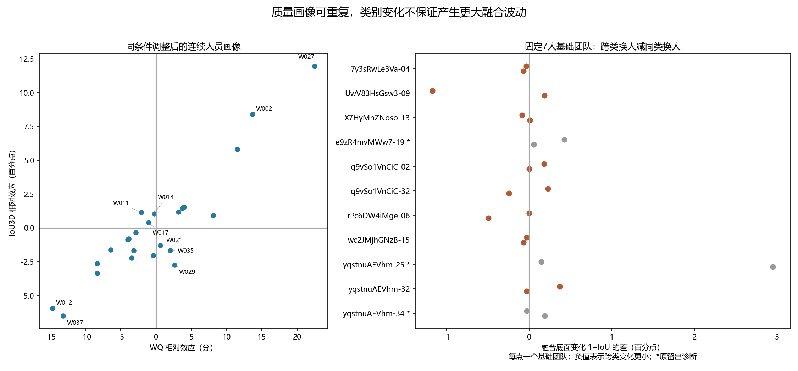

# 人员质量画像与固定团队换人研究

> 2026-10-15接续说明：本报告959份为前阶段面板；剔除新增范围待核28份后的当前主画像为931份，见[四轴更新](../worker_four_axis_update_20261015/README.md)。836份同目标子集与931份用途不同；同房研究现已启动。 当前统一状态见[资料核对](../../docs/thesis_main/四线程成果与论文主线核对_20261015.md)。该句原属文档整理阶段；后续已获授权并完成描述统计，当前版本见统一状态入口。


2026-10-15。已接入WQ-LS08-20261014工作指标，完成24人连续画像、相对粗类与固定基础团队的一人替换实验。**质量画像能解释部分跨建筑作答差异，但“换入较高质量类别”并不保证改善融合，“跨类替换”也不必然比同类替换造成更大波动。具体成员与基础团队仍有作用。**

本轮承接用户最新目标：寻找可解释、合理的人员分类，研究不同真人组合对标注变化及不确定性的作用。用户希望组合差异明显，但不以获得显著差异或某类收敛作为筛选标准。分类数、切点、固定人数设计是本轮明确记录的研究选择，不是用户已选定的唯一方案。分析前定义及缓存检查后的补充设计见[DESIGN.md](DESIGN.md)。

## 实际接入分母

|材料及用途|份数|处理|
|---|---:|---|
|旧人员条件分项材料|1179|962完整＋217仅底面|
|新联合质量比较|1145|与旧材料相交962；另183属于Semi、门洞、严重例外或历史层|
|普通完整几何交集|962|身份、数值与实际参考几何均核对一致|
|其中参考待定|3|保留记录，暂缓人员主画像|
|本轮连续质量画像|959|24人、114图、115个实际参考单元、21栋建筑|
|楼外相对作答预测|940|19份无同单元同伴，不进入该预测分母|

完整[绑定审计](binding_audit.csv)保留两表并集1362份的去向。本轮完整画像的参考来源为574份冻结参考、290份唯一现存完整参考的条件绑定、95份既有路由。条件绑定不等于新人工认证。217份仅底面没有被补成完整WQ；N05/N28的新底面也未被当作完整顶底参考。

输入使用`load_current_bundle()`。当前3441对象的完整data字典与评分归档快照一致；旧分项所用路由几何与评分归档也逐字段一致。融合输入另从当前loader重新投影和准备，与12图原输入快照完整比较一致，包含实际点、环序和来源。参考比较使用底部与顶部实际坐标，允许环起点及方向等价；同ID不代替几何版本检查，不同ID也不自动拆开等价单元。未处理共线插点等更宽泛的几何等价，避免掩盖现用IoU的表示敏感性。

## 人员画像及候选粗类

在同图、同采集条件、同实际参考单元内消除任务截距，再估计人员相对效应。它比各人不同任务的均分更适合当前不均衡覆盖，但仍是本面板的加性描述，不是纯能力或人员与图片噪声已被分离。

WQ相对效应零线上下形成10人相对较高、14人相对较低的粗类候选。没有均分人数、五档映射或目标图调切点；保留原连续量。最低支持为6个有同伴单元、3栋建筑。每个目标建筑评价均重新排除整个建筑拟合。

|预测目标|表达|建筑等权相对误差下降|合并平方误差下降|改善建筑|
|---|---|---:|---:|---:|
|WQ相对作答表现|连续画像|26.53%|18.60%|15/21|
|WQ相对作答表现|零线粗类|19.07%|13.40%|14/21|
|同参考IoU3D相对表现|连续画像|11.45%|4.66%|14/21|
|同参考IoU3D相对表现|零线粗类|9.03%|0.76%|12/21|

基线为相同可评价同伴集合内不区分人员的零预测。这里是相对作答预测，不是融合改善或分类正确率；两个指标的误差下降也不能证明WQ测量更准确。评分本身使用过现有开发资料，楼外隔离仅针对本轮人员画像，不把整个测量系统称为独立验证。

50次互斥建筑两半校准，WQ方向一致率的逐次中位数86.96%，IoU为69.57%。重复划分复用同一批数据，不是50批独立人员。W014、W017、W030的WQ方向一致率分别约11.9%、40%、26%；W021在完整训练中够支持，但两半均够支持的次数为0，不能把缺失记成稳定。候选标签及支持见[profiles.csv](profiles.csv)，目标建筑外名单见[fold_profiles.csv](fold_profiles.csv)。这些边界人员应保留连续值与不稳定说明，不能定成永久类型。

## 哪些轴提供不同信息

同条件调整后，WQ与IoU人员效应的秩相关为0.787，24人中6人的相对零线方向不同：W011、W014、W017、W021、W029、W035。与旧报告的三分位换档数不同，是因为本轮模型、参考暂缓范围和分组规则均明确重建。

已有时间轴与WQ效应的秩相关为0.374，比较限于21名时间支持充足者。时间可以保留为行为轴；慢不等于认真，快不等于低质。这是不同信息的线索，尚未证明时间有独立的增量预测效益。

本轮还试算`log(1+高度损失)−log(1+底边及方向损失)`。它与WQ人员效应相关0.975，现有证据不支持把它当成一套独立的新类型。正值可以由底边/方向损失更小产生，不表示这个人绝对高度更差。原始底边、方向、整体高度、局部高度和有符号高度比画像仍保留；当前没有足够语义证据把这些量命名为范围偏好、简化型或粗心型。全部比较见[axis_correlations.csv](axis_correlations.csv)。

## 固定基础团队的一人替换

复用12图已保存的冻结自动融合子集，参数为MV50、gap=7.5，输入和核心算法不改。缓存中共同24人图在3人及23人有一人替换对照，8人和16人没有。为补足中等规模比较，每张人数足够的图从原随机顺序前两条各取前7人为基础团队，分别加入所有其余人员；选择不读取目标质量或类别。11图共22个基础团队，24人图每个基础团队有17个加入者，23人哨兵图有16个。

仅补算350个缓存缺少的8人子集，状态保存在[new_states](new_states)。22个基础团队共372个不同8人团队、2960个一人替换对。结合旧3人及近全员等对照，共642个实际团队、4076个替换对；这些对共享成员，不能当作4076个独立样本。人数6的哨兵图只使用已有3/5人缓存。

|642个实际团队的评分去向|数量|
|---|---:|
|具备固定完整参考并成功评分|348|
|没有已绑定的完整参考|285|
|已有完整参考但融合不完整|9|

348个数值中110个属于原留出诊断，主用途候选中的完整数值为238。原留出涉及e9z-19、yq-34及新增哨兵yq-25，均未用于人员画像训练。4076个替换对中1055个涉及原留出；余3021个保持当前用途。参考固定沿用已有终点绑定作条件比较，未按子集最高Q挑参考，也不将终点绑定视为每个子集已经完成人工空间认证。缺完整参考时仅观察原作答分歧与可用底面波动。

质量未绑定与几何失败是不同列：Uw-09在本轮34个8人团队中仅25个底面完整；全部642个团队中，Uw有25个、rPc有1个底面不完整。uNb-36的9个完整评分失败仍保留。结果均值只在对应可评价集合上计算，见[团队分母](team_coverage.csv)、[团队评分与状态](cached_team_scores.csv)及[逐次替换](replacement_pairs.csv)。

### 跨类替换没有一致更大的波动

排除原留出诊断后，8图、16个固定基础团队可比较WQ同类/跨类替换。只有5/16个基础团队的跨类融合底面变化更大；按每图两个基础团队等权，2/8图更大、6/8图更小。这里没有检验总体显著性；Uw等失败造成条件分母不同，失败数量随比较保留。

“原作答平均两两差异的变化”与“融合底面1−IoU变化”分别输出。换人会同时改变具体成员与类别，不将观察差异解释成类别的因果效应，也不由跨类更小就反向认定混合必然更好。相同基础团队的全部对照见[matched_base_comparisons.csv](matched_base_comparisons.csv)。

### 较高质量成员的融合收益依赖基础团队

8人实验中，非原留出且有固定完整参考的仅4图、8个基础团队、136个团队。比较加入相对较高与较低WQ成员后，融合WQ均值之差如下；每个基础团队的全部17名候选均参与。

|图片|基础团队一|基础团队二|
|---|---:|---:|
|7y-04|+0.072|+0.198|
|X7-13|−0.169|−0.367|
|q9-02|+3.613|−0.939|
|wc2-15|−0.706|+0.184|

基础团队按表中保存的成员串排序，不根据结果命名。8个基础团队中4正4负；q9-02同一张图仅更换基础团队，方向就不同。粗类解释的加入者间融合WQ变异比例中位数约1.74%，最高约20.31%；这是固定基础团队内的描述性组间比例，不是交叉验证预测率。连续人员效应与融合WQ的秩相关也逐基础团队报告，不能用单个总体均值掩盖方向变化。见[逐加入者结果](fixed_base_entrants.csv)及[连续与粗类对照](fixed_base_associations.csv)。



图左显示全部24人，仅标注部分人员；图右每点为一个固定基础团队，灰色原留出诊断与开发用途分开。

## 下一步人员研究的方向

目前有依据保留“连续质量画像＋相对粗类候选＋时间行为轴”，没有依据把高度/底边损失比例再包装成独立类型。下一步应先沿已保存的同一成员集合比较后续两版质量指标，检查人员方向和团队结论是否改变；不需要重算融合。

本轮结果提示，值得优先解释的是同类内部哪些具体成员会改变哪些局部结构，以及相同加入者为什么在不同基础团队中产生不同结果。可从已保存的q9-02两组基础团队回溯固定算法的对应、半数票和连接变化，再判断是否存在跨图可重复的行为依据。一个图上的局部表现不足以命名新人员类型；后续细分仍应在目标建筑外建立，不能按该图融合收益反选人员。

完整质量组合证据目前集中于4张非原留出8人图。扩大这一结论的首要条件是补齐其他现有图的固定完整参考及范围绑定，而非继续随机堆积同一图的团队数。N05/N28的顶界和逐作答范围绑定由上游质量工作处理；本轮可用部分已完成，无需用户重新回答历史已明确事项。16人一人替换尚未补算，同房预测及新数据继续后置。

## 复现与交付边界

```powershell
D:/anaconda/python.exe -B -m tools.thesis_main.analysis.worker_wq_integration_20261015
D:/anaconda/python.exe -B -m pytest -p no:cacheprovider tests/test_worker_wq_integration_20261015.py tests/test_worker_classification_progress_20261014.py tests/test_wall_consensus_population_20261014.py -q
```

工具：[worker_wq_integration_20261015.py](../../tools/thesis_main/analysis/worker_wq_integration_20261015.py)。字段、单位与缺失含义见[FIELD_CONTRACT.json](FIELD_CONTRACT.json)，机器摘要见[SUMMARY.json](SUMMARY.json)，最后验证见[VERIFICATION.json](VERIFICATION.json)。评分引擎从已审查归档按原字节临时加载，运行后临时文件自动清除；本目录的新状态是复用依据，不是检查截图。

只新增本目录、专属工具和测试。正式资格、源作答、GT、WQ参数、融合核心及历史输出均未改；无git提交或推送。已检查公共地图和索引，依共享仓库分工不直接修改，建议统筹新增本README入口并将人员状态更新为“WQ工作版已接入，959份画像与固定基础团队替换已完成，分类及完整参考推广仍有限”。统一模型与合同不由本模块静默改写。

未重做原始时间审计、质量调参、全库融合或全仓测试。保留当前评分测量局限、未绑定完整参考、边界人员不稳定和有限基础团队覆盖，不宣称已得到天然人员类型或通用选人策略。
