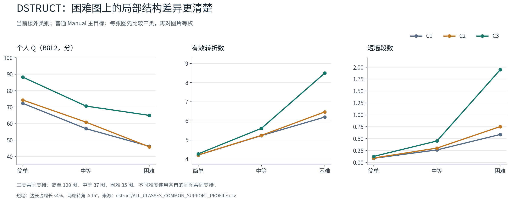
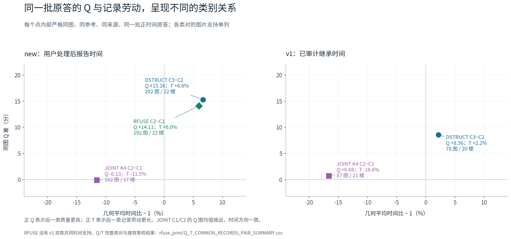

# HOHONET v2.1 当前类别：原答标法、质量劳动与团队混合

版本：`current_class_interpretation_20261104`。数据及已有结果冻结源：`48a2fc6aedd51cd701b1bce06c02bd3ef92ec75b`。本报告接续人工融合顺序验收，完成当前类别的解释层。

## 核心结论

**当前 DSTRUCT、RFUSE 和 JOINT 已有实质解释价值。本轮最需要补的确实是同图原答画像、同源共同 Q/T 与既有团队结果之间的连接；这些补充现已完成，无须为完成这层解释新增一轮分类选型或大规模 Q/T 选队。**

三条可以直接采用的研究发现是：

1. **DSTRUCT 组织了困难图上的结构保留差异，并联系到楼外位置误差和质量。** 当前 K3 的 C3 相对 C2，在 205 张主目标 Manual 共同图中 Q 高 14.178 分，188 图为正。困难图上平均多 2.149 个转折、1.248 段短墙。new 来源同一批正时间原答中，Q 高 15.262 分，几何时间比为 1.0663，质量优势并不对应同等幅度的劳动增加。
2. **RFUSE 的融合响应类别能接回实际原答行为。** 较高困难结构响应类在楼外原答中 Q 更高、位置和高度误差更小。new 内部困难图上平均多 2.747 个转折、1.797 段短墙，31/32 图的转折差为正；简单图大多转折数量相同。这个结果给“响应角色”提供了原图上的人员含义。
3. **JOINT 提供了单纯按 Q 排序不能概括的质量—劳动画像。** K4 的 C2 相对 C1，在 new 162 图中 Q 仅差 −0.133 分，时间比 0.8847；v1 87 图中 Q 差 +0.678 分，时间比 0.8340。质量图均值接近而劳动不同的关系确实存在。其他类对还显示较长劳动的质量回报随来源和成员条件变化。

进入团队后，类别比例、具体成员和共同背景都有观察到的作用。相同既有团队的 174 个共同面板上，DSTRUCT、RFUSE、JOINT 的配比间 Q 方差份额分别为 15.063%、7.482%、12.575%（K3）及 14.395%（K4）；同配比成员仍带来更大的总体波动。两类作用可以同时成立。

**成果入口：** [交互研究台](workbench/index.html)、[逐类总表](basis/CLASS_ORIGINAL_TEAM_TABLES.md)、[完整原图图册](examples/index.html)、[方法与分项定义](METHODS_AND_METRICS.md)。所有数值、支持与来源可在 CSV 中逐项追溯。

## 1. 本轮实际完成的工作

### 数据和版本

普通原答主分析库存为 7,703 条：Manual 主目标 6,512、其他合法目标 227；Semi 主目标 960、其他目标 4。主目标与其他合法目标的正式 Q 分项分别通过 `object_id + reference_id + reference_version` 精确连接，7,472/7,472 与 231/231 全部匹配。画像使用每个目标建筑对应的楼外标签，保留指标自己的缺失和可评支持。

原答坐标和预处理使用当前有效数据束，不直接从原始像素重建另一套几何。当前 v2.1 参考、绑定和难度保持原定义；原图仅用于对应的全景显示。57 组人工连接仍属于定向团队辅助病例，F2/F9 坐标候选保持单列。本轮个人画像没有把团队辅助连接当成个人质量改善。

### 新增交付

- 五个既有分区的人员、容量和建类合同：DSTRUCT K2/K3、RFUSE GEOM K2、OPPJOINT K3/K4。
- DSTRUCT 主画像，以及 RFUSE/JOINT 原答和分项画像；同图、难度、来源、建筑等权和类内分布完整保留。
- **283 个同记录同源 Q/T 条件汇总**，覆盖可用方法、类对、方式、目标范围和难度。
- 三体系 **12 个当前主要类别**的“类别—原答—团队效果”矩阵；K2 的粗分结果另有完整原答表。
- **2,084 条既有团队条件与指标记录**，串联严格 ABC、直接 AC、同房、纯类、联盟、配比、成员和背景。
- 4 张完整原图，92 个典型展示位及一个近共线诊断附例，共 39 个不同原答对象；16 幅主板和 1 幅近共线对照板。第 10 批新增 JOINT K4 的 28 个展示位和 4 幅板，原三种分区的选例保持。
- 可离线打开的图册、交互研究台、科研 PNG/SVG、可复现脚本、来源索引及逐条采用判断。

新增计算集中于这些必要的描述统计和既有面板重聚合。新增分类拟合、评分、融合及抽取团队均为 0。

## 2. 当前类别怎样标：先区分分类依据和观察结果

| 体系 | 当前采用位置 | 直接建类依据 | Q/T 是否直接进入 | 本轮补充的解释 |
|---|---|---|---|---|
| DSTRUCT K3，K2 粗分 | 普通 Manual 前向行为分类 | 原答结构水平与困难响应；含参考未匹配比例 | 否 | 楼外实际标法、位置、高度、Q 与劳动 |
| RFUSE GEOM K2 | 反向融合响应解释 | 实际自然团队的结构与边界/尺度响应系数 | GEOM 输入不直接包含 Q/T；完整训练输出门槛间接依赖 Q 可用 | 响应角色对应怎样的原答，以及实际团队效果 |
| OPPJOINT K3/K4 | 结构、边界、Q/T 联合画像 | 原答几何机会响应，Q 历史及同源 logT 历史 | 是 | 楼外同图同源的行为、质量与劳动关系 |

类别编号来自每一折的训练中心排序。DSTRUCT 按困难结构中心排序；RFUSE 按困难融合结构响应排序；JOINT 按训练 Q 残差中心排序。JOINT 的 C1/C2/C3/C4 不能永久翻译成某几个固定角色。`ALL` 人员名单只作全历史描述，某张图片的实际人数和成员由该楼外折决定。

当前 `ALL` 中 DSTRUCT K3 为 10/37/12 人，另有 3 人历史不足；RFUSE 为 55/4，另 3 人未知。RFUSE 的 C2 在实际所有楼外折累计涉及 7 人，每折 4–6 人；累计人数也不等于每张图容量。完整人员名单和每池容量见 [basis/README_ZH.md](basis/README_ZH.md) 与 [逐类矩阵](basis/CLASS_ORIGINAL_TEAM_MATRIX.csv)。

## 3. DSTRUCT：区别主要在需要局部结构时显现

### 3.1 同一批 201 张图的三类原答

下表为主目标 Manual 的三类共同支持，22 栋建筑。每张图内先算类别均值，再对图片等权。

| 指标 | C1 | C2 | C3 |
|---|---:|---:|---:|
| Q：B8L2，分 | 64.965 | 66.913 | 80.971 |
| 有效转折数 | 4.742 | 4.794 | 5.253 |
| 短墙段数 | 0.206 | 0.246 | 0.503 |
| 近共线点数 | 0.060 | 0.024 | 0.015 |
| 匹配边界绝对偏差，度 | 1.856 | 1.730 | 0.941 |
| 底面 IoU | 0.822 | 0.834 | 0.909 |
| 底边位置误差，度 | 2.177 | 1.964 | 1.006 |
| 内在方向误差，度 | 5.597 | 5.363 | 3.026 |
| 全局高度相对误差 | 3.72% | 3.32% | 1.62% |

这些差异说明，结构保留较多的 C3 同时具有较好的参考匹配、位置与高度表现。C1 和 C2 的 Q 接近，三类不需要都形成等间隔的质量等级。近共线点总体很少，属于需要展示和解释的局部特征，不能夸大成当前人群的主导问题。

类内差异仍然可见：各图内个人 Q 的 P25/中位数/P75 再按图等权，C1 为 59.078/65.688/71.505，C2 为 58.720/67.761/76.070，C3 为 75.586/82.631/88.288。完整分布与逐对象数值随表保存。均值较高不是每个成员在每张图上都更好。

### 3.2 困难响应

在 C3−C2 的两类共同支持上：

| 难度 | 图数 | Q 差，分 | 转折差 | 短墙差 |
|---|---:|---:|---:|---:|
| 简单 | 130 | +13.943 | +0.058 | +0.033 |
| 中等 | 38 | +9.929 | +0.360 | +0.146 |
| 困难 | 37 | +19.368 | +2.149 | +1.248 |

因此全体均值中的约半个转折差，实际上集中体现于困难图的局部结构。结构分类解释的是“面对更多结构机会时怎样响应”，并非所有图都多画几个点。

在同一人员、同一楼内都有简单和困难作答的补充中，C3 相对 C2 的困难响应额外增加 **2.330 个转折**，15/15 楼为正；短墙额外增加 **1.351**，13/15 楼为正。Q 响应平均增加 **5.235 分**，9/15 楼为正。结构响应比 Q 响应更一致，这与融合和评分还受位置、方向及参考条件影响相容。

来源：[DSTRUCT 报告](dstruct/REPORT_ZH.md)、[同图所有类对](dstruct/SAME_IMAGE_PAIR_SUMMARY.csv)、[同人同楼难度响应](dstruct/SAME_PERSON_DIFFICULTY_RESPONSE_SUMMARY.csv)。三类共同支持 201 图与两类共同支持 205 图分别保留，不共用分母。

## 4. RFUSE：把反向响应角色接回原图标法

RFUSE 的两类在 192 张共同图片上的 Q 为 68.126 与 82.063。C2−C1 平均 **+13.937 分**，175/192 图为正；建筑等权 **+15.171 分**。二维 IoU 高约 0.0807，三维 IoU100 高 9.340，匹配边界绝对偏差低 0.849°，底边位置误差低 1.064°，遗漏面积比例低约 0.0545。质量差由多个原答分项支持。

由于较高响应类在本次原答支持中来自 new，进一步在 new 内部比较：简单图的转折差只有 **0.086**，126 图中 108 图转折均值相同；困难图转折差 **2.747**、短墙差 **1.797**，转折 31/32 图为正。较高响应角色的原答特点可以表述为“在困难局部结构上保留较充分，并有更好的位置与参考覆盖”。

同一批正时间原答的 192 图中，Q 差 **+14.106 分**、几何时间比 **1.0596**。这提供了融合响应类别与个人标法、质量、劳动之间的实际连接；不能仅凭 ALL 的四人名单推断每张图都能组成同样人数的该类团队。

来源：[RFUSE/JOINT 报告](rfuse_joint/REPORT_ZH.md)、[同图分项与方向](rfuse_joint/SAME_IMAGE_PAIR_SUMMARY.csv)、[完全共同 Q/T](rfuse_joint/Q_T_COMMON_RECORDS_PAIR_SUMMARY.csv)。

## 5. JOINT：质量与劳动的关系有多种形式

JOINT 使用历史 Q/T 建类，所以历史中心不同本身是其定义的一部分。本轮关注目标楼外、同图同参考同来源原答的实际表现。

每个方法自己的全类共同图片上，JOINT K3 的 Q 为 **67.227/66.513/80.031**（194 图），K4 为 **67.452/67.959/68.870/82.148**（164 图）。前几类没有形成一致的逐级 Q 阶梯，这为联合画像保留了空间。

下表每一行的 Q/T 都来自同一批正时间原答：

| 类对 | 来源 | 图/楼 | Q 差，分 | 几何 T 比 | 观察到的关系 |
|---|---|---:|---:|---:|---|
| K4，C2−C1 | new | 162/17 | −0.133 | 0.885 | Q 图均值接近，后一类记录劳动约少 11.5% |
| K4，C2−C1 | v1 | 87/21 | +0.678 | 0.834 | Q 图均值接近，后一类记录劳动约少 16.6% |
| K3，C3−C2 | new | 192/22 | +15.349 | 0.872 | 较高 Q 伴随较少记录劳动 |
| K3，C3−C2 | v1 | 50/15 | +10.661 | 1.611 | 较高 Q 伴随较多记录劳动 |
| K4，C3−C2 | new | 143/21 | −4.171 | 2.949 | 更长记录劳动，Q 图均值较低 |
| K4，C3−C2 | v1 | 49/14 | +9.097 | 3.684 | 更长记录劳动，Q 图均值较高 |

这张表支持三个有用的解释：类别可以在 Q 接近时区分劳动；较高质量有时与更快同时出现；长记录劳动的质量回报存在来源和成员条件。无需把反向条件删除，也无需因此取消其他条件中已观察到的关系。

这里没有作统计等效性声明。“Q 接近”指明确列出的均值差较小；建筑等权、正负图数、全部类对及分位区间在原表中保留。时间是合法来源的记录劳动，不是重新回放日志得到的净专注时间。

来源：[全部 283 个共同 Q/T 条件](rfuse_joint/Q_T_COMMON_RECORDS_PAIR_SUMMARY.csv)、[逐图 Q/T](rfuse_joint/Q_T_COMMON_RECORDS_IMAGE_PAIRS.csv.gz)。

## 6. 原图与完整标注已经补齐

图册使用 GitHub Release 的原始 PNG，坐标来自当前有效原答。三张主图按原 DSTRUCT K3、RFUSE K2、JOINT K3 全部类别的最小人数覆盖优先选择，再按人数和图号确定，不看 Q/T；每类取结构与位置特征最接近类中位数的两人。另有一个跨楼附例。第 10 批将 JOINT K4 接入相同图片和同源候选组，保持原选图结果；各类至多两人，C3 本图只有 W121 一人时全部展示。

| 图片 | 当前难度 | 用途 | 具体观察 |
|---|---|---|---|
| `jtcxE69GiFV-10` | 简单 | 同楼简单主图 | 典型原答都可为 4 转折，Q/T 与边界位置仍有差别 |
| `jtcxE69GiFV-09` | 中等 | 同楼中等主图 | 全部典型均为 4 转折，位置和高度分项仍有差别 |
| `jtcxE69GiFV-26` | 困难 | 同楼困难主图 | DSTRUCT C3、RFUSE C2、JOINT C3 的典型原答保留 8 转折、3 段短墙；其余典型 5–6 转折、0–1 段短墙 |
| `yqstnuAEVhm-01` | 中等 | 跨楼附例 | 同为 8 转折、2 段短墙时，边界位置与 Q 仍可不同 |

图册现分别展示 DSTRUCT K3、RFUSE K2、JOINT K3 和 JOINT K4。K4 每图 C1/C2/C3/C4 展示人数为 2/2/1/2，新增 28 位，其中 23 个原答已在其他分区展示，5 个为新增独立原答。K4 原图使用既有有效坐标、楼外标签和同参考分项；[补充报告](examples/JOINT_K4_SUPPLEMENT.html)完整披露四图容量与个人 Q/T。附加 W114/W116 近共线对照中，两者同为 6 对点，W114 有 1 个近共线点、5 个有效转折，W116 则有 6 个有效转折。该附例因特征存在性而选，明确与主典型选样分开。

每个展示位保留完整上、下边界和原顺序、当前参考、底面投影、短墙与近共线标识、Q/D10 和质量分项、个人记录时间、工号和对象身份。39 个独立对象的有效坐标、结构计数和参考绑定已核对；全景边按球面关系绘制，接缝不误连。

K4 困难图中，C4 两例保留 8 转折、3 短墙；C1 两例为 9/6 转折、各 1 短墙，C2 为 5/6 转折、各 1 短墙，C3 唯一成员为 4 转折、0 短墙。结构表达、位置精度和记录劳动因此可以在同图分别观察；第 5 节 K4 总体 Q/T 的数值与共同支持保持原值。

来源：[离线图册](examples/index.html)、[选样规则](examples/SELECTION_RULE.md)、[逐图说明](examples/README.md)、[全部展示对象](examples/SELECTED_RECORDS.csv)。例图用来解释可观察现象，总体差异由前述同图统计支持。

## 7. 差异进入共识以后，改变了什么

### 严格 ABC 的实际含义

当前合法 DSTRUCT 14 人换 7 人的辅助版中，146 个三端共同 Q 事件、69 图、20 楼：同类换人幅度 **4.200 分**，对称跨类幅度 **7.641 分**，跨类额外幅度 **+3.441**，50/69 图为正。实际方向 `C−B` 为 **+6.712 分**，65/69 图为正。

转折额外变化却在 **54/69 图为零**。分项中边界、方向、高度、遗漏和延伸仍有变化。因此原答结构倾向进入共识后，可以表现为位置或方向更一致，而不必每次改变转折总数。

20/7 是 35% 替换，其对称额外变化 **+2.460 分**，38/53 图为正；`C−B` 的两端支持为 54 图，均值 **+4.214**。这是不同支持和不同替换比例的条件，不合成另一个 50% 结果。

### ABC 是一层证据，原答与其他团队设计也各有作用

RFUSE 直接 AC 的 20/4 条件在 82 图、21 楼中平均 **+2.934 分**，77 图升、5 图降；当前同房 10/5 在 3 图对、1 楼的六端支持中，对称额外变化 **+6.772**，`C−B=+17.569`。按实际研究范围采用这些发现。

JOINT K3 的直接 20/10、1→2 在 82 图中均值 **+0.297**，但平均绝对变化 **3.282**，42 图升、40 图降。平均方向抵消并不说明融合没有响应。它的完整联盟 1→1+3 又在 177 图中平均 **+4.455**，153 图为正，表明不同混合条件确有不同结果。

版本上，当前 DSTRUCT 的主结论来自已核语义合法的 ABC 和当前标签重聚合。旧 TARGET AC 有 34 个人员×楼外折标签与当前不同，保留为冻结历史设计证据；RFUSE/JOINT 的 AC 覆盖折与当前一致。完整事件和标签对应见团队报告与 basis 表。

来源：[团队完整报告](team_effects/REPORT_ZH.md)、[严格 ABC 当前指标](team_effects/STRICT_ABC_CURRENT_METRICS.csv)、[直接 AC](team_effects/DIRECT_AC_EXISTING_CONDITIONS.csv.gz)。

## 8. 模拟混合类型人群：比例、成员与背景各自起作用

### 8.1 真正相同团队的配比分解

四种分区均完整覆盖 924 支已存在团队的 174 个面板，32 图、21 楼。Q 有效支持为 159,655 队次；不是 159,655 张独立图片。

| 分区 | Q 配比间份额 | 转折份额 | 短边份额 | log 记录劳动份额 |
|---|---:|---:|---:|---:|
| DSTRUCT K3 | 15.063% | 23.796% | 18.116% | 19.776% |
| RFUSE K2 | 7.482% | 15.683% | 13.672% | 26.584% |
| JOINT K3 | 12.575% | 23.859% | 18.493% | 32.490% |
| JOINT K4 | 14.395% | 24.502% | 18.701% | 37.815% |

时间另有 130 面板、31 图、21 楼、116,966 个同源有效队次。先汇总方差再求份额，完整分母和原始方差在表中。它们是有限面板的描述，不是分类准确率；K4 更细的分区本身也会影响份额。

这张表支持：结构分类的区别继续进入团队结构和 Q；反向响应角色与实际团队输出及劳动有联系；联合画像组织了更多记录劳动的差异。同时，DSTRUCT 共同面板的配比间 Q 方差为 **5.738**、同配比成员方差 **32.355**，两部分都应解释。

### 8.2 具体成员和困难条件

已有 JOINT K4 的 `pa4otMbVnkk-18`、n=20 案例中，六种配比的 Q 均值相差 **10.041 分**；某一固定配比内部的 126 队，SD 可达 **14.598 分**、P05/P95 为 54.541/88.723。比例改变平均输出，成员决定同配比内的广泛波动。

DSTRUCT 全部当前主目标有限面板中，简单图的配比间/配比内 Q 方差为 **1.081/5.496**，困难图为 **14.758/81.682**。两部分都扩大十余倍，方差份额接近不等于类别作用没有增强。

### 8.3 纯类、联盟、全员和背景

主目标无未知背景的 205 张共同可评图中，**169 图至少有一支纯类队优于全部已分类人员合并队**，36 图合并队更好；全类减事后最佳纯类的平均差 **−6.051 分**。这是对完整组合的观察，不等于事先已知哪支纯类最好，也不意味着任意纯类都好。

RFUSE 完整联盟 1→1+2 平均 **+1.517 分**，157/191 图为正；JOINT K3 的 2→2+3 为 **+5.694**，130/146 图为正。完整联盟含人数增加，与固定人数换类分开解释。

固定替换块再扩大背景也有实际条件：RFUSE m=4、n=20→31 的替换效应阶差 **−1.667 分**，49/55 图阶差为负；JOINT K3 的 1→3、m=7、n=20→28 为 **−1.254**，40/49 图阶差为负；JOINT K4 的 1→2 同条件均值 **+0.014**，40 图正、36 图负。这里的阶差表示有符号的 Q 效应随背景增加如何变化，负值不自动表示每张图的绝对变化幅度缩小。背景对一次换人的影响需要按具体方向与条件解释。

### 8.4 同房重复性

当前 DSTRUCT 同房 10/5 有 318 个六端共同 Q 事件、19 图对、7 楼；`C−B=+10.331`，19/19 图对均值为正，18/19 两视角同时为正。更广的同房配比分解中，结构和记录劳动的跨视角一致性比 Q 更清楚。例如 DSTRUCT 配比效应的转折相关约 **0.371**、记录劳动相关 **0.549**，Q 相关 **−0.052**。具体视角的几何误差会进一步影响 Q，不能要求所有指标同步重复。

来源：[共同团队全部指标](team_effects/COMMON_COMPLETE_PANEL_METRICS.csv)、[配比与成员波动](team_effects/MEMBER_VARIATION_DISTRIBUTIONS.csv)、[联盟与背景](team_effects/EXISTING_COALITIONS_MEMBERS_BACKGROUND_Q.csv.gz)、[同房](team_effects/SAME_ROOM_STRICT_ABC_CURRENT.csv)。其他合法目标、Semi 及冻结历史设计在完整报告中单列。

## 9. 逐条采用判断

| 研究表述 | 判断 | 本轮采用口径 |
|---|---|---|
| 当前分类能解释不同标注行为 | 保持并补齐依据 | 用同图原答、完整原图、楼外 Q/T 和难度响应支持 |
| DSTRUCT 主要区分结构保留 | 保持并扩充 | 困难局部结构差异清楚，同时联系位置、高度及 Q |
| 三类必须对应低、中、高质量三级 | 需改写 | C1/C2 Q 接近；联合画像也不是稳定的逐级质量阶梯 |
| RFUSE 只体现建类时的响应指标 | 需改写 | 已接回楼外原答和实际团队条件，形成完整解释链 |
| Q 接近但劳动不同可以成为类别价值 | 保持，已有数值 | JOINT K4 C2/C1 在两种同源共同支持中均出现 |
| 较长劳动统一得到更高质量 | 条件变化 | 依据来源、具体类对和同记录 Q/T 报告 |
| 跨类替换平均产生更大 Q 变化 | 保持，附当前幅度 | DSTRUCT 14/7 为 +3.441，50/69 图为正；幅度与方向分列 |
| ABC 是分类解释性的唯一标准 | 需改写 | 原答差异、几何响应、劳动、联盟和成员波动各有证据用途 |
| 配比与成员均会改变混合结果 | 保持并补共同支持 | 相同 174 面板给出配比间/内方差；成员波动仍大 |
| 困难图只是方差比例不变 | 需改写 | 同时报绝对方差，类别与成员两部分都明显扩大 |
| 更多人或全类混合统一改善结果 | 条件变化 | 纯类、联盟、固定块背景分别给出具体方向和支持 |
| 原有 Q/T 选队因本轮画像而必须重算 | 保持现有结果 | 本轮没有改变其必要输入，不扩充选队实验 |
| 当前新分类能直接指导进入顺序、节约总劳动 | 尚不能判断 | 这是另一项应用主张；旧角色策略保留原身份，本轮不据画像替代策略结果 |

完整机器可读判断见 [CONCLUSION_LEDGER.csv](CONCLUSION_LEDGER.csv)。逐条判定约束的是具体表述，不用少数相反条件取消其他已有结果。

## 10. 对论文叙述的建议采用稿

> 本研究以个体原答的结构表达与困难响应、实际融合响应，以及质量和记录劳动的联合历史，建立相互补充的人员画像。在目标建筑之外形成类别后，同图原答比较显示，结构保留较多的类别在困难图片中表达更多局部转折和短墙，并具有较小的几何偏差与较高的质量；这些差异不必伴随同比例增加的记录劳动。联合画像还揭示质量均值接近而记录劳动不同，以及劳动回报随具体人群条件变化的情况。既有严格替换、完整联盟与固定人数配比结果进一步表明，类别构成能组织团队质量、结构和劳动差异，而具体成员与共同背景继续带来较大的波动。人群不确定性因此体现为可解释的行为倾向、类别比例与成员组合共同作用，而非单一质量等级或统一选员顺序。

正文中每个量化主张应紧接实际人数、支持图片/建筑及具体版本。

## 11. 复现与检查完成情况

必要检查已完成：精确对象—参考—版本连接；当前与历史标签身份；同图全类/两类支持；同源正时间及同记录 Q/T；相同 924 队共同面板及方差恒等式；原图、有效坐标、环顺序与结构计数；静态图完整性、相对链接和 JavaScript 语法。

原图图册与静态科研图已经目视检查。离线 HTML 通过本地链接和脚本检查；当前环境没有可用的浏览器运行时，未声称完成真实浏览器的交互测试。页面数据均内嵌，图册和图表无外网请求依赖。

本目录所有报告、脚本、CSV/JSON、PNG/SVG 和网页包含在第 08、09 批交付中。按仓库相对路径解压至 `D:/Work/HOHONET`，即可从原研究台或本目录 `workbench/index.html` 进入。详情见 [README.md](README.md) 与 [来源索引](SOURCE_INDEX.csv)。

### 完整来源引用

1. Sparkling-Flames（2026）. *3D_Manhattan_label / HOHONET v2.1: CURRENT_RESEARCH_BASIS*. GitHub 研究仓库，commit `48a2fc6aedd51cd701b1bce06c02bd3ef92ec75b`。[固定版本原文](https://github.com/Sparkling-Flames/3D_Manhattan_label/blob/48a2fc6aedd51cd701b1bce06c02bd3ef92ec75b/research/data/releases/v2.1/CURRENT_RESEARCH_BASIS.md)。
2. Sparkling-Flames（2026）. *build_target_aware_candidates.py*. HOHONET v2.1 当前目标感知人员特征与分类实现，GitHub，同上固定提交。[原始实现](https://github.com/Sparkling-Flames/3D_Manhattan_label/blob/48a2fc6aedd51cd701b1bce06c02bd3ef92ec75b/research/workers/personnel_v21_reselection_20261029/classification/code/build_target_aware_candidates.py)。
3. Sparkling-Flames（2026）. *recompute_v21_image_difficulty_20261030.py*. HOHONET v2.1 难度、标签与实际下游接续实现，GitHub，同上固定提交。[原始实现](https://github.com/Sparkling-Flames/3D_Manhattan_label/blob/48a2fc6aedd51cd701b1bce06c02bd3ef92ec75b/tools/thesis_main/analysis/recompute_v21_image_difficulty_20261030.py)。
4. Sparkling-Flames（2026）. *working_models.py: WQ-B8L2-20261015*. HOHONET 冻结质量函数实现，GitHub，同上固定提交。[完整函数与参数](https://github.com/Sparkling-Flames/3D_Manhattan_label/blob/48a2fc6aedd51cd701b1bce06c02bd3ef92ec75b/research/quality/quality_ab_feedback_handoff_20261015/prior_AB/src/working_models.py)。
5. Sparkling-Flames（2026）. *quality-original-images-20261015*. GitHub Release，项目原图资产。[Release 页面](https://github.com/Sparkling-Flames/3D_Manhattan_label/releases/tag/quality-original-images-20261015)。条目、CRC、原图 SHA-256 与本次对象对应见 `examples/ORIGINAL_IMAGE_RECEIPT.json`。

全部数值源表另列于 `SOURCE_INDEX.csv` 和各目录输入清单，包括确切路径、固定提交 URL、字节数及 SHA-256。本报告的新增统计由随附脚本从这些已保存数据计算。
