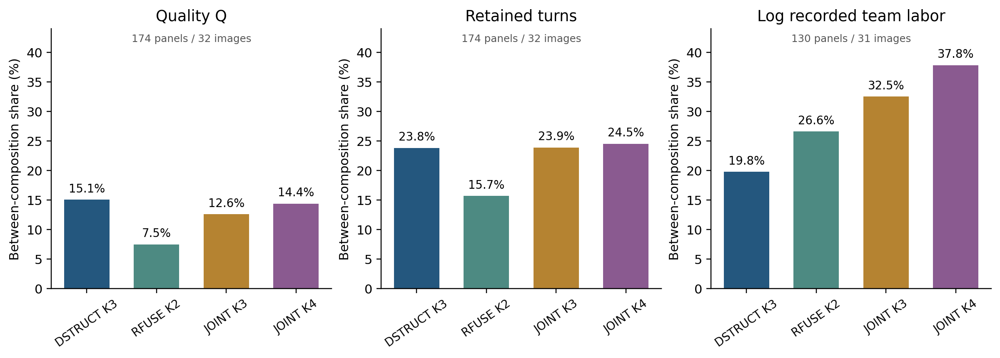
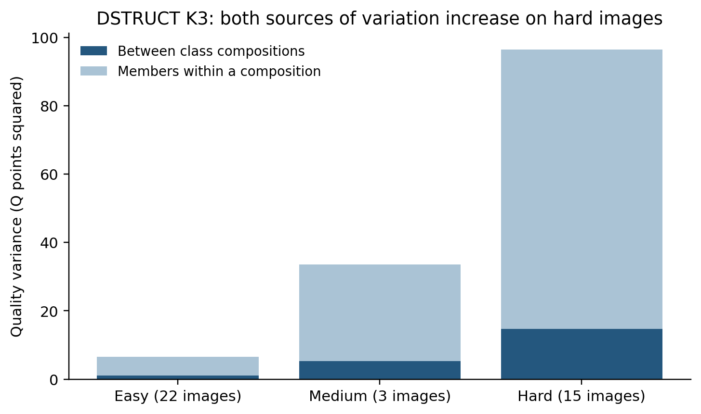

# 当前类别如何进入团队结果：DSTRUCT、RFUSE 与 JOINT 的现有证据整合

日期：2026-11-04。来源冻结提交：`48a2fc6aedd51cd701b1bce06c02bd3ef92ec75b`。本报告读取已保存端点、事件和统计，完成共同团队重聚合及解释；新增团队、融合、评分、分类拟合均为 **0**。

## 1. 核心判断

**现有结果已经足以说明：类别比例、具体成员和共同背景分别改变融合结果；三种分类能够提供互补解释，无须为了补这一解释层重新选型或扩充团队。** 最有用的补充是把同一研究对象上的质量、结构、位置尺度、劳动和输出状态放在一起，并让每项结论携带自己的支持范围。

- **DSTRUCT 的作用已经进入团队质量与结构。** 当前合法的 14 人换 7 人中，对称跨类变化平均比同类变化大 **3.441 Q 分**；50/69 张图为正。跨类方向的 `C−B` 平均 **+6.712 分**、65/69 图为正。有限团队中，类别配比同时组织质量、转折、短墙段和劳动差异；同配比成员仍解释大部分波动。这几项结果共同支持“类别有解释作用”，并不要求每张图或每个指标都更敏感。[严格 ABC](STRICT_ABC_CURRENT_METRICS.csv)、[共同团队](COMMON_COMPLETE_PANEL_METRICS.csv)
- **RFUSE 具有实际团队响应证据。** 直接 AC 的 20/4 条件中，82 图有 77 图平均升 Q、5 图下降，均值 +2.934 分；同房 10/5 条件也出现跨类额外 Q 变化。它的贡献是把原答特点同融合响应联系起来，而不是把训练时使用的响应指标再次列出就算验证。[直接 AC](DIRECT_AC_EXISTING_CONDITIONS.csv.gz)、[同房严格 ABC](SAME_ROOM_STRICT_ABC_CURRENT.csv)
- **JOINT 的平均方向接近零时，输出仍可能明显改变。** K3 的直接 20/10、训练 Q 秩 1→2，42 图升、40 图降，平均 +0.297 分，而平均绝对变化为 3.282 分。联合画像还组织了更多记录劳动波动，并且有明确的联盟方向和配比案例。这个结果适合解释人群混合的不确定性，不能压缩成“没有作用”。[直接 AC](DIRECT_AC_EXISTING_CONDITIONS.csv.gz)、[联盟及背景](EXISTING_COALITIONS_MEMBERS_BACKGROUND_Q.csv.gz)
- **困难图同时放大类别差异和成员差异。** DSTRUCT K3 的完整主目标有限面板中，简单图配比间 Q 方差为 1.081、配比内为 5.496；困难图分别为 14.758、81.682。困难图的方差占比没有明显升高，是因为两种差异都变大，不是因为类别差异消失。[难度分层](PRIMARY_COMPOSITION_ALL_METRICS.csv)
- **当前需要补写的是上述解释及版本衔接。** 已有 Q-only 五臂机会核对、AC 实际消费者补接、同房六端支持核对不在本报告中重新审计；原 Q/T 选队和旧策略也不重算。未来若要主张类别能指导进入顺序或分配劳动，再针对那项用途设计验证。[当前研究口径](../../../data/releases/v2.1/CURRENT_RESEARCH_BASIS.md)

## 2. 本报告使用的类别与实验身份

|体系|当前标签及解释位置|可直接接续的现有团队证据|版本边界|
|---|---|---|---|
|DSTRUCT|`TARGET_DSTRUCT_K3`；K2 为粗层。采用 `image_difficulty_20261030` 的当前楼外标签|当前合法严格 ABC、当前同房、当前固定团队配比、更新完整联盟|直接 AC 的既有 TARGET 设计使用冻结标签。K3 有 34 个人员×楼外折标签与当前不同；不能把其全部结果重新命名为当前类别效应|
|RFUSE|`RFUSE_GEOM_K2`；融合响应解释|当前固定团队配比、同房严格 ABC/配比分解；既有直接 AC、完整联盟、固定块背景|AC 覆盖的 22 个 LOBO 折与当前 RFUSE 标签一致，成员和端点仍保留原设计身份。旧严格 ABC 汇总保留其 2026-10-29 自动版日期|
|JOINT|`OPPJOINT_K3/K4`；历史质量、劳动与标法联合画像|既有严格 ABC、直接 AC、有限配比、完整联盟、成员及背景敏感性|本次图片难度更新未改变其输入标签。类别角色按训练历史 Q 秩解释，不能换成旧 V3 的“高质快/慢”等固定名称|

当前 DSTRUCT 与 RFUSE 的全历史展示名单不能直接代替目标建筑的 LOBO 名单。完整有限面板中的类数量包含固定背景 D 和被选择的六名成员，不能只数被替换的块。`OPPJOINT_K4` 比 K3 分组更细，配比间方差份额可以因分区细化本身增加；以下表格用于描述分类组织了哪些差异，不作分类器优劣排名。

本报告不把 `OPPSTRUCT`、`V21_DSTRUCT_RAW3_K3`、`V3_BEHAVIOR` 或 `V3_JOINT_QT` 改名为上述三种体系。普通 Manual 主目标、其它准入目标、Semi、门洞分别保留；本报告的横向共同团队比较仅为普通 Manual 主目标。所有数值来源路径、文件 SHA-256 与固定提交 URL 均在 [SOURCES.csv](SOURCES.csv)；AC 标签逐折衔接见 [AC_CURRENT_LABEL_CHECK_BY_FOLD.csv](../basis/AC_CURRENT_LABEL_CHECK_BY_FOLD.csv) 与 [逐人员对应](../basis/AC_CURRENT_LABEL_CORRESPONDENCE.csv.gz)。

## 3. 在相同已有团队中，类别比例组织了什么变化？

### 3.1 新补齐的共同团队比较

各方法原表的 `method_known` 支持不同：当前 TARGET/RFUSE 为 231 个面板、40 图；OPPJOINT K3/K4 为 182 个有效面板、38 图。只对齐图片或面板名称还不够：部分 JOINT 面板仅有部分队伍成员均可分类。

本轮因此取 **四种分区均覆盖完整 924 支已有团队的 174 个面板**，共 32 图、21 建筑。每个面板是固定背景与 12 人候选中选 6 人的完整有限集合。逐面板检查四种分区的团队数、各指标有效数和总方差完全一致；Q 有效 159,655 队次，形成/失败状态保留全部 160,776 队次。劳动单独保留 130 个面板、31 图、21 建筑、116,966 个同源有效队次。没有新增队伍，也没有把 924 个组合当成 924 张独立图片。[支持清单](COMMON_COMPLETE_PANEL_SUPPORT.csv)、[检查](CHECKS.json)

在每个面板内，按类别数量配置分组，将全部队伍的有限总体方差分解为“配比间”与“同配比成员间”两部分。沿原 `panel→pool→image→building` 等权层级汇总方差，再计算两者之比；不把每个面板的比例直接取平均。

|当前分区|Q：配比间占比|转折数：配比间占比|短转折边：配比间占比|log 记录劳动：配比间占比|失败状态：配比间占比|
|---|---:|---:|---:|---:|---:|
|DSTRUCT K3|15.063%|23.796%|18.116%|19.776%|11.375%|
|RFUSE K2|7.482%|15.683%|13.672%|26.584%|6.307%|
|JOINT K3|12.575%|23.859%|18.493%|32.490%|11.009%|
|JOINT K4|14.395%|24.502%|18.701%|37.815%|11.695%|

来源：[全部共同面板指标](COMMON_COMPLETE_PANEL_METRICS.csv)。Q 对应保存字段 `B8L2`。失败状态使用其完整登记分母，未把缺失 Q 填零。劳动是已记录人员劳动总和，不是融合运行耗时，也未包含本次未计时的人工排序。



这张表可以正面说明：DSTRUCT 的结构表达类别在团队转折、短段、质量和劳动上都有观察到的差异；RFUSE 的响应角色也与这些输出及劳动差异相关；JOINT 的联合画像把质量以外的劳动差异组织得较清楚。位置与尺度并未被遗漏：同一共同支持上，配比间面积方差占比依次为 11.580%、6.284%、15.316%、17.606%，平均高度的对应份额为 23.355%、18.143%、22.535%、23.584%。完整 CSV 同时保留 D10、IoU3D、质心、边界方向、遗漏和延伸等指标及各自支持。

### 3.2 类别作用与成员波动可以同时成立

在共同面板中，DSTRUCT K3 的 Q 配比间方差为 5.738、同配比成员方差为 32.355，对应均方根尺度约 2.40 与 5.69 分；配比作用可见，但不能代替具体成员。JOINT K3 为 4.790 与 33.302，RFUSE 为 2.850 与 35.242。上述量都是现有有限组合的描述。[共同面板](COMMON_COMPLETE_PANEL_METRICS.csv)

再看整个面板分布，而非只展示平均数：

|分区|面板内不同配比 Q 均值极差中位数|同配比 Q 标准差的面板内中位数，再对面板取中位数|同配比 Q 的 P05–P95 宽度中位数|
|---|---:|---:|---:|
|DSTRUCT K3|2.343|1.741|4.416|
|RFUSE K2|0.711|1.844|5.496|
|JOINT K3|2.350|1.520|4.390|
|JOINT K4|2.843|1.520|4.316|

这是 174 个面板的描述性分布，不与上一张建筑等权方差表混用。某配置只有一支可评队时，保留单例身份，SD/分位宽度不冒充可估成员波动。[逐面板表](MEMBER_VARIATION_BY_PANEL_Q.csv)、[P10/中位/P90](MEMBER_VARIATION_DISTRIBUTIONS.csv)

### 3.3 难度使绝对差异扩大

当前 DSTRUCT K3 的全部 231 个主目标有限面板中：

|难度|图数|配比间 Q 方差|同配比成员 Q 方差|配比间份额|
|---|---:|---:|---:|---:|
|简单|22|1.081|5.496|16.435%|
|中等|3|5.233|28.307|15.603%|
|困难|15|14.758|81.682|15.303%|

简单到困难，配比间方差约增大 13.7 倍，同配比成员方差约增大 14.9 倍。占比近似不变与绝对差异明显扩大并不冲突。各难度是不同的现有图片集合，表格不声称是对同一图片施加难度的实验。[当前分层](PRIMARY_COMPOSITION_ALL_METRICS.csv)



## 4. 严格 ABC：变化幅度与改善方向分别回答

严格设计为 A=D∪X、B=D∪Y、C=D∪Z，X/Y 同来源类、Z 为目标类。记：

- `W=|Q_B−Q_A|`：同类换人幅度；
- `G_A=|Q_C−Q_A|−W`：同一起点的跨类额外幅度；
- `G_S=(|Q_C−Q_A|+|Q_C−Q_B|)/2−W`：对称跨类额外幅度；
- `C−B`：实际 Q 升降方向。

### 4.1 当前 DSTRUCT 的主证据

|当前合法条件，固定坐标人工辅助扩展版|ABC 共同 Q|同类幅度 W|对称跨类幅度|G_A|G_S|G_S 正/负图数|C−B 及其支持|
|---|---|---:|---:|---:|---:|---:|---|
|14/7，50% 替换|146/147 事件；69 图/20 建筑|4.200|7.641|+3.532|+3.441|50/19|+6.712；65 正、4 负；69 图|
|20/7，35% 替换|60/61 事件；53 图/18 建筑|2.770|5.230|+3.108|+2.460|38/15|+4.214；50 正、4 负；54 图|

来源：[当前严格 ABC 全指标](STRICT_ABC_CURRENT_METRICS.csv)。20/7 的 `C−B` 只需 B/C 两端，因此能用 61 事件、54 图；它不具有与 `G_A/G_S` 相同的分母。20/7 是 35%，不是另一组 50% 替换。

**多数图的跨类变化确实更大，同时存在可解释的异质性。** 14/7 的 `G_S` 中位数为 +1.196 分，P10/P90 为 −1.220/+11.288；20/7 中位数为 +0.681，P10/P90 为 −1.581/+5.858。用预先明确的 ±0.5 分作描述性近零带，14/7 为“低于 −0.5：13 图、近零：14 图、高于 +0.5：42 图”；20/7 为 10、12、31 图。近零带不充当显著性检验，也不重新改变原正负定义。[逐图分布](STRICT_ABC_IMAGE_DIRECTION_DISTRIBUTIONS.csv)

原自动共同可评事件的分数保持不变；当前均值和支持变化来自固定节点人工顺序接续后新增的可评事件。14/7 原 ABC 共同支持为 136 事件/67 图，20/7 为 58 事件/52 图。不能把新出现的 Q 与“原来 0 分”相减。57 组是定向案例，不能据此估计所有无连接结果都可以修复。[原/辅助并列](STRICT_ABC_CURRENT_METRICS.csv)

### 4.2 改变的是哪些部分？

14/7 的 `C−B` 不仅反映转折数：当前边界损失平均下降 0.03113、方向损失下降 0.09841、高度损失下降 0.00218；遗漏与延伸指标分别下降 0.01857、0.01825。指标保留各自合法支持，下降方向按原损失定义解释。转折数的对称额外变化为 +0.222，但 69 图中 54 图该额外变化恰为 0，12 图为正、3 图为负。因此，质量提升可以主要表现在位置、方向、尺度或局部结构一致性，而不是每次都改变总转折数。[分项表](STRICT_ABC_CURRENT_METRICS.csv)

同源记录劳动的 `C−B` 百分比平均为 +3.724%（43 图、72 事件），20/7 为 +3.097%（29 图、31 事件）；正负图分别为 23/20、15/14。这里有质量改善伴随劳动略增的观察，但质量与时间支持不相同，不能直接组合为每个事件都“多花 3.7% 时间提高 6.7 分”。人工排序劳动未计时。

### 4.3 RFUSE 与 JOINT 的严格对照如何使用

RFUSE 当前同房 10/5、C1→C2 的 76 个登记事件中，51 个具有两视角六端共同 Q；在 3 个物理图对、1 个建筑内，`G_S=+6.772`、`C−B=+17.569`，3 对平均及两视角方向均为正。它提供该研究条件下的重复性支持，不按事件数宣称跨建筑广泛重复。其 12/6 的 1 对中 `G_S=−1.152`、`C−B=+10.664`，直接表明“跨类额外幅度不大”与“跨类实际升 Q”能够同时出现。[同房严格 ABC](SAME_ROOM_STRICT_ABC_CURRENT.csv)

JOINT 的 2026-10-29 冻结自动严格 ABC 已有方向层次：K3、14/7，训练 Q 秩 1→3 在 42 张共同 Q 图上 `G_A=+4.312`、`G_S=+4.201`，分别 36/42、33/42 图为正；1→2 在 44 图上则为 −0.212/+0.144。远端画像与相邻画像的差别不同，保留这样的梯度，比给整个分类贴统一“有效/无效”标签更有解释力。这一表保留原冻结自动版，不冒充当前辅助版重聚合。[其它方法冻结严格 ABC](STRICT_ABC_FROZEN_OTHER_METHODS.csv)

## 5. 直接 AC、纯类与完整联盟：具体混合后怎样变化

### 5.1 直接 AC 描述实际替换方向

|体系及已有条件|可评图/建筑|Q 差均值|平均绝对 Q 变化|正/负图数|可采用解释|
|---|---|---:|---:|---:|---|
|RFUSE K2，20/4，1→2|82 图/21 建筑|+2.934|4.424|77/5|多数图实际升 Q，并有少量反方向|
|JOINT K3，20/10，1→2|82 图/11 建筑|+0.297|3.282|42/40|平均方向抵消，但成员替换产生可见变化|
|JOINT K4，20/10，1→2|101 图/15 建筑|+1.333|3.411|55/46|升降较均衡，均值正向，不是每图都改善|
|冻结 TARGET K3，28/7，2→3|61 图/20 建筑|+4.136|5.601|55/6|冻结结构角色的实际替换方向，作为历史机制证据保留|

来源：[直接 AC 条件全表](DIRECT_AC_EXISTING_CONDITIONS.csv.gz)。该文件保留每行实际 n/m、有效物理比较数、图片数、建筑数、P10/P90 和来源版本。RFUSE/OPP 的 AC 标签在所覆盖 LOBO 折与当前一致；TARGET 的冻结标签发生局部变化，当前类别的主结论使用已验语义合法的严格 ABC 和当前重聚合，而不对上行中的所有旧 AC 事件重新命名。

### 5.2 完整联盟确实显示不同组合的作用

**更新 DSTRUCT K3 完整联盟：** 普通 Manual 主目标、无未知背景的 205 张共同可评图中，169 图至少一支纯类队优于全类别合并队，36 图全类别合并队更好；全类 Q 减事后最佳可评纯类 Q 的图均差为 −6.051 分。这个结论保留：加入全部已分类人员并不保证优于某支纯类。它不等于所有纯类都更好，也不构成事前已知的选队规则。这里“全类”只包括全部已分类人员；原池有未知人员时，未知背景变体单列。[全类与纯类](TARGET_K3_FULL_VS_BEST_PURE.csv)、[全部类别组合分项](TARGET_K3_ALLIANCE_METRICS.csv)

其它准入目标为 25 池、23 图，更新标签辅助版全类减最佳纯类均值 +0.049，7 图纯类更好、9 图全类更好、7 图持平。近零且方向分散，应作为不同目标范围的结果，不能并入主目标 205 图，也不宜用它否定主目标已观察到的现象。

**RFUSE 完整联盟：** 在保存的普通 Manual 主目标、无未知背景、人数增加条件下，`role1→role1+role2` 的 Q 平均差为 +1.517 分，191 图中 157 图为正、34 图为负。它与 4 人纯类对照、20/4 替换分别回答“合入目标类全部成员”“等人数纯类”“固定人数换部分成员”，不能把三种差值当成同一效应的重复测量。[完整联盟](EXISTING_COALITIONS_MEMBERS_BACKGROUND_Q.csv.gz)

**JOINT 完整联盟：** K3 的 `role1→role1+role3` 平均 +4.455 分，177 图中 153 正、24 负；`role2→role2+role3` 平均 +5.694 分，146 图中 130 正、16 负。K4 的 `role1→role1+role4` 平均 +4.759 分，150 图中 125 正、25 负。联合画像的差异在混合结果中仍可见，不能因为 K3 的某个 20/10 方向均值接近零而否定这些条件。这里含人数变化，既有三段分解表另行区分等人数替换与补入剩余成员。[完整联盟及所有反方向](EXISTING_COALITIONS_MEMBERS_BACKGROUND_Q.csv.gz)

冻结 TARGET K3 的全类 3→2、相同外部背景三段共同支持提供一个直接例子：199 图、792 条完整路径，等人数替换段 −7.503 分，补入剩余目标成员段 +2.387，总段 −5.116。三个数在同一合法路径上闭合。它说明人数增加可以部分抵消类别替换损失，同时总结果仍下降；这是一个完整现象，不需要为了恢复某个预期方向继续抽队。[三段共同支持](UNEQUAL_COMPLETE_CLASSES_THREE_LEG_Q.csv)

## 6. 保持比例换人、保持替换块换背景，都有独立解释

### 6.1 一个已有完整配比案例

JOINT K4 已选取的 `pa4otMbVnkk-18`、n=20 案例包括全部 924 支团队、6 种配置。不同配置 Q 均值从 54.987 到 65.029，差 10.041 分；但某配置 `q1:8|q2:6|q3:1|q4:5` 内的 126 支队均值 65.029、SD 14.598、P05/P95 为 54.541/88.723。类别比例改变均值，与同配比成员引起宽分布同时成立。该案例沿用此前“有实质方差面板中的中位案例”的选择，不为本报告重新挑图。[完整 32 配置](JOINT_EXISTING_ALL_CONFIGURATIONS_Q_READABLE.csv)、[原 3 案例总览](JOINT_EXISTING_CASE_OVERVIEW.csv)

另两个已有案例同样保留：`VLzqgDo317F-02` 的不同配置均值为 96.087–97.698，成员 SD 最高 0.542；`yqstnuAEVhm-29` 的均值为 56.648–60.940，配比间份额仅 1.708%，成员 SD 可达 12.041。这些案例分别显示高分小波动、类别均值差与大成员波动并存、成员主导的情况，不能只展示一种。

### 6.2 固定替换块以后，背景改变有符号 Q 效应和额外变化幅度

当前 DSTRUCT 严格 ABC 的精确 XYZ 配对中，14/7→20/7 的对称额外幅度变化为 −0.343 分（74 对、53 图）。按背景关系拆开：D14 包含于 D20 的分支为 −0.717（41 对、32 图）；共同背景成员也替换的分支为 +1.301（33 对、28 图）。`C−B` 的对应变化为 −1.812、−2.494、−1.449。**这些配对条件中，较大背景对应更低的有符号 `C−B` 均值，但跨类额外幅度并非只由人数决定。** 两分支的图片集合不同，不能用组间均值差当作纯增加人数效应。[严格匹配背景](STRICT_ABC_MATCHED_BACKGROUND.csv)

既有直接 AC 的精确固定块、嵌套背景阶差提供补充：

|冻结替换块条件|背景增加|有效图|有符号 Q 效应的阶差|阶差正/负图数|
|---|---|---:|---:|---:|
|RFUSE K2，1→2，m=4|n=20→31|55|−1.667|6/49|
|JOINT K3，1→3，m=7|n=20→28|49|−1.254|9/40|
|JOINT K4，1→2，m=7|n=20→28|76|+0.014|40/36|
|冻结 TARGET K3，2→3，m=7|n=20→28|61|−0.787|逐条件表保留|

来源：[完整固定块背景阶差](EXISTING_COALITIONS_MEMBERS_BACKGROUND_Q.csv.gz)。这里的阶差为背景增加后与增加前的有符号 `Q_C−Q_A` 之差。前两项支持这些条件下有符号 Q 效应平均下降，分别有 49/55、40/49 图阶差为负；这组正负计数不表示各图绝对换人幅度的增减。第三项平均近零但两向都出现，提示不能给所有角色方向统一一个“人数稀释系数”。本报告另保留 **固定 X/Z、固定 n/m 的外部背景对照**，将同配比只换背景成员与背景类别数量也改变分别记录。[精确外部背景](EXACT_FIXED_BLOCK_BACKGROUND_PRIMARY_Q.csv)

## 7. 同房重复性：结构、Q 与劳动不必同步

当前 DSTRUCT K3、C2→C3、同房 10/5，322 个登记事件中有 318 个六端共同 Q 事件，19 个图对、7 建筑；`G_A=+4.525`、`G_S=+4.787`，分别 17/19、16/19 图对为正。`C−B=+10.331`，19/19 图对均值为正，18/19 图对两视角同时为正。这里主要质量方向跨视角得到较一致的支持。[同房严格 ABC](SAME_ROOM_STRICT_ABC_CURRENT.csv)

几何和劳动各自有更小的共同支持。例如该方向六端几何 240 个事件、13 图对、5 建筑中，底面平均位置距离同类为 0.05005 个相机高度、跨类为 0.04866，跨类额外距离 −0.00140；角度距离额外变化却为 +0.296°。这说明跨类 Q 变化较大并不要求每个几何距离也更大。原几何表保留六端几何支持和 Q∩几何支持，不能把相同值的两种支持行相加。[几何分项](SAME_ROOM_STRICT_GEOMETRY_CURRENT.csv)

固定团队配比分解则回答更广泛的重复性：在普通可比同房 `mid_n_rep0` 的 324 面板、127 图对、13 建筑中，DSTRUCT K3 的配比间 Q 份额为 28.186%，其跨视角配比效应相关为 −0.052；转折配比效应相关为 +0.371。记录劳动在 60 面板、44 图对、11 建筑中，配比效应相关 +0.549、配比内成员残差相关 +0.703。RFUSE 对应 Q 相关 +0.132、转折 +0.412、劳动 +0.487。**标注劳动和结构差异较能跨视角延续，而 Q 还依赖具体视角的参考误差与融合输出。** 这些相关是现有图对的描述，并非预测准确率。[当前同房配比分解](SAME_ROOM_COMPOSITION_CURRENT.csv)

当前可核查的同房专项表支持 TARGET/RFUSE。没有找到可以直接替代这些表的当前 JOINT 同房严格 ABC/配比分解结果，因此不在 JOINT 栏编造同房重复性数值；其现有原答、直接 AC、完整联盟和固定配比已经能够支持联合画像的解释用途。完成本报告不需要为填满一格新增同房团队。

## 8. 逐条采用判断及需要补写的内容

|结论|判定|写入当前研究解释的方式|来源|
|---|---|---|---|
|DSTRUCT 主方向跨类 Q 变化平均更大|保持；幅度更新|14/7 的 G_S +3.441、50/69 图正；20/7 为 +2.460、38/53 图正|严格 ABC 当前指标、逐图分布|
|跨类幅度等于质量改善|需改写|G_A/G_S 说明幅度；另列 C−B、Q 正负数及分项|严格 ABC 当前指标|
|DSTRUCT 只改变角点/转折数量|需改写|质量、位置、方向、尺度、遗漏/延伸均有实际分项变化；多数图转折额外变化为零|严格 ABC 全指标、同房几何|
|类别配比对团队无作用，因为格内成员方差更大|需改写|配比间与格内方差同时报告；Q/结构/T 均有非零可见构成差异|共同 174 面板重聚合|
|JOINT 某方向均值接近零，所以分类没有解释性|需改写|同时报告平均绝对变化、42/40 图升降和其它联盟方向|直接 AC、联盟|
|RFUSE 可连接原答角色与实际团队响应|保持|用 20/4、当前同房和固定配比实证；不只展示训练响应特征|直接 AC、同房、有限配比|
|全类别合并总是优于纯类|需改写|当前主目标 169/205 图至少一支纯类更好；全类指已分类成员|更新完整联盟|
|所有三体系或任何两个类别都有相同强度的同房证据|尚不能判断|DSTRUCT/RFUSE 写明现有条件；JOINT 暂无可核查对应表，不扩团队填表|同房资料范围|
|困难图类别差异不增大，因为方差比例相近|需改写|同时展示绝对配比间与格内方差；两者在困难图均扩大|当前难度分层|
|背景增大会统一稀释所有角色差异|条件变化|按固定块、D 是否嵌套、n/m、方向及支持拆开|精确 XYZ、固定块及外部背景|
|当前 TARGET AC 可以直接沿用旧类名的全部结果|条件变化|保留冻结设计；当前类别主结论用已经合法化的 ABC 或当前重聚合|AC 来源与配套标签合同|
|辅助接续使原共同可评团队质量改善|需改写|原共同支持不变；新增可评支持导致均值变化，不把缺失 Q 当 0|原/辅助严格 ABC、既有验收|
|因为本轮解释补充，需要重做 Q/T 选队和进入策略|保持暂缓|没有新的必要输入或新的应用主张，不重算；旧角色策略保留原身份|当前研究口径|

上述“需改写”针对具体过强或混淆的表述，不等于否定其余已成立结果。可以采用的正面主线是：**当前类别描述不同标注行为；这些差异在部分质量、结构、尺度和劳动输出中继续存在；人员比例改变平均结果，具体成员决定同配比下的广泛波动，而共同背景决定某次换人的作用如何显现。**

## 9. 交付、复现和检查

统一机器可读入口为 [UNIFIED_EVIDENCE_MATRIX.csv](UNIFIED_EVIDENCE_MATRIX.csv)，包含 `method/scope/condition/n/k/m/support/effect/units/source/interpretation/label_version/endpoint_version/decision`；保留 2,084 条条件与指标记录及实际出处。共同团队结果、严格 ABC、直接 AC、联盟、同房和背景另有专题 CSV，未把全部结果压成一个共用分母。

运行：

```bash
python research/workers/current_class_interpretation_20261104/team_effects/build_team_effects.py
```

脚本只读取固定来源表，写本目录。复现检查包括原宏方差数值一致性、共同 924 队面板的精确团队数量/有效支持/总方差一致性、`总方差=配比间+配比内`、辅助条件按完整键覆盖且无重复键、三段 Q 差闭合。所有检查通过；结果见 [CHECKS.json](CHECKS.json)。[SOURCES.csv](SOURCES.csv) 给出 35 个实际计算来源的文件哈希和固定提交 URL。

可分享的图形同时提供 PNG/SVG。数据与文中数值保留完整小数来源；正文按解释所需精度四舍五入。没有重新融合、选择团队、修改类别、重做分类选型、填补缺失 Q 或估算未记录人工排序时间。
