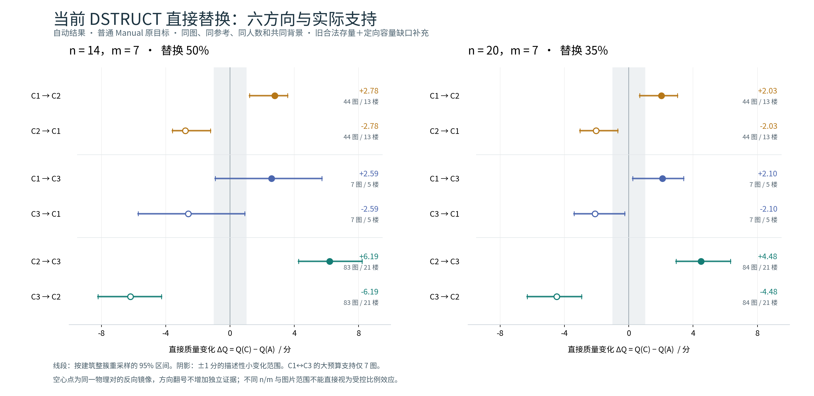
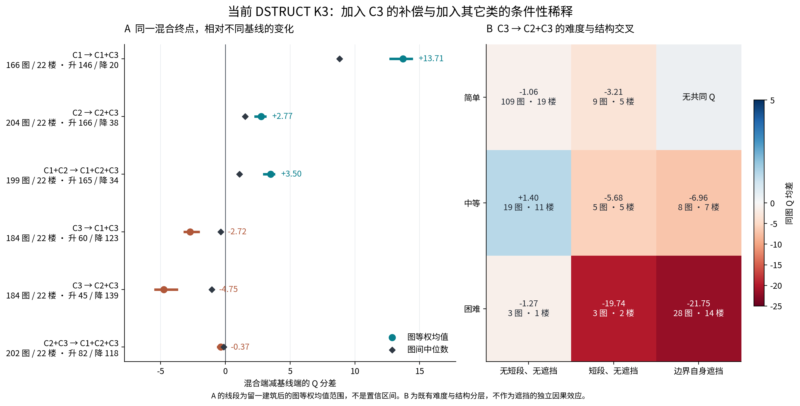
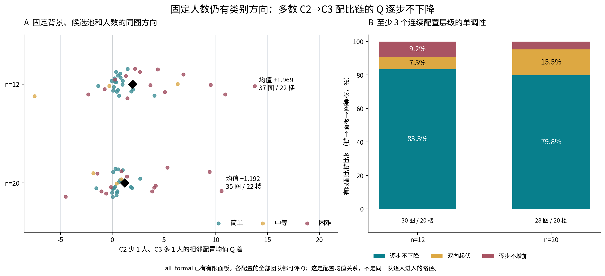
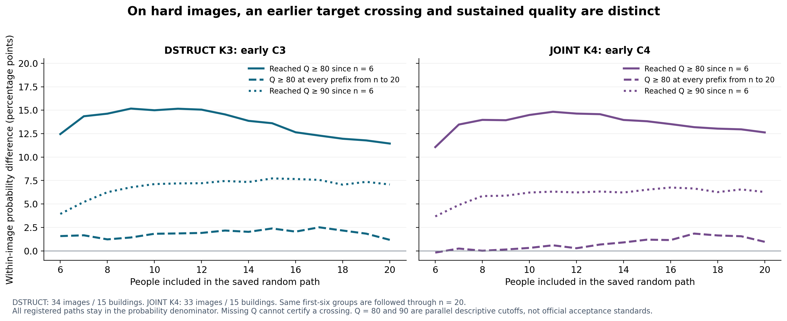

# v2.1 人员研究：从实际标法到混合人群

2026-11-05接入第11—15批。第08—10批解释个人原答；第11—12批研究组合、配比、进入过程与C1/C3半队替换；第13—15批补齐当前DSTRUCT直接替换。各包的原始报告、表和图保留，不用本轮数字覆盖其它团队或旧标签结果。

## 1. 分类依据与实际标法

[分类原答报告](../current_class_interpretation_20261104/REPORT_ZH.md)与[完整标注图册](../current_class_interpretation_20261104/examples/index.html)先展示同图的人怎样标。

DSTRUCT依据结构表达及条件响应建类，没有直接以Q/T建类，但包含参考匹配信息；RFUSE从融合响应解释人员角色；JOINT结合结构、质量与劳动描述人员。三者各有用途。类别编号应连同方法、楼外训练折和版本读取。

JOINT K4的C2/C1在同图同源记录中平均Q接近而记录时间不同；C3在new组143张对照图中有126张只有W121，不能把这部分人的差异写成覆盖广泛人员的类别规律。

## 2. 匹配换人：跨类变化是否超过同类？

现有DSTRUCT C2→C3的14人换7人辅助结果：146个三队共同可评事件、69图；跨类额外对称Q幅度+3.441，50/69图为正；C−B为+6.712，65/69图提高。前者衡量变化幅度，后者衡量升降方向。

第12批C1/C3另有50%替换：6/3在36图共同四端点支持中，两个方向的额外幅度分别+3.269、+3.955，C3相对C1平均Q+7.865，32/36图为正。8/4两个方向分别24图和4图，图片不重合，不能称同图双向验证。

## 3. 直接换类：保持人数和共同成员，结果怎样变？

第13—15批以下采用自动版、普通Manual原主目标、当前合法旧对加容量补缺；均为图片等权的C−A。

|方向|14人换7人：ΔQ；提高图数|20人换7人：ΔQ；提高图数|
|---|---|---|
|C1→C2|+2.776；27/44|+2.033；30/44|
|C1→C3|+2.590；6/7|+2.097；7/7|
|C2→C3|+6.190；77/83|+4.484；77/84|

反向为同一物理对的镜像。三个类对的图片不同；直接换类没有同类B队，不能代替上一节的幅度比较。C1/C3的小预算历史合法直接对与第12批四端点实验也分开保存。

C2→C3的20/7结果，简单57图平均+3.933，中等17图+3.304，困难10图+9.633；困难图逐次绝对变化平均16.075，体现更大的团队差异。七张平均Q下降图的平均3D IoU全部提高，说明范围重叠、方向及其它分项存在取舍。节点数相同也可有明显变化，不能只统计多了几个转折。

相同40图的完整同源Q/T对照：14/7平均Q+6.484、记录劳动+95.3秒；20/7平均Q+4.406、劳动+121.1秒。后者25图升质且劳动增加、13图升质且劳动未增加、2图降质。这是已有记录劳动，不是并行完工时间。

## 4. 混合人群：改善哪一组，与谁比较？

第11批联盟：C1加入C3平均Q+13.714，146/166图提高；C2加入C3为+2.768，166/204图提高。以纯C3为起点加入C2则为−4.749，139/184图下降。一个混合组可以优于C2而低于C3；联盟同时改变人数。

固定人数，C2减少一个名额、C3增加一个名额：12人条件平均+1.969，31/37图为正；20人条件+1.192，27/35图为正。这是有限配比格的均值比较。相同比例换具体成员仍有波动，困难图的分布更宽。

纯C3加入C2的困难层平均−19.768，26/34图下降；几何自遮挡层也有结构减少。用途、难度、自遮挡可能重合，应展示交叉表和原图，不能把每个分层分别当成独立原因。

## 5. 背景与进入过程

第13—15批固定换入换出成员，276个可比较块有56个随背景更换而翻向；固定背景类别人数后，120组仍有18组翻向。来自7图的补缺设计。说明同一类别配比中具体是谁仍然重要。

第11批随机路径条件分组：前6人C2+C3相对C1+C2，后续6—20人的平均Q高约1.78，165/190图较高。困难图早期含C3的路径更常较早出现Q≥80，但到20人时持续保持的优势明显缩小。这是既有随机顺序的关联，不是新DSTRUCT优先进入策略试验，也不是记录劳动节约。

## 6. 采用和核查记录

本地独立从第14批33,220个物理对重算三个类对两种核心预算，逐图值与报告一致；补缺按背景、块、池、图片逐层平均。同源40图Q/T复算一致。物理对无重复；Q差值与端点一致；W019、W026未出现在这些团队中。第11—12批此前复算了C1/C3共同四端点和固定块背景主要结果。联盟及路径其它细格保留作者结果身份，不称本次全部复算。

第13—15批自动共同Q32,086对；已有批准顺序扩展到32,127对。核心14/7与20/7无新增人工共同Q，不与先前辅助ABC混写。缺Q、输出失败、低质量分开报告，OOS继续独立。

本次仅接入包内两个专题路径，未覆盖ZIP所附全局文档补丁；未新增融合、评分、分类拟合或资格修改。未重跑全部原生融合及浏览器交互。票数机制的表述采用“实际跨过固定门槛”，不写成已估计“距离门槛多近”的效应。

完整来源：[混合与半队报告](../mixture_patterns_and_c13_half_20261104/REPORT_ZH.md)、[直接替换报告](REPORT_ZH.md)、[机制图册](mechanisms/CURRENT_DSTRUCT_AC_ATLAS.html)、[背景案例](background/FIXED_XZ_CASES.html)。
