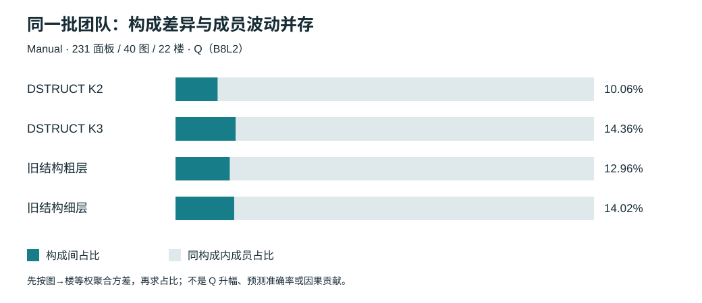

# 构成方差与 DSTRUCT 衔接

本轮将已有构成内／间方差与完整配比分布接在一起，并用冻结的 DSTRUCT 楼外标签重新组织**同一批保存团队**。结论是：DSTRUCT K3 可以组织部分质量与结构差异，但同配比内的具体成员仍是主要波动来源；本结果不支持用分类比例替代实际成员，也不支持宣称新分类全面优于旧分类。

来源版本：`f4f8903798279291ad0e8e461d107e824892ce81`，2026-10-26 读取。新增融合、分类拟合、评分均为 **0**。未改变参考、资格、门槛或端点。主线为普通 Manual；没有把 Manual 的 DSTRUCT 结果泛化为 Semi。

## 1 已有方差与配比并列展示

[研究台独立页](../../statistics/research_explorer_v1_r2_20261017/composition-variance.html)可离线打开，切换四种分类、五个指标和全部 231 个面板。左侧是同面板构成内／间方差，右侧是每个配比的均值、25%—75% 与 5%—95% 成员分布。二者使用同一组有效团队，不把分位区间称为置信区间。



历史四套分类的结果由已核 [RECOMPUTED_DECOMPOSITION.csv](../personnel_mixture_audit_20261022/RECOMPUTED_DECOMPOSITION.csv)整理为 [HISTORICAL_SELECTED.csv](HISTORICAL_SELECTED.csv)，保留原候选域、指标、分母与粗细身份。Manual 联合 Q/T 的 Q 占比 19.36%、log 时间占比 67.42%，Semi 联合细层分别为 23.07% 与 85.28%；不同域的占比不直接作为分类排名。旧结果没有换名为 DSTRUCT。

## 2 衔接覆盖及实际计算

- 原有限面板共 336 个；其中本轮主分析为 **231 个 Manual 面板、40 图、22 楼**，n 为 12—29（非每个整数均有支持）。每个固定背景 D，从 12 名候选取 6 人，共 924 支实际团队。
- **213,444 条面板—团队关联，213,442 个唯一端点**。少量团队跨面板重用，不将关联数解释为独立实验数。
- DSTRUCT K2/K3 与旧结构粗／细层在这批团队上全部成员标签已知；四方法的比较支持完全一致。每支队的背景并选入块与保存全队成员逐一核对。ALL 标签未用于目标图统计。
- Q、D10 共 **212,181 条可评关联**。转折数为 212,916 条，以该量实际存在为准；时间为 130 面板、31 图、21 楼、116,966 条单一来源且全员记录完整的关联。时间不是生产耗时。
- K2 为 779 个配比格，K3 为 **1,476 格**，旧结构粗／细层为 1,633／1,867 格。格数不同不等于实验次数增加。
- [覆盖账](PANEL_COVERAGE.csv)、[全格表](CONFIGURATIONS.csv)、[逐面板方差](PANEL_VARIANCE.csv)及四份 `TEAM_CONFIGURATION_LINKS_<method>.csv.gz`保存精确关联。全队成员继续由来源 `TEAM_MEMBERS.csv.gz`查得，不重复包装原始数据。

这是固定 D 和 12 选 6 的完整有限面板，不是整个人员池、全部背景或全部 n 人队的穷举。所有面板均保留，没有按新结果挑图或筛除低响应面板。

## 3 主结果

以下是同支持、同权重的**构成间方差占比**，不是 Q 升幅。

| 分类 | Q B8L2 | D10 | 实际转折 | log 记录时间 |
|---|---:|---:|---:|---:|
| DSTRUCT K2 | 10.06% | 10.24% | 20.57% | 18.35% |
| **DSTRUCT K3** | **14.36%** | **14.48%** | **21.98%** | **19.54%** |
| 旧结构粗层 | 12.96% | 13.12% | 21.17% | 18.83% |
| 旧结构细层 | 14.02% | 14.25% | 23.07% | 19.12% |

K3 的 Q 总方差为 38.6738 分²，构成间为 5.5546 分²，构成内为 33.1192 分²；**同构成内占 85.64%**。它略高于旧粗层的构成占比，但与旧细层接近，转折占比还低于旧细层。最合适的论断是“衔接成立、解释部分差异”，不是“新分类大幅提升解释力”。

22 个楼外折中 K3 均为 K2 的嵌套细分，已保存[实际映射](FOLD_NESTING.csv)。相同团队及权重下，K3 的经验构成间方差不会低于 K2；本次逐面板亦满足。其约 4.30 个百分点 Q 占比增加不能单凭数值证明细分有用，更不等于新增楼外预测 R²。楼外标签避免用目标楼建类，但本次没有训练或测试一个新的响应预测器。

### 难度的两个尺度不能混淆

| DSTRUCT K3 / Q | 图 / 楼 | 总方差（分²） | 构成间（分²） | 构成内（分²） | 构成间占比 |
|---|---:|---:|---:|---:|---:|
| 简单 | 22 / 22 | 6.5768 | 1.2541 | 5.3227 | 19.07% |
| 中等 | 3 / 3 | 34.3769 | 4.9953 | 29.3816 | 14.53% |
| 困难 | 15 / 15 | 96.4398 | 13.3156 | 83.1242 | 13.81% |

困难图的构成间**绝对差异更大**，但构成内差异增加得更多，所以占比反而较低。不能据简单图占比较高就说其构成差异更强。转折数的构成间占比则为简单 2.72%、中等 17.41%、困难 22.44%，与结构机会的解释相容。难度层建筑可重复出现，各层楼数不应相加。按 n、来源域的完整分层见 [SUMMARY.csv](SUMMARY.csv)；没有隔离图片难度的因果效应。

### 与配比分布的具体衔接

沿用历史展示的 7y-21 / n20 / 候选面板 2 作为读图例，而非新择优示例。DSTRUCT K3 在该面板形成六格，C1 固定 1 人，C3 从 0 到 5 人时，各格 Q 均值为 49.96、53.53、57.31、60.03、62.66、68.29。C3=3 的 350 队，其 5%—95% 分位约为 **49.43—83.19**，说明配比均值梯度与格内成员差异可以同时存在。类号按该目标楼解释，不把 C3 固定理解成跨楼不变的十二个人。

## 4 统计对象与缺失处理

面板固定图、n、背景、12 名候选与标签。对每个指标，只在该指标有效团队上等权：

`V_total = mean((y - mean(y))²)`

`V_within = mean((y - mean(y | class_counts))²)`

`V_between = mean((mean(y | class_counts) - mean(y))²)`

面板内满足 `V_total = V_within + V_between`，配比权重为该格有效团队数／总有效团队数，**不是每个配比格等权**。跨面板先图内平均，再楼内平均，最后建筑等权；占比用聚合方差之比，而非占比平均。来源域和 n 混合的总体是当前库存描述，各自分层另列。

- 单队格在有限总体恒等式中组内项为零，但 `member_variation_estimable=false`，SD 留空。K3 的 Q 中有 18 个单队格，不称这些人员可以互换。
- 总方差为零时占比不可定义，保存为缺失；139 个转折常数面板保留，不填成“100%解释”。
- “未完整可评”采用实际保存状态，另列 0/1 分解。1,263 条关联对应少于四节点 395、底面无效 340、无连接 528，见[状态账](ENDPOINT_STATUS.csv)。不将不可评 Q 填零，也不把此批定义泛化为所有缺 Q 的原因。
- 全队 N 人的唯一团队终点若有效，经验变异为零只说明没有其他团队可选，不证明准确；本轮固定背景面板不是自然人数全池曲线。

## 5 复现及验证

从仓库根运行（输入为仓库已有 gzip 实体文件，不是 LFS 指针）：

```bash
python -m unittest discover -s research/workers/dstruct_composition_bridge_20261026 -p 'test_bridge.py' -v
python research/workers/dstruct_composition_bridge_20261026/build_bridge.py
python research/workers/dstruct_composition_bridge_20261026/build_presentation.py
```

Python 3、pandas、NumPy 即可重聚合。没有导入融合器或分类训练器。`build_bridge.py`自动输出覆盖、全格、方差、逐团队配比映射及[CHECKS.json](CHECKS.json)；`build_presentation.py`仅整理历史摘要、保存总体 SVG 并构建离线展示数据。

重要校验：231×924 完整关联；四标签共同支持；逐队背景并块一致；总／内／间恒等式；K2/K3 折内嵌套与单调性；旧结构粗细的 **924 条 Q/D10 逐面板记录**从保存端点重新计算，与历史表最大误差约 1.14×10⁻¹³。四个单元测试覆盖不平衡配比权重、常数面板、缺失不填零和嵌套分区。

展示及同步清单见 [DELIVERY_QA.md](DELIVERY_QA.md)。本轮不重跑完整融合、抽样 bootstrap、原答评分或反推模型，不新增风险阈值、能量距离等可选实验。
