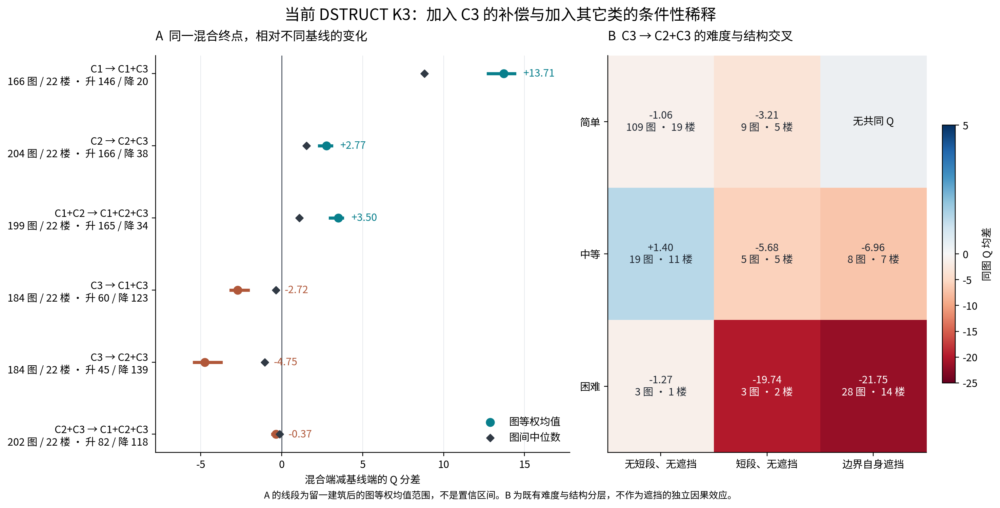
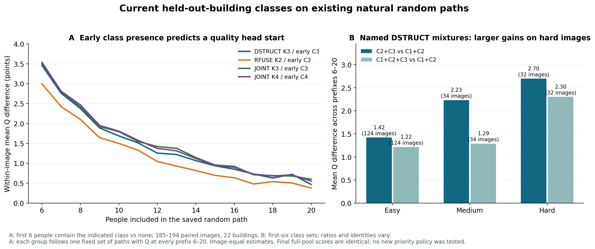
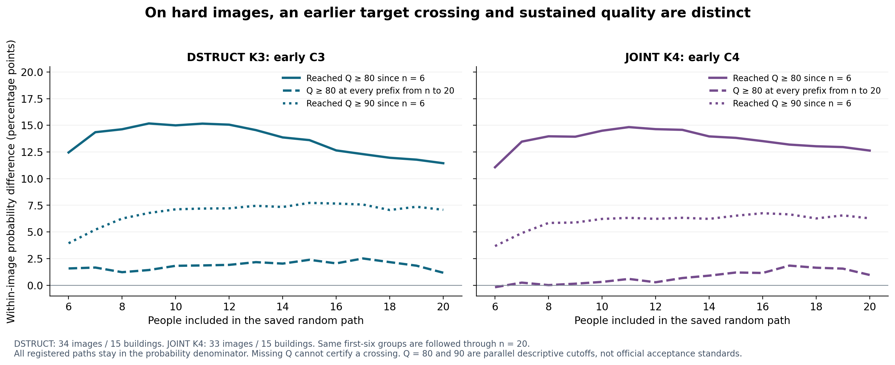
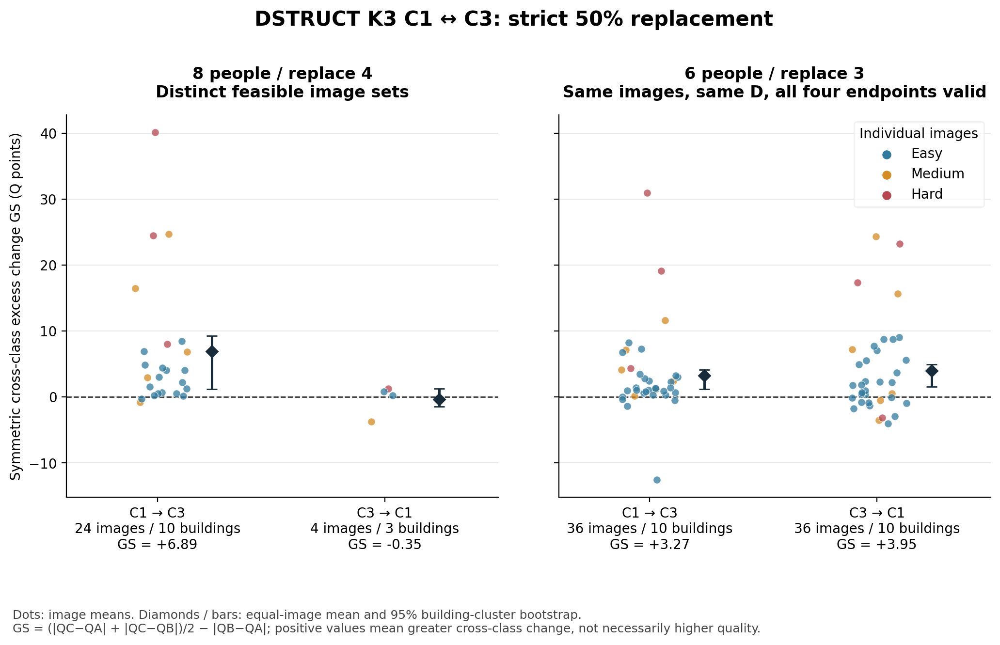
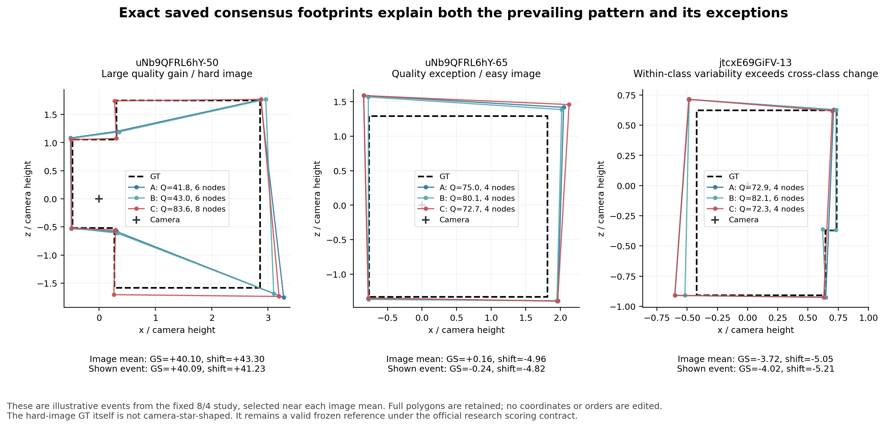

# HOHONET v2.1：不同类型混合后，有哪些可重复的规律？

## 核心结论

**已有计算能够形成一条完整研究主线：某些类别提供的结构信息会改善原本较弱的组合；同一组合相对结构表达较好的纯类又可能出现稀释。困难和边界自遮挡图片会放大这种差异。固定人数的配比结果、既有进入曲线，以及新增 C1↔C3 半队实验，从不同角度支持了这条主线。**

最清楚的证据来自当前 DSTRUCT K3。C3 加入 C1、C2 或 C1+C2，平均 Q 提高，而且多数图片同向；固定人数下，用 C3 增加一个类别名额也有相同趋势。早期包含 C3 的既有随机路径通常更早接近当前采用参考。与此同时，具体成员和共同背景仍然改变效果幅度，早期达到较高 Q 也不保证之后持续维持。

用户指定的 **C1↔C3 50% 严格 ABC 已真实补算完成**，不是由旧 C2↔C3 或单向 AC 改名获得。6 人换 3 人的同图、同背景、四端点共同支持覆盖 36 图/10 楼；两个方向的跨类额外变化 GS 均为正，C3 团队平均比 C1 团队 Q 高 7.865 分。8 人换 4 人则分别报告两方向容量范围。

本报告的 Q 为正式 B8L2，使用当前有效预处理、当前采用参考与楼外类别。下文所说“接近参考”对应用户提出的“趋近 GT”，不另行改变研究的参考定义。完整方法见 [方法与范围](METHODS_AND_SCOPE.md)。

## 一、混合是否有效，必须说明与谁比较

### 1. C3 可以为较弱组合补充有效信息

以下均为普通 Manual 主目标、同图两端共同 Q 的图片等权结果。联盟使用该类在该图全部可用人员，因此人数随联盟变化。

| 起点 → 合并队 | 平均 ΔQ | 同向提高图数 | 共同图片 | 解释 |
|---|---:|---:|---:|---|
| C1 → C1+C3 | +13.714 | 146 | 166 | 对 C1 的改善大且广泛 |
| C2 → C2+C3 | +2.768 | 166 | 204 | 对 C2 有较稳定的补充作用 |
| C1+C2 → C1+C2+C3 | +3.501 | 165 | 199 | C3 在两类已有背景上仍提供增益 |
| C3 → C1+C3 | −2.720 | 60（另 1 图持平） | 184 | 同一联盟相对 C3 自身往往较低；123 图下降 |
| C3 → C2+C3 | −4.749 | 45 | 184 | 139 图下降，差异集中于部分结构复杂场景 |

这五行不矛盾。同一支 C2+C3 队可以明显好于 C2，同时低于 C3；“融合有用”与“融合超过所有组成类别”是不同命题。C1→C1+C3 还新增 35 张可评图片，属于支持扩展，不把原无 Q 计成 0 分后合并到 +13.714 中。

三类全部合并也不是必然最优。此前主目标的 205 图共同支持中，169 图至少有一支纯类队的 Q 高于全部已分类人员的合并队。这里的“最佳纯类”是事后比较，并非一个提前知道答案的选队策略；已分类全员与含未知标签人员的真正全员在表中分开。三类合并相对 C2+C3 的平均差仅 −0.365，但建筑等权变为 +0.307，因此这一条应写成“多数图小幅下降，平均方向依赖建筑权重”，不写成普遍的三类劣化。

来源：[完整联盟分层](mixtures/DSTRUCT_ALLIANCE_STRATA.csv)、[可评支持变化](mixtures/DSTRUCT_ALLIANCE_SUPPORT.csv)、[七联盟共同支持](mixtures/DSTRUCT_SEVEN_COALITIONS_COMMON_Q_STRATA.csv)、[已分类与真正全员](mixtures/DSTRUCT_CLASSIFIED_VS_ACTUAL_ALL_MEMBERS.csv)。

### 2. 困难场景中的主要现象是结构表达被改变

对于已有“边界自遮挡”标记的 36 图/15 楼，C3→C2+C3 的平均 Q 变化为 **−18.467**，中位数 −9.123，27 图下降。与此同时，平均少 2.389 个转折、1.389 段短转折边，参考遗漏增加约 0.109。无短转折且无边界遮挡的 131 图，Q 差仅约 −0.707。

反过来，以 C2 为起点加入 C3，在边界自遮挡层的平均增益为 **+5.857**，27/38 图提高。因而较合理的机制解释是：同一混合结果保留了比 C2 更多的有用信息，但未完整保留 C3 原本表达的部分结构。几何分项与 Q 同时变化，为这个解释提供支持；它仍是对已观察几何的解释，不单凭类别标签推断每个人的动机。

官方困难图的 C3→C2+C3 平均差为 −19.768，中位数 −10.937，26/34 图下降。困难与边界自遮挡重合较多，已经提供交叉支持和交叉效应，不把两个分层的差别写成互相独立的因果作用。房间用途也提供完整表：卧室、卫浴、起居、走廊等用途先按既有登记值划分，再结合其结构条件解释。用途名称本身不是机制。

具体到场景，同样是 C3→C2+C3，困难卫浴 15 图/6 楼平均 −20.228 Q，12 图下降；困难起居与休闲 8 图/4 楼为 −22.156，6 图下降。简单卧室 44 图/14 楼仅 −0.276，简单卫浴 12 图/9 楼为 −1.238。因此可以在具体用途里看到困难结构放大的混合差异，而不把“卫浴”或“起居”直接当作原因。

来源：[Q 共同支持上的分项](mixtures/DSTRUCT_Q_COMMON_COMPONENT_STRATA.csv)、[难度×结构交叉](mixtures/DSTRUCT_DIFFICULTY_STRUCTURE_CROSS.csv)、[交叉支持](mixtures/DSTRUCT_DIFFICULTY_STRUCTURE_SUPPORT.csv)、[混合专题报告](mixtures/REPORT_ZH.md)。

## 二、固定人数后，类别比例仍然有作用

完整联盟同时改变人数，因此进一步使用已计算的有限配比面板。主要口径要求相邻两个配置中的全部登记团队均有 Q，在同一图片、人数、候选池和固定背景内比较配置均值。

| 固定人数 | 配比变化 | 平均 ΔQ | 图 / 楼 | 提高 / 降低 |
|---|---|---:|---:|---:|
| 12 | C2 少 1 人、C3 多 1 人 | +1.969 | 37 / 22 | 31 / 6 |
| 20 | C2 少 1 人、C3 多 1 人 | +1.192 | 35 / 22 | 27 / 8 |
| 12，简单 | 同上 | +0.762 | 20 图 | 18 / 2 |
| 12，困难 | 同上 | +4.220 | 14 图 | 12 / 2 |

中等层的 3 图为 −0.493，按其小支持原样保留。这没有抵消简单层、困难层和全体多数图上的正向趋势，也不需要为了让该层翻回正向继续选队。

进一步检查至少三个连续配比层级的均值链：在全部配置均可评支持上，n=12 的 C2→C3 链平均有 **83.3% 逐步不下降**，n=20 为 **79.8%**；同时存在上下起伏的链分别约 7.5%、15.5%。这些比例先按链、面板、图片逐层汇总，不把大量近重复配置当作大量独立图片。可以采用的表述是：**在已有有限候选池中，多数 C2→C3 配比链呈递增关系；关系允许局部平台和少数非单调图片。**

合法 Q/T 也已经放到同一批完整团队上比较。new 同源支持中，DSTRUCT C2→C3 在 n=12 的 Q +1.964、时间比 1.0195（27 图/20 楼），n=20 的 Q +1.230、时间比 1.0077（25 图/19 楼）。这说明这里的质量增益没有普遍伴随大幅增加记录劳动。JOINT K4 的 C3→C4 在 n=12 为 Q +2.701、时间比 0.8968（14 图/10 楼），n=20 为 Q +1.344、时间比 0.9290（14 图/11 楼），呈现质量提高且记录劳动下降的特定配比结果。它们是既有楼外团队的后续解释，未新增 Q/T 选队实验。

来源：[固定人数分层](mixtures/FIXED_N_FOCUSED_STRATA.csv)、[连续配比链](mixtures/FIXED_N_THREE_OR_MORE_LEVEL_CHAIN_STRATA.csv)、[完整配比与劳动专题](mixtures/REPORT_ZH.md)。

## 三、比例、成员和背景分别改变了什么

### 1. 类别比例有方向，具体成员决定很大一部分幅度

此前相同 174 个完整面板、32 图/21 楼中，DSTRUCT 的配比间 Q 方差约占 15.06%，其余来自同配比的成员差异。这个比例并不等于“类别只有 15% 的研究价值”：一致的均值变化可以与很大的类内波动同时存在。当前固定人数的方向分布和连续链结果正好证明了这一点。

因此，不应把类别视为具体人的可互换标签。解释应有两层：先描述配比均值往哪里移动，再描述在这个配比内换人会波动多大。所有同配比团队的分位数、标准差、可评率保留在 [成员分布表](mixtures/SAME_CONFIGURATION_MEMBER_DISTRIBUTIONS.csv.gz)。

### 2. 共同背景可以吸收替换块的影响

对同一换入/换出块，沿用既有背景扩充路径，并严格限制在前后四端均有 Q 的共同支持：

| 实际分类和替换条件 | 背景扩充 | 有符号效应阶差 | 绝对换人幅度阶差 | 绝对幅度下降图数 |
|---|---|---:|---:|---:|
| RFUSE，m=4 | n=20→31 | −1.667 | −0.460 | 50/55 |
| JOINT K3，role1→3，m=7 | n=20→28 | −1.254 | −1.210 | 43/49 |
| JOINT K4，role1→2，m=7 | n=20→28 | +0.014 | −1.317 | 63/76 |

K4 这一行尤其有解释价值：平均改善效应接近不变，但替换带来的绝对变动明显缩小。背景的作用可以是吸收波动，而不只是把平均收益往上或往下移动。以上是这些既有固定块路径的结果，保留其真实分类身份；不能把旧 TARGET 的标签直接改称当前 DSTRUCT。

本轮新 C1↔C3 还提供了“背景人数与类别比例都不变，只换具体背景成员”的证据。在 6/3 设计中固定替换块，并要求两套 D 的类别计数向量完全相同，前向仍有 188 块、36 图可比较；质量位移的图等权绝对差平均 4.248 分；188 块中有 20 块发生方向翻转，直接块比例为 10.6%，先在图内计算比例再图等权为 13.1%。具体背景成员确实能改变同一替换操作的效果，不能只用比例解释全部波动。来源：[同类别计数背景控制](c13_half/analysis/FIXED_BLOCK_BACKGROUND_CLASS_CONTROL_SUMMARY.csv)。

来源：[混合专题的背景分析与明细](mixtures/REPORT_ZH.md)。

## 四、是否更快接近参考？已有过程证据给出肯定但具体的答案

### 1. 早期类别构成确实影响质量曲线

使用已有自然随机序列，选取 N≥20 的池，在同一图内比较“前 6 人至少出现一名指定类”与“没有该类”。每组至少 16 条已登记路径，主要平均 Q 使用 6—20 人全部前缀可评的路径。

| 当前方法 | 前 6 人出现的类别 | 6—20 人平均 Q 差 | 图 / 楼 | 正向 / 负向图片 |
|---|---|---:|---:|---:|
| DSTRUCT K3 | C3 | +1.438 | 194 / 22 | 170 / 24 |
| RFUSE GEOM K2 | C2 | +1.202 | 185 / 22 | 162 / 23 |
| JOINT K3 | C3 | +1.499 | 193 / 22 | 172 / 21 |
| JOINT K4 | C4 | +1.498 | 193 / 22 | 168 / 25 |

四种方法的建筑等权和逐楼剔除结果仍为正。它们从不同画像角度识别了与早期质量有关的人群信息；四个结果来自同一研究数据，不能当成四个完全独立外部复现。

更贴近“某类＋另一类”的比较是：**前 6 人只有 DSTRUCT C2+C3**，相对**只有 C1+C2**，6—20 人平均 Q 高 **1.780** 分，190 图/22 楼中 165 图正向。建筑等权 +1.440，建筑重抽样 95% 区间约 [0.877, 1.985]。困难层为 +2.696（32 图/14 楼），简单层 +1.420。初始类别集合固定，但各类人数和具体成员仍可变，因此这个比较补充过程规律，不替代下节严格 ABC。

来源：[自然路径主汇总](curves/LANDMARK_ALL_SUMMARY.csv)、[具名类别组合](curves/NAMED_MIXTURE_SUMMARY.csv)、[组合×难度](curves/NAMED_MIXTURE_DIFFICULTY_SUMMARY.csv)。

### 2. 先遇到好结果，与之后持续保持好结果，有明显区别

困难图中，早期含 DSTRUCT C3 的路径，在 6—20 人观察窗内曾达到 Q≥80 的比例为约 **50.06%**，未含 C3 为 **38.62%**。但到了 20 人，当下 Q 仍≥80 的比例为 **26.75% 对 25.58%**。早期类别信息显著改善“先遇到较好结果”的机会，其优势没有等比例转成稳定达标。

对前 6 人 C2+C3 与 C1+C2 的具名组合，困难层截至 20 人曾达到 Q≥80 的概率差约 **+15.02 个百分点**，25 图正、2 图负、5 图同；简单层仅约 +1.09 个百分点。困难图片更容易显现人群构成对过程的影响。

这也解释了为何不能只画一条总体均值曲线就宣布“共识更快稳定”：同一队列可能先靠近参考，随后加入人员时再次偏离。报告与研究台并列提供首次越线、窗口内持续达标、可评概率与低尾。所有已入组路径（前 6 人标签已知）仍保留在概率分母中，缺失 Q 不能证明达标。完整 N 人的最终成员集合相同，因此最终全员 Q 相同；此处的优势主要发生在到达全员之前。

来源：[首次与持续达标专题](curves/REPORT_ZH.md)、[逐人数×难度](curves/LANDMARK_CURVE_DIFFICULTY_SUMMARY.csv)、[自然数据验收](curves/NATURAL_INPUT_VALIDATION.csv)。

### 3. 记录劳动也有收益信号，但集中程度必须展示

在所有成员均有合法同源记录劳动的 47 图/18 楼上，半数全员记录劳动预算内曾达到 Q≥80 的概率，早期 DSTRUCT C3 组提高约 **4.71 个百分点**，JOINT K4 C4 组提高约 **4.20 个百分点**。在两臂均有达标路径的另外一个共同支持——46 图/18 楼——中，首次达到 80 的条件平均劳动分别减少约 219.76 秒、193.16 秒；逐图中位数只减少 27.43 秒、21.01 秒，说明节约更多集中在部分图片。

这些结果支持“部分早期构成在既有路径中更有效率”的判断。记录劳动是人员劳动累加，不能改称墙钟等待时间；条件平均首次达标时间还要与未达标概率一起看。它们提供进一步应用的依据，不需要在本轮重新开展大规模 Q/T 选队。

来源：[同源记录劳动汇总](curves/LANDMARK_RECORDED_LABOR_SUMMARY.csv)、[进入过程完整说明](curves/REPORT_ZH.md)。

## 五、C1↔C3 的 50% 严格 ABC 已补齐

### 1. 按真实容量设置人数，另加同图双向支持

当前正式池不能合法组成 C1↔C3 的 10/5、12/6 或 14/7 严格 ABC。严格设计要求同来源类提供两个互斥替换块，不能重复使用人员来凑人数。最大可行的 8/4 中，C1→C3 有 24 图/10 楼，C3→C1 只有 4 图/3 楼，并且两方向图片不重合。

为了直接比较两方向，另冻结了 **6/3 同图双向设计**：36 图/10 楼，同一 D 配两个互斥 C1 块与两个互斥 C3 块，构成共享四端点。全部选队在看 Q 前完成，合计 3,200 事件、4,992 不同团队、48 不同图片。实际新端点为 4,898 个有 Q、94 个无连接；它们均不命中旧批准人工端点，不借用其他团队的环序。

来源：[冻结设计](c13_half/design/DESIGN.json)、[请求团队](c13_half/design/REQUESTS.csv.gz)、[事件](c13_half/design/EVENTS.csv.gz)、[运行记录](c13_half/endpoints/RUN_RECEIPT.json)。

### 2. 同图双向结果支持跨类变化更大，同时显示实际质量方向

| 比较条件 | 共同 Q 支持 | GS：跨类额外变化 | GS 正向图片 | 实际质量方向 |
|---|---:|---:|---:|---|
| 6/3，同图同 D，C1→C3 | 每方向 1,094 事件；36 图/10 楼 | +3.269 | 32/36 | C3 块团队相对 C1 块团队平均 +7.865 Q |
| 6/3，同图同 D，C3→C1 | 同一四端点共同支持 | +3.955 | 24/36 | 与上一行对应的反向质量变化 |
| 8/4，C1→C3 | 728/768 事件；24 图/10 楼 | +6.886 | 22/24 | 相对两支同类队均值 +10.165 Q |
| 8/4，C3→C1 | 113/128 事件；4 图/3 楼 | −0.346 | 3/4 | 相对两支同类队均值 −5.026 Q，4/4 图下降 |

6/3 四端点共同支持中，同类 C1 换人幅度为 6.511，C3 为 5.825，跨类对称幅度为 9.780。跨类额外幅度分别为 3.269、3.955。C3 团队相对 C1 团队的图等权 Q 位移为 +7.865，建筑聚类 95% 区间约 [4.584, 9.197]，32/36 图提高；建筑等权为 +6.146，其对应区间为 [4.265, 7.968]。

这种质量差不只是节点数不同。6/3 的同一四端共同支持上，C−(A+B)/2 的 3D IoU×100 提高 4.572，底边角位置误差减少 0.466°，方向误差减少 1.249°，而输出节点数平均只增加 0.212。平面形状、位置、方向和高度分项都参与了输出变化。来源：[对称基线分项表](c13_half/analysis/BALANCED_COMPONENT_SUMMARY.csv)。

8/4 反向平均 GS 小于零的原因是四图中一图的同类波动较大。其 GS 的建筑等权均值约 +0.015，区间跨零；同时四张图实际换入 C1 后 Q 均下降。因此该条件的准确结论是：实际质量方向明确，但“跨类幅度超过同类”的平均关系在这四图支持上不稳定。这不推翻 36 图同背景双向证据，也不应隐藏这个小支持条件。

GS 讨论变化幅度，不能读成质量收益。正反方向都可有正 GS，但质量一升一降。新增 C1↔C3 的 6/3、8/4 与此前 C2→C3 的 14/7 团队大小、背景和图片均不同，不据效应大小比较哪两类“距离更远”。

连接状态也提供了独立证据：6/3 设计的 1,152 个 C1 块背景团队中，32 个无连接；1,152 个 C3 块背景团队中，只有 1 个无连接。这一差异单独报告为连接成功率，不折算为失败端点的零 Q。

额外几何诊断表明，4,898 个有 Q 端点均无底面自交且面积非零，其中 337 个相机不在多边形可见核内；48 个冻结参考中也有 7 个存在这一性质，因此它不是本轮可以新增的正式无效规则。保持正式分母之外，额外核内共同支持的敏感性仍支持主要方向：6/3 的 33 图双向 GS 为 +1.798/+2.951，C3−C1 的 Q 为 +6.132，29/33 图正；8/4 正向 22 图 GS +4.585、Q 位移 +7.716。这里未改坐标、未重构参考、未借此推广 F2/F9 修正规则。

来源：[严格 ABC 汇总](c13_half/analysis/SUMMARY.csv)、[共享四端点汇总](c13_half/analysis/PAIRED_FOUR_SUMMARY.csv)、[逐项支持](c13_half/analysis/SUPPORT.csv)、[完整补充报告](c13_half/REPORT_ZH.md)。

上述具体事件按接近各图片平均效应选作事后解释。左图显示 C 保留了参考的折入结构；中图显示节点数相同时仍会有位置与质量反向；右图显示同类成员变动可以大于跨类变动。它们不替代全部图片统计。

## 六、发现的真实下游缺口已补齐：JOINT K4 小池进入策略

现有 K4 小池政策的 1,081 个实际端点中，两个端点命中此前批准的人工顺序。它们位于 `rPc6DW4iMge-06 / other_space_10` 和 `uNb9QFRL6hY-88 / other_space_22`。本轮核对池、参考、成员后接入辅助值，保留自动版；其余 1,079 个端点未重评分，原本 1,046 个有 Q 端点数值保持。

可比较前缀覆盖 15 池、14 图/8 楼，N≤9，观察从已执行的 n=3 开始。优先历史高 Q 的早期平均质量差从约 +1.500 变为 **+1.534**，方向保持；但“平均 Q 更高”并不意味着每项首次/持续阈值概率都提高。合法同源劳动的 9 图/5 楼又是另一个明确支持：更快历史人员优先可表现为记录劳动减少且 Q 较好，不能把它与全部 14 图的质量均值拼成一个共同支持结论。

主目标自然路径中的 1,488,398 个不同端点键与这 57 组辅助端点没有交集；主目标曲线沿用原融合值，只做当前类别的重新汇总。旧 V3 大池策略保留真实身份，不改称当前 DSTRUCT 或 JOINT 策略。

来源：[两端精确对应](curves/K4_SMALL_POOL_ASSISTED_ENDPOINT_MATCHES.csv)、[实际消费者变化](curves/K4_MANUAL_ASSISTED_CONSUMER_CHANGES.csv)、[K4 前缀汇总](curves/K4_EARLY_QUALITY_ALL_SUPPORT_SUMMARY.csv)、[主目标精确交集记录](curves/NATURAL_MANUAL_ORDER_INTERSECTION_RECEIPT.json)。

## 七、可以直接用于论文的研究表述

> 当前人群分类在融合中表现出有条件、可重复的解释作用。DSTRUCT 中结构表达较丰富的 C3 加入 C1、C2 或二者的既有组合时，通常提高融合质量；同一混合队相对 C3 纯类又可能降低结构保留与参考贴合，且这一差异在困难或边界自遮挡图片上更明显。固定人数的有限配比结果表明，这种现象并非仅由人数增加造成。多数 C2→C3 配比链呈递增关系，但同配比的具体成员与共同背景仍然决定效果幅度。已有随机进入序列进一步显示，早期出现相关类别有利于在较少人数和部分合法劳动预算内接近参考，然而首次越过质量阈值与后续持续保持应分别评价。新增 C1↔C3 50% 严格 ABC 在同图同背景下支持跨类改变通常大于同类改变，并给出明确的实际质量方向。

这段表述有三类互补证据：严格 ABC 解释换类相对换人的额外变化，直接 AC 和固定块分析解释具体替换的方向与背景作用，完整联盟和配比面板解释实际混合后得到什么。它们共同支持人群不确定性的研究，而不要求任何分类在所有图片上胜过所有 Q/T 策略。

## 八、逐条采用与交付范围

- **保持并加强**：类别结构信息能解释实际融合差异；同配比成员波动大；当前分类和原有效预处理继续采用。
- **条件明确**：混合相对较弱类别有益，但不必超过较强纯类；困难/遮挡放大差异；配比趋势与局部非单调并存。
- **新增支持**：当前 C1↔C3 的 50% 严格 ABC；早期具名类别组合的过程规律；合法同源劳动预算中的达标概率。
- **幅度变化**：K4 两个实际辅助端点接续后的早期统计，主方向保持。
- **需改写**：将“更早出现好结果”直接写成“更早稳定共识”，或将高 Q 均值直接写成全面节时；将全部已分类队等同真正全员队。
- **尚不能由本轮判断**：一个可部署的新进入/停止政策能否在独立新任务上普遍节约总劳动。当前已有解释与过程证据可以采用，不需要因此立即扩大选队实验。

完整逐条来源见 [结论台账](CONCLUSION_LEDGER.csv)。第 11 批交付既有混合规律与过程分析；第 12 批交付新 C1↔C3、整合报告、研究台和 v2.1 入口更新。数值、支持、标签版本、引用与文件完整性验收见 `DELIVERY_CHECKS.json`。原自动结果、旧冻结实验和既有图册继续保留。
