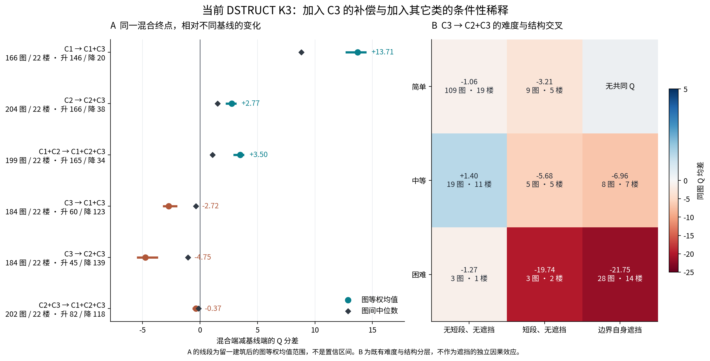
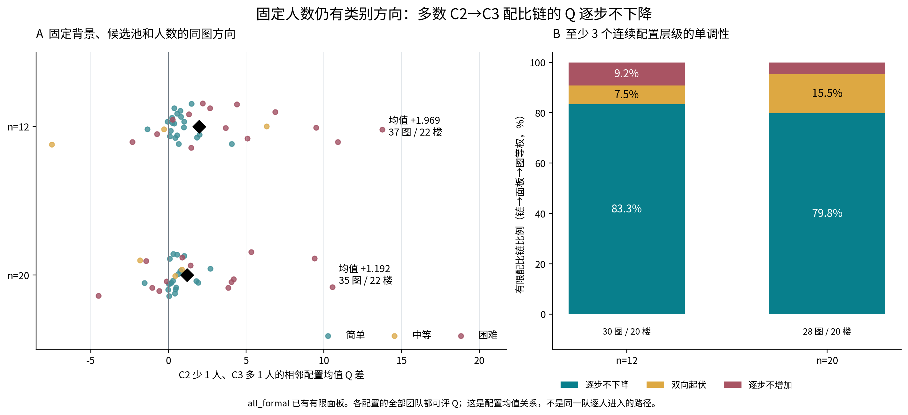
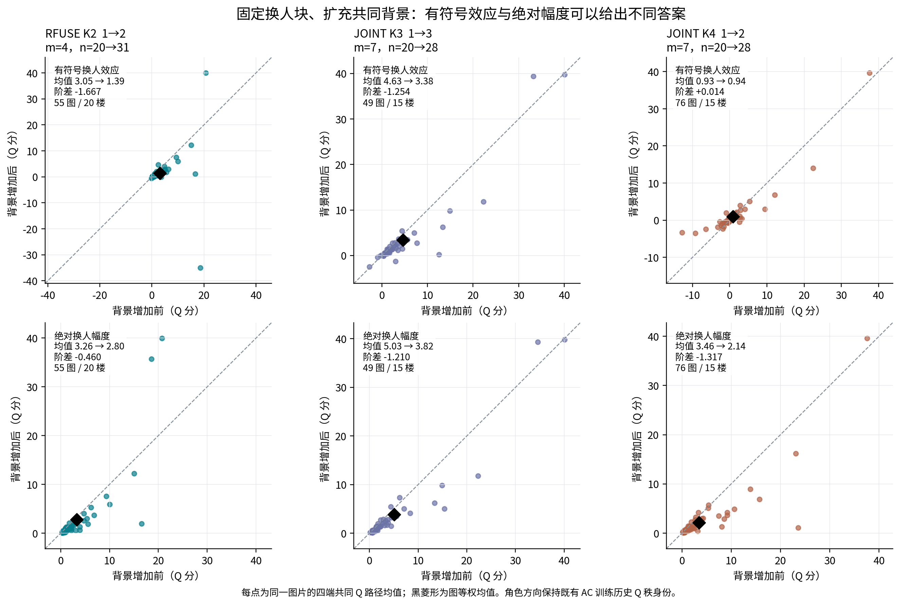
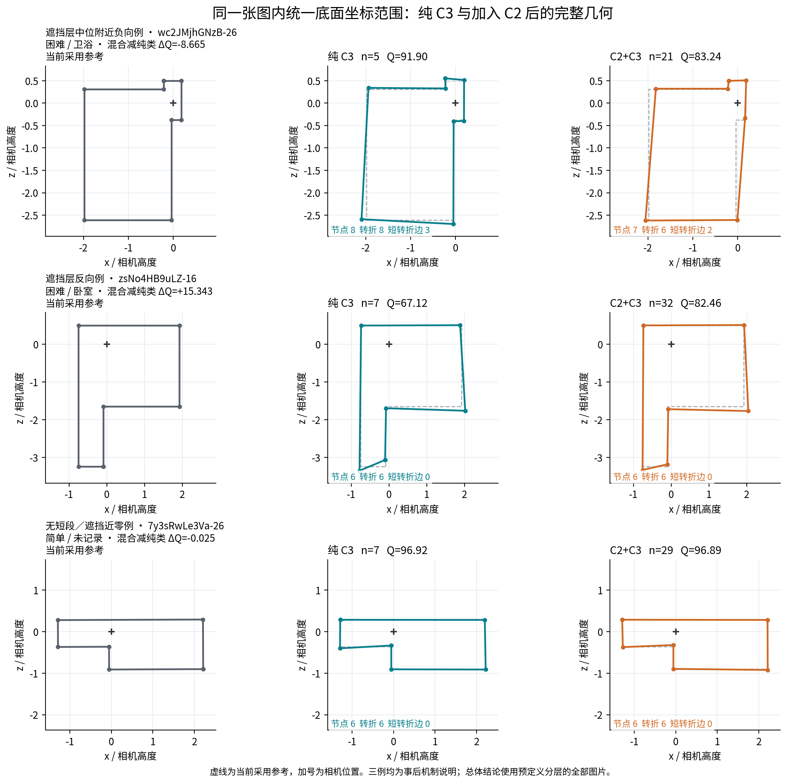

# 混合类型人群的条件规律：完整联盟、固定人数配比、成员与背景

日期：2026-11-04。研究范围以当前类别的普通 Manual 主目标为主。本模块复用既有团队、完整几何与质量值，新增分类拟合、选队、融合和评分均为 **0**。本轮新增 C1↔C3 50% 严格 ABC 另有专门交付；以下有限配比结果保持其原实验身份。

## 1. 核心发现

**现有数据已经显示一条连贯的规律：结构保留更多的 DSTRUCT C3 加入 C1 或 C2，通常提高混合结果的参考质量；相同混合结果相对纯 C3 又常有下降。固定人数提高 C3 比例仍有多数图上的正方向，而困难结构放大了这类差异及具体成员造成的波动。** 混合是否更好，必须说明比较的基线、实际比例与任务条件。

本轮进一步得到五项可以直接写入研究解释的结果：

1. **C3 对 C1/C2 的补偿是覆盖较广的同图现象。** C1→C1+C3 的共同 Q 支持为 166 图、22 楼，平均 **+13.714 分**，146 图升、20 图降。C2→C2+C3 为 204 图、22 楼，平均 **+2.768 分**，166 图升、38 图降。[逐图联盟差](DSTRUCT_ALLIANCE_IMAGE_CONTRASTS.csv.gz)
2. **较强纯类进入人数更多的混合队时，局部结构可能被削弱。** C3→C2+C3 在 184 张共同 Q 图上平均 **−4.749 分**，139 图下降。已有“边界自身遮挡”层的 36 图、15 楼中，均差为 **−18.467 分**；平均少 **2.389 个转折、1.389 段短转折边**，参考遗漏指标增加 **0.1090**。[Q 共同支持分项](DSTRUCT_Q_COMMON_COMPONENT_STRATA.csv)
3. **固定人数以后，C3 的方向仍然存在。** 固定背景、候选池及人数，相邻配置由 C2 少 1 人、C3 多 1 人，在 n=12 的严格完整 Q 支持上平均 **+1.969 分**，31/37 图升；n=20 为 **+1.192 分**，27/35 图升。至少三个连续配比层级的完整可评链中，逐步不下降的链占比分别为 **83.3%**、**79.8%**，按链→面板→图等权。[固定 n 同图表](FIXED_N_FOCUSED_IMAGE_EFFECTS.csv.gz)、[三层及以上配比链](FIXED_N_THREE_OR_MORE_LEVEL_CHAIN_STRATA.csv)
4. **比例的方向与成员的不确定性同时存在。** n=12 的困难图中，同一配置内部既有团队 Q 的 P05–P95 宽度平均 **24.091 分**，简单图为 **6.037 分**。类别比例能组织均值变化，但不能替代具体人员。[成员波动](MEMBER_SPREAD_STRATA.csv)
5. **背景能够减弱换人的绝对影响，即使有符号平均效应几乎不变。** JOINT K4、固定 7 人替换块、n=20→28 的 role1→2 条件，有符号效应阶差只有 **+0.014 分**；绝对换人幅度却平均下降 **1.317 分**，63/76 图下降。[固定块共同支持](FIXED_BLOCK_BACKGROUND_IMAGE_EFFECTS.csv.gz)

这些结论保留了反向图片及全部既有分层。少量反向图片限定规律的适用范围，也帮助解释质量分项、几何结构和具体成员为什么会产生不同结果。

## 2. 数据身份、分母和比较方法

### 2.1 当前类别与既有实验

当前 DSTRUCT 使用 `TARGET_DSTRUCT_K3` 的目标楼外标签。C1/C2/C3 的序号来自训练历史的结构特征次序，未按本轮楼外 Q 重新排序。完整联盟已逐成员核对当前标签，共完成 **25,952 次成员—类别核对**。RFUSE 使用 `RFUSE_GEOM_K2`；JOINT 使用 `OPPJOINT_K3/K4`。不同方法中相同的 C 编号不表示相同的一群人。

旧直接 AC 的 TARGET K3 有 34 个人员×楼外折标签与当前版本不同，故没有用其全部旧背景事件冒充当前 DSTRUCT 类别效应。本文 DSTRUCT 主证据来自当前完整联盟和当前有限配比。RFUSE/JOINT 的 AC 标签在原覆盖折上可接续；背景段保留原训练历史 Q 秩的 `role_direction` 名称。类别、任务范围和版本对应的既有核验见 [上一批团队解释报告](../../current_class_interpretation_20261104/team_effects/REPORT_ZH.md)。

项目资料冻结于 Git 提交 `48a2fc6aedd51cd701b1bce06c02bd3ef92ec75b`。三份人工辅助接续输入来自本地已验收交付；根整合验收另从固定 Git 提交重新取得三个原文件，确认**压缩字节、解压字节及 DataFrame 均完全相同，逻辑差异为 0**。原路径和哈希列于 [输入复制收据](INPUT_COPY_RECEIPT.json)，复核证据见 [固定 Git 源比对](../audit/ASSISTED_SOURCE_LOGICAL_COMPARISON.json)。[计算来源](SOURCES.csv)

### 2.2 图片、场景、难度与参考

难度统一采用当前 `POOL_TARGET_CONDITIONS.csv` 的官方简单/中等/困难标签。用途来自已有 `IMAGE_TYPE_INDEX.csv` 的用户登记，来源字段为 `早期争议复核导出.user_type`。没有根据本轮 Q 好坏给图片重新命名场景。边界自身遮挡、短转折边等条件使用既有参考几何字段。[逐池场景与难度索引](POOL_SCENE_DIFFICULTY_INDEX.csv)

Q 使用保存字段 `B8L2`，与当前采用参考一致。部分参考为用户已采用的修订版本，本文统称“当前采用参考”，不把所有参考写成原始 GT。普通主目标不与其它准入目标、Semi 或门洞范围混算。

### 2.3 三种分母分别保留

- **完整联盟：** 在同一图片、同一目标、同一参考内，比较两支实际既有团队。差值只使用两端共同 Q；新增可评和失去可评另列。联盟加入一类通常同时改变人数。
- **固定人数配比：** 在同一面板中固定背景 D、12 人候选池及最终 n，读取每种配置的完整有限组合均值。对类别数量只相差“来源类 −1、目标类 +1”的相邻配置求均值差，再在面板内平均、图片内平均，最后对图等权。它是既有有限人群中的配置均值关系，不是将任意一名具体成员替换后的保证。
- **固定替换块背景：** 保留同一 X/Z 换人块、同一方向及 m，比较嵌套 D 增加前后的换人效应。前后值与阶差均限制在同一条路径的四端共同 Q，保证数值闭合。

所有主表同时报告图间中位数、正负图数、建筑等权均值及留一建筑后的图均值范围。留一建筑范围是敏感性描述，不是置信区间。有限组合和重复路径不作为独立图片数。无 Q 没有填成 0。

## 3. 单类、两类及三类：同一混合结果的不同基线

### 3.1 完整联盟的主方向

下表实际人数中位数与 Q 差使用同一共同 Q 图片集合。

|基线 → 混合|人数中位数|共同图/楼|Q 图均差|图间中位数|升/降/平图数|建筑等权均差|
|---|---:|---:|---:|---:|---:|---:|
|C1 → C1+C3|5→11|166/22|+13.714|+8.810|146/20/0|+14.153|
|C2 → C2+C3|22→28|204/22|+2.768|+1.520|166/38/0|+2.106|
|C1+C2 → C1+C2+C3|28→34|199/22|+3.501|+1.093|165/34/0|+4.459|
|C3 → C1+C3|6→11|184/22|−2.720|−0.361|60/123/1|−2.428|
|C3 → C2+C3|6→29|184/22|−4.749|−1.046|45/139/0|−5.140|
|C2+C3 → C1+C2+C3|28→34|202/22|−0.365|−0.131|82/118/2|+0.307|

来源：[逐图联盟差](DSTRUCT_ALLIANCE_IMAGE_CONTRASTS.csv.gz)、[全部分层](DSTRUCT_ALLIANCE_STRATA.csv)。

**“C3 加入 C2 后改善”与“C2 加入 C3 后下降”是同一个混合终点相对不同基线的结果。** 前者说明混合结果通常优于 C2 纯类，后者说明混合结果常未保持 C3 纯类的水平。把两句并列，能直接解释用户关注的“某类加另一类以后怎样变化”。

最后一行有不同的范围：给 C2+C3 加 C1，118/202 图小幅下降，图均差为负，但按建筑等权为正。应写成**多数图小幅下降、总体幅度依赖建筑计权**，不能将其提升为所有 C1 加入都稳定稀释质量的规律。其留一建筑图均值仍为 −0.575 至 −0.145，说明图等权结果也不是由单一建筑决定。



### 3.2 新增可评与分数改善不同

C1→C1+C3 在 203 个已登记成对图片条件中，166 图原本两端都可评；另有 **35 图从无 Q 基线进入可评混合端**，没有丢失可评。C2→C2+C3 另新增 1 图；C3→C1+C3 新增 17 图，C3→C2+C3 新增 21 图。以上新增支持没有进入共同 Q 差的分母，也没有以“原 Q=0”计算改善。

C1+C2→三类联盟增加 3 图、丢失 1 图；C2+C3→三类联盟丢失 1 图。这说明混合可以扩展可评支持，也可能让个别原可评端点变为不可评。支持变化与共同支持上的 Q 方向分别保存。[完整支持表](DSTRUCT_ALLIANCE_SUPPORT.csv)

### 3.3 混合能否超过两支纯类，以及全体合并能否最优？

在两支纯类及其混合队都可评的三端共同支持上，C1+C2 超过较好纯类的图片为 **71/165**；C1+C3 为 **39/156**；C2+C3 为 **35/183**。对应“混合减较好纯类”的图均差为 −1.797、−3.106、−6.221 分。因此，目前较可靠的主线是**改善较弱基线、在部分条件实现互补、同时存在结构稀释**，不是“混合一定超过所有组成纯类”。“较好纯类”由事后已知 Q 定义，仅用于描述，不构成事前可执行的选队政策。[三端逐图对照](DSTRUCT_MIXTURE_VS_BOTH_PURE_IMAGE_EFFECTS.csv)、[分层](DSTRUCT_MIXTURE_VS_BOTH_PURE_STRATA.csv)

为避免七种组合使用不同图片，另取全部七种联盟都可评的 **154 图、22 楼**：C1、C2、C3、C1+C2、C1+C3、C2+C3、三类联盟的 Q 均值依次为 **75.369、84.826、92.286、84.137、90.210、88.519、87.982**。这些队伍的实际人数不同，此表是共同图片上的结果分布。[七联盟共同支持](DSTRUCT_SEVEN_COALITIONS_COMMON_Q.csv)

此前“所有已分类成员合并减事后最佳可评纯类”的结果也精确复核：**205 图、22 楼，均差 −6.050732 分，169 图纯类更好、36 图全类合并更好**。所谓“全类合并”只含已分类成员。两张有未知标签人员的池另列真正全员：S9hNv5qa7GM-06 从 34→35 人，Q −0.600；S9hNv5qa7GM-10 从 33→34 人，Q +0.283。[全类与最佳纯类](DSTRUCT_ALL_CLASSIFIED_VS_BEST_PURE_IMAGES.csv)、[已分类与真正全员](DSTRUCT_CLASSIFIED_VS_ACTUAL_ALL_MEMBERS.csv)

## 4. 哪些难度和场景放大了混合差异？

### 4.1 困难图的幅度明显更大

以 C3→C2+C3 为例，简单、中等、困难层的共同 Q 均差分别为 **−1.223、−1.794、−19.768 分**；支持为 118、32、34 图。困难层 26/34 图下降，中位数 **−10.937**，建筑等权 **−18.606**。反过来，C2→C2+C3 在简单、中等、困难层分别为 **+2.403、+1.530、+5.392 分**，114/130、28/38、24/36 图上升。[官方难度分层](DSTRUCT_ALLIANCE_STRATA.csv)

这一对结果表明：困难图上，加入结构保留更充分的人群能够帮助原较弱团队；同时，将结构较充分的少数纯类合入人数更多的其它类，可能降低其已经达到的水平。

### 4.2 结构差异有质量分项与几何对应

以下全部分项限制在同一批两端共同 Q 图片中，方向为 C2+C3 减 C3。

|既有参考结构条件|图/楼|Q 均差|图间 Q 中位数|减少转折数|减少短转折边|参考遗漏变化|
|---|---:|---:|---:|---:|---:|---:|
|无短转折边、无边界遮挡|131/19|−0.707|−0.756|0.122|0.053|+0.0075|
|有短转折边、无边界遮挡|17/8|−6.850|−2.038|0.529|0.529|+0.0144|
|边界自身遮挡|36/15|−18.467|−9.123|2.389|1.389|+0.1090|

遮挡层中，边界损失增加 **0.2041**、方向损失增加 **0.3412**、IoU3D×100 下降 **11.437 分**。该层 Q 降低的建筑等权均差为 −14.735；每次留掉一栋楼后的图均值为 −19.735 至 −16.663。数据与“局部结构在人数更多的混合中被削弱”的解释一致，实际投票与连接机制仍以具体端点追踪为依据。[共同 Q 分项](DSTRUCT_Q_COMMON_COMPONENT_STRATA.csv)

**难度与遮挡有重合，需要同时展示。** 遮挡共同支持的 36 图中，28 图困难、8 图中等，没有简单图。中等层内，遮挡 8 图均差 −6.965，非短段/非遮挡 19 图为 +1.404；困难层内，遮挡 28 图为 −21.753，非短段/非遮挡仅 3 图、1 楼，为 −1.268。困难无短段/无遮挡支持不足以分离两种条件的独立作用；本文采用“困难与遮挡共同限定的观察范围”，不声称控制其它条件后的遮挡因果效应。[难度×结构支持](DSTRUCT_DIFFICULTY_STRUCTURE_SUPPORT.csv)、[交叉分项](DSTRUCT_DIFFICULTY_STRUCTURE_CROSS.csv)

### 4.3 房间用途是可读的场景标签，效应仍需结合难度

在 C3→C2+C3 的共同 Q 支持上，卧室 52 图均差 −1.760，卫浴 36 图 −9.441，起居与休闲 27 图 −10.728，通行与连接 26 图 −1.933。用途间的图片难度与结构分布不同，这些总均值不作为用途的独立效果。

同为困难图，卫浴 15 图、6 楼均差 **−20.228**，12 图下降；起居与休闲 8 图、4 楼为 **−22.156**，6 图下降。同为简单图，卧室 44 图、14 楼为 **−0.276**，卫浴 12 图、9 楼为 **−1.238**。因此，读者能够在具体用途里看到困难结构引起的幅度变化。所有“用途×难度”组合，包括小支持及反向条件，都保留在 `purpose_x_difficulty` 分层中。[全部用途交叉表](DSTRUCT_ALLIANCE_STRATA.csv)

## 5. 固定人数改变比例：有方向，且多数有限链呈单调关系

### 5.1 相邻配置的主结果

主分析采用 `all_formal` 候选域，且相邻两个配置的全部既有团队都具有 Q。每项效应先在固定面板内平均配置均值差，再对图片等权。

|配比方向|n|图/楼|Q 图均差|中位数|升/降图数|建筑等权|留一建筑图均值范围|
|---|---:|---:|---:|---:|---:|---:|---:|
|C2 −1，C3 +1|12|37/22|+1.969|+0.799|31/6|+1.539|+1.660 至 +2.232|
|C2 −1，C3 +1|20|35/22|+1.192|+0.459|27/8|+0.810|+0.944 至 +1.360|
|C1 −1，C3 +1|12|30/21|+1.758|+0.691|26/4|+1.330|详表保留|
|C1 −1，C3 +1|20|27/20|+0.229|+0.342|21/6|+0.192|详表保留|

若放宽到配置均值中存在部分 Q 缺失的可用支持，C2→C3 的 n=12、n=20 均差分别为 +1.774、+1.335，正方向保持；对应 39、37 图。严格完整支持与部分可评支持均保留，没有用成功队替代失败队计分。[全部配比细表](FIXED_N_ADJACENT_CONFIGURATION_PAIRS.csv.gz)、[重点同图及分层](FIXED_N_FOCUSED_STRATA.csv)

n=12 时，C2→C3 在简单层为 **+0.762**（18/20 图升），困难层 **+4.220**（12/14 图升）；中等层仅 3 图，均差 −0.493。n=20 的简单、困难层为 **+0.539**、**+2.461**，17/19、8/13 图升。C1→C3 在 n=20 困难层则为 −0.309，5 图升、5 图降；类别方向并非每个背景配置中都同样明显。

不同 n 的“多 1 人”分别对应 1/n 的比例变化，且候选背景和支持图片可以不同；不能直接把 +1.969 与 +1.192 的差全部归因为背景人数稀释。固定块的背景验证见第 8 节。

### 5.2 不必要求每一步都改善，仍可识别较稳定的配比关系

单调性另要求至少 **3 个连续配置层级**，其它类别人数不变，并要求链上每个配置的全部既有队伍都可评 Q。先在面板内算链比例，再在图片内平均、对图片等权。

|C2→C3 配比链|图/楼|逐步不下降|没有超过 0.5 分的下降步|既有上升又有下降|
|---|---:|---:|---:|---:|
|n=12|30/20|83.3%|90.0%|7.5%|
|n=20|28/20|79.8%|86.9%|15.5%|

这是“同 n 增加 C3 比例，多数有限配置均值链趋于更高 Q”的证据。非单调链占比明确保留，亦未把两点连线自动算成多层单调证据。0.5 分仅是预先报告的描述性近零尺度，不作为显著性门槛。原答进入曲线涉及真实前缀、缺失和越线后回落，另由本轮曲线模块处理。[逐链全部配置序列](FIXED_N_THREE_OR_MORE_LEVEL_CHAINS.csv.gz)、[逐图链比例](FIXED_N_THREE_OR_MORE_LEVEL_CHAINS_BY_IMAGE.csv)



## 6. 保持比例换具体成员：困难图上仍有很宽的分布

在同一图片、背景和类别人数配置内部，使用至少两支有效队伍的已保存分布。每个面板先对配置等权，图片内再对面板等权。

|DSTRUCT 条件|图/楼|同配置 Q SD 均值|同配置 P05–P95 宽度均值|
|---|---:|---:|---:|
|n=12，简单|22/22|1.977|6.037|
|n=12，困难|15/15|8.604|24.091|
|n=20，简单|21/21|1.346|4.185|
|n=20，困难|14/14|7.858|22.404|

这些是全体合法成员分布的描述，图片支持与“某一相邻类别方向”不完全相同，未将两个分母直接相除。对应逐配置的团队数、有效 Q 数、均值、SD、P05/P95、可估成员波动标记均保留。[逐配置](SAME_CONFIGURATION_MEMBER_DISTRIBUTIONS.csv.gz)、[逐图](MEMBER_SPREAD_BY_IMAGE.csv)

上一批完全共同的 174 面板、32 图、21 楼中，DSTRUCT 的 Q 配比间方差份额为 **15.063%**，同配比成员方差仍占主要部分。现在的相邻配比方向说明“比例怎样改变均值”，成员分布说明“同一比例能出现多宽的结果”；二者回答不同问题，可以同时成立。[原共同面板方差](../../current_class_interpretation_20261104/team_effects/COMMON_COMPLETE_PANEL_METRICS.csv)

## 7. RFUSE 与 JOINT 的补充规律，以及同队伍 Q/T

### 7.1 联盟的方向在其它画像中也可见

|体系及联盟变化|共同图/楼|Q 图均差|中位数|升/降图数|
|---|---:|---:|---:|---:|
|RFUSE C1 → C1+C2|191/22|+1.517|+0.584|157/34|
|RFUSE C2 → C1+C2|127/22|−1.716|−0.536|41/86|
|JOINT K3 C1 → C1+C3|177/21|+4.455|+2.044|153/24|
|JOINT K3 C2 → C2+C3|146/17|+5.694|+2.720|130/16|
|JOINT K4 C1 → C1+C4|150/19|+4.759|+2.285|125/25|
|JOINT K4 C2 → C2+C4|193/22|+5.151|+2.631|167/26|
|JOINT K4 C3 → C3+C4|34/9|+6.207|+3.927|27/7|

JOINT K4 的 C2→C2+C4 在简单、中等、困难层分别为 +3.460、+6.781、+10.134；支持 127、34、32 图，正向图数 114、29、24。K4 C3 的纯类容量较小，C3→C3+C4 只有 34 图的共同 Q；不能把它的较大均值直接用来给类别间距离排名。[逐图联盟](RFUSE_JOINT_CLASS_ADDITION_IMAGE_EFFECTS.csv.gz)、[全部分层](RFUSE_JOINT_CLASS_ADDITION_STRATA.csv)、[实际支持及人数](RFUSE_JOINT_CLASS_ADDITION_SUPPORT.csv)

### 7.2 等人数的合法记录劳动与 Q 可以共同比较

时间分析使用 `new_only`，只保留合法同源正记录劳动；相邻配置在 Q 和时间两侧均覆盖同一批完整队伍。检查发现 jtcxE69GiFV-28、n=25 的一个配置有 1 支队缺少该合法时间支持，故剔除跨四方法共 **14 个不等团队支持的相邻配置比较**，不补时间、不改 Q。保留 **5,539 条** Q/T 同队伍配置比较。[剔除明细](Q_T_EXCLUDED_UNEQUAL_TEAM_SUPPORT.csv)、[共同团队比较](Q_T_IDENTICAL_COMPLETE_CONFIGURATION_PAIRS.csv.gz)

|当前配比方向|n|共同图/楼|Q 图均差|团队记录劳动几何比|Q 升且劳动不增的图片|
|---|---:|---:|---:|---:|---:|
|DSTRUCT C2 −1、C3 +1|12|27/20|+1.964|1.0195|11/27|
|DSTRUCT C2 −1、C3 +1|20|25/19|+1.230|1.0077|11/25|
|JOINT K4 C3 −1、C4 +1|12|14/10|+2.701|0.8968|8/14|
|JOINT K4 C3 −1、C4 +1|20|14/11|+1.344|0.9290|8/14|

DSTRUCT 这两个方向的平均 Q 改善没有伴随普遍大幅增加的记录劳动。JOINT K4 的 C3→C4 在这些楼外有限面板中，同时有更高 Q 的平均方向与更少记录劳动的平均方向，且 8/14 图同时满足 Q 升、劳动不增。JOINT 建类本来就含历史 Q/T，所以本段的价值是**楼外具体团队上的接续表现**，不是把训练分组差异再次作为独立验证。[Q/T 同图与分层](Q_T_IDENTICAL_COMPLETE_STRATA.csv)、[联合方向](Q_T_IDENTICAL_COMPLETE_QUADRANTS.csv)

劳动几何比由同图 log 团队记录劳动差指数化而来；劳动是人员记录时间总和，未包括未登记的人工排序时间，也不是墙钟等待时间。这些等人数成本差不自动证明更早达到参考阈值；关于真实前缀的达标速度，接续本轮曲线结果。

## 8. 固定换人块后增加共同背景：有符号效应与绝对幅度分别看

令 E 为固定方向的 Q_C−Q_A。以下每一条路径都固定 X/Z、m 和方向，D 为嵌套增加；仅在前后两次 AC 的四端都具有 Q 时求差。全表 **70,654 条登记背景步**的 D 嵌套关系经过检查。主报告中的三个条件如下。

|方法和既有角色方向|背景变化|图/楼|E 前→后|有符号阶差|阶差负图数|平均绝对幅度前→后|绝对幅度阶差|幅度下降图数|
|---|---|---:|---:|---:|---:|---:|---:|---:|
|RFUSE K2，1→2，m=4|n20→31|55/20|3.054→1.387|−1.667|49/55|3.263→2.803|−0.460|50/55|
|JOINT K3，1→3，m=7|n20→28|49/15|4.630→3.376|−1.254|40/49|5.035→3.825|−1.210|43/49|
|JOINT K4，1→2，m=7|n20→28|76/15|0.927→0.941|+0.014|36/76|3.458→2.141|−1.317|63/76|

“平均绝对幅度”先对每条路径的 |E| 求值，再按路径→图片汇总，不等于图均值的绝对值。前后均值之差与阶差在同一支持上闭合。表内角色方向保持原 AC 训练历史 Q 秩，未改成当前 DSTRUCT 类名。[四端共同 Q 支持](FIXED_BLOCK_BACKGROUND_COMMON_Q_SUPPORT.csv.gz)、[逐图前后值与阶差](FIXED_BLOCK_BACKGROUND_IMAGE_EFFECTS.csv.gz)、[全部背景分层](FIXED_BLOCK_BACKGROUND_STRATA.csv)

前两项有符号改善效应与绝对换人幅度都减小。第三项有符号均值近乎不变，同时绝对换人幅度在多数图下降。这说明“有符号平均差接近零”不能直接解释为背景无作用。



## 9. 三张完整几何例：负向、反向和近零

下列例图均在看过结果后按明示规则选择，承担机制解释，不替代总体统计。所有参考、节点、坐标、连接和评分均复用既有端点；每张图内部三个面板的底面坐标范围及比例一致，完整保留节点和短段。

- **wc2JMjhGNzB-26，困难/卫浴：** 遮挡层负向效应中位附近的例子。纯 C3 的 5 人队 Q=91.900，C2+C3 的 21 人队 Q=83.236，差 −8.665。融合节点 8→7、转折 8→6、短转折边 3→2；图中右侧局部转折发生削弱。
- **zsNo4HB9uLZ-16，困难/卧室：** 同一遮挡层的反向例。纯 C3 的 7 人队 Q=67.119，混合 32 人队 Q=82.461，差 +15.343；两端都是 6 个转折。其方向误差从 5.494° 下降到 3.121°，IoU3D×100 却从 93.716 小幅下降到 92.870，说明综合 Q 和单个分项不必同向。该例保留了“结构数量相同而方向质量变化”的现象。
- **7y3sRwLe3Va-26，简单/用途未记录：** 无短段/遮挡层最接近零的例子。n=7→29，Q=96.918→96.893，差 −0.025，节点和转折均为 6，几何几乎一致。

来源及可用于研究台的完整数据见 [三例几何 JSON](GEOMETRY_ILLUSTRATIONS.json)、[六端身份表](GEOMETRY_ILLUSTRATION_ENDPOINTS.csv)、[几何来源哈希](GEOMETRY_ILLUSTRATION_SOURCES.json)。



## 10. 逐条采用判断

|研究表述|判定|本轮可采用的写法|
|---|---|---|
|C3 加入 C1/C2 经常改善混合 Q|保持；补足范围|同图正方向分别为 146/166、166/204，并报告基线及人数变化|
|混合必然超过每支组成纯类|需改写|改善较弱纯类常见；超过事后较好纯类只发生在部分图片|
|C2 加入 C3 后的损失在困难结构更明显|保持；条件明确|困难、遮挡、短段与分项共同描述，保留难度×结构交叉支持|
|C1 加入 C2+C3 会普遍稀释质量|条件变化|多数图小幅下降，但建筑等权均值反向；不作普遍稀释判断|
|完整联盟的方向全由人数增加造成|需改写|固定 n 的相邻配比仍有 C2→C3 正方向与多数不下降链|
|C3 比例每提高一步都必然更好|需改写|n12/n20 的完整多层链约 83%/80% 不下降，同时保留非单调范围|
|同配比成员差异大，因此类别没有解释作用|需改写|比例组织均值方向，成员决定同一比例下的宽分布；困难图两者均扩大|
|较高 Q 必然需要大幅更多劳动|需改写|DSTRUCT 平均劳动变化较小；JOINT K4 部分方向 Q 更高、记录劳动更少|
|JOINT K4 的 Q/T 联合画像没有团队用途证据|条件变化|已有楼外固定 n、同一团队支持的质量/劳动结果，可作为解释用途证据|
|有符号背景阶差近零，背景就没有作用|需改写|K4 例有符号 +0.014，绝对幅度 −1.317，63/76 图幅度下降|
|所有混合方式都更早达到参考质量|本模块尚不能判断|等人数劳动与配置均值不等于真实前缀达标速度；接续本轮曲线证据|
|人工顺序使原共同可评团队的 Q 改善|保持原验收边界|本模块使用受影响接续身份，Q 缺失不作 0；主结论来自实际共同支持|

## 11. 复现、来源和检查

在仓库根目录运行：

```bash
python research/workers/mixture_patterns_and_c13_half_20261104/mixtures/analyze_mixtures.py
python research/workers/mixture_patterns_and_c13_half_20261104/mixtures/deepen_mixtures.py
python research/workers/mixture_patterns_and_c13_half_20261104/mixtures/export_geometry_examples.py
python research/workers/mixture_patterns_and_c13_half_20261104/mixtures/render_mixture_figures.py
```

绘图会寻找 Windows 微软雅黑/黑体、Linux Noto 或 macOS PingFang；也可传 `--font 字体文件路径`，或设置 `HOHONET_CJK_FONT`。脚本按自身位置解析仓库路径，不依赖本次工作目录或临时字体目录。

数值来源与具体条件可在 [KEY_FINDINGS.csv](KEY_FINDINGS.csv) 逐条追溯。全部基本输入列于 [SOURCES.csv](SOURCES.csv)，最终来源关系见 [FINAL_SOURCE_MANIFEST.csv](FINAL_SOURCE_MANIFEST.csv)。关键验收见 [CHECKS.json](CHECKS.json)、[DEPTH_CHECKS.json](DEPTH_CHECKS.json)、[GEOMETRY_ILLUSTRATION_CHECKS.json](GEOMETRY_ILLUSTRATION_CHECKS.json) 和 [FINAL_VERIFICATION.json](FINAL_VERIFICATION.json)。

检查覆盖当前成员标签、同图参考一致性、原 205 图全类/纯类基准复现、差值闭合、Q 缺失支持、全部合法分层连接、Q/T 相同团队分母、背景 D 嵌套、四端共同 Q，以及六个展示端点的分数/成员/参考/完整几何身份。所有新增统计与图均写入本目录，原自动结果和旧分类结果保留。
