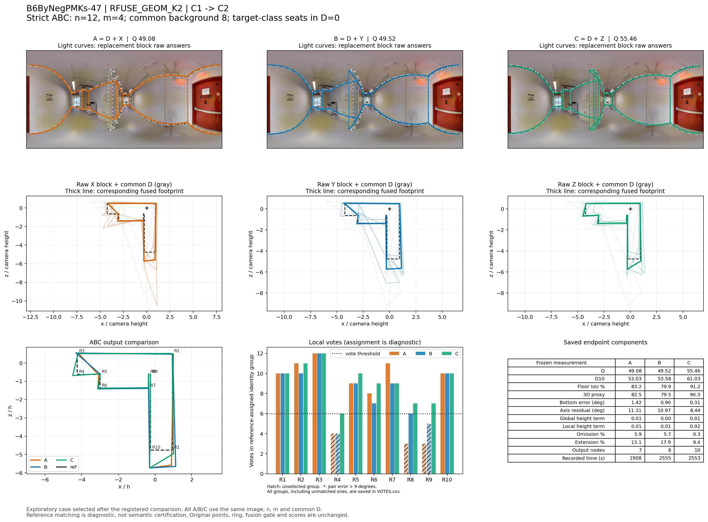
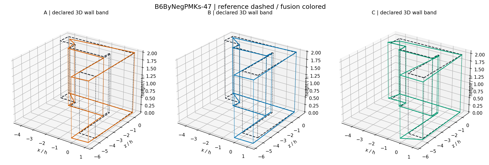

# 反推四人类怎样改变同图融合：B6ByNegPMKs-47

事件 `f261cd4329817662818a5684`，RFUSE_GEOM_K2；**困难图、普通Manual、留出建筑确认阶段**。原图、当前参考及困难标签均未修改。它是全比较之后的机制选例，不能将单例当成总体效果；四个先前screen案例仍保留原阶段身份。

## 1. 选例为何具有解释价值

从反推确认的20,278个事件中，RFUSE_GEOM_K2 n12/m4有118事件、51图、17楼；其中目标类恰4人、全部换入、难度中等或困难的有限域有20事件、10图，19事件三队Q可评。5张图在至少两组XYZ、两种实际背景中均有正Q gap。

本图两组不同XY/D的Q gap为5.718和10.917；选 **较小的5.718**，不取最大值。两事件的中位数为8.318，两者距离中位数相同（2.600），所以不存在一个更接近中位数的实际事件。选择本例还因为A/B质量接近，而C同时发生可解释结构变化。另一背景的Q gap也正，但形状gap为−0.051，完整保留；不能说这张图每种背景下都几何分离。

## 2. 使用的是真实楼外四人类

目标建筑 `B6ByNegPMKs` 的RFUSE_GEOM_K2实际LOBO目标类C2为 **W109、W112、W126、W130**，四人全部换入。四人的训练历史都排除了本建筑：总体图/楼分别118/21、117/21、120/21、127/21；困难支持18、19、19、20图。这里恰好与ALL四人类一致，但事件读取的是该楼的标签，不是用ALL替代。

三队均n=12，实际m=4，换入占队伍1/3；背景8人，目标类席位由0变4。源类当前池31人，X/Y各4人，Z耗尽当前目标类4人容量。

|块|成员|
|---|---|
|共同D|W100、W110、W118、W123、W124、W125、W131、W132|
|原块X|W108、W116、W129、W134|
|同类替换Y|W027、W036、W115、W121|
|跨类替换Z|W109、W112、W126、W130|

A=D+X、B=D+Y、C=D+Z，四块互不重叠。四名Z的原答各有10个节点，并在后述R4/R8/R9的真实融合组里各提供一票。

## 3. 区分度、升质与形状不是同一个量

|冻结量|A原队|B同类换人|C跨类换人|
|---|---:|---:|---:|
|Q（B8L2）|49.084|49.523|55.461|
|D10|53.033|53.579|61.027|
|底面IoU（%）|83.171|79.913|91.158|
|三维棱柱代理|82.477|79.500|90.335|
|底界角误差（°）|1.415|0.904|0.311|
|方向残差（°）|11.308|10.970|8.444|
|整体高度项|0.009|0.004|0.011|
|局部高度项|0.014|0.010|0.019|
|遗漏比例（%）|5.949|5.745|0.271|
|外扩比例（%）|13.081|17.946|9.402|
|融合节点|7.000|8.000|10.000|
|记录总秒数|1907.680|2555.248|2552.798|

B−A **+0.439**，C−A **+6.377**，C−B **+5.938**。同类绝对Q变化0.439，对称跨类变化6.158，gap **+5.718**。底面形状距离d(A,B)=0.062924、对称跨类距离0.133942，形状gap **+0.071018**。

C相对B的底面IoU提高 **11.245个百分点**、三维代理提高 **10.836分**；底界误差0.904→0.311°、方向残差10.970→8.444°。但是C的方向残差仍较大，总Q只有55.46；补出节点并未解决整个图的全部偏差。整体／局部高度项也没有同时变好，不能写成每项全面改善。

记录总时间C相对B约 **-0.096%**，相对A **+33.82%**。这是库存记录劳动秒，不是本轮生产实测；选到不同原队会改变“是否费时”的回答。三队均成功且可评分。

## 4. 四人类的局部作用：让已有背景支持越过6票门槛

|参考组|共同D支持|X支持|Y支持|Z支持|A/B/C总票|结果|
|---|---:|---:|---:|---:|---|---|
|R4|2|2|2|4|4 / 4 / 6|A、B未留；C刚好达到6票|
|R8|3|0|3|4|3 / 6 / 7|A未留；B、C均留|
|R9|3|0|2|4|3 / 5 / 7|A、B未留；C达到门槛|

R4的背景支持者为 **W110/W131**；R8为 **W123/W124/W132**；R9为 **W100/W124/W131**。Z四人各提供上述三处结构的一票。四人自己少于6票门槛，起作用的条件是背景已经提供2或3票：本例是背景与换入块的互补，不是四人可以无背景独立决定全部输出。

A留7节点、B留8节点、C留10节点。相对B，C补出R4与R9；相对A还包括R8。三组C对应的角点对最大角误差分别约0.786°、0.547°、0.829°。参考对应在融合后作诊断，未输入组别或票数。

## 5. 还有真实重对应与中位位置变化

A/B共有的D原观察54个，分组保持相同；进入Z后，D中 **W124/W131** 的两份R7邻近观察从原R7组拆到另一个两票小组，未达到门槛。原7个背景观察分成5+2，使10个共同观察对由同组变为异组。原观察坐标没有变化，变化来自融合重新对应；不能将这部分效果只归因为人员能力或固定组里加四票。

R7仍保留：A/B/C总票11/9/9，C中由5名D加4名Z构成。其中心x由A/B的470.419/470.523移至472.218像素；顶界161.037/158.788→158.512，底界356.894/354.957→357.398。其它组也按全部身份组成员的等人坐标中位数重新定位。例如R4在B/C的顶界中位数220.389→221.623、底界290.524→291.322；新增组是否过票门槛与位置是否更好应分别看。

`GROUP_MEDIANS.csv`保存每组中位坐标、对应参考位置及产生中位数的原观察人员；所有坐标中位数重算与冻结组中心差小于1e−7。`COMMON_D_OBSERVATION_ASSIGNMENTS.csv`保存54个固定背景观察在三队的组、票数与选留，W124/W131的变组可直接定位。

## 6. 真实图像支持什么

原图是红色楼梯门、打印区旁的回字走道；近处突出的白色墙垛造成多个回转，打印机和墙体遮挡了部分底部与背面。图中可直接看见墙垛正面、相邻墙面和若干地面／顶面交线，但不能由单张ERP直接看见全部背面边界。

当前已保存的主线机会解释为“走道近处突出墙垛有密集背面转折，复印机局部挡底部，需推断凹入结构”，机会类型 `geometric_self_occlusion`，参考有10个非冗余转折、3条短边，当前没有未决GT错误记录。本例沿用这一参考及范围：相机所在走道及可见转角，不延伸为整层廊道或玻璃后的房间。

因此本例可以称为 **四人类共同补足参考支持的回转结构，并改善底面／边界**；其中涉及遮挡推断，不升级为“本轮从原图逐角重新证实全部必要结构”。新增节点也不自动等于正确，改善由冻结参考各分项和原图机会共同解释。

## 7. 同图另一背景和局限保留

另一事件 `7248b9578594ea78d8973b49` 使用同一Z四人，但D与XY不同；Q同类/跨类幅度0.795/11.712、gap+10.917，A/B/C为7/7/10节点。它的形状同类距离0.1830、跨类0.1316、gap **−0.0514**：同类在那个背景里也可几何变化较大。两组都支持本图Q区分及结构补足，没有证明所有背景几何都更分离。该事件只引用已存结果，没有再为漂亮图片额外重放。

本例采用理由是：全4人目标类、固定8人背景、同类替换质量几乎不变，而跨类补票与输出结构可直接追踪；保留总体Q仍低、位置残差、对应变化和另一个背景的反向形状结果。总体用途仍由完整逐图／逐楼研究给出。

## 证据与复现

精确事件／所选楼外标签在上级目录；原答和三队全状态在 `CASE_GEOMETRY.json.gz`；逐组票数 `VOTES.csv`；局部支持 `KEY_STRUCTURE_VOTES.csv`；来源时间和分项 `ABC_SCALARS.csv`；所有共同观察关联 `GROUP_OBSERVATIONS.csv`。三队B8L2/D10/底面/三维标量重放与已存端点最大差均为0。
