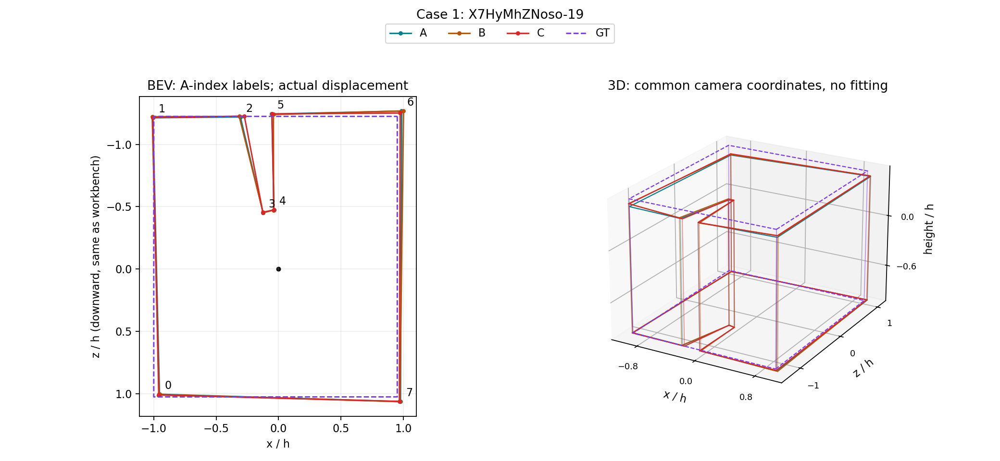
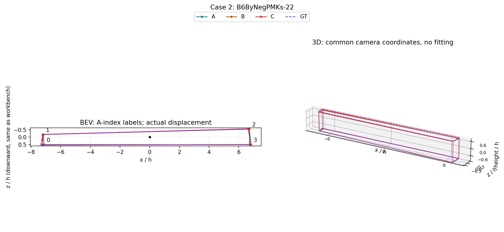
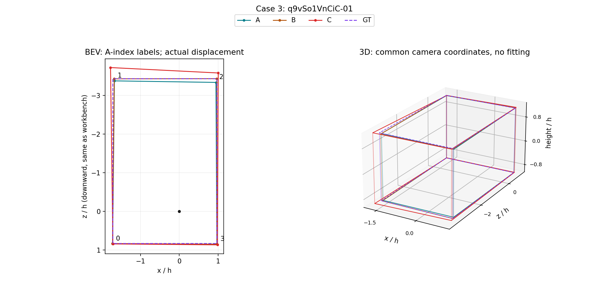
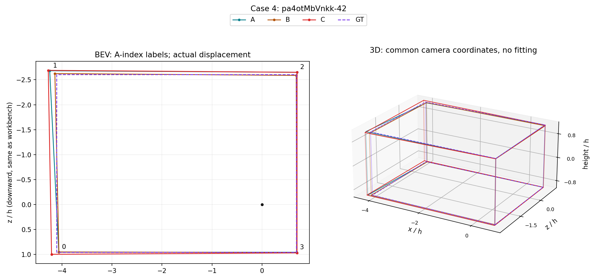

# 四例对应角点：视觉与数值复审（2026-10-20）

结论：用户的观察与逐角点结果基本吻合。前两例的整体形状及高度很接近；第三例A/C出现更大的局部范围变化；第四例两对都有小变形，差异发生在不同角点。第4例尤其说明：较小的Q差不保证较小的几何变化。人员可互换性应直接评价对应几何，而Q用于另外回答质量升降。

## 对应关系和计量

四例分别有8／4／4／4个底面角点，各自团队A/B/C保持相同角点结构。采用原绑定循环球面距离核对B、C与A的对应关系，8次全部为移位0；最优最大角距0.18—1.49°，次优循环移位至少92.89°。结合带编号叠图，未见起点错位或角点串配；不能仅因三个团队都叫node_000就断言身份相同。

沿用展示台几何投影，底面高度为−h，相机高度h=1：半径r/h=cot(π(bottom_y/512−1/2))。x/z由同一水平角求得，顶部高度由对应top_y及底面半径计算；没有平移、旋转或尺度拟合。投影底面与保存融合footprint逐坐标一致（容差1e−8）。**h是相机高度，不是米**，1024×512是坐标图幅，不是实际原图分辨率。

下表单位均为h，均值对一一对应角点等权；最大值定位局部变化，不被其它接近的角点稀释。底面3D距离等于BEV距离（相同底面高度）；顶部3D距离同时包含水平和高度变化。原角度匹配保留历史+0.5像素约定，三维投影使用现用展示台连续坐标，不混用两者。

| 案例 | 比较 | BEV均值 | BEV最大 | 顶部3D最大 | Q绝对差 |
| --- | --- | ---: | ---: | ---: | ---: |
| 1 X7HyMhZNoso-19 | A/B | 0.0081 | 0.0152 | 0.0358 | 0.88 |
| 1 | A/C | 0.0100 | 0.0324 | 0.0326 | 5.44 |
| 2 B6ByNegPMKs-22 | A/B | 0.0510 | 0.1216 | 0.1221 | 0.79 |
| 2 | A/C | 0.0672 | 0.1208 | 0.1273 | 3.00 |
| 3 q9vSo1VnCiC-01 | A/B | 0.0401 | 0.0994 | 0.1065 | 2.56 |
| 3 | A/C | 0.1598 | 0.3583 | 0.3743 | 5.02 |
| 4 pa4otMbVnkk-42 | A/B | 0.0483 | 0.1178 | 0.1325 | 3.43 |
| 4 | A/C | 0.0494 | 0.1508 | 0.1605 | 1.19 |

## 逐例视觉判断

### 第1例：形状近，Q差不能当明显形变

三队保留相同凹槽和角点连接，底面和顶界几乎重合。A/C最大底面位移0.0324h，约为A底面包围框对角线的1.06%，顶部最大距离甚至略小于A/B。虽然A/C差5.44分，不能据此称为明显几何变化；这不是已观察到跨类更换导致缺角的例子。三队相互接近也不代表三队都等同参考（图中紫色参考与凹槽不同）。

### 第2例：长窄空间，微小角度产生可测距离

三队保持长窄四边形，顶界高度也相近。A/B与A/C的最大底面距离几乎相同，分别0.1216h、0.1208h；最大底面y变化均仅0.371像素。该端点远离相机、接近地平线，因而像素变化小仍可有可测的空间距离。最大位移约为该角点相机距离的1.70%与1.69%；不能单用长房间对角线归一化掩盖横向变化，但本例视觉与逐点结果均未显示A/C明显大于A/B。Q阈值却只拒绝A/C，不能将其算作清楚的几何类别分离。

### 第3例：A/C的局部差异确实更大

BEV上侧边C明显向外扩张，左上角最明显。按A的0基编号，是角点1：底面y由298.279变294.798，上移3.482像素；底面角点移动0.3583h，顶部移动0.3743h。A/C平均底面距离约为A/B的4倍，最大值约3.6倍。这支持用户的“A/C有一定区别”，且不是缺点或错连，而是同一结构的局部位置／范围及相应三维几何变化。

### 第4例：两个局部方向均可确认

显示方向沿用研究台BEV：x向右，z向下；编号沿用A的0基角点。

- **左上角1，A比B更向外**：A坐标(−4.2435,−2.6801)，B为(−4.1400,−2.6237)，相距0.1178h。以A→B描述，就是B向右下／向内移动。这对应用户所说的一处“左上外凸”。
- **左下角0，A比C更向内**：A坐标(−4.0623,0.9526)，C为(−4.2068,0.9958)，相距0.1508h。以A→C描述，就是C向左下／向外移动。这对应用户所说的另一处“左下内凹”。这里是相对位置，不是新增凹角拓扑。
- 两对平均底面位移接近（0.0483h／0.0494h），A/C的最大底面与顶部位移反而略大。Q差却是A/B 3.43分、A/C 1.19分，因此原“同类不稳定、跨类稳定”标签不能解释为几何上前者更不相近。两队各分项对参考的改善／恶化可能抵消，标量质量差不等同几何差。

这两处对应是本轮坐标与视觉复审的分析判断；人工反馈只作为案例级依据，不扩展成总体判断，也不改写成先前已逐角点确认。

## 对后续研究的采用

1. 同角点结构的作答／融合可优先用对应角点的BEV均值、最大距离、顶部3D距离及局部方向描述替换变化；同时列相机距离或房间尺度下的相对量，保留绝对h量，不能只看其中一个。
2. 质量升降单独报告。第1、2、4例显示，以Q差作为联合相近判据的一票否决，会改变对实际几何互换性的解释。保留旧数值作历史对照，不直接提高Q容差来追求更好的相近率。
3. 这些指标适用于已建立对应的同结构情形。遇到漏角、增角、错误连接时，继续保留结构事件和范围指标，不能强行最近点配对后宣称变化小。
4. 本轮只是四例的案例复审，不从四例选择全库成功阈值，也不因此宣布已有分类整体成立或不成立。

## 证据与复现

- CORNER_MATCHING.json：对应关系、次优差距及投影合同。
- CORNER_DISTANCES.csv：60行逐角点数据（4例共20角点×A/B、A/C、B/C），含像素、BEV、顶部3D、径向与高度变化。
- CORNER_SUMMARY.csv：12行逐对汇总。
- 工具：`python -X utf8 -m tools.thesis_main.analysis.personnel_corner_review_20261020`。
- 验证：2项投影／地平线敏感性与全景接缝测试通过；12份底面投影与冻结footprint对照通过；四图已视觉检查。使用已有最终几何，没有重跑融合、重选参考或改评分。

这些PNG是研究图表，不是临时浏览器截图，保留以复核对应点及局部变化。
