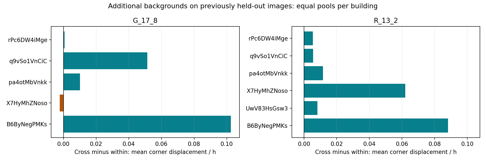

# 451个换类对照的角点距离扩展（2026-10-20）

**采用判断：用户提出的角点距离路线得到实算支持。** 在同数且有唯一循环对应的共同候选中，两个既有方向均表现为同类换块的几何变化平均更小。这个结论来自直接BEV／顶部3D距离，不再由Q分差替代几何。它仍是当前两个方向、人数与图片条件下的结果，不给人员固化新等级。

Pro任务已由用户发送；本轮未修改Pro任务书，只推进Codex评价线和独立核查。

## 同时比较同类与跨类，分母不分开挑

冻结451个A/B/C事件及1353支团队不变。本轮读取最终几何，未重跑融合或评分。

- A/B同数、完整且唯一循环对应：421事件。
- A/C同样条件：403事件。
- **两对同时满足：393事件**。连续距离的同类／跨类对照固定使用这393个事件；不将两臂分别筛选后的均值直接比较。
- 仅A/B可比28，仅A/C可比10，两边都不可比20。58个未同时可比事件留在451总账，不能算成零距离或被忽略。
- 按互斥原因，A/B缺连线3、不完整2、异数25；A/C分别4、1、43。“不完整”优先于“异数”，因此不可用状态计数与不互斥的全部角点数差统计不同。

这些是自动循环对应的候选，角点数相等本身不保证局部结构语义一致；异常实例另列。

## 核心结果：新增共同背景、原留出图片

先在每个事件对对应角点取平均／最大距离，再池内事件均值、楼内池等权、建筑等权。h为相机高度，不是米；“最大距离均值”是每次替换的最坏角点再平均，不是所有事件的单一最大值。

| 方向 | 共同支持（事件／图／楼） | 同类BEV均距 | 跨类BEV均距 | 同类最大距离均值 | 跨类最大距离均值 |
| --- | --- | ---: | ---: | ---: | ---: |
| G2→G1，17人换8 | 59／22／5 | 0.0660h | **0.0985h** | 0.1373h | **0.1996h** |
| R5→R2，13人换2 | 52／18／6 | 0.0238h | **0.0541h** | 0.0610h | **0.1384h** |

- 跨类／同类的建筑等权BEV均距比为G **1.49**、R **2.27**（均值的比，不是每个事件比值的平均）。
- 顶部3D均距同样保留方向：G为0.0778／0.1136h，R为0.0273／0.0613h。
- G的5栋有4栋跨类均距更大，1栋略小；R的6栋全部更大。跨类BEV均距更大的事件比例按同样建筑等权为65.56%和85.65%。这是方向比例，不是新“相近成功率”。
- 以A底面包围框对角线归一后，最大角点距离均值：G同类1.92%／跨类2.73%；R为0.87%／2.03%。h单位量与归一量并列，避免只看房间尺度。

事件层中位数也保留同类较小：G 0.0207／0.0268h，R 0.0121／0.0206h；事件层p90为G 0.2757／0.3022h、R 0.0676／0.1575h。它们与建筑等权均值是不同统计口径，不能混用分母。完整发现／原留出、原重放／额外背景共8层结果均保存，没有只留正面的两个汇总行。

不设置新的数值成功阈值；9°／12°只作为既有邻近角尺度的对应敏感性切片，不表示人工认可相近。上述两组新背景原留出结果在9°、12°切片下支持与数值均不变。

## 并行独立核查发现的两种边界

### 同一环的顺逆序，不是形状变化

新角点诊断先根据底面有向面积统一两环方向，再做循环对应；上下点保持绑定，只改变诊断匹配索引，不改保存几何、融合输出或评分。

- jtcxE69GiFV-30新增背景extra1的A/C：底面IoU约0.99115。旧不许反向的角距69.35°，诊断归一后0.253°；BEV均距0.00571h、最大0.00995h，确实很近。
- q9vSo1VnCiC-30原事件的A/B：旧角距93.74°降至2.254°，但仍有真实单角位移，BEV均距0.2143h、最大1.1798h。方向修正不等于把真实差异抹掉。

这是原工程几何比较的一项具体限制，原no-reverse指标和旧通过率保留，不静默回写。新结果记录ring_reversed、原角距、新角距、循环移位及次优差距。原四例都不涉及反向，因此其数值不变。

### 同样9个角，也可能保留了不同的局部结构

B6ByNegPMKs-47两条A/B事件都为9角，但一方保留内侧细折、另一方保留外侧角；其循环角距约49.73°。仅角点数相同不足以证明逐点语义相同。这两条另一臂异数，未进入393共同子集，仍保存在451总账与PANEL_CORNER_REVIEW_QUEUE.csv。

现有证据足以把它们列为同数不同结构候选，不必为完成本轮统计立即追加人工审图。如果后续要制定这类结构替换的接受规则，再集中交给用户判断。

## 对研究主线的含义

“分类是否有用”可以分成两项直接研究：

1. **几何可互换性**：对应角点在BEV与3D中移动多大；同一构成内部的波动和换类后的变化是否分离。
2. **质量／效率效用**：是否更接近固定参考、低尾如何、时间是否节省。不同几何可能得分相近，近似几何也可能有可见分差。

本轮给第一项提供了更直接的积极证据，尤其R方向在6栋都保留差异。不要据此删掉异数、缺角及失败事件；这些是另一类重要的替换风险。仍属于已多轮探索v2中的有限接续，不是新人员或外部盲测。

## 交付与验证

- `PANEL_CORNER_PLAN.json`：本轮范围、指标和共同分母。
- `PANEL_CORNER_PAIRS.csv.gz`：902次配对尝试及不可用原因。
- `PANEL_CORNER_EVENTS.csv.gz`：451事件共同资格与两臂指标。
- `PANEL_CORNER_POINTS.csv.gz`：可计算候选的逐角点距离和索引。
- `PANEL_CORNER_SUMMARY.csv`／`PANEL_CORNER_BUILDINGS.csv`：8层×3种对应口径与逐楼结果。
- `PANEL_CORNER_SUPPORT.csv`／`PANEL_CORNER_REVIEW_QUEUE.csv`：完整支持及4条检查队列。
- `PANEL_CORNER_CHECKS.json`：关键计数。

复现：`python -X utf8 -m tools.thesis_main.analysis.personnel_corner_panel_20261020`。

3项关键测试覆盖环起点、逆序等价与异数／不完整不补零。独立核查者未调用新compare函数，直接用保存footprint复算393事件的BEV均距，最大误差小于9.1e−16h；两组新背景汇总误差小于1e−12。未重跑58万队或旧全库分析，未变更正式合同、分类、参考、评分与N1。
