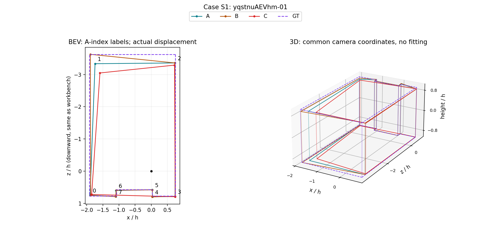
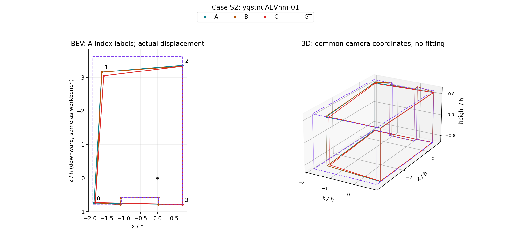
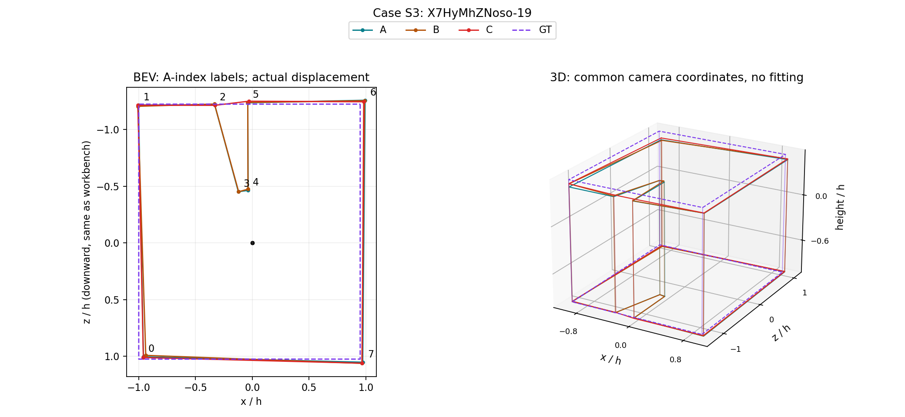

# 结构变化与失败补查：保留全部451个替换对照

2026-10-20，Codex独立验收线。Pro任务已在外部对话推进，本轮未更新其任务书。

## 判断

**两个既有方向继续得到局部支持：新增背景、原留出图片中，跨类替换更容易改变角点数和参考角点集合。** 这一支持不只来自此前393个同角点数候选。与此同时，结构变化可能补回遗漏，也可能消除错误凹槽；不能把变化率直接叫退化率。

因此，人员类别的可互换性、结构正确性和选人收益需要并列评估。当前结果值得继续推进有解释的条件细类，而不应因为存在反例就停止；也不能把两个方向升级为所有类别的结论。

## 全分母与比较

沿用已实际融合的451个A/B/C对照、1353支不同团队、66图、12栋。A/B保持类别构成、替换同类成员；A/C更换类别构成。人数、实际替换规模、背景、参考及来源人数匹配。未重新融合或改变评分。

此前393个事件可同时做两臂对应角点距离比较；另58个事件、14图保留在本轮，不补零。全451事件中，A/B角点数改变29次，A/C改变47次；两臂各5次至少一队质量不可用。这里计事件，不将重复图片或同一失败团队当独立样本。

下表为**新增背景、原留出图片**；先池内事件等权、再楼内池等权、最后建筑等权。比例不是右侧原始事件次数除总数。

| 方向 | 事件／图／楼 | 同类角点数变化 | 跨类角点数变化 | 原始变化事件（同／跨） |
| --- | --- | --- | --- | --- |
| G，17人换8 | 69／23／5 | 8.02% | 13.85% | 6／8 |
| R，13人换2 | 60／20／6 | 2.38% | 5.40% | 3／6 |

参考角点集合对称差（除以参考角点数；9°角度匹配诊断）也保留同类更小的方向：G为0.01220／0.01689（68事件、23图、5楼），R为0.00132／0.01102（58事件、20图、6楼）。相邻边集合差分别为0.02066／0.02382与0.00265／0.01345。每项只在两臂均有该诊断的共同事件上比较，缺失不按零。

失败风险并未普遍呈现跨类更高：质量不可用事件的建筑等权率，G两臂均2.22%，R同类2.70%、跨类1.90%。失败、角点数量和位置变化是不同维度。

## 视觉与数值一致的三个解释案例

A为原团队，B为同类块替换，C为跨类块替换。以下案例是事后解释样例，不增加验证支持量；S1/S2为同一张发现阶段图片，不算两张独立图片。图中编号只标A，不在不同角点数间强行建立对应。

| 案例 | 角点数A／B／C | B8L2 A／B／C | 解释 |
| --- | --- | --- | --- |
| S1，yqstnuAEVhm-01，extra0 | 8／8／4 | 87.37／87.41／69.72 | A/B保留底部局部凹口，C将其拉平；9°参考角点覆盖由100%降至50%，边覆盖由100%降至37.5% |
| S2，同图extra2 | 4／8／4 | 75.03／78.80／69.19 | B补回凹口，A/C都缺失。这里同类变化更大，但变化有益；整体左上范围仍偏离参考 |
| S3，X7HyMhZNoso-19，extra1 | 8／8／6 | 72.35／70.51／92.88 | C消除A/B相对固定参考多出的深凹槽；角点减少而质量提高20.53分。三队参考角点覆盖均100%、边覆盖均75%，单靠覆盖数也看不见全部改善 |

这些图已逐张视觉复核。S3仅说明相对当前绑定参考的改善，没有另行裁定原场景的范围语义。另有B6ByNegPMKs-47的反例：三队均8角点、匹配参考集合相同，但A底面无效，B/C可评分；数量与角度覆盖不能替代几何有效性。

## 投票余量：可解释线索，尚非完整机制归因

按A已选节点的最小票数减门槛，是否小于实际换人数m分层。新增背景的原留出G中，余量不足组18事件／6图／4楼，角点数改变率同类37.50%、跨类50.00%；其余51事件／17图／5楼两臂均未改变。R余量不足组仅9事件／4图／3楼，分别13.89%、55.56%；其余51事件为2.78%、2.78%。这是事后条件描述，图片与人员构成未匹配，不能归因于票数一项。

**余量充足不代表整队结构稳定。** S2的A已选节点最小余量为8、替换人数也是8，原选节点不处于静态失票危险区，但B新增了4个节点。该字段只看已选节点，不覆盖未选节点跨过门槛，也不覆盖换人后重新分簇。机制核查应同时追踪保留、丢失、新增节点及其支持成员，避免只拿原已选节点解释整个结果。后续已完成174队重放和精确票数追踪，见[VOTE_REPORT.md](VOTE_REPORT.md)。

## 指标与复现边界

- 参考诊断沿用存储的上下端点最大角距离、匈牙利匹配及5°／9°阈值；边诊断看匹配参考相邻关系。它们是角度覆盖诊断，不是人工确认的整面墙结构语义。
- 无效底面仍可能有角度诊断。因此几何完整性、质量是否可用另列；不把能算角度误当完整可评分。
- 对称差可发现覆盖率相同、覆盖的角点身份不同；同时保存丢失与新增数量，避免将补回遗漏和丢失结构混在一起。
- B8L2／D10、参考、融合算法、人员标签和原相近判据均未改。当前两方向来自既有搜索，新增背景不是外部盲测；本轮未新拟合Q/T/Semi/盲信/scope分类。

复现入口：`python -m tools.thesis_main.analysis.personnel_structure_tail_20261020`。读取已有冻结团队几何与角点比较清单，不重新计算1353队融合。

交付：STRUCTURE_EVENTS.csv.gz全量事件；STRUCTURE_NONCOMMON_58.csv补查清单；STRUCTURE_SUMMARY.csv逐项共同分母；STRUCTURE_VOTE_MARGIN.csv余量分层；STRUCTURE_CASES.json精确团队成员及参考；STRUCTURE_CHECKS.json计数检查。2项关键测试覆盖同数同覆盖但身份不同、缺诊断与不可评分不补零；独立子智能体另核对全量计数及留出组汇总。
