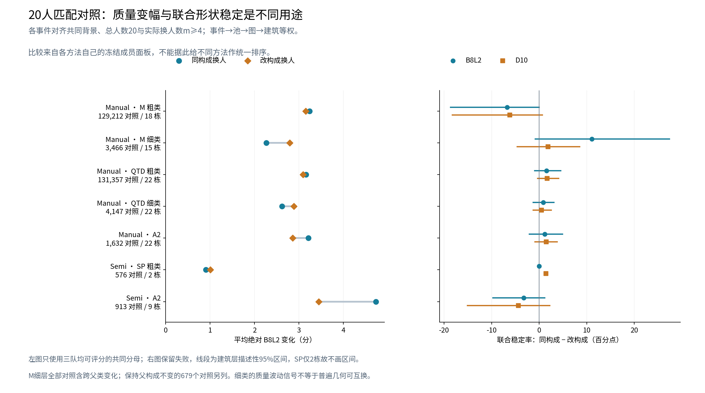
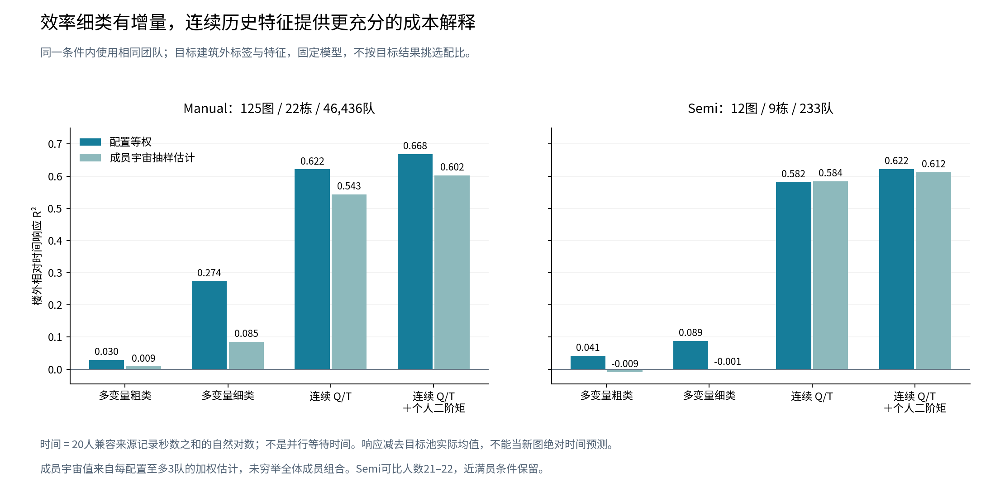

# HOHONET 人员分类与整体构成：事件表修复与第二阶段新实验

2026-10-21。仓库基线为 GitHub main `51b519f943b2dd3a4fb2f0198133ac5dd17209ab`。本报告接续第一阶段的人员分类、整体构成和机制研究，保留两个阶段身份。原生预处理、参考绑定、环序、人员及图片资格、融合参数和评分合同均保持不变；B8L2 为主，D10 为敏感性。同房研究继续独立。

## 1. 结论与类数澄清

**没有把人员限制为三类。用户的 A／B／C 是举例；本实验中的 A／B／C 也只表示三支对照团队。** 类别数 K、团队人数 n、每个人数配置抽取的成员集合数 r、实际换人数 m 是四个不同量。本次 n=20、每格 r≤3，是这一阶段的团队设计；不是 K≤3。现有结构方法有 2 个粗类和 4 个细类，尺度方法有 2 个粗类和 3 个细类，多变量方法在不同楼外折形成 3—4 个细类。当前候选不构成最终类别数的上限；本次没有做穷尽所有 K 的搜索，也不声称“三类最优”。[E1]

本次实际完成三项工作：修复并保存原完整事件表；新增 126,268 个不同团队的原生融合与评分；在已登记的大团队集合上完成 Manual 269,814 个、Semi 1,517 个同背景同换人数的匹配对照。研究得到的采用判断是：

1. **Manual 的 M 结构粗类保留作主要标法解释，细类保留作局部结构与有条件的质量波动解释。** 同图短转折表达具有既有跨图重复证据；新实验中 M 细类在 n20、m=4—5 的部分替换条件下减少质量波动。但整体几何可互换性及细类优于粗类的一般质量配方，没有获得同样强的支持。
2. **新来源 Manual 的 Q/T/难度细类有明确效率用途。** 相同 Q 父类构成下，保持细类构成能减少时间变化；改变较慢细类人数产生可重复的时间方向。在共同端点上，粗→细时间响应误差减少 25.15%／7.73%，两权重均为 22 栋中 20 栋改善。连续 QT 仍更强，细类没有相应质量增益。
3. **Semi 的 SP 保留尺度标法解释，不升级为一般 n20 团队配方。** 总体同构成联合稳定优势接近零；细类的小样本积极结果全部伴随粗构成变化，不能证明独立细分增量。新 Semi 多域细类在 n20 时缺乏大块替换容量，另保留其配置响应和报告行为解释。
4. **A2、Rnew2、F01 保持独立方法身份。** A2 原答关系相似性的旧证据仍有效，新 n20 困难图替换却出现明确反例；Rnew2 在自己的合法支持域未超过连续 QT；F01 本阶段 n20 机会不足。没有将这些方法拼成统一人员树。[E2—E6]

这些结论以实际成员、图片和机会为条件；它们分别回答标法、构成响应、替换、效率和风险。不能用任一项替代其余项目，也不能以共享响应模型的负 R² 否定已观测的局部结构类型。

## 2. 完整事件表已修复，结果按批保存

原文件名标示 12,953 行的精简事件表实际上只有 **6,663 行**。缺失的是末尾 6,290 个事件：普通 Manual 4,219 个、全部 Semi 2,069 个、门洞 2 个。源分析表的 12,953 个事件和原生终点仍完整，因而可以按真实源数据恢复，未重造结果。可以证实的问题是非原子导出和缺少完整主键集核验使一个前缀表进入交付；没有证据确定当时具体由哪次中断造成。[E7]

|交付对象|修复后范围|用途|
|---|---:|---|
|原名称的逐事件关键表|12,953 行 × 95 列|快速阅读；已替换原不完整文件|
|完整事件表|12,953 行 × 719 列|保留原差值、A/B/C 实际成员及三队绝对终点字段|
|普通 Manual 分表 1、2|4,000／3,835 行，各 719 列|单独取得，合计 7,835 个事件|
|普通 Semi 分表|2,069 行 × 719 列|单独取得|
|门洞 Manual 分表|3,049 行 × 719 列|保留独立资格分层|
|完整字段字典|719 行|含定义、单位、来源及缺失语义|

修复检查包含行数、列宽、唯一事件 ID、冻结请求的精确主键集合、成员及构成向量，并对打包后文件再次读回核对。现在导出采用临时文件、写完关闭、完整读回及原子发布，未完成文件不作正式交付。新实验的事件表为另一版本的 **697 列合同**，保留独立字典，不将两版列数不同误认为缺列。

新增原生终点分 6 批保存；新 Manual 事件分 9 批保存，分别为 161、17,305、30,442、5,179、35,455、55,667、30,612、40,330、54,663 行，互不重叠，合计 269,814 行。Semi 1,517 行单独保存。中间曾检出配置 gzip 末尾不完整及一个事件片 gzip 不完整，均在正式发布前由校验拦截；按原 seed／请求恢复，未改变标签、人员集合或重新选择结果。修复和异常回执一并保留。[E1、E2、E7]

## 3. 本轮新增覆盖的精确范围

### 3.1 研究库存与实验人员域

第一阶段整合的非 OOS 行为库存仍为 **9,217 份作答、62 人、233 图、22 栋**；正式融合库存为 **7,302 份作答、229 个条件／参考绑定人员池、196 张不同图片、22 栋**。历史筛除记录、GT 暂停图可用于行为观察，标签不授予正式组队资格。本阶段只扩展具有 n20 容量的普通任务池，门洞和特殊范围继续由第一阶段独立结果覆盖，没有混入这批普通任务效果。[E0、E1]

本轮六个方法×条件的 **48,321 个可行完整类别人数向量全部取得结果**。每格至多 3 个具体成员集合；144,666 条方法／配置／成员引用去重为 144,642 个实际团队，其中 18,374 个复用，126,268 个新增。整体覆盖 190 个任务池、168 张不同图片、22 栋；同图 Manual 与 Semi 是不同池。[E1]

|条件／方法|适用池|登记层级全部人数配置|楼外登记层 K（细层／A2单层）|本轮角色|
|---|---:|---:|---:|---|
|Manual M|168|15,555|4|结构粗／细构成与替换|
|Manual A2|168|13,933|3|原答关系分区对照|
|Manual 新来源 QTD|136|15,530|3—4|Q 父层与效率细层|
|Semi SP|21|444|3|尺度粗／细构成|
|Semi A2|22|2,724|3|独立关系分区对照|
|Semi 新来源 Q/T/scope/Semi|21|135|3—4|报告行为层及配置响应|

粗层复用同一方法细层登记的具体团队，粗构成投影不重复计作新团队。不同方法的团队集合也按实际成员去重，确定性终点只计算一次。

### 3.2 三种“全部组合”分别记账

|组合空间|已完成|尚未完成／解释|
|---|---|---|
|本阶段选定方法、n20 的类别人数配置|48,321／48,321 格|这是本阶段真正完成的配置全覆盖|
|全方法、全部原登记人数的配置|累计 112,307／1,847,304 格|仍有 1,734,997 格未触及；包括新团队对其它合法方法的附带覆盖|
|本阶段登记的具体团队|144,642／144,642 个|含复用 18,374；每格至多 3 队不等于穷尽成员|
|六方法合法 n20 成员集合的去重总体|164,388／74,401,305,315,356 个|包含前阶段所有符合本域的 n20 团队；剩余 74,401,305,150,968 个|
|这批有限团队面板内的合法匹配对照|Manual 269,814；Semi 1,517，全部完成|全人口所有成员三元组未穷尽|
|加入顺序与全部前缀|本阶段未展开|第一阶段 243,030 条末两步路径及近全员 129,046 个集合保持原身份|

本阶段只有 168 格穷尽了格内成员，其中 148 格仅有一个集合。单集合格、全员唯一集合不能估计同构成换人的波动。成员总体极大，主要来自 Semi 的最高 46 人池；单池 C(46,20) 已为 5,608,233,007,146。没有把抽样写成全成员完成。

本阶段新增原生融合的实测主进程墙钟合计 1,232.46 秒，平均 102.45 队／秒，六批分别保存执行回执。该速率已包含当批便携表导出，未计人为停顿、打包持久保存及后续分析，不能推为任意规模的固定速率；剩余成员数、固定吞吐假设下的量级估计、完整有序序列数均在覆盖表中列明。[E1]

第一阶段与本阶段合并，累计 **418,172 个不同实际团队**，不是把历史 583,261 个请求键全部重新运行。新 126,268 个中 125,370 个可评分、530 个少于四点、368 个连接失败；失败全部保留。[E1]

## 4. 推荐保留的实际分类

### 4.1 Manual：结构表达与效率分别交付

M 的结构统计扣除了近共线冗余，比较同图、同条件的转折和短边机会；其细类不会把“多点”一律解释成保留真实结构。当前全数据展示标签为 59 人已分配，完整 62 人名单保留未知原因。目标图片的实验另用目标建筑之外标签。[E0]

|M 类别|全数据人数与实际成员例|可见含义与采用用途|
|---|---|---|
|M0 粗类|40 人|常规或较简化表达；不是统一的低质量类|
|M1 粗类|19 人|同一结构机会下较常表达短转折；困难结构的差别更明显|
|M00|6：W008、W029、W030、W034、W035、W037|较少转折；与增加近共线点的行为分开|
|M01|34 人|常规转折比较组，保留类内位置差异|
|M10|13 人|条件性较多转折|
|M11|6：W002、W109、W112、W115、W126、W130|较强短转折表达，适合追踪局部补票与稀释|

旧修正后的有效检查为 M1−M0 同图转折差 +0.6071、困难图 +2.1644、短转折边差 +0.3359。它们是跨图标法结果，不因本轮某些换人结果反向而失效。M11 在已有 pa4-10 案例中的局部 7→9 票、跨过 8 票门槛仍是实际结构补充证据；同类并非每图、每处都保留。[E0、E8]

新来源 Manual 的 `MV_QTD_manual_new` 使用自身 Manual 历史，最终展示层为 35 人、两个 Q 父类和三个叶类；楼外折可形成 3—4 个叶类。最终三叶来自当前训练规则和容量，不来自用户限制。

|最终叶类|人数|实际成员|
|---|---:|---|
|QH：较高 Q，未进一步拆分|15|W102、W104、W109、W110、W112、W114、W115、W118、W122、W123、W125、W126、W130、W131、W134|
|QL.1：较低 Q、较快|11|W103、W107、W108、W111、W113、W116、W117、W120、W124、W127、W132|
|QL.2：较低 Q、较慢|9|W100、W101、W105、W106、W119、W121、W128、W129、W133|

这两个低 Q 细类的结构差异弱，较慢不表示保留更多真实细节，也不表示质量更高；不将其命名成结构类。旧原答楼外时间差约 1.595 倍，22/22 楼同向。本阶段又从冻结训练特征独立核对了 22/22 楼的慢类方向，并用实际 n20 配比和替换验证其效率用途。[E0、E2]

### 4.2 Semi：尺度与报告行为分开

SP 粗类为较低推导高度倾向的 `SP_LOW` 5 人与 `SP_OTHER` 54 人；细类为 `SP_L` 5 人、较大底面积倾向 `SP_A` 5 人、常规尺度 `SP_T` 49 人。SP_LOW／SP_L 为 W029、W030、W035、W105、W119；SP_A 为 W012、W031、W034、W037、W131。它们表达相机高度归一化坐标中的终稿倾向，不是实测房高、心理动机或错误率类别。[E0]

新来源 Semi 多域方法独立使用自身 Q/T/scope 与编辑报告，35 人形成 14／21 人父层及 4／10／17／4 人细层。缺乏精确初始化的 525 条新记录只能支持“报告编辑／未报告编辑”和“报告错误机会下未改”，不能复原删点、补点或重定位轨迹。本轮保持其探索身份，未借用 Manual 的效率结论充当 Semi 验证。[E0、E4]

A2 在 Manual 的三组成员数为 17／23／19，Semi 为 24／17／18。它由跨图原答关系形成，不直接比较不同图片的簇编号。已有匹配 Q、来源和共享角点数支持后的同类−异类连续边界差，Manual 为 −0.4961°、Semi 为 −0.2434°，保留其原答关系用途；本轮实际检验表明，相似原答并不自动产生相似团队贡献。[E0、E2、E3]

完整逐人标签、类成员和缺失原因沿用已保存的 Manual／Semi 长表。全数据展示标签、Rnew2/F01 的原历史冻结身份及验证楼外标签分别保存；本阶段没有根据目标结果重标人员。

## 5. 同构成换人和改变构成：新大团队实测

### 5.1 匹配设计及共同分母

每个事件固定 n=20，A∩B=A∩C 为同一背景，A→B、A→C 实际换人数相同且 m≥4。A/B 完整类别人数向量相同，A/C 不同。B→C 的实际净换人数另外记录，不能与前两条边混写。选择依据为人员、类别与集合关系，不按目标 Q 选出正例。粗／细使用同一方法的原登记团队面板。[E2、E3]

Manual 共 269,814 个方法×层级事件，涉及 164 池、22 栋；264,867 个三队均完整，4,947 个至少一队失败。Semi 共 1,517 个，1,506 个三队均完整，11 个含失败。跨方法或粗细层可能复用物理三元组；事件数不是独立样本数。汇总按事件→池→图→建筑聚合，建筑等权；区间是探索后的建筑层描述性 bootstrap，不宣称新盲测。

联合稳定要求两终点完整、|ΔB8L2|≤2、点数相同、底面 Jaccard 差≤0.05、循环边界角差≤3°。D10 仅替换质量项。绝对质量差只比较三队均可评分的共同分母，稳定率保留失败；“稳定”不表示正确。

|方法／层级|事件／图／楼|实际 m|同构成／改构成绝对 B8L2 变化|联合稳定率差：B8L2／D10|
|---|---:|---:|---:|---:|
|Manual M 粗|129,212／87／18|4—14|3.236／3.152|−6.76／−6.16 pp|
|Manual M 细|3,466／67／15|4—11|2.262／2.794|+11.09／+1.85 pp|
|Manual 新 QTD 粗|131,357／105／22|4—13|3.157／3.094|+1.57／+1.70 pp|
|Manual 新 QTD 细|4,147／103／22|4—10|2.617／2.884|+0.86／+0.49 pp|
|Manual A2|1,632／154／22|4—9|3.209／2.862|+1.16／+1.49 pp|
|Semi SP 粗|576／5／2|4—16|0.904／1.005|−0.01／+1.43 pp|
|Semi A2|913／17／9|4—13|4.734／3.443|−3.22／−4.35 pp|

这些行来自不同方法的合法面板，不能直接作统一优劣排名。共同端点的模型对照另见第 6 节。

### 5.2 M 细类的新价值：质量波动有条件地较小

M 细类三队可评分的 3,367 个事件，改构成比同构成的绝对 Q 变化高 **0.532 分**，区间 [0.073,0.988]。后续匹配来源人数的 799 个事件仍高 **0.481 分**，[0.088,0.939]；再要求两条替换边楼外块均值 Q 变化≤5 分，408 个事件为 +0.911 分，[0.128,1.855]。更紧的≤2 分只剩 109 个事件且区间跨零。先评价总作用，再做匹配；没有把 Q 配平当作前置条件。[E2]

它不构成一般形状可互换结论：联合稳定优势在 D10 下从 +11.09 降到 +1.85 pp，来源匹配后的 B8 稳定差约为零。同／改构成底面 Jaccard 差为 0.02682／0.02825，平均高度棱柱差 0.03111／0.03288，质心差 0.03842h／0.03969h，几何差异区分较小。

真正保持 M 父类构成不变的细类替换有 **679 事件、50 图、13 栋、m=4—8**：绝对 Q 变化 2.842／3.179，稳定差 B8 +8.17 pp、D10 +4.75 pp，但区间均跨零。不能把全部 M 细类样本的优势全归于父类内部细分。

m 响应给出更明确条件：m4 的 2,143 个事件，绝对 Q 差优势 0.365 分；m5 的 973 个事件为 0.550 分，两者区间为正。m5 的 B8／D10 稳定差为 +6.23／+7.28 pp，区间也为正。m6 的 253 个事件反向，m7 以上支持迅速减少。采用范围落在当前 n20、m4—5 的这些成员与图片机会，不能假装整条 m 曲线同向。[E2]

M 细类的>5 分损失为 3.70%／4.05%，>10 分损失为 2.36%／2.36%；B/C 失败率为 0.503%／0.435%。较小平均波动没有自动减少所有失败或低尾。池内绝对 Q 差 p95 的建筑等权均值为 5.765／6.709 分，它不是全人口总体 p95。

### 5.3 难度与 Semi 的具体反例

M 粗类总体未给同构成优势，但困难图的 48,576 个相关事件、14 图、8 栋中，改构成绝对 Q 变化比同构成高 1.118 分，[0.248,2.477]，联合稳定差却只有 +0.48 pp。说明质量幅度与形状稳定不是同一结果。

A2 在 Manual 简单图稳定差为 +4.25 pp；困难图 263 事件、27 图、14 栋为 **−11.90 pp**，[−20.40,−3.94]，同构成绝对 Q 变化反而高 2.449 分。这是当前 n20 困难条件的明确限制，未推翻 A2 同类原答较相似的独立结果。[E2]

Semi 的所有新增匹配事件均来自简单图。SP 细层另有 28 个对照，稳定差 +17.76 pp，但它们全部已包含在 SP 粗层，且全是跨父类构成变化；没有同父类内部细块替换机会，不能作为细分增量。新 Semi MV 的池内有标签人数 21—22，n20 最大 m 只有 1—2，因此无 m≥4 对照是容量不足，不是效果为零。[E3]

## 6. 效率细类与连续对照：明确的新用途

### 6.1 固定 Q 父类构成，细类使成本变化更可解释

新 Manual QTD 保持父构成不变的 **1,319 个事件、100 图、22 栋、m4—8**，同／改细构成的平均绝对 log 时间比为 **0.06658／0.08252**；差 0.01595，[0.00499,0.02883]。超过对称 10% 时间比例门槛的风险为 **25.34%／34.41%**。对应 B8／D10 联合稳定差仅 +0.47／+0.25 pp，主要增量清楚地落在时间。[E2]

进一步只取 QH 及其它细类人数不变、QL.1↔QL.2 转移的 875 个事件，慢类方向从目标建筑外的历史时间确定：

|B→C 变化|事件／图／楼|记录总时间变化|B8L2 变化|>5 分损失|>10 分损失|
|---|---:|---:|---:|---:|---:|
|减少较慢 QL.2|432／87／22|−4.59%，[−6.88,−3.09]|−0.848，[−2.038,+0.111]|5.98%|4.39%|
|增加较慢 QL.2|443／86／22|+4.71%，[+3.13,+6.70]|+0.458，[−0.179,+1.193]|3.40%|0.63%|

两组质量可用事件分别为 430、438，时间为全部 432、443；失败另计。A→B、A→C 都匹配 m4—8；**B→C 净换人数均值为 2.76／2.81，慢类人数变化均值 −1.67／+1.76**，不能称净块每次也换 4—8 人。D10 变化为 −0.862／+0.441，方向一致。平均 Q 区间含零没有消除实际质量损失尾部。

这里时间是 20 人原来源记录秒数之和，模型取自然对数；不是最大等待时间或并行完工时间。仅使用时间齐全、来源兼容的团队，新批来源为 `user_processed_reported_not_raw_log_replayed`，未重放原日志。以上是这些记录团队的实际构成差，不是心理动机解释或随机试验的因果承诺。

### 6.2 共同端点证明效率细分有增量，也显示连续历史更充分

全配置分析先在各类原有支持域评价总作用，不以 QT 完整性筛掉类别效用；再分别在 M 网格和新 MV 网格取共同合法人员、共同端点，比较粗、细与连续基线。标签、Q/T 特征及模型系数都排除目标建筑；同一外层折对训练和目标使用同一映射。没有择优只报告一个网格。[E4—E6]

共同新批 Manual 域为 **125 图、22 栋、46,259 个质量队／46,436 个时间及失败队**。实际共同人数 21—35，中位 30，106 图至少 25 人，已扩展到非近满员情形。下列成对值依次为配置等权／成员组合规模加权抽样估计。

|模型|Manual 时间响应 R²|Manual B8 响应 R²|
|---|---:|---:|
|M 粗类|0.0265／0.0021|0.0260／0.0112|
|M 细类|0.0283／0.0062|0.0249／0.0102|
|新 QTD 粗类|0.0295／0.0088|0.0201／0.0020|
|新 QTD 细类|0.2736／0.0854|0.0186／0.0015|
|连续 QT 均值|0.6215／0.5432|0.0239／0.0086|
|连续 QT 加个人二阶矩|0.6684／0.6021|0.0242／0.0071|

新 QTD 细替粗对时间的 MSE 收益为 **25.15%／7.73%，两权重均 20/22 楼改善**；M 网格共同域同样改善 6.63%／7.38%。加入充分 QT 二阶矩后，细类基本不再提供额外时间预测信息；这是可解释分类与连续数值预测的用途区别。质量没有出现相应改善。

M 的原人员域粗→细 B8 MSE 仅减少 **0.553%／0.129%**；在新批共同域细类略差，且 102 个质量池确有同粗内细构成变化机会，不能将这个负增量归为全无机会。A2 自身网格 B8 R² 为 0.0546／0.0094，但在新批共同端点为 0.0177／0.0019；因此不能拿不同人员域、不同配置权重的分数直接排名。[E4、E5]

Semi 共同新批域仅 11 图／8 栋／215 个质量队，时间为 12 图／9 栋／233 队，仍主要是 21—22 人池的近满员。新 MV 细类时间 R² 只有 0.0886／−0.0012，连续 QT 为 0.5820／0.5838，加二阶矩为 0.6223／0.6124。SP 宽域 21 图、12 栋的细替粗 B8 误差增加 **1.84%／1.65%**，不推荐把细分升格为一般质量配方。[E4、E5]

Rnew2 保留原合法外楼映射，可评 63 池、12 栋、1,640 个质量终点，其类别 B8 R² 0.0250／0.0002，同端点 QT 0.0519／0.0161，类别没有额外超过 QT。F01 的 76 池没有合法原楼外映射，其余 92 池原有标签成员仅 8—17 人，无法组成 n20，记机会不足。

**这些 R² 都是相对目标池实际均值的响应检查。** 目标池均值参与定义相对响应，不用于拟合回归系数；不能写成对未知新图绝对质量或时间的部署预测。负 R² 说明当前跨建筑共享模型没有超过这个相对均值基线，不说明所有局部构成效应为零。每格至多 3 队形成的成员规模加权结果仍是估计，不是全成员实测。

## 7. 各分项与实际原图机制

### 7.1 不只看底面重叠

完整事件表保留 B8L2、D10、底面边界、ERP 顶底位置、方向、Hmean、Hcenter、平面范围、平均高度、三维代理、参考节点／边召回、遗漏／扩展、失败及时间。Manual 匹配分析保存 310 个指标的全部分层统计；共同端点模型保存 16 种结局和全部固定模型尝试，含负结果。[E2、E4]

共同新批域、成员规模加权下，M 粗类对 Hcenter／Hmean 的响应 R² 为 0.0304／0.0234，三维代理 0.0206、底面 IoU 0.0131、角点数 0.0079、遗漏／扩展 0.0040／0.0123；细类未整体改善。失败响应很弱，M 粗类约 0.00007，其他方法多在零附近或负值。Semi 的 `yqstnuAEVhm-01` 有 6 个配置、18 队全部连接失败，质量不可评，但失败分母保留；全失败的零变化不表示稳定正确。[E4、E5]

### 7.2 新增 q9-15：角点数和门槛没变，坐标中位数仍会变化

本阶段按 Release 索引取得一张新的实际原图，形成同图两个正反对照。它们是事后机制选择，不能估计发生频率，也不能单凭两个例子排除来源影响。六支团队都输出 4 角、门槛均 10 票；共同观察的共组关系变化均为零，差异不能归为重分组或节点过门槛。[E9]

|真实对照|A／B／C 的 SP_LOW 人数，其他补足20人|匹配规模|A／B／C 的 B8L2|
|---|---|---|---|
|支持型个例|1／1／4|A→B、A→C 均换15人，共同5人|69.957／71.461／77.451|
|同图反例|4／4／5|两边均换13人，共同7人|73.313／69.742／73.468|

支持例的同／改构成绝对 Q 差为 1.505／7.494；反例为 3.572／0.155。两者 D10 保留相同方向。支持例从 A 到 C，底面 IoU 0.75405→0.80478、extension 0.32618→0.24202，平均推导高度／参考高度 1.01512→0.99436，但方向误差 0.88411→1.73296、Hcenter 0.00860→0.01584，分项并非全部改善。

在约 ERP x=460 的对应位置，支持例 A/B/C 底点 y 中位数为 324.0000／324.0000／328.5698；反例为 327.9342／324.0000／326.6925。116 条真实观察逐条保存。SP 类反映历史尺度倾向，但同类内部的位置分布仍不同，固定类人数不能固定坐标中位数。这是补充旧门槛案例的一种具体传递机制。

两例来源构成未完全配平，时间不完整；不将整队差异独立归于 SP，也不报告伪造的效率。只重放六个已有团队取完整票账，几何与缓存逐值一致，新增终点和评分均为零。ERP 采用既有 1024×512 坐标，3D 相机高度固定为 1，是既有代理，不是实测物理房高。

### 7.3 旧结构机制继续保留，语义未知集中列出

第一阶段 pa4 的 M11 补票、jtc 的必要结构失选、rPc 同类个人 Q 接近却少关键票、31→30 人时门槛和旧观察重分组共同改变的案例，继续作为独立机制证据；本阶段没有原样重跑这组实验。它们分别说明结构补充、局部稀释、定位支持和算法对应的作用，不能全部归为人员能力。[E8]

“真实必要结构”“参考省略的真实细节”“不同范围”“冗余点”“错误或定位偏差”保留不同语义。可从几何直接认定的近共线冗余与可见位置差按实际记录描述；rPc 开口附近额外角、pa4 遮挡边界等缺乏唯一物理裁定的少量局部继续未知，不因参考点数较少就自动判错，不要求用户逐对审查大量作答。

## 8. 26 域组合账、scope 与前阶段成果如何接续

五域为 Q、T、难度 D、scope、Semi；“二至五”是域的数量，26 个子集不是类别数。前阶段已逐项核对旧登记，并实际拟合 Manual 26 个、Semi 不含 D 的 11 个；Semi 含 D 的 15 个因自身机会不足保留未知。统一 Ward K2 是那一阶段筛查规则，不是后续分类类数上限。[E0、E10]

本阶段没有把新 126,268 个团队包装成“26 个子集都完成深入验证”。只对 **Manual Q+T+D** 与 **Semi Q+T+scope+Semi** 两个已冻结多域方向追加 n20 深研，其余保留原完成度；M、SP、A2 另列结构／关系方法覆盖，不冒充五域子集。Manual QTD 为 15,530 个配置、46,447 个登记团队、135,504 个方法×层级匹配事件，含 1,319 个父类内细换类；Semi 多域为 135 个配置、395 个团队，m≥4 无容量机会。[E10]

旧 245 个实例、188 个正向候选、同 26 人七字段 Full／删域 16 法、768＋1,040 个真实替换反推候选、直接 m2 块学习的负结果，均保留已有标签／筛查／真实构成／独立复核身份。旧 QTDS 的 S 是结构，不是 scope；本轮没有重跑旧高低 Q／快慢全搜索，也没有把旧较大替换写成从未实施。

scope 辅助分析依据用户讨论区分范围表达政策、开口处理和图像可见性。233 张库存图没有逐图独立裁定的 enclosed／extended 加可见性政策标签，保持未知；93 条可兼容裁定全正确，缺乏形成质量类型的变化。原 23 张普通 Manual 匹配事件面板中，新批回答全部为 in-scope 的 4 张图恰好都是简单图，不能把相应差异独立归于 scope，也不能外推为完整普通库存或全部来源。旧 scope 标记条件下换人结果方向不同，作为条件性关联记录，不更改 GT、OOS 或人员资格。新 Semi 的“未改”“修改”仍不等于盲信或修对。[E11]

## 9. 接入研究台、复现和分批文件

分类联接保留 `method_id`、`condition`、层级、标签快照与目标楼外折；类编号只在该命名空间内有效。团队以精确人员集合和任务池去重，事件保留 A/B/C 成员、共同背景、替入替出块、完整类别向量、n、m 与来源。旧 719 列和新 697 列事件分别使用对应字典，不能仅按列序拼接。[E7、E12]

关键成果均可单独取得：修复完整表及四个分表、Manual／Semi 标签、阶段覆盖账、新事件字段字典、匹配关键表、共同端点全分项表、875 个方向事件、中文总报告及自包含 HTML。完整新事件分九个 Manual 包和一个 Semi 包，六批原生结果另存；总索引给出路径、行数、大小和 SHA256。小型整合包只收报告、关键表、绘图代码与恢复引用，不重复全量缓存、原图全集、虚拟环境或旧仓库输入。

保存遵循完成一批即保存：设计和请求先冻结，原生结果逐批闭合，事件逐池验证后组成不重叠批，分析表与图随后各自保存。当前修复、六批新终点、九批 Manual 事件、Semi 事件、两条件配置分析和新机制案例均已经形成可恢复文件。`BATCH_STATUS.json` 与完整文件索引记录各阶段，不依赖最终一个大 ZIP。

复现先使用原阶段包和相同仓库基线，再按设计及请求恢复本阶段分批结果；完整命令见各专题复现说明。原生输出已有时，覆盖汇总、配置响应、匹配事件统计和科学绘图均可只用已保存小表与精简几何。没有完整缓存时，仅按精确缺失团队补算，不重跑同集合的等价终点。

本轮还完成了一次限定风险的独立数值复核：重聚合关键误差、核对 5,972 条旧标签、44 个外楼特征回执及 16,232 个同端点池×指标组；粗细与 QT 的独立重算差在浮点舍入量级。它是复现检查，不是用大量审计替代研究，也不声称所有模型假设因此成立。[E6]

## 10. 证据文件索引

|编号|文件与阶段身份|
|---|---|
|E0|前阶段 `../../report/REPORT_ZH.md`；`../../integration/MANUAL_LABELS_LONG.csv`、`SEMI_LABELS_LONG.csv`、`CLASS_MEMBERS.csv`、`VALIDATION_LABEL_INDEX.csv`；旧分类修正数沿用其当前有效版本。|
|E1|`../next_stage/coverage/本批计算与组合覆盖回执_20261021.md`、`N20_COMPLETION.json`、`N20_METHOD_COMPLETION.csv`、成员总体与逐批执行表。|
|E2|`../n20_abc/MANUAL_N20_FINDINGS_ZH.md`；`checkpointed_manual/summary/` 全分项、来源、难度、m 响应和尾部；`time_analysis/` 的1,319父内与875方向事件。|
|E3|`../n20_abc/results_semi/RESULTS_ZH.md`、`N20_ABC_ALL_COMPONENT_EVENTS.csv.gz`、主结果和完整指标表。|
|E4|`../n20_analysis/manual/N20_FINDINGS_ZH.md`、`../n20_analysis/semi/N20_FINDINGS_ZH.md`；逐池、逐楼、全部模型尝试、配置成员与机会表。|
|E5|`../n20_analysis/N20_INTEGRATION_NOTES_ZH.md`、`N20_COMMON_ENDPOINT_DECISION_TABLE.csv`、`N20_COMMON_QT_HIERARCHY_INCREMENT.csv`、两权重说明。|
|E6|`../next_stage/analysis_check/NEW_ANALYSIS_CHECK_ZH.md`、`NEW_ANALYSIS_CHECK.json`、`RECOMPUTED_METRICS.csv`。|
|E7|`../event_repair/ready_batch02/ABC_EVENT_RESULTS_COMPLETE.csv.gz`、`EVENT_FIELD_DICTIONARY.csv`、`FULL_REPAIR_RECEIPT.json`、旧前缀缺行诊断与修复说明。|
|E8|前阶段 `../../evidence/README_ZH.md`、五个真实案例与完整票账；本轮复用，非新样本。|
|E9|`../evidence/README_ZH.md`、两例完整JSON、`POSITION_MEDIAN_OBSERVATIONS.csv`、六终点质量与票账、实际Release原图回执。|
|E10|`../integration/PHASE1_PHASE2_DOMAIN_SUBSET_COVERAGE_26x2.csv`、`N20_METHOD_CONDITION_TIER_COVERAGE.csv`、`STAGE_COVERAGE_LEDGER_ZH.md`。|
|E11|`../scope/SCOPE_FINDINGS_ZH.md` 及辅助证据包；不重新裁定范围或评分。|
|E12|`../n20_abc/N20_MATCHED_EVENT_FIELD_DICTIONARY.csv`、`REPRODUCE_MATCHED_N20_ZH.md`；本目录研究台字段说明及全部文件索引。|

源仓库：[Sparkling-Flames/3D_Manhattan_label](https://github.com/Sparkling-Flames/3D_Manhattan_label/tree/51b519f943b2dd3a4fb2f0198133ac5dd17209ab)。类别和方法、全部成员、全部顺序没有被宣称穷尽；本阶段登记的全部人数配置、原生请求和有限面板匹配对照则已完成。总体质量、局部结构、效率与失败各保留自己的证据和分母。
