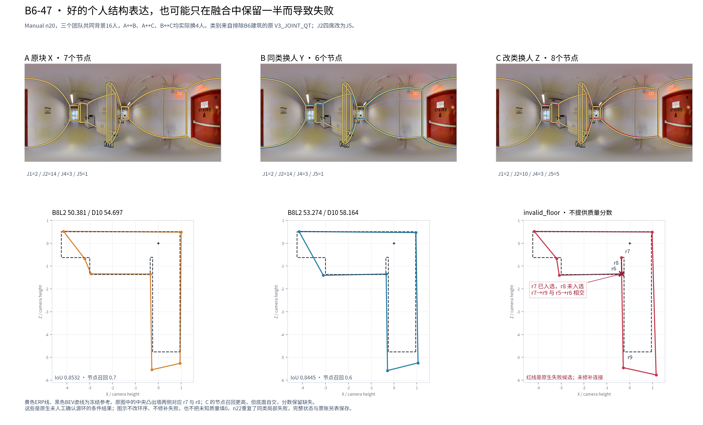

# B6-47：四位高历史Q、相对较快的人员补出了真实结构，融合为什么仍失败

## 结论与案例身份

这两例提供的是**结构补充传递到融合的具体失败条件**：换入者都完整画出了中央凸出墙的两个相邻角，融合却只选中其中一个角。冻结的源环投影因此跨过另一角直接连向远端；与本队的实际中位定位结合，形成自交底面。新增角点、较高个人Q和相近记录时间，在这里没有保证可用的融合终点。

本包使用的是 **原 V3_JOINT_QT 的 Manual 楼外分类**，排除了 B6ByNegPMKs 建筑；不是本轮新建的 Manual+Semi 联合类别。目标折有5类。J2与J5只是本折编号，含义由本折历史中心定义，不套用ALL编号。两个事件均已在 `joint_exchange/NATIVE_MANUAL_EVENTS_COMPLETE.csv.gz` 登记；本包在看到结果后挑选失败案例解释机制，不用于估计发生率，也不重新选择类别。

仅重放已有6个不同成员集合来导出完整状态。所有重放 `candidate` 的SHA与原生缓存几何完全相等；**新增团队0、评分调用0**。端点分项直接读取缓存；`invalid_floor` 的质量分数保持缺失。底层数据仍是v2，V3只是前轮研究号。[证据：`CASE_EXPORT_RECEIPT.json`、`EXACT_EVENTS.csv`、`CASE_ENDPOINT_METRICS.csv`]

## 1. 两个严格事件实际换了谁

|项目|n20事件|n22事件|
|---|---|---|
|event_id|b9dd6bd002ac8d1aa20cc271|bdfb5373fcacd0d5c9ec00eb|
|共同背景人数|16|18|
|A、B构成|J1=2，J2=14，J4=3，J5=1|J1=2，J2=15，J4=4，J5=1|
|C构成|J1=2，J2=10，J4=3，J5=5|J1=2，J2=11，J4=4，J5=5|
|实际替换|A↔B、A↔C、B↔C均为4人|同左|
|融合节点门槛|10票|11票|

三个可变人员块在两例中相同：

- A的原块X：**W103、W104、W106、W108**，均J2。
- B的同类替换块Y：**W100、W123、W127、W128**，均J2。
- C的换类块Z：**W102、W109、W115、W126**，均J5。

n20共同背景是 W105、W110、W111、W112、W113、W116、W117、W118、W120、W125、W129、W130、W131、W132、W133、W134；n22在此基础上增加W121、W124。两例的背景、人数和门槛同时不同，不能将它们当成单一人数因素的因果曲线。

本折J5的历史Q中心比J2高 **18.617分**，相对时间对数中心低 **0.09061**，复杂机会下转折中心高 **1.572**。这说明登记的方向确实是“较高Q、较快、困难结构保留更多”，没有用目标图成绩来定义类别。它不意味着每个J5人员在每张图都更快。[证据：`TARGET_BUILDING_EXCLUDED_CENTERS.csv`；逐人历史见 `TARGET_BUILDING_EXCLUDED_LABELS.csv`]

## 2. 增加了节点召回，却失去了可用底面

|团队|B8L2|D10|节点数|参考节点召回（9°）|记录总秒数|原生状态|
|---|---:|---:|---:|---:|---:|---|
|n20 A|50.381|54.697|7|0.7|3759.666|complete_conditional|
|n20 B|53.274|58.164|6|0.6|3794.162|complete_conditional|
|n20 C|缺失|缺失|8|0.8|3791.992|invalid_floor|
|n22 A|50.036|54.253|6|0.6|4309.336|complete_conditional|
|n22 B|53.635|58.609|6|0.6|4343.832|complete_conditional|
|n22 C|缺失|缺失|7|0.7|4341.662|invalid_floor|

C的个人目标图Q均值也高于A：n20由38.942升到42.839，n22由38.397升到41.939。但融合C没有合法底面，IoU、三维代理、方向误差、遗漏/扩展等需要底面的质量分项均继续缺失，不能用可计算的节点召回来代替可用质量。C的记录总时间仅比B少2.170秒；历史速度方向在这一具体人员块上没有变成显著节时。

时间源为 `user_processed_reported_not_raw_log_replayed`，单位秒，保留原来源身份；这里没有把预测误差改善换算成工时收益。[完整既有分项：`CASE_ENDPOINT_METRICS.csv`]

## 3. 四位换入者画的是成对的真实结构

原图中央凸出的墙体两侧在冻结参考中对应r7、r8。四位换入者都画10对点，均保留 `r6→r7→r8→r9` 的局部顺序，原答底面全部有效。其个人B8L2分别为W102=51.676、W109=56.476、W115=45.616、W126=44.147。位置仍有差异，但不能将这个增补解释成“只多画了一个错误角”或“冗余点使结果变坏”。

这与因图像范围、可见细节或参考省略而产生的模糊增加不同：此处既有清楚可见墙体，又有冻结参考的两角支持。不据此修改其他图片的scope资格或参考。[证据：Release原图、`RAW_MEMBER_GEOMETRY.csv`、`RAW_REFERENCE_OPPORTUNITIES.csv`、各case内原答与冻结参考]

## 4. 真正的传递链：局部票数不成对，投影环与位置共同造成交叉

节点编号只在各队内有效。下面的r7/r8是结合原答观察与参考进行的解释名称；跨队跟踪使用不可变的record id和pair index，没有直接比较队内node编号。

|条件、团队|r7前角：背景+替换块|r8后角主对应组：背景+替换块|门槛|两角是否成对选中|
|---|---:|---:|---:|---|
|n20 A|6+0=6|5+1=6|10|均未选中|
|n20 B|6+2=8|5+2=7|10|均未选中|
|n20 C|6+4=10|5+4=9|10|只选中r7|
|n22 A|8+0=8|5+1=6|11|均未选中|
|n22 B|8+2=10|6+2=8|11|均未选中|
|n22 C|8+4=12|5+4=9|11|只选中r7|

C的四位换入者为两个角各提供4票，但背景在两个主对应组提供的票不同。门槛按节点独立判断，因此r7通过，r8仍未通过。n20另有一个近似r8的1票对应组；n22另有2票对应组。冻结对应不允许将它们直接相加。[证据：`FOCUS_GROUPS.csv`、`GROUP_MEMBERS.csv`]

本例并不是“没有任何完整原答可以串起入选节点”：n20有5位人员的完整投影环一致，分别是四位Z和W112；n22为上述5位加W130。保留入选点、跳过未入选r8后，其环都出现 `r6→r7→r9`。n20的r7→r9在原始回答中的直接相邻支持仅1票，经过删除未入选点的投影后有8票；n22为2票和9票。这两种票是边诊断，不是另设一个边门槛。实际政策仍是冻结的完整投影源环选择。[证据：`SOURCE_RING_COVERAGE.csv`、`SELECTED_RING_EDGE_VOTES.csv`]

**缺一角本身并不必然使所有定位的底面自交。** 本队实际节点中位位置让直连落在危险一侧：n20 C的r6为`(-0.33718,-1.34398)`，r7为`(-0.36362,-0.63296)`；r7→r9与r5→r6在`(-0.35133,-1.34428)`相交。n22交点为`(-0.35016,-1.35671)`。所以完整原因是“只选中配套两角的一角”与“投影连接、实际中位定位”的共同作用。没有通过重排、移动点或补点制作修复后的高分结果。[证据：`SELF_INTERSECTIONS.csv`、`SELECTED_CORNER_GEOMETRY.csv`、`GROUP_MEDIAN_CONTRIBUTORS.csv`]

## 5. 哪些变化来自对应，哪些不是

A→C的共同背景原观察分别为114和127个；在共同观察之间，共簇关系变化数均为 **0**。因此核心失败无需诉诸“背景全部重新归组”：替换人员确实给已有两个局部主组分别补票，过线状态发生了不对称改变。B→C的共同观察中则有11/19个改变了共同组员，完整分母和映射已保存；不会把这些变化混成纯人员能力效应。[证据：`OBSERVATION_TRANSITIONS.csv`、`OBSERVATION_ASSIGNMENT_TRANSMISSION.csv`]

r8附近的单独组也不是可以随意加回的“漏算票”。对n22的这两位观察与9票主组做了18个有限全环对应诊断：W124的局部观察分别可与主组9人匹配；W133只有3/9匹配到主组对应角，另6/9在完整环对齐中对应到相邻r7侧。原生身份组必须保留全环一致性，不能只看局部角度接近就合并两个组。这里记录算法既有的这一机制，没有改对应或声称另一种分组已验证更好。该7.5°参数是每个遗漏节点的匹配代价，不是跨图原答9°/12°分簇阈值。[证据：`LOCAL_R8_FULL_RING_CORRESPONDENCE.csv`]

## 6. 对分类用途的实际判断

这个反例与“某些较高Q、较快且较保留困难结构的类块通常能同时改善质量和时间”的总体结果可以同时成立。J5类别在本图准确描述了四位成员的成套结构保留；失败发生在团队对这套结构的支持不均、源环投影以及定位的传递过程中。

实际构成建议需要同时观察局部**配套结构**的票数：已经把一个关键返角推过线时，其相邻必要角是否也有足够、且处于同一冻结对应组的支持，比只要求团队里有几位“高Q/细节类”更具体。这个机制解释并没有额外搜索可救回本图的成员，也没有改变门槛。总体效果与风险分母仍以 `joint_exchange` 的完整事件表为准。

## 7. 文件与复现

- `EXACT_EVENTS.csv`：2条完整事件，每条保留499列登记/既有结果。
- `EXACT_CASE_MEMBERS.csv`、`TARGET_BUILDING_EXCLUDED_LABELS.csv`、`TARGET_BUILDING_EXCLUDED_CENTERS.csv`：成员、标签和楼外角色解释。
- `cases/*.json.gz`：6个原生团队、完整票账/环诊断、参与原答、冻结参考。
- `CASE_ENDPOINT_METRICS.csv`、`FOCUS_GROUPS.csv`、`SELF_INTERSECTIONS.csv`：结果与主要机制小表；其余CSV保存完整观察链。
- `export_cases.py`：从已有原生缓存导出并验证6队几何，按case保存；评分调用0。
- `analyze_mechanism.py`：只读状态，导出实际交点、票数、环投影、局部对应诊断；融合调用0。
- `render_cases.py`：用冻结原答、原生几何和Release图生成两张科研对照图。3D为相机高度归一化可视化代理。

环境使用单线程BLAS，沿用仓库冻结依赖和 `/tmp/hohonet_deps`。源缓存是 `expanded_blocks/runtime/joint_001/B6ByNegPMKs-47__manual__9eae4a3584.json.gz`。恢复完整状态无需原图；只重画图时需要索引指向的B6-47 Release原图，路径及SHA见 `FIGURE_RECEIPT.json`。精简包不重复归档原图、仓库输入、运行环境或全量端点缓存。
