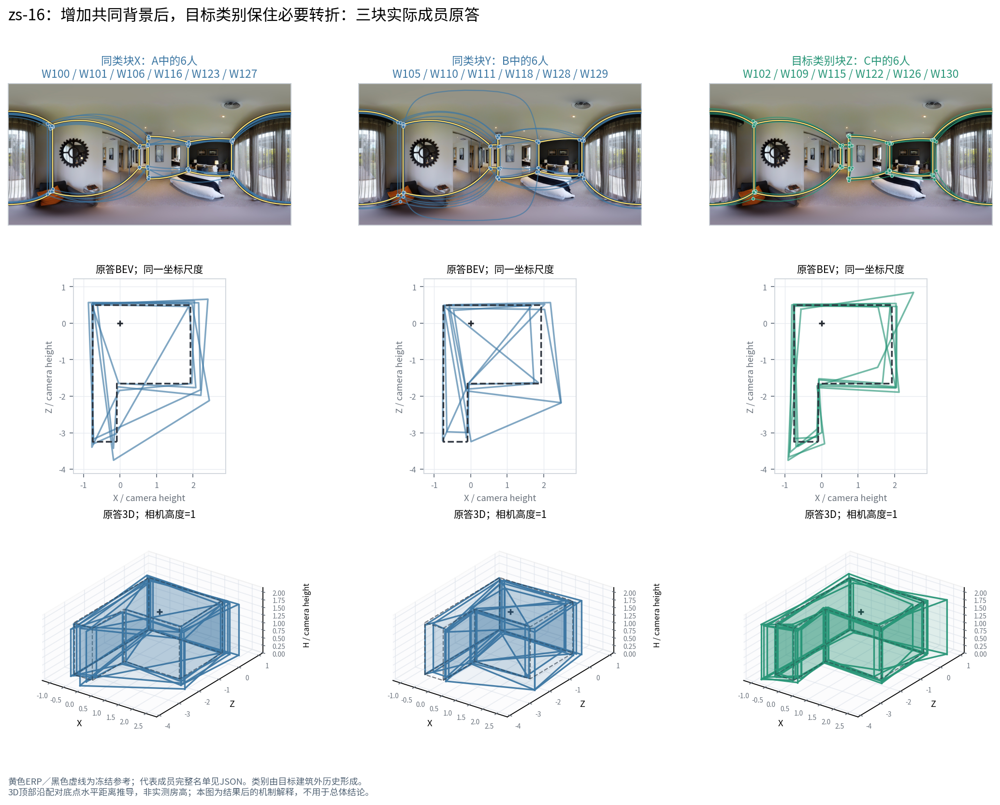

# 联合类别的两种实际作用：定位中位数与必要转折票数

本报告解释本轮新登记、已实际融合的三个精确事件。底层为真实 v2；使用 Manual 楼外联合类别 `V3_JOINT_QT`，没有混入 Semi 原答。案例是总体结果之后选择的解释材料，总体效应来自 `joint_exchange/` 的完整方向与失败分母。

只对九个已有端点重放原生融合状态以导出对应、票账和连接。九次重放的候选几何摘要均与已评分缓存逐一相等，**没有再评分、调整门槛或改动原答**。完整成员、全部分项、原始观察归组及中位数秩均可单独读取。

## 1．wc2-56：四个角点全在，收益仍然真实

事件 `ae7834d1143c3eb255ef9d70`，Manual、n20、实际换6人。A/B 的完整类别向量均为 `J1:2|J3:15|J4:3`；C 为 `J1:2|J3:9|J4:3|J5:6`。共同14人背景相同，X/Y 为同一常规类的两组六人，Z 为历史较高Q、相对更快的一组六人。这里的 J 号是 wc2 目标建筑之外的标签，不能直接套用全数据 J 号。

| 团队 | B8L2 | D10 | 底面IoU | 方向残差 | 记录总人秒 | 结构节点 |
|---|---:|---:|---:|---:|---:|---:|
| A | 88.2843 | 91.3879 | 0.960827 | 2.4028° | 2638.432 | 4 |
| B，同构成换人 | 94.0926 | 95.6812 | 0.976703 | 1.5913° | 2750.166 | 4 |
| C，改构成换类 | 98.5964 | 98.7983 | 0.989834 | 0.6431° | 2622.614 | 4 |

C−B 为 **Q +4.5038、记录人秒−4.638%**；C−A 也提高10.3121分。A→B 已经存在5.8083分的具体成员波动，不能把同类视为完全等价。

原生状态表明，三队的四个角点都是 **20票，门槛10**，全部入选，节点对应一致。这里不存在“增加一个关键角点”的机制。差别来自坐标次序统计：替换六人后，角点的 x、顶部 y、底部 y 中位数改变。

例如参考角 r0 底部 y=319.88（冻结1024×512坐标）。B 的底部中位数为318.4033，由 W118/W124 的中心两秩决定；C 为319.5369，由新块 W115 与原背景 W131 决定。顶部也从205.0229移到204.4421，接近参考204.21。新增类别的贡献既包括自身进入中位数，也包括改变背景成员在排序中的位置；不能把所有收益都记成“融合直接采用了新人员的整份答案”。

同图第二条预登记成员路径也取得净 Q +13.0299、记录人秒−5.217%，所以展示的第一条不是该图唯一正结果。不同路径的差异见完整事件表，本图用于说明定位传递，不估计整个分类的效应。

## 2．zs-16：同一个目标类别块，效应随背景和门槛变化

两个精确事件为：n20 的 `f5a4b2fb6c7c48b523c8d0bc`，n21 的 `c2244690085439b7a26cd94e`。实际都换6人，X/Y/Z保持同一组成员；n21只在三支队的共同背景里增加 W125。

- X，A中的源类六人：W100、W101、W106、W116、W123、W127。
- Y，B中的同源类六人：W105、W110、W111、W118、W128、W129。
- Z，C中的目标类六人：**W102、W109、W115、W122、W126、W130**。

目标楼外，源块属于常规表达 J2，目标块属于 J5。当前图片中，目标六人确实都画了六对角点，源块则为四或五对。原图显示衣柜右侧的前后墙转折；冻结参考也包含这组结构。这里不是用总点数猜测“多画就更好”，而是检查同一可见转折机会与它的实际票数。

| n | 团队 | 关键r1票数／门槛 | r1状态 | 节点数 | B8L2 | 记录总人秒 |
|---:|---|---:|---|---:|---:|---:|
| 20 | A | 8／10 | 失选 | 5 | 45.6568 | 5337.771 |
| 20 | B | 10／10 | 保留 | 6 | 91.9589 | 5692.124 |
| 20 | C | 11／10 | 保留 | 6 | 82.8636 | 5401.843 |
| 21 | A | 8／11 | 失选 | 5 | 45.9086 | 5728.442 |
| 21 | B | 10／11 | 失选 | 5 | 45.8440 | 6082.795 |
| 21 | C | 11／11 | 保留 | 6 | 81.5440 | 5792.514 |

共同背景给 r1 **5票**。X提供3票，Y提供5票，Z六人全提供该角点，因此A/B/C分别为8、10、11票。新增背景 W125 没有提供该角点的票，却使半数门槛由10升为11。B 的原有10票因此失选，C的11票恰好仍保留。这一局部观察的归组、贡献人员及其坐标在两个 n 下可直接按原始观察键对应。

结果是：n20 时 C−B **Q −9.0952**、记录人秒−5.100%；n21 时 C−B **Q +35.7000**、记录人秒−4.772%。并不是 C 自身随人数增加变得更好：C的Q从82.8636略降到81.5440。方向翻转主要来自B丢掉必要角点，底面IoU从0.940134降到0.773739，方向残差从1.3582°增到13.6995°。

这个案例也解释了两项需要同时保留的群体判断：同构成成员可以不同——n20 的A/B差46.3021分；历史多转折类别仍有局部补充价值——Z在当前机会提供了源类部分成员缺少的第六票，使结构对人数门槛更有余量。一个具体成员反例不会推翻该类别的结构用途，而该用途也不能简化为“任何背景下换入都升质”。

## 3．可复核文件与单位

`EXACT_EVENTS.csv` 保留三个事件的所有原指标与成员；`cases/` 保存原答、参考、几何、完整融合状态；`GROUP_VOTES.csv`、`EDGE_VOTES.csv`、`OBSERVATION_ASSIGNMENTS.csv`、`GROUP_OBSERVATION_LINKS.csv` 给出投票、连接和旧观察对应；`MEDIAN_ORDER.csv` 保留每个坐标的全部秩，`ENDPOINT_METRICS.csv` 保留 B8L2/D10 及各分项。

角点到参考的最近角诊断只用于可读对应，不改变融合内的环向匹配、7.5跳过代价或原答9°/12°分簇。原生角点编号在不同端点间没有固定语义，跨端点追踪使用原始观察ID和pair_index。三维图的尺度是相机高度单位，顶部沿上下点射线推导，不是实测房高。

时间为库存中的处理后记录秒数之和，来源为 `user_processed_reported_not_raw_log_replayed`，没有转换成墙钟生产时长。原图来自已索引GitHub Release；wc2复用上一轮已取得原图，zs本轮按ZIP范围提取，CRC、大小与SHA记录在上级`originals/PHOTO_RECEIPT.json`。未打包原图全集。

复现：在本研究目录 `research/workers/personnel_effective_exchange_conditions_20261022/` 运行 `python mechanisms/export_positive_cases.py`，再运行 `python mechanisms/render_positive_cases.py`。第一步重放已计算团队的状态并检查几何一致；第二步仅渲染，不融合、不评分。字体子集随案例包提供。
