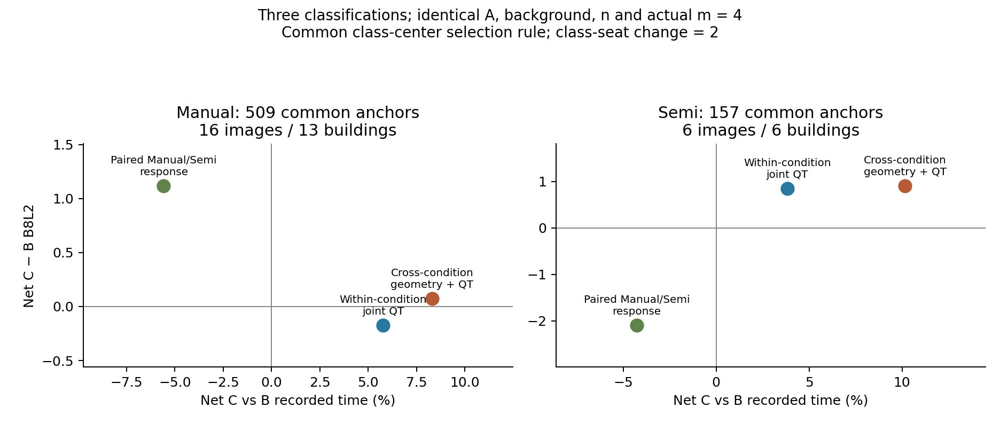

# 跨条件新类别的共同锚点比较

## 采用判断

**本轮没有发现一个可以整体取代原单条件联合类别的新跨条件分类。** `XCOND_PAIRED` 值得保留为 Manual 的条件性替换/效率分类；它在共同锚点上的 C−B 为质量 +1.120、时间 −5.576%，但 C 相对原队 A 仍降低 0.992 分。Semi 同一方法则是质量 −2.089、时间 −4.273% 的取舍。新 `XCOND_GEOM_QT` 在本规则下没有形成更有利的质量—时间组合，因此暂不作为统一选队推荐。[Manual 共同支持结果](CROSS_MANUAL_SAME_SUPPORT_SUMMARY.csv) [Semi 共同支持结果](CROSS_SEMI_SAME_SUPPORT_SUMMARY.csv)

这些判断评价的是三种分类在**同一锚点和同一类中心指导规则**下的实际替换用途；没有要求效率分类必须同时制造形状分离，也没有以某一个负用途否定其原答描述用途。新分类的原答相似性、成员稳定性与形成特征见独立 `../cross_condition_taxonomy/`，不在这里重复拟合。

## 1. 共同支持怎么形成

三种方法为：

| 方法 | 形成依据与身份 | 本实验标签层级 |
|---|---|---|
| V3_JOINT_QT | 前轮冻结的**各自条件内**结构×Q×T 类别 | 楼外粗类 |
| XCOND_GEOM_QT | 本轮 Manual 与 Semi 双条件几何及 Q/T 联合类别 | 同时排除目标楼两条件后形成的粗类 |
| XCOND_PAIRED | 本轮同图、同人的 Manual→Semi 配对响应类别；Q/T 不参与类别形成 | 同时排除目标楼两条件后形成的粗类 |

新类别每人只有一套双条件标签，再复制到 Manual/Semi 的评价域；端点始终分别评价，没有混合两条件的质量。各折类号、类数、形成家族和探索标记均保留。部分 GEOM_QT 折仍标为探索，没有为提高结果静默删除这些折。[冻结标签](../cross_condition_taxonomy/CROSS_LABELS_LOBO.csv.gz) [冻结中心](../cross_condition_taxonomy/CROSS_CLASS_CENTERS_LOBO.csv.gz)

每个既有面板有 12 名可变成员，所有 `C(12,6)=924` 个六人子集的终点已经完整计算。对每个二人共同可变背景 S，检查所有可行四人 X；只有三种分类都能找到同构成 Y 和类别人数变化 2 席的 Z，才进入共同锚点库存。对交集 X 按冻结哈希取一个，三方法使用**完全相同的 A、共同背景 D、总人数 n、实际替换 m=4**。各方法保留自己的所有同构成 B；C 按同一楼外类别中心规则 `q_history − 10 × t_history` 选类别构成，所有成员并列项都保留。[登记设计](CROSS_METHOD_COMPARISON_REGISTERED_ZH.md)

这里 m=4，但**类别席位变化 r=2**。12 选 6 的已缓存子空间中，当 A→B 和 A→C 的同一共同背景固定、两次都换 4 人时，类别席位变化最多为 2；纯类别席位 m4/m6 的新实验另见 Manual/Semi native 报告。本比较没有把两种替换规模混为一谈。

所有方向、锚点与候选选择只用楼外标签、中心和冻结哈希，不用目标端点结果。旧 V3 的已训练交互预测器没有在这一比较中获得额外优势；三者均使用相同的简单中心规则。它不是各方法独立优化后的最优政策，也不是完整连续特征策略比较。

## 2. 实际覆盖与完整失败分母

| 条件/域 | 完整共同锚点 | 三方法全部可评分且时间可比的共同锚点 | 图/楼（严格共同支持） | 事件引用数（完整库存） |
|---|---:|---:|---|---:|
| Manual 全正式面板 | 109 | 106 | 6 / 6 | 1,743 |
| Manual 新批面板 | 524 | 509 | 16 / 13 | 7,665 |
| Semi 全正式面板 | 40 | 40 | 1 / 1 | 442 |
| Semi 新批面板 | 174 | 157 | 6 / 6 | 2,547 |

共 **847 个方法间共同锚点、12,397 条事件引用**，引用了 7,121 个不同团队端点，全部复用，新增融合为零。事件引用包括同锚点下的方法、多个 B 和 C 并列成员；不能把 12,397 当成相同数量的独立背景或新实验团队。Manual 与 Semi 的完整候选和共享锚点机会表逐项保存。主比较要求同一锚点下三方法所有所选 B/C 都可评分且时间可比，再做方法间配对，避免方法各自挑可评分子集。[Manual 回执](CROSS_MANUAL_COMPARISON_RECEIPT.json) [Semi 回执](CROSS_SEMI_COMPARISON_RECEIPT.json)

完整库存的失败信息仍单列保留。新批面板上，C−B 的楼等权失败率变化为：

| 条件 | V3_JOINT_QT | XCOND_GEOM_QT | XCOND_PAIRED |
|---|---:|---:|---:|
| Manual，全部 524 锚点 | +0.641 个百分点 | +0.256 个百分点 | −0.641 个百分点 |
| Semi，全部 174 锚点 | +0.578 个百分点 | +7.630 个百分点 | −0.748 个百分点 |

Semi 174→157 的严格评分交集同时使图/楼数从 7/7 变为 6/6。未纳入严格 Q/T 表的锚点没有删除，仍可在完整事件及失败表找到；质量冻结值缺失也没有改填 0。失败和可评分条件结果必须并看。

## 3. Manual：配对响应类有净效率用途，不能把净差异写成绝对改善

以下三行使用**相同 509 个新批锚点、16 图、13 楼**。先对同锚点内的成员并列项平均，再按背景/人数/图/楼等权。

| 方法 | 同构成 B−A，B8L2 | 改构成 C−A，B8L2 | C−B，B8L2 | C−B，D10 | C/B 记录时间 |
|---|---:|---:|---:|---:|---:|
| V3_JOINT_QT | −1.505 | −1.677 | −0.172 | −0.133 | +5.775% |
| XCOND_GEOM_QT | −1.450 | −1.377 | +0.073 | +0.174 | +8.305% |
| **XCOND_PAIRED** | **−2.112** | **−0.992** | **+1.120** | **+1.052** | **−5.576%** |

PAIR 的净质量与效率方向优于这两个同规则对照，但只有 7/16 图、5/13 楼的平均质量和时间同时向好。它的 B 相对 A 降得更多，而 C 仍低于 A，故不能称为“换类让原队质量普遍提高”。可保留的用途是：在这种共同背景和候选子空间，配对响应类别有助于区分更省时、相对同构成替换质量损失更小的方向。

全正式面板的严格 106 个锚点、6 楼上，PAIR 的 C−B 为 +1.153、时间 −4.261%，但只有 2/6 楼平均双优。这是独立的支持域，不能与新批域重叠成员/团队简单相加为更多独立证据。[逐锚点响应](CROSS_MANUAL_ANCHOR_RESPONSES.csv.gz) [方法间配对差异](CROSS_MANUAL_PAIRED_METHOD_DIFFERENCES.csv.gz)

## 4. Semi：配对响应类提供质量—时间取舍

以下使用**相同 157 个新批锚点、6 图、6 楼**。

| 方法 | 同构成 B−A，B8L2 | 改构成 C−A，B8L2 | C−B，B8L2 | C−B，D10 | C/B 记录时间 |
|---|---:|---:|---:|---:|---:|
| V3_JOINT_QT | +1.154 | +2.005 | +0.851 | +0.832 | +3.823% |
| XCOND_GEOM_QT | +1.017 | +1.927 | +0.910 | +0.722 | +10.162% |
| XCOND_PAIRED | +3.072 | +0.982 | **−2.089** | **−1.847** | **−4.273%** |

PAIR 的改构成 C 虽仍高于 A，但低于同构成 B，省时伴随质量代价，6 楼中只有 1 楼平均双优。GEOM_QT 则用更多记录时间取得很接近旧 V3 的净质量收益，并且完整锚点的失败增幅更高。本轮不将这两个新法作为 Semi 整体替换规则；Semi 单条件旧联合类在独立纯块实验中的效率方向仍保留，不被这一不同面板上的结果否定。[Semi 原联合类纯块报告](SEMI_NATIVE_FINDINGS_ZH.md)

全正式域只有 1 图、40 共同锚点，质量差异仅约 10⁻⁴ 分量级，主要提供时间观察，不能拿浮点级 Q 正值宣布质量改善。新法原答研究也已发现 PAIR 的 Semi 类内原答形状不更接近；这不会自动否定效率/响应用途，但限制了把它命名为“相似形状类”的解释。[逐锚点响应](CROSS_SEMI_ANCHOR_RESPONSES.csv.gz)

## 5. 本次完成与未完成的用途边界

完成了共同 A、D、n、实际 m 的三方法比较、类别席位变化 r=2、不同具体成员和背景的完整已登记事件、冻结分项/结构/失败分母，并保存了各图、各楼、方法间逐锚点配对差异。未知标签的面板和无共同可行 X 的背景在机会表中保留，没有按零类补齐。

本比较只有粗类。新 PAIR 多折没有独立细层，不能凭重复同一标签声称细类增量；本轮也没有另训连续 QT 指导者，在相同共享 ABC 上与这三种分类直接比较。前轮连续 QT、连续结构的结果仍有效，但属于旧共同支持选队或预测用途，不可嫁接成此次 matched ABC 的对照结果。

分类价值的最终安排是：**Manual 的 PAIR 保留为可解释配对响应及条件性净效率候选；Semi 报告其明确质量—时间取舍；GEOM_QT 本轮不替代旧联合类；原联合类的具体纯块方向继续按对应条件采用。** 不要求一套双条件标签包办原答相似、质量改善、效率和互换性。

## 复现

`register_cross_comparison.py` 从冻结标签、中心和完整 924 面板构建共同锚点；`evaluate_joint.py cross manual` / `semi` 读取已有精确端点并评估；`compare_cross_methods.py manual` / `semi` 产生严格同支持结果；`plot_joint_results.py` 导出独立 PNG/PDF 和图中数据。所有注册与评价表按条件分开，来源 SHA、未知机会与完整键在 `CROSS_*_DESIGN_FREEZE.json`、`CROSS_*_PANEL_LABEL_SUPPORT.csv`、`CROSS_*_OPPORTUNITIES.csv.gz` 中保存。
