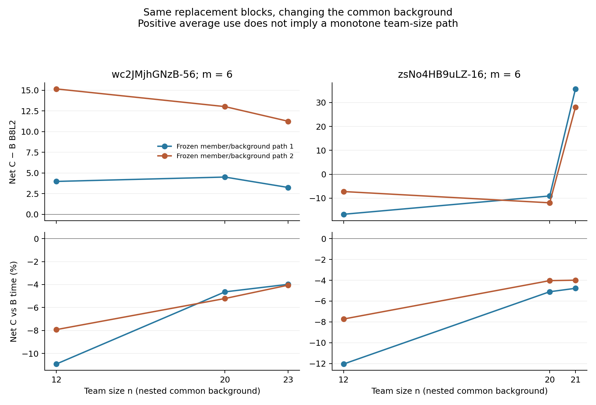

# 联合类别的有效换人、换类条件：本轮实质结果

## 推荐采用什么

**原单条件联合类别应保留为有方向的构成工具。** Manual 已得到相同背景、人数、真实换人数下的质量和时间双收益；Semi 已得到较稳定的记录工时降低方向。两者用途不同，不需要把它们都改写成普遍的“形状相似且任意可互换”人群。本轮跨条件配对响应类在 Manual 也显示条件性净效率价值，但没有取代原联合类。

| 分类与具体用途 | 本轮共同支持 | 实际 C−B 作用 | 采用判断 |
|---|---|---|---|
| Manual 原联合类：普通表达源块→楼外更高 Q、更快且困难转折表达更多的目标块 | 64 个 m4/m6 纯块 ABC；62 个同分母可评分时间事件，8 图/6 楼 | B8L2 **+5.691**，时间 **−3.632%**；7/8 图、6/6 楼均值双优 | 保留有益方向；两例 C 失败及人数反向路径同时保留 |
| Semi 原联合类：较高 Q、更快目标块 | 28 个 m4 纯块 ABC，5 图/4 楼，全部可评分时间同源 | Q **+0.153**，时间 **−8.544%**；28/28 事件省时 | 保留效率用途；质量成员低尾明显，不作普遍质量提升建议 |
| Manual 新跨条件配对响应类 | 三方法相同 509 个新批 A/D/n/m 锚点，16 图/13 楼，实际 m4、类别席位 r2 | Q **+1.120**，时间 **−5.576%**；但 C−A **−0.992** | 保留条件性净效率候选；不能把相对 B 的改善说成原队 A 的绝对改善 |
| Semi 新跨条件配对响应类 | 三方法相同 157 个新批锚点，6 图/6 楼，m4/r2 | Q **−2.089**，时间 **−4.273%** | 明确质量—时间取舍，暂不作整体质量替换推荐 |
| 新跨条件结构×QT | 同上述共享锚点 | Manual 净 Q +0.073/时间 +8.305%；Semi +0.910/+10.162% | 本规则下不替代旧联合类；原答描述用途另评 |

C−B 是“改构成替换 C”相对于“同构成替换 B”的净差，A 是二者共同原队。专题报告同时列 B−A、C−A、全失败分母及所有质量/结构分项。[Manual 纯块报告](MANUAL_NATIVE_FINDINGS_ZH.md) [Semi 纯块报告](SEMI_NATIVE_FINDINGS_ZH.md) [跨条件方法比较](CROSS_METHOD_FINDINGS_ZH.md)

## 1. 这次新增了什么证据

前轮独立复算通过的 Manual 联合类别选队收益 **Q +1.432、记录时间 −5.419%** 保留：31 图中 27 图 Q 提高、27 图省时、23 图同时；21 楼中 15 楼同时。那是实际选队研究，与本轮匹配换人问题相关，但它没有固定共同背景和真实换人数，不能充当本轮已完成替换实验的证据。

本轮完成三项互补研究：

1. **新原生纯类别块。** A=D+X、B=D+Y、C=D+Z，X/Y 同类，Z 异类，X/Y/Z 互不重叠。真实换人数 m 与类别席位变化 r 都为 4 或 6。所有可行有序方向先登记，每方向两条成员/背景路径；n 包括 12、20 和按实际容量确定的上限。完成 1,638 条事件引用，1,637 个不同物理三元组、4,844 个团队，其中 **4,837 个新原生端点、7 个精确复用**。
2. **既有完整 924 面板上的新背景/成员匹配。** 检查每面板全部 66 个二人可变共同背景，每背景在所有可行源队中冻结选择一个；保留全部同构成 B，并保留前轮冻结预测器选中构成下的所有 C 成员并列项。完成 **33,275 个不同物理 ABC**，只有 4 个与既有事件相同；复用 34,437 个端点，没有重复融合。这里真实 m4、类别席位 r2。
3. **三分类相同锚点比较。** 原单条件联合、新跨条件结构×QT、新配对响应类使用同一 A、D、n、m 及同一个类中心指导规则。完成 **847 个共同锚点、12,397 条方法/成员事件引用**；全部复用端点。这些引用不是 12,397 个独立新背景。

三个阶段合计 **47,310 条全局唯一 event_id**；按实际三队集合去重为 **44,392 个物理三元组**，保留 A/B/C 方向则为 45,213 个；引用 **44,328 个不同团队端点**，其中 39,491 个来自前轮完整交付、4,837 个本轮新增。76 个物理三元组在两个阶段被引用，2,546 个物理三元组被不同方法引用，这些重复已经在索引里明确标注。[实际覆盖](ACTUAL_COVERAGE.csv) [完整事件索引](ALL_EVENT_REFERENCE_INDEX.csv.gz) [端点精确来源](ALL_USED_TEAM_REFERENCES.csv.gz) [完成回执](FINAL_COVERAGE_RECEIPT.json)

此处没有声称人员池的全部具体成员组合穷尽。纯块每方向两条路径；缓存面板虽然终点 924 集合完整、66 个共同背景完整检查，每背景也只选了一个 A。所有理论组合容量、未用锚点和未知标签机会逐项保留。大于本支持的成员全集、任意加入顺序、未登记的新 n/m 并未计算。相同成员集合终点只算一次，顺序没有用来增加伪样本量。

在已登记原生 n/m 范围内，Manual 全正式/新批分别有 395/227 个可行有序方向×n 格，理论有序 ABC 数为 7,159,511,096,314,290 / 2,995,136,420,056,662；Semi 为 168/29 格，理论数 38,149,855,116,421,299,608 / 1,197,751,520。支持域可能重叠，这些机会数不能相加解释成独立团队。已缓存面板的 m4/r2 有 3,104,232 个按面板/背景索引的合法有序 ABC，本轮评价 33,275 个，尚有 **3,070,957 个机会未展开**。这部分是仍未完成的成员穷尽范围；它可以复用现有 924 端点继续展开，不需要重新融合。当前设计优先覆盖不同背景、方向和并列成员，未将同一组端点的百万次重复配对写成已全算。[精确机会完成账](OPPORTUNITY_COMPLETION.csv)

## 2. 为什么保留 Manual 方向

目标类六个外折的历史 Q 中心约 +14.8 至 +15.2，源类约 −3.5 至 −2.7；目标在困难图的转折残差约 +0.93 至 +1.04，而源类约 −0.64 至 −0.42；目标相对源类的历史 log 时间差为 −0.09 至 −0.32。实际目标块人员并集为 **W102、W109、W115、W122、W126、W130**，精确每图成员和类号均保存。它是历史上较高质量、较快、困难结构表达更丰富这一联合角色的方向，不是把 Q 或来源配平后的独立结构效应。[楼外中心与成员](NATIVE_PREFERRED_CLASS_ROLES_AND_MEMBERS.csv)

主支持 62 个 ABC 的 C−A 也为 **Q +5.805、时间 −0.970%**，因此其 C−B 双收益不是只由 B 特别差造成。净效应既有底点、方向、高度与范围改善，也有局部结构覆盖改善：9°参考角点/边召回 +0.0363/+0.0550，实际转折 +0.290。角点数量不变的矩形图仍有几何收益，不能仅凭角点数判断类贡献。

同构成与改构成 |ΔQ| 为 4.565/6.468，净差 +1.903；底面形状差异 0.0385/0.0508，平均高度棱柱差异 0.0493/0.0666。这一方向同时表现为“改变更多”和“平均更有益”。但冻结联合稳定率同/跨仅 37.33%/35.07%，差远小于方向用途。**采用的是方向，而不是类内任意成员的替代保证。**

m4 和 m6 均有实际正收益；n20 为净 Q +1.876、时间 −3.589%，n25 则 Q −1.726、时间 −1.543%。同一块沿人数路径也能翻向。完整路径图把这种条件性作为结果展示，而非为了维持平均结论隐去。

## 3. 缓存面板上的新成员/背景支持

缓存匹配使用前轮已冻结的楼外类别交互预测器，不重训、不读目标端点进行筛选。它补足了比原两条纯块路径多得多的共同背景；类别席位变化为 2，不能与纯块规模等同。下表统一要求 ABC 全部可评分且时间可比。

| 条件和方向 | 登记/同分母事件 | 背景 | 图/楼 | 净 Q | 净记录时间 | 图/楼平均双优 |
|---|---:|---:|---|---:|---:|---|
| Manual，类中心较高 Q 且更快 | 3,845 / 3,795 | 802 | 23 / 15 | +2.802 | −2.197% | 14/23，9/15 |
| Manual，冻结预测器预计 Q/T 同时改善 | 2,703 / 2,683 | 613 | 22 / 16 | +3.776 | −5.127% | 14/22，10/16 |
| Semi，类中心较高 Q 且更快 | 673 / 670 | 178 | 7 / 5 | +1.138 | −2.570% | 3/7，3/5 |
| Semi，冻结预测器预计 Q/T 同时改善 | 452 / 452 | 136 | 6 / 4 | +1.120 | −3.465% | 3/6，3/4 |

因此联合方向的价值并不只来自两条原生成员路径。另一方面，整个新批缓存库存不限制方向时，Manual 的质量净效应 +0.751、时间 +4.468%，Semi +0.632、时间 +1.910%（后两列是各自可用分母，详表列出）；不能把“改类别”本身当作节时规则。进入有益方向需要楼外中心或冻结指导器，具体成员和背景仍重要。[Manual 缓存全结果](summaries/cached/manual/PRIMARY.csv) [Semi 缓存全结果](summaries/cached/semi/PRIMARY.csv)

类中心与实际成员历史均值是两种不同证据，已经分别保存在 `training_class_center_QT_direction` 和 `training_member_QT_direction`。早期冻结缓存注册表中的 `training_QT_direction` 曾表示实际 Y/Z 成员均值，本轮没有改动冻结队伍，而在补充方向表中澄清；最终 `center_*` 汇总均使用真正类中心。[字段说明](DIRECTION_FIELD_CLARIFICATION_ZH.md)

## 4. 质量、失败与效率各有支持范围

Manual 推荐方向的 64 个 ABC 中，C 有两个 `invalid_floor`，A/B 没有，发生于同一 B6-47 成员路径 n20/n22。它们没有合法冻结 Q，保留失败，不填零，也不从报告删除；主 Q/T 表使用 62 个相同可评分分母，另报全 64 个失败分母。其余全方向、各分项、全部事件失败也保存。

Semi 推荐方向没有融合失败，时间在 28/28 事件下降，但个别成员路径的净 Q 低至 −15.016、−12.415；同方向平均几何变化大小并不超过同构成。它适合效率用途，不能当作形状分离类或无条件质量提升类。新跨条件 PAIR 则在 Manual 与 Semi 形成不同的净质量—时间取舍，需要分别采用。

时间均保留原始来源和秒数。本报告主要效率域是新批、来源一致的 `user_processed_reported_not_raw_log_replayed`；使用成员记录秒数之和，不是新测量团队并行历时。全部来源混合的正式人员域仍用于合格质量/结构研究，但不能借用其更大分母发布时间收益。

## 5. 粗类、细类与连续特征的最终安排

本专题的实际换类主要验证楼外**粗类方向**。新 PAIR 多折没有独立细类，原联合细层也不能凭复用粗标签宣布细分有增量。细层原答描述、父类内细分实验归总体研究的对应专题，本报告不越界给出统一层级推荐。

前轮连续 QT、连续结构与类别的共同支持预测/选队实验继续有效；本轮没有另行训练连续 QT 指导者，在这些新 ABC 上直接与类别指导比较。因此新的匹配结果证明了**类别方向具有具体实际用途**，尚不证明其相对同源连续 QT 指导者的新增决策收益。两类证据保持身份：旧选队结论用于选择工具的比较，本轮结果用于替换方向、共同背景、真实 m 和人数路径的判断。

推荐在研究台展示“目标建筑外的类定义与成员＋来源→目标方向＋当前人数/容量＋预计结构机会＋失败条件”，而不是单列人员永久类别标签。跨折编号只在该折解释，连续中心、真实成员和可见标法承担跨折对应。全部已登记事件与终点引用已经完成并保存，本专题没有以进一步审计或下一轮建议代替实际研究。
