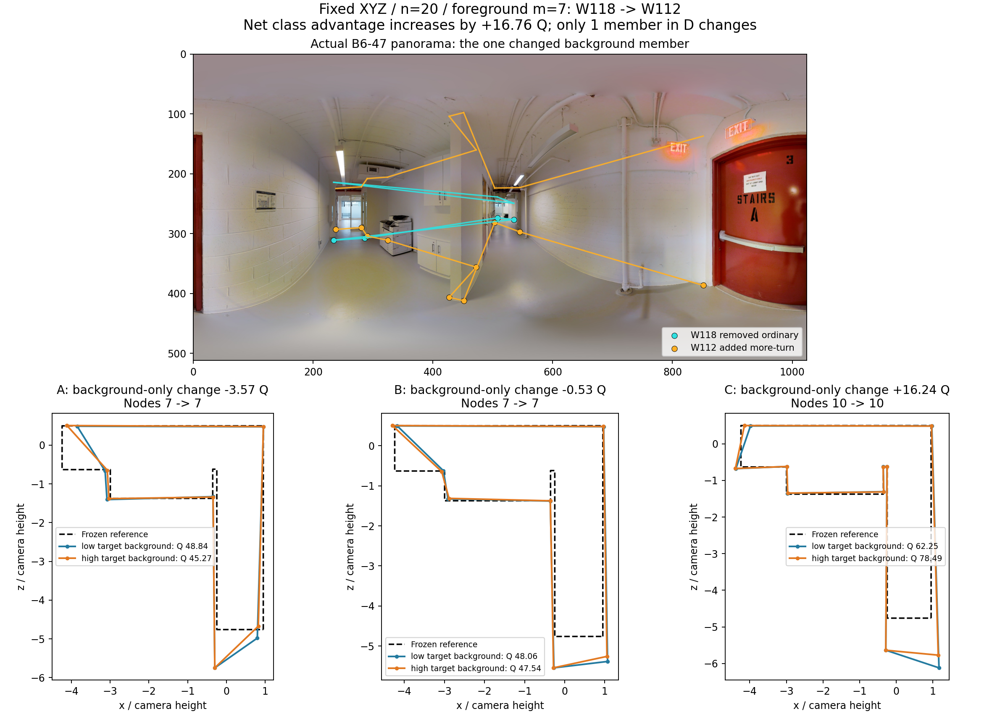
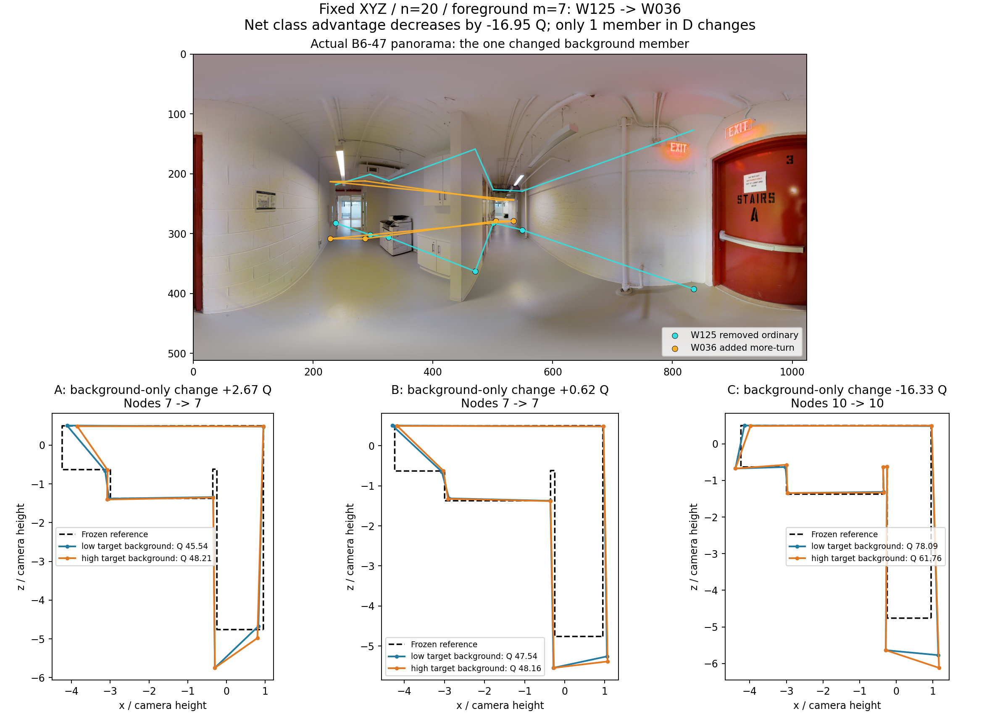

# Manual 结构类收尾：替换规模与共同背景的实际作用

**采用判断：保留“常规表达→较多转折”的定向升质用途，n20/m4作为广覆盖条件，m7作为有实际容量时的较大块条件。固定原队时，m4升到m7确实提高C队质量；背景已多一名较多转折成员时，前景m7块相对同类替换的优势通常有所缩小，主要因为B队得到改善，不能解释成C队通常降质。**

本轮实际读取main为`cf053a6e31d17393c0e8216ce15660fa37b8b7bb`；基础作答仍是真实v2。复用上一轮`8bfd3e4…`下已完成的结构类别、楼外标签和端点；没有重拟合类别、调整资格、参考、预处理、环序、B8L2/D10或融合规则。本文属于人员分类用途续研，未重开同房专题。

## 1. 这一轮解决了什么

|问题|实际完成|采用结论|
|---|---|---|
|固定A的m4→m7究竟改变了谁|对154条真实嵌套路径，用共同五端点分母重聚合C7−C4、B7−B4及两者差；保存精确成员与逐图楼结果|C本身升质，较大块具有实际增量；不是只靠B变差抬高净优势|
|旧低/中背景层是否可比|核实67图与11图只有uNb-09一张交集；另有39图可做相邻背景席位比较|旧“≤4/13”保留为条件关联，不作普遍硬分界|
|固定XYZ、同图改变D，是否仍有背景作用|39图15楼，78个历史预登记XYZ锚点；逐锚点完整枚举14选13的全部D，1092 ABC|有多数图/楼支持的边际补充减弱；已有目标类人数影响净收益，但具体成员仍可造成强正反差异|
|主结构换类发现是否保留|新增背景支持上同时比较B−A、C−A、C−B、绝对变化和失败|m7在26/39图、13/15楼净升质；跨类幅度在28/39图、11/15楼更大，继续采用|

上一轮120图/16楼的n20/m4，以及77图/16楼的n20/m7主结果继续保留。下文新增39图是有背景变化容量的有限子集，不能覆盖或替代原主结果，也不重复累加为新增独立图片。

## 2. 固定A：m4→m7确有C队升质

沿用原登记路径：X、Y、Z按冻结顺序取嵌套前缀。m从4变7时，原D里的3名源类成员移入X，Y/Z各新增3人，所以A完全相同；B和C各实际更换3人。每一个m内部仍有严格共同D的ABC比较。

|共同分母上的变化|建筑等权平均Q|改善图|改善楼|
|---|---:|---:|---:|
|**C7−C4**|**+1.405271**|**59/76**|**11/16**|
|B7−B4|+0.110938|38/76|7/16|
|**(C7−B7)−(C4−B4)**|**+1.294333**|**56/76**|**13/16**|

154条路径来自77图16楼，151条的A/B4/C4/B7/C7同时可评分；共同分母覆盖76图16楼。三个均值严格满足1.405271−0.110938=1.294333。原报告的C−A增量+1.337、58/76图来自C/A自身有效的较宽分母；它不再与共同分母净增量混列。原净增量+1.294仍成立。

这支持有容量的m7方向：多数目标图中，增加替换规模提高了最终C质量。该结论不要求每一条m曲线单调。最大容量只到m6的另一组，严格共同分母上C6−C4为−1.018，净增量−1.100，27张可比图中C升质13图；因此不能仅按“多换总更好”选规模。这是不同容量域的实质差异，不否定m7的实际发现。

精确证据：[共同分母总表](FIXED_A_COMMON_DECOMPOSITION.csv)、[逐路径与全部D/X/Y/Z](FIXED_A_PATHS_EXACT.csv.gz)、[逐图](FIXED_A_IMAGE_EFFECTS.csv)、[逐楼](FIXED_A_BUILDING_EFFECTS.csv)、[各质量分项逐图](FIXED_A_METRIC_IMAGE_EFFECTS.csv)。

## 3. 背景新实验：固定XYZ，穷举可行的D

### 3.1 为什么必须补这组比较

旧m7低背景层67图，中背景层11图，总计77图，交集只有**uNb-09**。旧两层平均差既包含背景差，也包含图片/人员池差。该共同图旧分层净Q为+0.966→+0.664，但当时XYZ与具体D未匹配，不能单独证明背景机制。

当前正式池中39张图有两个可行目标类背景席位，人数均为35。严格m7三块XYZ占21人，D占13人，因此固定XYZ后剩14人中选13人，**每个锚点恰有14个可行D，任意两个D只换1人**。该容量使可比背景的完整枚举很小，无需扩大类数或重做历史团队。

每图取原登记的前两个深度背景中source_pair=0、target_block=0的XYZ锚点，选择没有读取目标Q。对78个锚点穷举所有D，共1092个物理ABC；其中78个ABC已存在，1014个ABC组合为本轮新增。3276个唯一团队端点中，236个直接复用、3040个补算，分六批保存。全部锚点内背景组合1092/1092完成，**未穷尽所有XYZ块**。

类别来源是对应目标建筑之外的Manual结构历史；固定前景X/Y均常规表达、Z较多转折。用于背景梯度的低/高两状态保持XYZ不变、总人数20、前景实际换人数7不变，只将D中的一名常规成员换为一名较多转折成员；其余12名背景相同，其他类人数不变。这样明确区分**前景m7换类效果**与**背景实际m1改变**。

### 3.2 同图、同XYZ的背景结果

在1448个有向背景对中，1397对的六个ABC端点共同可评分，覆盖39图15楼、76/78个锚点。先对同一锚点内的可行背景对等权，再依次对锚点、图片、建筑等权：

|D中目标类多1人后的量|平均变化或水平|图片支持|建筑支持|
|---|---:|---:|---:|
|A队Q变化|+0.565732|26/39改善|12/15改善|
|B队Q变化|**+0.914917**|29/39改善|11/15改善|
|C队Q变化|+0.074243|26/39改善|8/15改善|
|较低目标类背景下的C−B|+4.460262|27/39正向|13/15正向|
|较高目标类背景下的C−B|+3.619587|27/39正向|12/15正向|
|**净优势的变化**|**−0.840674**|**23/39减弱**|**11/15减弱**|

D10净优势变化为−0.766650，同向。76个可评分锚点中43个减弱、33个增强。**背景的确影响类别块的边际效用，且多数图/楼支持减弱；但主要是同类替换队B得到补充，C的平均变化接近零。** 因而不能为了让C−B数值更大而刻意减少背景中的好成员，也不能说已有较多转折成员的团队通常更差。

较低/较高是同图可行容量内的相邻席位，不是所有图统一的绝对配额。0→1、1→2、2→3、3→4、4→5、5→6分别覆盖9/11/4/6/1/8图，变化并非各级单调。4→5仍只有uNb-09一图，精确匹配后净效应变化−0.217；其低/高水平为−0.940/−1.157。**“≤4/13优先”可保留为旧数据的探索性构成筛选，但本轮不把4人写成稳定停止线。** 可操作建议是先考虑较少已有结构支持的背景采用m7，同时看具体关键转折的票余量；m4仍是覆盖更广的基础条件。

具体成员的影响也可见：固定XYZ和完整背景类别人数向量，仅换D内同类成员，源类背景单次实际m1的C绝对Q变化平均0.932、净优势绝对变化1.710；目标类背景对应0.944/1.026。这些是背景成员敏感性，不能与前景m7变化直接当作同规模分类检验。

完整证据：[精确背景对](background_gradient/MATCHED_BACKGROUND_GRADIENT_PAIRS.csv.gz)、[逐图](background_gradient/GRADIENT_IMAGE.csv)、[逐楼](background_gradient/GRADIENT_BUILDING.csv)、[分席位梯度](background_gradient/GRADIENT_SEAT_TRANSITION_SUMMARY.csv)、[同构成背景成员变化](background_gradient/SAME_COMPOSITION_BACKGROUND_PAIRS.csv.gz)。

## 4. 新背景支持上，m7换类仍有实际用途

1092个物理ABC中1058个三队Q可评。此处与上一节1397个“两个背景的六端点对”分母不同，事件不作为独立图片：

|量|建筑等权Q|解释|
|---|---:|---|
|B−A|+0.183945|同类换人有符号变化|
|C−A|+3.961519|跨类相对原队改善|
|**C−B**|**+3.777574**|**26/39图、13/15楼改善；55/78个XYZ锚点平均改善**|
|D10的C−B|+3.569219|方向尺度敏感性同向|
|同类/跨类绝对Q变化|**3.203798/5.246560**|**28/39图、11/15楼跨类更大**|

这是保留结构分类的两项分别成立的用途：它区分了变化幅度，也提供了多数支持的有益方向。与旧77图m7的均值不同，来自固定XYZ并扩充背景的特定支持，不改写成原结果数值修正。

失败按真实集合保留：A/B/C各有13/1092、20/1092、23/1092个失败端点；34/1092个物理ABC至少一队失败。C原始失败比例2.106%，按本文图片/建筑层级加权为2.381%。净Q损失超过5分为42/1058（原始3.970%，建筑等权2.323%），超过10分为9/1058（原始0.851%，建筑等权0.165%）。失败集中于S9-04的C5次、uNb-01的B9次、wc2-53的A13/B11/C18次，全部保存，未补零分或修复几何后重新计入。

新背景图中，大多数ABC混合库存时间来源。严格同一单一来源、时间完整且质量共同可评仅1个ABC，六端点背景梯度没有可靠共同时间支持。因此本实验不新增效率结论；既有m7质量/时间共同子集19图14楼的记录时间约+2.13%继续保留，说明结构方向通常用少量额外记录时间换质量。

风险及分母见[风险与幅度表](background_gradient/ABC_RISK_AND_MAGNITUDE.csv)，质量分项见[ABC汇总](background_gradient/ABC_SUMMARY.csv)与[全事件](background_gradient/EVENTS_COMPLETE.csv.gz)。

## 5. 同一个背景类别席位变化，为什么仍会出现相反结果

以下两个B6-47案例共享同一XYZ锚点。D都把常规类换成较多转折类，背景目标类人数都是3→4；每次实际只改D中一人，A/B/C人数仍20，前景m仍7。两例为事后解释，均已计入上述统计，不另算效果样本。

### 5.1 W118→W112：节点不变，融合位置改善

W118当图4对点，W112为10对点；这是当前图可见的结构表达差别。C输出在前后却均为10节点，B均7节点，说明补入人的更多结构没有再次增加输出角点数。C的Q由62.247升到78.486（+16.239），B由48.065变47.539（−0.525），净优势增加16.765。

C的底面IoU从0.8323升到0.8552，三维代理从83.151升到85.395，底点角误差0.706°→0.615°，自身正交方向残差6.147°→3.118°。方向残差是自身规整性，不改称相对GT的全局方向误差。

局部r4主组支持14→16，同时此前另组中的W027与W130两条旧观察并入主组；这不是“新增一人所以只加一票”。关键r7从10→11，前后均过门槛10。参考结构机会均已有输出，质量变化主要经**对应重组和中位数定位**传递。

### 5.2 W125→W036：历史类别仍有价值，当图贡献却不同

W125当图7对点，W036当图4对点。W036属于历史“较多转折”类，不意味着这张图必须比常规成员画得多。C仍为10节点，Q由78.087降到61.756（−16.332）；B增加0.616，净优势因此减少16.948。

r4主组支持14→11；除W125离开外，W012、W102、W104的已有观察转到未选中的分组，该分组由2增至5票，仍低于门槛10。主组仍入选，但中心对应到参考的角距离从0.167°升至1.211°。C的底面IoU0.8553→0.8361、三维代理85.394→83.565、自身方向残差3.197°→6.287°；底点误差却略降0.615°→0.574°。这是真实的分项取舍，不能只看节点数或某一个位置分项。

两例共同解释：类别人数提供群体组织规律，**具体成员的点对配置还会改变其他观察怎样对应以及定位**。本轮的多数换类收益与这些成员反例可以同时保留。原图使用旧包已经取得的B6-47原图；保存12个真实融合状态重放、0次额外评分，几何与保存端点完全相同。精确成员、观察归组与局部转换见[案例成员表](background_gradient/cases/EXACT_EVENTS_AND_MEMBERS.csv)、[组票表](background_gradient/cases/GROUP_VOTES.csv.gz)、[局部转换](background_gradient/cases/LOCAL_GROUP_TRANSITIONS.csv)。

## 6. 可直接采用的结构主线结论

1. **分类保留。** 相对简化/常规/较多转折用于描述历史表达；本轮使用对应建筑外的常规→较多转折方向，没有根据目标结果改类。
2. **规模采用。** n20/m4作广覆盖条件；有m7容量时可采用35%的较大块替换，固定A比较直接支持C队升质。最大仅到m6的不同容量子群不作自动加人的默认建议。
3. **背景采用。** 较少已有目标类支持时，m7块通常具有更大的边际作用。背景多一名目标类使净优势平均减0.841，但C本身平均几乎不变，已有好背景不应为了净差而被人为削弱。“4人界限”只保留探索身份。
4. **解释采用。** 同点数定位改善、观察对应变化、投票门槛及连接失败均可能传递结构类别作用。多数图/楼的定向收益可采用，少数强反例用于判断具体局部和成员，不能把“转折更多”直接当正确。

本轮使“m7是否真的比m4改善C”和“低背景规律是否只是不同图片”两个问题得到实质回答；当前结构主线可以收尾，无需继续扩展类数或穷尽全池组合才采用。

## 7. 文件与复现

- `analyze_existing.py`：只读取既有完整事件，生成固定A共同分母分解和旧背景同图清单，0次融合。
- `run_background_gradient.py register`：按容量和既有登记锚点生成精确背景枚举；`run`只调用既定冻结引擎，对缓存缺口补算，每批保存。
- `analyze_background_gradient.py`：从新六批端点或根目录去重端点文件生成完整ABC、精确背景对及各层汇总，0次融合；端点并集是便携恢复入口，不需要保留运行缓存。
- `export_background_cases.py`：从选定两例重放状态和组票，生成原图/BEV图；0次评分。
- [楼外标签](background_gradient/USED_LOBO_LABELS.csv.gz)、[固定XYZ与剩余人员](background_gradient/ANCHORS_EXACT.csv)、[有限组合容量](background_gradient/FINITE_COVERAGE.csv)、[请求](background_gradient/EVENTS_REGISTERED.csv.gz)、[端点请求](background_gradient/ENDPOINT_REQUESTS.csv.gz)。
- [去重端点标量](background_gradient/ENDPOINT_SCALARS.csv.gz)与[去重几何](background_gradient/ENDPOINT_GEOMETRY.csv.gz)均为3276行，通过`team_key`连接；`event_id`连接ABC，通过`anchor_id`连接固定XYZ，通过`pair_id`连接两个D。
- 完整状态：[登记](background_gradient/REGISTRATION.json)、[完成](background_gradient/COMPLETION.json)、六批`native/batches/background_001`至`006`各自的完成/执行文件。原适配器的closure字段字面值保存在`adapter_origin`，本轮实际阶段单独以`research_stage`和本目录声明，未冒称旧算新算。

当前材料均属于多轮使用v2的内部验证。新XYZ锚点/背景的选择未读取目标效果；它们是对已选结构方向的成员/背景扩展，不是全新外部数据。代码和表中保留全部失败、未共同可评与有限覆盖，最终采用依据为实际效应、方向比例和机制，而非零失败标准。
