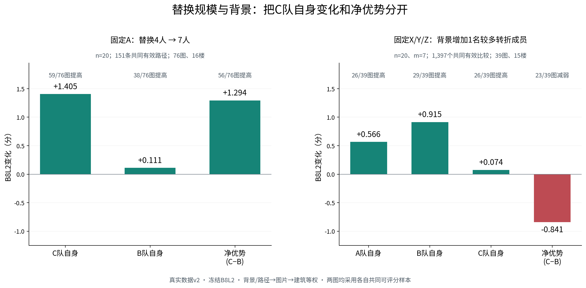

# HOHONET 人员分类与换类：采用结论与实质续研

**本轮结论：人员分类主线已具备当前 v2 数据上的收尾条件。** 推荐采用有明确角色、真实容量和匹配替换结果的工作分类：Manual 联合分类用于质量—时间兼顾或时间换质量；Manual 结构分类用于表达解释和较大块定向升质；Semi 自身联合分类用于效率与条件性升质。旧 M、A2、SP、QTD、Rnew2、F01 和跨条件分类继续保留各自用途，不拼成一套未经验证的统一层级。

这次没有重新全面搜类。已补齐上一轮完整交付，完成固定 A 的规模分解、新的固定 X/Y/Z 背景实验、同候选域的连续 Q/T 比较，以及 Semi 新旧收益来源分析。结果允许多数规律和具体反例并存，不以所有分类都有效或胜过连续特征作为收尾条件。

## 1. 来源、实际交付与本轮新增

本轮读取 GitHub main 的提交为 **`cf053a6e31d17393c0e8216ce15660fa37b8b7bb`**，提交时间 2026-10-22 05:44:57 UTC。[提交](https://github.com/Sparkling-Flames/3D_Manhattan_label/commit/cf053a6e31d17393c0e8216ce15660fa37b8b7bb)；PR #23 已合并，合并提交为 `8bfd3e476bd5ae6edc1424e2c8ea07dd2f69a235`。最新模型、术语、人员记录及难度、质量、融合、同房、画像、下载归档等14个入口已按该提交读取，见 [MAIN_SOURCE.json](MAIN_SOURCE.json)。

**底层始终是真人数据 v2。** 目录中的 v3 是研究轮次。端点继续使用冻结 v2 输入、资格、参考绑定、环序、融合与 B8L2/D10；当前 main 的专题收尾用于解释，不构成更换底层数据或算法的理由。

仓库当时只接收阶段01、ALL分类基线、manual_001 的3,489端点，这个历史接收记录保留。本轮环境中的完整事件、端点和代码仍实际存在，已重新取得并分批保存，未用旧案例 ZIP 或作者完成文字代替文件。详见[实际可读取清单](阶段01_实际可读成果与接续依据.md)、[逐文件表](STAGE01_ACTUAL_FILES.csv)。

|来源阶段|实际材料|本轮处理|
|---|---|---|
|已核旧研究|分类、选队收益、有效换类、原生/跨条件事件及扩大实验|保留原阶段身份；旧大文件已有可读文件身份，引用[历史索引](HISTORICAL_AVAILABLE_FILES.csv)，不重复上传大缓存|
|上一轮 closure 完整实存|Manual联合A 81,221行、B 21,000行，结构29,928行，Semi13,882行；合计146,031登记行、138,244物理ABC|补齐完整下载；实际读取事件继续分析，不重算所有端点|
|上一轮去重端点|101,092唯一端点：101,031上一轮新算、61历史复用；含标量、几何和失败状态|完整保存一次；主ABC使用100,530个端点，其余为政策/连续对照等|
|本轮新背景实验|39图、15楼，78个固定XYZ锚点×每锚14个可行D＝1,092物理ABC|3,276唯一端点中236复用、**3,040本轮新融合**，全部完成并分批保存|
|本轮新分析|固定A规模分解、104个目标储备内连续选块、Semi共同格及固定D/Z成员枚举|使用完整实存结果，0次重复融合；按图、楼和背景解释支持|

本轮新实验及上一轮的大事件均提供单文件下载，不仅依赖ZIP。新背景3,276端点与旧全集重叠236个，按精确团队去重后合计104,132个端点；各文件保留各自来源，不强行重压成更大的重复全集。

## 2. 直接采用哪些条件

下表的质量均为建筑等权；先在相应背景/成员设计内汇总，再图片、建筑等权。**净变化指 C−B**；A、B、C的完整有符号变化另表给出。失败不填0，也不从尝试分母删除。

|优先用途|分类与方向|n / m；比例|净Q / D10|净Q改善图／楼|记录时间|采用判断|
|---|---|---|---:|---|---|---|
|质量与时间兼顾|Manual联合：换入较高历史Q、相对源类更快角色|20 / 4；20%|**+3.142 / +3.218**|**6/7；5/5**|**−1.565%**，同一ABC有效子集|主采用；6/7图、5/5楼同时升质省时|
|时间换质量|Manual联合：换入本折最高历史Q、相对较慢角色|20 / 4；20%|**+4.707 / +4.433**|**16/20；10/14**|**+7.165%**，同一ABC有效子集|主采用；接受额外记录时间，不泛化为所有慢类|
|广覆盖结构方向|Manual结构：常规表达→较多转折|20 / 4；20%|**+1.690 / +1.647**|**96/120；14/16**|可比时间子集约+1.60%|主采用；同点数定位改善也是其作用|
|较大结构块|Manual结构：常规表达→较多转折|20 / 7；35%|**+3.141 / +2.882**|**63/77；15/16**|可比时间子集约+2.20%|容量允许时采用；不设背景4人硬门槛|
|Semi质量与效率|Semi自身联合：较高历史Q、相对更快目标角色|12 / 4；33.3%|**+3.493 / +2.795**|**3/5；3/4**|**−10.09%**|Semi优先条件；具体成员低尾仍需显示|
|Semi更广容量|同一方向家族|14 / 3；21.4%|**+1.494 / +1.357**|**5/7；4/5**|**−5.68%**|多数图片有效；不写成多数背景升质|
|Semi较大团队补充|同一方向家族|16 / 3；18.75%|+1.157 / +1.058|3/5；2/4|−6.36%|保留效率用途；质量楼级支持较弱|

结构时间分别只覆盖50图/16楼和19图/14楼，不能把120图/77图质量分母当作质量—时间同时改善分母。Semi质量与全部可靠记录时间保留各自有效行；时间使用现存同来源成员记录秒数之和，经比率的对数分层聚合，不是本轮新测生产历时或货币成本。

本轮[新增规模与背景结果](integration/新增规模与背景结果.csv)单列新背景枚举和固定A分解，不冒充原43条件的一部分。完整[推荐条件阅读表](integration/推荐条件_阅读表.csv)保存角色、层级、人员域、n/m、D、席位变化、成员/配置覆盖、分项、失败和采用建议；[43条件继承与更新](integration/全部43条件_继承与采用更新.csv)保留全部原尝试和对照，不只交付有利行。既有 n10/m7 结构方向、A2 的变化区分和旧选队收益继续保留，未被本表覆盖掉。

## 3. 各类究竟怎样标，谁属于哪类

类别是跨图历史形成的工作分区。ALL标签用于看人和描述；实际目标图实验使用目标建筑外标签及该折历史中心。类号不保证跨折一致，较快/较高Q均相对于本折源角色；缺历史保留unknown。下表是ALL描述，不是把这些编号直接作为所有折的固定人员配额。

### 3.1 Manual结构三类：解释在复杂机会中的表达差异

|类|人数与代表成员|可见标法|主要历史证据|
|---|---|---|---|
|M1：复杂结构明显简化|6人：W008、W029、W030、W034、W035、W037|简单图与多数人接近，复杂结构机会中明显少保留转折和短边|复杂机会有效转折残差−2.372；短转折亦少|
|M2：常规转折表达|34人；包括W100、W104、W106、W116、W123、W128等|接近同图常规表达，复杂机会略简化；类内仍有位置、质量和速度差异|复杂转折残差−0.550|
|M3：较多转折与短细节|19人；包括W002、W027、W102、W109、W112、W115、W122、W126、W130等|复杂机会保留较多非近共线转折及短边；不要求每图都增加角点|复杂转折残差+0.791；近共线残差约0.020，与增加冗余点不同|

这里的残差按同图、条件、参考和来源层比较，再按人员建筑历史汇总。它描述表达倾向，不把所有多点认作必要细节，也不把少点直接当作错误。3人证据不足；该方法ALL为三粗三细、每粗类仅一个叶，**没有额外的独立细分层**。

### 3.2 Manual结构＋Q/T联合五类：把表达与组织角色连起来

|ALL类|人数|定义及实际成员|
|---|---:|---|
|J1 较快、适度转折|10|W001、W006、W011、W012、W013、W017、W021、W028、W113、W134|
|J2 常规时间、略简化|23|W010、W031及多名新来源常规表达人员；完整名单见下方成员表|
|J3 复杂结构明显简化|6|与M1六人相同；历史Q接近J1/J2，表达却不同|
|J4 较慢、常规转折|9|W015、W032、W033、W036、W114、W121、W125、W129、W131|
|J5 较高历史Q、较多细节|9|W002、W027、W102、W109、W112、W115、W122、W126、W130|

57人有标签，5人缺足够本条件几何/Q/T机会。J5的ALL相对时间并非最快；实际“更快”方向是某个楼外源类→目标类的比较，不能把J5永久命名为快类。较快m4实验中的目标角色联合名单为 **W102、W109、W115、W122、W126、W130**；最高Q较慢方向另包含W112。楼外可为4/5/6类，不把ALL五类强制覆盖所有折。

J1/J2/J3的相对Q中心接近，分别约−3.74、−3.70、−3.22；它们的时间和复杂结构表达不同。J5相对Q约+15.29。联合类因此有清楚的角色解释，但同类内仍保留连续Q、时间、低尾及局部贡献。[逐折实际角色与成员](manual_qt_followup/ADOPTED_FOLD_ROLES_AND_MEMBERS.csv)

### 3.3 Semi按自己的终稿和历史分类

Semi结构为三粗四细，59人有标签：常规/较少表达粗类中有6人的偏简化细类和32人的常规细类；6人近共线分段较多；15人较多转折。近共线组是 **W010、W014、W031、W037、W102、W130**，其近共线残差约0.162，较多转折组约0.014。两种“多点”因此应分开：增加同墙线分段与表达更多转折不是同一标法。

Semi自身联合ALL为五类、54人有标签：较低Q适度转折6人、较低Q常规表达12人、较快较多转折9人、较慢常规/偏少转折8人、较高Q较快常规表达19人。它不是把Manual的J类直接搬到Semi，也不是新增的Manual＋Semi联合模型。新批没有精确初始化时，本轮只解释终稿、历史Q/T和实际团队效果，不补造编辑轨迹。

**完整21行定义（含unknown）和全部人员名单：** [分类定义与完整ALL成员](integration/分类定义与完整ALL成员.csv)。[分类方案总表](integration/分类方案_采用总表.csv)保留11个方法家族；新分类两方法×两条件的ALL/LOBO标签与旧M/SP/A2映射各保持原文件身份。文件名中的ALL_METHOD指对应新分类接口，不表示11个历史家族全部合成同一标签表。

### 3.4 粗类、细类及旧方法的采用关系

Manual新粗类用于表达与方向选择；Semi细类能把偏简化、普通表达、冗余分段和更多转折分开。Manual联合类内的连续选择已有新增收益/代价证据，**当前无需为每种速度或低尾差异继续拆出新类**。

旧M二粗四细保留父类内结构解释；扩大后的m5不再支持整体同类更稳定，m6保留条件性幅度信号，不能沿用早期合并7/7楼。A2保留跨图几何关系和指定n17/m9的变化/下降风险区分；SP保留Semi尺度解释；F01/QTD保留相应效率和条件作用；Rnew2保留真实替换关系学习的成果与直接m2学习负结果。XCOND_GEOM、XCOND_GEOM_QT、XCOND_PAIRED继续作为真正使用同人两条件历史的独立分类，效果仍按Manual/Semi分开。本轮没有重新拟类，也没有把未优于强Q/T基线当作抹掉结构解释的理由。

## 4. Manual联合：往哪里换、换多少，何时用连续选择

### 4.1 主要匹配替换结果

A=D+X，B=D+Y，C=D+Z；X/Y来自同一源类，Z来自目标类，每块m人，三块和D两两不交。严格三队设计至少需要 n+2m 名实际候选：n20/m4至少28人，D16；n20/m7至少34人，D13。不能在仅20人的池里声称完成n20/m4的这种设计。

|Manual联合方向|n/m|同类 B−A|跨类 C−A|净 C−B|净改善背景|含义|
|---|---|---:|---:|---:|---|---|
|较高Q、较快|20/3|+1.483|+2.162|+0.678|27/40|较广10图8楼支持，净收益较小|
|较高Q、较快|20/4|−0.028|+3.114|**+3.142**|**22/27**|主推荐；另1背景的C全失败保留|
|较高Q、较快|20/5|约0|+1.939|+1.939|17/23|5/6图、4/5楼升质；同跨幅度分离弱|
|较高Q、较快|20/6|−0.073|+4.782|+4.855|11/12|3图2楼积极，但目标块唯一、互换波动不可估|
|本折最高Q、较慢|20/4|+0.262|+4.970|**+4.707**|**29/39**|20图14楼，接受约7.16%额外记录时间|

三个有符号差值共用同一ABC可评分分母。较快m4为8,645/8,820事件，较慢阶段B为19,755/21,000。较快m4的同类/对称跨类绝对Q变化为 **3.303/4.608**，6/7图、5/5楼跨类更大；较慢m4为 **3.860/8.038**，17/20图、13/14楼跨类更大。这两条具体条件同时回答了“分类能否区分变化”和“方向是否有益”。

较快m4的C有5/252个唯一目标端点失败；较慢m4的C为0/600，但A/B各有38/1400和45/1400个失败。成功时的Q均值与全部尝试风险分开。后者是选择目标语义后的新增背景内部检查，不称新建筑盲测。[共同ABC、逐图/楼及真实成员](manual_qt_followup/MANUAL_QT_ADOPTION_REPORT_ZH.md)

### 4.2 连续Q/T：分类提供组织解释，不要求强行超过它

原分类约束QT10和全候选连续QT10在 **19,896个相同A/D/m锚点**选中完全相同成员。分类在这一策略上提供角色、容量和解释价值，没有增加连续策略以外的数值收益。QT10使用楼外相对Q减去10倍相对log时间排序；10是取舍系数，不是节时10%的承诺。

n20/m4四策略共同可评分1,890/1,960锚点，统一比较 **P−A**：QT10为Q **+2.709**、时间 **−4.150%**；Q-only为+2.641、+2.007%；QT20为+2.682、−4.723%。不拿这些P−A与上节C−B直接排名。

本轮新增同目标储备比较：104个冻结储备、748个目标端点，储备内全部Z块构成均匀分布，再用相同楼外历史选具体块。n20/m4均匀Z相对A为Q+3.128、时间−1.658%；QT10相对同A仍升质省时，Q+2.709、时间−4.150%。所以相对均匀Z，QT10是 **平均0.419分Q换额外2.534%记录时间**。它不是相对原队降质。

m3在类内按Q选块，相对均匀Z提高0.581分、时间增加0.937%，8/10图、7/8楼Q增益，可作为偏质量补充；m5的QT10以0.173分换1.862%额外时间；m6目标块唯一，所有政策0增量是容量事实。类别先组织、连续特征再选具体成员，是当前可以使用的两层方式。[同A、同目标储备结果](manual_qt_followup/FINITE_SELECTION_INCREMENT_SUMMARY.csv)

两处解释已修正：旧m5 QT20自身成功集合的+2.351不再用来声称同支持胜过QT10；共同支持为+1.729，对应QT10+1.768。本轮早期类内选择草算使用辅助历史字段，正式结果已统一到原分类q_history/t_history；m4额外节时以2.534%为准，不保留草算2.46%。冻结分数和标签没有改变。

## 5. Manual结构：较大块有效，背景改变的是边际补充价值

### 5.1 原主要发现继续采用

新结构类“常规→较多转折”n20/m4在120图16楼的净Q+1.690，96图、14楼正向；m7在77图16楼净Q+3.141，63图、15楼正向。旧n10/m7固定TURN语义子条件仍保留C−A约+5.91、75/96图及13/16楼改善。不同n的图片和成员覆盖不同，不把它们拼成纯人数因果曲线。

结构m4/m7的同类/跨类绝对Q变化分别为 **3.084/3.604、3.261/4.100**；跨类幅度更大分别在78/120图、12/16楼与47/77图、11/16楼。多数图片升质比幅度区分更强，两种用途分别成立。

### 5.2 固定A，从4人换到7人：C确实平均升质，但要用共同分母

冻结路径中，77图16楼共154条m4→m7路径；A不变，X/Y/Z按保存的嵌套成员路径扩块，D相应减少。要求A、B4、C4、B7、C7五端点共同可评后，保留 **151条路径、76图16楼**：

|比较|平均Q变化|改善图片|改善建筑|
|---|---:|---:|---:|
|C7−C4|**+1.405**|**59/76**|11/16|
|B7−B4|+0.111|38/76|7/16|
|(C7−B7)−(C4−B4)|**+1.294**|56/76|13/16|

旧约+1.337的C变化使用C/A单独有效集合；本表统一到五端点，三项严格满足差值关系。可以正面采用“这些固定A路径上，扩大到7人多数图片使C更好”；净优势+1.294不再单独冒充C自身升质。m4→m6在另一可行共同子集反而C−1.018、净−1.100，故不主张每多换一人都单调更好。[精确路径与分解](structure_followup/FIXED_A_COMMON_DECOMPOSITION.csv)

### 5.3 新实验：同图同XYZ，完整换背景

旧m7两背景层67图和11图仅 **uNb-09一张共同图**；旧低/中层均值不能单独证明普遍背景机制。本轮在有真实容量的39图15楼，为每图选两个预登记XYZ锚点（不按目标Q挑选）；每图池35人，XYZ占21人，剩余14人中选13人D，**14种背景全部计算**。每次ABC内部仍有同一D，XYZ始终不变。

78锚点×14D＝1,092个物理ABC；3,276去重端点，236复用、3,040新算。另构成1,448个严格匹配背景对：D中一名常规成员替换为一名较多转折成员，团队n20和前景m7固定。六端点共同可评1,397对，39图15楼：

|背景增加一名目标类后|平均Q变化|图方向|楼方向|
|---|---:|---:|---:|
|A队自身|+0.566|26/39提高|12/15提高|
|B队自身|**+0.915**|29/39提高|11/15提高|
|C队自身|**+0.074**|26/39提高|8/15提高|
|换类净优势 C−B|**−0.841**|**23/39减弱**|**11/15减弱**|

相同匹配对上，净优势由4.460降到3.620。**这支持多数图片/楼上的边际补充减弱：背景已有更多该类表达后，源类B获得的改善往往更大，C的额外优势变小；不是C通常变差。** “不超过4/13”不采用为硬阈值，4→5本身仍只有1图；使用连续背景构成和实际成员支持更合适。

完整新背景实验总体仍有净Q **+3.778**、D10+3.569，26/39图、13/15楼提高；同/跨绝对Q为 **3.204/5.247**，28/39图、11/15楼跨类更大。这说明换类方向在新的背景组合中仍有实用性。C有23/1092个不同端点失败（原始2.11%、楼等权2.38%）；任一臂失败34/1092个ABC。1058个共同成功ABC中，净损失>5分为42/1058，>10分为9/1058，分别3.97%与0.85%；层级权重风险另为2.32%与0.16%。

新背景实验大多数队伍混合库存时间来源；严格同一单一来源、三队时间完整且共同可评仅1个ABC，六端点背景梯度没有可靠共同时间支持。因此本实验不新增效率结论，时间取舍仍引用原有可比子集。

本轮只穷尽所选两个XYZ下的全部D，未穷尽全部XYZ。[精确容量](structure_followup/background_gradient/FINITE_COVERAGE.csv)、[完整ABC](structure_followup/background_gradient/EVENTS_COMPLETE.csv.gz)、[匹配背景对](structure_followup/background_gradient/MATCHED_BACKGROUND_GRADIENT_PAIRS.csv.gz)均已保存。新背景实验是使用过的v2图片上的新成员组合检查，不称外部盲测。

## 6. Semi：旧效率发现有效，新升质来自更充分的成员与背景支持

旧28事件、5图4楼的净Q+0.1532、时间−8.5437%保留原权重和来源。对齐旧14个“图片×类别方向×n×m”格后，统一权重的变化如下：

|支持|净Q|记录时间|解释|
|---|---:|---:|---|
|旧28个ABC、旧14格|+0.1533|−8.58%|原结果统一到格权重后的起点|
|新成员/背景，仅旧14格|**+3.1302**|**−9.34%**|主要质量增益已在旧图片与原规模内出现|
|旧5图的全部新规模/方向|+2.0564|−7.55%|扩大条件使平均收益降低|
|全部69格，7图5楼|**+1.8982**|**−7.23%**|新增两图并非抬高总体均值的来源|

新增支持指原v2库存中纳入本实验的图片/组合，不是新采集版本。旧28个ABC与新主层有11个物理ABC重叠；去掉它们，全主层净Q仍+1.899。

最清楚的完整枚举例是7y-13、n12/m4：目标一直是 **W109/W115/W120/W127**，源类8人和历史标签不变。旧两路径对称Q为−5.368；**固定旧两个D与同一Z**，穷举源8人的35种无序分割后为+4.952；再覆盖全部9个D后为+11.178，315个物理ABC全部枚举。9/9背景平均正向，389/630个具体C−B比较正向。这里是源类内部组合及背景支持改变，不能说找到了新的目标高手。

该例还保留真实代价：Q+11.178主要伴随自身方向残差−2.352°，但三维代理−1.559、底边角距+0.324°、均高误差+0.01460。总分改善不等于全部参考几何变好。n12/m4总体三维代理仍+0.997，方向应按群体与局部两层解释。

采用n12/m4有明确容量和风险依据：39个背景×源储备×方向面板21个升质、36个省时，39个平均损失均≤1分；目标C 0/39唯一端点失败，6/1365物理ABC有源臂失败。n14/m3覆盖7图，但仅36/83面板升质、71/83省时，图片多数与背景多数分开。

Semi同/跨类对称绝对Q变化n12/m4为 **5.173/4.541**，n14/m3为 **4.386/3.567**。因此采用其效率与定向收益；该方向不支持“同类总更稳定”。详细[采用报告](semi_followup/SEMI_ADOPTION_FINDINGS_ZH.md)保存逐格、逐图/楼、固定D/Z、真实成员与低尾，完成了新旧结果的衔接。

## 7. 质量与机制：实际改变了什么

### 7.1 分项与总分并列

结构n20/m7的C−B分项：三维代理+1.957、底面IoU+0.0152、底点角距−0.133°、自身方向残差−0.559°、均高/中心高度误差−0.00438/−0.00240；遗漏−0.00176、外扩−0.01569。Semi n12/m4相应三维代理+0.997、底面+0.00774、底点−0.0383°、方向−0.6248°，转折数却平均−0.136，不能用新增角点解释全部升质。

Manual联合较快m4的对称C−(A+B)/2分项，三维代理+2.809、底面+0.0196、底点−0.223°、方向−0.519°、均高误差−0.0122，平均转折+0.285；最高Q较慢方向三维代理+3.049、底面+0.0377、底点−0.429°、转折+0.588。这里明确采用对称量，不将它们误列成C−B分项。所有分项有效分母保存在原表与本轮同支持表。

沿用最新质量收尾：dir是输出自身最佳正交轴残差，不是相对GT整屋旋转误差；IoU3D100是角点均高棱柱代理。上下界像素、面积与实际高度的有符号变化描述几何，不自动等于改善；Hmean/Hcenter则是参考质量误差项。结构机会、节点/边召回与票数作为局部解释，不新增为Q扣分项。

### 7.2 代表性实际案例

|案例|真实改变|可采用机制|
|---|---|---|
|2t7-09、结构n20/m4|A/B/C均4角，Q93.973/89.429/95.424，净+5.995|同角点数量下定位、底面和高度改善；不靠新增角点|
|B6-47、结构n20/m7|必要机会r3/r4/r7/r8最高组支持由6/9/8/8变12/10/12/14，门槛10；Q净+5.897|较多转折块补足必要支持；其中一个机会也涉及背景观察重分组；遗漏变少但外扩略增|
|7y-03、反向m4、n20→21|XYZ固定，D仅加W121；C关键角10票不变，门槛10→11，Q95.498→54.210|人数门槛让必要结构退出；不是票变少，也不是“增加人数总更好”|
|B6-47、结构n20/m4失败|C局部一角10票入选，配套另一角分成3/5票均失选；投影环自交|部分真实补充经连接与位置产生无效底面；保留失败，不改环修成高分|
|7y-19、Semi n12/m4|B/C输出和Q相同95.877，记录时间1216.860→1070.755秒|可纯粹提供效率价值，无需几何差异变大|
|7y-13、Semi n12/m3|同目标类用W109替W127、另两人W115/W120不变，Q59.097→84.349，时间再−4.48%|连续历史和具体成员可改善类内定位尾部；这是真实m1补充，不冒称新m3类别块|

这些案例已附实际原图、ERP/BEV/3D与精确票账，见[原答到融合机制](../personnel_exchange_closure_20261022/mechanisms/机制解释_原答到融合.md)、[Manual联合主方向机制](../personnel_exchange_closure_20261022/manual_joint/mechanism_case/MANUAL_JOINT_CASE_ZH.md)。原图来自Release索引，未使用生成图代替数据。

本轮新增B6同XYZ背景正反例：D内W118→W112时，C自身约+16.239、净优势+16.765；D内W125→W036时，C自身约−16.332、净优势−16.948。两例C均为10节点。正例包含旧W027/W130观察重新并组，负例包含旧W012/W102/W104观察拆入未选组，变化经对应与中位定位传递，并非各加减一票。W036虽在历史中属较多转折，当图却只有4点对，说明群体表达倾向仍有可解释的成员条件差异。见[正例叠图](structure_followup/background_gradient/cases/background_net_gain.png)、[反例叠图](structure_followup/background_gradient/cases/background_net_loss.png)、[精确成员](structure_followup/background_gradient/cases/EXACT_EVENTS_AND_MEMBERS.csv)及[局部组票转换](structure_followup/background_gradient/cases/LOCAL_GROUP_TRANSITIONS.csv)。

真实参考外细节仍可作为表达证据；G015壁炉、M01参考暂停等沿用既有裁定，不为了增加本轮升质而修改GT，也不将多画、少画、范围选择、冗余点和定位错误合成一种行为。

## 8. 与其它专题如何连接

|专题已采用成果|本轮怎样使用|职责保持|
|---|---|---|
|人员画像与可靠性|W109/W112总体Q近而时间和困难表现不同；W122/W126低尾不同，解释类内仍需连续历史|scope倾向、确认/报告错误机会和筛除各保留分母，不压成新可靠性分|
|难度与范围|短边和几何自遮挡机会帮助解释简化、局部位置敏感和时间代价；先固定目标空间|H不是RGB遮挡；scope裁定正确率不等于out回答倾向；41张历史顶界待定图为12完整/29不完整参考，按真实资格用|
|质量|总工作分、分项和局部几何并列，使用真实有效分母解释近分异形|冻结B8L2/D10、参考、个人与图片排除不改；可算诊断不等于正式资格|
|融合与人数|对应、局部票数、全N门槛、中位位置和连接解释换类传递|9°/12°整份原答分簇不混同内部gap7.5；不为本轮结果重写融合|
|同房、选队与停止|保留用户既有房间分类的均值/个人相似性、源历史用途；可解释任务公共水平与个人差异|房间不是建筑；同房历史策略收益不冒充本轮类别块效应；不重开同房实验|

这些是当前main已收尾专题的解释连接，本轮不重新审计它们的所有原始材料。引用入口与固定提交保存在main_snapshot及MAIN_SOURCE.json；阶段成果不相加成新的独立样本量。

## 9. 覆盖、复现及收尾

原26种变量域子集逐项记录继续保留：Manual 26/26筛查；Semi 11/26有支持，15个含难度域组合机会不足，不填零。旧245是方法×适用域，188正向候选、旧768/新1040关系候选和直接m2块学习均已有，不能写成未做。本轮使用有竞争力的结构和联合方案推进用途，未把算法/阈值变体冒充新增域组合。

上一轮Manual A在249个选定图×方向×n/m单元的有限储备内完整枚举81,221个ABC；全池理论约1.336×10^15，未穷尽。结构n20所选3,073种可行背景人数向量均覆盖，成员组合未全穷尽。Semi69格631种人数配置均覆盖，8个小格完整枚举，但全池约35.41亿物理ABC仅覆盖6,941。精确整数和未覆盖容量沿用[原覆盖账](../personnel_exchange_closure_20261022/integration/coverage/COVERAGE_FINAL_ZH.md)。

本轮新增背景穷举明确限于39图×2个XYZ锚点×14D；新Manual类内政策明确限于104个冻结目标储备；Semi解释复用全部实际完成事件。加入顺序只保留已有指定n/m路径，不重复计算等价集合终点。失败、缺时间、缺参考与容量不足分开记录。

复现入口见[本轮运行与文件说明](运行与文件索引.md)。原完整事件支持重聚合；端点全集支持重建ABC；只有新的背景缺口调用冻结原生引擎。每个完成批次及时保存，代码、请求、精确D/X/Y/Z、端点键、楼外标签、必要几何和对应关联均可定位。

**可以收尾的四个回答：**

1. **什么分类解释真实标法？** Manual结构三类、Semi结构三粗四细，以及各自联合Q/T角色都有实际成员和重复表达证据；旧关系/尺度/多变量方法保留不同用途。
2. **同类和跨类替换是否不同？** Manual联合n20/m4、结构n20/m4及m7有多数图/楼的幅度或方向支持；Semi优先成立效率和条件性升质，不要求同类更稳定。
3. **粗细类与连续特征有何分工？** 粗类说明表达与换入角色；有依据的细类区分冗余/简化等表达；类内连续Q/T承担具体选人和取舍。没有必要继续把所有内部差异变成新类。
4. **怎样配置？** Manual兼顾质量/时间优先联合n20/m4；愿付时间选最高Q较慢角色；结构补充在容量允许时用m7并关注背景已有支持；Semi优先n12/m4，n14/m3扩大容量。记录具体成员和背景，解释失败与质量分项，不作永久普适保证。

当前无需以外部新数据、所有组合穷尽、零失败或所有指标同向作为收尾前置。未完成的是更广人群/新任务外部验证和全池巨量组合，不影响本轮明确采用。全部已保存结果与历史阶段均保留，没有向公开仓库或额外外部服务发布。
