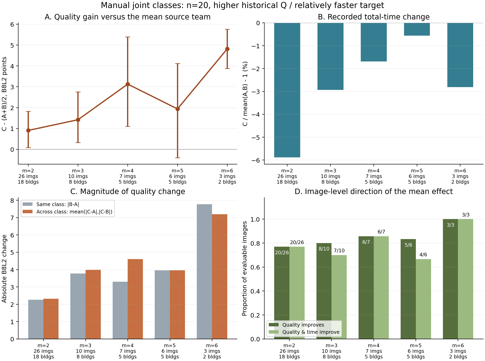

# Manual 结构＋Q/T 联合分类：有效换块条件与组织用途

## 采用判断

本轮保留旧 `V3_JOINT_QT` 分类，已经把其用途从“按类别选队可能更好”推进为**共同背景、相同总人数、相同实际换人数下的实际换类证据**。最适合作为主条件的是普通 Manual、同一新采集来源正式人员池中，**n20/m4：把4名源类成员换为楼外历史 Q 更高、相对源类更快的目标类成员**。在四个背景/成员储备及其内部完整块枚举后，对称 Q 增益为 **+3.128**，**6/7图、5/5楼**平均升质；记录时间平均 **-1.69%**。同类/跨类绝对 Q 变化为 **3.303/4.608**，6/7图、5/5楼支持跨类变化更大。它同时支持方向性升质、一定节时与类别变化区分，作为本轮 Manual 联合分类的首选条件。

第二个明确用途是 **n20/m4、换入训练折历史 Q 最高且相对较慢的类**。该语义条件由阶段 A 发现，随后冻结两组新背景、重新枚举成员块。阶段 B 的对称 Q 增益 **+4.838**，**16/20图、10/14楼**升质；同类/跨类变化 **3.860/8.038**，**17/20图、13/14楼**支持跨类变化更大。代价是记录时间 **+7.20%**。因此它适合以时间换取质量与形状改变，不能包装成省时方向。

n20/m3可作为覆盖更广、替换比例较小的方案，n21/m3可作为同类较近/跨类较大的补充条件。m5、m6保留升质用途，但不是“换得越多越好”：m5的绝对 Q 变化分离很弱，m6仅3图2楼且目标成员几乎全类入队。以上都是可执行的工作分类与条件规律，不要求每个背景同向。

## 1. 分类怎样解释人，实际用了哪些人

分类输入仅为 **Manual 历史结构＋Q＋T**，并非 Manual＋Semi 联合输入。Q历史是既有同图同条件同伴中心化质量的楼间平均；T历史是同来源相对记录时间的对数历史。困难机会下的转折、短边表达参与结构域。上一轮冻结方法按训练侧选择 CQT 或 EQT：CQT包含简单/复杂结构机会，EQT使用总体转折/短边。所有本轮评价都排除目标建筑历史，不重新根据目标图表现分人。

全数据描述有五个有标签类及5名证据不足者，实际标签和支持见 `GLOBAL_DESCRIPTIVE_LABELS_AND_HISTORY.csv`；这五类不强行覆盖每个楼外折。22个楼外折中，18折为K5、2折为K4、2折为K6；19折选CQT、3折选EQT。实验比较的是楼外中心定义的角色，不按J编号跨折拼接。

| 全数据描述类 | 实际标法/历史表现 | 人数 | Q历史中心 | T历史中心 | 成员 |
| --- | --- | --- | --- | --- | --- |
| J1 | 历史较快；复杂结构仍有短转折表达 | 10（新来源2） | -3.74 | -0.650 | W001、W006、W011、W012、W013、W017、W021、W028、W113、W134 |
| J2 | 常规大类；困难结构转折相对少 | 23（新来源21） | -3.70 | -0.076 | W010、W031、W100、W101、W103、W104、W105、W106、W107、W108、W110、W111、W116、W117、W118、W119、W120、W123、W124、W127、W128、W132、W133 |
| J3 | 困难结构明显简化；本轮新来源池无成员 | 6（新来源0） | -3.22 | 0.099 | W008、W029、W030、W034、W035、W037 |
| J4 | 历史较慢，Q居中；细节并非统一缺失 | 9（新来源5） | -0.72 | 0.687 | W015、W032、W033、W036、W114、W121、W125、W129、W131 |
| J5 | 历史较高Q，复杂结构转折与短边较多 | 9（新来源7） | 15.29 | 0.131 | W002、W027、W102、W109、W112、W115、W122、W126、W130 |

J5整体历史Q较高，也在复杂结构中保留更多转折与短边；但J5不是永久“快类”。例如慢成员能在不同训练折转入另一类，J5与源类的相对快慢也随折与可用子集改变。实际实验应查 `AVAILABLE_CLASS_CENTERS_AND_MEMBERS.csv`、`ACTUAL_DIRECTION_HISTORY.csv` 和逐人支持，不用全数据J5名单代替楼外分组。

较快方向在m3—6中实际使用的目标成员主要来自 W102、W109、W115、W122、W126、W130；m3若干折还包括W112。完整源/目标/背景名单均在精确事件表。m4源类要容纳两个互不重叠四人块，目标至少四人，D为16人；整支三队的并集至少28人。未知类别或缺历史者没有被当成零值补入。

## 2. 新实验完成了什么

初始阶段 A 登记 **81,221个唯一物理ABC事件**、**484个有限背景/成员面板**、**47,114个唯一团队请求**，覆盖30图20楼；连续策略有79,584条同原队记录。已全部评价并分池保存，0个待完成池。所有既有精确端点由上层缓存优先复用，新增部分沿用冻结融合与评分。阶段 B 另有20图14楼、40个新增背景、21,000事件和3,400唯一请求，单独保存。

该图人员池从31图库存起步；`uNb9QFRL6hY-58`只有20名可用人，不能在n20下形成互不重叠的源两块和目标块，所以未进入本轮严格ABC。门洞/特殊范围不混入普通Manual主域，历史筛除人员不恢复组队资格。分类本身的全数据描述与原答证据仍按旧资格保留。

主设计为 A=D+X、B=D+Y、C=D+Z，X/Y同类，Z目标类；三块均为m，彼此和D不相交。优先方向每个可行n20/m登记四个不同背景/成员储备；在源储备2m内枚举全部无序互补分区，在目标储备内枚举全部m人子集。n19/21沿用同一块与嵌套D的两条路径。所有成员/背景选择在新增端点结果前冻结，曝光平衡并以哈希打破并列。

**有限储备内穷举，不是整个人员池穷举。** n19/20/21、可行m2—7的容量账共有1,325个方向/图片/n/m单元，初始阶段实际选中249个；其可行背景类别向量有6,895个，实际覆盖399个，具体背景484个。所选单元全池理论无序ABC总数为1,335,937,197,428,677，已登记81,221，余1,335,937,197,347,456未计算；未选中的1,076个单元及理由另列。完整空间虽过大，本轮已完成冻结有限范围，不用每格几个例子冒称全部组合。相同成员集合终点仅计算一次，未展开等价加入顺序。

## 3. 主方向：n20、较高历史Q且相对更快

下表Q的四个差值全部使用**同一个三队共同可评分事件集合和相同聚合权重**，依次为 B−A、C−A、C−B、C−(A+B)/2，因此精确满足代数关系。原始逐对可评分均值和不同分母仍保存在完整表，不丢弃失败。时间列使用全部同来源可靠记录，另表保留共同可评集合时间；平均先在背景内、再按图片、最后建筑等权。

| m | 图/楼 | 共同ABC：B−A / C−A / C−B / 对称Q | 对称D10 | 记录时间 | 同/跨绝对Q变化 | 升质图；楼 | 同时升质节时图 | C失败端点 |
| --- | --- | --- | --- | --- | --- | --- | --- | --- |
| 2 | 26/18 | +0.234/+1.024/+0.791/+0.908 | +0.942 | -5.89% | 2.263/2.320 | 20/26；15/18 | 20/26 | 0/612 |
| 3 | 10/8 | +1.483/+2.162/+0.678/+1.420 | +1.582 | -2.93% | 3.772/3.978 | 8/10；7/8 | 7/10 | 3/400 |
| 4 | 7/5 | -0.028/+3.114/+3.142/+3.128 | +3.227 | -1.69% | 3.303/4.608 | 6/7；5/5 | 6/7 | 5/252 |
| 5 | 6/5 | -0.000/+1.939/+1.939/+1.939 | +2.504 | -0.56% | 3.958/3.961 | 5/6；4/5 | 4/6 | 1/84 |
| 6 | 3/2 | -0.073/+4.782/+4.855/+4.818 | +4.852 | -2.81% | 7.768/7.190 | 3/3；2/2 | 3/3 | 0/12 |

图中区间是内部建筑重抽样描述区间，各m支持量不同，不能把连接线当作同一组建筑上的单调因果曲线。

其中n20/m4有8,645/8,820三队可评事件，21/27可评背景平均升质；另1个背景的C全失败也完整保留。n20/m3是30/40背景平均升质，Q为+1.420但同/跨绝对变化接近，只有4/8楼支持跨类幅度更大，所以主要作为升质/效率方向，而非最强的可互换性分类证据。m5的平均质量仍正向，5/6图、4/5楼支持；它对结构召回的作用更明显，但绝对Q幅度3.958/3.961不能说分类显著压低了类内波动。

n21/m3在10图8楼上，同/跨绝对变化2.490/4.978，8/10图、7/8楼支持跨类变化更大，对称Q+2.519、时间−2.86%。这是很好的补充研究条件，原队与替换块均精确保留。它的两背景主表不直接与n20四背景均值相减；固定X/Y/Z和相同路径的20→21对照，Q方向作用平均增加0.615，类间幅度优势增加1.235。n20→21/m4反而平均减少1.059。人数作用不是单调收益。

## 4. 第二用途：最高历史Q类，接受时间代价

宽泛的“Q更高但更慢”混有多个目标角色，初始n20/m4整体只有Q+0.602、记录时间+14.39%。按训练折已有中心识别最高Q目标后，得到更有意义的方向。这个语义细分在看过阶段 A 结果后提出，阶段 B 只选择新成员/背景，不继续按结果搜最佳队。

| 阶段 | 事件 | 背景 | 对称Q | D10 | 时间 | 同/跨幅度 | 升质图；楼 | 跨幅更大图；楼 |
| --- | --- | --- | --- | --- | --- | --- | --- | --- |
| A：最初一个背景 | 10,500 | 20 | +1.376 | +1.483 | +5.67% | 2.935/5.311 | 17/20；11/14 | 16/20；11/14 |
| B：两个新增背景 | 21,000 | 40 | +4.838 | +4.551 | +7.20% | 3.860/8.038 | 16/20；10/14 | 17/20；13/14 |

阶段 B 的共同可评集合为19,755/21,000事件：B−A **+0.262**、C−A **+4.970**、C−B **+4.707**、对称 **+4.838**。逐对各自可评分均值为C−A+3.756、C−B+3.574，分母不同，不能用它们的算术平均重建共同集合的对称量。A/B分别38/1,400、45/1,400唯一端点失败，C为0/600；失败不赋0分来制造净Q。新增背景的30/39可评面板升质，20图中16图升质，群体方向在新增背景重复，但时间代价也重复了。

这不是全新建筑盲测：同一v2图片被历史研究反复使用，条件本身在阶段A后选出。它是具体成员和共同背景上的内部扩展检验，按这个身份可以明确采用。该阶段20个可用人员子集中17个历史上也确实较慢，3个子集因缺人/类内构成而均值较快，记录在历史中心表中，没有删除或改写它们。

## 5. 改变了哪些质量与结构分项

| 分项 | 较快方向n20/m4 | 较慢最高Q方向阶段B n20/m4 | 解释 |
| --- | --- | --- | --- |
| 三维代理 IoU×100 | +2.8091 | +3.0495 | 升高较好 |
| 底面 IoU | +0.0196 | +0.0377 | 升高较好 |
| 底点角度项（度） | -0.2231 | -0.4291 | 降低较好 |
| 自身正交轴残差（度） | -0.5188 | -0.9438 | 降低较好；非GT旋转误差 |
| 平均高度误差 Hmean | -0.0122 | -0.0029 | 降低较好 |
| 中心高度误差 Hcenter | -0.0001 | -0.0030 | 降低较好 |
| 遗漏 omission | -0.0071 | -0.0347 | 降低较好 |
| 外扩 extension | -0.0167 | -0.0041 | 降低较好 |
| 节点数 | +0.2846 | +0.5598 | 数量，不自动判好坏 |
| 转折数 | +0.2846 | +0.5882 | 数量，不自动判好坏 |
| 短转折边 | +0.0618 | +0.2658 | 数量，不自动判好坏 |
| 近共线冗余数 | +0.0000 | -0.0253 | 表达诊断 |
| 参考9°节点召回 | +0.0391 | +0.0646 | 升高表示更多参考机会被几何对应 |
| 参考9°边召回 | +0.0506 | +0.0812 | 同上，不能替代原图语义 |
| 平均高度 h | +0.0247 | -0.0000 | 有符号尺度变化，不等同误差 |
| 顶界平均 ERP y（像素） | -2.7373 | +0.6778 | 有符号位置变化，不等同误差 |
| 底界平均 ERP y（像素） | +2.0529 | -0.8416 | 同上，受输出节点集合影响 |
| 底面面积（h²） | -0.0697 | +0.2695 | 有符号范围/尺度变化，不自动判好坏 |

较快m4既有底点定位、底面、三维代理改善，也有参考节点/边召回提高，平均新增节点不到0.3。因此不能把总体质量增益全部归因为“多画角点”。较慢最高Q方向的新增转折约0.588、短转折边约0.266、节点召回约+0.065，并伴随底点角度、遗漏和三维代理改善；平均高度本身几乎不变而高度误差项改善，说明定位与结构同时作用。dir是候选自身的最佳正交轴残差，不能称GT整屋旋转误差。三维IoU为相机高度归一的棱柱代理。

全部上下界、底点/顶点对应、范围、尺度和几何距离字段均在 `ALL_COMPONENTS_AND_DENOMINATORS.csv.gz`，没有以总Q替代分项。参考外新增结构不自动算错；参考召回只是几何诊断，必要结构的解释使用原图可辨的同一机会。

**本联合分类的独立案例**见 `mechanism_case/MANUAL_JOINT_CASE_ZH.md` 与原答/融合 ERP、BEV、3D 图：B6，n20/m4，楼外 J2→J5，共同背景16人完全相同。源类到目标类替换使两个可见结构机会分别从8→10票、6→10票跨过门槛，原背景观察的身份集合也未变化。C相对B的Q+3.365、D10+4.372、记录时间−0.703%，底点角度与高度项改善；但相邻另两处仍只有9票和8票，未完整恢复结构，底面/三维IoU反而下降，C相对原队A仍低1.023分。这是联合分类真实的补票与定位取舍，不用总分掩盖局部代价。三队只做3次元数据重放、0次重新评分，重放几何与旧端点完全一致。案例是结果后的机制选择，不增加独立总体证据。结构路线的共享机制案例另见 `../mechanisms/机制解释_原答到融合.md`，两种方法身份明确区分。

进一步把角点对应限定在A/B、A/C、B/C三对都有可用量的相同事件集合，区分“每个角点移动多少”与“融合质量改变多少”：

| 方向 | 几何对应量 | 同类 | 对称跨类 | 可用图/楼 | 跨类更大图；楼 |
| --- | --- | --- | --- | --- | --- |
| 较快目标 | 对应角距离（度） | 0.7528 | 0.9418 | 7/5 | 6/7；5/5 |
| 较快目标 | 对应底点平均距离（h） | 0.0534 | 0.0724 | 7/5 | 3/7；2/5 |
| 较快目标 | 对应顶点平均距离（h） | 0.0634 | 0.0817 | 7/5 | 4/7；3/5 |
| 较慢最高Q目标 | 对应角距离（度） | 0.9597 | 0.9941 | 16/12 | 6/16；5/12 |
| 较慢最高Q目标 | 对应底点平均距离（h） | 0.0327 | 0.0329 | 16/12 | 9/16；6/12 |
| 较慢最高Q目标 | 对应顶点平均距离（h） | 0.0385 | 0.0402 | 16/12 | 8/16；6/12 |

较快m4的对应角距离在6/7图、5/5楼较大；底点和顶点空间位移的多数支持更弱。阶段B的强Q变化分离也没有变成所有同节点对应量都明显分离：在可用的16图12楼子集中，底/顶点位移均值很接近。其有效用途应落在观察到的质量、结构与失败改变上，而不是笼统宣称每个定位维度都明显变化。不同拓扑或不可对应的事件继续保留在总体质量、结构和失败表，不因该定位子集不适用而删除。

## 6. 具体成员和背景：规律不是被一个人包办

m3在去掉任一可变化目标成员后的有限子集中，楼等权Q均值仍为正，范围约+0.50到+3.16；m4约+1.81到+5.05。对应支持量不同，详见 `TARGET_MEMBER_EXCLUSION_SUMMARY.csv`，这是固定背景下完整目标块枚举的描述对照，不是宣称某个人具有永久因果贡献。m6目标全类入队，没有可替代目标成员，目标成员波动标为不可估计。

类内仍有可解释差异。n20、原m4目标块中的缓存端点，固定19人，以W130换W126，真实只换1人，Q平均+2.201，5/6图、4/5楼正向；节点数平均不变、底点角度项降低0.134°，记录时间约+4.46%。这一补充对照说明连续历史和具体成员可以处理类内的定位/时间取舍；它没有伪装成又一个m4跨类事件。

背景具有实际作用。B6-47、n20/m5固定目标五人W102/W109/W115/W126/W130，C类别席位始终J1:2、J2:9、J4:4、J5:5，仅更换D，四个C为Q48.499、54.676、51.657以及invalid_floor。该表连同四个精确D、A/B/C保存于 `B6_FIXED_TARGET_FIVE_DIFFERENT_BACKGROUNDS.csv`。因此同一个目标块可以在不同同构成背景上成功或失败，不能简单把全部风险归到一个目标成员。

反例进入主表：B6-47/m3四背景仅一背景升质；UwV83HsGsw3-22/m5四背景均降质，平均−2.220；zsNo4HB9uLZ-16/m3四背景均降质，换到m4时三个背景升质而均值强正向。它们说明换块比例、背景已有结构支持和定位余量共同决定效果。m4主条件共同可评事件的楼/图平衡损失>5分率为2.39%，损失>10分约0.27%；阶段B对应约9.62%和6.25%，更强变化也伴随较大的损失尾部。二者分别推荐，风险不混为同一水平。

## 7. 连续Q/T对照：分类提供组织方式，没有凭空多出收益

每个策略都使用同一个A、D、m、同一候选人员域，只用楼外历史q−λt，不用目标图个人Q或融合结果选人。类别约束QT10先限于目标类，再排连续分；不约束的QT10可以从全部A外候选选。**所有19,896个同原队锚点上，这两种λ=10策略选中完全相同的成员集合**，因此其Q、时间与失败完全相同。本轮没有证据说类别在该连续效用之上额外升质；它的用途是可解释地组织目标池，并在当前支持内保留该连续策略的结果。

| 实际m | 选择方式 | 相同A的Q变化 | 记录时间 | 同时改善图 |
| --- | --- | --- | --- | --- |
| 3 | 类别约束 QT10＝连续 QT10 | +0.235 | -6.92% | 6/10 |
| 3 | 连续 Q（λ=0） | +1.678 | +0.08% | 4/10 |
| 3 | 连续 QT20 | +0.152 | -8.05% | 7/10 |
| 4 | 类别约束 QT10＝连续 QT10 | +2.709 | -4.12% | 5/7 |
| 4 | 连续 Q（λ=0） | +2.641 | +1.93% | 1/7 |
| 4 | 连续 QT20 | +2.682 | -4.70% | 5/7 |
| 5 | 类别约束 QT10＝连续 QT10 | +1.768 | -2.37% | 4/6 |
| 5 | 连续 Q（λ=0） | +1.825 | +1.39% | 2/6 |
| 5 | 连续 QT20 | +2.351 | -3.18% | 4/6 |
| 6 | 类别约束 QT10＝连续 QT10 | +4.818 | -2.76% | 3/3 |
| 6 | 连续 Q（λ=0） | +4.267 | +3.84% | 1/3 |
| 6 | 连续 QT20 | +4.171 | -6.62% | 3/3 |

n20/m4的QT10得到Q+2.709、时间−4.12%；只按历史Q选择约Q+2.641、时间+1.93%。QT20的Q+2.682、时间−4.70%，表现出不同速度偏好。策略两两比较可能只差0—2名成员，表内另存真实策略间换人数，不把它们当作m人严格ABC。旧相对均匀选队Q+1.43/时间−5.42%的结果继续保留为旧选队实验，本轮没有拿它替代匹配替换证据。

## 8. 重要对照与可以收尾的问题

| 登记历史方向 | n/m | 对称Q | 时间 | 升质图；楼 |
| --- | --- | --- | --- | --- |
| q_down__faster | 20/3 | +2.311 | -5.20% | 8/22；6/16 |
| q_down__faster | 20/4 | -2.437 | -10.34% | 1/3；0/2 |
| q_down__slower | 20/3 | -1.505 | +14.36% | 3/17；3/12 |
| q_up__slower | 20/3 | -0.890 | +14.75% | 17/27；9/19 |
| q_up__slower | 20/4 | +0.602 | +14.39% | 16/22；10/15 |

“较低历史Q但更快”在n20/m3虽然均值+2.311，却只有8/22图、6/16楼升质；它的正均值由少数大改善拉动，适合作为效率和失败风险对照，不作为多数升质推荐。宽泛高Q慢方向也不能代替“最高Q目标”的具体语义条件。这些是方向选择的信息，不因个别反例取消已在多数图片重复的有效条件。

本轮可以收尾四点：**联合分类具有可操作的方向与人数/比例用途；n20/m4较快高Q方向最均衡；最高Q较慢方向提供更强的变化分离与有代价的升质；类别内部仍应保留连续历史与实际成员处理低尾。** 当前不需要继续无止境增加分类或改融合门槛。对大团队的建议从真实容量与背景支持出发，而不是固定类数、认为同类完全可替换，或假设整条人数曲线都同向。

## 9. 交付、复现与身份

`EFFECTIVE_CONDITIONS.csv`为采用表，`COMMON_ABC_SIGNED_EFFECTS.csv`为共同分母三变化闭合表；`EVENTS_COMPLETE.csv.gz`、`phase_b_highq_slower/EVENTS_COMPLETE.csv.gz`是两阶段完整精确事件；`TEAM_REQUEST.csv.gz`与中央端点文件提供可重聚合的成员集合和几何；所有失败均保留。输入/标签、历史中心、精确背景、类别配置空间、未覆盖容量、政策对照、嵌套人数路径均有独立小表。

运行代码与依赖入口见本目录 `README.md`。每完成一池立即保存，再合并总表；本报告与小表是独立文件，不依赖只读摘要或无法定位的大ZIP。所有结果都是v2材料上的内部研究；分类旧发现、初始新增块实验、结果后语义分层、阶段B新背景检查分别保存。
