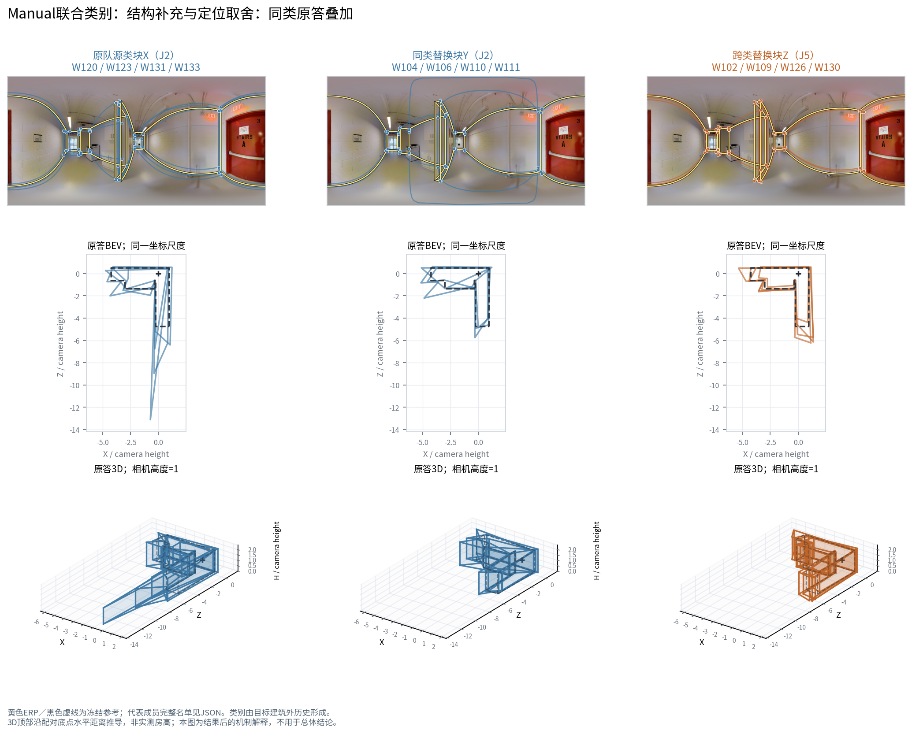

# Manual 联合分类的真实机制案例：同一背景下补票与定位取舍

本例确实属于 **Manual 结构＋Q/T 联合分类 `V3_JOINT_QT`**，采用排除 B6ByNegPMKs 建筑的既有楼外标签。不是把结构单域分类案例改名。底层数据、原答、参考及冻结融合/质量算法均为 v2。类别编号只对本折有效。

## 1. 研究对象与精确三队

- 图片：`B6ByNegPMKs-47`；事件：`a6b1eed8f4c86b3ce2d8c62c`；阶段 A，n=20、m=4，实际替换比例20%。
- 方向：本折 J2→J5，目标类在训练折中历史Q较高、相对源类更快；方向由楼外历史登记，未用目标图Q定义。
- A、B 类别人数均为 `J1:2|J2:15|J4:3`；C 为 `J1:2|J2:11|J4:3|J5:4`，即用4席 J5 替换4席 J2。
- D（16人）：`W100|W103|W105|W108|W112|W113|W116|W117|W118|W124|W125|W127|W128|W129|W132|W134`。
- X（原队源类4人）：`W120|W123|W131|W133`。
- Y（同类替换4人）：`W104|W106|W110|W111`。
- Z（跨类替换4人）：`W102|W109|W126|W130`。
- A=D+X，B=D+Y，C=D+Z。D、X、Y、Z 互不重叠；所有三种比较实际均换4人。

原队源块X的原答节点数为8、7、9、7，同类块Y为7、6、7、7，目标块Z四人均为10。下图显示每人的完整原答；较多节点具体落在左侧回折和中央薄墙两侧，而不是只凭总节点数给它们“正确”评价。

## 2. 原答如何通过对应与票数改变融合

本队人数20，冻结节点最低支持为10票。对同一可见结构机会，记录各队最高支持的对应组，不把不同身份组的票数相加。r3/r4 对应图像左侧墙面回折；r7/r8 对应中央伸出的薄墙两侧。ERP图上黄色为冻结参考，原图可见这些回折/墙面边缘。

| 参考机会 | B：D票＋Y票 | C：D票＋Z票 | C变化 | D原观察集合 |
|---|---|---|---|---|
| r3 | 5+2=7 | 5+4=9 | 仍未进入 | 相同 |
| r4 | 7+1=8 | 7+3=10 | 进入 | 相同 |
| r7 | 6+0=6 | 6+4=10 | 进入 | 相同 |
| r8 | 4+3=7 | 4+4=8 | 仍未进入 | 相同 |

**r4 从8票增至10票，r7 从6票增至10票，两个节点跨过门槛进入C。** r4的Y贡献只有W110；Z贡献W109、W126、W130。W102对应的近邻原观察落入另一个身份组，本例没有把它并到r4凑票。r7的Z四人均贡献一票。r3和r8虽然也增加支持，仍分别为9票和8票，尚未进入。

四处B/C的共同背景不仅成员相同，`(worker, object_id, pair_index)` 原观察集合也完全相同。因此本例两处入选可以追到替换块新增的支持，不必借“共同背景被重新分组”解释。精确观察归属见 `OBSERVATION_ASSIGNMENTS.csv.gz`；各组中心、票数与入选状态见 `GROUP_VOTES.csv.gz`；连接直接/投影支持见 `EDGE_VOTES.csv.gz`。

这是**真实结构得到部分补充**的案例。相邻另一侧r3/r8仍不足票，不能说C已完整恢复该结构。C虽有8个有效节点，连接后仍在范围和局部形状上有代价。

## 3. 更好与变化更大分别看

| 指标 | A | B | C | C−B |
|---|---|---|---|---|
| 总体Q | 51.2277 | 46.8391 | 50.2045 | +3.3654 |
| D10 | 55.7308 | 50.1038 | 54.4763 | +4.3725 |
| 三维IoU代理×100 | 83.3620 | 85.6768 | 82.5967 | -3.0801 |
| 底面IoU | 0.8464 | 0.8692 | 0.8297 | -0.0395 |
| 底点角度项 | 1.4276 | 1.4855 | 0.8951 | -0.5904 |
| 方向正交残差 | 10.0571 | 13.4236 | 10.7034 | -2.7201 |
| 高度均值项 | 0.0150 | 0.0129 | 0.0008 | -0.0121 |
| 高度中心项 | 0.0073 | 0.0199 | 0.0120 | -0.0078 |
| 遗漏 | 0.0415 | 0.0431 | 0.0565 | +0.0134 |
| 外扩 | 0.1325 | 0.1008 | 0.1371 | +0.0363 |
| 节点数 | 6.0000 | 6.0000 | 8.0000 | +2.0000 |
| 库存记录时间之和 | 3422.6000 | 3283.4260 | 3260.3350 | -23.0910 |

Q的四种有符号变化为：B−A **-4.3887**，C−A **-1.0232**，C−B **+3.3654**，C−(A+B)/2 **+1.1711**。D10对应分别为 **-5.6270、-1.2545、+4.3725、+1.5590**。三队均形成有效可评分终点。

**C相对同类替换B的Q提高3.365分，D10提高4.372分，记录时间减少0.703%。** 底点角度、方向正交残差、两个高度评分项改善，并补入两个结构节点。但是C仍比原队A低1.023分；三维IoU代理、底面IoU、遗漏和外扩均比B差。图中长廊一端的外扩、另一侧未入选的回折使“结构节点补充”与“底面更接近参考”没有同步成立。这里的方向项是正交轴残差，不是独立测得的GT旋转角误差。

总记录时间是同来源既有作答秒数之和，A/B/C分别约57.04、54.72、54.34分钟；不是本轮新测的生产耗时。3D图按相机高度归一，顶部距离从配对底点射线推导，不是实测房高。

## 4. 案例用途与复现

本例在全部结果已知后选择，理由是实际原图已可取得、跨类对同类净收益为正且对称Q收益接近本背景均值；不是额外的总体效果估计，也不是以最大Q增益挑例。B6整张图在本条件下仍是重要反例：同一个方向可以在某个背景受益、另一些背景下降。因此本例用于解释联合类别的原答、票数、定位和质量取舍，群体推荐仍以完整事件、图片和建筑汇总为准。

`export_case.py`仅进行了已允许的3次融合状态重放，用于取身份对应、节点票账和连接票账；**0次重新评分**。三个候选几何与既有端点逐一校验相同，见 `CASE_EXPORT_RECEIPT.json`。再次运行且已有结果时直接复用，不增加回放。`render_case.py`只读保存状态和已取得原图绘图；`explain_case.py`只从小表派生投票与分项说明，均不融合、不评分。

关键文件：`EXACT_EVENT.csv.gz`、`EXACT_MEMBERS.csv.gz`、`FOLD_MEMBER_HISTORY.csv`、`ENDPOINT_METRICS.csv.gz`、`ABC_COMPONENT_CHANGES.csv`、`LOCAL_OPPORTUNITY_VOTES.csv`、`case.json.gz`，以及 `figures/` 三张图。PNG以完整字节、原子替换保存，并经PIL完全解码和SHA复读；回执为 `figures/PNG_WRITE_VERIFICATION.json`。
