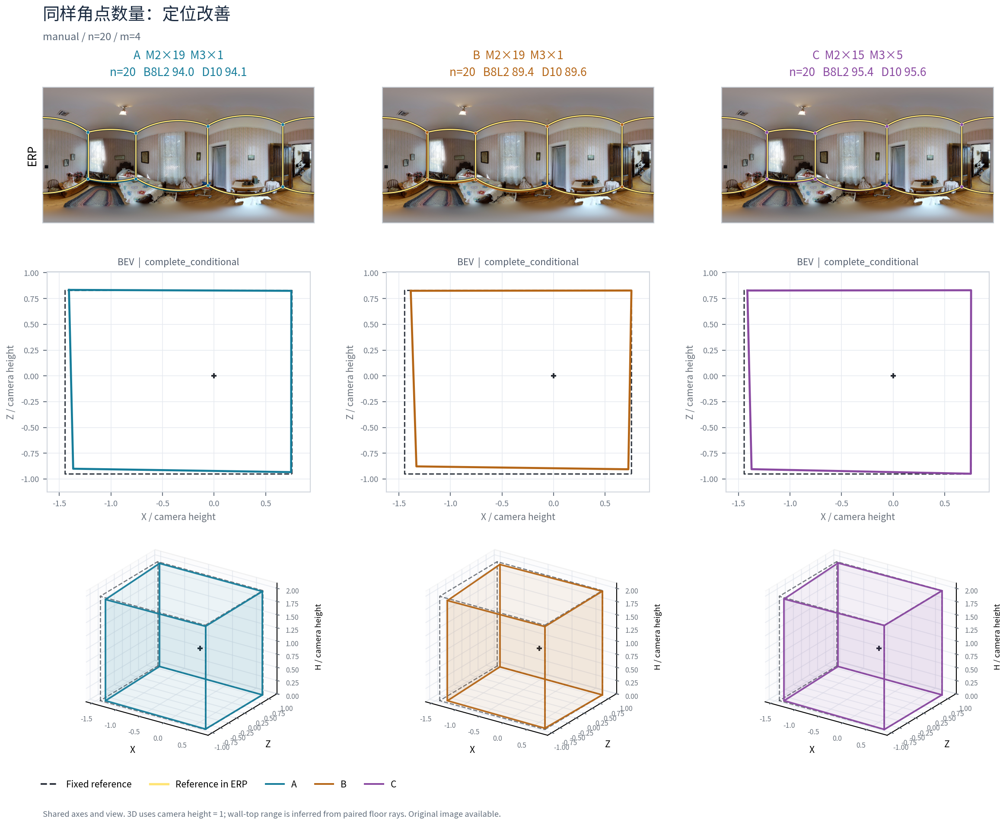
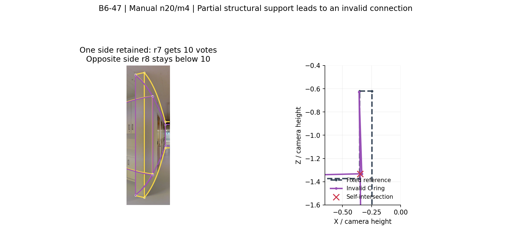
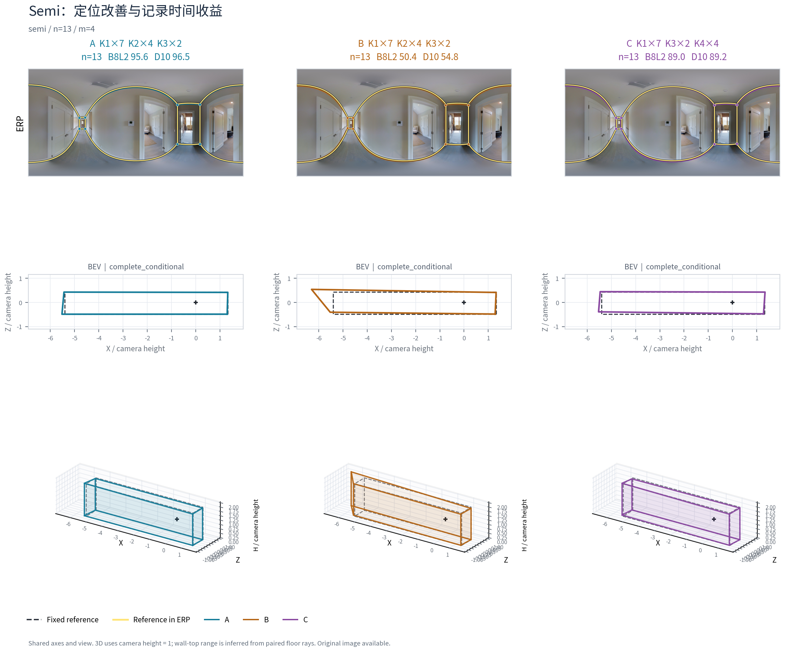
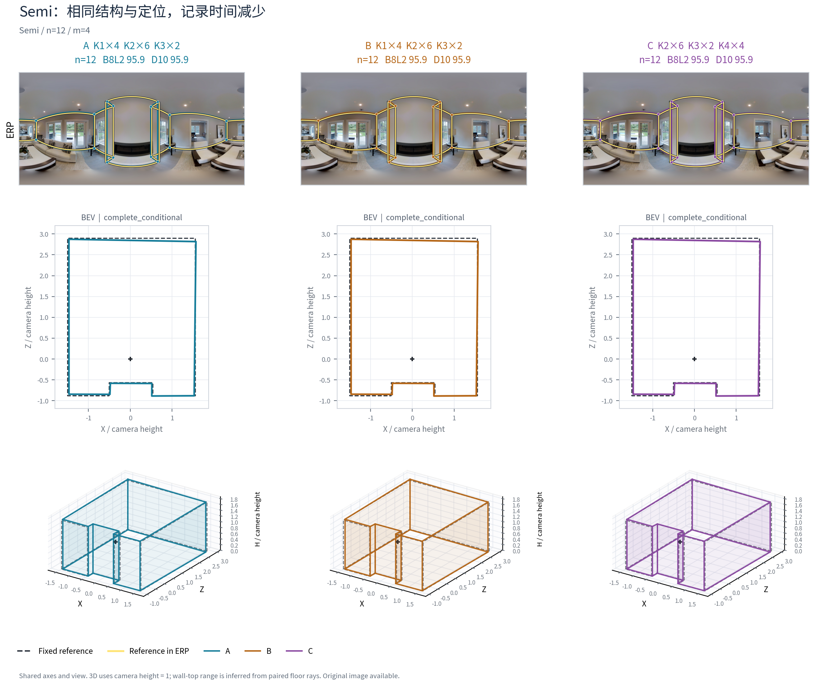
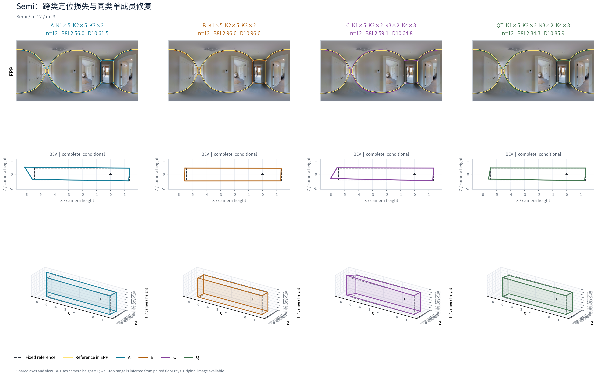

# 原答—对应—票数—连接—质量：本轮机制解释

本文件保存已经完成的实际案例。底层为真实数据 v2，图片按 GitHub Release 原图索引取得；图上的点和融合结果来自保存的真实作答与冻结算法，不是示意生成图。案例用于解释群体结果，不代替图／楼等权的总体效果。选择为看过结果后的机制解释，未冒称独立验证。

七个主案例重放了 21 次已有端点的中间状态，另两个 Semi 补充案例重放7次（其中一例有第四队 QT），最后补入一个 Manual 联合主条件案例的3次状态重放；逐一核对几何与已保存端点一致，**没有重新评分、修点、改参考或补连接**。全部原答、精确 A/B/C、背景、节点票、观察归组、环边支持均保存；各案例 JSON 保存完整状态。Semi与Manual联合补充案例独立存放，合计31次状态重放不是31个新增独立端点实验。

## 1. 角点数不变，换类仍能改善定位

**Manual，2t7-09，n20/m4。** A/B/C 均输出四角。B 与 A 维持同一源类人数，C 将四名常规表达成员换为本折较多转折类别成员。Q 为 **93.973／89.429／95.424**，C−B 为 **+5.995**，D10 为 +6.048；三维 IoU×100 为 +5.328，底面 IoU 为 +0.04198，底点角误差降低 0.552°，平均高度误差分项降低 0.01266。

这个案例的主要作用是四个对应角点的位置与边界更接近参考，不能解释为“增加了角点所以更好”。原图为四角房间，叠图可直接看到同样拓扑下的边界位置不同。新增类别是历史行为类型，并不要求其每张图都增加转折。

精确事件：`f1aae22f42dbc5c89e5b1d44`。此例来自全部正式人员域，时间记录含两种来源；不以这张图的记录时间差承担同来源效率结论。

## 2. 必要转折得到补充，但定位外扩仍有代价

**Manual，B6-47，n20/m7。** A/B/C 的 Q 为 **49.196／53.929／59.826**，输出节点为 **7／6／10**；C−B 为 **+5.897 Q、+6.763 D10**。A/B 的人数构成为本折常规 17、较多转折 3；C 为常规 10、较多转折 10。D 完全相同，实际更换七人。

原图中走廊左侧返角及中央突出墙体两侧的转折可辨，冻结参考也包含这些机会。按参考机会定位后，B 中四个必要转折的最高支持组分别为 **6、9、8、8 票**，均不到门槛 10；C 对应组为 **12、10、12、14 票**，全部进入输出。参考机会编号为 r3、r4、r7、r8，编号只用于本案例，不把不同融合的 node 编号直接等同。

| 参考机会 | B 最高支持组 | C 最高支持组 | 解释 |
|---|---:|---:|---|
| r3：左侧返角 | 6 | 12 | 共同背景均贡献5票；同类块1票，换类块7票，直接补足 |
| r4：相邻转折 | 9 | 10 | 跨过门槛；附近还有另一个未入选组，不能相加假装同一个节点 |
| r7：中央墙体一侧 | 8 | 12 | 同一6票背景获得更多有效补充 |
| r8：中央墙体另一侧 | 8 | 14 | 换入成员补充，同时一个背景观察的归组变化；并非纯粹新增六票 |

因此，本例既包含类别块的结构补票，也包含对应关系变化。C 的遗漏分项由约 0.04199 降到 0.00269，底点角误差下降 0.948°；但外扩由约 0.17226 **升到** 0.18484。远端走廊的定位仍然外扩，不能把新增四个必要转折解释成全局几何已经正确。三维代理净提高 3.370 分，与总 Q 的变化幅度不同。

精确事件：`f6893bb1710e29da5802f39c`。全成员原答叠加在 `figures/manual_structure/member_overlays.png`，源块 X、同类块 Y、目标块 Z 的同图三视图在 `raw_three_views.png`。图中也保留了类内偏离较大的真实人员，没有按目标 Q 筛掉难看的原答。

## 3. 相同替换块，20→21 人使必要返角失选

**Manual，7y-03，反方向较多转折→常规，m4。** X/Y/Z 完全固定，只给三队共同背景增加 W121。n20 的最低支持为 10，n21 为 11。关键 r1 的原始观察及其归组，经精确对象／点对键核对，在两个人数下完全相同。

| 团队 | r1 支持，n20→n21 | Q，n20→n21 | 结果 |
|---|---:|---:|---|
| A | 11→11 | 97.455→97.162 | 两次都达门槛 |
| B | 11→11 | 97.449→96.355 | 两次都达门槛 |
| C | **10→10** | **95.498→54.210** | n20 入选，n21 不入选 |

C−B 由 −1.951 变为 **−42.146**。C 的节点从六个变为五个，底点角误差约 0.433°→1.711°，底面 IoU 约 0.962→0.928。该实例的直接转折丢失可以归因于投票门槛：W121 没有为 r1 提供新票，原有 10 票没有减少，却不再足够。

这是当前目标环上的实际返角，不是以全局角点数量猜测结构。它说明人数建议应结合关键结构票的余量；不能把一个人数上的有效类别块直接视为任意人数都有效。总体人数路径还包含新增观察与重分组，此处只对已核对的关键 r1 作明确门槛归因。

事件为 `657a556b4b2e3e316cf60198`（n20）和 `268b3f37b6543564e1677b19`（n21）。精确检查见 `FIXED_BLOCK_THRESHOLD_MECHANISM.csv`。

## 4. 只补到结构的一侧，可能形成无效环

**Manual，B6-47，n20/m4。** A/B 的 Q 为 **47.979／47.243**，各七节点；C 有八节点，但冻结结果为 **invalid_floor**，没有合法 Q。此例同样换入较多转折类别，却未补齐中央薄墙两侧的结构。

C 的 r7 达到 **10 票**而入选；相邻 r8 的两个分裂组只有 **3、5 票**，都不到门槛。输出把已入选 r7 直接连接到更远的 r9。所选环中 `node_003→node_004` 与 `node_010→node_006` 的底面边在 **(−0.348285, −1.331797)** 相交，坐标单位为相机高度。后者直接边支持为 3，投影边支持为 7；它不是已经有一条完整成套结构得到多数支持。

该失败揭示需要关注的是**相邻必要转折能否成套达到支持并连接**。不能由这一个失败否定较多转折类别的总体升质用途，也不能因为出现了更多节点就忽略失败。我们保留原 `source_suggestion` 环及 invalid_floor 状态，没有修改融合算法以使其评分。

精确事件：`09b26209b5f3289de09fd298`。几何交点与边编号检查保存于 `FAILURE_CONNECTION_MECHANISM.json`，全部边的原始支持见 `EDGE_VOTES.csv.gz`。

## 5. Semi：同节点的升质、节时及成员反例

**7y-13，n13/m4，本折 K2→K4。** B、C 都是四节点，四个节点的支持数均为 13、13、12、12，门槛为 7。Q 从 **50.446 提高到 88.975**，库存记录时间合计从 **2219.470 秒降到 1943.650 秒**，即 −12.43%。dir 正交轴残差从 10.496 降到 1.249，外扩从约 0.12610 降到 0.02496；不是通过新增节点产生收益。

dir 是冻结算法的轴／正交残差，不是相对于 GT 的整屋旋转角。三维代理改善 5.512 分；遗漏和部分高度分项并非全都变好，不能把总 Q 的 +38.529 分投射到每一质量分项。

同一个 D 和 C，换成另一组同源类成员后，B 的 Q 为 **96.919**，C−B 则为 **−7.944**，仍节时 5.88%。这两个真实比较说明：类别方向具有总体用途，源队实际成员决定改善空间。该 n13/m4 整格的 35 个物理 ABC 已全部枚举，群体净 Q 为 +9.560；解释案例不以最漂亮一队代替整格结果。

正例事件：`b811ba12eb7033aa4cf18f8a`；同目标反例：`e5b0e465f554e1dd3b313418`。

## 6. Semi 的两个补充用途：纯效率与同类成员修复

### 6.1 输出几乎不变，也可以有明确用途

7y-19，n12/m4，事件 `b3ea1be32dde2004e09bb43f`。B 和 C 的 Q 均为 **95.877214**，D10 为95.899608，三维代理95.324771，八个节点全部得到12票，门槛6。B→C 的库存记录时间合计 **1216.860→1070.755 秒，减少12.01%**。

这一类实际用途无需通过更大的几何差异来成立。原图中的中央壁炉凸出已经在两队中保留，换类改变了完成人员及记录时间。终稿相同不能据此倒推出相同编辑轨迹，也不能推断是否盲信初始化。

### 6.2 同一目标类内一个成员，可以影响定位低尾

7y-13，n12/m3，事件 `6b08426576f01bdfebc4009c`。A/B/C 均为四节点；B→C 的 Q **96.618→59.097**，D10 **96.647→64.766**。四个节点支持不变，但底点角误差从0.212°升到1.014°，dir从0.504升到7.039，底面与三维代理、遗漏和外扩变差。记录时间仍减少3.01%。

同D的楼外连续 Q/T 控制队在目标类内把 **W127 换为 W109**，另外两名目标成员 W115、W120 不变。这个第四队与 C 的类别人数完全相同，真实替换为 **1人**；它不冒充另一个 m3 ABC。Q 回升至 **84.349**，较 C 高25.252；记录时间 **1967.957→1879.854 秒，再减少4.48%**。dir降至2.287，但尚未回到优秀 B 的水平，高度分项也并非一起改善。

原图叠加显示主要差异位于长走廊远端的定位，节点数量本身不能解释这次下降。群体分类用于选取有用方向和替换规模，连续历史与实际成员用于处理类内尾部，二者可以共同使用。全部七次补充状态重放和0次评分的记录见 `../semi/mechanism_cases/CASE_EXPORT_RECEIPT.json`。

## 7. 证据与解释范围

- `GROUP_VOTES.csv.gz`、`OBSERVATION_ASSIGNMENTS.csv.gz`、`EDGE_VOTES.csv.gz` 对应原生状态。跨团队的 node 编号不能直接比较，本文件使用同一可见参考机会和观察键建立对应。
- 9°／5°参考召回是几何诊断；整份原答9°／12°分簇与融合内部墙角对应参数不同。以上实验没有改变任何阈值。
- 参考以外的真实细节不自动算错；本轮关键结构正例选在原图可辨、既定目标环也支持的机会。既有 pRb 参考省略细节等语义证据继续保留在旧包，本轮没有为得到结论更改 GT 资格。
- 面积、ERP 坐标、高度比的有符号变化描述“怎样变”，其正负不是自动质量方向。三维 IoU 是相机高度归一的棱柱代理，不是新的完整三维实测。
- 完整案例的成功和失败均进入总体表。人物类别表示当前历史数据中的重复倾向，不推断心理动机，也不把同类成员视为每个位置完全可互换。

## 8. Manual 联合主条件：补足关键票，保留底面代价

B6-47、n20/m4、楼外 J2→J5，采用的确为 Manual 结构＋Q/T 联合分类。固定16人D，r4从D7＋Y1＝8变为D7＋Z3＝10，r7从D6＋Y0＝6变为D6＋Z4＝10，两个节点进入；D的原观察键完全相同。C−B为Q＋3.365、D10＋4.372、记录时间−0.703%，而C−A为−1.023，底面与三维代理也存在代价。相邻r3/r8未达门槛，属于结构部分补充。

该例独立说明联合分类主方向的机制，未把前述结构单域案例改名。完整说明和精确原答、票账在[Manual联合案例](../manual_joint/mechanism_case/MANUAL_JOINT_CASE_ZH.md)。

