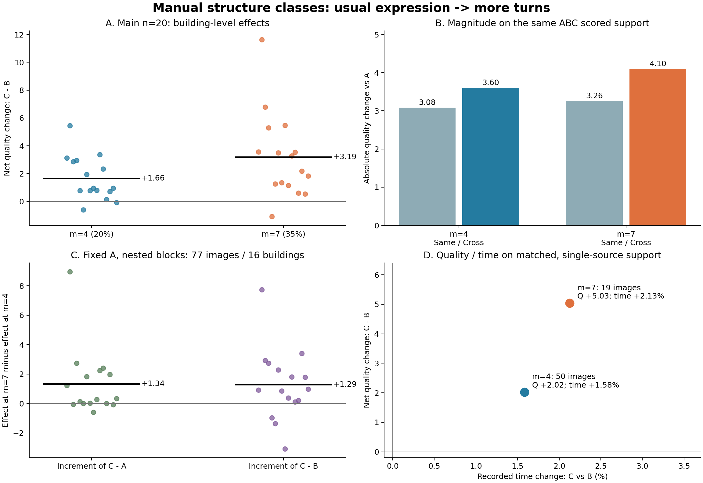

# Manual 结构分类：大团队有效换类条件与采用判断

**本轮保留新 Manual 结构三类，并将“常规表达→较多转折”作为有实际用途的定向升质分类。主要采用条件是 n=20、m=4；有容量时采用 m=7，尤其在共同背景中较多转折成员较少的情况下。** 这项用途同时有匹配三队、具体成员变化、背景变化、跨图片和跨建筑的支持。它主要改善结构与定位质量；同来源可比的记录时间通常略增，效率用途应与联合 Q/T 分类分别判断。

全部底层数据仍是真实数据 v2。分类来自先前研究，v3 只是研究轮次名称。本轮读取已合并 PR #23 的 main，源提交为 `8bfd3e476bd5ae6edc1424e2c8ea07dd2f69a235`。没有重拟合这些结构标签，没有修改预处理、参考、环序、质量算法或融合门槛。

本报告对应 **29,928 条已完成逐事件记录、36,804 个去重端点、120 张图、16 栋楼**。大表和全部失败已经保存，不仅保留摘要。主实验、人数路径、固定 A 的替换规模路径分别汇总，引用旧端点的路径行不冒充新增独立样本。

## 一、最终采用什么

| 用途／条件 | 本轮判断 | 主要证据 |
|---|---|---|
| 描述人员实际标法 | 保留结构三类 | 相对简化、常规、较多转折在跨图有效转折与短边表达上有重复差异；冗余点另计 |
| 普通 Manual，n20/m4，常规→较多转折 | **主要采用**，覆盖较广 | 净 Q（C−B）+1.655；96/120 图、14/16 楼改善 |
| 普通 Manual，n20/m7，同方向 | **主要采用**，较大块替换 | 净 Q +3.185；63/77 图、15/16 楼改善；固定 A 的 m4→7 仍有增量 |
| n20/m7，D 中较多转折成员≤4/13 | **优先的构成条件**，内部探索发现 | 净 Q +3.793；60/67 图、15/15 楼改善；本子集 C 无失败 |
| 中等难度 | 优先 m4；m7 条件采用 | m4 为15/21 图改善；m7 为7/13，且跨类绝对变化没有更大 |
| 困难图 | 保留结构补充用途，作为专项条件 | 平均增益大，但 C 失败集中于此；须解释局部结构是否成套获得支持 |
| 反向“较多转折→常规” | m4/m5 不作为默认升质方向；m6 保留容量子集探索 | m4/m5 多数图降低；m6 有正向子集，但失败较多且规模路径不一致 |
| 节省时间 | 结构分类不承担主要效率推荐 | 时间与 Q 共同有效支持中，m4/m7 记录时间分别约+1.58%/+2.13% |

这里“采用”指当前数据及资格下的研究工作分类与换类条件。分类不需要每个成员、每张图都同向；本轮结论依据多数图片、建筑与背景中的重复趋势。有效条件表及精确分母见 [RECOMMENDED_CONDITIONS.csv](RECOMMENDED_CONDITIONS.csv)。

图 A 为每栋楼的净 Q；图 B 在相同三队可评分分母上比较同类／跨类绝对变化；图 C 是固定 A 的真实规模路径；图 D 只使用时间与质量共同有效、同一时间来源的子集。图 A 的 m4/m7 支持不同，不能直接当作规模响应；图 C 承担该比较。

## 二、这些人实际怎样标

### 2.1 全数据描述类别与实际成员

以下全数据标签用于描述成员，**实际目标图实验始终使用对应目标建筑之外的标签**。M1/M2/M3 原始编号不跨折直接比较；实验按训练中心对齐为 `TURN/K3/E1/E2/E3`。本轮有16折训练选择为 TURN/K3，其余训练家族／类数保留在既有成果，不强行改成三类。

| 全数据描述类 | 人数 | 有效转折历史残差 | 短转折边历史残差 | 近共线冗余残差 | 有支持人员的历史图片／建筑范围 |
|---|---:|---:|---:|---:|---|
| M1 相对简化表达 | 6 | −0.699 | −0.242 | +0.077 | 83—109 图、15—18 楼 |
| M2 常规表达 | 34 | −0.147 | +0.014 | +0.025 | 49—168 图、11—22 楼 |
| M3 较多转折 | 19 | +0.374 | +0.306 | +0.020 | 24—165 图、10—22 楼 |
| 未知 | 3 | 缺证据 | 缺证据 | 缺证据 | 0—2 图、0—1 楼 |

残差先相对同图同参考的人员中位数，再按训练建筑均衡汇总，反映相同机会下的表达倾向。有效转折排除≤5°近共线节点；短转折边还要求局部明显转折和边长小于周长4%。因此三类并非按总角点数简单分组：相对简化者也可能增加共线点，较多转折类的冗余中心并不高于常规类。

实际成员完整保存在 [CLASS_LABELS_ALL_DATA_DESCRIPTION.csv](CLASS_LABELS_ALL_DATA_DESCRIPTION.csv)，描述中心在 [CLASS_DESCRIPTION_CENTERS.csv](CLASS_DESCRIPTION_CENTERS.csv)。

- **相对简化6人**：W008、W029、W030、W034、W035、W037。
- **常规34人**：W006、W010、W014、W018、W031、W033、W100、W101、W103、W104、W105、W106、W107、W108、W110、W111、W113、W114、W116、W117、W118、W119、W120、W121、W123、W124、W125、W127、W128、W129、W131、W132、W133、W134。
- **较多转折19人**：W001、W002、W011、W012、W013、W015、W017、W021、W027、W028、W032、W036、W102、W109、W112、W115、W122、W126、W130。
- **证据不足3人**：W019、W022、W026。缺失未填零，也没有因此恢复任何被筛除作答的正式组队资格。

差异在复杂结构机会中更明显：同图人员有效转折中位数≥6的机会中，相对简化、常规、较多转折的转折残差中心约为 −2.372、−0.550、+0.791；中位数<6的机会分别约+0.042、+0.068、+0.319。这里是结构机会条件，与后文冻结图片难度分层不同。它们描述“面对有转折机会的结构时通常怎样表达”，不推断心理动机，也不要求较多转折类在每张四角房间里增加节点。

### 2.2 与历史质量、时间及其他域的关系

全数据描述层中，较多转折类的历史平均 Q 约74.74，常规类约67.36，相对简化类约66.68；相对同图的 Q 效应中心分别约+5.68、−2.61、−2.46。较多转折类既有结构倾向，也带有较好的历史质量，这是实际分类用途的一部分。复杂结构适应性中心同样较好。

时间、scope 与 Semi 辅助历史按真实机会另列在逐人表。常规类时间特征有32人可用，不能将其余两人当成零；scope 回答倾向和有裁定支持的正确机会也分列。结构标签本身不使用 Semi 历史，本报告没有把跨条件辅助说明写成联合 Manual＋Semi 分类。

## 三、实验如何比较同类换人与换类

每个事件为 A=D+X、B=D+Y、C=D+Z。D 为相同具体成员背景，X/Y 来自同一源类，Z 来自目标类，三块均为 m 人且彼此及与 D 不重叠。三队人数相同。因此：

- **B−A**：同类换人。
- **C−A**：跨类相对原队。
- **C−B**：跨类相对同类替换的净效果。
- **|B−A| 与 |C−A|**：在三队 Q 都有效的同一批事件上比较变化幅度。

主结果依次对具体 D 内的成员组合、同一背景人数向量内的 D、图内人数向量、楼内图片、建筑等权。深度成员面板不会凭事件多就压过其它人数配置。每项质量、时间、几何指标保留自己的分母；失败保留在登记分母。原始事件均值、图片等权结果与逐楼结果同时交付。

### 3.1 n20 主结果

| 方向 | m／替换比例 | 图／楼 | B−A Q | C−A Q | **C−B Q** | C−B 改善图／楼 | 同类／跨类绝对 Q 变化 |
|---|---|---|---:|---:|---:|---|---|
| 常规→较多转折 | 4／20% | 120／16 | −0.176 | +1.538 | **+1.655** | **96/120；14/16** | **3.084／3.604** |
| 同方向 | 5／25% | 9／7 | −0.076 | +1.097 | +1.173 | 7/9；6/7 | 1.926／2.436 |
| 同方向 | 6／30% | 29／13 | +0.544 | +2.412 | +2.005 | 17/29；8/13 | 4.637／5.831 |
| 同方向 | 7／35% | 77／16 | +0.067 | +3.323 | **+3.185** | **63/77；15/16** | **3.261／4.100** |
| 较多转折→常规 | 4／20% | 72／15 | 见完整表 | −1.552 | −1.522 | 25/72；3/15 | 2.067／2.894 |
| 同反方向 | 5／25% | 20／8 | 见完整表 | −1.313 | −1.418 | 6/20；1/8 | 2.653／3.247 |
| 同反方向 | 6／30% | 19／8 | 见完整表 | +1.095 | +1.149 | 12/19；6/8 | 2.193／2.396 |

m5/m6 是真实容量所决定的最大 m 子群，不与 m4/m7 的独立人群均值相减来声称规模因果。同一事件中 C−B=(C−A)−(B−A)；上表三种总体均值可能因评分有效分母、分层权重不同而不严格相减相等。

常规→较多转折的 m4/m7，分别有12/16、11/16楼支持跨类绝对变化更大；净质量则有14/16、15/16楼改善。**本分类对“往哪里换更好”的区分，比对“所有几何距离必然更分离”的区分更强。** 中等难度的跨类绝对 Q 变化甚至略小于同类，但其净质量仍可改善，两个用途应分别保留。

m4/m7 的 C 失败率按相同分层口径约0.84%／0.52%，C−B 质量下降超过10分的比例约2.43%／0.53%（分母为该对可评分事件）。三队可评分的绝对幅度分母分别为9,868／2,825条；净 Q 的可比事件为9,929／2,852条。全失败和去重失败端点见完整表；没有将失败赋为零分掺入 Q 均值。

为便于将三种变化直接相减，另保存 [共同ABC比较表](COMMON_ABC_COMPARISON.csv)。全部三队可评分时，m4 的 B−A／C−A／C−B 为 **−0.162／+1.528／+1.690**；m7 为 **+0.159／+3.300／+3.141**，其改善图／楼数仍为96/120、14/16和63/77、15/16。该表统一分母后恒等式严格成立；主表保留全部各自可评分事件，两种口径都支持同一采用判断。

## 四、背景、难度和实际成员如何改变用途

### 4.1 有用的背景规律：当背景较少表达转折时补入

n20/m7 的共同背景有13人。D 中较多转折成员不超过4人时，净 Q **+3.793**，60/67图、15/15楼改善；覆盖124个可行背景人数向量、398个实际 D、2,444个事件，本子集 C 无失败。D 已含5—8名较多转折成员时，净 Q 为 **−0.872**，仅4/11图改善，C失败率约5%。

这说明较多转折类的边际作用与整体构成有关。前者是本轮推荐的具体组织条件；后者保留为条件性反例。类别人数不等于某个节点的实际票数，仍需查看局部机会。背景分层预先定义，优先采用哪一层依据本轮结果形成，属于 v2 内部探索发现。两层图片可重叠，不能相加为独立覆盖。

### 4.2 难度分层的采用判断

| 难度 | n20/m4 净 Q；改善图／楼 | n20/m7 净 Q；改善图／楼 | C失败率 m4／m7 | 判断 |
|---|---|---|---|---|
| 简单 | +1.525；71/84、15/16 | +3.448；52/58、15/16 | 0.13%／0% | 两规模均有普遍升质用途，m7更强 |
| 中等 | +2.167；15/21、10/11 | +1.625；7/13、6/8 | 0.24%／0% | 优先m4；m7对图片的支持较弱 |
| 困难 | +3.654；10/15、6/10 | +8.019；4/6、4/6 | 6.65%／8.33% | 收益与风险均集中，适合局部结构专项 |

困难图不因少数失败被整体否决。失败说明成套结构支持、对应和连接的作用更大；简单图的多数收益则可以来自同样节点数下的定位改善。难度分层图数相加与主层一致，楼可重复，楼等权均值不能按图片数直接拼回总均值。

### 4.3 换另一批成员或背景，趋势仍存在

m4 的1,641个有净 Q 的具体 D 中，**1,079个（65.75%）**平均改善；m7 为370/458（80.79%）。以具体源类配对为单位，正向比例约68.11%／78.59%；以同一 D 内具体目标块为单位，约69.75%／76.82%。这些是可追溯的重复性单元，并非彼此独立的新增图片。

预登记的背景保留检查层中，m4 净 Q +2.089，88/120图、15/16楼改善；m7 +3.414，65/77图、15/16楼改善。该检查没有按目标效果挑背景，但整个 v2 数据已多轮研究，不冒称全新外部盲测。

m4 每图目标块中位数20个、实际 D 中位数9个，118/120图在固定 D 下有超过一个目标块可比较。m7 每图目标块中位数6个、D中位数6个，52/77图有多个目标块，39/77图在固定 D 下有多个目标块。余下25张 m7 图只有一个实际目标块：它们可以检验源类换人和该块的定向作用，目标成员波动记为不可估计。没有把单一目标块的零方差当成分类成功。

## 五、替换规模与人数路径

### 5.1 固定原队 A，m4→7 具有真实增量

为分开规模与不同人员池的作用，本轮追加308条固定 A 的嵌套路径，共1,020个事件。X/Y/Z 按冻结顺序取前缀；m增加时，D内相应源类人员移入X，使 A 完全不变。每一个 m 内仍是严格同 D 的 ABC 比较。

在常规→较多转折、最大可行 m=7 的77图16楼154条路径中：

- m4→7 的 **C−A 增量为+1.337 Q**，58/76张可比图、11/16楼正向。
- **C−B 增量为+1.294 Q**，56/76图、13/16楼正向。

因此“提高替换比例常能增加升质收益”不只来自两组不同图的均值差。逐步 m4→5、5→6、6→7 的净增量分别约+0.364、+0.215、+0.121，但每一步的成员／容量支持不同。最大只到m6的29图子群，m4→6的楼等权净增量为−0.966；它应保留为容量和背景条件，不据此否认有充分容量的m7方向。

固定 A 路径独立保存于 [FIXED_A_M_RESPONSE.csv](FIXED_A_M_RESPONSE.csv) 和完整逐路径变化表，未与主层重叠累计。上述增量是保存的真实嵌套替换结果，不把 C−B 的变化全部解释成单独一名目标成员的因果效应。

### 5.2 不同总人数仍有多数支持，门槛会影响局部结构

固定 X/Y/Z、嵌套 D 的 n 路径中，较多转折方向的 m4 在 n12/16/20/21/24 净 Q 约为 **+3.00/+1.66/+1.35/+0.90/+1.18**；m7 在 n12/16/20/21 为 **+4.70/+3.44/+3.51/+4.10**，各状态均有多数可比图片改善。容量不同导致路径可到的人数不同；不能将各 n 的边际均值误当完全相同的图片集合。

直接配对 n20→21 时，m4 净效果平均增量−0.456，m7为+0.117。冻结最低支持由10升至11，m4路径中约5.72%的分层加权观察伴随 C 节点减少，m7约0.45%。这些统计不把所有变化归因于门槛；加入人也会改变观察与对应。

机制案例7y-03给出了严格的局部门槛证据：X/Y/Z固定，只在D加W121；关键返角观察及归组未变，C支持10→10而门槛10→11，返角失选，C−B由−1.951变为−42.146。总体没有普遍反转，这个例子明确指出何时不能将某个人数上的类别块效应直接外推。

## 六、变化发生在哪里

### 6.1 质量分项与形状

| C−B 分项 | n20/m4 | n20/m7 | 方向解释 |
|---|---:|---:|---|
| B8L2 Q | +1.655 | +3.185 | 提高 |
| D10 | +1.607 | +2.927 | 同向敏感性支持 |
| 三维 IoU ×100 代理 | +1.258 | +1.957 | 提高 |
| 底面 IoU | +0.0122 | +0.0152 | 提高 |
| 底边球面误差 | −0.159° | −0.133° | 改善 |
| 自身正交轴方向残差 | −0.255° | −0.559° | 改善，不是相对GT全局朝向误差 |
| 平均高度残差 | −0.00272 | −0.00438 | 改善 |
| 去中心局部高度残差 | −0.00147 | −0.00240 | 改善 |
| 遗漏 | −0.00678 | −0.00176 | 降低 |
| 外扩 | −0.00636 | −0.01569 | 降低 |
| 融合有效转折数 | +0.090 | +0.073 | 描述性变化，更多不自动正确 |
| 5°参考节点召回 | +0.0133 | +0.0154 | 提高 |
| 5°参考边召回 | +0.0178 | +0.0172 | 提高 |

逐项分母在 [MAIN_QUALITY_COMPONENTS.csv](MAIN_QUALITY_COMPONENTS.csv)，完整分项、上下界、尺度、角点距离和诊断在长表及逐事件表。三维量为现有相机高度归一的棱柱代理，不是新增真实三维测量。

m4/m7中约91.62%／94.29%的可比事件，B和C的融合节点数相同。这些事件对总体净Q的描述性贡献分别为+1.088／+2.503；节点增加事件贡献约+0.583／+0.774。**多数收益发生在节点数不变的状态中。** 这不是特征因果分解：同点数仍可能是不同节点身份、不同结构位置；实际角点及原图案例用于进一步解释。

同一可对应角点支持上，类内／跨类底点距离约0.0319/0.0331（m4）、0.0354/0.0375（m7），顶点距离约0.0379/0.0396、0.0420/0.0453，单位为相机高度。跨类几何幅度略大，质量的方向收益更鲜明。质量接近、形状接近与稳定性不互相替代。

### 6.2 四个完整机制案例

完整原图、成员叠图、ERP／BEV／3D、对应与票数见 [机制解释_原答到融合.md](../mechanisms/机制解释_原答到融合.md)。以下不是新挑出的替代统计样本，均已计入主表。

1. **定位改善，角点数不变：2t7-09，n20/m4。** A/B/C均四角，Q为93.973/89.429/95.424，C−B +5.995，底点角误差下降0.552°。该方向在四角房间也可以起作用。
2. **必要结构补充：B6-47，n20/m7。** 原图可辨且冻结目标环支持的四处必要转折，在B中的最高支持为6/9/8/8票，在C中为12/10/12/14票，跨过门槛10。C−B +5.897，但外扩分项仍升高，局部结构正确不等于全局定位全部正确。
3. **人数门槛反转：7y-03，n20→21，反向m4。** C的关键返角始终10票，因门槛升到11失选；A/B仍为11票。机制可明确归因于这个局部门槛变化。
4. **只补到一侧造成失败：B6-47，n20/m4。** C使薄墙一侧r7达到10票，另一侧r8分裂组只有3、5票，未成套入选，所选环发生自交，冻结结果为invalid_floor。失败没有被修补成可评分输出。

结构补票、定位、对应变化和连接风险都是真实分类作用的不同传递途径。“较多转折”既不能直接等于正确，也不能因一个无效环而被整体否定；本轮统计和案例共同支持在合适背景下采用该方向。

## 七、时间取舍、来源与连续特征对照

只在三队记录时间完整、正值、同一单一来源且三队Q均可评分时联合比较：

| 条件 | 事件／图／楼 | C−B Q | 改善图 | C相对B记录时间算术变化 | 几何变化 |
|---|---|---:|---|---:|---:|
| 全正式域 n20/m4 | 2,339／50／16 | +2.022 | 47/50 | **+1.584%** | +1.062% |
| 全正式域 n20/m7 | 357／19／14 | +5.035 | 19/19 | **+2.126%** | +1.347% |
| 仅新来源 n20/m4 | 1,812／72／16 | +3.082 | 64/72 | **+1.339%** | +0.753% |

时间为成员库存记录秒数之和，非本轮新测生产耗时，也非并行墙钟时间。该方向支持“花少量额外记录时间换质量”，不声称节时。主层的全图Q和这里的时间子集不混写成同一分母。

只比较源类／目标类块来源人数完全相同的事件，m4净Q仍+2.348（88/98图、15/16楼），m7仍+5.700（32/33图、15/15楼）。因此收益不只是两类来源批次比例不同。但进一步同时匹配历史块Q差≤5的有效支持仅m4下7事件、2图、1楼；它不能承担“完全独立于历史Q”的强结论，也不阻止报告已观察到的类别总用途。

本轮复用此前连续结构特征预测、原答相似性与旧M细分类成果，没有重新全面搜索连续结构阈值。连续结构适合表示成员在类内的位置和局部机会支持，结构类则提供可解释的成员块与人数向量。本轮新增价值是**相同D/n/m的实际大团队替换、容量与背景条件、规模路径和机制**，不是宣称类别在所有预测任务上胜过连续特征。Q/T联合分类的同范围连续对照由本轮联合分类专题单独完成。

## 八、旧成果如何继承，本轮究竟补了什么

旧的精确 `TURN/K3/E2→E3` n10/m7结果保留：96图16楼，相对原队C−A Q约+5.910，75/96图、13/16楼正向；同类／跨类绝对变化约5.736/8.125。它支持高替换比例的结构方向，不将其直接当作20人队伍效应。

本轮补齐四个实质空缺：20人队伍上的方向与块规模；大量实际源／目标成员块和背景；固定A的m响应；固定块的n响应。旧n20少路径所得较弱或混合信号仍在旧包，现在推荐依据更完整的新大团队证据。A2、旧M、QTD、Rnew2、F01及联合类保持各自方法身份，没有拼成一套已统一验证的层级。

本结构主线现在可以收尾的研究问题是：**结构分类能描述历史标法，且“常规→较多转折”在大团队中存在多数成立的定向升质条件；同类变化通常较小但区分度中等；背景已有目标类多少、真实替换比例、难度和关键结构票余量决定实际用途。** 不需要继续扩大候选分类才能形成这些判断。

## 九、组合覆盖、未覆盖容量与复现

### 9.1 三种空间明确分开

| 空间 | 本轮已完成 | 未覆盖说明 |
|---|---|---|
| 选定n20方向／人员域／m的ABC可行背景类别人数向量 | **3,073/3,073**；全正式2,834、新来源239 | 已完整；不是所有无约束n20构成 |
| 选定条件下的实际共同背景D | **3,796**个 | 精确剩余数逐格保存；固定规则均衡选取 |
| 登记ABC事件与端点 | **29,928/29,928事件；36,804/36,804端点** | 所有登记缺口为0，失败照常保留 |
| 全正式人员域无约束n20人数向量 | **3,312/3,712** | 400个未覆盖；另存完整清单 |
| 全正式域无约束n20实际成员集合 | **28,108/251,050,935,840** | 尚有251,050,907,732；具体成员未穷尽 |
| 新来源域无约束n20人数向量／成员集合 | 478/534；1,881/65,785,489,410 | 域与全正式重叠，不累加为独立全局团队 |
| 加入顺序 | 仅展开明确登记的嵌套n／m路径 | 不枚举所有排列；等价端点只计算一次 |

例如常规→较多转折n20/m4，全部可行具体ABC（X/Y无向去镜像）约5.15×10¹⁶，而实际登记10,168条；n20/m7约1.05×10¹⁴，登记2,892条。全部背景**人数配置**覆盖与全部**成员组合**穷尽差别巨大，精确十进制整数已保存，未用“每配置完成”冒称全空间完成。

所有普通Manual池先核对训练家族和真实容量；训练家族不同、联合容量不足、19个门洞／特殊范围Manual池均另列。没有因筛选本轮有价值条件而改动质量或组队资格。历史非OOS行为证据和GT暂停图的分类支持仍在旧包，本轮融合范围仅为冻结正式普通Manual池。

### 9.2 可独立取得的主要文件

- **结论**：[本报告](REPORT_ZH.md)、[有效换类条件](RECOMMENDED_CONDITIONS.csv)、[共同ABC比较](COMMON_ABC_COMPARISON.csv)、[质量分项](MAIN_QUALITY_COMPONENTS.csv)、[固定A规模响应](FIXED_A_M_RESPONSE.csv)。
- **标签与成员**：[全数据描述](CLASS_LABELS_ALL_DATA_DESCRIPTION.csv)、[楼外实验标签](CLASS_LABELS_REUSED.csv.gz)、[逐折角色与成员](CLASS_ROLES_REUSED.csv)、[历史中心](CLASS_DESCRIPTION_CENTERS.csv)。
- **完整事件**：[EVENTS_COMPLETE.csv.gz](EVENTS_COMPLETE.csv.gz)，包含精确A/B/C/D/X/Y/Z、端点键、各分项、失败和派生指标；所有已登记事件都在其中。
- **端点定位**：[ALL_ENDPOINT_REQUESTS.csv.gz](ALL_ENDPOINT_REQUESTS.csv.gz)、[已用端点索引](results/USED_ENDPOINT_INDEX.csv.gz)、[来源清单](results/ENDPOINT_SOURCES.csv)。实际标量与几何在整合包的中央native分批文件中，共享端点不在此重复打包。
- **覆盖**：[CAPACITY_AND_COVERAGE.csv.gz](CAPACITY_AND_COVERAGE.csv.gz)、[COUNT_VECTOR_COVERAGE.csv.gz](COUNT_VECTOR_COVERAGE.csv.gz)、[N20_FULL_SPACE_TOTALS.csv](N20_FULL_SPACE_TOTALS.csv)、[全部无约束向量](N20_FULL_CLASS_VECTOR_SPACE.csv.gz)。
- **完整可重聚合结果**：`analysis/`内逐事件派生、具体背景、人数向量、逐图、逐楼、难度／背景分层、成员块多样性和长指标表。
- **口径与代码**：[FIELD_GUIDE_ZH.md](FIELD_GUIDE_ZH.md)、本目录9个Python脚本、主／补充登记冻结JSON及完成状态。输入SHA与中央端点来源完整保留。

计算顺序为登记主实验、登记固定A路径、中央端点补算、逐事件评价、聚合、描述／覆盖表、采用表与图。旧端点和冻结分类可以直接复用；恢复报告和汇总无需再次融合。运行命令与依赖入口见 [README.md](README.md)。
