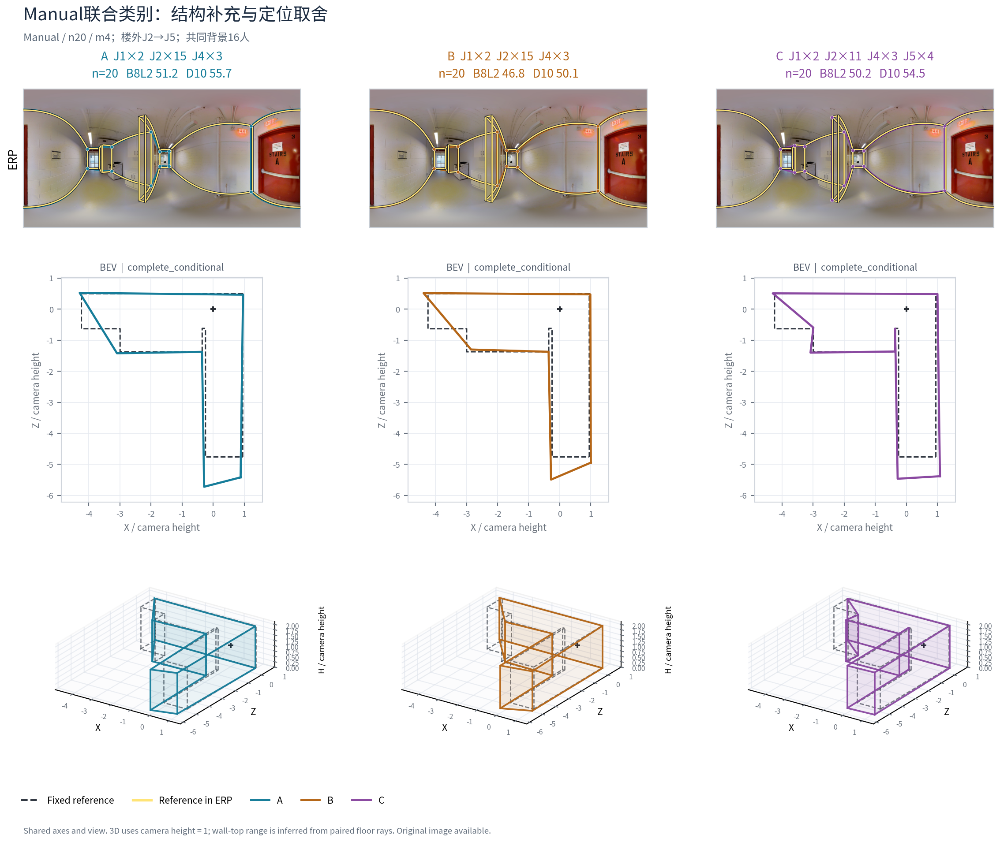
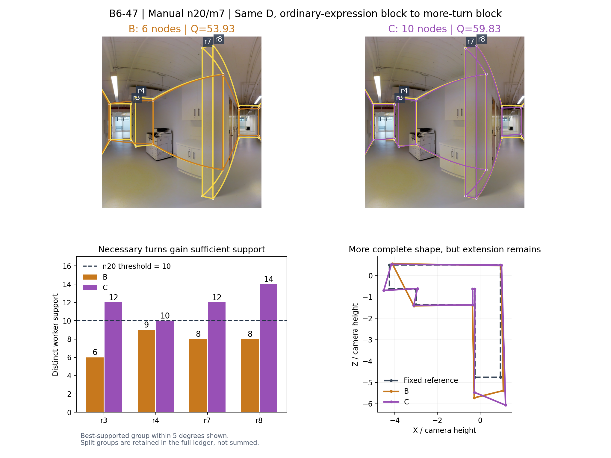
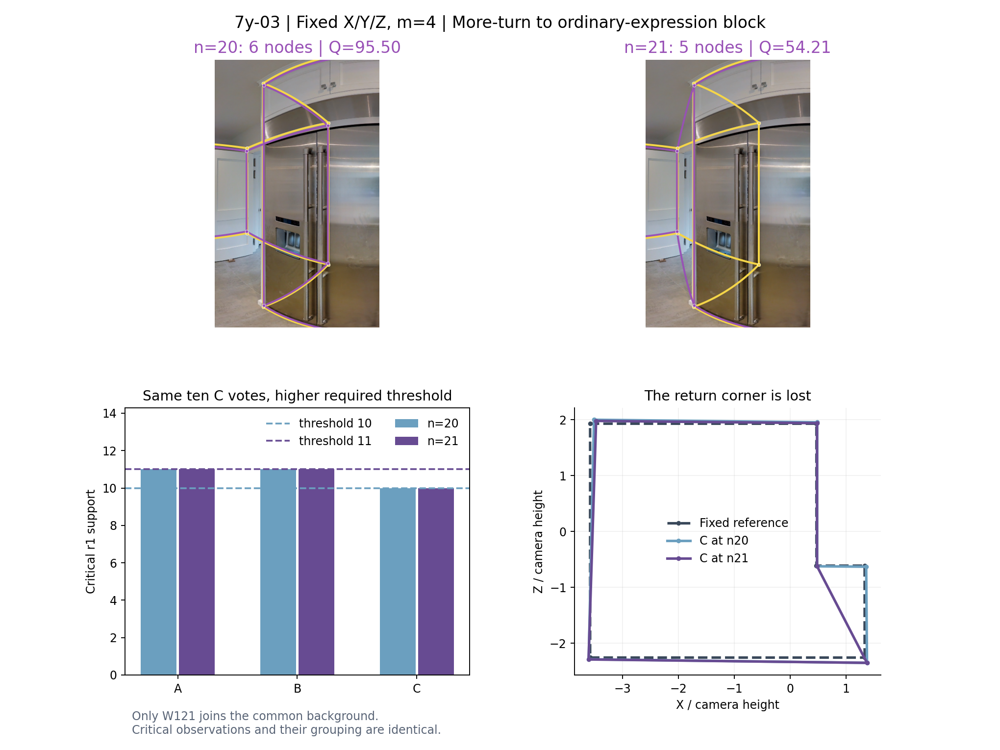

# HOHONET 人员分类主线：有效换类条件与采用判断

研究日期：2026-10-22。底层数据：**真实数据v2**。此前包名中的v3表示研究轮次。本轮目录：`personnel_exchange_closure_20261022`。

## 结论与建议采用的条件

**人员分类主线已经形成可采用的结果：保留三条主线，各自承担不同用途。** Manual结构三类用于解释真实标法、组织结构补充及定向升质；Manual结构＋Q/T联合分类用于安排质量—时间取舍；Semi自身联合分类用于效率优先的替换。共同背景和实际替换人数一致的实验支持这些用途，也说明“同类变化较小”只在部分条件下成立，不是采用每一种分类的必要条件。

最值得采用的是以下条件。Q为冻结B8L2分数，数值越大越好；三列Q使用**同一个三队共同可评分集合**。改善比例按图片／建筑平均C−B判断，不按重复事件投票。

| 分类与源→目标语义 | n／m／比例 | B−A：同类换人 | C−A：跨类对原队 | C−B：换类净Q | 净改善图片；建筑 | 采用判断 |
|---|---:|---:|---:|---:|---|---|
| Manual联合：相对较慢、较低历史Q→较高历史Q且相对更快 | 20／4／20% | −0.03 | +3.11 | **+3.14** | **6/7；5/5** | 质量与记录时间兼顾，联合分类首选 |
| Manual联合：相对较快源类→训练折最高历史Q、相对较慢目标类；阶段B新背景 | 20／4／20% | +0.26 | +4.97 | **+4.71** | **16/20；10/14** | 以更多记录时间换质量，变化分离更强 |
| Manual结构：常规表达→较多转折 | 20／4／20% | −0.16 | +1.53 | **+1.69** | **96/120；14/16** | 覆盖较广的定向升质 |
| Manual结构：常规表达→较多转折 | 20／7／35% | +0.16 | +3.30 | **+3.14** | **63/77；15/16** | 有足够源、目标容量时采用较大块 |
| 同上，D的13人中较多转折成员≤4人 | 20／7／35% | +0.11 | +3.86 | **+3.75** | **60/67；15/15** | 优先背景条件；本子集C没有失败 |
| Semi联合：楼外历史相对慢、Q较低→较快、Q较高目标角色 | 12／4／33.3% | 0.00¹ | +3.49 | **+3.49** | **3/5；3/4** | 记录时间约−10.09%，优先效率与质量兼顾 |
| 同一Semi方向 | 14／3／21.4% | 0.00¹ | +1.49 | **+1.49** | **5/7；4/5** | 记录时间约−5.68%，较广图片支持 |

¹ Semi保留源两块互换A/B的两个方向，因此有符号同类均值为0是设计对称性；同类绝对变化分别为5.17和4.39，不能把0解释成同类成员完全等效。

Manual联合首选条件共同ABC内C/B记录时间约**−1.56%**；以C相对A/B时间均值、全部可靠时间记录统计为**−1.69%**。阶段B对应约**+7.16%／+7.20%**。结构方向的全部同来源时间子集约增加**1.60%／2.20%**，它适合以小幅时间增加换质量。各时间统计均来自已有记录秒数之和，不是本轮新测生产耗时。

完整采用表有43行，包括反方向、难度、人数和风险对照，见[有效换类条件表](integration/有效换类条件表.csv)、[精简表](integration/有效换类条件表_精简.csv)及[字段说明](integration/条件表字段说明.md)。表中保留了逐对全部可评分均值、共同ABC均值、每项分母、失败、成员和背景覆盖。这里不把某一组支持上的均值套用到另一种人数或人群。

## 一、接续了什么，新增了什么

### 1. 当前仓库与旧成果身份

开始研究时读取了[GitHub main](https://github.com/Sparkling-Flames/3D_Manhattan_label)和[PR #23](https://github.com/Sparkling-Flames/3D_Manhattan_label/pull/23)。PR已于2026-10-22 03:19:30 UTC合并；本轮固定main为`8bfd3e476bd5ae6edc1424e2c8ea07dd2f69a235`，PR原分支头为`855ca2b08cdd3dcf3d1a9b63827e3bdee332a995`。Dot整理、核验与归档已纳入，没有把未读分支的结果当成不存在。

以下旧发现保留原身份：

| 既有成果 | 本轮继承方式 |
|---|---|
| Manual结构n10/m7，常规表达→较多转折：96图16楼，C−A约+5.91；75图13楼改善；同／跨绝对变化约5.74／8.13 | 保留为小团队大比例换块结果；本轮扩展到n20、不同m、不同D，不改写成相同口径的重复结果 |
| Manual联合旧64登记事件、62共同可评分，净Q约+5.69、记录时间约−3.63%，另2个C失败 | 保留旧样本身份；其中n20约+1.88、−3.59%，与总体分开 |
| Semi旧28事件，净Q约+0.15、时间约−8.54% | 保留为早期效率证据；本轮换成员与背景后得到新的支持与低尾 |
| 相对同候选域均匀选队，Manual联合Q约+1.43、时间约−5.42%；31图中27图升质、27图节时、23图同时改善；21楼中15楼同时改善 | 继续保留为选队实验，未用它替代本轮ABC换类证据 |
| A2关系分区、旧M粗细、SP尺度、QTD、Rnew2、F01、跨条件分类 | 保留各自标签、人群、输入与用途；不拼成一套已统一验证的层级 |

旧245候选是方法×适用域登记，QTDS中的S是结构。旧188正向候选、16种共同真实团队分类、旧768／新1040真实替换反推候选、后续m2块学习负结果，都作为已做工作保留，不再写成未实现。26种Q/T/难度/scope/Semi域子集的52行Manual/Semi覆盖表已继承；Manual已有筛查，Semi含难度域的15个组合仍受机会支持限制。本轮是三条已有分类的用途深化，没有把新增算法变体冒充新增域组合。

### 2. 本轮实际完成的增量

- Manual联合阶段A：**81,221个物理ABC、484个有限背景/成员面板、30图20楼**，并完成同支持连续Q/T策略对照。
- Manual联合阶段B：从阶段A提出“最高历史Q、接受较慢”语义条件后，冻结**40个新背景、21,000个物理ABC、20图14楼**，检验换背景后的重复性。
- Manual结构：**29,928登记行**，含大团队构成、固定A的替换规模路径、固定X/Y/Z的团队人数路径；覆盖120图16楼。
- Semi：**13,882方向行＝6,941个物理ABC**，其中主扩展6,500个，配置补齐441个；完成631/631个选定可行人数配置及8个小格的完整成员／背景枚举。

按真实成员、A/B互换等价、C固定去重后，本轮共**138,244个唯一物理ABC**，而不是146,031个独立实验；涉及137个条件池、130张不同图片、22栋楼、8,193个不同实际共同背景。ABC本身使用100,530个端点；连同连续策略等必要对照，最终交付**101,092个唯一端点**，其中101,031个为本轮原生计算、61个复用既有精确团队。失败端点也在全集内。

同一确定性成员集合的结果在交付全集只保存一次。登记阶段与不同主题之间产生的重复端点引用、人数/规模路径复用与Semi双方向均在覆盖表中单列，不充当额外图片或建筑。

### 3. 完整旧包恢复

上轮大文件已按原始清单恢复：**31份完整事件文件、437,518行、约662 MB；56份批次端点文件、约72 MB**。原归档压缩字节和SHA均匹配；没有重新融合全部旧团队。历史下载索引共有114个文件，缺失引用为0。用户可以分别取得完整事件与端点，已经不是只有摘要、批次索引或不可定位的ZIP。

入口：[历史完整下载清单](integration/historical/HISTORICAL_DOWNLOAD_INDEX_ZH.md)、[机器可读清单](integration/historical/HISTORICAL_DOWNLOAD_INDEX.csv)。旧结果、本轮新计算、仅报告引用保留各阶段身份。

## 二、最终保留的分类：实际人员怎样不同

### 1. Manual结构三类：标法解释的主线

全数据描述标签中59人有足够证据，分为简化型6人、常规表达34人、较多转折19人，另3人证据不足。**这三个名称描述同一可见结构机会中的表达倾向，不描述心理动机。**

| 描述类 | 实际成员示例与完整人数 | 标法差异 |
|---|---|---|
| 简化型 | W008、W029、W030、W034、W035、W037，共6人 | 在复杂结构机会中更经常省去转折、合并短边；并不等于所有少点答案都错误 |
| 常规表达 | W100、W101、W103、W104、W106、W116、W128等，共34人 | 大部分常见轮廓表达接近同伴中心；遇复杂结构时转折相对少 |
| 较多转折 | W102、W109、W112、W115、W122、W126、W130及若干历史来源人员，共19人 | 同一复杂机会下更常保留短转折与凹凸；不是单靠近共线冗余增加点数 |

同图中心化的转折历史中心约为**−0.699／−0.147／+0.374**；复杂结构机会下约为**−2.372／−0.550／+0.791**。短边历史约−0.242／+0.014／+0.306，冗余历史约+0.077／+0.025／+0.020。因此“较多转折”类在平均意义上并不是“冗余点最多”类；单看角点数量会丢失这种区别。

参考之外的新增结构仍需结合原图解释：真实必要回折、参考省略的细节、范围改变、冗余和错误结构分别处理。分类没有把额外角点自动记成正确或错误。已有原答几何相似性也保留条件性：Manual同点数、同来源后，类内平均角距离约8.39°、类间8.91°；再匹配Q后差距明显缩小。这个结果支持类的部分几何解释，不代替本轮真实换类检验。

### 2. Manual结构＋Q/T：安排质量与时间取舍

全数据描述57人有联合标签，五类为：较快且保留部分复杂细节10人；常规大类23人；复杂结构简化6人；较慢常规9人；较高历史Q且复杂转折较多9人。完整定义与成员在[Manual联合报告](manual_joint/MANUAL_JOINT_FINDINGS_ZH.md)及[逐人历史标签](manual_joint/GLOBAL_DESCRIPTIVE_LABELS_AND_HISTORY.csv)。

高Q多转折描述类的成员为**W002、W027、W102、W109、W112、W115、W122、W126、W130**。但它的全数据相对时间中心为+0.131，不能永久命名为“快类”。推荐方向是**相对于该折源类更快**，同一个目标角色面对不同源类可承担“节时升质”或“花更多时间升质”两种用途。

实际楼外折没有被强制固定为五类：22折中18折K5、2折K4、2折K6。按楼外历史中心对应语义角色，未直接拼接不同折的J编号。全数据五类不是结构三类的细分层级，两套标签分别保存。

### 3. Semi自身联合分类：效率和质量取舍

Semi按自身终稿结构、质量和相对时间历史形成联合类别；未把Manual类直接移植为Semi分类，也未从缺少初始化的批次虚构编辑轨迹。全数据54人、五类的解释为：较低历史Q6人；Q略低常规12人；较快且转折较多9人；较慢8人；较高Q常规19人。

其中较快多转折类为**W006、W011、W021、W113、W120、W126、W127、W128、W132**；较慢类为**W027、W028、W029、W032、W036、W112、W114、W121**。全部逐折成员、历史中心、机会支持、未知状态见[Semi成员表](semi/CLASS_ROLES_AND_MEMBERS.csv)、[历史中心](semi/TRAINING_CLASS_CENTERS.csv)。全数据成员名单不能替代目标楼之外的实验成员表。

Semi结构三粗四细仍有解释用途：简化／常规、近共线冗余、较多转折能描述不同终稿表达；SP描述尺度差异。本轮有效换类主证据来自Semi联合分类，不把联合结果记到SP或结构细类名下。

### 4. 粗类、细类与连续特征怎样分工

**粗类已经足够组织本轮主要换类方向。** 旧M父内细类、Semi结构细类、A2几何关系分区继续用于局部解释和条件对照；本轮没有新增证据证明某个更细的统一层级优于所有粗类，也没有因为这一点删除已有细类。它们的适用人群、历史标签与已做实验在[分类方案总表](classification/CLASSIFICATION_SCHEME_CATALOG.csv)中分别保留。

连续特征适合在类内选择成员和处理速度偏好。Manual同候选范围的类别约束QT10与无类别约束QT10，在**19,896个同原队锚点上选中完全相同的成员集合**。因此本轮没有类别超过该连续策略的额外收益；分类提供的是可解释的目标池和替换方向。n20/m4时，该策略相对同一A的Q约+2.71、记录时间约−4.12%；只按历史Q约+2.64、时间+1.93%。两者是真实同支持选择结果，未将预测误差改善当成节省工时。

Semi的445个同D策略对照中，118个没有实质选择机会，327个有选择机会；整体类别方案相对连续QT约+0.12 Q、时间−0.25%，198个实际选出不同成员的对照中约−0.23 Q、时间−1.14%。它支持类内连续优化，不支持“类别在所有条件优于连续Q/T”。

## 三、Manual联合分类：n20怎样换最有用

### 1. 首选换4人，保留换3／5／6人的不同用途

主方向为楼外历史Q更高、相对源类更快的目标类，普通Manual、新来源正式人员域。严格ABC需要源类至少2m人、目标至少m人；n20/m4的三队并集至少28人。因此不预设每张有20人的图都能完成换4人实验。

| n20实际m | 物理ABC；图片／楼 | 对称Q：C−(A+B)/2 | 对称D10 | 记录时间变化 | 对称升质图片；楼 | 同／跨绝对Q变化 | 用途 |
|---|---|---:|---:|---:|---|---|---|
| 3 | 4,000；10／8 | +1.420 | +1.582 | −2.93% | 8/10；7/8 | 3.77／3.98 | 较温和、覆盖更广；不是最强变化分离条件 |
| 4 | 8,820；7／5 | **+3.128** | **+3.227** | **−1.69%** | **6/7；5/5** | **3.30／4.61** | 首选 |
| 5 | 10,584；6／5 | +1.939 | +2.504 | −0.56% | 5/6；4/5 | 3.96／3.96 | 升质保留，节时和幅度分离增量弱 |
| 6 | 5,544；3／2 | +4.818 | +4.852 | −2.81% | 3/3；2/2 | 7.77／7.19 | 容量较窄的局部条件；目标成员波动部分不可估计 |

这里使用对称Q，避免无序X/Y分区中A、B命名顺序影响方向结论；首页同时给完整C−B。m3的C−B为+0.678，6/10图、5/8楼正向，而对称比较为+1.420、8/10图、7/8楼。它是有价值的方向，但不能把这两种改善比例混成同一统计。

m4在21/27可评分共同背景上平均改善，另1个背景C全失败保留在失败分母。m3为30/40背景改善。去掉任一可变化目标成员后的有限子集，m3楼均值仍约+0.50至+3.16，m4约+1.81至+5.05，说明收益不由唯一一个人包办。m6常为整个可用目标类入队，其目标成员方差记不可估计，没有记成0来证明可互换。

对人数路径，n21/m3的同／跨绝对变化为2.49／4.98，8/10图、7/8楼支持跨类变化较大。固定X/Y/Z和嵌套D的20→21对照，m3方向Q作用约增加0.615，m4反而约减少1.059。人数影响真实存在，但没有“越多人越好”的单调规律。

### 2. 最高历史Q且较慢：作为另一种正式用途

宽泛“高Q但更慢”的n20/m4方向，阶段A对称Q仅约+0.60、时间+14.39%；按训练折已有历史中心识别最高Q目标后，出现更有解释力的方向。这个条件是在阶段A结果后提出，再在两个新背景中冻结成员选择。

| 阶段 | 背景／事件 | 对称Q | 时间 | 升质图片；楼 | 同／跨绝对Q | 跨类幅度更大图片；楼 |
|---|---|---:|---:|---|---|---|
| A：最初背景 | 20／10,500 | +1.376 | +5.67% | 17/20；11/14 | 2.94／5.31 | 16/20；11/14 |
| B：新增背景 | 40／21,000 | **+4.838** | **+7.20%** | **16/20；10/14** | **3.86／8.04** | **17/20；13/14** |

阶段B有19,755个共同可评分ABC，C−B为+4.707；逐对利用自身所有可评分事件时为+3.574，两者方向一致，分母不同。新背景中30/39可评分背景正向；C为0/600个唯一端点失败，A/B分别38/1,400与45/1,400失败。失败没有赋0分加入质量均值。

这项结果支持**质量优先、接受约7%额外记录时间**的组织方案，也比节时主方向更清楚地区分类内／跨类变化。它仍是v2内部新背景扩展，不称全新建筑盲测。

### 3. 同构成与具体成员各自起作用

B6-47、n20/m5固定目标五人W102/W109/W115/W126/W130，C的类别人数始终为J1:2、J2:9、J4:4、J5:5。仅更换同构成的D，四个C分别为Q48.499、54.676、51.657和`invalid_floor`。固定目标块并不能消除背景差异，这也说明不能把失败简单归到某一个目标成员。

类内仍存在可用的信息：固定19人，用W130替换同类W126，实际仅换1人，Q平均+2.201，5/6图、4/5楼改善；节点数平均不变、底点角误差下降约0.134°，代价是记录时间增加约4.46%。这是类内定位—时间取舍的补充证据，没有伪装成m4跨类实验。

## 四、Manual结构三类：大团队换类规律已经成立

### 1. 较大块有收益，背景决定应不应该继续加

n20/m4的逐对净Q为+1.655，96/120图、14/16楼改善；n20/m7为+3.185，63/77图、15/16楼改善。共同ABC口径分别为+1.690／+3.141，采用判断不变。

最有用的背景条件是**D的13人中，较多转折成员不超过4人**：m7净Q逐对+3.793，共同ABC+3.749；60/67图、15/15楼改善。该子集覆盖124/124个可行背景类别人数向量、398个实际D、2,444事件，C没有失败。D已有5—8名较多转折成员的子集，逐对净Q为−0.872，仅4/11图改善。因而建议按背景已有的表达能力补充，不能把“多转折类多多益善”当成配比规则。

这条背景规则是在本轮预定义背景比例层中发现的内部条件，不是外部盲测。它有多楼、多图、多D支持，足以作为当前数据域的工作建议。

### 2. m7的优势不只是不同图片造成

固定原队A，沿同一成员路径从m4增至m7，在77登记图、16楼、154路径中，有76张图质量可比：C−A效果平均增加**+1.337 Q**，58/76图、11/16楼正向；C−B净效果平均增加**+1.294 Q**，56/76图、13/16楼正向。最大容量只能到m6的子群则有负向规模响应，保留为容量条件，未用它否定m7子群的多数趋势。

更换具体背景时，m4有65.75%的可评分D平均净改善，m7为80.79%。按具体源类块配对，正向比例约68.11%／78.59%；按目标块约69.75%／76.82%。预登记保留背景层也保持正向：m4约+2.089、m7约+3.414。

m4在118/120图有固定D下多个目标块；m7为39/77图。m7有25张图只有一个目标块，这部分不能估计目标成员波动。实际类容量已在成员覆盖表保存，没有把全员集合唯一的零波动当成分类证据。

### 3. 难度条件与时间代价

| 图片难度 | n20/m4逐对净Q；改善图片 | n20/m7逐对净Q；改善图片 | C失败率m4／m7 | 建议 |
|---|---|---|---|---|
| 简单 | +1.525；71/84 | +3.448；52/58 | 0.13%／0% | 两者可用，有容量时m7更强 |
| 中等 | +2.167；15/21 | +1.625；7/13 | 0.24%／0% | 优先m4，m7按背景使用 |
| 困难 | +3.654；10/15 | +8.019；4/6 | 6.65%／8.33% | 结构补充专项；同时观察成对结构与连接风险 |

这里失败率是既定层级平衡后的比例；完整事件有原始计数。困难条件的均值和失败同时较大，不需要删除该类，但不把它写成无条件默认配比。

时间、Q同时可靠且记录来源相同的子集，m4有2,339事件、50图16楼，净Q+2.022、时间+1.584%；m7有357事件、19图14楼，净Q+5.035、时间+2.126%。这说明质量收益伴随小幅记录时间增加。不同时间有效支持不与120图／77图的质量分母混写。

### 4. 多数收益不要求增加最终角点数

m4／m7的可比B、C约91.62%／94.29%节点数相同。这些事件对总体净Q的描述性贡献约+1.088／+2.503；新增节点组的贡献约+0.583／+0.774。它说明同点数下的定位、上下界、尺度和局部连接都值得观察，并非所有收益都由“多出几个角点”解释；该分组不是因果归因分解。

固定X/Y/Z的人数路径上，m4在n12/16/20/21/24、m7在n12/16/20/21均有多数图净改善。局部门槛反转案例说明票数余量的重要性，不代表总体人数曲线普遍反转。

## 五、Semi：以效率与质量取舍收尾

本轮Semi主扩展6,500个物理ABC、7图5楼，总体净Q约+1.898、D10约+1.639、记录时间约−7.23%。4/7图、4/5楼同时升质节时；7/7图、5/5楼均节时。另3张图平均Q约−0.025、−0.083、−0.255，显示主要用途确实是效率及可接受的质量取舍。

| 条件 | 物理ABC | 净Q | D10 | 时间 | 升质图片；楼 | 判断 |
|---|---:|---:|---:|---:|---|---|
| n12/m4 | 1,365 | **+3.493** | +2.795 | **−10.09%** | 3/5；3/4 | 优先；5图均节时，另两图平均损失不超过1分 |
| n14/m3 | 830 | **+1.494** | +1.357 | **−5.68%** | 5/7；4/5 | 覆盖较广的主条件 |
| n14/m4 | 350 | +1.572 | 详见表 | −8.95% | 2/4；2/4 | 效率及低尾条件，不能称多数图片升质 |
| n16/m3 | 460 | +1.157 | 详见表 | −6.36% | 3/5；2/4 | 较大团队的效率补充 |
| n13/m4 | 35 | +9.56 | 详见表 | 见完整表 | 1图1楼 | 整格完整枚举的机制证据，不扩大成广泛推荐 |

n12/m4同／跨绝对Q变化为5.17／4.54，n14/m3为4.39／3.57，**这里没有“同类换人更稳定”的主要证据**。但跨到目标类仍能节时并在多数支持上改善质量。这是“分类区分变化幅度”和“方向有用”可以分开成立的实际结果。

主扩展有32/6,500个物理ABC涉及至少一个失败，均在源团队；C为0/394个唯一端点失败。n12/m4的共同可评B/C比较中，损失超过5分为132/2,718（4.86%原始比例），超过10分为53/2,718（1.95%）；层级平衡后分别约3.08%／1.09%。n14/m3分别为145/1,660（8.73%）和82/1,660（4.94%），层级平衡后约5.89%／2.74%。因此平均节时不能取代尾部风险说明。

中等难度仅2图2楼，平均Q约−0.054、时间−8.90%，没有超过5分的损失；按效率用途保留。本方向没有困难图支持，也没有满足严格三块容量的n20或m≥5机会，表中明确记机会不足。

7y两个图某个目标角色的全类历史Q更高，但目标图实际可用子集的楼外Q均值反而较低；原结果保留并单列解释。用可用成员历史做附加方向检查后，总体Q约+1.905、时间−7.42%，结论没有靠删除这两图获得。

## 六、不只看总分：分项和风险具体改变在哪里

下表为原主题主分项；Manual联合用C−(A+B)/2，结构／Semi用C−B，真实分母保存在对应主题表。三维为相机高度归一的棱柱代理；角度与误差降低较好。

| 分项 | Manual联合较快，n20/m4 | Manual联合最高Q较慢，阶段B n20/m4 | Manual结构n20/m7 | Semi n12/m4 |
|---|---:|---:|---:|---:|
| 三维代理IoU×100 | +2.81 | +3.05 | +1.96 | +1.00 |
| 底面IoU | +0.0196 | +0.0377 | +0.0152 | +0.0077 |
| 底点角误差（度） | −0.223 | −0.429 | −0.133 | −0.038 |
| 自身正交轴残差（度） | −0.519 | −0.944 | −0.559 | −0.625 |
| 平均高度误差 | −0.0122 | −0.0029 | −0.0044 | −0.0027 |
| 遗漏 | −0.0071 | −0.0347 | −0.0018 | −0.0033 |
| 外扩 | −0.0167 | −0.0041 | −0.0157 | −0.0052 |
| 转折数 | +0.285 | +0.588 | +0.073 | −0.136 |

四条方向都存在定位或几何分项改善，结构数量并不统一增加。Semi甚至平均少一点转折而Q、时间更好；这符合它的效率与质量取舍用途。Manual较快m4对应角距离的类内／跨类均值为0.753°／0.942°，6/7图、5/5楼支持跨类较大；底点与顶点空间位移的多数支持较弱。阶段B虽然Q变化分离强，三对能对应的16图12楼中底点位移约0.0327／0.0329相机高度单位，不能把质量分离笼统称为所有几何分项都明显分离。

主要风险也有可用边界：Manual联合较快m4的对称损失>10分率约0.27%，C有5/252个唯一端点失败；较慢最高Q阶段B的损失>10分率约6.25%，C为0/600失败，但源团队存在失败。结构m4／m7净损失>10分约2.43%／0.53%，C层级失败约0.84%／0.52%。这些分母和损失比较对象不同，完整表逐项标明，未把一个成功率拿来覆盖另一种失败机制。

## 七、实际原答—投票—融合机制

案例均使用GitHub Release中的实际原图与v2原标注；只重放冻结融合取得票账和连接元数据，未改评分、GT或原答。ERP、BEV、三维叠图、A/B/C精确名单、局部观察归组、票数、门槛与结果均单独保存。完整入口：[机制解释](mechanisms/机制解释_原答到融合.md)。

### 1. Manual联合主条件的实际补充：票数与位置同时改变

B6-47、**Manual联合n20/m4**，楼外J2→J5的已登记ABC，A/B/C的Q为51.228／46.839／50.205。C−B为+3.365、D10+4.372、记录时间−0.703%；C相对A仍低1.023分，对称增益为+1.171。本例的效应接近所在背景的平均水平，没有选该图最大的增益。

两个必要回折机会的共同背景观察完全相同：r4有7张背景票，源块Y提供1票、目标块Z提供3票，总支持**8→10**；r7有6张背景票，Y提供0票、Z提供4票，总支持**6→10**。两个角点刚好进入门槛10，节点由B的6个变为C的8个。底点角度项改善约0.590°、参考节点召回增加0.2；同时底面与三维分项下降，远端轮廓仍有代价。这一案例属于联合分类本身，说明分类组织的目标块可以补足关键票，但不是所有几何分项同时受益。

精确事件与局部票数见[ABC事件](manual_joint/mechanism_case/EXACT_EVENT.csv.gz)、[局部结构票账](manual_joint/mechanism_case/LOCAL_OPPORTUNITY_VOTES.csv)。

### 2. 角点数不变，定位仍可明显改善

2t7-09、Manual结构n20/m4，A/B/C均为四角，Q为93.973／89.429／95.424，C−B为+5.995；三维代理+5.328、底面IoU+0.0420、底点角误差−0.552°。这是相同节点数下的实际位置改善，没有把质量接近当成形状相同，也没有要求先增节点才能产生类别作用。

### 3. 必要回折成套跨过票数门槛

B6-47、Manual结构n20/m7，原图可辨的墙体回折在B中支持不足。四个关键参考机会的最有支持、几何合理候选，从约**6／9／8／8票变为12／10／12／14票**，门槛为10。B为6节点、Q53.929；C为10节点、Q59.826，净Q+5.897，遗漏项由0.04199降至0.00269。

此例也保留反向分项：外扩从0.17226升至0.18484，远处过道位置仍不完美。增加的结构在本机会有真实图像支持，不能因此把所有目标类新增结构都判成必要。

### 4. 只多一名背景人员，门槛能改变类别作用

7y-03的反方向结构实验，固定X/Y/Z，只向D加入W121，n20变n21。关键回折的观测和归组保持不变：A/B有11票，C有10票。门槛从10提高到11，C的这一结构失选，6节点变5节点；C的Q由95.498降到54.210，净C−B由−1.951变为−42.146。

这个案例把人数、观察归组、票数与门槛分开了：此处主要是门槛跨越，不是新增人员重新造成对应变化。总体人数路径仍有多数正向，局部例子用于解释何时失效。

### 5. 只补到结构一侧，连接可能失败

B6-47、Manual结构n20/m4的另一个完整ABC，A/B为7节点，Q47.979／47.243；C为8节点但`invalid_floor`。必要薄墙的一侧达到10票，另一侧观察分裂为3票与5票，均未过10；选中的跨接边与另一条边相交，形成无效底面。两侧支持分裂、节点选择和连接共同导致失败，不能把它归结为“多一个角点必然更坏”。

### 6. Semi可以几何完全相同而节时，也可以同构成大幅下降

7y-19、n12/m4，B/C均8节点、关键组均12票，几何和Q完全相同（95.877），记录时间由1216.860秒降到1070.755秒，约−12.01%。这是纯效率用途的实际例子。

7y-13、n12/m3，另一个ABC中B为96.618，C为59.097；底点角误差由0.212°增到1.014°，自身正交轴残差由0.504°增到7.039°。在同一个D、同一个目标类中把W127换为W109，保留W115/W120，连续QT队Q回升到84.349、记录时间再减少约4.48%，但仍低于原B。这是类内具体成员能修正部分低尾、又不能保证完全补回质量的案例。

另一个同图n13/m4完整格里，固定D和C，不同同类源块B可从50.446到96.919，使同一个C既对应+38.529的巨大改善，也对应−7.944的下降。原队与同类对照成员本身就是需要解释的条件，不能只用类别人数覆盖其贡献。

## 八、枚举、资格、验证和可复现范围

### 1. 哪些范围已经完整，哪些没有

| 主线 | 已完成范围 | 仍未穷尽的范围 |
|---|---|---|
| Manual联合阶段A | 484个冻结有限面板内，源两块无序互补分区及目标m人子集完整；249个选定方向/图/n/m格 | 1,325个可行格中1,076个未选；所选格的全池理论无序ABC约1.336×10¹⁵，实际81,221；6,895个可行D类别向量中覆盖399个 |
| Manual联合阶段B | 新增40个背景的21,000个有限ABC完整 | 是同一语义条件的新背景检验，不是20图全池穷举 |
| Manual结构 | 正式人员域选定方向/m的2,834/2,834个ABC可行D类别人数向量完整；另有同来源时间域 | 具体D与成员按固定均衡规则取样；全n20成员集合约2.511×10¹¹，不是全成员穷尽 |
| Semi | 631/631个选定可行类别人数配置；8个小格完成具体成员与背景全枚举；其他有限储备源划分完整 | 全选定格理论有序ABC约70.815亿，实际6,941物理ABC；没有n20、大于等于5人块和困难图的方向容量 |

人数配置、具体成员集合、共同背景及加入顺序是四种不同对象。这里没有为确定性同集合终点重复展开所有加入顺序；只有人数路径研究保存必要前缀。完整容量与未覆盖数见[覆盖报告](integration/coverage/COVERAGE_FINAL_ZH.md)及各主题容量表。

全部登记范围已经完成，缺端点为0。未穷尽全空间主要来自组合数量与真实类容量，不是只算每格三队却写成全部组合。未来若要扩大总体覆盖，可按现有冻结请求和容量表续批；本轮采用判断不以把天文组合全算完为前提。

### 2. 资格、历史标签与特殊图片

本轮主融合域为现有正式资格下的普通Manual／Semi；门洞、特殊范围、OOS及GT暂停按原资格分列，不为了扩大组队恢复被筛除人员。已有全部非OOS行为库存、GT暂停图上的标法证据继续保留在分类来源中；本轮主融合支持不声称覆盖全部行为库存。

scope回答倾向与有裁定支持的正确率分开；未修改不等于盲信、修改不等于修对。初始化和纠错机会不足者保留未知。Q、时间、复杂结构支持不足时不补0。图片／人员实际进入分类描述、LOBO特征与融合的清单分别保留。

全数据描述标签与实际楼外实验标签分别交付。类别训练排除目标建筑；本轮主类不使用另一条件目标楼历史。既有Manual＋Semi历史联合候选作为独立对照保留，其双条件排楼方式在旧方法表中记录，没有把Manual结构＋Q/T误称跨条件联合。

### 3. 发现与后续检查的身份

v2已被多轮探索使用，本轮不宣称全新外部盲测。初始类别、成员／背景生成和范围在新端点评分前冻结；结构背景规则与Manual最高历史Q语义方向属于本轮结果后的探索发现。结构保留背景层、固定A规模路径、Manual阶段B的新背景用于扩展检查；阶段B没有继续按目标结果挑成员。

相同成员端点、重复事件、图片和建筑的相关性通过分层聚合及覆盖说明处理，不用巨大事件数制造独立样本量。群体趋势、图片／建筑同向比例、实际效应大小与重要反例共同决定采用；没有要求每人每图同向，也没有仅靠显著性决定用途。

## 九、交付与主线收尾

本轮已能明确回答四个核心问题：

1. **哪些分类解释真实标法？** Manual结构三类解释复杂机会中的简化、常规与较多转折；Semi结构细类保留冗余、尺度等区别。联合分类把这些表达与质量、时间角色连接起来。
2. **同类和跨类怎样不同？** Manual联合n20/m4、最高Q较慢阶段B、结构n20/m4/m7存在多数支持的跨类变化增大；Semi主要不支持这一幅度规律，但支持有益效率方向。
3. **怎样选替换规模和背景？** 联合Manual优先n20/m4；结构优先n20/m4及有容量的m7，尤其D目标表达不足时；Semi优先n12/m4或n14/m3。保留m3/m5/m6与人数路径的实际条件，不把曲线写成单调。
4. **分类和连续特征各有什么用？** 分类足以组织可解释的成员池、方向与配比，连续Q/T及类内具体成员用于处理速度偏好和低尾；本轮没有证据要求用更多类别替代这套分工。

因此可以收尾“分类发现＋有效换类条件＋机制解释”这条主线。没有必要为了证明永久天然类型、所有成员可互换或任何人数都受益而继续扩展分类。

### 下载入口

- 本中文主报告及[43行有效条件表](integration/有效换类条件表.csv)。
- [分类方案总表](classification/CLASSIFICATION_SCHEME_CATALOG.csv)、[全数据逐人标签](classification/ALL_METHOD_LABELS_ALL_DATA.csv)、[楼外标签](classification/ALL_METHOD_LABELS_LOBO.csv.gz)、各主线逐折角色与历史中心。
- Manual联合[阶段A完整事件](manual_joint/EVENTS_COMPLETE.csv.gz)、[阶段B完整事件](manual_joint/phase_b_highq_slower/EVENTS_COMPLETE.csv.gz)、[完整连续策略结果](manual_joint/POLICIES_COMPLETE.csv.gz)。
- [结构完整事件](structure/EVENTS_COMPLETE.csv.gz)、[Semi完整事件](semi/EVENTS_COMPLETE.csv.gz)、[Semi连续对照](semi/CONTINUOUS_QT_COMPLETE.csv.gz)。
- [101,092端点标量](delivery/endpoints/ALL_REQUIRED_ENDPOINT_SCALARS.csv.gz)、[配套几何](delivery/endpoints/ALL_REQUIRED_ENDPOINT_GEOMETRY.csv.gz)、[来源索引](delivery/endpoints/ENDPOINT_SOURCE_INDEX.csv.gz)。
- [机制原图叠图与票账说明](mechanisms/机制解释_原答到融合.md)、[冻结代码与输入复现说明](integration/reproduce/REPRODUCE_ZH.md)。
- [统一文件清单](FILE_INDEX.md)、[大事件表可选分片](delivery/event_parts/README.md)、[历史完整文件下载清单](integration/historical/HISTORICAL_DOWNLOAD_INDEX_ZH.md)。

每个池、批次和主题完成后即保存，再合并完整表。精简核心包只含报告、代码、标签、小表与少量必要案例，不含原图全集、环境、重复仓库输入或全量缓存；完整大表和端点提供独立文件。各文件SHA、行数、阶段身份与恢复命令可单独取得。
