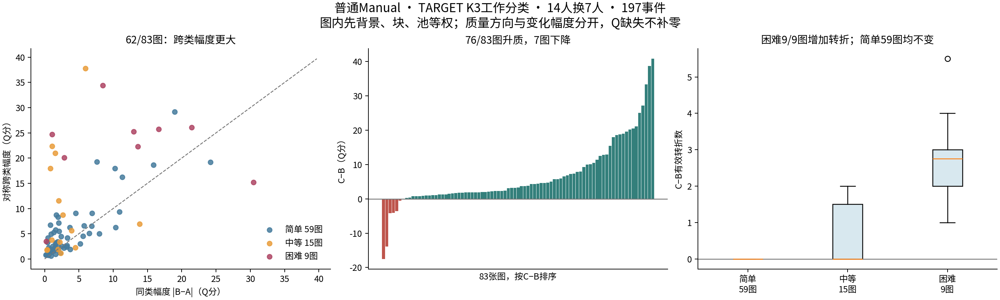

# HOHONET v2.1：按 v2 完整研究链路补齐下游分析

## 一、完成情况与可采用判断

本轮完成了用户指定的五条下游研究链：最新半队全部反例与机制、旧同房 ABC 在当前标签下的实际双视角效果、同类近历史 Q 的快慢人员×难度、同房均值及个人预测、Q/QT 选队与停止人数和历史获取成本。不是仅确认文件存在；相关指标均已从实际原答、精确团队、已存端点或原历史面板继续计算，并保留逐事件、逐图、逐楼与状态分母。

**当前证据足以支持“人员类型组织了可解释的人群响应，但具体成员、共同背景与视角仍造成重要不确定性”。** 半队替换的多数规律保留；它不要求每张图片升质，也不要求类别能消除类内差异。已有历史的实际用途也可明确区分：稳定历史 Q 对选队有用，Q/T 通常减少记录劳动但有质量坏尾，同房公共均值与稳定个人水平对个人预测有增量；依靠完整同房历史决定停止人数，在当前面板上提高了平均质量，却没有相对固定7人实现从零获取历史的成本回本。

本轮**没有最终决定分类方法**。TARGET_DSTRUCT K3/K2 继续作为冻结工作分析对象；OPPJOINT用于联合画像；RFUSE用于从融合响应反看人员作用；RAW3保留原答敏感性与较大替换块用途。不按某个最高分差或覆盖数重排主方法。后文的采用判断指研究结论及其用途，不代替用户尚未作出的分类选型。

### 核心结果

|研究问题|当前可采用结果|支持与关键边界|
|---|---|---|
|普通 Manual 主向14/7半队|GA均值+3.512，61/83图正；GS+3.397，62/83图正；C−B+6.578，76/83图升质|197事件、85登记图、21楼；GA/GS185事件，C−B187事件；幅度与方向分开|
|同房旧队10/5半队|C−B图对均值19/19正；18/19图对的两个视角都正；GA/GS两视角均正14/19、13/19|268旧事件、237六端共同Q事件、19直接图对、7楼；保持旧选队身份|
|同房14/7半队|2个合法图对均已执行；C−B均正，GA/GS均仅1/2图对正|目标块始终同一7人，不能推广成任意同类七人|
|近Q快慢×难度|旧63对中42对增加慢者转折优势，44对增加短边优势；当前完整105对平均结构变化很小|旧支持、当前支持和52对精确交集分别报告；更多表达不自动更正确|
|同房公共均值预测|源均值MAE6.464，楼外公共基线9.496；39/65图、8/13楼改善|128个直接图对；当前无关系待定主层|
|个人预测|公共同房均值P＋楼外稳定相对个人水平θ：MAE13.385，优于P的14.755及稳定个人绝对历史15.645|同一1,793份目标原答；不是图片均值预测的分母|
|n5 Q/T选队|记录劳动比0.827，48/57图减少；ΔQ+0.124，29图升、20图降、8图同；损失>5分加权比例8.65%|232上下文、57图、10楼，合法同源时间池、无关系待定层|
|停止及冷成本|源规则Q86.054，对照固定7为85.189；13/21图改善，P10略降；从零项目劳动比2.115，0/3组回本|质量5组21图；劳动3组11图，各自分母明确|

精确值、版本与论文措辞见 [32项v2→v2.1全链路对照](stage06_synthesis/V2_TO_V21_CROSSWALK.csv)。下文和各阶段报告给出原因、反例与实际计算范围。

## 二、实际读取的版本与研究边界

### 2.1 来源固定

云端会话不能直接访问 Windows 的 `D:\Work\HOHONET`。本轮使用同一项目远端 `Sparkling-Flames/3D_Manhattan_label` 的冻结提交 **`13a7861334749805a86dc19e9ea79fcaa71020c0`**，并从已存在的本地对象和当前归档中提取与该版本核对一致的资料。没有退回旧本地HEAD作为当前版本。

用户指定的依赖README及DEPENDENCIES、v2 CONCLUSIONS、USES_CLOSEOUT、final_classification_downstream，以及最新AC交付和独立核验README均已读取；原内容保存在 `source/`。当前原答池快照的Git blob为 `fa42df06d5cf0990d5e3bbd99f68c9f517b349b9`，SHA256为 `18e7a9159ea3f13ff7ca4d649d09de4be0a93075c325fcb8ba5f8ad41fa3aa37`。当前正式质量、参考、准入、楼外标签和135项冻结引擎依赖均保留来源校验。

**唯一不能声称读过的指定本地入口是Windows根目录的AGENTS.md**：可访问远端根树没有该文件，定点请求返回404；旧本地根也未找到。未用某个旧子目录AGENTS替代，也未自行补造规则。当前科研输入所需材料已全部取得或从原算法及完整输入精确重建，现有研究结论不再等待用户提供某个未知ZIP。若Windows上有仅本地存在的AGENTS，它仍应在实际应用文档更新前由本地环境读取。

### 2.2 没有混在一起的层

主分析限普通Manual主目标。其它合法空间、门洞、Semi、OOS以及不同事件阶段各保留原身份；当前没有正式Q的记录不填0。关系表的 `oos_pending` 与当前原答的 `is_oos` 是两件事：本轮发现旧用途支持含4个关系待定图对，保留旧支持结果，同时给出无关系待定的主层，不据此新裁定图池OOS或更改参考。

没有新增人、房间事实或类别拟合，没有重跑256条自然人数曲线，没有重复并行线程的严格9/10人ABC。直接AC、整类替换、有限配比、自然人数曲线与旧策略已有结果仍保留原实验身份；本轮只接续它们尚未完成的解释和用途链。

### 2.3 哪些复用，哪些实际新增

|模块|复用基础|本轮实际动作|
|---|---|---|
|最新半队|279原综合事件、837精确端点标量|重聚合与全部反例索引；缓存未命中的348个既有团队只重放诊断轨迹；新实验团队0|
|旧同房ABC|62,964旧事件；当前标签合法27,860物理事件、37,354方法投影|继续计算双视角实际效应；复用143,194不同端点；从缓存提取84端点完整轨迹；新融合0|
|快慢难度|原10339条匹配、当前历史与原答结构|固定旧支持、当前匹配、共同支持和成员/建筑敏感性；新融合与新评分0|
|同房预测|原直接关系、原历史预算/种子及三套原答支持|公共均值、个人残差/预测、多历史、匹配控制、平衡人员×视角描述分解|
|Q/QT选队与停止|原面板、候选、算法、顺序和停止规则|需25,826去重团队，其中310精确复用、25,516缺少端点实际算完；仅5,100受影响停止前缀更新评分|

选队旧团队库在精简归档中明确未完整保留。本轮确定性重建后，以旧参考重评分核对原200政策条件×B8L2/D10合400单元，最大误差小于3×10⁻¹⁴。没有把重建件冒称为找回的原始文件。停止原124,924行中119,824行直接复用；5,100受影响行只涉及4池、343精确团队。这个补算范围由实际缺失和参考变化决定。

## 三、最新半队：多数规律与全部反例

### 3.1 幅度和质量方向是不同问题

严格ABC为A=D∪X、B=D∪Y、C=D∪Z，D/X/Y/Z互斥；X/Y同类、Z异类。GA=|C−A|−|B−A|，GS=(|C−A|+|C−B|)/2−|B−A|，均表示跨类相对于同类的变化幅度；C−B才表示质量升降。类内变化大本身也是研究结果。

14/7综合197事件，85登记图、83共同Q图。同类幅度平均4.577 Q，直接跨类8.089，对称跨类7.974；GA +3.512、GS +3.397，分别61/83、62/83图为正。建筑等权GA +2.578、GS +2.728，均18/21楼为正。C−B +6.578，76/83图正；建筑等权+6.679，20/21楼正。C−B逐图中位数+3.344、P10 +0.480，绝对变化均值7.636。

D10同方向：C−B +6.127，76/83图正；GS +3.233，62/83图正。劳动在95个合法同源事件、55图、19楼可评，C−B均增5.977%，32图增加、23图减少。劳动不是现实并行耗时；提升质量未被默认写成节省劳动。

结构响应有明确条件：简单59图有效转折全部不变，仍有56图C−B升质；困难9张可评图中有效转折和参考节点保留均9/9增加，平均增加2.806转折，C−B平均+17.732 Q但仅7/9升质。困难图有劳动支持的6图全部增加。它显示增加细结构、定位/连接改善及劳动负担可以共同或相反变化。

### 3.2 本轮重新确定的全部反例

最新同起点非正22图、对称非正21图、C−B非正7图、三队共同Q完全不可评2图。这些集合重叠，数值并集32图。另4张图虽然逐图均值不是反例，仍有个别不可评事件，一并进入**36图完整机制交付**：`pa4-14`、`VFua-01`、`zs-16`、`S9h-12`。这与旧focused-only的192事件/22张对称非正名单不同。

21张对称非正图中17张仍C−B升质；14张至少一半设计权重三队Q均≥90；8张|GS|≤1；11张存在C分数位于A/B之间的事件，11张存在质量分项方向相反。7张C−B降质图均出现分项反向，但没有一张可用“三队都≥90”概括。因此高分集中只解释一部分，不能替代其余反例。

若C分数位于A/B之间，GS在该事件必为−|B−A|/2。这是数值关系；是否由投票、定位、连接或共同偏差造成，需要轨迹和原答支持。各图的多种数值标签与实际机制证据分别存储，没有强行分成互斥原因。

### 3.3 已取得的具体机制

全部36图、116个相关原事件含20/7背景对照、348个团队的候选身份组、未入选组、真实支持人员、位置子簇、原答指派、完整源环及连接状态均已取得。重放与原保存状态一致，最大标量误差1.42×10⁻¹⁴。没有把本轮“补轨迹”当作新实验样本。

MV50采用≥50%。14/7只有在同一候选组得到7名替换成员全部支持时，该块才单独达到7票；共同背景与替换块也可能以D1+Z6等方式达到门槛。两个候选都过票也不保证完整环存在。D票数达门槛指当前完整团队归组内的D支持，未另行运行D-only融合。

|案例|数值与实际过程|可采用解释|
|---|---|---|
|S9h-09|锚点A/B为4节点、Q78.997/77.798；C为6节点、Q60.282。C三个方向节点各D1+Z7=8票，邻近原闭合表达候选D6+Z0=6票未入选|结构表达明确改变并降质；当前正式目标仍是冻结闭合走廊，不按较高Q重选空间|
|jh4-04|A/B/C入选8/9/11节点，Q76.671/46.211/59.133；C−B+12.922但GS−15.230|同类B已大幅改变，C位于A/B之间；不是“跨类无作用”|
|jh4-12|同一Z的两个事件C−B为+7.725、−35.591；X/Y/D同时改变|实际成员与背景有重要条件作用；不能冒称隔离了D的纯背景实验|
|B6-11|逐图C−B−0.050；两个事件+1.535、−1.635，三队始终4节点|小均值来自方向抵消，并非全部组合相同，也非高分天花板|
|S9h-04|B有6个入选节点，却no_connection；出现过票且支持集合互斥、缺少覆盖全部节点的源环|节点票数充分不等于连接充分；物理互斥语义仍须看原答|
|VFua-04|四个事件C均no_connection，节点位置估计存在|问题在完整结构/环条件，缺Q不能填0或归为程序崩溃|
|S9h-12|局部事件A/B不足4节点，其他事件可评且逐图幅度正|逐图均值必须与逐事件输出状态一起报告|

全部21张对称非正名单、36图每一张的具体参考角/像素位置与人工问题，见 [完整逐图说明](stage01_half_team/ALL_36_CASES_ZH.md)、[机器可筛选索引](stage01_half_team/ALL_36_CASE_READING_INDEX.csv) 和 [离线案例查看器](stage01_half_team/HOHONET_latest_half_all36_viewer_ZH.html)。共同参考偏移另有明确几何诊断表；它定位VFua-04、X7-07等需要核对的局部，未凭几何近邻自动裁定真实墙体。

### 3.4 与20/7的连接

20/7为82事件、72登记图、70共同Q图：GA +1.465（54/70图正）、GS +1.347（47/70正）、C−B +4.525（65/70升质）。相同精确X/Y/Z有100条14→20链接，涉及72图；56条/45图保持D14⊂D20，另外44条/37图连D成员也更换。

在D嵌套且两端可评的41图中，按精确块和配对背景等权，GA从3.860变1.543、GS从3.884变1.362、C−B从7.441变4.346。非嵌套背景层33图（与前层重叠8图，合计66图）的C−B为7.135→3.740。更大的共同背景通常削弱这批主方向差异，但增人数、加入的具体D、门槛7→10及替换比例50%→35%同时改变，不能分离为单一比例因果效应。精确链接和权重均已保存。

## 四、旧同房ABC：真正的双视角结果

### 4.1 8,904究竟是什么

8,904是**旧物理D/X/Y/Z构造在当前TARGET K3标签下仍合法的双视角事件**，每事件含两张图、每图ABC三个端点。它不是8,904张图、不是视角行，也不是独立房间数。覆盖35直接图对、14楼、多个范围层；普通可比子集5,086事件，不能把全部都用于普通主目标结论。

三个工作方法共有37,354个合法方法投影，对应27,860个不同旧物理事件。方法间共享成员和端点显式保留交集；不能当成多次独立重复。旧团队在当前标签下的条件子集始终保持旧选队身份。

### 4.2 主向半队10/5更适合做跨视角主展示

|n/m|事件/六端共同Q|图对/楼|GA均值|GS均值|C−B均值|图对均值GA/GS/C−B为正|
|---|---|---|---:|---:|---:|---|
|10/5|268/237|19/7|+5.248|+6.067|+13.749|17/19、16/19、19/19|
|12/6|86/67|7/4|+4.583|+4.993|+12.838|3/7、6/7、7/7|
|14/7|10/6|2/2|−2.241|+0.333|+11.364|1/2、1/2、2/2|

均值在图对、原声明组、建筑层级聚合后建筑等权；图对多数单独计算。12/6的GA正均值不代表多数图对为正。

10/5中，**两个视角分别都正**的图对，GA14/19、GS13/19、C−B18/19；质量方向相反1对。图对平均C−B的中位数6.958、P10 2.336；GS中位数2.899、P10−0.059。D10同支持C−B+12.887，19/19图对均值正。若源视角 |C−B|>2 分，另一视角也满足 |C−B|>2 且同号的条件重复率71.45%，异号8.43%；它不是预测准确率。

结构和劳动重复的程度不同。19图对中有效转折C−B两边均增4对、均零13对、单边增加2对；合法劳动只有13对，两边均增4、均减3、反向6。底面角误差在19/19图对均值降低，方向误差18/19降低；因此许多质量作用通过定位体现，不必增加节点数量。劳动平均增加98.244人秒，9/13图对增加，不能把此主方向描述成省时。

### 4.3 半队容量与固定核心

严格ABC来源需至少2m、目标需至少m，共同合法人员至少n+2m；n=2m时共需4m名互斥人员。逐图对实际共同原答及楼外标签决定容量，不用全历史名册代替。

128个普通直接图对中，主向10/5合法32对，旧设计已覆盖19对，剩13；12/6合法9对，已7对，剩2；14/7合法2对，全部已执行；16/8及更大主向半队为0。14/7两对是S9h-05/12与pa4-42/44，目标Z在10事件中始终为 **W102、W109、W112、W115、W122、W126、W130**。每人10次、2图对、2楼。

因此，14/7适合展示固定核心的背景与视角响应；10/5支持更广，更适合当前同房半队的主要展示。无需为了“七人半队”再造一套14/7试验。若以后要验证按当前分类重新选队的推广性，10/5未执行13对及12/6未执行2对是具体候选，需另存新设计身份。

### 4.4 可直接查看的跨视角机制与反例

同房查看器包含3对图片、6张真实原图、14事件和84完整缓存轨迹，4,959项原答点对与当前合法原答一致：

- S9h-05/12的六个14/7事件：05的三队都6节点；12的A为4–5、B为3–4、C始终6；B四次below_four。一个C节点真实D1+Z6=7票，证明块人数不能代替局部票。
- S9h-10/19是10/5质量方向反例：视角10的C−B+3.895，视角19为−1.625；三队都4节点，各节点D及替换块均达门槛。这里没有节点未过票证据，应从位置、尺度及顶部分项解释。
- pa4-42/44均维持4节点、质量都提高，但44的GA为负。高分定位变化与类内变化同时存在。

原图/完整原答/参考/票账入口：[同房案例](stage02_same_room/abc/cases/CASE_VIEWER.html)。完整结论与方法层、空间层、输出状态分母见 [同房报告](stage02_same_room/REPORT_ZH.md)。

## 五、同类、近历史Q的快慢人员×难度

本项重新完成严格匹配，未以一般画像或难度分层替代。两人同图、同合法目标、同类、同来源/计时语义；楼外相对Q差≤3，调整历史劳动比≥1.5。快慢由楼外历史确定，未按目标图Q或耗时选人。同一有向人员对在简单与困难各至少2图；先每人对内按楼等权，再对人员对等权，共享人员仍保留身份。

方向是 `(慢−快)困难−(慢−快)简单`：

|支持|人对/人员|转折均差；正向对|短边均差；正向对|Q均差；正向对|
|---|---|---|---|---|
|原v2冻结|63/35|+0.335；42/63|+0.350；44/63|−2.454；28/63|
|固定旧人对与图片，当前Q/资格|63/35|+0.335；42/63|+0.350；44/63|−2.496；26/63|
|当前TARGET K3完整匹配|105/35|+0.020；55/105|+0.010；59/105|−0.163；48/105|
|旧精确人对×图片与当前条件交集|52/35|+0.249；37/52|+0.289；39/52|−2.531；22/52|

原支持的多数表达规律保留；当前扩展均值小也是真实结果。两者不同主要涉及人员对、图片、近Q支持及类别关系变化，不能仅归给换分类。更多表达不自动正确：VFua-03/04的W134→W125，困难图多6个转折、4短边，Q69.825→44.974，记录劳动24.389→286.279秒，需看镜面/柜体附近W125节点5–8是否为实际墙段。

当前TARGET新来源Manual的简单130/130图、困难35/35图历史慢者记录劳动较长，建筑等权几何时间比约2.34/2.41；劳动区别比结构和Q方向稳定。困难35图转折14正、15负、6零，Q16正、19负；同人同楼的814上下文在15楼中仍有成员/建筑敏感性。删一人或一楼，当前微小结构与Q均值会跨零，这不抹去旧63对及交集52对的条件规律。

全部52,851方法×人对×图片条目对应14,528个实际不同有向人对×图片，跨方法重叠不当独立证据。31项输出含短边、近共线点、定位、遗漏/外扩、面积、高度、Q及劳动。Semi只用自己的标签，当前缺充分困难支持；不填成零效应。详细结果与真实原答案例：[快慢×难度报告](stage03_speed_difficulty/README.md)、[案例查看器](stage03_speed_difficulty/CASES_VIEWER.html)。

## 六、同房均值、个人相似与实际预测

### 6.1 先复现v2，再分开支持扩展

v2原123图对、64图、12楼完整复现：源均值预测MAE5.080850，楼外公共基线9.303137；固定相同原答换当前评分为5.081438对9.305423，几乎不变。当前扩展及关系分层另列，不能把更大样本误差变大写成算法退步。

旧用途含4个已登记的关系待定图对：jtcx-22/23与pRb-04/06、04/10、06/10。旧含待定支持保留；当前无待定主层为128直接图对、65图、13楼、2600个人图对。只用直接关系，无同建筑代替同房，无传递补边。

### 6.2 公共均值有用途，构成和匹配应单独解释

当前主层源均值MAE6.464，楼外公共基线9.496；39/65图、8/13楼改善。D10为6.374对9.448。来源Q需已有正式评分，不是无参考预测。

在同楼、正式难度、参考有效转折及隐藏转折数H匹配、固定三图共同人员后，同房与关系未知图对的均Q差为5.051/8.931，8/9楼同房更接近。H不是顶部高度；未知关系也不是已确认异房。这里控制了部分背景，不把全部差额解释成结构因果效应。

原多历史面板的无待定层41图6楼，源均值MAE由同支持单源5.163降至最小严格多数4.358、最大历史4.302。固定全视角共同人员的更窄21图5楼为4.525→3.566→3.552。两层分开，主要增量出现在多份历史的汇集，继续增加历史的平均增益较小。264条不同有向来源边、289,875个面板记录均核对已有直接关系，0条缺边。

### 6.3 个人重复性与增量预测

2600个人图对、57人，绝对Q相关0.400762，减同行均值后0.198644，再减楼外稳定个人相对水平后0.012878。105/128图对排序相关正，40/57人相对同行的多数好/差方向重复；重复现象和很小的额外剩余相关可以同时成立。

P是来源图排除本人后的同行Q均值；θ是本人楼外历史相对同行的稳定水平。在同一1793份目标原答上：P的MAE14.755，稳定个人绝对历史15.645，本人来源Q16.735，P+θ为13.385；再加入原固定半份本人剩余项变14.193，没有改善。

多历史的同支持1284份目标原答、41图6楼中，P+θ的MAE由11.707→11.505→11.474；加半份本人剩余项为11.535，仍未改善MAE，但排序相关0.394→0.414。可以保留排序或条件解释用途，不能自动声称它已经改善团队选队，也不能据一个固定系数否定所有可能模型。

### 6.4 人员×视角构成是另一种量

在原声明组的共同人员平衡矩阵中，Q=总均值+人员主项+视角主项+剩余交互。当前无待定且每对都有直接关系的15组、40图、13楼、52人、685原答格，建筑等权平方和占比为**人员52.65%、视角8.27%、交互39.09%**，交互RMS10.028Q。它表明稳定个人与公共视角之外还有重要人×视角变化。

该占比是描述性平方和组成，不是人员分类解释率、预测准确率或因果贡献。原同支持换当前评分几乎不变；扩大视角支持会改变全视角共同人员，不能只归因于参考或分类。完整矩阵、组级分解和直接关系支持已保存。

## 七、Q/QT选队：已有历史的效果与实际坏尾

原候选、同房直接关系、人数、算法和种子不变，区分“原v2人员固定、当前计分”和“当前历史、原候选池重新选队”。楼外历史沿用至少8图/3楼支持；共3997个人×留出楼等历史单元支持状态未变，Q值及相对排名随当前正式支持更新。没有使用目标Q挑人。

Q/T从楼外Q队出发，贪心换入预计劳动较少者，约束团队历史相对Q均值下降不超过2；它不是目标实际Q损失不超过2的保证。

### n5同源时间池

|关系层|支持|Q-only Q|Q/T Q|ΔQ；升/降/同图数|记录劳动比；减少图数|目标Q损失>5加权比例|
|---|---|---:|---:|---|---|---:|
|无关系待定主层|232上下文，57图10楼|92.616774|92.740908|+0.124134；29/20/8|0.826679；48/57|8.6481%|
|原冻结设计层|240上下文，62图11楼|93.362740|93.475052|+0.112312；31/23/8|0.802734；53/62|7.8620%|

主层平均绝对ΔQ1.679；9/10楼劳动减少，1楼相同。原层11/11楼减少劳动。原层31/62图升质恰为一半，不能写成多数所有图片都升质。当前Q/T相对Q平均变正，主要因为当前历史重新选择使Q-only基线下降：旧队当前Q93.691195→重选93.362740；Q/T自身93.469330→93.475052几乎不变。

楼外Q本身相对单源Q，在当前主层43/59图、10/11楼更高。跨n3、4、5、6、7、9、13，Q/T劳动方向较稳定，Q均差分别−0.564、−1.453、+0.124、−0.891、−2.228、−1.202、−0.051；不同n容量不一样，不能当同一固定图集自然人数曲线。

坏尾实际存在：源uNb-40→目标01，Q/T比Q-only低28.949分、劳动624.481对1086.440秒；目标43低28.769分、590.447对1012.354秒。两队完整输出，不是融合失败。另一例uNb-12提高25.032分，却劳动增加7.38%；S9h-10换了具体成员，Q仅变约0.000005。完整原答/几何/参考在 [政策案例索引](stage05_selection_stop/selection/REPRESENTATIVE_CASE_INDEX.csv)。

这四个既定案例另有[原图、两队几何与逐人完整原答直接查看入口](stage06_synthesis/selection_case_exhibits/index.html)。四个独立案例页各自内嵌真实原图与数据，保留实际输出状态；原图上的差别需要人工判断其墙体语义，未据分项直接断言投票原因。

## 八、停止人数与历史获取成本

冻结源规则先用已完整取得的源视角曲线，选择距其峰值不超过2分的最早k≥3；目标只按几何完整性补收，不看目标Q。固定7同样允许几何补收。这里“m”是源视角数，与替换人数m不是同一变量。

|层|固定7 Q→源规则Q|固定7人数→源规则人数|升质图片|固定7 P10→源规则P10|合法劳动支持及比值|
|---|---|---|---|---|---|
|主5组21图|85.189→86.054|7.035→7.181|13/21|78.984→78.565|3组11图，1.255631|
|原6组24图|86.958→87.764|7.029→7.357|16/24|81.148→80.958|4组14图，1.235131|

平均Q和大损失比例有所改善，P10略降。8张Q负例完整保留：VFua-01，e9-03/26/28，uNb-14/72，wc2-03/61。wc2-03平均少收3.109人、Q下降4.487；S9三图平均Q提高2.76—3.77，却平均多收7.14—8.59人。停止规则可产生改善、恶化及不同劳动响应，不是稳定省人承诺。

从零取得源历史必须计每个源视角共同人员全部作答一次，不将共享原答的256条重放顺序重复收费。原4合法组项目劳动/fixed7为2.394848，0/4回本；无待定主3组为2.115261，0/3回本。相对“所有视角满共同池”比值分别0.843369/0.870559，但基线不同，不能据此说相对fixed7已回本。未记录的参考制作与人工评审成本保持未计入，不填0。

成本数值与v2相同，是原答、合法时长、人数与停止选择逐项复核后得到。跨楼Q/T历史从零最少采集多少、如何分配候选预算并在后续房间摊销，原数据没有定义最优化的采集合同；8图/3楼是支持门槛，不是最小成本方案。那是可选新设计，不是本轮漏算已有面板成本。详细方法、低尾和完整重建验证见 [选队停止报告](stage05_selection_stop/REPORT_ZH.md)。

## 九、怎样使用工作分类与已有模拟成果

|对象或设计|当前适合回答什么|不能据此单独宣称什么|
|---|---|---|
|TARGET K3、K2|结构原答差异及其团队响应；K3用于当前主方向半队机制，K2保留更粗的合法队伍覆盖|类别决定每名成员或每张图的全部Q/劳动；已完成最终选型|
|OPPJOINT|质量、记录劳动与标法的联合画像，以及已有直接AC/整类变化|联合类别的每种变化独立于历史Q，或本轮连续Q/T选队等同重新验证OPPJOINT分类|
|RFUSE|从融合响应反看原答路线遗漏的作用|凭同房普通半队仅3图对1楼的大均差取代结构路线|
|严格ABC|同类B与跨类C的额外幅度、质量方向和条件；本轮补齐跨视角重复|所有无B的AC也能证明跨类大于同类|
|直接AC、整类替换|固定人数/背景的实际人群替换及每图整类成员加入/退出，覆盖更多大块条件|将不等人数整类并集当作纯类别因果效应|
|同类近Q快慢|同类内速度与结构机会的关系、具体成员条件|更多表达必然更准确，记录劳动等于并行完工时间|
|公共均值+稳定个人历史|已有历史的质量预测及实际选队用途|残差相关、描述方差占比和有限配比解释率都是预测准确率|

原直接AC/整类成果已经回答大量混合人群问题，本轮不重算：冻结审查中的TARGET20/7为85图78升、均差+4.576；固定20人整目标类换入m1—8为185图155升、+3.615；OPPJOINT20/10为42升40降、均值+0.297而绝对变化3.282；RAW3 23/12的4图1楼全降。它们是保留的已审查结果，不冒称本轮新增。相同类别人数、相同X/Z、相同n/m而只换D具体人的既有TARGET20/7，85图平均效果差−0.388、绝对差4.564，进一步说明小均值不能抹掉背景作用。来源见归档 [AC独立核验入口](source/research/workers/personnel_ac_review_20261030/README.md)。

## 十、是否还必须新增实验

**为完成本轮v2→v2.1的已有材料解释与用途链，不需要再新增新分类大池策略或全新同房ABC。** 这不是因省事而停止：需要的缺端点已经实际补算，需要的旧事件双视角、匹配原答、预测与成本已计算，剩余问题能明确区分。

1. 新14/7同房主向无法扩大当前合法图对，2/2已覆盖且目标核心固定；不重复做同一覆盖。
2. 若研究者随后要问“当前分类预先选队能否推广到旧设计没覆盖的图对”，优先全覆盖10/5的32对（现19），再考虑12/6的9对（现7）。不能先按收益挑13/2个未执行图对；新设计先冻结成员/背景抽样，再精确查端点缓存，只补缺队。
3. 最终类别约束的大池进入策略应明确相对连续Q/QT或自然顺序增加什么信息、怎样处理未知历史和公平预算。旧V3进入策略不能改名为TARGET或OPPJOINT。当前用途结论不依赖这个尚未定义的新问题。
4. 从零最低跨楼历史采集成本，需要真实采集日程、候选覆盖及复用范围；不能从支持门槛推导一个虚构最小回本点。

### 剩余缺口分类

|类别|当前状态|具体后续|
|---|---|---|
|已有数据待整理|核心汇总、入口和交付已完成；全体旧同房合法事件已有结果与存档指针|若指定代表3对以外的个案，可继续精确提取已有完整轨迹；不是新融合|
|必须补算|本轮已报告问题没有未完成的必要计算|缺Q按真实状态保留；不为补齐表格虚构分数|
|需要新设计|上述10/5推广、大池类别策略、最低历史获取成本；Semi困难层或其它空间推广|定义新增问题后再做容量、历史预算和端点缓存检查|
|需要人工判断|36图局部结构语义、S9h-12凹角、VFua-04镜面/柜体、uNb-01/43质量坏尾实际墙段|案例均给出原图/原答/参考/几何及可用票账；不要仅凭总Q推断具体票或墙体|

各项状态、来源与是否阻塞结论详见 [缺口登记](stage06_synthesis/GAP_REGISTER.csv)。少量未决局部语义不影响已经核验的数值、多数规律和输出状态，只限制对应机制的语义解读。

## 十一、交付、验证与仓库更新状态

交付按阶段保存，所有包保持同一个 `HOHONET_v21_full_chain_20261030/` 根目录；解压到同一父目录即可合并。代码与最低可复现输入、原始源表、标签/团队身份、结果和验证分别保留。摘要与正文能通过 [全链路对照表](stage06_synthesis/V2_TO_V21_CROSSWALK.csv) 的精确路径/筛选条件回连，而不是只有不可追溯的截图。

|结果目录|主要内容|
|---|---|
|`stage00_intake/`、`source/`、`scripts/`|冻结版本、数据/引擎来源、完整分析脚本与复现输入|
|`stage01_half_team/`|279综合事件、837标量、36图、348完整轨迹、全部反例索引与20/7衔接|
|`stage02_same_room/`|旧ABC双视角实际结果、容量、固定核心、84案例轨迹、公共均值/个人预测/多历史/方差分解|
|`stage03_speed_difficulty/`|原63/当前105/交集52、31指标、同人同楼及删人删楼敏感性、完整原答案例|
|`stage05_selection_stop/`|两种历史选队身份、25,826端点、停止原顺序与受影响补丁、合法冷成本及坏尾|
|`stage06_synthesis/`|32项全链路对照、四类缺口及关键数值合同验证|
|`repository_update/`|7旧文件的追加更新、2新入口、增量patch及防覆盖应用脚本|

每个压缩包的全部成员均重新读到底，核对ZIP CRC、嵌套gzip CRC、CSV/JSON内容、图片解码和文件SHA256；准确包名、大小、哈希及下载链接由最终 `DOWNLOAD_INDEX` 给出。案例查看器的全部控件/绘图组合已执行检查；另用Chrome 156实际打开半队、同房、快慢案例及综合报告四个页面，无脚本错误、无水平溢出，中文、原图与几何截图均已目视检查。全组合执行与真实浏览器截图分别留有验证回执。静态科学图已目视检查，源CSV/JSON不依赖网页即可核验。

**仓库文档已完成更新副本与可应用补丁，但实际Windows D盘及远端未写入。** 7个原文件保留原字节内容，DEPENDENCIES追加8个本轮验收行；新增worker和release入口。补丁在独立冻结文档快照上通过 `git apply --check`，实际应用后9文件与overlay逐字节一致。应用程序按原文件SHA256阻止覆盖并行修改；提供完整研究目录后才允许导入数据和发布入口，避免只贴链接而无实际文件。操作入口：[仓库更新说明](repository_update/README_ZH.md)。

最终分类选择仍由研究者决定。当前可以直接采用的是本报告的条件规律、适用范围、真实反例和用途权衡，而无需把研究结果压成单一“升质省时”结论。
