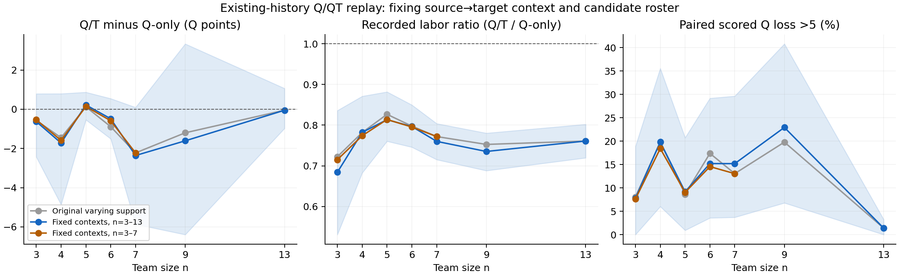

# v2.1 Q/QT选队：严格共同支持下的团队规模补充分析

## 结论

**把同一源→目标上下文、候选名单和关系资格全部固定后，Q/T节省记录劳动的方向保留，但其质量表现仍随人数不规则变化。** n=5的小幅正均值不是简单由不同人数使用不同图片造成的；它也不足以证明普遍升质。n=13相对Q-only的严重损失比例较低，不等于13人优于5人：在全尺寸均可评分的同一支持上，两政策从5人到13人的绝对Q反而都下降，记录劳动增加。

这是对Pro已完成研究的**共同支持补充**，不是发现其G01—G05未完成，也不是再设计策略或重跑融合。对应的明确可补缺口是Pro `stage05_selection_stop/REPORT_ZH.md` §4.3：原表各n容量与图集不同，尚未建立固定支持的规模比较。

## 1. 本轮新增了什么

1. 在所有已执行人数3/4/5/6/7/9/13上取**精确源→目标上下文交集**，不是仅取相同目标图；验证各n及两政策候选名单逐字一致。
2. 实际计算126个上下文、46图、9楼的固定支持结果；另计算3—7人共同支持210个上下文、54图、10楼。
3. 输出图级、楼级、楼簇重采样区间、逐一删楼敏感性，以及相邻规模配对变化和成员嵌套率。
4. 将质量缺失、融合失败与可评坏尾分开；另给“Q-only有Q时，Q/T无Q或损失>5”的明示复合诊断，不把缺Q填0。
5. 针对观察到的n13相对坏尾较低，追加一项**事后探索性**绝对质量/劳动对照；不借此选择或宣布最优人数。

新融合端点=0；新人员标签=0；策略调参=0。已有原始标注、正式参考、资格、历史门槛、Q/T历史Q均值最多下降2分的规则均不改变。

## 2. 输入、设计和分母

来源是 `/HOHONET_v21_全链路下游分析_20261030/STAGE05_SELECTION_STOP.zip`，其冻结仓库提交为 `13a7861334749805a86dc19e9ea79fcaa71020c0`。本轮直接读取：

- `selection/POLICY_EVENT_RESULTS.csv.gz`：71,608行原始政策事件，包含旧/新历史及不同范围，**不把这些行当独立样本数**。
- `selection/RELATION_FLAGS.csv`：直接采用关系、待定/冲突标志。
- `selection/QT_N_SENSITIVITY.csv`：原可变支持表，仅供复算校验。

输入ZIP内成员与本地输入逐字相同，SHA256见 `results/SOURCE_ARCHIVE_IDENTITY.json`；完整脚本/输入哈希见 `results/VALIDATION.json`。原事件表SHA256为 `a92f5ffbb321655fdbe1214e9f844e71007b54dc299dad9331c60436c21f865a`。

固定条件是：普通Manual、范围可比、直接采用且无关系待定/冲突、`new_timed_history`同源合法时间候选、`v21_history_reselected_fixed_candidates`当前历史重选。比较`outside_Q`与`outside_Q_outside_T_fast`。上下文身份由图对、源池、目标池、domain共同定义；在每个上下文内候选人员固定、全人数均已实际执行，两政策均有端点。候选数严格大于选队人数；入队人数、去重和候选成员包含关系全部验证。

**加权：**先在目标图内对源上下文等权，再楼内图等权，最后建筑等权。劳动比先取每个配对记录劳动的对数比，按同一层级平均，再取指数。它不是总劳动之比，不是并行等待时间，也不是人工报酬。

**缺失：**主要共同支持只按设计存在与容量选择，绝不按质量好坏筛选。ΔQ和损失率限两政策均有Q；可评率与实际失败率保留全设计分母。完整交集补充层进一步要求同一上下文的所有n、两政策均可评，得到124个上下文/46图/9楼；它是条件性敏感性分析，不替代主层。

**不确定性：**20,000次建筑簇重采样，固定种子20261030；每次重复同步所有n，同楼内全部图和上下文一起保留。表中95%区间是这9座已观察建筑的经验重采样敏感性，不是人口随机抽样保证；同一标注者跨楼复用，不能宣称楼间完全独立。删一楼另行报告。没有把126个上下文当126个独立试验，没有多重比较后宣布最优n。

## 3. 固定126个上下文后的规模结果

各行均为**同一46图、9楼、126个上下文**，质量指标有效上下文随是否可评分另计。Q为B8L2，ΔQ=Q/T−Q-only；劳动比小于1表示Q/T较省记录劳动。

|n|配对ΔQ|ΔQ的95%楼簇经验区间|劳动比|可评配对损失>5|Q/T可评率|
|---:|---:|---:|---:|---:|---:|
|3|−0.627|[−2.435, +0.791]|0.684|7.78%|100.00%|
|4|−1.722|[−4.864, +0.792]|0.782|19.81%|99.07%|
|5|+0.218|[−0.538, +0.869]|0.813|9.17%|100.00%|
|6|−0.485|[−1.511, +0.545]|0.797|15.20%|99.07%|
|7|−2.361|[−5.865, +0.095]|0.760|15.19%|100.00%|
|9|−1.611|[−6.397, +3.335]|0.735|22.93%|100.00%|
|13|−0.051|[−0.977, +1.064]|0.761|1.39%|98.61%|

这些百分比均为图→楼层级加权，不是原事件计数除126。n4、n6、n13分别有1条Q/T无Q上下文，Q-only均有Q。n4和n6指向同一VFua源07→目标01；n13为VFua源01→目标04。所有全人数共同支持内Q-only端点均可评。n13的“无Q或损失>5”加权比例为2.78%，不应只展示1.39%而遗漏不可评。

原可变支持表n5的ΔQ为+0.124、劳动比0.827；固定上下文后为+0.218、0.813。3—7人共同支持中n5为+0.144、0.814。全尺寸全可评124上下文中n5为+0.220、0.819。**n5微小正均值在这些支持定义下都保留，但量级很小，不能写成Q/T稳定提高质量。**

固定46图中，n5有24图ΔQ正、17图负、5图相同；劳动40图减少、1图增加、5图相同。楼级为6楼ΔQ正、2楼负、1楼相同；8楼劳动减少、1楼相同。n5逐一删楼后的ΔQ范围为+0.032至+0.534；与经验区间跨0并不矛盾：前者仅删除一座既有楼，后者允许对不同楼重复抽样。

所有已执行n的劳动比都小于1，七个楼簇经验区间上界均小于1。但**相对同人数Q-only省劳动不等于跨人数更省劳动**，不能把n13的0.761解释为比n5的0.813用时更少。

## 4. 不能把n13的相对坏尾较低误读为“人更多更好”

此节是看到n13相对坏尾较低后追加的探索性诊断；比较事先已有的n5主条件与n13，不改变策略。只使用**所有尺寸、两政策均可评**的124个共同上下文、46图、9楼，避免跨人数质量分母变化。

|政策|n13−n5的Q变化|95%楼簇经验区间|Q下降图/楼|n13/n5记录劳动比|
|---|---:|---:|---:|---:|
|楼外Q-only|−3.990|[−9.603, +0.476]|36/46图、6/9楼|2.331|
|楼外Q/T|−4.308|[−9.674, +0.367]|38/46图、8/9楼|2.170|

两政策均在46/46图、9/9楼增加记录劳动。n13相对Q-only的较小损失，是在**Q-only基线本身也下降**的条件下观察到的，不能据此主张13人绝对质量更高或更经济。另一方面，楼簇区间仍宽，这些是当前有限设计中的方向与幅度，不是所有未来建筑的人数定律。

同一候选池中，Q-only各相邻n团队都嵌套；Q/T只在3→4、4→5全部嵌套。5→6、6→7、7→9、9→13的层级加权嵌套率分别为71.08%、51.41%、60.18%、60.02%。**Q/T每个n重新执行贪心交换，不应将其规模表称作“一支队伍只不断加人”的自然曲线。** 即使Q-only嵌套，加人也同步改变构成与融合门槛；本分析没有分离其机制，不凭总Q猜测某一临界票造成下降。

## 5. 可以进入论文的表达

> 在具有现成楼外历史、合法同来源劳动记录及直接同房关系的固定候选支持内，连续Q/T选队在已执行的各团队规模上均减少了相对同人数Q-only队的记录劳动。固定源—目标上下文后，质量效应仍非单调：5人条件的平均差异略正，其它多数规模略负或更负，且各规模均存在局部损失。因此，Q/T更适合作为已有历史下的质量—劳动取舍，而非目标质量保证；相对基线的损失率也不能替代不同团队规模间的绝对质量及总劳动比较。

此补充可接在原选队报告4.3或论文“规模条件下的用途稳定性”之后，不需要改写人员分类主线、增加新融合、重新冻结最终类别或改动Word提纲。

### 尚不能推出

- 不能宣布5人最优、13人总是更差，或把有限候选支持推广到所有206张普通Manual图。
- 不能把已存在的楼外历史当作从零取得，也不能计算尚未定义的最低历史采集/跨房间摊销。
- 不能把人数变化归因于单一门槛机制；Q/T成员可能非嵌套。
- 不能将可评端点的坏尾与无输出混为同一Q数值；保留两者及其分母。
- 不能把本补充冒称新类别选队的优势检验，或重复列为Pro必须返工的缺口。

## 6. 已完成验证和复现

1. 对Pro原规模表的7个n×6个统计量独立重建，42项最大绝对误差1.42×10⁻¹⁴；各原事件/图/楼分母一致。
2. 使用**另一套Python标准库csv/gzip/math实现**重建两共同支持层的84个统计量，不调用主脚本的聚合函数；与12位有效数字输出的最大差4.79×10⁻¹¹以下。
3. 在临时目录重新执行完整程序；7份主要CSV逐字相同，包括固定种子的20,000次重采样结果、删楼和探索对照。
4. PNG已实际打开检查，标题/坐标/图例清晰；英语图内标签对应本文中文解释。Matplotlib/Fontconfig出现不可写默认缓存的环境警告，计算、PNG及SVG生成均成功；不影响数据结果。

运行环境：Python 3.12.14、numpy 2.3.5、pandas 2.2.3；绘图另需matplotlib。完整运行：

```bash
python scripts/analyze_common_support.py
python scripts/validate_independently.py
```

主结果：`results/COMMON_SUPPORT_SUMMARY.csv`；精确支持与名单：`COMMON_CONTEXT_ROSTER.csv`、`COMMON_CONTEXT_EVENTS.csv.gz`；图/楼级与删楼：`COMMON_SUPPORT_IMAGES.csv`、`COMMON_SUPPORT_BUILDINGS.csv`、`LEAVE_ONE_BUILDING_OUT.csv`；相邻人数配对与嵌套：`ADJACENT_SIZE_PAIRED_CHANGES.csv`；事后绝对对照：`EXPLORATORY_N5_N13_ABSOLUTE_CONTRAST.csv`。全部失败/缺失状态仍在原输入及逐事件表中。



图：灰线为原可变支持，蓝线为126上下文全人数共同支持，棕线为210上下文3—7人共同支持。蓝色带为楼簇经验重采样95%区间，**不是逐事件独立样本的误差条，也不是未来总体保证**。
