# HOHONET 人员类别、组合配比与融合不确定性

## 20261020 接续研究：直接替换关系学习、条件细类与冻结评估

**本轮得到的可用结果是：有条件的构成效用、少数可解释的几何分离方向，以及较可靠的历史来源效率分层。没有得到可任意换人的通用人员类型，也没有得到跨图片普遍胜出的混合比例。** 这并非仅做一次检验后的结论：本轮实际执行了 17 个正式原生评估批次，保留全部候选、失败、容量不足和发现后翻向的结果，并对漂亮配比继续重抽、跨图检查和单图有限总体穷举。[E0、E1、E8]

本报告以“完整类别计数向量＋总人数 n＋任务条件”为构成单位；多背景类别块实验是其中的一种配对设计。**构成有效、成员可互换、质量提高、节约时间是四个不同结论。** 下文的 C01、C02 等仅在所属方法内部有意义，不能跨方法把同号类当作同一人群。

### 建议保留什么

| 结果 | 建议用途 | 已有支持与主要风险 |
|---|---|---|
| 反向新批关系两类 Rnew2，尤其 13 人换 5 人 | 解释、预测较大类别块改变的质量与结构方向 | 29 图、6 楼、35 人；C02→C01 平均 +6.65 分，24 图改善，但同构成主相近率只有 47.74% |
| 高 Q23 内部慢／快两类 F01 | 在现有人员中优先考察效率，并单独保留质量风险 | 42 图、6 楼、480 个配对；来源块用时比 0.375、质量差 −0.03；同类换人下降超过 5 分约 5.92% |
| Q／T／几何四类 F04/F05，反向细类 R03/R06，原 G/R 两方向 | 有向构成比较与机制解释 | 多楼质量方向与部分几何分离重现；历史 Q 差和小类容量仍重要 |
| 高 Q 快 5＋慢 2、整队 7 人 | 简单图和现有有限成员内的候选配比 | 同构成主相近率约 65%→73%；多名成员在所有观察中出现，尚不能脱离具体人员推广 |
| Semi 编辑、错误报告后未修改、scope 细类 | 保留条件描述和待复查方向 | 已进入真实融合实验；作用随 Manual/Semi、图片和成员变化，尚不能命名为普遍纠错／盲信能力 |

## 1. 数据与前轮过程：核查后的起点

### 1.1 读取范围和冻结链

本轮使用 GitHub main **445686f8f3cf6039c4ce1f60016cad1d26829044**。已读取新增任务书、双线任务与验收、前轮精简原包、Codex followup、统计证据审查、冻结融合入口和特征来源；指定新增目录均存在，缺口清单为空。前轮精简包 291 个文件与 Git/LFS 来源逐文件一致。`INITIAL_SOURCE_READ.json`、`PRIOR_PACKAGE_SOURCE_PARITY.json` 留存路径、大小和 SHA。[E0]

科学融合仍固定于 **82c6164b0d4630de5316199c92aa405930973168**；输入快照 SHA 为 `83179b9842d06916b105d80ff181918c223e4fee2073f425f9825db124ec11d7`。原生输出中仍保留旧输入归档 main `e572eb73…`，它与本次读取的 main 是不同层次的来源标识，不能混写。沿用既有坐标、平均 x、历史删点、环序、人工参考、暂停／GT 问题处理与 OOS 资格。没有重加工原始导出，没有改变参考、融合、B8L2 或 D10 来迎合分型；N1 仍未接入。[E0、E2]

独立复核了已知 followup 的 451 个事件、1,353 个团队、66 图、12 楼：3,022 个汇总数值重算最大差约 7.1e-15；另外原生重放 30 队、10 图、7 楼，分数最大差约 7.1e-14，几何差约 2.2e-16。前人已知的 G2→G1 60.32%／44.37%、R5→R2 80.48%／49.84% 得到核实；它们是本轮已知线索，不能再称新盲测。[E2]

### 1.2 真实数据支持

库存为 10,439 份；正式质量数据 7,302 份、196 张图、60 人。冻结融合快照有 229 个条件池，合计仍为 196 张真实图片、22 栋建筑；同一图的 Manual 与 Semi 不能重复算成独立图片。[E0]

| 冻结资格层 | 池数 | 记录数 | 本轮实际覆盖池数 |
|---|---:|---:|---:|
| 普通 Manual | 177 | 5,719 | 177 |
| 门洞 Manual | 17 | 571 | 4 |
| 普通 Semi | 32 | 901 | 14 |
| 特殊 Manual | 2 | 66 | 0 |
| 特殊 Semi | 1 | 45 | 0 |

以上是实际请求覆盖。普通 Semi 的 14 池中，只有 **12 池／12 张图至少有一队完整可评分**；`7y3sRwLe3Va-21` 和 `yqstnuAEVhm-27` 两个 Semi 池各仅有 6 个 n=2 递延任务，原样保留，不能当成有正式质量结论的 Semi 图片。普通 Manual 的 177 池和本轮门洞 4 池均有正式评分支持。逐条件的尝试与评分支持见 E1 的 `QUALIFIED_SUPPORT.csv`。

本轮全部正式批次跨批去重后为 **569,529 个“条件池×精确成员集合”融合评估任务**，覆盖 195 池、181 张真实图片、22 楼、60 人、6,244 份实际使用的冻结记录。忽略图片／条件后，具体成员集合为 536,228 套。17 批次记录 573,428 次原生评估调用，其中有 3,899 次跨批重复；重复任务的科学字段完全一致。569,529 不是独立样本量，更不是新参与者数量。[E1]

其中 557,111 个任务完整可评分；7,039 个 n=2 任务执行了冻结融合，但沿用 `two_person_deferred` 的评分递延资格，单列而非当作真正失败。n≥3 的 562,490 个任务中有 5,379 个不完整：无连接 4,285、少于四点 894、底面无效 200。失败留在尝试和稳定率分母，Q 与连续几何缺失保持缺失，不补零。全局失败率仅描述已测设计，不能代替某个构成的失败风险。[E1]

### 1.3 发现与评估的边界

继续使用十栋历史楼、六栋发现楼、六栋评估楼的既定划分。所有历史特征和人员类别仅从历史十楼学习；反向类别内部采用五折、每折留两栋历史楼。发现阶段允许检查实际融合效果，再冻结方向和精确请求。主要方向冻结于 **2026-10-19 15:25 UTC**，五个配比冻结于 **15:34 UTC**；“20261020”是接续任务编号。[E0、E3]

六栋评估楼为 B6ByNegPMKs、UwV83HsGsw3、X7HyMhZNoso、pa4otMbVnkk、q9vSo1VnCiC、rPc6DW4iMge。它们属于多轮探索过的 v2，属于**冻结规则后的内部复查**，不是外部盲测。新团队、新背景和新抽样也不是新人员或新的独立图片。单图穷举和 W132 检查由本轮结果触发，明确标为评估后机制研究。[E0、E3、E8、E9]

## 2. 分类如何形成，实际搜索了什么

### 2.1 正向：机会与来源分开，质量和效率不合成总分

历史画像共 60 人、328 列。继承的 156 列已逐列重算一致；增加 172 列用于来源／条件时间、绝对与相对 Q、低尾和波动、困难适应、节点数量与上下边界习惯、Semi 编辑、新报告错误后未修改、scope 倾向等。构建 **188 个候选定义，184 个可形成至少两类**，保留缺失和不合格原因，未把未知机会设为零。高 Q23 是满足历史支持门槛 `core_supported` 且 `q_beta≥0` 的 23 人，含新 15、旧 8；原高三分位 18 人另用方法号区分。[E4]

高 Q23 确有细分空间：T 支持 23 人，困难表现 16 人，新报告错误未改 12 人，Semi 编辑 19 人，scope 倾向 15 人。但这些人数不完全对应同一来源：困难支持的 16 人中有 15 名新批；新报告错误未改的 12 人和 scope 的 15 人全部来自新批；编辑支持 19 人为新批 11 人与旧批 8 人的合计，仍按各自机会和来源建特征。缺失模式本身也反映批次，不能把“无记录”解释成能力差。旧确认初始错误在历史中仅 1 图、1 楼，正式人员中 24 人各一次机会，4 次未修改；无人达到至少 3 次／2 楼的历史拟合门槛，无法建立有多楼支持的旧确认盲信能力类。[E4]

正向方法包括可解释分位规则、多个变量组的平衡聚类／medoid、条件分型、高 Q 粗分后按时间、困难和结构习惯细分。选择优先方法时先看字段和人员容量；随后实际比较 59 个正向方法及既有对照。没有要求全部变量进入某一个最终总分。[E3、E4]

### 2.2 反向：真实相近关系进入学习，而非只预测平均 Q

保留的旧历史材料包含 122,082 个真实同背景单人替换对，79 图、10 楼、606 个锚背景。另用固定元数据规则扩展人数和背景，原生计算 31,539 队，得到 359,916 个实际替换对、81 图、1,576 个锚背景。两者合计 481,998 对作为关系学习材料，仍只涉及同一历史十楼；另 7,272 个旧嵌套背景事件仅作分型冻结后的历史压力检查，没有混入候选选择。人数和背景相同的两队之差直接进入人员关系，当前图的标注簇没有被当作跨图类别。[E5]

风险表达实际尝试了旧主联合不相近风险、去 Q 几何风险、底面／平均高度棱柱代理连续距离及背景中心化风险。比较 complete linkage、谱聚类、类内风险分区，以及加强宽口径坏尾惩罚的分区。分区目标包含已知关系加权的类内距离与类别容量平衡；候选选择再看按楼留出的类内相近、类间差异、坏尾和覆盖。主两类采用不含 Q 阈值的几何风险与宽尾惩罚，**但这不等于最后得到的类别与 Q 无关**。[E5]

关系机会不足不会被当作距离为零：图估计对未知关系不给亲近权重，complete linkage 对未知边采用悲观距离，并另查收缩敏感性。失败的原始 Q 与连续几何保持缺失；连续风险目标为失败设定的惩罚是单独登记的 loss。来源条件中的“背景中心化”候选会用同一历史背景其他来源的替换事件作居中基线，因此不应称其为纯来源内风险；主 Rnew2 使用的是直接几何风险，不使用这个背景中心化表达。[E5]

旧关系路线尝试 768 个候选，555 个有效；扩展关系路线尝试 1,040 个候选，752 个有效。实际枚举可支持的整数 K，从 2 到 13；每类至少 4 人，使同类 m=2 的两块具有最低实际容量。五名稀少支持人员在主要关系分型中保持未知，未单独做成看似稳定的单人类。七个条件域包括普通、困难、小人数、大人数及新旧来源细分。无有效留楼支持的小域也保留失败，不作为赢家。[E5]

### 2.3 搜索台账与未覆盖部分

| 已实算部分 | 实际范围 | 没有声称穷举的部分 |
|---|---|---|
| 正向宽搜 | 62,610 个 ABC，183,219 个独特池×团队；55 图、64 池、6 楼 | 由可行域分层抽具体块和共同背景；不是全部人员组合 |
| 反向宽搜 | 33,468 个 ABC，97,432 个任务；51 图、6 楼 | 15 条历史优先路线的多方向／n/m 抽样，非全部候选全任务交叉 |
| 原 G/R 密集复查 | 20,679 个可行“池×方向×n×m”单元全部覆盖；33,332 ABC、99,779 队 | n/m 单元覆盖完整，具体成员块与 core 顺序仍是固定抽样 |
| 类别无关共同面板 | 发现 14,243、评估 10,577 队；n=5/9/13/17、m=2；共同 26 人 | 固定两组 core，最多 48 个块；用于公平方法比较，不代表所有人员 |
| 混类／整队挑战 | 7 路线，两阶段 16,294 原事件、48,472 独特池×团队；n=3–32、m=2–17 | 每池每方法最多 16 个整队和 16 个局部混类上下文；抽样容量失败不是数学不可行证明 |
| Rnew2 嵌套人数 | 282 条固定路径、5,232 ABC、15,679 队；n=3–31、m=2/5 | 路径上的可行整数 n 完整展开，但每格只抽两套块／core 顺序 |
| 配比网格 | 13 张按楼和难度选的发现图；3,825 构成、14,990 队 | n=3–9 的可行类别计数向量全列；较大二类 n=10–17 只取端点和约四分位比例；每构成最多 4 队 |
| 配比冻结复查 | 五个比例；同图最多 16 支未在原网格出现的队，评估最多 16 队／构成 | 人员仍是原人员；容量穷尽时不把旧队称新队 |
| P05 单图继续追踪 | 3,752 个可行团队全部原生计算 | 混类两队比较空间 6,420,736 对只抽 2,000 对；纯类各 1,540 对全算 |

候选台账包括筛选依据、失败折、小类容量、来源约束和未选方向；原始请求成员可由种子和冻结标签重建。主方向冻结为 11 条正向、6 条反向细类，加 Rnew2 两个方向；负向对照、发现强而评估弱的方向没有删除。普通 Manual 覆盖最完整；门洞只实际测试 4 池，Semi 请求 14 池、其中 12 池有正式评分，特殊条件没有新批实验，不能外推。34 个未请求冻结池逐一列在 E1。[E1、E3、E5、E7、E8]

## 3. 怎样定义“相近”与“更好”

### 3.1 同图配对，分开三种变化

每个 ABC 中，A 和 B 使用同一完整构成但替换 m 名具体人员；C 在相同图片、参考、共同成员、总人数 n 和实际换人数 m 下改变类别或配比。A∩B=A∩C=core。质量净方向定义为 **Q(C)−Q(B)**，相对的是同类替换后的实际结果。图形相近比较分别为 A/B 和 A/C。[E3]

混类实验另外保存 A/B/C 完整计数、类别槽改变数、B→C 的实际成员变动。A→B 与 A→C 同为 m，不意味着 B→C 也必为 m；例如整队 A 与 B、C 均无共同成员时，B 与 C 可以部分重叠。类别改变几个槽、实际换几个人、总人数不能混用。

统计先在图片／条件池内汇总，再在建筑内平均，最后对建筑等权。跨条件结果另外报告真图片数；具体方法比较使用相同的可用锚点或同一来源／历史 Q 子集。百分比是这种层级均值，不能拿“平均相近率×事件数”当原始成功计数。全部小表保留各指标实际分母，缺分不抹成零。这里主要依据效应大小、方向、几何与坏尾作判断，没有用 p 值是否过线作为唯一价值标准。

### 3.2 严／主／宽与连续形状并列

| 口径 | 严 | 主 | 宽 |
|---|---:|---:|---:|
| 旧联合：绝对 B8L2 差 | ≤1 | ≤2 | ≤5 |
| 旧联合：底面 1−IoU | ≤0.02 | ≤0.05 | ≤0.10 |
| 旧联合：绑定环角差 | ≤2° | ≤3° | ≤5° |

旧联合还要求双方完整、原节点数相同。`noQ` 只去掉 Q 阈值，仍保留相同节点数等旧约束。它检验几何分离是否只是由当前分差阈值触发，**并没有把历史 Q 分类信号从人群中去掉**。[E2]

新增形状判据在新批结果前冻结，并列报告：主口径要求底面差≤0.05，对称墙段覆盖≥0.95，真实转角 F1≥0.95，上／下 ERP 边界偏差的 p95 均≤3°，且至少 99% 方位有共同有效边界。墙和角点距离容差严格为两队平均面积平方根的 0.05 倍，真实转角取转向严格大于 10° 的角；不要求原节点数相等。严／宽版本的底面差及距离比例为 0.02／0.10，覆盖和转角 F1 为 0.98／0.90，边界 p95 为 2°／5°。双方仍须完整、底面有效且相机在内部。没有对几何做配准、缩放、修点或换参考。[E2]

连续诊断另看范围遗漏／扩张、墙覆盖、参考附近角点和边连接、原节点数、底面差、上下 y、半径和推断高度。平均高度棱柱 IoU 只是三维代理；只有满足严格平顶可识别条件时才给精确平顶棱柱值。本轮非平顶实例中该精确值为空，不能称完整房间体积 IoU。语义上的“必要结构”没有新人工 GT，也没有接入 N1；本报告的结构改善先指与冻结参考更一致，图上需要人工确认其语义合理性。

## 4. 直接关系两类：最清楚的类别块效用

### 4.1 类别是什么，哪些变量解释它

Rnew2 的完整方法号为 `R_directswap_geometry_partition_b2_K2__ordinary_new__mixed_history_v1`。只在同新批人员中分型，C01 为 21 人，C02 为 14 人，逐人冻结标签在 E5/R1。历史删楼分型的平均 ARI 约 0.955，最低约 0.778；这是历史标签稳定性，不能代替团队互换成功率。[R1]

| 历史人员等权描述 | C01：历史 Q 较高、节点习惯较多样 | C02：历史 Q 较低、节点习惯较收敛 |
|---|---:|---:|
| 人员数 | 21 | 14 |
| 绝对 Q 均值 | 75.53 | 64.03 |
| 相对任务 Q，qβ | +5.48 | −6.19 |
| 个人绝对 Q 的 p10 均值 | 48.41 | 41.54 |
| 个人 Q 标准差均值 | 18.98 | 18.64 |
| 任务残差 Q 标准差均值 | 14.72 | 14.10 |
| 点数残差标准差均值 | 1.154 | 0.768 |

C01 不是低波动或总能标对的组。T、新报告错误未修改、scope 倾向在两类间并非强区分变量。新报告未改效应分别有 18/21 与 10/14 人达到支持门槛，支持者累计 61 与 37 个机会，两类全员合计为 65 与 44 个。新 Semi 编辑效应有 16/21 与 11/14 人支持，支持者累计 107 与 74 份记录，全员合计为 131 与 88 份。两类没有旧 Semi 确认错误机会，保持缺失；编辑或未改的这些效应不能单独命名为净纠错能力。[R1]

### 4.2 同一支持下，换 2 人和换 5 人不同

主比较固定 29 张同时支持两方向、两种 m 的评估图片、6 栋楼。每格 58 个 ABC、174 支独特具体团队、58 个不同 core；四格并集 696 队，仍只有同一批 35 人和 29 图。下面的“同构成”指含共同背景的 A/B，**不是纯类整队稳定率**。core 配比跨路径变化，精确完整向量逐事件保存。[R1]

| n=13 的方向 | m | C−B：B8L2 / D10 | 同构成／跨构成主相近率 | 同构成／跨构成新形状相近率 | 质量改善图／总图 |
|---|---:|---:|---:|---:|---:|
| C01→C02 | 2 | −3.474 / −3.042 | 60.95% / 45.18% | 72.06% / 63.73% | 8/29 |
| C01→C02 | 5 | −4.991 / −4.557 | 58.81% / 39.25% | 77.28% / 52.68% | 6/29 |
| C02→C01 | 2 | +0.623 / +0.563 | 55.40% / 56.81% | 75.02% / 75.85% | 19/29 |
| C02→C01 | 5 | **+6.652 / +6.404** | **47.74% / 44.76%** | **70.46% / 58.37%** | **24/29** |

按表中四行，A/B/C 不完整团队数依次为 0/1/0、0/0/0、1/1/1、1/0/1；每格 C−B 的有限质量事件数为 57、58、57、57，均仍覆盖 29 图、6 楼。失败保留在尝试与相近率分母。两种 m 各自抽取并冻结块成员；比较 m2 与 m5 固定了图片支持，并未固定所有具体块成员。只有同一 m 的嵌套 n 路径严格保持三块不变。[R1]

C02→C01 换 5 人时，六栋楼质量方向均正，平均参考附近角点召回增加约 0.0938、墙覆盖增加约 0.0412。反向换 5 人在 23/29 图、5/6 楼降低质量。对应的去 Q 旧几何相近率差分别为 +21.11 与 +29.76 个百分点；因此并非只有当前质量阈值造成差别。[R1]

稳定与改善的区别也很清楚。C02→C01 换 5 人的旧严格相近率反而为同类 26.63%、跨类 28.85%，宽口径为 83.06%／57.68%；旧主分离只有 2.98 个百分点，不能夸大成所有口径都有明显可互换分离。换类后质量提高，形状也可能应当改变。C01→C02 换 5 人的同类／跨类有符号下降超过 5 分约为 11.77%／34.23%；C02→C01 同类块也会出现非常严重的个例失稳。[R1]

四格历史三块 Q-close3 均无支持，块间历史 Q 差约 11–12 分。全新批条件排除了来源比例变化，但未消除 Q 信号。本轮首先保留整体类别效用；超出 Q 的剩余信息在第 6 节共同面板中另检验，没有先把分类信号全部匹配掉再宣布类别无用。

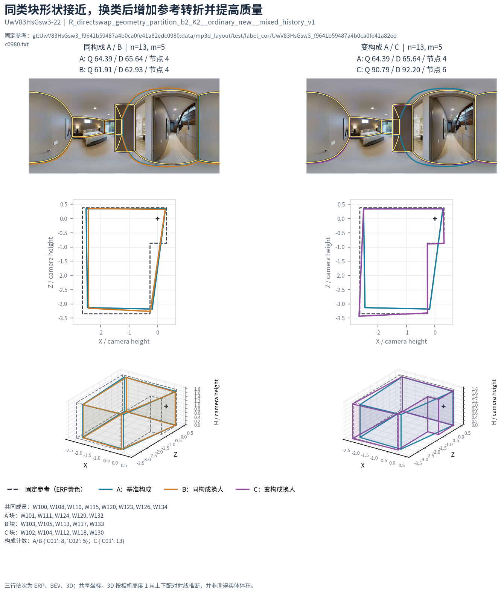

**图例 S07。** UwV83HsGsw3-22，8C01＋5C02→13C01，n13/m5。A/B=64.386/61.906，C=90.791；A/B 新形状接近，原节点均为 4，C 为 6，更贴近参考内凹转折。A/B 分差 2.479 超过旧主的 2 分，不能说所有相近判据都通过。图中给出成员与参考，精确几何和输入在 `cases/S07_reverse_new2.json`。

### 4.3 人数、完整配比和图片条件

嵌套曲线在同一路径上固定三块人员，三臂每增加 n 都加入同一共同成员。C02→C01、m5 在共同 n13 容量的 29 图中，质量效应 n5 为 +10.907、n13 +6.652、n17 +3.810、n18 +4.991；并不单调。n19 后支持掉到 28 图，n20 为 24 图，n21 为 14 图。另有事先按容量定义、n5–21 始终可比的 14 图／5 楼子集，其 n13/m5 效应只有 +1.045。图片条件和人员容量显著改变可见规律，不能把支持换了一批图的曲线拐点都称人数门槛。[R1]

难度也不是简单的统一排序。n13/m5 时，C01→C02 在中等图平均 −10.384（6 图／4 楼），困难图约 +0.081（5 图／4 楼）；反向 C02→C01 在中等与困难图分别约 +7.727、+7.966。难度沿用既有参考范围一致的复核标签，属于已知条件分析，并非验证了采集前自动难度预测。

主面板 **n13/m5 的完整构成向量**共出现 10 种，全部保存在 `reverse/assessment_interpretation/nested_new2/full_vectors/FULL_VECTOR_SMALL.csv`，逐图、逐楼和精确成员证据在同目录。两方向合计仍是 116 个 ABC、348 队、29 图、6 楼、35 人，未增加新样本。下表选三种至少有 3 图、2 楼支持的配比作事后解释；另外 7 种及其低容量、失败和反例均保留。[R1]

| 完整构成：A/B → C | ABC／不同核心／团队 | 真实图／楼 | C−B：B8L2 | 同／跨主相近率 | 同／跨新形状相近率 |
|---|---:|---:|---:|---:|---:|
| NV04：10C01＋3C02 → 5C01＋8C02 | 15/15/45 | 13/5 | **−10.633** | 60.00% / 38.33% | 83.33% / 56.67% |
| NV09：7C01＋6C02 → 12C01＋1C02 | 26/26/78 | 21/6 | **+4.330** | 56.90% / 46.19% | 78.73% / 64.84% |
| NV10：8C01＋5C02 → 13C01＋0C02 | 13/13/39 | 11/5 | **+12.923** | 20.00% / 35.00% | 55.00% / 45.00% |

三行分别覆盖全部 35 人，但实际换入 C 的成员数为 14、21、20，换出的所属类在 A/B 中覆盖 21、14、14 人。NV04 在 10/13 图、4/5 楼下降，全部团队完整可评分；同构成换人绝对 Q 波动超过 5 分仍有 23.33%，跨构成净恶化超过 5 分有 38.33%。NV09 在 15/21 图、4/6 楼改善，另 6 图、2 楼为负；C 有 1/26 个团队不完整，净 Q 用 25 个有限事件，仍覆盖全部 21 图、6 楼。同构成绝对 Q 坏尾为 16.75%，净恶化超过 5 分为 7.94%。这些比例是图内再楼等权的均值，不是原始事件计数。[R1]

**NV10 是“换后更好，但同构成不稳”的明确例子。** 它在 9/11 图改善，各楼均值为正，39 队都完整；但 A/B 主相近率只有 20%，低于 A/C 的 35%，同构成绝对 Q 波动超过 5 分达 25%。S07 的正例和 S10 的严重类内失稳都在这一个完整向量中。不能从平均 +12.923 分推成 C02 块可任意替换，或把纯 C01 称为最优配方。[R1]

在同一完整向量内，NV04、NV09、NV10 分别有 2、5、2 张图出现两套不同实际核心。例如 NV09 的 Uw-12，一套核心下 A/B/C 为 55.065/56.878/96.082，另一套为 96.995/96.890/98.318；完整构成相同，获益规模却不同。这是同图机制证据，不是两张新图片。各向量的图片支持也不同，不能用跨行均分大小直接推断纯配比因果效应。这份事后分层不替代前表共同支持，也不是另一轮新验证。[R1]

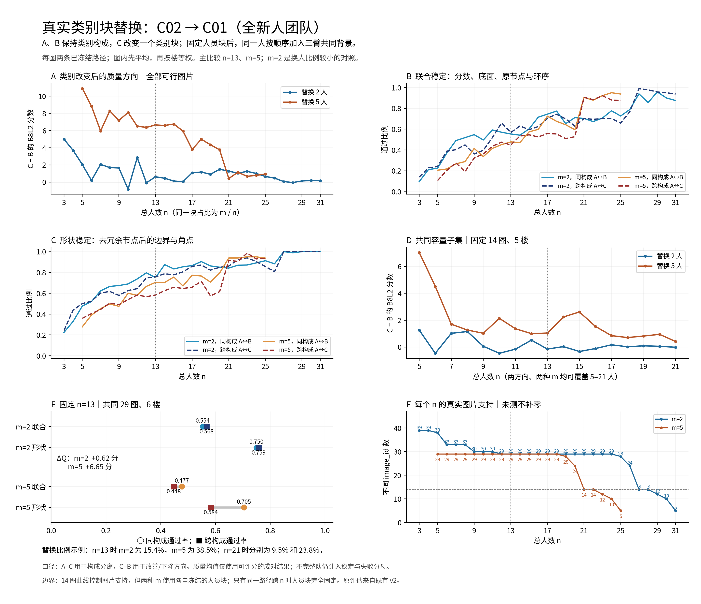

### 4.4 特定人员：W132 的同支持实算

在逐人事件剔除中，删去所有包含 W132 的 C02→C01、m5 事件后，只余 12 事件、10 图、5 楼，质量均差约 −0.078。这个现象不能直接解释成 W132 必不可少，因为它同时改变了保留下来的图片与背景。[E9]

因此冻结了一个机制诊断：仅在原 n13/m5 双向 116 事件内，若 W132 在 ABC 并集中，就穷举该池同类 C02、且不在整个并集中的所有替代者，在 W132 出现的所有位置一致替换，其他成员完全不动。85 原事件有容量，22 原事件没有 W132，9 原事件无替代容量；得到 235 个真实替代 ABC，加原基准共 739 队。[E9]

| 同支持机制比较 | 原事件／替代／图／楼 | 原 C−B Q | 替代后 C−B Q | 原／新形状分离 |
|---|---:|---:|---:|---:|
| C01→C02 | 42/160/26/6 | −5.965 | −6.120 | 28.24 / 24.79 个百分点 |
| C02→C01 | 43/75/26/6 | +6.528 | +6.393 | 12.08 / 4.17 个百分点 |

质量方向在同支持真实替代后保留，形状分离明显更依赖具体人。W132 只在 A 块的 17 原事件、33 个替代中，B/C 完全不变，净质量逐条精确不变；但 A/B 与 A/C 的相近关系会变化。这说明简单“删人后效应消失”混入了删样本影响，也说明类别不能取代具体成员风险。这是评估后机制检查，不是新的验证。

### 4.5 反向细类的方向与反例

另外六条反向细类方向全部按原冻结的 n13/m2 检查。下表的“主／形状分离”均为同构成相近率减跨构成相近率，正值意味着换类更容易改变结果，不代表质量改善。[R1]

| 方向与分类 | ABC／图／楼 | 有限净 Q 事件 | C−B Q | 主／新形状分离（百分点） |
|---|---:|---:|---:|---:|
| R03 普通几何七类 C02→C01 | 390/38/6 | 386 | −1.982 | +15.00 / +6.83 |
| R04 新批几何七类 C07→C06 | 108/18/5 | 108 | −1.869 | −2.78 / +8.06 |
| R05 新批几何七类 C04→C01 | 102/17/6 | 102 | −0.038 | +11.71 / +4.27 |
| R06 普通联合风险十类 C07→C01 | 342/30/6 | 339 | −4.540 | +16.71 / +11.82 |
| R07 困难新批几何七类 C03→C06 | 30/5/4 | 30 | −1.162 | +10.42 / +10.42 |
| R08 同一困难七类 C06→C03 | 24/4/3 | 24 | +6.478 | +33.33 / +27.78 |

R03、R06 的质量下降在来源人数一致子集中仍为 −2.324、−4.321；但这不等于已经排除历史 Q。六条固定方向中，只有 R04 有三块历史 Q-close3 支持：29 事件、16 图、5 楼，新形状分离 +23.33 个百分点，净 Q 为 −2.422。剔除换入 C 块含 W129 的 R04 事件后，仍有 55 事件、18 图、5 楼，形状分离却变为 −2.50 个百分点。这是成员依赖的反例，不能用全人数范围的控 Q 支持替代某个固定窗口。[R1]

R08 的固定格在 4 图、3 楼均有正质量均值，但未达到新图通用规则的覆盖。其其他人数／换人规模压力集合覆盖 5 图、4 楼，质量为 +10.816，形状分离却约为零；R05 的整体质量接近零，D10 为 +0.032，也不应按微小正负号排胜负。细类能提供有向的条件差异，高 K 的少量成员容量也直接限制可替换块和可用图片。全部固定格、压力格、失败与成员剔除结果保留在 `reverse/assessment_interpretation/directions/`。[R1]

## 5. 高 Q 内部细分：效率比质量等价更值得保留

F01 为 `F20_highQ23_T_qK2`。历史 23 名高 Q 人员按来源内、经任务调整的时间效应分为快 C01 12 人、慢 C02 11 人；新／旧人数分别为快 10/2、慢 5/6。它们的历史 Q 仍有差异，因此先看整体，再分别匹配来源与历史 Q。[F1]

固定 n13/m2、慢→快，覆盖 480 个 ABC、42 图、6 楼，替换块实际覆盖全部 23 名高 Q 人员；连同可含细类之外人员的固定背景，总参与人为 59。质量净差 **−0.029 分，D10 −0.111**；同类和跨类主相近率都为 **63.22%**，新形状为 76.49%／75.69%。同类和跨类从 A 出发下降超过 5 分分别约 **5.92%／5.93%**，因此均差接近零不是逐队等价证明。[F1]

436/480 个事件的 B、C 替换块来源时间可比，C/B 的层级几何均值比 **0.375**，来源块净差约 **−417 秒**。以这 436 个时间可比事件为分母，至少省 20%、B/C 均完整且 C 的质量不比 B 低超过 2 分的层级比例为 76.36%；再要求 B/C 旧去 Q 几何相近，为 68.77%。时间可比但缺分或不完整的事件保留为未满足联合成功；这些比例先在图内计算，再对建筑等权，不是简单的事件成功数除以 436。只给平均节时而不保留这些联合风险，会夸大实际选人价值。[F1]

| F01 固定 n13/m2 子集 | 事件／图／楼 | B8L2 C−B | 来源用时几何比 | 时间可比事件 |
|---|---:|---:|---:|---:|
| 整体已测 | 480/42/6 | −0.029 | 0.375 | 436 |
| 三块来源人数相同 | 332/38/6 | −0.141 | 0.347 | 309 |
| 再限制三块历史 Q 任意两两均值差≤3 | 97/35/6 | −0.745 | 0.380 | 89 |

在最后子集中，主相近率同类／跨类为 71.37%／70.00%，新形状为 85.43%／75.41%。控制后仍有时间差，也存在几何风险。逐人剔除时，整体时间比始终约 0.330–0.431；质量均差却跨越 −2.017 至 +0.878。**建议保留“高 Q 内优先考察快类”作为现有人员的效率启发式，同时继续做团队质量检查；不能称无损替换保证。** [F1]

这里的时间采用比较图片对应的冻结来源作答报告秒数；用于分类的时间特征才限定从历史十楼训练。它不是本轮重新采集的成本，也不是并行完成时长。新批缺逐份目标重做用时，`target_time` 保持 null。F1 的比值是先平均 log(C/B) 再取 exp，linked-condition 表则用 C/B 算术层级均值，二者不直接排序。

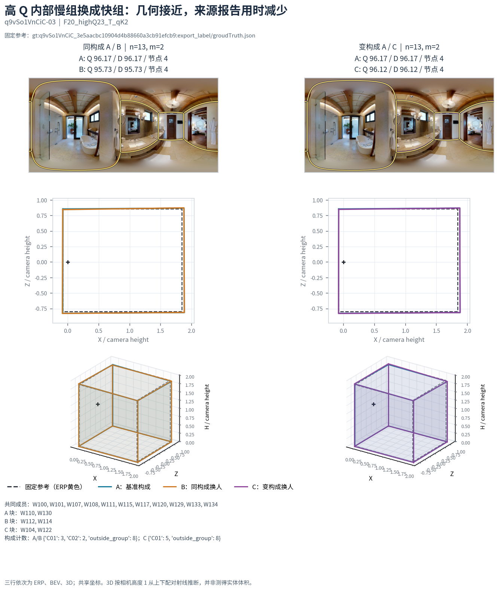

**图例 S06。** q9vSo1VnCiC-03，来源和三块历史 Q 接近，B→C 为 95.727→96.117，替换块报告时间 1387.264→445.642 秒，字面事件比 0.321。快类也存在 q9v-30 上 90.546→37.103 的巨降，精确事件与几何另保留在 F1 的案例小包。

其他正向细类没有被忽略：高 Q18 慢→快在 38 图／6 楼为 +0.236、时间比 0.366，但控 Q 子集仅 22 事件／10 图／5 楼、跨类入组仅 2 人，其中时间可比只有 14 事件／9 图／4 楼；高 Q 新批 T／编辑细类在 29 图／6 楼质量 +0.102、时间比 0.736，控 Q 后仍较快。高 Q23 多点→少点在 40 图／6 楼为 −1.163，但去 Q 几何分离仅 2.25 个百分点，不能把“多点”直接解释为必要结构修复。困难 T／适应／几何方向在发现曾 +7.547，评估固定格却 −0.965，压力设置 +4.482，应保留条件交互，降级普遍改善主张。[F1]

Q／T／几何四类的 C04→C02（F04）在 43 图／6 楼为 −2.105 分，反向 C02→C04（F05）在 41 图／6 楼为 +2.270；来源人数匹配后仍为 −2.250／+2.631。两方向的入组历史 Q 均值差约为 −14.65／+15.78 分，三块两两 Q-close3 均无支持。这保留整体分类的有向效用，但不能据此宣称已验证超出 Q 的独立作用。[F1]

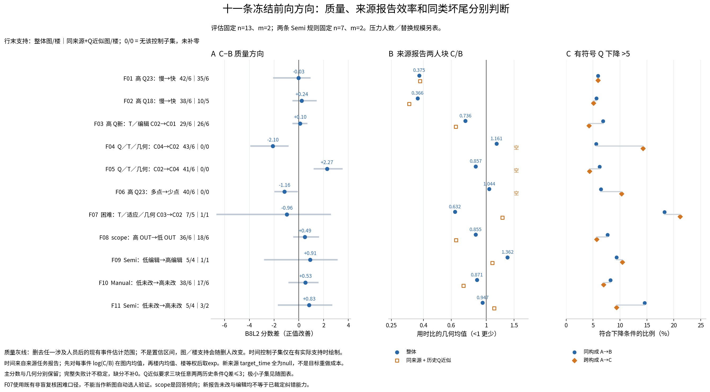

## 6. 类别、Q 与来源：同一批团队上的公平竞争

不同方法可用的人和图片不同，不能直接凭各自最好结果排名。共同面板在同一 26 名新批人员、同一已融合团队上重算标签构成：原 16 种 Full／逐变量组删除 K2/K3，同时有每 K 20 种保持容量的随机分型。后续八法竞争在读该比较结果前冻结了投影标签；其共同支持另行求交，不能把 16 法面板与 8 法面板的数值混成一个样本。[F2]

八法评估共同支持为 **3,675 个可比较 A–core 观测、220 个 core、30 图、6 楼、10,028 个不同池×团队**。一个观测是在固定 core／n／m 下，用同一 A 分别对有支持的同构成邻块 B 和跨构成邻块 C 取均值；八法必须在这个 A 上都同时有两边支持。相同具体团队可能在不同 core 分解中再次作为 A，因此 3,675 不是去重团队数、独立图片数或 ABC 事件数。关系七类投影到共同人群时可能只有六个非空类，并出现一人小类；容量损失明确保留，不能把这种投影说成新训练了同容量七类。[F2]

| 冻结方法 | 评估主相近率：同构成−跨构成（百分点） | 旧去 Q 几何差（百分点） |
|---|---:|---:|
| Q／T／几何四类 | +1.975 | +1.398 |
| Full 多变量两类 | +1.689 | −0.062 |
| 反向普通几何七类投影 | +1.467 | +1.699 |
| 反向新批几何两类 | +1.299 | +1.512 |
| 反向新批几何七类 | +1.207 | +2.461 |
| 仅 Q 两类 | +0.611 | +1.641 |
| 仅 Q 三类 | +0.496 | +1.649 |
| Full 多变量三类 | +0.044 | +0.305 |

在共同 8 法且 Q-close3 的 1,470 个 A–core 观测、30 图、6 楼中，反向新批七类的主分离 +4.990 个百分点，但去 Q 几何仅 +0.333；新批两类为 +2.022／+1.514，普通七类投影为 +2.990／+1.477。这里的 Q-close3 是每个邻块的历史 Q 均值距 A 块≤3，B、C 之间可能相差至 6；它比第 5 节三块任意两两≤3 的约束更宽。全体共同人员均为新批，因此来源比例已固定；这些结果说明在该支持上的条件信息，并不证明类别与所有 Q 信号无关，也没有一种模型全面胜出。Q-only 仍有竞争力。[F2]

原 16 法面板中，Full 三类评估主分离约 +0.880、去 Q 几何 +0.536 个百分点；相对 20 个随机同容量分型，主分离增量中位约 +0.863，19/20 为正，但去 Q 几何增量中位约 −0.502，只有 8/20 为正。去掉几何组在评估反而可更好，发现阶段却不是同方向。因此不能声称七组变量均提供稳定独立增量，也不能仅凭一次消融排名认定变量无用。[F2]

具体构成仍有方向：共同面板 Full 三类的 C02 两人块→C03 两人块，在评估 29 图／6 楼、669 个可比较 A–core 观测上，质量 +4.140、来源时间比约 0.771；C03→C01 则质量 −4.895、来源较快。这里的历史 Q 差仍强，适合解释构成效用与效率取舍，不等于超出 Q 的因果机制。反向学习的历史折内比较另显示，新批七类相对同 K、同折历史 Q 分箱有主／几何分离增量约 4.00／2.41 个百分点，但其目标块和成员压力结果也有反例。[E5、F2]

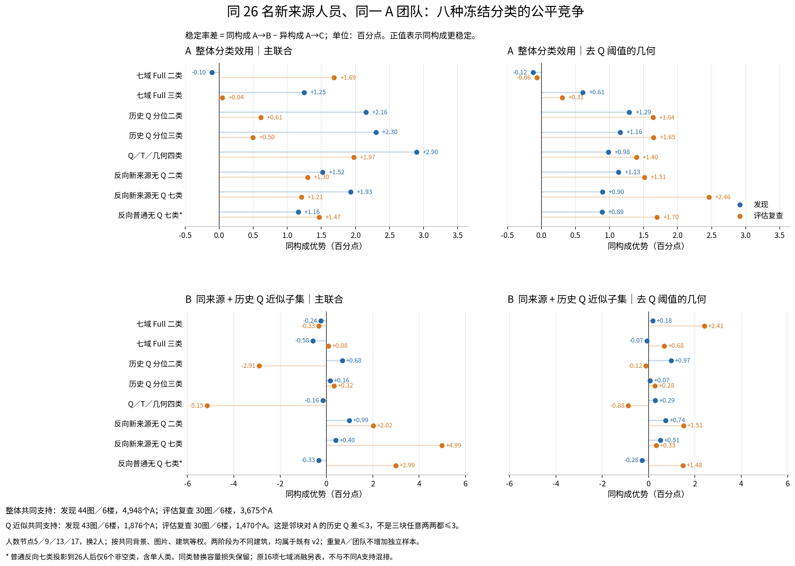

## 7. 整队与完整配比：有局部线索，没有普遍最优配方

### 7.1 整队更换比局部换人难得多

七路线混类挑战中，A/B 的被替换块至少含两类，C 改变完整类别计数，允许结果成为纯类或混类；纯类内部互换及更多等额／不等额比例另由基线和配比网格检验。混类挑战两阶段 16,294 原事件去掉一个精确重复后有 16,293 个独特 ABC。总共 48,472 个池×团队，96 真图、108 条件池、12 楼、59 人；去掉图片身份后为 47,735 套不同成员集合。发现后冻结的 470 个类内向量中 386 个在评估有同 n/m/全向量支持，84 个未被此次请求观察；402 个构成比较中 343 个被观察、59 个未被观察，不能将缺失直接当作数学无容量。35 个类内展示优先项中 24 个获评估支持、11 个保留缺失；16 个优先构成比较均被观察，未只留下赢家。[E7]

评估普通路线的整队主相近率多在 **15%–23%**，局部混类替换多在 **42%–56%**。这是各自已测分布的描述，n、图片和成员支持不完全相同，不能作为方法间公平因果排名；精确 n/m/向量表才是直接证据。较高平均质量也不能消除同构成整队的坏尾。

较好的有限线索是高 Q23 **快 5＋慢 2、n=7 整队更换**：发现 18 对、11 图、4 楼的同构成主相近率 65.42%，评估 20 对、12 图、5 楼为 72.50%；新形状为 76.67%→88.33%。改成快 4＋慢 3 的同 n/m 比较在发现 10 图／4 楼、评估 11 图／5 楼可做，主分离约 30→13.33 个百分点，但质量方向从 −1.658 翻成 +0.519，新形状分离评估仅 3.33 个百分点。它更像简单图、现有人员的稳定构成线索，而非比例的质量排序。[E7]

与它一起冻结保留的 **快 2＋慢 3、n=5 整队构成**给出明确反例：发现 17 对／13 图／4 楼，主相近 62.5%、新形状 68.8%；评估 13 对／9 图／5 楼，主相近降为 0%、新形状 18.3%。两种构成人数也不同，不能把此反差说成只改变快慢比例的因果作用。n=7 的简单图解释是在评估后对固定构成分层所得，不是又一条已验证的采集前难度规则。[E7]

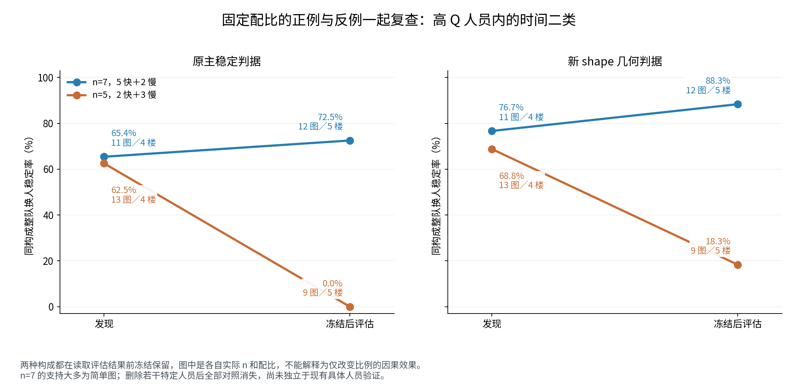

这条线索还有明确成员限制：发现删去八名指定人员中的任一人都会清空所有观察；评估删去七名中的任一人也会清空。人员常驻来自有限容量，不可据此验证任意同型新人。上述人员名单和每次剔除后的分母完整保留。[E7]

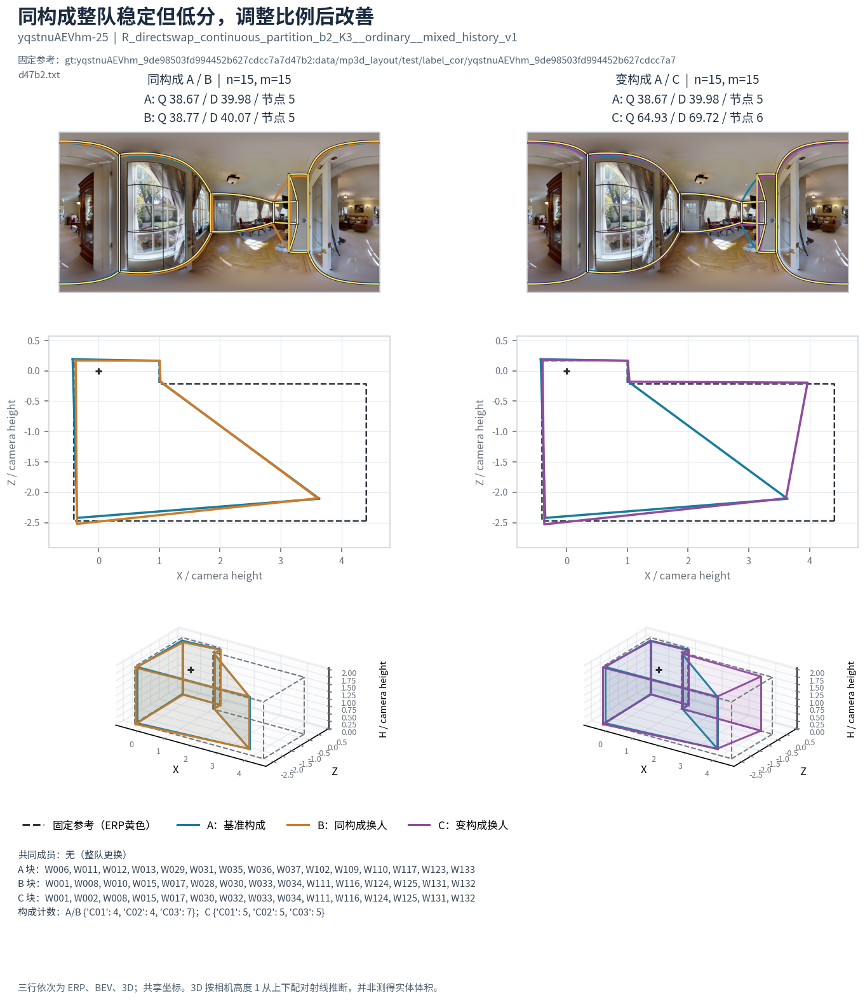

**图例 S08。** 反向连续风险三类，yqst-25，整队 n15。A/B 均为 4:4:7、无共同成员，质量 38.666/38.773，主和形状都近；C 为 5:5:5，质量 64.928。A→B、A→C 都实际换 15 人，B→C 实际只换 2 人并改变 2 个类别槽。这是稳定但低质量及局部比例改善，不是通用最优比，也不是 P05 的正向 Full 三类。

**图例 S09。** 同一反向连续风险三类，7y3s-21，整队 n15、4:10:1。A/B 质量 51.302/50.007，均 7 节点，但底面差约 0.277，所有相近口径失败。分数接近和相同节点数都不足以定义人员可互换。

### 7.2 五个漂亮比例：把赢家追到失败与有限总体

从发现网格中选出五个有醒目正例的固定比例，然后在所有支持图片上检查，包括其原先表现差的图片，并在原图抽最多 16 支不同具体团队。四个原赢家换成员后翻负；唯一继续正向的是 P05，正向 Full 三类 n5 的 1:3:1，在 jtcx-03 上从 +11.895 缩至 +3.875。[E8]

| 冻结比例 | 发现中最好看的图：原均值优势→同图新成员 | 全评估图的混类−最好纯类 | 评估图片／楼 |
|---|---:|---:|---:|
| P01 反向新批二类 n4，3:1 | +16.074→−8.862 | −2.674 | 39/6 |
| P02 同类法 n5，3:2 | +14.078→−16.060 | −3.841 | 33/6 |
| P03 高 Q 快慢 n3，2:1 | +13.294→−3.492 | −4.082 | 42/6 |
| P04 正向 Full 三类 n3，0:1:2 | +13.489→−5.242 | −3.744 | 33/6 |
| P05 正向 Full 三类 n5，1:3:1 | +11.895→+3.875 | −9.712 | 29/6 |

“最好纯类”是各图已测纯类均值的描述性对照；并未假设采集前知道它是谁。每个纯类对照分别保留。全部可用和各臂均完整两种口径方向一致为负，失败率另列。P01 有 39 图构成支持、38 图可算净质量，未把缺失者补零。[E8]

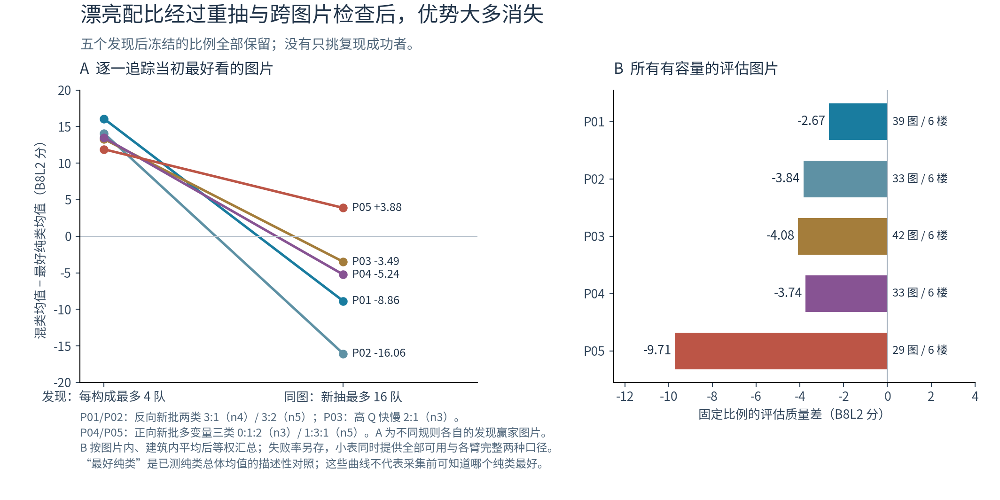

P05 在该图每类恰有 8 人，有限总体可完整计算，因此继续穷举：混类 3,584 队，三种纯类各 56 队，共 **3,752 队，全部完整**。混类 Q 均值 81.220；纯 C01/C02/C03 分别 64.056/80.770/80.816。对最好纯类的优势仅 **+0.404 分**。混类最低 50.644，低于纯 C02 的 52.875、纯 C03 的 57.568；也没有获得更强类内可互换性。[E8]

每队均为 4 节点，旧 9° 参考节点／邻接匹配诊断均为 100%；这不是新真实转角诊断也达到 100%。按 0.05√参考面积的位置容差，混类真实转角召回均值仅 0.639，低于纯 C02 的 0.661 和纯 C03 的 0.705。该图主要表现为范围偏差的平衡，而不是缺失节点被混类恢复。中位数融合下，纯 C01 的远墙平均内缩、纯 C03 平均外扩，混类平均远墙位置更接近参考，但逐队位置和倾斜仍有明显波动；不能说算术平均抵消误差。混类 6,420,736 个可能队对中固定抽 2,000 对，新形状相近率仅 7.95%，与团队穷举本身的确定均值是不同支持口径。[E8]

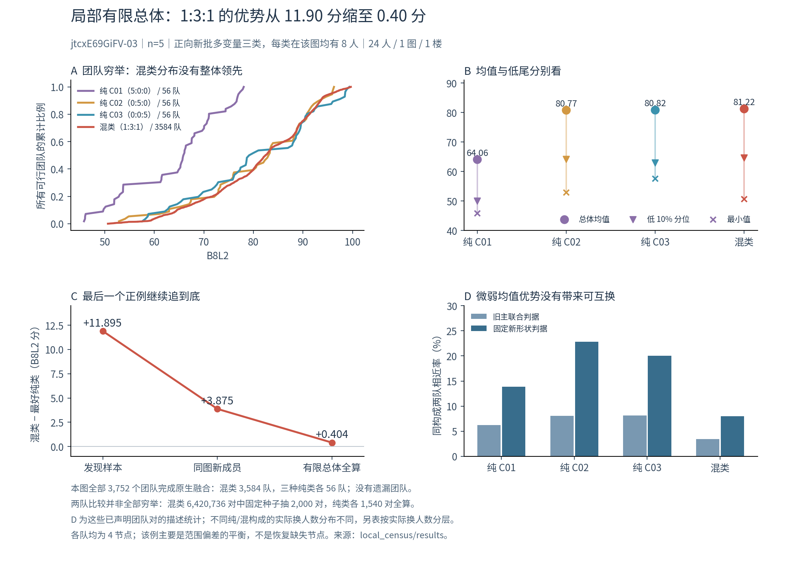

这一结果保留了一个可解释但很弱的局部互补现象，也限制了它的实用意义。没有因为不够普遍而提前停止，也没有把起初 +11.90 分的截图当作最终结论。

## 8. Semi、错误未改和 scope 的实际实验

新旧来源、机会数和证据性质分别处理。正常未修改不等于盲信；新报告初始错误后的未改不等于旧人工确认错误未改；编辑不必然是纠正。缺逐份初始几何的新批不能估净改善。scope 回答 OUT 倾向是标注范围偏好，既不等于 OOS 裁定准确率，也不等于识别隐藏扩展的能力。[E4、F1]

固定方向实验中，Semi 低编辑→高编辑在 5 图／4 楼、n7/m2 为 +0.909，来源用时比 1.362，去 Q 几何同类优势 11.46 个百分点；逐人剔除质量范围 −2.760 到 +3.062，不能声称稳定净纠错收益。新报告低未改→高未改在 Semi 的发现方向 −3.583，评估却 +0.827，负面质量假设未复现。Manual 同类方向为 +0.533，同类几何分离未形成可重复优势。[F1]

scope 高 OUT→低 OUT 在普通 Manual 固定方向中有 432 事件／36 图／6 楼，质量 +0.487、来源用时几何比 0.855；全部替换块来自新批。进一步要求三块历史 Q 两两接近，仅余 24 事件／18 图／6 楼，质量 −0.678、时间比 0.644，几何判据也没有一致的同类优势。来源控制和 Q 近似不能把回答倾向变成能力排序。[F1]

进一步冻结同图、同班、同 core、同 n/m、同参考的 Manual/Semi 直接配对。评估 n≥3、m≥2 有 330 对、5 图、4 楼、35 人，不是随机分配任务模式。以下都用同一精确成员比较，而不是把两个模式的不同人员均分相减。表中“新编辑”采用 `F20_new_NewEdit_qK2` 的既定全域人员标签，与上文 F09 的 Semi 条件标签分开追溯。[E6]

| 同班条件比较 | 配对／图／楼 | Manual C−B | Semi C−B | 可保留的解释 |
|---|---:|---:|---:|---|
| 新编辑低→高 | 45/5/4 | −1.173 | +4.878 | 条件差异存在，不能推成一般纠错能力 |
| 高 Q23 慢→快 | 25/3/2 | +0.903 | −0.202 | 效率标签的质量方向受任务模式影响 |
| 新报告未改低→高 | 45/5/4 | +0.093 | −0.112 | 未改没有统一的质量含义 |
| scope 高 OUT→低 OUT | 44/5/4 | −3.875 | −1.824 | 总体之外的成员／图片反例，不能按 OUT 倾向排能力 |

编辑比较中，Semi 的同构成旧主相近率比 Manual 高（68.06% 对 56.94%），但去 Q 几何相近率更低（75.00% 对 87.50%），B 队平均 Q 也更低（83.10 对 92.39）。稳定、形状和质量可向不同方向变化。[E6]

本轮还完整读取了用户提供的 scope 讨论文件。它被作为尚待检验的提案，用于区分表示范围、封闭／扩展政策、可观测性和参考充分性；没有将隐藏扩展自动裁定为 OOS，也没有据此改 GT 或资格。门洞、特殊条件覆盖不足的地方保持边界，不把普通 Manual 规律直接迁移过去。

## 9. 为什么人数可能触发突变，哪些案例应人工看

原 G/R 线索经更密集人数和背景复查仍有条件价值。新的已知锚设置中，G n17/m8 在评估 23 图／5 楼，主相近同类／跨类为 **59.23%／42.02%**；R n13/m2 在 29 图／6 楼为 **70.08%／55.91%**。它们不是前轮已知的 60.32%／44.37%、80.48%／49.84% 的同一批新样本。整个密集 n/m 评估层面，G 为 54.17%／49.48%、R 为 75.74%／62.19%；效应受 n、m 和背景比例影响，不能只保留最好的锚点。[E2]

在 yqst-07 的固定块路径上，n12→13 加入 W132 后，B 队 8 节点变 4 节点，Q **69.675→90.275**。旧观测共簇关系未变，四个组仍各获 6 票，但最低支持门槛由 6 升到 7，因而失选；bottom p95 变化约 6.36°、top 约 10.57°，按最终上下边界推断的总墙高均值由 1.933 降至 1.878（相机高度单位）。另在 yqst-29，n6→7 加入 W114，原支持为 3 的组遇到门槛 3→4，节点 14→13，Q 下降约 **35.67 分**。相同门槛机制可以改善也可以恶化，不存在本轮已证明的“人数越多必然更好”或“奇数人数危险”规则。[E2]

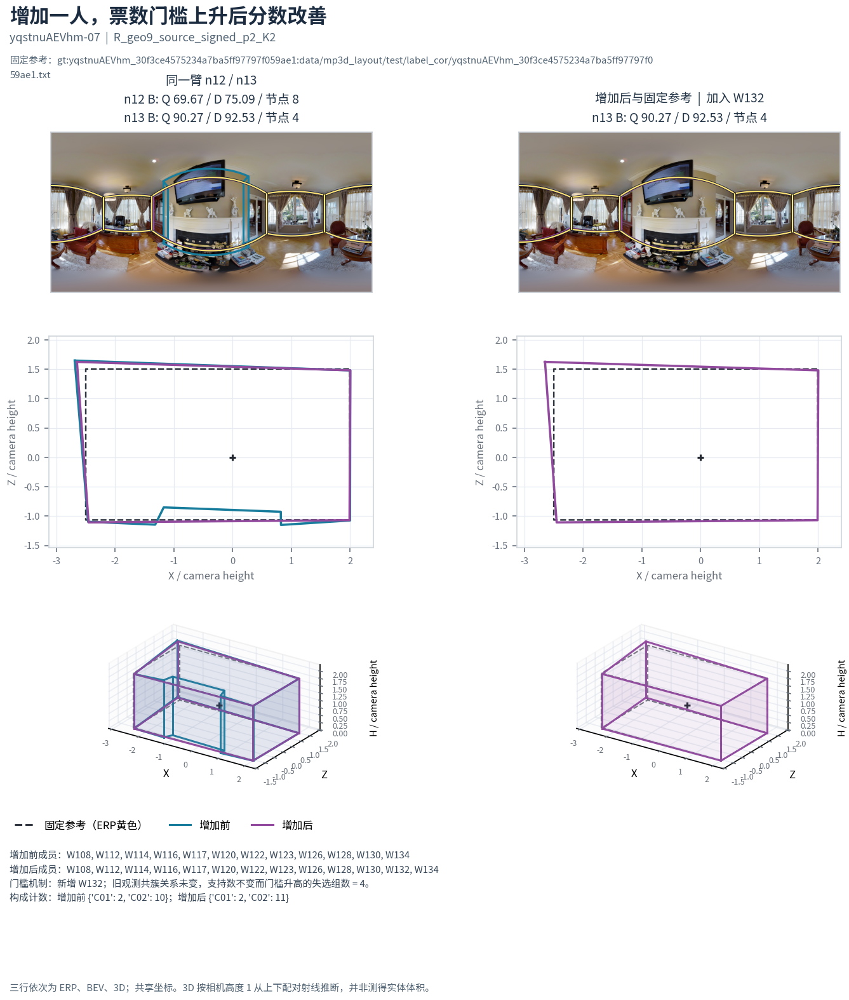

这里增加人数也增加了一名具体共同成员，改变 core 的类别计数；机制复放额外检查旧观测共簇、支持数及门槛，以定位这两个特定案例。它们仍不是隔离所有因素的纯人数因果试验。另有门槛不变而结果显著改变的步骤，完整台账保留。[E2、R1]

节点数也不能等同于结构：yqst-01，A 6 节点、B 5 节点，旧相同节点要求判失败，新形状判据通过；两队却都漏掉参考壁炉内凹。在发现阶段 n≥3 的 185,474 个独特几何队对中，405 对原节点数不同却通过新形状判据，涉及 13 图、4 楼。通过新形状但平均高度棱柱代理 IoU<0.95 的有 2,062 对、53 图、6 楼；因此即使边界判近，也必须看上下 y 和三维代理的剩余变化。[E2]

对 B8L2/D10 的 277,882 个独特队对，274,804 对有双评分；其中 11 对出现两口径相反、且两边幅度均至少 2 分的方向，涉及 5 图、3 楼。主要 Rnew2/F01/QTG 结论的方向在 D10 中保留，但并非所有个案都一致。没有改变主评分来选择漂亮方向。[E2、R1、F1]

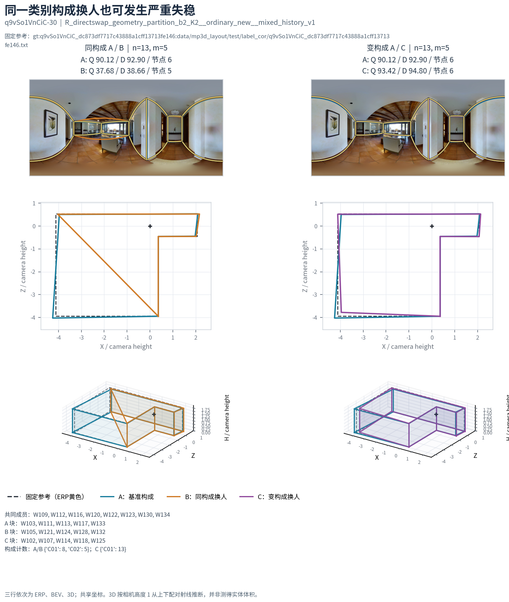

**图例 S10。** q9vSo1VnCiC-30，n13/m5，A/B 都是 8C01＋5C02、共用同一 8 人核心，质量却从 90.123 变为 37.683；节点 6→5、底面差约 0.477，主与新形状均不相近。C 为 13C01＋0C02，6 节点、质量 93.417。它和 S07 属于同一个完整构成变化 NV10：同一配比中既可看到换类后的质量改善，也可看到同类成员替换的巨大坏尾。应人工确认被斜连接截去的范围和参考转折，而不是只比较总分。[R1]

### 9.1 优先人工看图顺序

| 案例 | 该确认什么 | 精确事件／成员所在文件 |
|---|---|---|
| S07 Uw-22 | 参考内凹是否确应恢复；同类形状近而换类改善 | `cases/S07_reverse_new2.json` |
| S10 q9v-30 | 同一 8C01＋5C02 构成为何出现严重范围偏移 | `cases/S10_reverse_counterexample.json` |
| S06 q9v-03 | 来源效率更快且几何近的具体可用案例 | `cases/S06_efficiency.json` |
| S03/S04 yqst-07／29 | 固定票数因门槛上升失选，何时改善／恶化 | `cases/S03_threshold_improves.json`、`cases/S04_threshold_worsens.json` |
| S08/S09 yqst-25／7y3s-21 | 稳定但错、近分异形，是否与视觉判断一致 | `cases/S08_stable_low_quality.json`、`cases/S09_same_composition_different_shape.json` |
| S02 yqst-29 | 两组背景中质量均升，但范围遗漏也增大 | `cases/S02_quality_gain.json`，保留两组精确团队 |
| S05 yqst-01 | 冗余点与语义必要转角的区别 | `cases/S05_redundant_nodes.json` |
| S01 jtcx-26 | 整队纯类替换的明显结构塌缩 | `cases/S01_pure_class.json` |

S02 的两组背景中 B→C 分别提高约 8.90、10.06 分，但第一组遗漏面积比例从约 0.061 增至 0.134，不能简单说所有结构都更好；两组 core 完整类别比例也不同，是方向的多背景案例而非完全相同配比的重复。所有图共用冻结参考、共享坐标；成员叠图未按当前图 Q 删除任何人。原图从既有 Release 按字节范围读取，记录条目、CRC、计算 SHA；索引未给 SHA 的条目没有假称通过独立索引 SHA 校验。

## 10. 面向选人与预测的规则

**目前最接近实际选人用途的是高 Q 内的来源效率分层。** 在现有可用人员、相近来源和足够历史支持下，快类可作为候选优先级；需要同时保留同类坏尾、团队完整率以及 Q 和结构复核，不能把历史快类当成此次必快、必好。

**反向 Rnew2 可用作有条件的构成效应描述。** 在已测新批、同类背景与人数范围中，较大 C02 块换为 C01 通常提高质量并改变结构；小规模 m2 效应小得多。它可以生成“这个构成更值得实算”的候选，但当前没有经过新人员外部预测验证。人数／比例变化下不应只预测相近概率，仍应保留实际融合的方向与失败。

**用完整计数向量和支持边界记录规则。** 比如 S07 的 8:5→13:0、S08 的 4:4:7→5:5:5 与高 Q 5:2 是三个不同方法、不同人数、不同条件的构成。不能把它们缩成“混类有用”，也不能从 P05 的弱局部范围平衡推出最佳混合比。

**暂不采用的强结论：** 同类任意人员普遍可互换；scope 高 OUT 即低能力；未改即盲信；更多编辑必有净纠错；多变量必优于 Q-only；固定 8/12/16/24 人节点或某一奇偶人数普遍最优；增人必改善；某个漂亮单图配比可直接推广。这些候选都有实际失败、反转、容量不足或没有相应证据，已在表内保留。

下一次独立验收可直接使用本包冻结标签、请求和判据，优先复核 Rnew2 的完整构成分层、F01 来源匹配效率、S07/S10 与门槛案例。真正的新人员或新建筑研究应另登记，不能把本包再次重放称新盲测。人工作答相近判断尚未回收；本轮没有伪造人工确认，视觉对照用于集中判断上述少量机制。

## 11. 复现、交付内容与证据索引

本包保留主报告、关键代码与依赖、冻结标签／候选台账、精确评估请求、核心小表、选定最终几何和 Release 原图条目。完整原图、冻结库存全集、全 native 池缓存、距离矩阵、逐折模型、环境和大量日志均不装包；从固定 GitHub 档案恢复，或按明确生成器、种子与请求重建。

核心数字的重建链为：冻结历史输入→人员标签→精确成员请求→原生融合与固定评分→配对几何与小表。案例另内嵌所需成员的最终处理输入和原参考，可以在不读取完整输入快照、也不读取旧结果缓存的情况下原生重放。较大研究面板依赖恢复后的冻结快照，但不用任何原结果缓存。

**交付目录已原生重放 17,726 个核心任务，覆盖 46 图、7 楼、59 人；每队 32 项最终字段及几何指纹一致，最大数值差为 0。** 同时重算了 1,819 个核心配对事件的几何判据与汇总。18 个设计流全部核验一致，其中 16 个重新生成、2 个精确保留的小请求逐项核验；完整正向画像 60×328 字段和 188 个候选、11,280 行标签也已从冻结记录重新计算一致。根目录 `verification/FINAL_VERIFICATION.json` 区分这些实跑、代表案例重放和已有结果的只读审查。核心面板固定为 17,726 个去重任务：F01/F04/F05，Rnew2 n13 四格，G/R 锚新抽样，高 Q n7 整队，五比例全部评估、P05 全团队、W132 同支持检查。不会把这次核心复放再加成新的研究样本。`EXPECTED_FINAL_FIELDS` 只保存必要最终数值与几何指纹，并非每队全流程状态。[E10]

### 证据索引

下列路径均相对包内 `interchangeability_20261020/`；代码与原始评分链另在同级 `analysis/`。完整成员请求比报告中的四舍五入数字优先。

| 编号 | 内容与主要路径 |
|---|---|
| E0 | 来源与注册：`INITIAL_SOURCE_READ.json`、`PRIOR_PACKAGE_SOURCE_PARITY.json`、`REGISTRATION.json`、`ELIGIBILITY_NOTE.json` |
| E1 | 真实覆盖：`independent/global_coverage/GLOBAL_COVERAGE_AUDIT.json`、`independent/global_coverage/QUALIFIED_SUPPORT.csv`，同目录逐批／逐图／逐人／未请求池小表 |
| E2 | 原 G/R、判据与独立审查：`independent/METRIC_CONTRACT.json`、`independent/baseline/results/`、`independent/discovery_metric_audit/` |
| E3 | 设计：`discovery/*SPEC.json`、`assessment/ASSESSMENT_FREEZE.json`、`assessment/*SPEC.json` 与精确请求 |
| E4 | 正向历史：`forward/candidate_ledger.csv`、`forward/FEATURE_AUDIT.json`、`forward/features_train.csv.gz`、`forward/worker_labels.csv.gz`、`forward/SHORTLIST_CLASSES_ZH.csv` |
| E5 | 反向历史：`reverse/review_tables/`、`reverse/legacy_fit/` 与 `reverse/mixed_fit/` 的候选台账、冻结标签和规则；`reverse/REVERSE_REPRODUCTION_ZH.md` |
| R1 | 新反向评估：`reverse/assessment_interpretation/nested_new2/` 与 `reverse/assessment_interpretation/FINAL_REVERSE_ASSESSMENT_SMALL.csv` |
| F1 | 正向评估：`forward/assessment_interpretation/F11_all_directions_compact.csv.gz`、逐楼／逐人剔除与精确案例 |
| F2 | 公平竞争：`forward/common_panel/compact_two_phase_evidence/`、`forward/common_panel/competitors/`、`forward/final_figures/*plot_data.csv.gz` |
| E6 | 同班 Manual/Semi：`condition_transfer/assessment_effects/` 与两阶段精确请求 |
| E7 | 完整混类：`independent/mixed_challenge/both_effects/`，全部冻结 470／402 单元、成员容量与失败 |
| E8 | 配比：`ratio_grid/confirmation_results/`、`ratio_grid/local_census/results/`、`independent/p05_local/` |
| E9 | 特定人员：`reverse/assessment_interpretation/w132_probe/` 与 `assessment/w132_probe_requests.json.gz` |
| E10 | 复现：`reproduction/`、`core_replay/`，根目录 `README_ZH.md`、`requirements.txt`、`verification/` |

