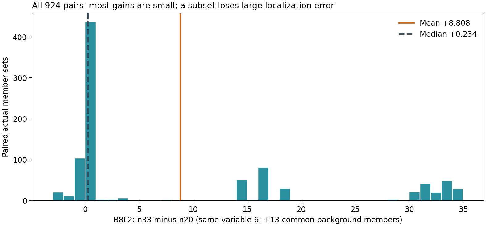

# 本轮新混合构成案例：相同可变成员，背景增加后定位波动收缩

**本例支持“背景能改变类别构成及具体成员差异的传递强度”。** 在 `7y3sRwLe3Va-13` 的有限人员面板中，保持同一组可变 6 人，将共同背景从 14 人扩大到 27 人，团队由 n20 变为 n33。924 个精确配对中 787 个 Q 提高、137 个下降；全部两端均输出四个真实转折、均可评分。类别／成员波动缩小主要体现为定位和自身方向残差的变化，没有新增必要转折的事件。

这是 **1 图／1 楼的一条嵌套背景路径**，不是 924 张图；人数与 13 名具体背景成员同时改变，不将其叫作纯人数因果，也不将它冒充固定 n 的 ABC 替换。

## 完整分布，包含小变化和负向

四个结构细类按该楼外折定义。每个 n 的完整可行配比有 **12 格**，各格下成员集合合计为 `C(12,6)=924`，此有限可变池全部枚举。

| 团队人数 | 完整配比格数 | 924 队的最小／最大 Q | 各配比平均 Q 范围 | 12 格内成员标准差的均值 |
|---|---:|---:|---:|---:|
| 12 | 12 | 56.089／98.058 | 63.743–96.749 | 15.124 |
| 20 | 12 | 60.787／97.697 | 76.231–96.804 | 11.805 |
| 33 | 12 | 90.256／98.142 | 95.882–96.977 | 1.115 |

完整 36 格和各指标分布在 [CASE_7y13_ALL_STRUCTURE_CONFIGURATIONS.csv](../../configurations/CASE_7y13_ALL_STRUCTURE_CONFIGURATIONS.csv)。本例重点解释已有 n20→33 的完整 924 配对，而非只展示最好一格。

| n33−n20 的 Q 变化 | 配对数 | 组内平均 | 组内中位 |
|---|---:|---:|---:|
| 下降 | 137 | −0.973 | −0.770 |
| 提高 0–5 分 | 452 | +0.291 | +0.172 |
| 提高超过 5 分 | 335 | +24.299 | +18.467 |
| 全部 | 924 | +8.808 | +0.234 |

**541/924 对绝对变化不超过 1 分。** 平均提高 8.808 主要由 335 个较大改善组成，不能说典型每队都提高约 8.8。下降端最差 −2.664，无下降超过 5 分者。两端没有融合失败。图中保留所有 924 对。

## 三个中位代表：位置改善、近零变化、分项取舍

为解释分布，从 `Q增益>5`、`|Q变化|≤1`、`Q下降` 三个事后效果层中分别取距离该层中位数最近的实际配对，团队键打破并列。后两层有重叠，因此它们是案例选取层，不是上述互斥计数分组；三个实际代表不同。不是选择最大收益。

| 代表 | Q：n20→n33 | D10：n20→n33 | 底面IoU | 方向正交残差（°） | 底点项（°） |
|---|---:|---:|---:|---:|---:|
| 较大改善组中位 | 78.200→96.666 | 83.483→96.810 | .9384→.9723 | 3.731→.746 | .3059→.2364 |
| 近零组中位 | 96.658→96.787 | 96.676→96.874 | .9704→.9727 | .442→.650 | .2402→.2314 |
| 下降组中位 | 96.834→96.064 | 96.983→96.724 | .9740→.9761 | .741→1.130 | .2118→.1999 |

第一对中，远墙一角在 BEV 的 x 从 −5.730 移至 −5.514（相机高度归一），另一角从 −5.480 到 −5.467；该短墙因此较少倾斜。ERP 对应位置变化不大，经过底点射线转换后形成可见的远端形状差异。两端节点支持为 **18/18/20/20** 与 **31/31/33/33**，最低门槛为10与17；各角在两端均已足票。因此这一对的改善归于**位置与几何规整性**，并非增加角点或使一个必要角第一次过票。

第二对本来已经接近参考，面积与底点轻微改善，同时方向残差增加，最终只提高0.129。第三对底面IoU和底点项也改善，但方向残差增加更大，总分下降0.770；D10下降0.260。**“位置某一方面更好”“形状总体更稳定”“Q更高”可以不同时成立。** 方向项是作答自身最佳正交轴的残差，不是与GT逐墙角度误差。

左列是 Release 原图的远墙局部，以1024×512坐标定位；橙色 n20、青色 n33，黄色虚线为固定参考。中列为完整底面，右列同坐标尺度放大远墙。这里只绘制保存端点，未重排环序或修正几何。

## 精确人员与类别

三对共享的背景路径为：

- 不变的14人背景：`W002|W013|W021|W029|W036|W106|W111|W112|W118|W119|W120|W130|W132|W133`。
- 新增13人背景：`W001|W006|W011|W012|W014|W015|W018|W102|W104|W107|W115|W116|W123`。
- 较大改善代表的固定可变6人：`W008|W017|W033|W105|W117|W127`。
- 近零代表的固定可变6人：`W008|W010|W017|W033|W109|W127`。
- 下降代表的固定可变6人：`W030|W033|W105|W109|W117|W134`。

全部精确成员在 `EXACT_MEMBERS.csv`，目标建筑外结构／联合标签和历史中心字段在 `FOLD_LABELS_AND_HISTORY.csv`。案例所需 **37 份实际原答**及既有资格、时间来源、有效处理坐标已独立保存为 `RAW_MEMBER_GEOMETRY.json`。

面板 ID 中的 `__v1__` 是 `variable_panel_no=1`，**不是底层数据 v1，也不是全员旧来源**；`source_domain=all_formal`，团队包括新旧两来源。底层数据始终 v2。

本路径多数团队的完整源时间缺失，因此不报告新增效率收益，既有时间字段不补零。原答保留现行处理点，未声称原始导出坐标全都可得；新批 Semi 没有精确初始化时，不从终稿推断编辑轨迹。

## 保存与复现

- `SELECTED_PAIRS.csv`：三对团队键、固定可变集合、全部变化和案例选择条件。
- `ENDPOINT_GEOMETRY.csv`、`ENDPOINT_SCALARS.csv`：六个真实缓存端点，能脱离大缓存重画和解释。
- `COMPONENT_CHANGES.csv`、`STORED_CORNER_COORDINATES.csv`：质量分项和原有环序下各角的坐标变化。
- `ALL_924_EFFECT_STRATA.csv`：完整互斥效果分组；完整配对引用相邻 `configurations/CASE_7y13_BACKGROUND_ADDITION_PAIRS.csv.gz`。
- `REFERENCE.json`：完全相同的 `gt_original` 参考，不新增语义裁定。
- `RECEIPT.json`：来源、规模和哈希；新增融合0、重新评分0。

运行 `python research/workers/personnel_mixture_comparison_20261022/difficulty/render_7y13_background.py --cache <已恢复的v3有限面板composition/batches/batch_001>`。图以 BytesIO 完整字节、原子替换保存，并经 PNG 全解码和复读确认。几何／小原答已保存在本目录，后续研究不必恢复全量端点才能读取本例。
