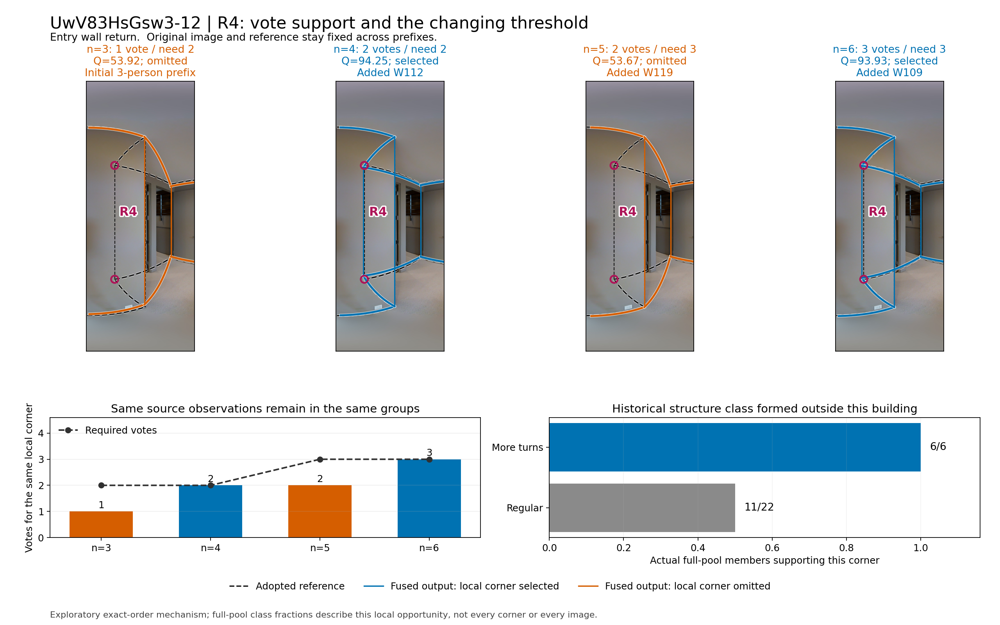
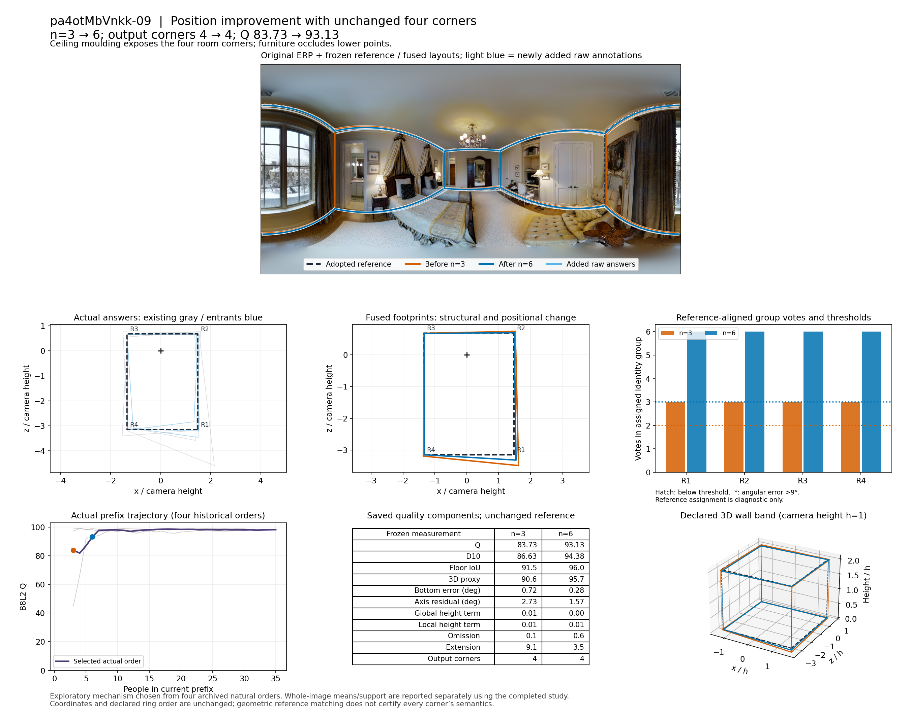
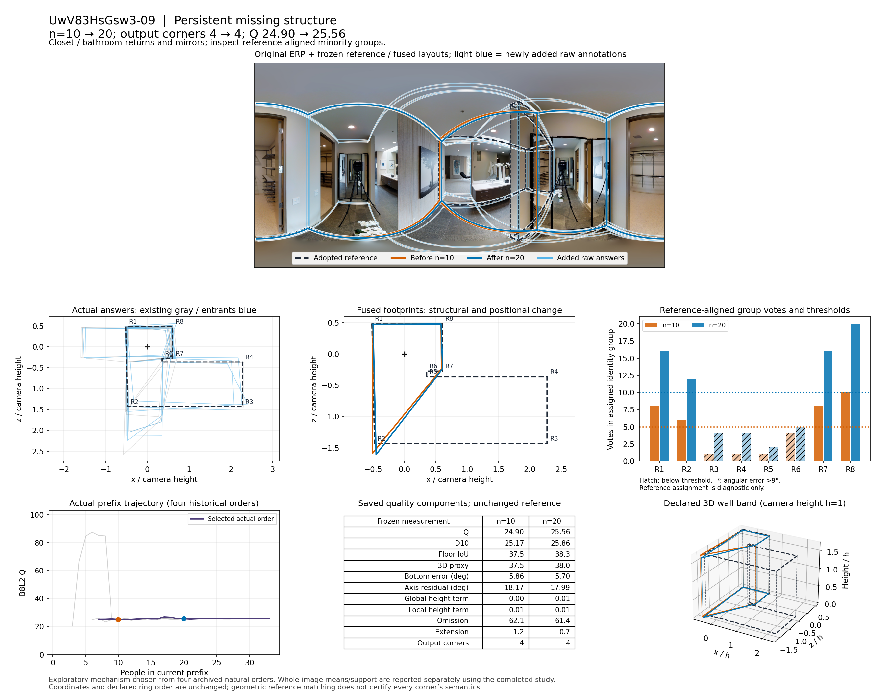
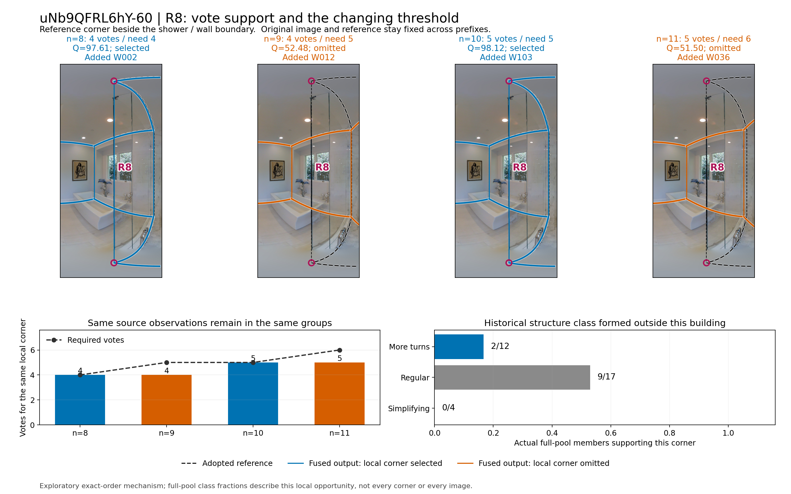
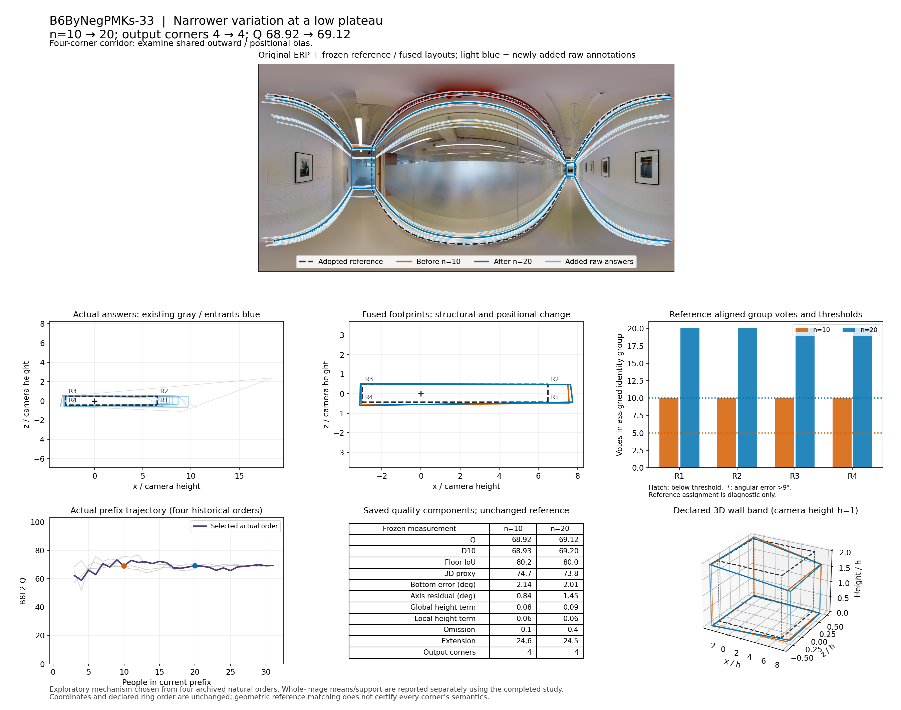

# 人数曲线的五个真实机制案例

实际读取主线提交：`72a44e80c344975962e1071bd54d894dd86bb4b4`。底层数据为真人 **v2**。本目录只解释人员进入过程的具体机制，不重新发现分类，也不把五个案例作为总体趋势的分母。

五案均为 Manual、非门洞。它们从原有每池四条自然随机顺序中探索选出；整图平均曲线、低尾、失败及优先进入政策的支持，采用本轮主统计的完整顺序集合另报。这里保留选例时的四条历史路径用于核对，不将其称为新独立验证。

**完整顺序背景已经补齐：**[五案24条自然顺序与各政策8条配对顺序](final_context/CASE_CURVE_BACKGROUND.md)。该目录保存 280 条精确路径、8,960 条前缀、7,154 个不同端点及 5,120 条政策配对事件的完整切片，沿用最终 404,082 行前缀表，没有重新融合或评分。自然曲线标准差与主表统一为 ddof=1。旧机制路径保留原身份；新背景不把旧选例当总体均值。

新增背景中，Uw-12 较多转折优先 n3 / n6 的配对 Q 为 +21.26 / +4.41；uNb-60 同一角色在 n10 为 −15.57，而常规结构类优先为 +27.20。这分别联系下文 6/6 对 11/22、2/12 对 9/17 的局部支持。B6-33 自然24条 n10→20 均值为66.67→68.41、样本标准差4.021→1.483；其低平台缩波成立，但不能沿用旧四条均值略降作为本轮主均值。Uw-09 的自然24条 n6 出现11/24不可评分，完整失败背景也已补入。

## 直接采用的认识

1. **人数增加既能补足关键一票，也能提高门槛而暂时丢失同一个转折。** Uw-12 入口回折在 n=3、4、5、6 上依次失选、入选、失选、入选；旧观察没有重新分组。uNb-60 的玻璃淋浴邻接参考折点也呈现相同的门槛机制，方向却是先高分后下降。
2. **结构类确实能识别一些局部补充人群，但“通常较多转折”不等于保留每一种转折。** Uw-12 的关键回折得到较多转折类 6/6 人、常规类 11/22 人支持；uNb-60 的关键折点得到较多转折类 2/12 人、常规类 9/17 人、简化类 0/4 人支持。这是同一套楼外类别在两个真实结构机会上的正反对照。
3. **没有结构增减，人数也能通过定位改善质量。** pa4-09 从三人到六人始终四角，Q 从 83.73 到 93.13；底边误差、方向残差和底面范围同时改善。
4. **波动缩小可以停在有共同偏差的平台。** B6-33 的所有 31 人都进入同样四个对应组，仍有外扩和高度差；全员 Q 69.29。Uw-09 则是另一种低平台：参考转折在人员池中有表达，但支持不足以通过硬多数，融合持续漏失大块参考范围。

这些发现连接了类别、实际局部标法、对应、投票、连接和质量分项，而不把“更多角点”直接等同于正确。

## 五案定位

| 图片 | 当前难度与结构机会 | 本案精确路径区间 | Q | 主要用途 |
|---|---|---|---|---|
| UwV83HsGsw3-12 | 中等；入口墙垛回折，参考六角，H=1 | n3→6，另展开 n3/4/5/6 | 53.92→93.93 | 必要回折补票、门槛反复和结构类的局部补充 |
| pa4otMbVnkk-09 | 简单；四处上角可辨，下角受床椅遮挡 | n3→6 | 83.73→93.13 | 同角点数下定位改善 |
| UwV83HsGsw3-09 | 困难；中央窄墙、背向转折、镜面，参考八角，H=2 | n10→20；补充全池 n33 | 24.90→25.56；全池25.82 | 结构少数持续失选、投影环跨越缺点 |
| uNb9QFRL6hY-60 | 困难；玻璃淋浴侧及门边范围解释，参考十角，H=1 | n10→20，重点 n8/9/10/11 | 98.12→48.20；n10→11为98.12→51.50 | 门槛提高、局部缺票、类别用途的反例 |
| B6ByNegPMKs-33 | 简单；长玻璃走廊，参考四角，H=0 | n10→20；补充全池 n31 | 68.92→69.12；全池69.29 | 一致四角但共同外扩与高度偏差 |

难度、范围和参考语义直接沿用主线 `IMAGE_DIFFICULTY_OPPORTUNITIES.csv` 的对应五行，另存为 [CASE_DIFFICULTY_SCOPE.csv](CASE_DIFFICULTY_SCOPE.csv)。它们不是本案按结果重新定的难度。

## 1. Uw-12：入口回折的第二票、第三票

原图左侧入口存在局部墙垛回折；主线既有语义记录将其解释为需要补足的背向小转折。这里把参考顺序中的这个角标作 **R4**。镜面中的房间不扩为新的目标范围。

| 前缀人数 | 新进入者 | R4 支持人员 | 票数／门槛 | 结果角数 | Q |
|---:|---|---|---:|---:|---:|
| 3 | 此时队伍 W104、W105、W129 | W104 | 1/2 | 5 | 53.92 |
| 4 | W112 | W104、W112 | 2/2 | 6 | 94.25 |
| 5 | W119 | W104、W112 | 2/3 | 5 | 53.67 |
| 6 | W109 | W104、W109、W112 | 3/3 | 6 | 93.93 |

W112、W109 是本建筑之外历史形成的较多转折类成员。W119 属常规类，此图没有给 R4 票。n4→5 时旧票和 R4 中心均保持，但硬多数门槛从 2 提高到 3；n5→6 时门槛保持 3，W109 补入第三票。相邻步骤的旧观察组内／组间关系没有变化，所以这里不是“增加人员后旧观察被重新分类”造成的跳动。

失选时，输出把 R3 接到 R5，局部直角回折变成斜跨线；入选时恢复 R3–R4–R5。n5 的 R3–R5 边有 2 个原始直接支持、4 个投影环支持；n6 两段恢复边各有 3 个直接支持。具体边票见 [CASE_EDGES.csv](UwV83HsGsw3-12/CASE_EDGES.csv)。

n5→6 的底面 IoU 为 92.21%→95.89%，底边误差为 1.630°→0.471°，自身正交方向残差为 9.072°→1.306°，三维代理为 90.53→94.95。Q 大跳动与回折恢复和斜跨线消失一致；各组中位坐标也有变化，不能把全部分数差机械分摊给一个因素。

在全池 28 人中，R4 的 17 票为较多转折类 **6/6**、常规类 **11/22**。这一图支持“优先纳入经常表达回折者，可以更早形成该局部多数”的具体解释，同时显示常规类中也有有效补充者。



完整 [ERP／BEV／分项／3D 对照](UwV83HsGsw3-12/MECHANISM_ERP_BEV_VOTES_3D.png)。

## 2. pa4-09：四角不变，定位改善

n3 原队为 W107、W108、W120；n6 再加入 W006、W127、W115。四个对应组从各 3 票到各 6 票，始终入选，旧观察没有重分组。四角数量相同，不能据此说输出相同。

从 n3 到 n6，底面 IoU 91.49%→96.04%，底边误差 0.717°→0.284°，方向残差 2.733°→1.575°，三维代理 90.64→95.68。BEV 中较远端的外扩与底角位置偏差收缩，顶部及底部坐标随组内中位位置调整。R1、R2 的上下点最大球面偏差均由约 1.5° 减小到不足 0.8°。其中并非每次加入都改善：n3→4 的 Q 为 83.73→81.85，后续才提高。

这案说明自然混合早段收益不必来自补结构。原图有清楚的四处上角，床椅遮住部分底角；后续成员为同一几何结构提供更多定位证据。全池 n35 的 Q 为 98.22，支持该路径最终接近固定参考。



## 3. Uw-09：支持不足与投影环造成的持续结构缺失

本图当前参考为双洗手台与中央墙的围合，八角，存在窄墙背向转折与镜面混淆。叠图中的近侧窄墙和转折有真实可见线索；对远侧遮挡深度不另作全图语义重裁。本案以已采用参考范围和可定位的原答为依据。

n10 时，参考 R3、R4、R5、R6 所对应组分别有 **1、1、1、4** 票，门槛 5；n20 时为 **4、4、2、5** 票，门槛 10。全池 n33 仍只有 **8、8、6、9** 票，门槛 17。增加人数确实增加这些局部的绝对票数，但它们一直没形成多数。

因此输出 n10、n20、n33 都只有四角，Q 分别为 24.90、25.56、25.82；遗漏率约 62.1%、61.4%、61.3%，均高误差和局部高度残差反而很小。这里主要是底面与连接范围问题，不是整体高度错误。

更具体地，n10 的 R2–R7 跨接边**没有原答直接支持**，但有 4 个去掉未选节点后得到的投影环支持；n20 相应跨接仍是 0 个直接支持、8 个投影支持。把各角的多数结果连起来，不等于每条输出边都在多数原答中作为直接相邻边出现。冻结方法按完整投影环提供环序，本案只是记录它怎样将局部少数转化为大范围缺失。

n10→20 旧观察中另有 4 对从同组变为分组；这与前两案不同，不能把全路径变化都归于门槛。但本案关键少数组远低于门槛的事实在三个规模均存在。



## 4. uNb-60：人数增加后，关键参考折点失选

本图的主线语义记录明确把玻璃淋浴侧点与普通实墙区分。R8 位于淋浴玻璃邻接的当前参考折点；本案不把它泛称为每个人都必须画出的不透明墙角，也不更改既有参考。

| n | 新进入者 | R8 票数／门槛 | R8 | Q |
|---:|---|---:|---|---:|
| 8 | W002 | 4/4 | 入选 | 97.61 |
| 9 | W012 | 4/5 | 失选 | 52.48 |
| 10 | W103 | 5/5 | 入选 | 98.12 |
| 11 | W036 | 5/6 | 失选 | 51.50 |

n10 的五个支持者为 W002、W018、W103、W123、W131。W036 没有给这个位置票，使门槛提高而票数不变。n10→11 没有旧观察重分组；R8 中心不变，但从输出中删除。原 R7–R8–R9 变成 R7–R9 的斜跨线。新的跨接边有 1 个直接支持、6 个投影环支持。

n10→11 的底面 IoU 98.32%→94.24%，底边误差 0.179°→2.605°，方向残差 0.441°→9.809°；均高和局部高度项几乎不变，三维代理仍有 93.88。因此总分约 46.62 分的下降不能写成“所有几何维度都崩溃”：关键是这一折点失选后的局部形状、边界和正交表达恶化。到 n20，Q 48.20；全池 n33 的 Q 为 44.45，但后段还有别的选点变化，不把它全都归给 n10→11 单步。

全池的 R8 支持为较多转折类 **2/12**、常规类 **9/17**、简化类 **0/4**。W036 的楼外类别是较多转折类，但此图不给 R8 票；W103 属常规类却能补第 5 票。这不是否定结构类，而是给出其实际条件：历史“较多转折”对某些回折有效，对玻璃／范围解释不同的局部未必有效。优先进入政策在本图的总体效果应读全部注册顺序，而不是只看此条路径。



完整 [ERP／BEV／分项／3D 对照](uNb9QFRL6hY-60/MECHANISM_ERP_BEV_VOTES_3D.png)。

## 5. B6-33：波动收缩仍停在外扩平台

这是主线标为简单的长玻璃走廊。四个对应组在 n10、n20、n31 分别获得全部 10、20、31 票，从未缺少多数支持，所有原答都表达这四组。人数增加不需要先解决局部节点能否被选中。

所选路径 n10→20 的 Q 68.92→69.12，底面 IoU 80.21%→80.03%，外扩约 24.6%→24.5%；三维代理反而由 74.71 降到 73.82。全池 Q 69.29，外扩24.20%，均高相对误差0.120。BEV 与 ERP 显示多数成员共同外扩、上界也有系统偏移；重复加入类似定位不会把中位数自动拉到参考位置。

旧四顺序中，本图 n10→20 的 Q 标准差由约 3.74 降至 0.92，但均值约 70.17→68.64。这个数只描述选例时四条顺序；完整本轮分布另列。此案的可靠机制是“节点高度共识＋共同定位偏差”，用来解释为什么降低成员波动与接近参考可以分离。



## 文件、口径与复现

本目录共保存 5 条完整精确路径的 160 个状态（含 n2 的冻结延期状态）、160 条事件（5 条重点区间＋155 条相邻步骤）、原池 160 份原答、1,342 行组票。所有几何与评分来自已存 v2 原状态和原结果；**新增融合调用 0，重算质量 0**。原图只读取公开 Release 中这五张 PNG，逐图 SHA 与 ZIP CRC 见 [原图回执](originals/ORIGINALS_RECEIPT.json)；未下载原图全集，也未声称核对未下载完整 ZIP 的 SHA。

| 文件 | 用途 |
|---|---|
| [CASE_PRIMARY_SUMMARY.csv](CASE_PRIMARY_SUMMARY.csv) | 五个重点区间的分项、成员、端点键、失败与重分组计数 |
| [CASE_EVENTS.csv](CASE_EVENTS.csv) | 重点区间及所有相邻步骤；`team_from/to` 关联原冻结状态 |
| [KEY_PREFIX_MECHANISMS.csv](KEY_PREFIX_MECHANISMS.csv) | 关键人数的完整旧标量、成员及 R4/R8 支持 |
| [CASE_VOTES.csv](CASE_VOTES.csv) | 每一步每个对应组的票数、门槛、是否选中、原观察与工作人员 |
| [CASE_GROUP_LINKS.csv](CASE_GROUP_LINKS.csv) | 用 `(object_id,pair_index)` 交集跨步骤跟踪组；不按 `node_000` 名字假设同一角 |
| [CASE_EDGES.csv](CASE_EDGES.csv) | 实际输出环的直接边支持与投影环支持，含具体支持成员 |
| [CASE_RAW_REFERENCE_PAIRS.csv](CASE_RAW_REFERENCE_PAIRS.csv) | 每份原答各点对与参考的连续球面诊断，保留未对应和大偏差 |
| [CLASS_LOCAL_SUPPORT.csv](CLASS_LOCAL_SUPPORT.csv) | 原折分类的各类分母、具体成员及全池每一参考对应组的支持 |
| `<image>/LOBO_MEMBER_LABELS.csv` | 实际用于此建筑的楼外标签和历史字段；未用 ALL 标签替代 |
| `<image>/CASE_GEOMETRY.json.gz` | 原 records、参考、所选顺序全部 full automatic；含来源 ZIP、成员路径及源 SHA |
| `<image>/PATH_SCALARS.csv` | 本图四条原历史顺序的完整标量，供选例过程复核 |
| [final_context/CASE_CURVE_BACKGROUND.md](final_context/CASE_CURVE_BACKGROUND.md) | 完整24自然与8配对政策顺序的逐人数背景、正反作用及两张新曲线图 |
| [final_context/CASE_POLICY_PAIRED_EVENTS.csv.gz](final_context/CASE_POLICY_PAIRED_EVENTS.csv.gz) | 全部5,120条政策配对事件，含精确成员、替换量、分项及时间分母 |
| [final_context/CASE_REFERENCE_NODE_CURVES.csv](final_context/CASE_REFERENCE_NODE_CURVES.csv) | 每个参考角5°／9°的出现率，区分已知零命中与诊断未知 |

图中的 R1、R2 等是**当前固定参考环序**的角号。组到参考的配对用上下点最大连续球面距离的 Hungarian 对应，只用于输出后的可读诊断；它不参与融合、不决定角点必要性，也不是重新定义质量匹配。原答点对表采用同样的独立诊断。组支持表保留实际最大误差，因此可识别被配到参考但位置很远的组。

`S_bottom_deg` 是底边球面误差；`dir` 是输出自身在最佳正交轴下的边长加权方向残差，不是逐墙与 GT 的角差。`Hmean` 是沿墙长均高的相对偏移，`Hcenter` 是去均值后的近邻边界高度残差；底面不同很大时后者不单独解释为纯高度偏差。3D 图为相机高度归一的既有墙带代理，不是实测完整三维真值。图表保留上述测量的冻结值。

分类表的 `q_history`、`t_history` 是原方法历史特征，不能误当此图原始个人 Q 或秒数；本文局部支持比较只使用对应建筑楼外标签。`CLASS_LOCAL_SUPPORT.csv` 的历史中心是实际图片池内该类成员的均值，**不是全训练折的分类中心**，已用 `center_scope` 明示。完整逐折定义仍由主分类输入提供。

来源时间字段为空的团队不补零；原记录总时间沿用原表字段，不能解释为新测生产工时。`ring_confirmed=false / geometry_review` 等原融合表示状态原样保留，和评分是否可用分开。

复现顺序（在本轮实际 checkout 与已恢复 v2 原包下）：

```bash
PYTHONPATH=/tmp/hohonet_deps python population_work/cases/build_cases.py all
PYTHONPATH=/tmp/hohonet_deps python population_work/cases/extend_case_evidence.py
PYTHONPATH=/tmp/hohonet_deps python population_work/cases/plot_threshold_sequences.py
python population_work/cases/summarize_final_case_curves.py
```

迁移工作目录时可用 `HOHONET_POPULATION_WORKSPACE` 指向本轮工作根、`HOHONET_POPULATION_REPO` 指向具有所需分析模块的固定提交 checkout；默认值记录了实际运行环境。只重新绘图时，已有每案 `CASE_GEOMETRY.json.gz`、原图与 CSV 足够，不需恢复原 ZIP 或再运行融合：调用 `build_cases.py plot` 和 `plot_threshold_sequences.py`。原图下载器 `fetch_case_originals.py` 使用 GitHub Release 的分段读取，路径和核对字段保存在 `originals/`。

本轮机制新增的是原状态的关联、楼外类的局部支持分解、实际原图叠图与解释；这些精确机制路径的端点和 Q 属于历史复用。`final_context` 另从本轮已完成的全部前缀表提取5图的24条自然及各8条政策结果，其端点含历史复用与主运行新增，来源列原样保留；本案例汇总本身不另行融合。全体图片／建筑的多数比例由主统计表提供，避免把五张探索选例当作总体收益。
