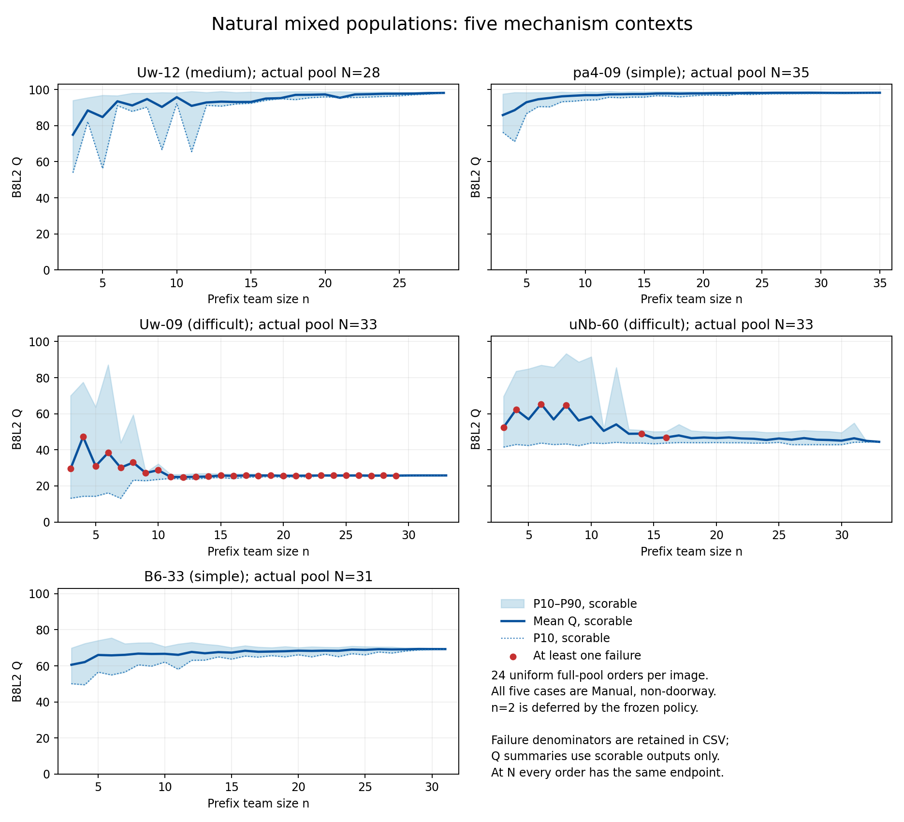
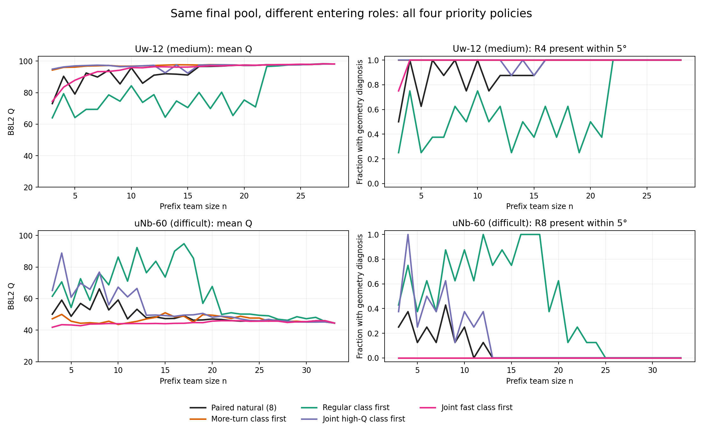

# 五个机制案例的完整顺序背景

本表在整批注册前缀结果完成后生成。机制案例仍是旧四条自然顺序中选出的探索案例；这里补入每图24条自然顺序和各政策8条精确配对顺序，不重新选择案例。

自然24条描述该人员池的平均过程。政策的净变化只对比它自身对应的8条自然顺序；不把政策8条与自然24条的差直接当配对效应。每条顺序保留其抽样权重，重复终点只在计算时去重。标准差统一使用样本标准差（ddof=1），与主自然曲线表一致。

R4／R8等存在率来自已存输出几何与参考点对的Hungarian对应。`ref_matched_nodes_5/9` 使用0基角号，因此Uw-12的R4查询索引3，uNb-60的R8查询索引7。它不是投票组身份的跨顺序跟踪，也不自动证明真实结构语义。匹配未知保留未知；n2延期与其他不可评分分别记录。

## 自然24条：固定人数的分布

| 图 | n | Q均值 | Q P10 | Q标准差 | 可评分/路径 | 非策略失败 | 平均节点 |
|---|---:|---:|---:|---:|---:|---:|---:|
| UwV83HsGsw3-12 | 3 | 74.94 | 53.97 | 17.22 | 24/24 | 0 | 5.54 |
| UwV83HsGsw3-12 | 6 | 93.49 | 91.09 | 3.70 | 24/24 | 0 | 6.00 |
| UwV83HsGsw3-12 | 10 | 95.76 | 92.34 | 2.37 | 24/24 | 0 | 6.00 |
| UwV83HsGsw3-12 | 14 | 93.08 | 92.02 | 11.54 | 24/24 | 0 | 5.92 |
| UwV83HsGsw3-12 | 20 | 97.28 | 95.94 | 1.34 | 24/24 | 0 | 6.00 |
| UwV83HsGsw3-12 | 28 | 98.13 | 98.13 | 0.00 | 24/24 | 0 | 6.00 |
| pa4otMbVnkk-09 | 3 | 85.84 | 76.29 | 14.03 | 24/24 | 0 | 4.00 |
| pa4otMbVnkk-09 | 6 | 94.59 | 90.54 | 3.82 | 24/24 | 0 | 4.00 |
| pa4otMbVnkk-09 | 10 | 96.88 | 94.18 | 1.96 | 24/24 | 0 | 4.00 |
| pa4otMbVnkk-09 | 18 | 97.71 | 95.95 | 1.14 | 24/24 | 0 | 4.00 |
| pa4otMbVnkk-09 | 20 | 97.87 | 96.89 | 0.73 | 24/24 | 0 | 4.00 |
| pa4otMbVnkk-09 | 35 | 98.22 | 98.22 | 0.00 | 24/24 | 0 | 4.00 |
| UwV83HsGsw3-09 | 3 | 29.56 | 13.17 | 22.56 | 18/24 | 6 | 4.75 |
| UwV83HsGsw3-09 | 6 | 38.41 | 16.17 | 28.36 | 13/24 | 11 | 5.25 |
| UwV83HsGsw3-09 | 10 | 28.74 | 23.61 | 14.28 | 19/24 | 5 | 4.62 |
| UwV83HsGsw3-09 | 17 | 25.79 | 24.91 | 0.73 | 19/24 | 5 | 3.83 |
| UwV83HsGsw3-09 | 20 | 25.63 | 24.72 | 0.69 | 20/24 | 4 | 3.92 |
| UwV83HsGsw3-09 | 33 | 25.82 | 25.82 | 0.00 | 24/24 | 0 | 4.00 |
| uNb9QFRL6hY-60 | 3 | 52.51 | 41.55 | 12.55 | 23/24 | 1 | 8.75 |
| uNb9QFRL6hY-60 | 6 | 65.40 | 43.78 | 19.81 | 23/24 | 1 | 9.42 |
| uNb9QFRL6hY-60 | 10 | 58.39 | 43.83 | 20.49 | 24/24 | 0 | 9.00 |
| uNb9QFRL6hY-60 | 17 | 47.99 | 44.04 | 4.07 | 24/24 | 0 | 8.58 |
| uNb9QFRL6hY-60 | 20 | 46.54 | 44.05 | 2.43 | 24/24 | 0 | 8.88 |
| uNb9QFRL6hY-60 | 33 | 44.45 | 44.45 | 0.00 | 24/24 | 0 | 9.00 |
| B6ByNegPMKs-33 | 3 | 60.61 | 50.11 | 7.89 | 24/24 | 0 | 4.00 |
| B6ByNegPMKs-33 | 6 | 65.82 | 54.96 | 7.68 | 24/24 | 0 | 4.00 |
| B6ByNegPMKs-33 | 10 | 66.67 | 62.13 | 4.02 | 24/24 | 0 | 4.00 |
| B6ByNegPMKs-33 | 16 | 68.36 | 65.44 | 2.30 | 24/24 | 0 | 4.00 |
| B6ByNegPMKs-33 | 20 | 68.41 | 66.14 | 1.48 | 24/24 | 0 | 4.00 |
| B6ByNegPMKs-33 | 31 | 69.29 | 69.29 | 0.00 | 24/24 | 0 | 4.00 |

## 两个关键局部：较多转折类优先的配对效果

下表使用各政策与其自然基线的8对顺序；“改善”分母为两端均有Q的路径。存在率分母为该端可取得几何匹配诊断的路径，完整分母见CSV。P10差是两端分布分位数之差，不是逐对差的P10。

| 图/局部 | n | 自然8 Q | 优先8 Q | 配对ΔQ | 改善/可比 | Q P10差 | 5°存在率：自然→优先 | 9°存在率：自然→优先 | 失败：自然→优先 |
|---|---:|---:|---:|---:|---:|---:|---|---|---|
| UwV83HsGsw3-12/R4 | 3 | 73.03 | 94.29 | 21.26 | 7/8 | 37.60 | 50.0%→100.0% | 50.0%→100.0% | 0→0 |
| UwV83HsGsw3-12/R4 | 4 | 90.36 | 95.99 | 5.63 | 7/8 | 13.75 | 100.0%→100.0% | 100.0%→100.0% | 0→0 |
| UwV83HsGsw3-12/R4 | 5 | 79.07 | 96.17 | 17.11 | 7/8 | 40.50 | 62.5%→100.0% | 62.5%→100.0% | 0→0 |
| UwV83HsGsw3-12/R4 | 6 | 92.43 | 96.84 | 4.41 | 7/8 | 9.43 | 100.0%→100.0% | 100.0%→100.0% | 0→0 |
| UwV83HsGsw3-12/R4 | 8 | 94.26 | 97.22 | 2.96 | 5/8 | 7.07 | 100.0%→100.0% | 100.0%→100.0% | 0→0 |
| UwV83HsGsw3-12/R4 | 9 | 85.49 | 96.72 | 11.23 | 4/8 | 39.18 | 75.0%→100.0% | 75.0%→100.0% | 0→0 |
| UwV83HsGsw3-12/R4 | 10 | 95.77 | 96.80 | 1.04 | 5/8 | 3.40 | 100.0%→100.0% | 100.0%→100.0% | 0→0 |
| UwV83HsGsw3-12/R4 | 11 | 85.93 | 96.94 | 11.02 | 5/8 | 40.20 | 75.0%→100.0% | 75.0%→100.0% | 0→0 |
| UwV83HsGsw3-12/R4 | 14 | 91.69 | 97.67 | 5.98 | 7/8 | 12.69 | 87.5%→100.0% | 87.5%→100.0% | 0→0 |
| UwV83HsGsw3-12/R4 | 20 | 97.44 | 97.19 | -0.25 | 2/8 | 0.07 | 100.0%→100.0% | 100.0%→100.0% | 0→0 |
| UwV83HsGsw3-12/R4 | 28 | 98.13 | 98.13 | 0.00 | 0/8 | 0.00 | 100.0%→100.0% | 100.0%→100.0% | 0→0 |
| uNb9QFRL6hY-60/R8 | 3 | 50.08 | 47.17 | -2.91 | 3/8 | -1.04 | 25.0%→0.0% | 37.5%→12.5% | 0→0 |
| uNb9QFRL6hY-60/R8 | 4 | 59.03 | 49.95 | -5.05 | 3/7 | -1.18 | 37.5%→0.0% | 50.0%→14.3% | 0→1 |
| uNb9QFRL6hY-60/R8 | 5 | 48.75 | 45.62 | -3.13 | 3/8 | -1.04 | 12.5%→0.0% | 12.5%→0.0% | 0→0 |
| uNb9QFRL6hY-60/R8 | 6 | 56.93 | 44.35 | -13.76 | 1/7 | -2.43 | 25.0%→0.0% | 25.0%→0.0% | 0→1 |
| uNb9QFRL6hY-60/R8 | 8 | 66.18 | 44.26 | -21.81 | 0/7 | -2.24 | 42.9%→0.0% | 42.9%→0.0% | 1→0 |
| uNb9QFRL6hY-60/R8 | 9 | 52.79 | 45.65 | -7.14 | 3/8 | -1.21 | 12.5%→0.0% | 12.5%→0.0% | 0→0 |
| uNb9QFRL6hY-60/R8 | 10 | 59.14 | 43.57 | -15.57 | 1/8 | -2.57 | 25.0%→0.0% | 25.0%→0.0% | 0→0 |
| uNb9QFRL6hY-60/R8 | 11 | 47.09 | 44.56 | -2.53 | 2/8 | -0.10 | 0.0%→0.0% | 0.0%→0.0% | 0→0 |
| uNb9QFRL6hY-60/R8 | 17 | 49.11 | 48.81 | -0.30 | 2/8 | 0.39 | 0.0%→0.0% | 0.0%→0.0% | 0→0 |
| uNb9QFRL6hY-60/R8 | 20 | 47.04 | 49.46 | 2.42 | 4/8 | -0.53 | 0.0%→0.0% | 0.0%→0.0% | 0→0 |
| uNb9QFRL6hY-60/R8 | 33 | 44.45 | 44.45 | 0.00 | 0/8 | 0.00 | 0.0%→0.0% | 0.0%→0.0% | 0→0 |

## 所有登记政策都保留

四种政策为较多转折类优先、历史人数最多结构类优先、联合较高历史Q类优先、联合较快类优先。表中五案该最多结构类的逐折语义均为常规，因此案例表仍按实际角色称常规。源类、目标类及其容量由目标建筑之外的历史指定。本目录保留各图每一个人数的全部结果，不只保留有利政策或人数。

| 图 | 政策 | n | 配对ΔQ | Q P10差 | 改善/可比 | 损失超过5分 | 平均实际换人数 |
|---|---|---:|---:|---:|---:|---:|---:|
| UwV83HsGsw3-12 | 联合较快类优先 | 6 | -1.64 | 3.39 | 1/8 | 1 | 4.9 |
| UwV83HsGsw3-12 | 联合较快类优先 | 14 | 4.46 | 7.73 | 5/8 | 1 | 3.2 |
| UwV83HsGsw3-12 | 联合较快类优先 | 20 | 0.01 | -0.21 | 4/8 | 0 | 1.9 |
| UwV83HsGsw3-12 | 联合较高历史Q类优先 | 6 | 4.76 | 8.70 | 7/8 | 0 | 4.0 |
| UwV83HsGsw3-12 | 联合较高历史Q类优先 | 14 | 5.88 | 12.79 | 7/8 | 0 | 2.5 |
| UwV83HsGsw3-12 | 联合较高历史Q类优先 | 20 | -0.25 | 0.07 | 2/8 | 0 | 1.5 |
| UwV83HsGsw3-12 | 历史常规结构类优先 | 6 | -23.06 | -33.05 | 1/8 | 5 | 1.4 |
| UwV83HsGsw3-12 | 历史常规结构类优先 | 14 | -16.98 | -28.40 | 0/8 | 4 | 3.1 |
| UwV83HsGsw3-12 | 历史常规结构类优先 | 20 | -22.12 | -40.46 | 0/8 | 4 | 4.5 |
| UwV83HsGsw3-12 | 较多转折类优先 | 6 | 4.41 | 9.43 | 7/8 | 0 | 4.6 |
| UwV83HsGsw3-12 | 较多转折类优先 | 14 | 5.98 | 12.69 | 7/8 | 0 | 2.9 |
| UwV83HsGsw3-12 | 较多转折类优先 | 20 | -0.25 | 0.07 | 2/8 | 0 | 1.5 |
| pa4otMbVnkk-09 | 联合较快类优先 | 6 | 0.54 | 1.42 | 4/8 | 0 | 1.6 |
| pa4otMbVnkk-09 | 联合较快类优先 | 18 | 0.35 | 0.68 | 3/8 | 0 | 1.0 |
| pa4otMbVnkk-09 | 联合较快类优先 | 20 | 0.03 | -0.06 | 2/8 | 0 | 0.9 |
| pa4otMbVnkk-09 | 联合较高历史Q类优先 | 6 | 7.13 | 13.86 | 8/8 | 0 | 4.8 |
| pa4otMbVnkk-09 | 联合较高历史Q类优先 | 18 | 1.01 | 2.23 | 7/8 | 0 | 2.9 |
| pa4otMbVnkk-09 | 联合较高历史Q类优先 | 20 | 1.00 | 1.24 | 7/8 | 0 | 2.5 |
| pa4otMbVnkk-09 | 历史常规结构类优先 | 6 | -1.87 | -0.52 | 1/8 | 1 | 1.4 |
| pa4otMbVnkk-09 | 历史常规结构类优先 | 18 | -2.28 | -2.44 | 1/8 | 0 | 4.8 |
| pa4otMbVnkk-09 | 历史常规结构类优先 | 20 | -2.29 | -3.69 | 0/8 | 0 | 5.2 |
| pa4otMbVnkk-09 | 较多转折类优先 | 6 | 7.13 | 13.86 | 8/8 | 0 | 4.8 |
| pa4otMbVnkk-09 | 较多转折类优先 | 18 | 1.01 | 2.23 | 7/8 | 0 | 2.9 |
| pa4otMbVnkk-09 | 较多转折类优先 | 20 | 1.00 | 1.24 | 7/8 | 0 | 2.5 |
| UwV83HsGsw3-09 | 联合较快类优先 | 6 | -41.07 | -9.06 | 1/3 | 2 | 2.8 |
| UwV83HsGsw3-09 | 联合较快类优先 | 17 | 0.24 | 0.26 | 6/7 | 0 | 1.6 |
| UwV83HsGsw3-09 | 联合较快类优先 | 20 | 0.35 | 0.11 | 4/7 | 0 | 1.4 |
| UwV83HsGsw3-09 | 联合较高历史Q类优先 | 6 | 1.29 | -3.71 | 1/3 | 0 | 1.8 |
| UwV83HsGsw3-09 | 联合较高历史Q类优先 | 17 | -0.48 | -0.21 | 0/7 | 0 | 1.2 |
| UwV83HsGsw3-09 | 联合较高历史Q类优先 | 20 | -0.15 | -0.38 | 2/7 | 0 | 1.1 |
| UwV83HsGsw3-09 | 历史常规结构类优先 | 6 | -23.12 | -4.04 | 0/4 | 3 | 3.0 |
| UwV83HsGsw3-09 | 历史常规结构类优先 | 17 | 0.06 | 0.63 | 4/7 | 0 | 4.8 |
| UwV83HsGsw3-09 | 历史常规结构类优先 | 20 | -0.09 | -0.07 | 2/7 | 0 | 3.6 |
| UwV83HsGsw3-09 | 较多转折类优先 | 6 | -17.59 | -3.32 | 1/4 | 2 | 3.9 |
| UwV83HsGsw3-09 | 较多转折类优先 | 17 | -0.33 | -0.82 | 4/7 | 0 | 7.6 |
| UwV83HsGsw3-09 | 较多转折类优先 | 20 | -0.54 | -1.44 | 3/7 | 0 | 6.5 |
| uNb9QFRL6hY-60 | 联合较快类优先 | 6 | -14.14 | -1.96 | 0/8 | 5 | 4.6 |
| uNb9QFRL6hY-60 | 联合较快类优先 | 17 | -4.77 | -1.05 | 1/8 | 3 | 3.0 |
| uNb9QFRL6hY-60 | 联合较快类优先 | 20 | -1.33 | -0.27 | 1/8 | 0 | 2.0 |
| uNb9QFRL6hY-60 | 联合较高历史Q类优先 | 6 | 12.81 | 5.45 | 8/8 | 0 | 3.4 |
| uNb9QFRL6hY-60 | 联合较高历史Q类优先 | 17 | 0.43 | 3.21 | 5/8 | 1 | 2.1 |
| uNb9QFRL6hY-60 | 联合较高历史Q类优先 | 20 | 1.14 | -0.09 | 7/8 | 0 | 1.8 |
| uNb9QFRL6hY-60 | 历史常规结构类优先 | 6 | 15.66 | 2.93 | 5/8 | 0 | 2.5 |
| uNb9QFRL6hY-60 | 历史常规结构类优先 | 17 | 45.68 | 50.77 | 8/8 | 0 | 8.6 |
| uNb9QFRL6hY-60 | 历史常规结构类优先 | 20 | 20.64 | 4.35 | 7/8 | 0 | 7.1 |
| uNb9QFRL6hY-60 | 较多转折类优先 | 6 | -13.76 | -2.43 | 1/7 | 3 | 4.0 |
| uNb9QFRL6hY-60 | 较多转折类优先 | 17 | -0.30 | 0.39 | 2/8 | 3 | 5.4 |
| uNb9QFRL6hY-60 | 较多转折类优先 | 20 | 2.42 | -0.53 | 4/8 | 0 | 4.2 |
| B6ByNegPMKs-33 | 联合较快类优先 | 6 | -5.65 | -2.64 | 1/8 | 5 | 4.9 |
| B6ByNegPMKs-33 | 联合较快类优先 | 16 | -1.40 | -2.19 | 1/8 | 0 | 4.8 |
| B6ByNegPMKs-33 | 联合较快类优先 | 20 | -0.96 | -0.87 | 3/8 | 0 | 3.1 |
| B6ByNegPMKs-33 | 联合较高历史Q类优先 | 6 | -0.37 | -1.51 | 3/8 | 1 | 1.2 |
| B6ByNegPMKs-33 | 联合较高历史Q类优先 | 16 | 0.43 | 0.00 | 3/8 | 0 | 0.8 |
| B6ByNegPMKs-33 | 联合较高历史Q类优先 | 20 | 0.93 | 0.50 | 5/8 | 0 | 0.8 |
| B6ByNegPMKs-33 | 历史常规结构类优先 | 6 | -13.74 | -18.29 | 0/8 | 6 | 3.4 |
| B6ByNegPMKs-33 | 历史常规结构类优先 | 16 | -3.67 | -5.17 | 0/8 | 3 | 6.5 |
| B6ByNegPMKs-33 | 历史常规结构类优先 | 20 | -2.76 | -2.97 | 0/8 | 0 | 4.4 |
| B6ByNegPMKs-33 | 较多转折类优先 | 6 | -2.76 | -0.13 | 3/8 | 3 | 4.6 |
| B6ByNegPMKs-33 | 较多转折类优先 | 16 | 0.62 | -0.63 | 4/8 | 0 | 3.2 |
| B6ByNegPMKs-33 | 较多转折类优先 | 20 | 1.25 | 1.29 | 7/8 | 0 | 2.2 |

## 由完整顺序得出的具体判断

### 1. Uw-12：较多转折类能加快这个入口回折形成多数

原答支持表显示，入口R4得到较多转折类6/6人、常规类11/22人支持。这个局部的支持比例与历史类别一致；不是只因为六角比五角“更多”。旧精确路径说明同一个位置如何在票数1/2、2/2、2/3、3/3时反复入选与失选。
完整配对结果也支持这一解释：较多转折类优先在n3的Q净增21.26分，7/8对改善，R4的5°存在率由50.0%到100.0%；n6仍净增4.41分，7/8对改善。n3的D10净增18.77分、三维代理净增6.03分，底边误差减少1.015°，变化不仅见于Q。
作用主要在前段：到n20，净Q为-0.25分，接近零；全员28人时两种顺序必然合流。n6较多转折类六人已全进入，政策侧只有1个实际成员集合；其8次配对比较反映对8个自然背景的差异，不能解释为8种不同六人政策队。

### 2. uNb-60：同一结构类在玻璃侧机会上的作用反向，常规类更有用

此图R8是既有参考采用的玻璃淋浴邻接折点，语义与入口实墙回折不同。原答支持为较多转折类2/12、常规类9/17、简化类0/4。类别“通常较多转折”保留其历史解释，但并不意味着它更常表达这个具体位置。
较多转折类优先在n10净Q为-15.57分，R8出现率从自然配对组25.0%变成0.0%。相反，常规类优先在n10净增27.20分，Q P10提高30.52分，R8出现率变为87.5%；n17净增45.68分，8/8对改善。n17常规类全部17人组成同一个政策端点，因此这里的8/8是8个不同自然对照都较低，不是8个独立纯类团队。
n10常规优先的D10提高26.45分，底边误差减少1.782°，输出自身方向残差减少6.234°，三维代理提高4.23分；均高项变化仅-0.0037。这与局部折点和边界表达改变相符，不是所有几何维度等幅变化。继续把其余人员加入后，这一优势衰减，全员33人的Q仍为44.45分。
失败也保留：较多转折优先n6有1/8不可评分，两端均可评分的7对净Q为-13.76分。这个数与两端各自可评分均值之差不同，不能混用。联合较高历史Q优先在n6可产生12.81分的改善（8/8对），但其后也不保证保持R8；不同政策有不同过程用途。

### 3. 另外三案分别解释定位改善、结构缺失和缩波平台

pa4-09始终为四角。自然24条n3→6的Q均值为85.84→94.59，到n20为97.87；原精确路径中的上下边界与底面定位改善可以解释这种早段收益。单看节点数会漏掉它。
Uw-09的可评分Q到n20仍仅25.63，原答少数转折远低于多数门槛的机制继续成立。扩展到24条后还看到明显失败：n3为6/24，n6为11/24，n20为4/24。可评分Q均值并不含这些失败，不能把它单独当整体可靠性。原四条中选出的可评分路径不能代表这些新增失败背景。
B6-33的n10→20自然均值为66.67→68.41，样本标准差为4.021→1.483，Q P10为62.13→66.14。24条支持“均值小幅改善、低尾与波动明显收缩”，替代旧四条均值略降的背景描述；四角一致但共同外扩的具体机制不变。全员Q仍为69.29，所以缩波不等于消除共同偏差。

### 4. 时间用途使用实际记录与相同配对范围

Uw-12联合较高历史Q类优先在n6净Q为4.76分，8对完整记录的时间差平均-210.30秒，逐对相对差平均-21.97%。pa4-09快类优先n6的净Q为0.54分、时间差-139.29秒、逐对相对差-11.74%；其质量变化较小而记录时间变化更清楚。
这些是已有标注记录时间之和，不是新测生产工时，也不是把算法预测误差换算成节时。秒差均值、逐对百分比均值、总量之比均在表中区分；基线差异大时它们可以异号。uNb-60较大前缀多有缺失时间，本案不据此声称节时。

**采用判断：**入口回折与玻璃侧折点给出可接续的正反局部规律：先识别类别在具体结构机会上的支持，再选择进入顺序。自然混合确实能在前段改善定位或补多数，也会在另一些图上收敛到缺结构或共同偏移的平台。五案为总体曲线提供机制解释，不能把任一图的较优政策直接推广为全库选队规则。

## 完整顺序曲线图

局部角存在率图只使用有几何诊断的路径，失败分母另见各表。未知匹配不能计作缺失，已知零命中仍计入缺失。政策图的自然线是相应8条配对自然路径；它与上图自然24条的均值可以不同。

## 文件与适用范围

- `CASE_CURVES_BY_POLICY_K.csv`：自然24、政策8及其配对自然8分别的逐人数分布，含分项、时间、失败、节点数及各自分母。
- `CASE_REFERENCE_NODE_CURVES.csv`：每个参考角、5°／9°、每个人数及每个比较臂的出现率，保留未知数；所有参考角都保存。
- `CASE_POLICY_EFFECTS_BY_K.csv`：精确配对8条的净变化、方向比例、失败和关键角出现率；自然24仅另作背景。
- `CASE_POLICY_PAIRED_EVENTS.csv.gz`：各顺序前缀的实际两队成员、端点、真实替换量、类别席位变化及分项差。
- `CASE_FULL_PREFIX_ROWS.csv.gz`、`CASE_EXACT_ORDERS.csv.gz`：完整五案前缀与精确顺序输入切片。
- `CASE_REFERENCE_INDEX.csv`：明确1基图示编号、0基保存索引与不变参考坐标。
- `CASE_BACKGROUND_RECEIPT.json`：输入完整性、实际覆盖与代码身份。

全员人数处所有顺序具有同一实际成员集合，因此输出一致、方差为零是确定性终点的性质，不用它证明分类有效。某类全部先进入后也可能暂时只有一个团队集合；表中同时给出独立端点数及可估计成员波动标识。

本目录只给五张探索机制图的完整注册顺序背景，不替代全体图片／建筑的总体推断。原机制的原答、票数、门槛、对应及原图仍由上一级案例目录保存。