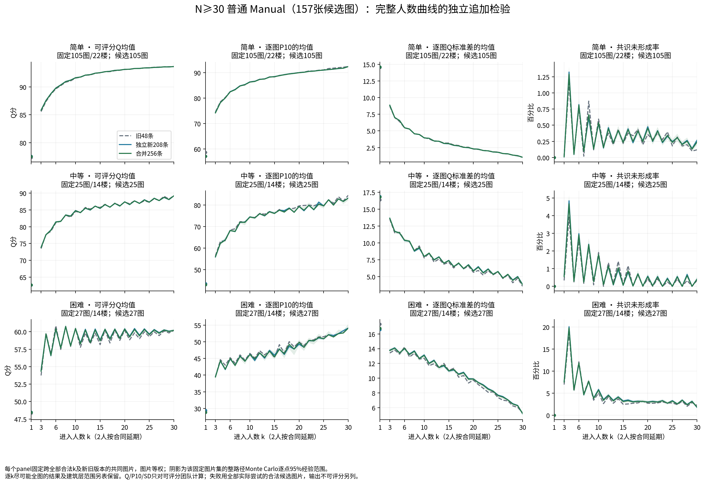
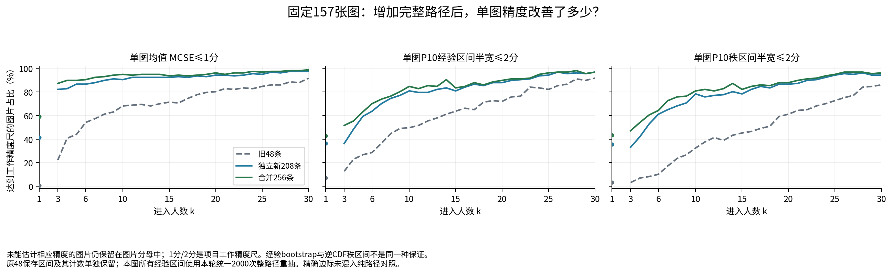
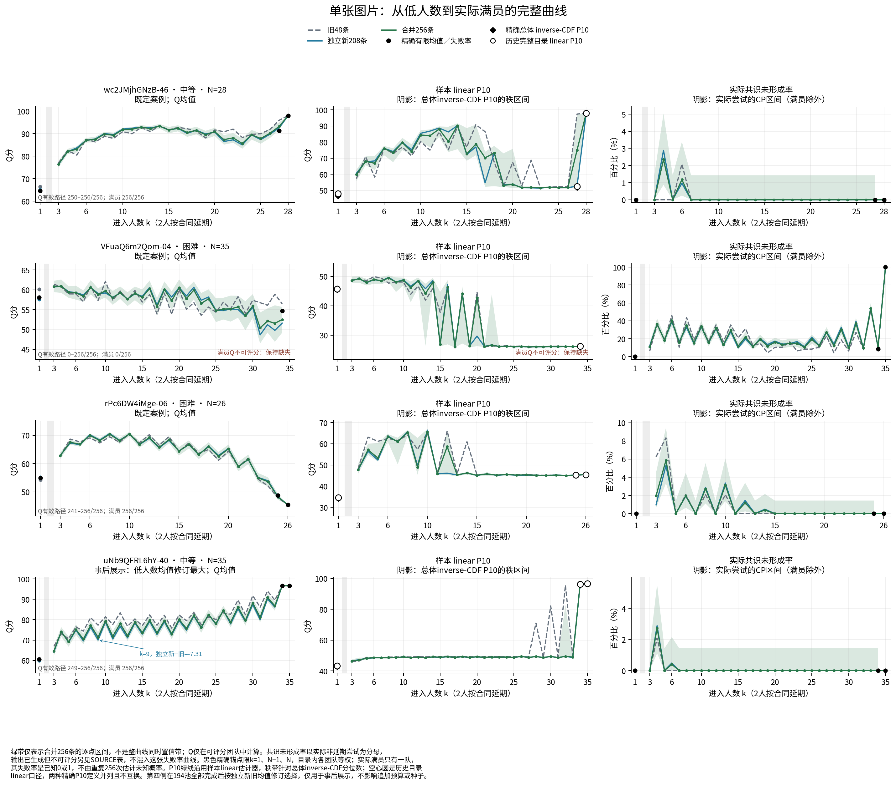
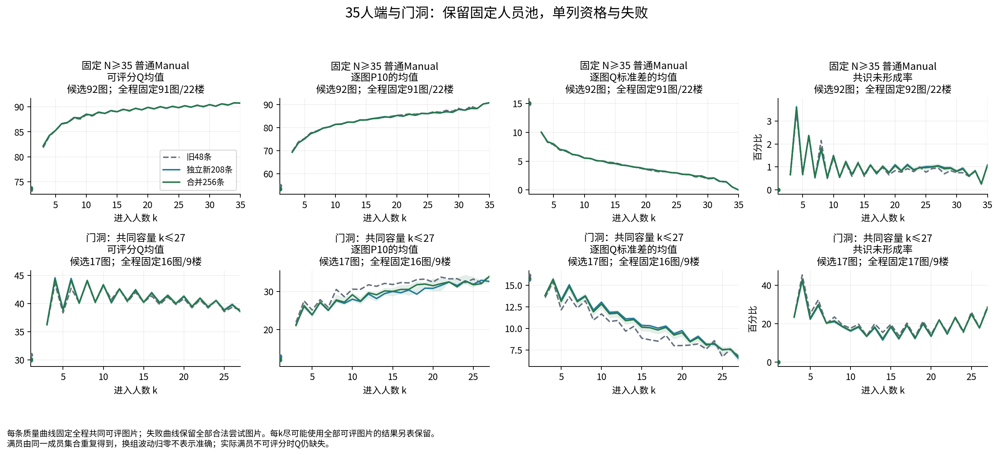
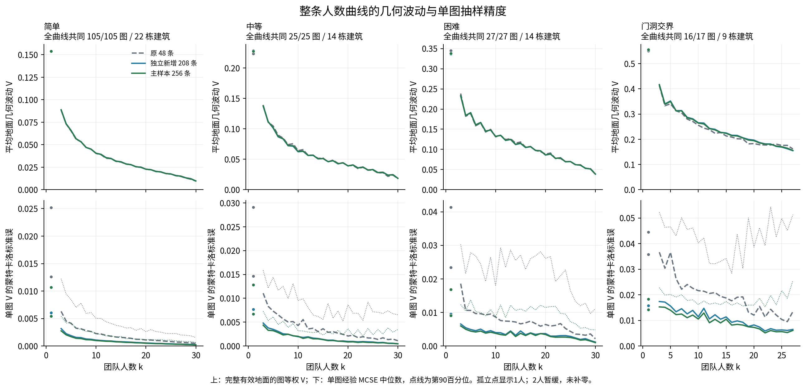
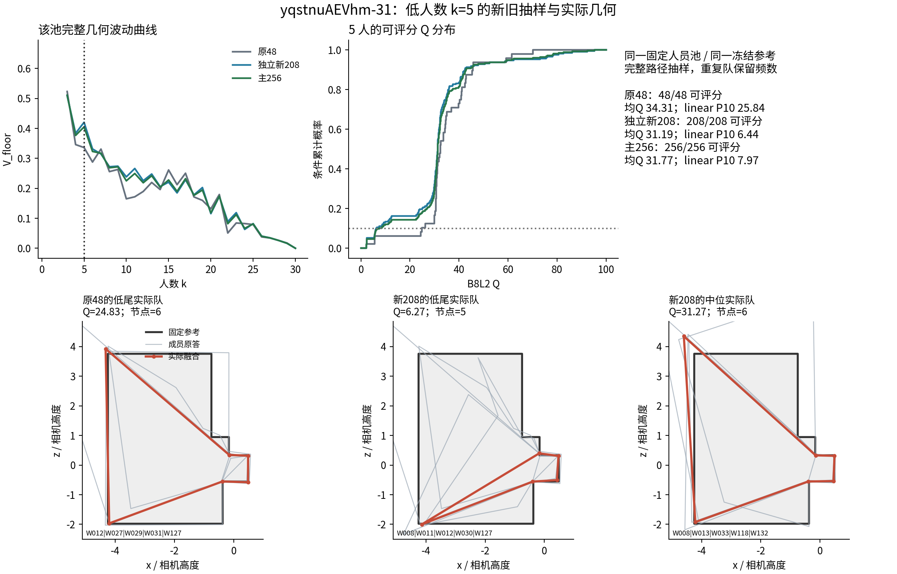
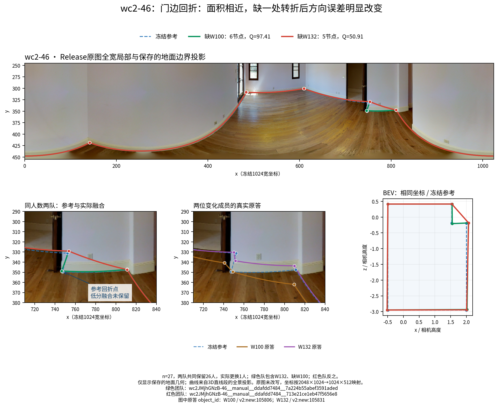
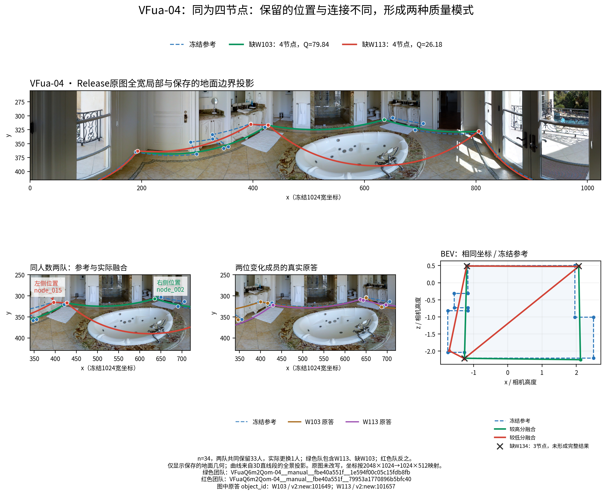

# HOHONET 人数曲线抽样补充研究：48条的用途、追加至256条后的精度与采用

**完成版本：2026-10-26。** 数据来自真人v2，实际采用main提交`b9bcec809fbaec8ab055931a1abb7baa5db44dac`；最终读取远端仍为同一提交。本轮已完成全部194个Manual人员池的208次新增完整自然排列抽取，形成统一旧48、独立新208、合256比较。历史四策略另按旧16、新16、合32配对；没有重新分类、改参考、调融合或恢复被排除作答。

本报告替代本专题的阶段说明作为综合采用入口。各原始阶段包保留来源身份；数据、复现和下载关系见文末与[专题README](README.md)。[主张索引](report26/CLAIMS_INDEX_ZH.csv)将研究问题连接到精确表、事件键和采用判断；[新旧结论对照](report26/OLD_NEW_CONCLUSIONS.csv)列出应修改的表述。

## 一、主要研究判断

**48条已经能描述跨图片总体曲线的主要形状，但经常不足以精确描述单图的低人数均值，更不足以普遍精确描述单图P10和罕见失败。** 本轮按所有Manual池统一追加完整顺序，没有只挑旧估计看起来不稳定的人数点。追加后，固定157图的3人均值MCSE大于1分的图片从122张降到20张，10人从50张降到8张；同一比较中，3人P10经验95%区间半宽仍有76张超过2分。均值和低尾需要不同的精度判断。[逐点证据](analysis_reporting26/results/FINAL_FIXED157_POINT_PRECISION_READOUT.csv)

本轮最值得保留的五项结论是：

1. **普通图片总体曲线与难度差异保留，单图精度明显改善。** 简单、中等图片在20→30人仍多数升质；困难图该段平均Q变化较小，增人的主要收益转向低尾、换组波动和几何稳定性。
2. **“困难后段平台”应解释为均Q变化小，不能写成所有结果不变。** 困难27图20→30平均Q为−0.175分，路径范围跨零；P10却提高4.246分，Q标准差下降4.676分，地面几何波动在26/27图下降。增加人数可以压缩不确定性，同时没有明显提高平均准确度。
3. **门洞需要实质修正一处旧细节。** 6→10人均Q由旧48的+0.320改为新208的−1.302、合256的−1.006；与此同时，实际共识失败在17/17图下降。更多可用输出、结果更集中与可评平均Q下降可以同时发生。
4. **低尾的难点有时是分数模式和分位数定义，而不只是“样本再大一点”。** 精确近满员目录显示，团队都见过也可能频数不准；经验bootstrap区间很窄也可能漏见低分概率。已知完整边际应直接使用精确团队分布，并保留两种P10定义。
5. **原有历史策略的强方向得到独立追加重复。** 高Q与较多转折优先有明显平均质量和低尾收益；快速优先具有节省劳动但牺牲部分质量的用途；人数最多结构类优先不宜作默认升质策略。这些仍是历史V3角色的用途验证，未转化为新DSTRUCT或RFUSE验证。

增加顺序改善的是**对固定人员池的估计精度**，不会让同一人数下真实的人员不确定性自动减小。`Q_SD`衡量换同样人数的一组人会差多少，`MCSE`衡量我们把平均Q估得多准；追加后发现未见过的坏模式时，估计SD可以上升，而MCSE仍下降。

## 二、实际完成的实验与估计对象

### 2.1 固定支持与真实计算规模

|对象|本轮实际完成|
|---|---:|
|Manual人员池／图片|194：普通177图/22建筑；门洞17图/9建筑|
|新增独立自然排列抽取|40,352次＝194×208，预分独立A104/B104|
|新增派生策略顺序|10,048条＝157×16×4；不是10,048个额外独立自然样本|
|保存前缀出现|1,644,576条|
|设计去重团队|1,396,509支|
|复用已有端点|39,852支：原人数库23,252、前轮精度库16,600|
|新增端点记录|1,356,657条：第一阶段784,140、第二阶段572,517|
|新增记录中非延期状态|1,327,903条|

新增端点记录分为正式可评1,293,037、节点不足19,787、未连接14,345、输出几何不可评734、两人按原设计延期28,754。**这些是去重运算账本，不能直接相除写成研究失败率。** 研究概率使用相应随机路径的实际出现次数及尝试支持。[最终执行账本](new_endpoints26/FINAL_EXECUTION_LEDGER.json)、[精确路径关联验证](delivery26/FINAL_PATH_LINK_VALIDATION.json)

普通固定N≥30为157图/22建筑，其中简单105、中等25、困难27；固定N≥35为92图，实际均35人。157图的容量为N30/31/32/33/34/35分别10/4/7/22/22/92，因此“30人”并非全部图片的满员。门洞的N为27至35，17图的共同完整人数范围到27；30人比较单列N≥30的16图，35人单列7图。质量与几何的共同可用支持另列，失败始终保留对应候选图。

本轮主自然版本是旧48／独立新208／合256；原53个重点池的额外48条单列为`prior96/all_history304`敏感性，不能写成所有图片304条。**Semi本轮没有新增路径**，保留原专题的实际版本，不声称获得本轮256条精度验证。[容量与版本表](report26/key_tables/T00_CAPACITY_INVENTORY.csv)

### 2.2 怎样抽、怎样复用

固定一张图的N名合格人员，每次均匀随机排列；排列内部无放回，不同排列可重复。在固定k上，每个k人子集概率相同。重复团队只运行或读取一次冻结端点，但统计时保留全部抽中次数。小池重复抽到同一完整排列也合法，因此“独立抽取次数”和“不同排列数量”各自保存。

每个前缀直接从该集合的原始作答生成共识，**不是把上一步的融合结果再与新人融合**。比较人数变化时按完整路径配对；比较固定k团队分布时使用真实频数。主规则、预处理、参考、环序、B8L2和D10均沿用旧合同；k=2继续延期，在图上保留缺口。[冻结设计](FROZEN_EXTENSION_DESIGN.json)、[精确设计目录](design26/)、[引擎说明](engine26/README_ENGINE_ZH.md)

### 2.3 质量、失败和误差的定义

平均Q、P10和Q标准差在正式可评分团队中计算；P10及SD先逐图计算，再按图片或建筑汇总，不能把不同图的分数混成一个总体P10。原`linear`插值P10继续作为曲线展示量，同时保存经验逆CDF及其秩区间。SD按有效路径数减一作分母。可评分路径数不足时保留缺失，不填0。

真实共识失败包括冻结算法没有形成完整共识的状态，和“已生成候选几何但无法正式评分”分别报告；缺参考、未执行、两人延期也分别保存。既有宽口径`failure_rate/failure_delta`没有静默改名为`actual_consensus_failure_rate/delta`。

完整路径bootstrap的范围说明**固定这批图片、人员池条件下的抽样误差**；建筑重抽说明既有建筑构成的差异。两者分别给出，没有把大量路径当作独立图片，或把建筑重抽当成新建筑验证。主表同时保存图片等权与建筑等权；本报告主要采用图片等权，并给建筑范围。[自然方法](analysis_precision26/README.md)、[字段合同](report26/RESEARCH_DESK_FIELDS_ZH.md)

## 三、48条与256条：总体曲线可靠到什么程度，单图改善多少？

### 3.1 固定157图总体曲线的形状保留

下表各人数使用同一157图。每格的P10和SD是“逐图先算、图片再等权”的平均；失败是各图实际失败概率的平均。

|人数|均Q：旧48→新208→合256|P10：旧48→合256|Q_SD：旧48→合256|实际失败：旧48→合256|
|---|---|---|---|---|
|3|78.183 → 78.555 → 78.484|65.650 → 65.304|10.288 → 10.457|1.261% → 1.386%|
|6|83.349 → 83.411 → 83.398|73.897 → 73.736|7.749 → 7.737|3.012% → 3.040%|
|10|85.104 → 85.195 → 85.178|77.664 → 77.519|6.079 → 6.167|1.566% → 1.625%|
|20|86.538 → 86.600 → 86.589|81.511 → 81.400|4.093 → 4.165|0.770% → 0.898%|
|30|87.187 → 87.179 → 87.181|84.594 → 84.361|2.168 → 2.195|0.518% → 0.540%|

均Q在关键人数上的旧48→合256变化仅+0.302、+0.049、+0.074、+0.050、−0.006分；独立新208与旧48的比较也直接保留。因此原总体平均曲线可以继续使用，正式展示更新为合256。低尾与失败的细小数值仍会调整，不能从均值稳定推出它们已经同样精确。[精确表](analysis_reporting26/results/FINAL_FIXED157_POINT_PRECISION_READOUT.csv)

固定157图、1及3…30人整条**总体均值曲线**的路径重抽最大绝对偏差95%界，由旧48的0.362分降至新208的0.176、合256的0.161；同量的建筑重抽范围尺度仍为3.942、3.760、3.780分。P10总体曲线的路径界为0.814→0.519→0.558。合256的某一个经验分位数精度读数不必优于独立新208；旧样本并未因此被删除。[固定整曲线范围](analysis_precision26/results_stage2/FIXED_IMAGE_AGGREGATE_CURVE_BAND_SUMMARY.csv)

这说明追加确实降低了计算抽样误差，**建筑之间的真实差异仍在**；多抽随机顺序不能替代更多独立建筑。

### 3.2 单图均值明显改善，低人数P10仍是主要短板

阈值“均值MCSE≤1分”和“P10经验95%半宽≤2分”是便于展示的工作精度，不是通用统计标准。对同一157图：

|人数|均值MCSE>1图数：旧48→256|均值MCSE中位数：旧48→256|P10经验半宽>2图数：旧48→256|256逆CDF秩半宽>2图数|
|---|---|---|---|---|
|3|122 → 20|1.432 → 0.610|137 → 76|83|
|6|72 → 15|0.920 → 0.411|112 → 47|56|
|10|50 → 8|0.640 → 0.271|79 → 24|30|
|20|31 → 6|0.322 → 0.127|44 → 16|19|
|30|13 → 2|0.112 → 0.048|13 → 5|6|

旧审查给出的P10超标数137/110/80/44，在本轮统一bootstrap种子下为137/112/79/44；原端点和Q没有变化，差别来自有限次重抽区间的阈值跨越。原审查数保留历史身份，比较新旧抽样使用本轮统一版本。均值MCSE计数122/72/50/31得到原样核实。[逐图精度](report26/key_tables/T02B_SINGLE_IMAGE_PRECISION_KEYPOINTS.csv.gz)、[达标支持](report26/key_tables/T02A_SINGLE_IMAGE_PRECISION_REACH.csv)

逐点MCSE达标也不等于整条曲线都精确。固定157图、每图自己的全部合法可估人数范围内，单图均Q整曲线经验95%带半宽的中位数/P90，从旧48的4.572/6.940降至合256的2.000/2.992；P10则从12.255/27.392降至6.275/19.109。排除已经精确枚举的边际后，合256的相应中位数仍为均Q1.364、P10 3.646。这里是每图完整路径重抽，不是把逐点区间拼成一个同时保证。[整曲线精度读数](analysis_precision26/results_stage2/FINAL_READOUT_WHOLE_CURVE_PRECISION.csv)

### 3.3 单图改变被总体平均掩盖了多少？

普通177图中，旧48→合256的整曲线最大均Q变化中位数为2.060分，91图至少有一人数点变化超过2分，9图超过5分；P10最大变化中位数4.951分，86图至少有一处超过5分。门洞17图的最大均Q变化中位数3.501分，P10为5.410分。这是逐图描述，最大值跨很多人数点，不能当作一项显著性检验。[完整逐图变化](report26/key_tables/T05C_PER_IMAGE_FULL_CURVE_CHANGES.csv.gz)、[汇总](report26/key_tables/T05D_FULL_CURVE_CHANGE_SUMMARY.csv)

独立新208还在旧48未见失败的地方观察到真实失败：普通有186个图×人数点，涉及54图/18建筑；门洞45点，涉及11图/6建筑。输出不可评分另有普通37点/11图、门洞49点/8图。相邻人数相关，这些点不是186或45个独立样本；它们直接说明“原48未见”不能解释为该点不会发生。[新增观察状态与精确键](report26/key_tables/T05A_NEWLY_OBSERVED_FAILURE_CASES.csv.gz)、[分母汇总](report26/key_tables/T05B_NEWLY_OBSERVED_FAILURE_SUMMARY.csv)

`uNb9QFRL6hY-40`是一个直观例子：N=35、中等难度，k9均Q旧48为77.332、独立新208为70.026，修订−7.306分；k30样本P10从82.155变为49.364，k32从95.581变为49.423。这是同一人员池、同一算法的分布估计修订，没有新增人员或把融合改坏。该例按事先写明的事后展示规则选出，承担解释作用，不能再当独立验证集。[选择清单与曲线源表](analysis_precision26/figures_stage2/N05_CASE_SELECTION.csv)

### 3.4 低人数的锯齿有重复成分，不能全部归于48条的噪声

完整曲线还保留了一项有解释力的事后描述：以k=5、7、9各自减去相邻两个偶数人数的均值，再逐图平均，困难固定27图的Q差旧48为−3.171，新104A/B为−3.001/−2.949，合256为−3.009，23图负、4图正。对应节点数差−0.732，27/27图负；实际失败概率差却为−6.038个百分点，也在27/27图为负。奇数点在这些低人数条件下更少节点、可评Q更低，同时失败更少，三者不是同一种好坏判断。

简单105图相同Q对比仅−0.005，路径范围[−0.034,+0.022]，57正48负；中等25图为−0.802，15负10正。门洞N≥30的16图则为−4.289，16/16图负，节点数差−0.809、16/16负；实际失败差−6.502个百分点、15负1正。独立批次说明部分锯齿是真实重复的曲线特征，不只是旧样本不够平滑。这里没有做组件干预，也不据此建议所有图片一律选奇数或偶数人数。[有限奇偶描述与支持](analysis_shape26/results/PARITY_LOCAL_CONTRAST_SUMMARY.csv)

## 四、人数变化的实质发现：难度、后段与门洞

### 4.1 简单、中等图片的多数收益保留，困难图更早进入均值变化较小的区间

以下是合256、固定普通N≥30的共同支持。Q为两端条件均值之差；P10为两个逐图分位数之差；失败以全部对应尝试计算，单位为百分点。

|难度|人数|图/建筑|均Q变化|Q升/降图|P10变化|Q_SD变化|实际失败变化（pp）|
|---|---|---|---|---|---|---|---|
|简单|3→6|105/22|+3.974|105/0|+8.280|-3.371|+0.800|
|简单|6→10|105/22|+1.856|103/2|+3.851|-1.522|-0.272|
|简单|10→20|105/22|+1.505|102/3|+3.698|-1.658|-0.086|
|简单|20→30|105/22|+0.501|93/12|+2.404|-1.258|-0.216|
|中等|3→6|25/14|+7.572|24/1|+12.227|-3.248|+2.359|
|中等|6→10|25/14|+3.375|24/1|+6.262|-2.413|-1.109|
|中等|10→20|25/14|+2.625|22/3|+4.898|-2.149|-1.250|
|中等|20→30|25/14|+1.802|21/4|+3.909|-2.039|-0.156|
|困难|3→6|27/14|+6.107|26/1|+5.515|+0.299|+4.326|
|困难|6→10|27/14|+0.005|15/12|+1.221|-0.971|-6.149|
|困难|10→20|27/14|-0.077|14/13|+3.654|-3.202|-2.734|
|困难|20→30|27/14|-0.175|16/11|+4.246|-4.676|-1.100|

简单和中等层3→6、6→10、10→20、20→30的多数升质都保留。以20→30为例，简单平均+0.501、93/105升，建筑95%范围[+0.272,+0.698]；中等+1.802、21/25升，建筑范围[+0.749,+2.992]。这两层不能被困难平均平台概括。[区间完整表](report26/key_tables/T03A_NATURAL_INTERVALS.csv)

困难3→6平均Q由旧48的+7.119调整为新208的+5.874、合256的+6.107，仍26/27图升质，路径95%范围[5.707,6.547]、建筑[4.657,7.683]。但Q_SD平均+0.299，15图上升、12下降；真实失败增加4.326个百分点，建筑范围[1.148,8.459]。**低人数扩队的平均升质，不代表波动和失败也同步改善。**

困难6→10均Q+0.005，10→20为−0.077，后者路径范围[−0.452,+0.312]、建筑[−2.725,+2.496]；可以描述为平均质量的后段平台，准确含义是“现有平均变化较小，未显示明确持续升高或下降”，不是证明所有图完全不变。

### 4.2 困难20→30：后段价值主要体现为低尾和稳定性

固定27图/14建筑的结果是：

|量|合256变化|图片响应|路径95%范围|建筑重抽95%范围|
|---|---:|---|---|---|
|平均Q|−0.175|16升、11降|[−0.467,+0.110]|[−2.340,+2.381]|
|P10|+4.246|24升、3降|[+3.499,+6.063]|[+1.013,+7.680]|
|Q标准差|−4.676|25降、2升|[−4.947,−4.378]|[−6.357,−2.398]|
|实际失败概率|−1.100个百分点|10降、1升、16无变化|[−1.534,−0.666]个百分点|[−2.823,+0.521]个百分点|
|地面几何V|−0.047685|26降、1升|[−0.050370,−0.045001]|[−0.062045,−0.028432]|

均Q旧48为+0.016，新208为−0.221，符号从接近零的一侧转到另一侧，**不改变“平均增益小”的判断**。低尾和波动的收益有实际幅度与多数图片支持；失败改善平均为负，但建筑范围跨零，不能写成各建筑一致改善。[自然区间](analysis_precision26/results_stage2/COMMON_SUPPORT_INTERVAL_SUMMARY.csv.gz)、[几何区间](analysis_geometry26/results_stage2/GEOMETRY_FIXED_SUPPORT_INTERVALS.csv.gz)

两批独立104条的困难地面V变化分别−0.046375和−0.048283，均26/27图、13/14建筑下降。合256的质心位置波动下降0.057333相机高度单位，平均高度波动下降0.008013，实际转折数波动下降0.451281个。这个重复证据支持**后段使不同成员组合的结果更一致**，并不要求平均Q同时改善。

沿用已有Q80/Q90阈值，以“可评且达到阈值”为全部尝试中的事件，也可以看到不同用途的分离。困难27图20→30，Q≥80达标率平均+3.183个百分点，但只有8图升、14图降、5图不变；路径95%范围[+2.363,+4.003]个百分点，建筑范围[−3.342,+10.054]。Q≥90则平均−0.608个百分点，1升11降15不变，路径范围[−1.078,−0.138]个百分点、建筑[−4.078,+2.969]。两者在旧48和独立新208中的平均方向重复。**P10多数提高不等于每个高质量阈值通过率都提高。** 这些达标事件没有把失败Q填0，也不代替P10。[固定阈值与同路径支持](analysis_reporting26/thresholds/Q80_Q90_FIXED_SUPPORT_INTERVAL_SUMMARY.csv)

### 4.3 30→35及实际满员：确定端点仍可能失败

N=35普通候选92图，满员`VFuaQ6m2Qom-04`失败，因此质量比较91图，失败比较92图。分层30→35：简单71图均Q−0.012，47升24降；中等13图+1.655，7升6降；困难可评7图+1.036，4升3降。中等和困难的建筑范围分别[−0.390,+4.178]、[−0.511,+2.401]，不能因点均值为正给所有图推荐满员。

困难的失败支持仍为8图/7建筑，30→35实际失败概率平均增加6.445个百分点（1增1减6不变）；若只看剩余7图的平均Q会漏掉这一结果。满员时合法团队的Q_SD和几何V归零，是因为人员集合只剩一支，**不是算法消除了误差**。普通全部177图满员有1图实际失败；门洞17图有6图失败。未形成合法输出的满员，几何V和Q保持缺失。[实际满员逐图表](report26/key_tables/T01C_ACTUAL_FULL_PER_IMAGE.csv.gz)

### 4.4 门洞：更少失败、更集中和更低Q可以同时出现

门洞各区间保留实际容量及质量/失败支持：

|人数|Q图/建筑|均Q变化与方向|P10变化|Q_SD变化|失败图/建筑|失败变化（pp）|
|---|---|---|---|---|---|---|
|3→6|17/9|+7.935（17升/0降）|+6.489|+0.992|17/9|+6.549|
|6→10|17/9|-1.006（5升/12降）|+1.456|-1.920|17/9|-13.534|
|10→20|17/9|-2.121（5升/12降）|+2.236|-3.319|17/9|-2.849|
|20→30|15/9|-1.729（8升/7降）|+3.937|-4.405|16/9|+9.131|
|30→35|4/4|-0.367（1升/3降）|+2.098|-2.177|7/7|+20.871|
|20→实际满员|11/6|-0.715（7升/4降）|+6.631|-7.953|17/9|+21.714|

6→10的独立新208均Q为−1.302，合256为−1.006，修正旧48的微升+0.320。合256路径范围[−1.598,−0.441]，建筑范围[−2.118,+0.296]；这是本批门洞图中多数下降、建筑间仍有差异的结果。与此同时，17/17图实际失败下降，平均−13.534个百分点，建筑范围[−16.037,−11.060]个百分点；结果更容易形成，已可评输出的平均准确度却没有同步提高。

10→20均Q−2.121，5升12降；P10+2.236、SD−3.319，地面V在17/17图下降。20→30仅15图可评Q，平均−1.729、8升7降；失败按16图计，平均增加9.131个百分点，6增5减5无变化。不能把这些现象合成“越多人越好”或“更多人只会变坏”，其用途在于区分**质量水平、换组集中程度和形成共识的机会**。[门洞区间与支持](analysis_precision26/results_stage2/COMMON_SUPPORT_INTERVAL_SUMMARY.csv.gz)

## 五、几何与质量分项：为什么更稳定不等于更准确

地面波动`V_floor`定义为两次独立随机组队合法地面之间的期望`1−IoU`。同队重复出现保留零距离；所有路径对并不作为独立样本，MCSE删除一整条路径计算。质心、高度、节点数、实际转折数另报各自距离。[几何合同](analysis_geometry26/METHOD_AND_FIELD_CONTRACT_ZH.md)

固定157图合256的地面V在3/6/10/20/30人为0.121423/0.079303/0.059742/0.036295/0.016084；对应旧48为0.122364/0.079003/0.059700/0.036649/0.016054，主曲线形状保持。3→6全部157图下降，6→10和10→20各155/157下降，20→30为156/157下降；增加抽样主要压低了这些估计的MCSE，未把原有结构收敛规律改写。[几何完整曲线](analysis_geometry26/results_stage2/GEOMETRY_STRICT_COMMON_CURVE_SUMMARY.csv.gz)

多数单图地面V的MCSE降至旧48的约0.43倍；在k30，只有旧MCSE>0的147图定义这个比值，另外10图已经满员，旧新均为0，不能用0/0制造改善率。一个有代表性的低人数反例是`yqstnuAEVhm-31`的k5：旧48的V为0.336144，独立新208为0.420326，P10从25.836变为6.439；Q<10从3/48变为28/208，两批104分别为13和15次。全部团队均可评，没有失败筛选改变分母。追加在这里发现了原48低估的坏模式，所以估计的真实几何波动上升、估计误差同时下降。

该点是在普通固定157图、k3…10中按新旧V差最大选作探索性机制展示。真实五人队的原答和BEV显示，新低尾队收缩到下侧狭窄范围，地面IoU只有0.1024；它不能用“全体均值变化很小”概括，也不能当新的严格匹配换人实验。[精确成员、原答和频数](analysis_geometry26/low_k_cases/yqstnuAEVhm-31__manual__7b26e5d3cd__k5/CASE_SELECTED_ACTUAL_TEAMS.csv)

困难20→30的正式分项进一步说明：平均地面IoU由0.8296降至0.8189，方向误差由8.341°升至8.655°，遗漏由0.13365升至0.14749；延伸从0.04280降至0.03891，局部高度损失从0.004549降至0.003521。不同方面的收益和代价同时存在，支持“成员更一致，但可能稳定在有偏的表达”。D10在共同可评路径上的变化为−0.291分，与B8L2后段无明显升质的解释一致；没有为曲线改变评分。[质量分项](analysis_precision26/results_stage2/QUALITY_COMPONENT_COMMON_SUPPORT_SUMMARY.csv.gz)

这里的分项是既有资格下的条件描述，不把某一个平均分项当作全部因果机制。实际机制由下面精确团队及原图案例补充。

## 六、P10与机制实例：什么时候该精确枚举，而不是继续追求平滑曲线？

### 6.1 六个完整小池给出可核对真值的改进

六池共6图/4建筑，N为6、7或9，完整目录2234队，其中180支两人队延期，2054队可评。本轮1248次新自然排列全部复用目录，没有新增融合。排除单人、缺一人、满员后的25个内段点，先池内平均、再六池等权：均Q估计绝对误差从旧48的0.5230降至新208的0.1837、合256的0.1905；SD估计误差从0.3271降至0.1011、0.0796，合256六池均改善。[精确小池汇总](analysis_precision26/small_exact_validation/SMALL_POOLS_ERROR_SUMMARY.csv)

这些完整小池没有实际失败，故零失败是其已枚举空间事实；它们验证了质量估计，不承担大池罕见失败概率校准。

### 6.2 见过全部团队，频数与P10仍可能不准

三个预登记近满员目录共有89支团队，本轮对应624次新增排列，不需新融合：

|案例|有限总体|旧48／新208／合256及含义|
|---|---|---|
|wc2-46，27/28人|4/28队约51—53分，24队约97—99分|低峰次数2／24／26；均Q95.951／92.584／93.215，精确91.341。旧48低估低分模式，合256的SD14.006比旧9.322更接近精确16.191|
|VFua-04，34/35人|35队中3队节点不足，32队可评|合256可评230/256、失败26/256；条件均Q52.514，精确54.679。P10已在低模式，均值仍受模式频数影响|
|rPc6-06，25/26人|23队约45分，3队约72—75分|合256高峰24/256，精确3/26；P10较易估准，少量高模式主要影响均值和波动；低Q不等于融合失败|

三个案例均Q MCSE从1.346/3.878/1.144降至0.875/1.676/0.516。但VFua合256的均值这一次没有比旧48更接近精确值，增加样本不保证每次每个点估计都单调更好。[精确分布和频数](analysis_geometry26/finite_margin_cases/FINITE_CATALOGUE_SAMPLING_COMPARISON.csv)

wc2的合256恰有26个低峰分数。原linear P10取零起点`0.1×255=25.5`，把第26个低峰与第27个高峰平均，得到74.958；新208的linear P10却为52.601。**这不是出现了一种75分的中等队伍，而是跨模式插值。** 合256经验逆CDF为52.601，两种定义各自保留，不将定义差全部称为抽样误差。

uNb9-06单人目录的最低分团队概率为1/9；合256只出现17次，经验linear P10及其bootstrap区间都为36.627、零宽，有限总体逆CDF却为21.689，秩区间为[21.689,36.627]。这是“区间很窄仍可能低估尾部”的真实反例。[小池低尾核对](analysis_precision26/small_exact_validation/REPORT_ZH.md)

另有精确累计概率恰为10%、下一分数有空档的边界，例如uNb9-03与UwV-22。此时经验分位数可能在空档两端切换，问题不只在线性插值；不能机械按`1/√R`投影P10区间，或不断追加直到落到想要的一端。已知有限目录时，采用目录分布、两种P10及固定质量阈值概率更直接。[分位数边界说明](analysis_geometry26/quantile_boundary_note/)

### 6.3 原图和票账解释：结构、位置与对应会造成不同质量模式

wc2的两支27人队固定其余26人：缺W100时六节点、Q97.408；缺W132时五节点、Q50.908。两者地面IoU为0.9778/0.9617，方向误差却为0.710°/10.714°。两名相关成员的原答均有六对点。该例直接观察到的是融合输出少一个节点，并伴随明显的方向偏移；具体身份对应如何改变，没有用仅有的节点数来代替票账判断。

VFua两支34人队固定其余33人：缺W103时Q79.845，缺W113时26.176，两者都四节点，但对应位置相差约478个原图像素。局部身份组在门槛17附近由17/16换到16/17；缺W134则两处均16票，只剩三节点。W104的对应分配也会改变，不能把融合视为固定票箱简单减去一票。[原图、精确团队、票账和参考](visual_cases_20261026/REPORT_VISUAL_CASES_ZH.md)

这些例子说明需要追加抽样的是对模式频率的认识；重写融合不在本轮范围。本轮保留旧规则下真实发生的成功、低Q与失败。

## 七、历史进入策略16→32：强质量用途保持，时间与单图选择分别判断

策略使用157图/22建筑，简单100、中等28、困难29；与自然固定N≥30的157图仅交集148图、各自另9图。比较为同一基础随机顺序与稳定优先分块的差，前段取各图3人至半池共同人数点，先逐图平均、再图片等权。

|历史角色|旧16 Q差|独立新16|合32|合32升/降图数|路径95%范围|建筑95%范围|
|---|---:|---:|---:|---:|---|---|
|联合高Q优先|+7.6716|+7.6646|+7.6694|151/6|[7.5408,7.7978]|[6.0277,9.2973]|
|较多转折优先|+6.1273|+6.1465|+6.1402|136/21|[6.0047,6.2816]|[4.3790,7.9896]|
|联合快速优先|−1.7420|−1.8303|−1.7823|53/104|[−1.8933,−1.6727]|[−2.5473,−0.8818]|
|人数最多结构类优先|−1.9473|−1.9279|−1.9403|31/126|[−2.0716,−1.8088]|[−2.8268,−1.1327]|

四策略合32路径区间分别2000/1998/1976/1999个重抽可估（均请求2000）；不足2000时是固定支持上的条件经验范围，没有跳过缺图再重新赋权。高Q、多转折的前段P10分别+12.0899、+10.2262，实际失败分别−1.1667、−0.8832个百分点。快速的SD下降1.8795，但Q在104/157图下降；其P10微增+0.4282的建筑范围跨零。人数最多结构类也可让结果更集中，却同时降低平均Q和P10。[完整策略证据](report26/POLICY32_COMPLETED_FINDINGS_ZH.md)、[独立批次](report26/policy32_evidence/P13_INDEPENDENT_BATCH_REPETITION.csv)

高Q、多转折、快速、人数最多结构类的单图Q效果MCSE中位数旧16→合32依次0.749→0.566、0.879→0.628、0.612→0.451、0.781→0.584；合32仍39/39/22/40图MCSE>1。**总体用途稳定，可以结束本轮策略追加；单图精确最优策略排序尚不是同一项已完成结论。** 例如高Q在X7Hy-07两批均约−3.3分，多转折在e9-19两批均约−10至−12分；这些保留的反例没有抹掉多数图片上的强作用。

### 同来源劳动时间：必须使用Q/T共同支持

|合32前段|共同图/建筑|该支持Q差|劳动比（1为不变）|劳动变化|节时/费时图|
|---|---:|---:|---:|---:|---:|
|高Q优先|115/21|+8.7695|1.081659|+8.17%|52/63|
|多转折优先|94/21|+8.6026|1.134396|+13.44%|27/67|
|快速优先|72/19|−0.9691|0.786092|−21.39%|72/0|
|人数最多结构类优先|117/21|−3.5225|1.011379|+1.14%|54/63|

劳动比沿用逐图、共同k的分层算术平均，不是把不同图总秒数相除。四行支持不同，不能拿全157图Q差替换本表Q差。劳动记录不是排队或交付时间，也没有换算金钱。时间字段为`source_time_seconds`及`time_source_kind`，两种来源字符串为`user_processed_reported_not_raw_log_replayed`与`inherited_v1_audited_source`，只在相容来源的正式共同支持中比较。

旧/新16劳动比方向重复，但完整支持的时间路径精度仍受稀疏合法机会限制。高Q新16的整体路径bootstrap为0/2000可估，合32为1145/2000；其他三策略合32为1546/1582/1070。不是这些图都没有时间，而是“全部固定图、全部共同k均有合法配对”的交集很苛刻。例如yqst-01有35份正时间，却为30/5两种来源；新16高Q在k11仅1/16路径同时同源。jtcx-22是33/2来源，k17仅1/16；uNb9-72只有23/35份正时间，k5仅1/16。增加顺序不能补造缺失记录或改变来源语义，不能拿建筑区间代替这一抽样限制。[时间机会表](report26/policy32_evidence/P09_HIGHQ_NEW16_SPARSE_TIME_K.csv)、[完整章节中的P09—P15说明](report26/POLICY32_COMPLETED_FINDINGS_ZH.md)

本轮仍采用历史V3_BEHAVIOR/V3_JOINT_QT角色，没有重新训练类别。人数最多结构类的旧16在当前共同k上为−1.947267，旧main曾用−1.943602；差别来自yqst-29的k4在新批不可估、旧批也收紧同一k支持，端点分数未改。时间共同图数也采用本轮115/94/72/117，不能与旧116/96/73/119直接相减解释成抽样效果。

## 八、推荐的抽样方案与本轮停止判断

### 8.1 今后按问题选择精度，而不是给所有池规定同一个巨大样本数

**全曲线研究可采用统一独立排列批次、精确边际和按用途复查三部分。** 本轮统一208条新增顺序覆盖所有194池、所有合法人数，避免只在旧估计暴露出的几个点追加。它已经完成本轮的主要证据任务，不继续为得到更平滑或更显著的曲线而全库扩展。

|研究用途|当前采用|有实际需要时怎样继续|
|---|---|---|
|固定图片总体均值、难度层主要趋势|原48已经可展示；正式采用合256和独立新208对照|本轮停止全库追加，保留建筑差异|
|单图均值曲线|合256明显改善，大多数达到1分MCSE工作目标|按整条曲线最难的非精确点估算下一整批预算，保留全部路径；再检查独立批差|
|单图P10与多模式低尾|合256仍有明显不精确点|报告秩区间、模式概率；已知单人/缺一人/满员用完整目录；不按平方根规律机械外推P10|
|罕见失败|单列实际尝试概率与二项区间|按要排除的失败概率预设试次数，不把零事件解释为概率零|
|历史进入策略总体用途|合32强方向及独立批次重复|本轮停止策略追加；特定图需要精确选策略时再按配对误差安排|

以固定157图整条曲线的非精确k为对象，依据本轮方差和可评分率，对“各点均Q MCSE≤1分”作后续**整路径预算投影**：132图当前256已达工作目标；20图投影总512，3图1024，2图2048。最难的例子包括VFua-04的k33（估总1520）和UwV-09困难图的k4（估总1337）；S9-04虽为简单图，其k4也估总616。不能仅按难度或仅按低人数决定追加。[预算投影表](analysis_reporting26/results/WHOLE_ORDER_FUTURE_MEAN_BUDGET_PROJECTIONS.csv)

这些512/1024/2048是根据当前估计向上分批的规划量，**本轮没有实际执行这些额外路径，也不是整曲线95%误差保证**。若要求MCSE≤0.5分，预算明显上升：投影总256/512/1024/2048/4096分别50/40/42/20/3图，另2图超过4096。工作精度应由单图决策用途决定，不能把最严格门槛施加给所有展示结论。

### 8.2 失败与几何需要不同的判断

固定k若48次实际尝试零失败，独立二项模型的一侧95%上限仍6.0503%；256次零失败上限1.1634%。希望在同一固定k排除失败概率超过1%，至少需299次零失败试次；这不是全曲线同时保证，遇到实际失败还要按观察概率另算区间。实际满员只有唯一团队，状态已精确确定，应直接报告该队，不继续重复制造“独立满员证据”。

几何V的误差由完整路径jackknife或已知目录校准，不能把成对距离数量当作样本量。VFua有限目录显示，窄经验jackknife区间也可低估模式频率的不确定性；因此全库几何均值的重复和少量精确模式校准一起采用。已知有限目录可直接给真实V，避免在只有几十队的边际反复估频率。

## 九、对人员分类、配比与严格ABC既有结论的影响

**分类、完整配比和严格ABC成员对照没有被本轮替换。** 本轮抽样改变的是对同一已有人员池随机进入分布的估计，没有改任何人员标签、目标参考、端点评分或ABC的精确成员。因此原定向换人、同类/跨类差异、背景与配比发现继续保留各自版本和支持。

具体需要更新的是依赖旧随机曲线作出的用途建议：不能仅凭48条单图P10决定人数；不能从困难平均平台推出继续增人没有低尾收益；不能把满员零波动当作安全保证；门洞6→10旧微升改为本轮多数图下降，并同时写入失败改善。快速优先的时间收益继续保留在其同源Q/T子域，高Q和多转折的质量用途得到独立顺序支持。这是对已有人员不确定性研究的精度与机制补充。

论文主文建议保留：固定157图的完整自然曲线与单图精度对比、困难后段“均值／低尾／几何分离”、门洞质量与失败分离、四历史策略的独立批次结果，以及wc2/VFua两个模式机制例。完整精度分母、P10定义边界、时间机会与逐图反例放附录及研究台。[新旧采用对照](report26/OLD_NEW_CONCLUSIONS.csv)、[人员主报告修改段落](report26/final_integration/PERSONNEL_MAIN_REPORT_INSERT_ZH.md)

## 十、可复用交付、运行与接入

最新文件和实际下载验证状态见[统一下载入口](https://chatgpt.com/library?file_id=libfile_381dc032fac08191b4b8d1b28c16ac84&account_id=personal)。本报告对应的仓库相对根为：

`research/workers/personnel_population_curves_v2_20261023/sampling_extension_20261026/`

|需要做的事|使用文件|
|---|---|
|阅读采用结果|本报告、[主张索引](report26/CLAIMS_INDEX_ZH.csv)、[新旧对照](report26/OLD_NEW_CONCLUSIONS.csv)、[主表说明](report26/key_tables/README_ZH.md)|
|查看逐图逐人数精度、失败与新旧变化|`report26/key_tables/T01—T05`及`analysis_precision26/results_stage2/`|
|查看策略与劳动支持|`analysis_policy26/results/`、`presentation/`及`report26/policy32_evidence/`|
|接入几何、原图和案例|`analysis_geometry26/results_stage2/`、`visual_cases_20261026/`；图表均保留source表|
|从保存结果复算|[REPRODUCE.md](report26/REPRODUCE.md)、[研究台字段](report26/RESEARCH_DESK_FIELDS_ZH.md)、[引擎](engine26/README_ENGINE_ZH.md)|
|从精确进入顺序关联到端点|`design26/orders_by_pool/`、`links_by_pool/`、`dependencies_by_pool/`，键`path_id,k,team_key`|
|读取完整新端点与几何|全部DATA分片及[物理分片索引](new_endpoints26/COMPLETE_NEW_ENDPOINT_SHARD_INDEX.csv.gz)|

最少阅读和重画图使用S10报告代码+S11分析结果；从路径重新统计另加S01精确设计、全部14个DATA，以及固定main中的历史依赖。解压到共同接收根，顺序为**S01+DATA → S11 → 最后S10覆盖阶段代码**。S00/S04是历史检查点，S05是已完整交付的策略阶段；六小池、三个有限目录、原图案例包可单独阅读，不代替全量设计和端点。

旧main的大表、原图全集、环境和缓存未重复打包；新增结果实际保存为分片，不以索引代替数据。物理标量与对应`geometry_compact.jsonl.gz`逐行同序，通过`team_key`与1起始行定位。可选单文件`NEW_ENDPOINT_SCALARS.csv.gz`只是方便导出，权威为全部分片及校验索引。

全部14个DATA已真实取回，内部CSV/gzip/JSONL读至结尾并核对行数与关联；S10/S11的真实保存和读回身份以统一入口为准，不用本地文件存在代替下载成功。最终报告、代码、主表与原件来源分别留有完成回执和SHA，完整复算不需要恢复本轮临时工作缓存。
