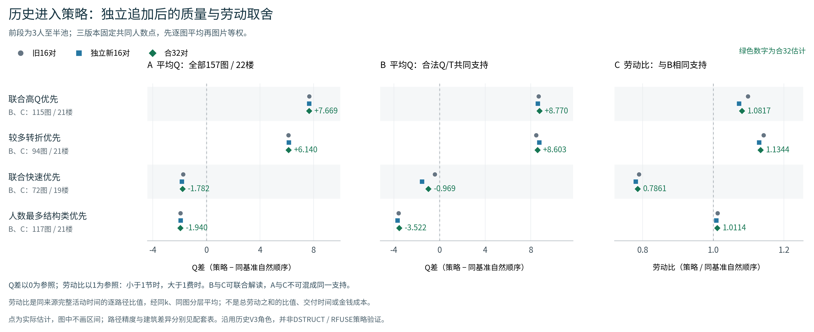

# 图P02：历史进入策略，独立追加后的质量与劳动取舍



**可直接用于论文的图注：** 四种历史进入策略相对同一基础自然顺序的前段效果，比较旧16对、独立新16对及合32对。前段为各图3人至半池；各版本固定共同人数点，先逐图平均，再图片等权。A显示全部157图、22栋建筑的平均Q差；B、C同时使用各策略合法同来源Q/T共同支持，依次为115图／21楼、94图／21楼、72图／19楼、117图／21楼。B为同支持Q差，C为逐路径劳动比经同k、同图分层平均；劳动比小于1表示节时，大于1表示费时。绿色标注为合32估计。旧、新两批重复了高Q及较多转折优先的质量收益，也重复了快速优先的劳动—质量取舍。图中只显示点估计；路径抽样精度与建筑差异分别报告，时间全支持不可估的重抽未通过删除图片补成区间。角色沿用历史V3_BEHAVIOR／V3_JOINT_QT，并非新DSTRUCT或RFUSE策略验证。

## 放置与解读

推荐放在策略子报告第1节或综合报告的进入策略章节。三个面板同时保留，是为了直接展示全体质量结论和实际Q/T用途：例如快速优先在全157图Q差为−1.7823，而合法72图Q/T子域的Q差为−0.9691、劳动比0.786092；不能把两个不同支持的Q数字合并解释。时间是原记录活动耗时，不是排队、交付时间或金钱成本。

图中没有画不确定性区间，以免把全支持可估率不足的时间路径区间与建筑范围叠为一种误差。完整精度及实际反例见`../POLICY32_COMPLETED_FINDINGS_ZH.md`，精确各版本范围见`../policy32_evidence/P01_EARLY_STANDARD_SUMMARY.csv`。

## 文件与复现

- PNG：`P02_policy32_Q_labor_support.png`；PDF和SVG为同图的矢量版本。
- 36行绘图源表：`P02_policy32_Q_labor_support_SOURCE.csv`，保留原英文字段、支持量、版本及源表引用。
- 图形代码：`../plot_policy32_Q_labor.py`，只读取已完成标准汇总，不重抽、不拟合、不融合。
- 来源提交：`b9bcec809fbaec8ab055931a1abb7baa5db44dac`；正式输入为`analysis_policy26/results/POLICY_PRECISION_SUMMARY.csv`。

```bash
python report26/plot_policy32_Q_labor.py --base /path/to/population_extension_20261026
```

默认中文字体为`assets/NotoSansCJKsc-Regular.otf`；也可用`--font`指定已有中文字体。绘图不需要重取原图或重跑端点。
