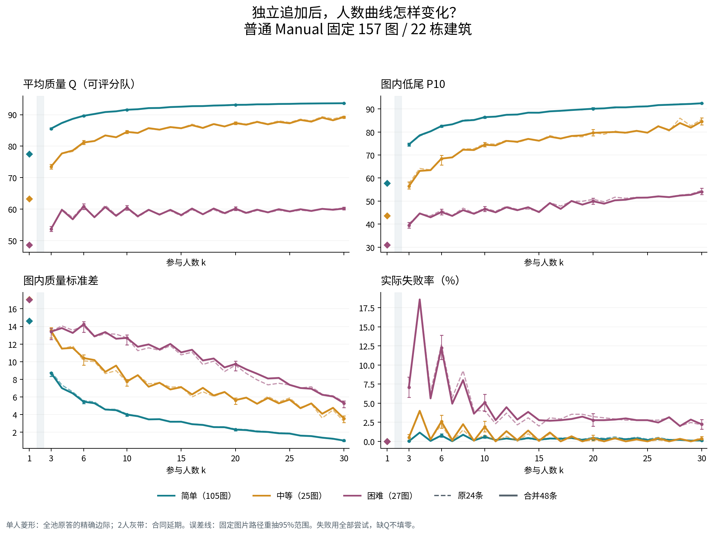
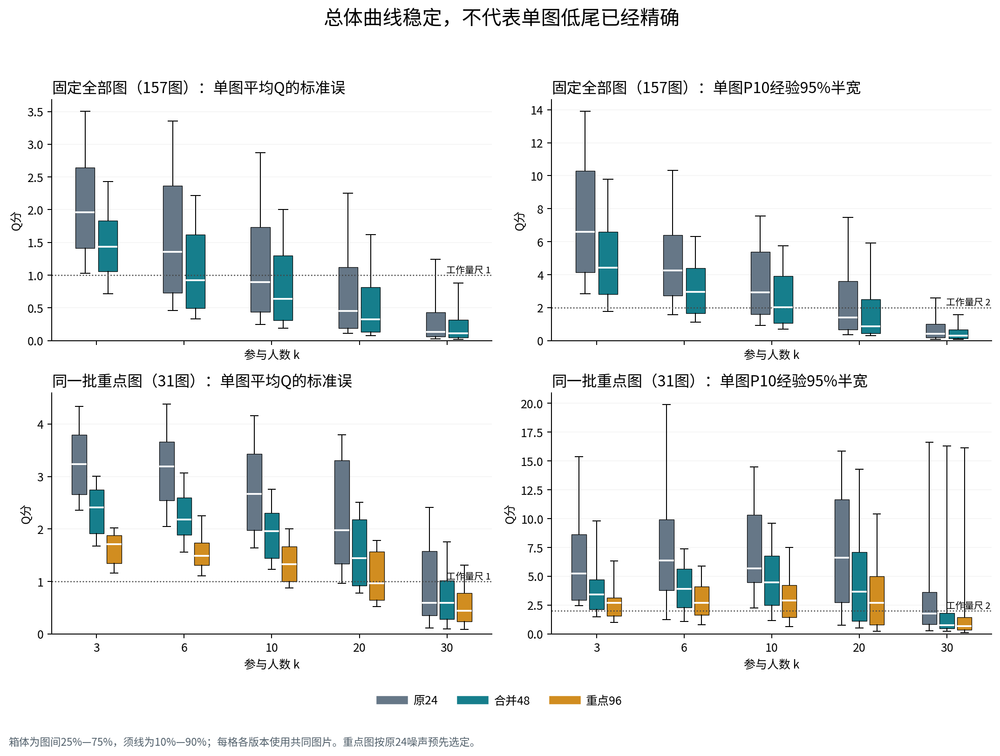
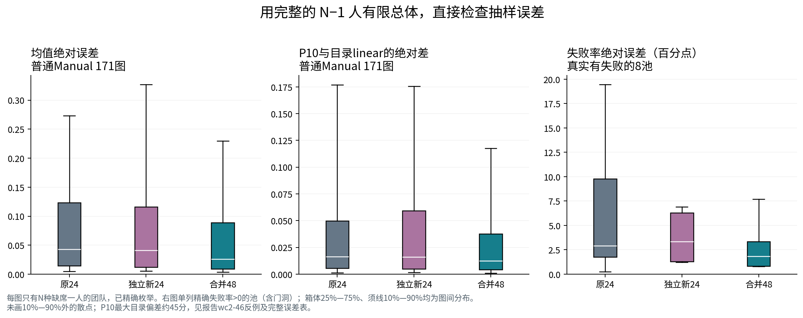
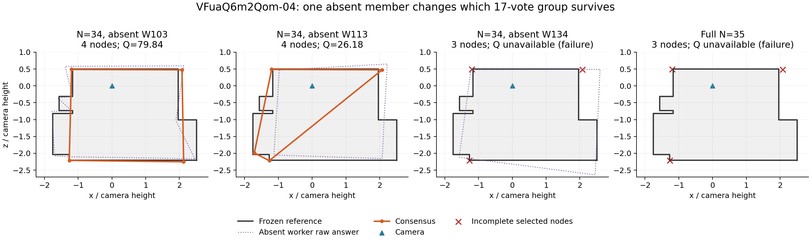
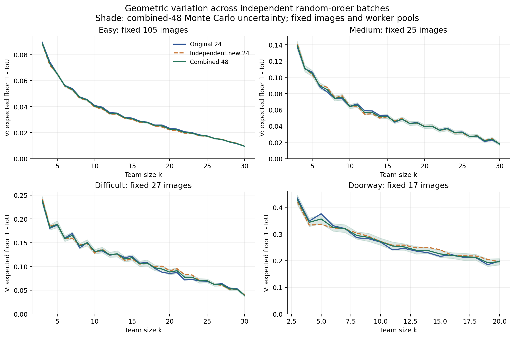
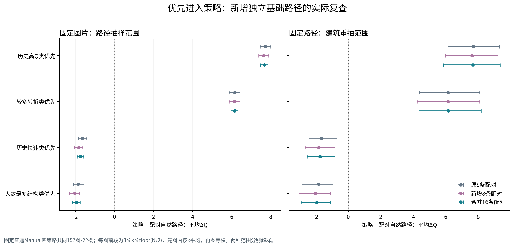

# 人数曲线的随机顺序抽样精度与稳定性：实质补充研究

**日期：2026-10-25。实际读取 main：`40d0fe62dc62f6f6c12723af10195b7abb7bc9fe`。真人数据v2。**

## 一、研究判断：保留宏观曲线，修正小幅方向，改进单图精度

这轮确实新增了独立进入顺序并计算了新团队。最重要的结果是：**原24条足以支持当前跨图平均的主要人数曲线和几何稳定化方向；它不足以把每张图的低人数均值、P10、稀少成功/失败及困难图的小幅后段升降都定得很准。** 新增结果支持采用“统一48条作主比较、重点池96条单列、可行边界用完整有限团队全集”的方案，停止全库继续追加。

新增抽样没有把原结果整体推翻，但使三个结论更清楚：

1. **困难图的部分小幅升降应改写为方向不稳定。** 6→10人原批次−0.742分、独立新批次+0.752分，合并48为+0.021分；20→30人分别+0.378、−0.347、+0.016分。后段均值变化较小，现有结果未显示明确持续升高或下降；低尾和成员波动仍改善。这是对具体方向的修正，不等于证明均值完全不变。
2. **同人数的成员波动收缩得到独立重复。** 固定157图/22楼，3→6、6→10、10→20、20→30人的底面几何V下降，四段各有22/22楼的平均变化为负；逐图多数比例和反例保留。它比困难图后段的微小均Q方向更稳定。
3. **近满员应优先补齐有限团队。** k=N−1只有N支队，本轮得到全部精确边际。一张图的新24条几何MCSE看起来很小，却明显偏离完整有限总体；另一张图的35个缺席队在约26、61、80分和失败之间跳变。重复随机顺序不如补齐尚未计算的少数队有效。

增加随机顺序R改变的是对同一k团队分布的**估计精度**；增加参与人数k才改变团队分布本身。原24、新24、合并48的差异称为估计修正，不能写成“增加抽样提高了标注质量”。

## 二、实际做了什么，复用了什么

原实验核实为229个人员池、196张不同图片、318816个端点、404082个前缀连接。219个较大池的自然顺序均为旧4条加追加20条；其5256条原MC顺序已按生成代码逐人还原一致。另10个很小的Semi池穷尽排列。每条顺序内部无放回；同一个成员集合复用确定性端点；每个团队从原答独立融合，未把上一阶段融合输出继续与新人融合。

要估计的总体是：每个固定合法人员池内、每个人数k的所有等概率k人子集。新增自然顺序用排序后的成员名单调用NumPy `default_rng(seed).permutation`，每条内部无放回，各顺序独立生成，因此任一k前缀对所有k人子集均匀；不同路径可以恰好访问同一队，保留其抽样频数。种子由已冻结namespace、主种子2026102501、pool_id、新路径编号的规范JSON做SHA256取前8字节小端整数派生，完整种子和成员顺序均已保存；没有按Q挑选种子。统一主比较在每图内给48条等权，再图等权；53个重点池不因路径更多而在总体占更大权重。

本轮主研究共有177个普通Manual池/22楼、17个门洞Manual池/9楼。普通Manual固定N≥20为168图/22楼，N≥30为157图/22楼；N≥35为92图/22楼，实际全部N=35。N≥30中的简单/中等/困难分别105/25/27图；N≥35分别71/13/8图。普通Semi32池/12楼仅重聚合原结果，没有新增Semi顺序；OOS不进入普通质量分析。

|工作|实际数量|性质|
|---|---:|---|
|194个Manual池各新增24条|4656条自然路径|独立于原24，构成公平主比较|
|旧噪声预选53池各再加48条|2544条自然路径|普通各难度12池＋全部17门洞，累计96；另存不含旧样本的新72|
|四策略各追加8个配对base，157个共同池|5024条策略路径|沿用楼外标签和实际目标成员，未重新分类|
|新增顺序总数／前缀连接|12224／403376|其中自然7200、策略5024|
|精确边际目录|14904条|单人、N−1、满员及6个N≤10池的所有非空子集；2人仍延期|
|去重请求／旧端点复用|340055／16246|旧端点来自固定main，不重复打包|
|本轮主新增端点记录|323809|主原生执行323807＋计时批次中恰好命中设计的2队|

完整执行账：新增记录中2114条单人、7874条两人合同延期、313821条三人及以上。B8L2/D10可评304202条；三人及以上302088条可评、11733条不可评。主计算6进程耗时约41.3分钟，含原生汇总及逐端点读取约45.3分钟；这是本环境的执行量，不是劳动时间或金钱成本。

完整路径与精确边际共用缓存，精确边界只带来2441支“仅为精确边际而新增”的队；其它所需队已由旧缓存或随机/策略路径覆盖。194个满员团队全部复用旧结果，没有把重复满员当作新的独立团队。其余19个计时新队单列保留，不进入主估计。

依据：`design/DESIGN_RECEIPT.json`、`design/ENDPOINT_DEPENDENCIES.csv.gz`、`new_endpoints/EXECUTION_ACCOUNTING.json`、`inventory/`、`engine/OLD_ORDER_SEED_CHECK.json`。

## 三、平均Q：宏观曲线已稳定，小幅分段需要更谨慎的实际解释

### 3.1 固定157图上的原24、新24与48

下表固定N≥30的157图/22楼。MCSE是固定图片和人员池下的一个Monte Carlo标准误，不是95%区间半宽。

|人数k|原24均Q|独立新24均Q|合并48均Q|原24 MCSE|48 MCSE|共同支持|
|---|---|---|---|---|---|---|
|3|78.149|78.209|78.183|0.180|0.128|157图／22楼|
|6|83.333|83.382|83.349|0.157|0.114|157图／22楼|
|10|85.061|85.147|85.104|0.131|0.090|157图／22楼|
|20|86.490|86.580|86.538|0.104|0.070|157图／22楼|
|30|87.248|87.127|87.187|0.068|0.047|157图／22楼|

所列人数点的新旧总体均值接近，原24已经能辨认曲线的大形状。这个精度来自逐图平均后的汇总，不意味着每张图同样精确。图间/建筑间差异远大于这里的路径误差，不能把这个小MCSE当作推广到新建筑的误差。

### 3.2 人数变化：同路径配对，固定容量图片集合

“路径95%”固定图片重抽完整路径；“建筑95%”固定已观察路径、整栋建筑重抽。两种范围分别说明，都是逐项范围，不是整条曲线的同时置信带。

|条件|固定容量|人数段|原24 ΔQ|新24 ΔQ|48 ΔQ|路径95%|建筑95%|支持及正/负图|
|---|---|---|---|---|---|---|---|---|
|全部|N≥20|3→6|5.472|5.244|5.346|[5.074, 5.602]|[4.776, 5.894]|168图/22楼；+165/−3|
|全部|N≥20|6→10|1.817|1.956|1.895|[1.684, 2.098]|[1.617, 2.243]|168图/22楼；+149/−19|
|全部|N≥20|10→20|1.432|1.437|1.438|[1.255, 1.627]|[0.919, 2.098]|168图/22楼；+141/−27|
|全部|N≥30|20→30|0.758|0.547|0.649|[0.499, 0.798]|[0.114, 1.263]|157图/22楼；+127/−30|
|全部|N≥35|30→35|0.227|0.369|0.298|[0.197, 0.403]|[-0.074, 0.647]|91图/22楼；+63/−28|
|全部|N≥30|30→实际满员|0.294|0.402|0.348|[0.267, 0.429]|[-0.067, 0.861]|156图/22楼；+102/−44|
|困难|N≥20|6→10|-0.742|0.752|0.021|[-0.832, 0.848]|[-1.322, 1.500]|29图/15楼；+16/−13|
|困难|N≥20|10→20|-0.216|-0.387|-0.298|[-1.137, 0.487]|[-2.862, 2.076]|29图/15楼；+13/−16|
|困难|N≥30|20→30|0.378|-0.347|0.016|[-0.623, 0.676]|[-2.330, 2.666]|27图/14楼；+15/−12|

3→6人的大幅收益保留；合并48在168图中165图均Q上升。困难6→10和20→30的小幅方向在独立批次间反转，应收紧原来对“回落”或“继续提高”的描述。困难10→20平均约−0.298分，同时P10提高2.923分、图内SD降低2.695分；20→30平均约+0.016分，同时P10提高4.153分、SD降低4.439分，后两项分别有24/27图按改善方向变化。均值平台与低尾/成员波动继续改善可以同时成立。

30→35仅使用实际N=35的92图；Q比较有91图，因为一个满员团队失败。30→实际满员固定N≥30的157图，Q共同支持156图，并保留10张实际N=30图片的零变化。失败统计仍使用全部92或157图。满员同队的SD为0是有限池成员集合唯一的结果，不代表参考正确、没有定位偏差或融合一定成功。

分层细节也不能省略：困难图3→6均Q约+7.321、P10+5.859，但条件SD约+0.631、失败率约+4.741个百分点；这里不是所有风险同时降低。普通图整体3→6失败率也增加约1.612个百分点。质量、结构波动和实际失败必须并列。

依据：`key_tables/T01_FIXED_SUPPORT_PERSON_COUNT_CHANGES.csv`、`T02_FIXED_SUPPORT_CURVE_LEVELS.csv`；逐图/逐楼见 `analysis_precision/new_results/`。

### 3.3 重要质量分项

同一固定157图范围、共同可计算图片。B8三个block是损失量，越小越好；不能把它们当作可以直接相加的Q分变化。保留二维IoU等现有量，未改变评分。

|k|分项|原24|合并48|估计修正|共同图片|
|---|---|---|---|---|---|
|3|B8底面损失|0.26751|0.26698|-0.00053|157|
|3|B8方向损失|0.26779|0.26752|-0.00027|157|
|3|B8高度损失|0.01253|0.01248|-0.00005|157|
|3|二维IoU|0.89541|0.89513|-0.00028|157|
|20|B8底面损失|0.13632|0.13632|0.00000|157|
|20|B8方向损失|0.15987|0.15987|0.00000|157|
|20|B8高度损失|0.00463|0.00463|0.00000|157|
|20|二维IoU|0.93048|0.93119|0.00071|157|
|30|B8底面损失|0.13727|0.13707|-0.00021|157|
|30|B8方向损失|0.15024|0.15046|0.00022|157|
|30|B8高度损失|0.00416|0.00416|-0.00000|157|
|30|二维IoU|0.93219|0.93224|0.00005|157|

完整13项的逐图均值和独立新24对照在 `NATURAL_COMPONENT_POOL_K_BATCH_POINTS.csv.gz` 与 `NATURAL_COMPONENT_COMMON_SUPPORT_COMPARISONS.csv.gz`。D10的曲线及人数配对差也完整保存，不为迎合B8L2方向选择评分。

## 四、单图精度、P10与有限总体检查

### 4.1 24条在哪些位置不够细

仍固定普通N≥30的157图。下表为**逐图精度的中位数**及达到工作量尺的图片数；不是跨图总体MCSE。P10为图内、同k、可评分团队的NumPy线性经验分位数；SD为图内样本SD（ddof=1），再按图平均。

|k|原24均Q MCSE|48均Q MCSE|MCSE≤1图数|原24 P10半宽|48 P10半宽|P10半宽≤2图数|
|---|---|---|---|---|---|---|
|3|1.959|1.432|14/157 → 35/157|6.602|4.409|6/157 → 20/157|
|6|1.352|0.920|60/157 → 85/157|4.243|2.963|31/157 → 47/157|
|10|0.893|0.640|83/157 → 107/157|2.913|2.031|52/157 → 77/157|
|20|0.455|0.322|115/157 → 126/157|1.411|0.878|97/157 → 113/157|
|30|0.136|0.112|138/157 → 144/157|0.421|0.305|133/157 → 143/157|

低人数处单图均值和P10仍比总体曲线粗得多。48改善估计，但不能把“总体均值差不到0.1分”转译为“每图都精确到0.1分”。重点96只与同一预选子域的24/48比较；普通重点画到30人的固定支持是31图/15楼，门洞17图全部有96。对应表保留独立新72，避免把按旧高噪声选图后的回归均值全部算成追加样本的功劳。

同一预选普通N≥20的35图，在k3达到均Q MCSE≤1的图片数，原24/48/96均为0；k20则为7/11/19。k3的P10经验95%半宽≤2有4/9/16图，k20有9/12/16图。追加样本有用，但96仍不足以给这些高波动低人数单图精确到1分的均值判断。分母为35而非全部36个普通重点池，因为其中一池N<20；完整同支持小表为 `analysis_precision/new_results/FINAL_FOCUS_MATCHED_PRECISION_REACH.csv`。

P10本身不一定总比均值难估。VFua-04低尾集中于一个密集低Q峰，所以其P10很稳定，而均Q在两个相隔很远的峰之间更难确定。反过来，在连续分布近似下，24条中期望只有约2.4个观测处于总体最低10%，经验bootstrap无法制造没有观察到的尾部。报告同时保留二项秩界；若要求单图P10相差一两分的判断，不应只凭很窄的经验范围。

对于24/48/96条零失败样本，未穷尽时的单侧95%二项上界仍约11.735%/6.050%/3.072%。这是抽样可能遗漏风险的通用量尺；**本轮精确N−1检查并没有发现旧24完全漏掉真实失败的池**，不能用理论可能性代替实际发现。

### 4.2 k=N−1：直接比较完整有限总体

表中“精确”指当前固定人员池下全部团队的冻结评分分布，不是新的物理场景真值。精确总体SD用ddof=0；原抽样SD仍用ddof=1。P10同时保留完整目录的linear口径和均匀离散分布的逆CDF分位数；二者在小有限总体的跳跃处可以不同。下表P10的“误差”是相对完整目录linear参考的差，不全部等同于对逆CDF分位数的纯Monte Carlo误差。定义敏感性另表保存。下表普通Manual的N−1边际只包括N>10池；小池全集另列。

|量|批次|图片|平均绝对误差|绝对误差P90|RMSE|
|---|---|---|---|---|---|
|均Q|old24|171|0.173|0.273|0.520|
|均Q|new24|171|0.182|0.327|0.584|
|均Q|pooled48|171|0.128|0.230|0.432|
|P10|old24|171|0.445|0.177|3.603|
|P10|new24|171|0.349|0.176|3.453|
|P10|pooled48|171|0.343|0.118|3.462|
|失败率（百分点）|old24|171|0.040|0.000|0.501|
|失败率（百分点）|new24|171|0.082|0.000|0.830|
|失败率（百分点）|pooled48|171|0.021|0.000|0.196|

两种P10参考的总体判断一致：普通171个大池的N−1，旧24→48的MAE以目录linear为0.445→0.343，以逆CDF为0.452→0.347；误差≤2分均为97.66%→98.83%。单人边际仍较粗，两个定义的MAE分别4.208→3.105、4.495→3.170。重点36池单人的48→96，linear MAE反而2.016→2.559，逆CDF为2.324→2.318，不能统一写为“96进一步改善P10”。这些有限边际已完整计算，可直接采用完整目录。门洞 `q9vSo1VnCiC-13` k32的48条误差由linear参考1.743变为逆CDF参考2.177，是跨过2分工作阈值的具体定义敏感例。详见 `analysis_precision/p10_definition_sensitivity/P10_PAIRED_VERSION_COMPARISON.csv`。

几何检查提供一个更鲜明的精度诊断：`rPc6DW4iMge-06`，N=26、k=25，精确V=0.075846。原24估计0.103640，独立新24估计0.009781；新批次的样本内jackknife MCSE只有0.000810，但实际误差为−0.066066。合并48为0.060356。整批样本没有充分覆盖少数不同形状的团队时，样本内标准误会偏窄；补齐26种缺席队能直接解决该人数点的问题。这个例子来自已枚举边际，没有追加或挑选种子。

在普通177图的完整N−1几何边际（含6小池）上，原24的V平均绝对误差0.0007565，48降至0.0003462；绝对误差P90从0.0009952降到0.0004339。宏观精度良好与上述单图反例并存，应采用对应层级的判断。

### P10特别例：两批接近、甚至看遍所有队，也可能仍停在错误的质量峰

`wc2JMjhGNzB-46`，N=28、k=27，完整28队中有4队Q在50.908—52.601，其余24队Q在97.314—98.562。低峰的精确概率为4/28=14.286%。低峰4队分别缺席W132、W107、W111、W131，均5节点/5转折；高峰为6节点/6转折。这些是已保存端点的描述，不凭人员类别猜测。

|批次|低峰出现次数／路径数|不同团队数|样本linear P10|
|---|---:|---:|---:|
|原24|1/24|13|97.415|
|独立新24|1/24|18|97.408|
|合并48|2/48|24|97.408|
|独立新72|6/72|24|97.321|
|合并96|7/96|28|97.387|
|完整目录，团队均匀权重|4/28|28|52.406|

均匀有限分布的逆CDF 0.1分位为51.951，与目录linear只差0.456分；两种定义都处于低峰，不能解释随机批次约45分的高峰偏移。96条已经见过全部28支队，随机频数却把低峰估为7.292%，经验P10因此仍在高峰。**独立批次很接近，并不总能证明一个离散尾部已经准确；只要有限团队全集已经齐全，就应按完整目录等权计算，而不是继续重复随机顺序直到出现预期P10。**

原24、新24、48、96都保留原自然频数，不为得到这个结论改权重或删种子。完整枚举的等权是另一个明确定义的精确边际结果。小表见 `analysis_geometry/case_WC2_46_P10/`；分位定义对照见 `analysis_precision/p10_definition_sensitivity/`。

### 4.3 VFua-04：只补14队，比不断重复近满员顺序更有效

`VFuaQ6m2Qom-04`（困难、N=35）的35个N−1队，21队已缓存，本轮补14队。32队可评、3队失败；可评Q的精确均值54.679、P10为26.205、总体SD为25.625，失败率3/35=8.571%。其中15队落在约80分、14队约26分、3队约61分，另3队失败。满员35人的唯一团队也失败，Q留空。

原24均Q54.516恰好接近精确均值；独立新24为58.548，48为56.485，96为53.167。相应均Q MCSE从原24的5.345降至48的3.878、96的2.709。增加样本改善预期精度，点估计这一次并不逐步靠近精确值。这个人数点已有35队全集，应直接采用精确结果，而不是继续随机加路径。

保存的票账说明了分峰：去掉W103时关键身份组17票进入，另一组16票不进入，四节点Q=79.845；去掉W113时两处支持反向，仍四节点但Q=26.176，连接切过底面；去掉W134时两处都16票，三节点失败。保留成员W104的原答角点在不同队里的身份对应也改变，不能简化为只减去固定组的一票。k=34门槛17，与满员k=N=35的门槛18分别保留；没有用34人票数冒充35人票数。

精确成员、原答对象、票账、连接和可重画几何见 `analysis_geometry/case_VFua_04/`。这是算法对人员信息的条件响应例，不是对特定人员的普遍优劣判定。

## 五、门洞单列：不能把少量可评分团队的Q当作可靠完成

17个门洞池/9楼，均追加到96条；主比较仍用平衡48。下表使用普通实验以外的门洞支持。

|人数段|48 ΔQ|路径95%|建筑95%|ΔP10|ΔSD|失败变化pp|Q支持|
|---|---|---|---|---|---|---|---|
|3→6|6.464|[5.234, 7.779]|[5.398, 7.586]|6.224|-0.017|8.95|17图/9楼|
|10→20|-2.339|[-3.469, -1.148]|[-6.526, 0.550]|1.547|-3.584|-2.94|17图/9楼|

门洞3→6平均Q改善伴随失败率上升，10→20平均Q下降伴随成员波动收缩，独立新批次保留了这些主要现象。它与普通Manual不能合并成一个已验证的人数规则。门洞30→实际满员的Q共同支持只有11图，而失败的容量支持为16图；Q平均变化约+0.056，失败率增加约9.245个百分点。不同指标的支持不能互换。

普通与门洞共194池的N−1精确边际中，8个池存在失败（2个普通、6个门洞），原24都已经见过失败。相反，两个门洞池的**稀少成功**在原24里没有出现：

|图片；人数|精确可评／失败|唯一可评队的缺席者；Q|原24／新24／48／独立新72／96的可评分路径数|
|---|---|---|---|
|B6ByNegPMKs-42；34池取33|1／33|W121；45.534|0／1／1／2／2|
|b8cTxDM8gDG-08；35池取34|1／34|W123；14.680|0／1／1／1／1|

精确失败率分别97.059%、97.143%。旧Q缺失、新Q出现只表示条件可评支持出现，不能写成抽样“提高了质量”。精确条件SD=0也只因为各有一支可评队，和可靠融合完全不同。表保留69支精确队和192条已登记路径，见 `analysis_geometry/case_missed_failure/RARE_SUCCESS_*`；没有追加案例团队或恢复筛除资格。

## 六、几何波动：原结论保留，而且比小幅均Q更稳定

V为两个独立均匀k人团队在双方完整底面可计算时的平均1−IoU。样本U统计只去掉同一路径和自身配对；不同路径偶然同一队的零距离保留。合并48包含新旧跨批配对，通常不是两批V的简单平均。误差用删除完整路径的jackknife，不能把R(R−1)/2个距离当成独立团队。

固定157图/22楼：3人V原24为0.122150，新24为0.122986，48为0.122364；20人分别0.036518、0.036727、0.036649；30人分别0.016013、0.016157、0.016054。3人聚合MCSE从0.001446降至0.000983。

|人数段|合并48 ΔV|路径近似95%半宽|下降／上升图|建筑等权ΔV|下降建筑|
|---|---:|---:|---:|---:|---:|
|3→6|−0.043361|0.002049|157／0|−0.043416|22／22|
|6→10|−0.019304|0.001442|153／4|−0.020013|22／22|
|10→20|−0.023050|0.001428|156／1|−0.023374|22／22|
|20→30|−0.020596|0.001250|156／1|−0.018980|22／22|

建筑等权与图等权同时保留；这里的逐楼范围是描述分布，不当作建筑bootstrap区间。固定N≥30简单/中等/困难的3人V分别0.088517/0.139093/0.238501，30人为0.009561/0.018018/0.039483。17张门洞3人V为0.427784，20人仍0.196034。困难和门洞的剩余几何波动明显更大。

同一157张普通N≥30图中，3→30人的质心距离0.158551→0.022362，平均高度差0.044410→0.005130（均为相机高度单位），实际转折数绝对差0.406461→0.074856，节点数绝对差0.400071→0.070506。它们支持几何稳定化，但不能替代Q或失败。

依据：`analysis_geometry/GEOMETRY_FINDINGS_ZH.md`、`analysis_geometry/results/GEOMETRY_FIXED157_INTERVAL_MAIN.csv`、逐图/逐楼表及完整精确边际表。

## 七、原优先进入策略：平均大方向已够用，单图和细小低尾还不够

原策略实际使用8条配对base，不是24条全部用于每个策略。本轮另加独立8条，比较8/8/16。固定四策略共同支持157图/22楼，N≥20；它与自然N≥30的157图只重叠148图，各有9图独有。楼外标签与历史角色不重训，按既有特征含义对齐目标类，具体目标成员随折保存。

每图前段为3≤k≤floor(N/2)，先在同base、同人数的共同Q支持上取策略−自然，再图内按人数平均、最后图等权。失败用全部非延期配对尝试；坏尾为共同Q事件损失超过5分的比例，按相同层次汇总。

|角色优先策略|原8 ΔQ|新8 ΔQ|16 ΔQ|路径95%|建筑95%|正／负图|Δ失败pp|损失>5分%|
|---|---|---|---|---|---|---|---|---|
|历史高Q类优先|7.710|7.624|7.672|[7.470, 7.849]|[5.870, 9.351]|+152/−5|-1.11|3.64|
|历史较多转折类优先|6.146|6.136|6.150|[5.951, 6.325]|[4.342, 8.193]|+135/−22|-0.79|6.50|
|历史快速类优先|-1.651|-1.831|-1.745|[-1.911, -1.589]|[-2.532, -0.819]|+53/−104|0.61|20.44|
|人数最多结构类优先|-1.845|-2.034|-1.941|[-2.155, -1.754]|[-2.912, -1.102]|+31/−126|1.14|20.86|

高Q与较多转折优先的大幅正向作用，在独立新基础路径中保持；原8条已足以在当前图片集合上辨认这些大平均方向。高Q策略原/新逐图方向一致154/157，多转折148/157；快优先130/157、人数最多结构类优先133/157。不能把总体方向稳定写成每张图的策略幅度都稳定。

快速类优先的合并前段P10差约+0.401分，但原8、新8分别只有+0.351和+0.062，建筑重抽范围跨零；不据此采用“改善低尾”的推荐。它同时有均Q代价、约20.438%的>5分坏尾事件和失败率上升。人数最多结构类优先的总体负向也保留。四种策略的D10方向与B8L2一致，完整低人数3→6和后段20→N−1结果另表保存。

劳动时间只作有合法同来源记录的配对描述：

|策略|共同Q/T图片|平均劳动比（策略/自然）|同一Q/T支持的ΔQ|
|---|---|---|---|
|历史高Q类优先|127|1.115|7.724|
|历史较多转折类优先|124|1.183|7.030|
|历史快速类优先|89|0.793|-0.860|
|人数最多结构类优先|140|1.051|-3.496|

这些比值先在图内同人数配对事件上平均，再按人数、图片平均，**不是全库总工时之比**；每行支持不同，不能把时间子域和全157图Q直接拼成一项收益。没有把活动耗时当作排队、并行交付或金钱成本。新旧批次的时间覆盖不同，本报告不拿不同时间支持均值相减来宣称抽样稳定。

依据：`analysis_policy/results/POLICY_COMMON_PAIRED_EVENTS.csv.gz`、`POLICY_PRECISION_SUMMARY.csv`、`key_tables/T06_*.csv`、`T07_*.csv`。

## 八、今后采用什么计算规模，哪些可以停止

|研究用途|本轮判断|采用方案|
|---|---|---|
|当前多图总体大形状、早段明显收益、几何波动下降|原24已有效，独立新24重复主要结果|本轮48作更精确展示；无需全库继续加到96/数百|
|困难图小幅均Q升降、逐图低人数差异|24常不足；部分方向已修正为小变化/方向不稳定|报告实际区间和反向图，不追求曲线单调或显著|
|逐图均Q精细比较|48改善，低人数仍常未到MCSE≤1|有具体决策需求时，以目标误差估算预算；重点96已单列，不将其当全体新验证|
|逐图P10与稀少失败/成功|不能仅凭经验bootstrap窄范围下结论|并列有效路径、不同团队数、失败分母及秩/二项界；边界优先精确枚举|
|单人、N−1、满员，小池|有限空间可低成本完整覆盖|采用HYBRID48边界精确表；停止随机重复这些人数点的边际估计|
|原四策略总体平均大方向|原8与新8一致；16降低路径误差|采用16配对主结果，不需为总体角色排序继续全库扩充|
|单图策略推荐或细小低尾收益|仍有换向/成员效应|保持base配对，只对真正将采用的具体比较给精度预算|
|Semi|既有32池诊断可用，10个小池已精确|本轮无新增Semi验证；不把Manual追加结果当作Semi已验证结论|

统一48条的完整路径保留人数配对；精确边际不能代替“同一次进入过程”的变化。推荐展示 `HYBRID48_IMAGE_CURVES.csv.gz` 时注明：k1/N−1/full及6小池合法k精确，其它k用48条。k2和确实全失败的Q保持空缺；重点96不混入这条统一采用曲线。

预算公式可用已观察的s²、可评分比例和允许MCSE估算。以48条下普通固定N≥30的3人结果为例，要求单图均值MCSE约1分，所需总路径数的中位估计：简单约68、中等约190、困难约143；若要求近似95%半宽1分，则约260/730/550。它们是针对当前条件的预算近似，不是保证或新实验结果，也不是P10的预算公式。只需要总体判断时，继续把所有池加到这些数量没有必要。

本轮停止依据是：先用旧24的精度确定统一24追加与53池追加48的有限预算，再完成独立批次、有限边际和策略共同base检验。未以显著性、升降方向或曲线平滑程度决定继续。当前已经停止新增融合；残留的是明确的单图精细精度需求，不是主结果尚不能交付。

Semi的次要诊断：普通Semi有32池/12楼，k3均Q MCSE中位约1.021；容量足够的22池在k10为0.510、k20为0.213，P10经验95%半宽中位分别约1.952、0.461。该描述沿用旧路径，不能冒称追加样本验证；详表 `analysis_precision/old_diagnostics/SEMI_SECONDARY_PRECISION.csv`。

## 九、文件、复现和研究台采用

本轮未修改人员分类、资格、参考、GT、环序、融合门槛、对应、定位、连接或B8L2/D10。Manual与Semi分开，门洞单列。每个未知、失败、延期和缺失状态有明确键与分母。新端点是实算记录，旧端点以固定提交和路径引用，未复制历史大表充当新增数据。

核心键：`pool_id`、`path_id/k`、`base_path_id`、`team_key`、`member_workers`、`member_object_ids`、`reference_id/reference_version`。精确种子用完整整数字符串保存。全标量和轻量几何有全部新增记录；大几何包保留完整身份票账和连接。`geometry_available`只表示候选字典存在，不能代替有效完整几何资格。

文件入口：`CLAIM_INDEX_ZH.csv`（中文主张索引）、`FIELD_CONTRACT_ZH.md`、`REPRODUCE_ZH.md`、`CURRENT_FILES.csv`（独立交付）。报告/代码、精确设计、主数据及完整票账分别打包；原24大输入按 `inventory/NECESSARY_SOURCE_FILES.csv` 的版本和哈希复用。PNG/PDF及作图CSV可接入研究台，HTML版嵌入主要图，无需外部原图目录即可阅读。

保存后对实际取回的ZIP读取到结尾，继续读取内部CSV/gzip、JSONL/gzip，并核对行数、字段、成员前缀与端点/几何关联。汇总导出中遇到的文件缺尾只通过固定数据、固定种子重新导出受影响派生表处理，未新增融合或按报告数字补造行。最终取回验证结果单独保存，见 `verification/` 与交付验证附件。 本次从实际取回ZIP中检查340055个请求、12224条顺序、403376个前缀、323809条新增标量/轻量几何、14904条精确目录以及323807条完整原生状态；重复键、缺失键、成员前缀不一致和精确权重错误均为0。

交付时还修正了策略顺序表的显示字段：5,024个策略行原来继承自然base的 `workers/worker_order`，实际前缀、团队及融合始终使用正确策略顺序。本版从冻结前缀恢复正式顺序，并核对同base的target优先稳定分割；5,022行内容改变，2行原来已一致，7,200个自然行原字段不变。新增 `base_worker_order` 明确自然顺序。403,376条前缀的团队键全部核对；9份请求/关联/结果SHA未变。原表、原代码和更正回执保留，P01采用第2版；没有把元数据修正写成新实验。

**本轮适合进入论文主文的内容**：宏观曲线的独立随机重复；困难均值小幅方向与稳定性改善的区分；逐图与总体MC精度差异；近满员有限枚举的成本优势；主要优先策略的独立base重复。单图精细概率、稀少成功和具体成员机制作为有范围的条件结果与案例，不写成统一成功人数规则。
