# HOHONET 人员标法分类与换人、换类研究

研究版本：20261021 v1。输入主线：GitHub main `6503e2f54966a74352a6ec526f211fc3871c1427`。主评分 B8L2，敏感性评分 D10。

## 一、推荐采用的分类及其价值

**本轮已经形成实际人员类别，并完成原答、跨建筑和团队替换检验。推荐以 Manual 的结构表达层级、Semi 的位置尺度层级作为主标签，另保留独立的 A2 几何关系分区。** 分类不是永久人格或能力等级，而是这批任务中可以在原答中辨认、由楼外历史支持的标法工作分类。

Manual 最稳定的差别是：面对短边、窄转折和几何自遮挡时，有些人员更常保留方向转折，另一些更常合并或省略。这个差别在简单图很小，在困难结构中明显增大，并会改变节点支持与融合结果。Semi 未复现同样的通用短转折分类，但发现了五人的较低推导高度组；其历史差异能够传递到有方向的团队几何变化。

|推荐标签轴|实际分区|采用判断|主要解释的现象|
|---|---|---|---|
|Manual 结构表达|M0 40人、M1 19人；4个细类|粗类采用，细类按条件与成员敏感性使用|哪些结构机会更常被保留或简化，何时形成局部补票|
|Semi 位置尺度|SP_LOW 5人、SP_OTHER 54人；3个细类|较低高度粗类采用；底面积细类主要限旧批|顶部、底部与底面距离共同产生的推导高度和面积差异|
|Manual A2 几何关系|17、23、19人三类|作为独立补充分区采用|相同点数下，整份绑定原答的几何邻近关系|
|Semi A2 几何关系|24、17、18人三类|作为独立补充分区采用，匹配Q/来源后的效应较小|Semi终稿整体几何关系，不继承Manual标签|
|Semi 终稿结构候选|S0/S1及S00/S01/S10|保留冻结结果供解释与复现，不采用为新批通用类型|旧批较少删减初始化等机制；新批跨图重复未成立|

每种条件都交付62人的名单，其中59人赋主类，W019、W022、W026明确标为证据不足。文件 `labels/manual_labels.csv`、`labels/semi_labels.csv` 为全数据描述标签；`labels/lobo_labels.csv` 为评价目标建筑时必须使用的楼外标签，共2,108行，覆盖Manual实际22楼、Semi实际12楼。两条研究路线没有被拼成未经检验的交叉大类。

本轮实际保存了 **5,810个不同团队**，包括保持构成换人、改变类别块、精确配比、完整人数路径，以及用户指定的 jtc-26 配对。旧库另外复用63,476个已有端点对。最清楚的团队发现是：普通Manual换入较多短转折类，在n=5换1人、n=9换2人时有平均正收益；Semi较低高度类主要体现为几何方向变化。jtc-26则是明确的类内成员反例：两种分类都把W106/W113分在同类，但关键第三票仍使他们的团队贡献截然不同。

证据入口：`labels/class_catalog.csv`、`route_a/selected_method_validation.csv`、`route_b/lobo_expression_summary.csv`、`fusion/SUMMARY.csv`、`fusion/EXTRA_SUMMARY_RECEIPT.json`。

## 二、实际成员：粗类、细类和条件限制

### 2.1 Manual：常规或简化表达，与较多短转折表达

|粗类|细类及名称|人数|成员|
|---|---|---:|---|
|M0 常规或简化表达|M00 较少转折|6|W008、W029、W030、W034、W035、W037|
|M0 常规或简化表达|M01 常规转折|34|W006、W010、W014、W018、W031、W033、W100、W101、W103、W104、W105、W106、W107、W108、W110、W111、W113、W114、W116、W117、W118、W119、W120、W121、W123、W124、W125、W127、W128、W129、W131、W132、W133、W134|
|M1 较多短转折表达|M10 条件性较多转折|13|W001、W011、W012、W013、W015、W017、W021、W027、W028、W032、W036、W102、W122|
|M1 较多短转折表达|M11 较强短转折表达|6|W002、W109、W112、W115、W126、W130|

M0内部也存在区别。M00的非近共线转折残差平均为−0.699，M01为−0.143；M10与M11分别为+0.283、+0.582。相应短转折边残差为−0.242、+0.014、+0.241、+0.450。这些是先同图同行调整、再按建筑等权的描述量，不是正确率。

M00不意味着总角点数在每图都少。例如W037会在减少实际方向转折的同时增加近共线分段点。M11也不意味着每图都保留所有必要细节。它与旧R5不完全相同：W122进入M10，W002进入M11，说明本轮分类确实由更广历史重新形成。

粗类删一建筑后的平均标签一致率为99.38%，细类为95.53%。细类对来源与容量更敏感：新批M10的全数据成员只有W102/W122，M10和M11的强弱不能直接写成每个条件下的固定排行。各人一致率与缺失原因均保存在逐人表。

### 2.2 Semi：较低推导高度，与其余尺度表达

|粗类|细类及名称|人数|成员与采用条件|
|---|---|---:|---|
|SP_LOW 较低推导高度|SP_L 较低推导高度|5|W029、W030、W035、W105、W119；作为条件性几何类型保留|
|SP_OTHER 其余尺度表达|SP_A 较大推导底面积|5|W012、W031、W034、W037、W131；前四名旧批有支持，W131的新来源细类证据未重复；面积差本身不证明采用了不同目标范围|
|SP_OTHER 其余尺度表达|SP_T 常规尺度比较组|49|其余49名已赋类Semi人员，完整成员见附录；它是比较组，不表示内部所有标法相同|

SP_LOW/SP_OTHER是已冻结三类的直接聚合，细类仍为SP_L/SP_A/SP_T，没有为提高融合成绩重新拟合。全数据Ward树也呈现这一粗细关系。粗/细层的平均楼外标签一致率分别为98.84%/91.91%。SP_A的来源限制与SP_T的比较组性质直接写入采用状态字段。

三名未赋类人员的原因分别是：W019和W026在相应条件没有可比普通历史；W022的Manual仅2图/1楼，Semi没有可比普通历史。历史筛除和不可用作答仍列入库存说明，赋行为标签不会恢复正式质量或投票资格。

证据入口：`route_b/class_members_and_features.csv`、`route_b/semi_adopted_labels.csv`、`route_b/semi_adopted_lobo_labels.csv`、`labels/FIELD_CONTRACT.json`。

## 三、实际研究范围与两条路线

### 3.1 行为库存、分类输入和正式团队是三个范围

取得并实际读取的主记录文件包含10,439份记录。全部非OOS库存为9,217份、233张图片：普通Manual 7,523份/216图，普通Semi 1,091份/41图，门洞Manual 603份/17图。不同条件中的图片会重合，不能把各行图数直接相加。

|范围|实际数量|本轮用途|
|---|---|---|
|全部非OOS行为库存|9,217份、233图、62人|逐份行为、资格和缺失库存；门洞单列|
|可计算既有表达特征|9,113份；另104份不可计算|不修补无效几何以强行补类|
|个人可比主观察|9,068份|沿用唯一主观察与坐标证据限制|
|B普通Manual分类候选输入|7,432份、60人、216图、22楼|W022支持不足；实际59人拟合使用7,430份|
|B普通Semi分类输入|1,041份、59人、40图、12楼|终稿结构与独立尺度分类；41张库存图中一张无合格分类观察|
|门洞可比行为观察|585份、17图|普通Manual楼外标签的条件外推，不参与普通类拟合|
|A既有正式原答池|7,302份、229池、196图、60人|重算121,515对几何关系；普通Manual/Semi分别建类|
|B新团队主实验|105个元数据候选池、94个有设计容量池，合计88张不同图片|普通Manual 52图/22楼；普通Semi 22图/12楼；门洞17图/9楼；特殊层另列|

A的普通Manual/Semi候选原答分别为5,719份/177图/22楼和901份/32图/12楼；Manual剔除W022的2份支持不足观察后，实际拟合为5,717份/59人，Semi为901份/59人。剩余门洞与特殊池另表记录，不进入普通类训练。故“已有质量分簇表覆盖了7,302份”不等于已覆盖所有9,217份非OOS行为；本轮B与完整库存表补上了这个范围区别。

GT暂停图用于标法证据，正式Q沿原资格保持缺失。明确GT错误导致的质量暂停210份、reference quality hold 175份，两者可能重叠；历史不接受108份、审查筛除89份、retained_pending 11份分别保存。质量可用7,302、独立投票标志9,007、池分析标志8,725是不同资格字段，不能互代。主实验实际用了3,125份唯一原答。Semi困难图在行为库存里存在，但此次正式结构替换缺少足够来源匹配、互不重叠的三块成员，仅实际验证了易/中图。逐图、逐人与原池的使用标志保存在 `evidence/inventory_usage_by_image.csv`、`evidence/inventory_usage_by_worker.csv`。

### 3.2 路线B：解释特征形成类型

结构路线采用两个变量：非近共线转折数，以及短转折边数。前者是点对数减去≤5°近共线节点数，只用于描述，不从原几何里删点；后者沿用既有“边长小于底面周长4%、两端方向转折均至少15°”定义。两项先减同图、同条件、同参考的同行中位数，再在人员内部按建筑等权。支持门槛为至少12图、4楼。

Manual和Semi分别按训练人员标准化、进行Ward层级分组。实际比较过加入近共线、面积和高度的少量候选；例如直接加入近共线量容易把W037单独切成一类，多维方案还混合范围与结构。因此采用清楚的结构层级，把共线行为与尺度另行解释。Semi后续在log底面积、log推导高度上独立形成三类，没有将Manual类迁移到Semi。Ward准则及实现区别参见文献[R1]；本轮有效性来自实际数据检查。

### 3.3 路线A：从跨图关系反向划分人员

A1逐图片记录两人是否在原答9°或12°分区中共簇，再按跨图关系形成分区；从不直接比较不同图片的簇编号。A2进一步只比较点对数相同的原答，用保持既有环序、最佳循环位移后的绑定顶部/底部最大球面角距d形成相似度 `exp(−d/12)`。在每张训练图的来源配对层内中心化后，按建筑等权并作两楼强度的收缩，再用有符号关系矩阵的谱嵌入和KMeans分区。正负边谱方法依据见[R2]；12°转换尺度和来源调整是本轮研究选择。

A只尝试K=2/3/4，以开发建筑内删楼稳定性、每类至少3人和较小K优先规则选型。选定Manual A1三类、Semi A1两类；A2在两条件均三类。Manual固定11楼开发、11楼检查；Semi因开发支持容量在出结果前确定8楼开发、4楼检查。另保存每个目标建筑完全排除后的重拟合标签。

**发现与验证的边界：** A的固定检查建筑没有参与K选择。B及Semi尺度类别是本轮探索形成、随后做楼外内部检查，不冒称全新外部盲测。所有目标评分、目标图原答差异和新团队实验均使用楼外标签；全数据标签只用于最终成员描述。对齐A2类号只为展示编号，不改变各折人员分区。原答9°/12°阈值与融合内部墙角对应7.5°始终分开。

## 四、Manual人员具体怎样不同

### 4.1 差别集中在结构机会与困难条件

下表为目标图双方至少2人、同图同条件同参考的楼外M1−M0差，先图后建筑等权。

|条件|图/楼|非近共线转折差|短转折边差|
|---|---:|---:|---:|
|普通Manual全部来源|216/22|+0.607|+0.336|
|仅新来源|204/22|+0.718|+0.438|
|仅旧来源|124/20|+0.472|+0.153|
|简单图|133/22|+0.068|+0.030|
|中等图|39/17|+0.552|+0.212|
|困难图|38/15|+2.164|+1.163|

普通Manual的转折差在20楼为正、2楼为零；短转折差在18楼为正、1楼为负、3楼为零。这个类别描述的是“在什么机会下经常不同”，并非平面四角房间也必然多画。

再固定既有可用参考为6个有效转折：无短边、无几何自遮挡时，M1/M0简化率为0.55%/18.37%；有短边时为10.92%/33.84%；有几何自遮挡时为11.71%/67.55%。支持量依次10图/7楼、10图/7楼、13图/9楼。此处“简化”是相对参考转折数的诊断，几何自遮挡代理也不等于照片中家具遮挡的人工标记。

### 4.2 在同一个可见结构机会下比较

本轮使用Release原图与保留的人工评论定位局部窗口，对全部可比人员计数；叠图每类最多5人，按楼外历史靠近本类均值选人，不按本图Q或保留成功挑人。窗口内点对数是局部表达代理，不自动等于墙角正确性认证。

|目标图与同一局部机会|M0表达数/机会|M1表达数/机会|语义解释|
|---|---:|---:|---|
|S9-12 必须标出的窄转折|3/26|9/9|已有用户复核确认必要；本表仍是窗口表达代理|
|Uw-22 近处墙面转折|5/27|5/8|必要围护结构被保留或合并|
|yq-01 左侧短转折|13/28|6/7|可见墙面/壁炉附近的实际转折|
|pRb-12 左侧突出细节|4/26|5/9|原图和已有评论支持真实细节；参考省略且质量暂停|
|jtc-13 窄小弱线索转折|2/27|7/8|参考支持的弱线索机会，未新增人工正确性认证|

这些图来自不同建筑，支持“较多短转折表达”并非一张图里的作答簇重命名；每类内部仍有反例。尤其pRb-12中M1也有4/9未达到局部表达代理，不应写成M1每图必保留。

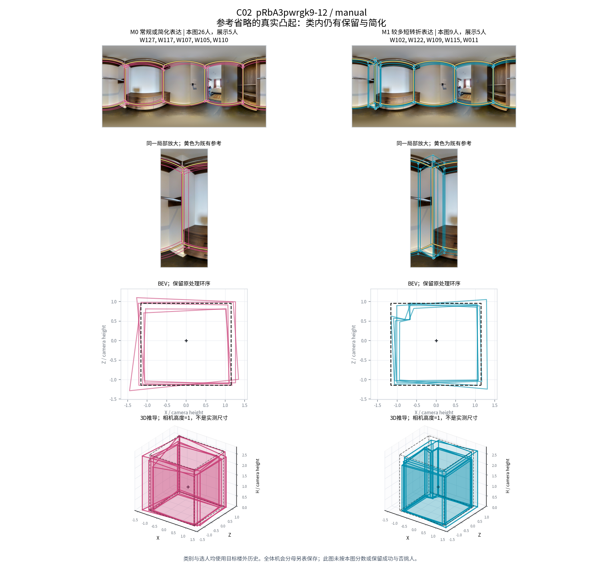

### 4.3 “多画”与“少画”需分五种机制

|机制|本轮可支持的实例|对分类的解释|
|---|---|---|
|保留或遗漏必要结构|S9-12、Uw-22|M1在窄转折和困难图较常提供局部结构支持|
|表达参考省略的真实细节|pRb-12|额外点不自动是错；暂停图只用行为证据|
|选择不同目标范围|jtc-12门洞、7y-13 Semi|点数相同也可能终止于不同边界，必须单列范围政策|
|增加冗余或近共线点|B6-18 W037；多人Semi辅助标签|总点数与实际方向转折须分开，不能当作保留细节的同义词|
|错误结构或定位、参考不一致|Semi wc-56额外节点、部分高度/范围偏移|须结合具体原图及参考资格判定；更多节点有时降低质量|

W037的Manual近共线行为出现在19图/10楼，W031为10图/6楼。Semi的W010、W014、W031、W037分别有2/2、2/2、2/2、4/4个图/楼的重复近共线机会。3°时保留W010/W014/W037，10°又加入W001/W133；因此把它们保存为辅助重复行为标签，不强造一个已证明可替换的独立人员类。

“目标表示超出范围”“照片不可见或歧义”“采用何种范围政策”在本轮保持区别。Bi-Layout研究对封闭当前房间与延伸可见范围的双重定义，为这种解释提供了外部背景[R3]；没有据此重绑本仓库参考、改OOS或重新评分。

证据入口：`route_b/lobo_expression_by_difficulty.csv`、`route_b/lobo_fixed6_mechanisms.csv`、`evidence/local_opportunities.csv`、`evidence/local_opportunities_by_class.csv`、`route_b/semi_new_candidate/repeated_collinearity.csv`。

## 五、Semi独立发现：高度类型成立，通用短转折类型未成立

### 5.1 较低推导高度的重复证据

楼外SP_LOW对SP_OTHER在24图/11楼的log推导高度差为−0.048394，11楼均为负，相当于约4.72%的几何平均高度差。旧来源20图/10楼为−0.055707、10楼均负；新来源5图/4楼为−0.037790、3楼负1楼正。该结论基于Semi终稿自己的历史，与Manual标签无关。

为区分位置和点数，进一步固定点对数、要求底角一对一匹配最大≤9°，同图双方至少2人；SP_L对SP_T得到以下结果。像素在1024×512归一ERP坐标上定义，推导高度以相机高度为1，不是实测房高。

|来源|图/楼|顶点y差|底点y差|log高度差|顶界分量|底界分量|
|---|---:|---:|---:|---:|---:|---:|
|全部|22/10|+3.582px|+1.217px|−0.04590|−0.03925|−0.00665|
|旧批|17/9|+4.783px|+1.269px|−0.05288|−0.04948|−0.00339|
|新批|5/4|+0.702px|+2.387px|−0.02841|−0.00835|−0.02006|

正的顶点y表示图像中的顶界更低；正的底点y会使归一后的底面距离变短。对既有高度公式采用两个替换顺序的对称分解，解释出旧批主要由顶界贡献、新批底面距离作用更明显。故统一类名应为“较低推导高度”，不能称五个人都把天花板标错或有同一编辑动机。

W029/W030/W035的Manual也有较低高度历史，负方向覆盖14/15/17栋；W105/W119在Manual的偏差很小，Semi才明显降低。7y-13中W030与W123同为4点对，个人Q为90.18/94.14，但顶界、底界和推导高度仍有差别；W030对比W013时Q反而更高。B6-18则存在同类反例：SP_L的W035在本图与SP_T成员高度相近。

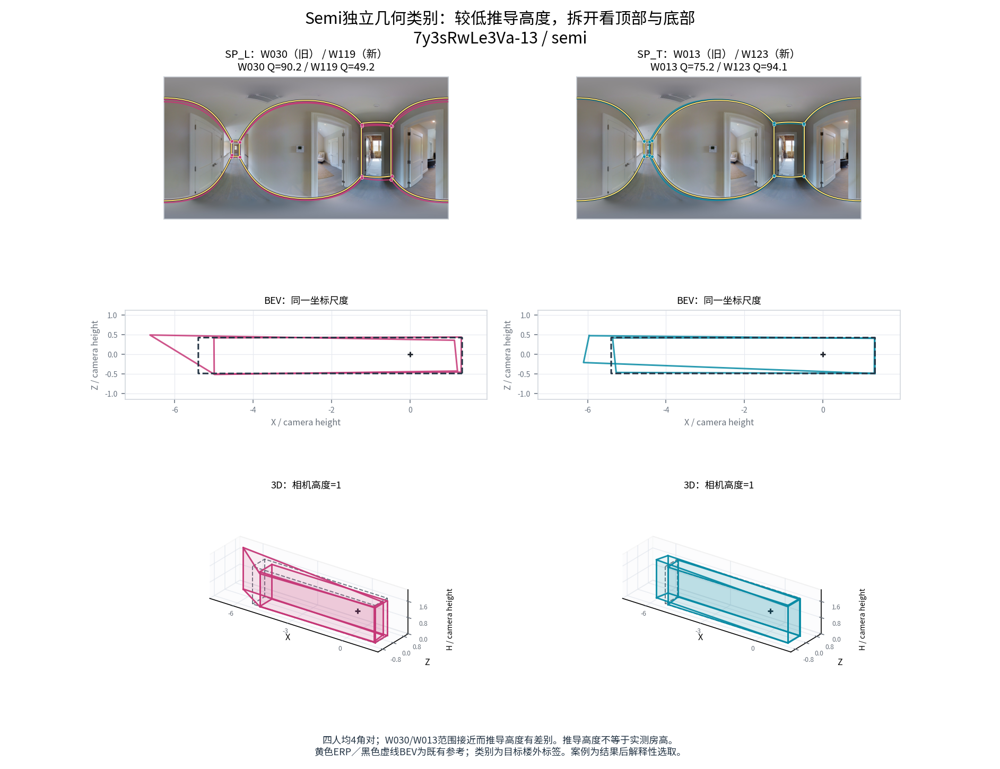

### 5.2 为什么没有采用Semi新批短转折分类

冻结的S0/S1在全部来源25图/12楼上有+0.422转折、+0.173短边的聚合差；仅旧批仍为+0.743/+0.419，但仅新批24图/11楼变为−0.041/−0.014。新批35人单独重新拟合终稿两类后，楼外历史较多短转折组仍少0.026条短边。因此停止该路线扩展，不以高标签一致率替代实际表现重复。

旧批结构差异有初始化机制。按每人每图主观察、精确初始化绑定，S00/S01/S10分别有270/198/62份，净删点对作答145/92/9份。已确认初始化错误机会为72/54/18份，未纠正3/6/11份；S10旧成员是W006、W011、W021。三组机会各对应同一批6张图片，不能当成144个独立环境样本。较多终稿结构有时来自较少删减初始化，并不自动更好。

新批没有精确初始化；“报告有错误”的机会与未改分别为S00 79/6、S01 123/16、S10 82/23，与旧批已确认错误分开存放。没有从终稿虚构保留、删减、补充或重定位的过程。

证据入口：`route_b/semi_adopted_lobo_summary.csv`、`route_b/semi_new_candidate/height_same_count_summary.csv`、`route_b/semi_new_candidate/semi_initialization_by_class.csv`、`route_b/REPORT_ZH.md`。

## 六、同类原答是否更相似：A2与结构类别的区别

### 6.1 A2在相同点数下形成了可重复的几何分区

绑定角距同时约束顶部、底部及同一循环位移，不能靠两端分别匹配得到更好结果。下表数值是每张图片同时存在类内与类间配对时的建筑等权结果，配对数不是独立样本量。

|条件与检查|图/楼|类内角距|类间角距|类内−类间|类内底面IoU增量|
|---|---:|---:|---:|---:|---:|
|Manual固定独立建筑检查|115/11|7.537°|9.135°|−1.598°|+0.02253|
|Manual逐目标楼外|177/22|7.820°|10.363°|−2.543°|+0.02915|
|Manual楼外且共同点数/Q/来源匹配|176/22|10.405°|10.901°|−0.496°|+0.00448|
|Semi固定独立建筑检查|14/4|4.280°|9.227°|−4.948°|+0.07076|
|Semi逐目标楼外|28/12|4.116°|5.680°|−1.564°|+0.02800|
|Semi楼外且共同点数/Q/来源匹配|27/12|4.530°|4.774°|−0.243°|+0.00253|

严格匹配要求同图、双方共同点数、相同来源组合（new/new、v1/v1或跨来源）、目标Q均值10分箱与Q差5分箱；跨来源配对没有被一律删除。Manual匹配前71,311对、实际贡献59,595对，角距差的建筑自助95%区间为[−0.909°,−0.150°]；Semi匹配前13,356对、实际贡献11,967对，区间为[−0.505°,−0.022°]。9°共簇率分别增加0.84和5.01个百分点，两个区间均含零；Semi的IoU增量区间亦跨零。未形成双侧比较的层不贡献匹配均值。A1的几何优势在相同匹配后消失，故A1作为方法对照，推荐A2。

A2并不是每类都同样紧密。Manual A01/A02/A03类内角距分别10.57°/5.51°/11.67°；A02更紧密，A01/A03较分散。A01/A03的人员与建筑等权Q分别66.36/66.00，几何关系仍不同。A03平均较少转折、近共线点略多、底面积略小，但偏移量不足以命名“高度错误类”。

全数据与楼外标签对齐后，人员平均一致比例为Manual96.15%、Semi91.95%。Manual W103/W128较敏感；Semi W107/W111/W119/W124较敏感，均保留成员级支持数据。

### 6.2 可见正例与反例

7y-21的W109/W118属于楼外A02，W132/W133属于楼外A03；四人同为新来源、6角对，目标Q范围29.89—39.36。两对类内角距5.90°/8.93°，跨组52.54°—58.44°。四份各自底面均为有效简单环；同色叠图中两人的边界会相互穿过，不是把单份自交修成好图。差异涉及实际角点位置集合，未在本轮裁定哪一种目标范围正确。

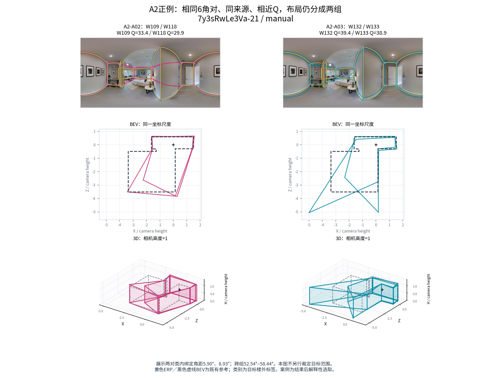

jtc-28的同点数四人例则类内更散，完整反例叠图C09与数据同时交付。A2的价值是历史关系和一定条件下的原答接近，不是逐图必然相近。

### 6.3 B结构类不能代替整体几何关系

Manual B粗/细类在同点数时，类内绑定角距反而比类间大1.690°/2.228°；共同点数/Q/来源联合匹配后为0.010°/0.147°。因此分别报告两项实际结果：B捕捉局部结构表达，A2捕捉整体原答关系。不能拿B内部特征相近，替代“类内原答整体更相似”的独立检验。

证据入口：`route_a/selected_method_validation.csv`、`route_a/A2_class_pair_geometry.csv`、`route_a/B_raw_answer_validation.csv`、`route_a/A2_7y21_geometry_receipt.json`。

## 七、与Q、T、难度及辅助证据的关系

Q和T没有参与B主结构聚类，但与类别有关。普通Manual楼外M1−M0的Q差全部来源为+13.24，旧来源+2.32，新来源+18.00。因此不能把新批融合收益全部称为独立于质量的风格收益。另一方面，旧批M00/M01/M10的平均Q均约67，仍呈不同转折表达与时间特征，说明类别不只是临时高低Q切分。

|Manual细类/来源|人|逐人平均Q|个人Q低10%分位的组均值|个人用时中位数的组均值|
|---|---:|---:|---:|---:|
|M00 旧批|6|66.68|37.96|159秒|
|M01 旧批|6|67.64|38.81|117秒|
|M10 旧批|11|67.32|42.37|180秒|
|M11 旧批|1|81.91|54.10|113秒|
|M01 新批|28|67.19|42.45|129秒|
|M10 新批|2|85.00|52.06|119秒|
|M11 新批|5|85.44|54.85|153秒|

这些用时保留原始语义：主要是source_active_time_seconds，新批为用户处理后报告时间，不冒称已经逐目标日志核定；target_matched_time_seconds另列。各类速度有重叠，不能称为统一“慢而细”或“快而简”类型。

进一步用其它建筑历史Q与来源预测目标几何残差，再加冻结结构粗类：Manual短转折MAE只改善约1.08%，建筑自助区间含零；非共线转折MAE变差约5.98%。Semi的终稿结构粗类同样未改善；此处增量检验未评价后续SP尺度类。A2虽在Q/来源匹配后仍保有原答关系增量，B结构类不宜被宣传为替代Q的通用预测器。其明确价值来自条件化标法、同一局部机会与实际票账机制。

Semi推荐的SP_L也不是统一速度或难度适应类型：旧3人平均Q75.81、个人用时中位数的组中位数79.50秒；新2人相应73.29、166.75秒。这里用时的第二层汇总为中位数，与上表Manual采用的组均值不同；旧3人的组均值为127.50秒。困难质量支持仅旧W035一份，新来源无正式困难Q，不据此命名困难适应差。旧批SP_L/SP_A/SP_T的已确认初始化错误机会与未纠正分别18/0、24/0、102/20，仍共享同一批6图；新批报告机会与未改15/1、10/2、259/42另列。这说明较低高度与原S10的少删初始化机制不是同一人群。

scope选择、错误未纠正、历史不采用、审核排除和参考暂停分别保存，分母与证据等级不合并。质量不可用不等于作答错误，scope的非in-scope回答也不自动是不正确。新画像/组合额外成果包本轮未取得；采用仓库已有输入及用户提供的机制线索独立重算，没有重复开展高低Q、快慢全配比搜索。

## 八、实际换人、换类、类别块与配比

### 8.1 比较设计与完成量

每个ABC事件固定同一图、参考、人数n、共同背景和实际替换规模m。A是共同背景加原类别第一块成员；B换成同类别另一块；C换成另一类别的成员块。三块相互不重叠、规模相同，且new/v1来源人数完全相同。候选由楼外标签、容量和固定随机种子产生，不用目标Q或融合结果选人。

质量净效应为 **Q(C)−Q(B)**，等价于(C−A)减去(B−A)；几何类内/跨类位移分别是A–B与A–C。分类属于人的历史属性，结果是实际成员替换效应，不是脱离具体人员的类别因果效应。先在图内平均事件，再在建筑内平均图片，最后建筑等权；Q缺失不当成0，异点数和不完整几何保留分母。

|设计|ABC事件|不同端点|范围|
|---|---:|---:|---|
|B粗细主实验|1,276|3,828|94池，普通Manual/Semi、门洞、特殊层分别统计|
|固定类别块完整人数路径|336|1,008|14条路径，Manual4图、Semi2图、门洞1图|
|A2专属交换|286|858|Manual/Semi各12图/12楼|
|Semi SP_L与SP_T|38|114|11图/11楼，容量不足的方向另列|
|预指定jtc-26配对|1个配对|2|用户指定4人背景与1人替换|

四项新设计端点数之和为3,828+1,008+858+114=5,808，按pool_id/team_key合并去重后仍为5,808；预指定jtc-26另有2个无重叠团队，合计5,810个不同团队。另复用的63,476个旧端点对来自11图/6楼、152个旧背景库，n=5/9/13/17、m=2/5，只重贴新楼外标签而不重算几何；保留旧抽样设计，不能冒充新分类独立实验。

### 8.2 普通Manual换入M1有结构补充和平均质量收益

|M0→M1的n/m|事件/图/楼|可比较Q事件|B8L2净效应|楼级95%区间|D10净效应|
|---|---|---:|---:|---|---:|
|5/1|104/52/22|100|+3.51|[+0.98,+6.42]|+3.34|
|9/2|51/51/22|50|+4.49|[+2.12,+6.86]|+4.02|
|13/3|51/51/22|48|+2.21|[−0.49,+4.83]|+2.40|

反向M1→M0的三个均值为−3.81/−2.33/−4.10分。在困难Manual的15图/15楼，M0→M1分别+4.34/+3.17/+3.69分，平均节点数+0.63/+0.80/+1.47，相对参考的5°节点召回+0.066/+0.082/+0.155。简单图的节点增量仅+0.045/0/0，中等图n13/m3的Q净效应为−1.27；类别效益并非随替换规模单调增加。

同类换人也有方向差异。以M1为原类，三个规模的同类/跨类共同可比BEV位移为0.0317/0.0500h、0.0325/0.0506h、0.0309/0.0657h；保持M1构成更稳定。以M0为原类则没有这种统一方向，n5/m1为0.0669/0.0508h。M0包含不同程度的简化和定位习惯，不能统称完全可替换。

沿用旧联合相近标准：双方完整可评价、|ΔB8L2|≤2、点数相同、BEV Jaccard差≤0.05、循环对应结构角距≤3°，必须同时满足。这不是原答9°/12°阈值，h也不是米。

### 8.3 精确配比和细类检验已实际完成

在n5/m1的M0→M1实验，M1人数从0→1、1→2、2→3时，净B8L2分别+3.05/+4.09/+2.60，支持20/20/12楼。n13/m3中从3→6的均值为−1.95（6楼），5→8为−10.48（3楼）。这些格子具有不同实际背景和图片，不能彼此排序成“最优配比”；它们明确显示共同背景会改变同方向换类的结果。

细类不是只命名未检验。M00→M01在n5/m1、n9/m2、n13/m3的净效应+0.70/+4.49/−1.40，支持11/7/5楼；M10→M11在n5/m1有27图/16楼、+1.34分，n9/m2只1图，m3无容量。Semi S00/S01也做了实际对照，但没有稳定质量排序。细类保留为标法程度与条件差异，不能写成稳定质量等级。

### 8.4 Semi高度类型能改变团队几何

|SP_T→SP_L的n/m|图/楼|同类/跨类BEV位移|同类/跨类顶部位移|融合高度相对变化|B8L2/D10净效应|
|---|---:|---|---|---:|---|
|5/1|11/11|0.0450/0.0909h|0.0491/0.0960h|−0.258%|+0.70/+0.54|
|9/2|11/11|0.0219/0.1161h|0.0275/0.1265h|−0.966%|+1.43/+2.11|

高度方向采用 `exp(mean(log(H_C/H_B)))−1`；两队引用同一参考，参考高度在比值中抵消。两个规模分别7楼、9楼下降，2楼、1楼上升，其余不变。换入两名SP_L时有更清楚的几何分离和约1%的融合高度下降，Q区间均跨零，故保留为几何标法类别。

反向SP_L→SP_T的高度均值+0.482%/+0.463%；n9/m2仅5楼而非11楼，Q为−4.99。小类需要两块互不重叠成员，产生不对称容量，不能与另一方向作对称总体结论。SP_A可出现在共同背景，但此次替换块只比较SP_L/SP_T；SP_A尚无独立换类效益结论。

冻结Semi短转折类S0→S1的三个规模Q仅+0.15/−0.50/−0.78，参考节点召回变化均为0；没有复制Manual收益。普通Semi困难层没有本轮正式融合覆盖。

### 8.5 A2原答相似性与融合可互换性分别成立到什么程度

A2对B团队零重贴时出现较强类内位移优势，但这仍受B抽样条件影响。随后完成A2专属实验，结果更克制：

|条件n/m|共同可比事件/全部ABC|同类/跨类BEV位移h|同类/跨类联合相近率|
|---|---|---|---|
|Manual 5/1|66/72|0.03350/0.03189|56.9%/45.8%|
|Manual 9/2|62/72|0.02398/0.02275|58.3%/50.0%|
|Semi 5/1|63/72|0.06392/0.08045|59.7%/47.2%|
|Semi 9/2|64/70|0.02722/0.02512|66.0%/60.4%|

位移只取两臂都能有效对应的共同事件；联合相近率则把全部ABC事件计入图内、楼内汇总，异点数或不完整端点记为不相近，分母并非左列的共同可比子集。

Manual的平均同类BEV位移没有更小；Semi只在n5/m1支持这一方向。联合相近率四格均较高。旧端点库的A2重贴分离也很小。因此推荐A2解释原答关系，融合仅使用上述具体支持条件，不从同类原答相近推导为完全可互换。

证据入口：`fusion/SUMMARY.csv`、`fusion/MANUAL_DIFFICULTY_EFFECTS.csv`、`fusion/EXACT_RATIO_EFFECTS.csv`、`fusion/A2_SPECIFIC_POOLED.csv`、`fusion/semi_position/SIGNED_GEOMETRY_SUMMARY.csv`。

## 九、局部机制：补充、稀释、同类反例

### 9.1 jtc-26：同类成员的关键第三票

固定W103、W104、W116、W128，W113换成W106，个人目标Q从39.55降到10.30，团队B8L2从15.14376升到65.75343，D10从15.19837升到67.25861，4节点变5节点。n始终为5、门槛始终3票。node_004原有W104/W116两票，W106补成第三票；旧观察分组未变。

两人楼外B标签均M0/M01，A2均A01，四名共同背景也均属B的M01。**这是成员差异未被类别完全解释的正式反例。** W106楼外短边残差比W113略高只能作连续辅助，不能看完目标结果再追认一个新类。

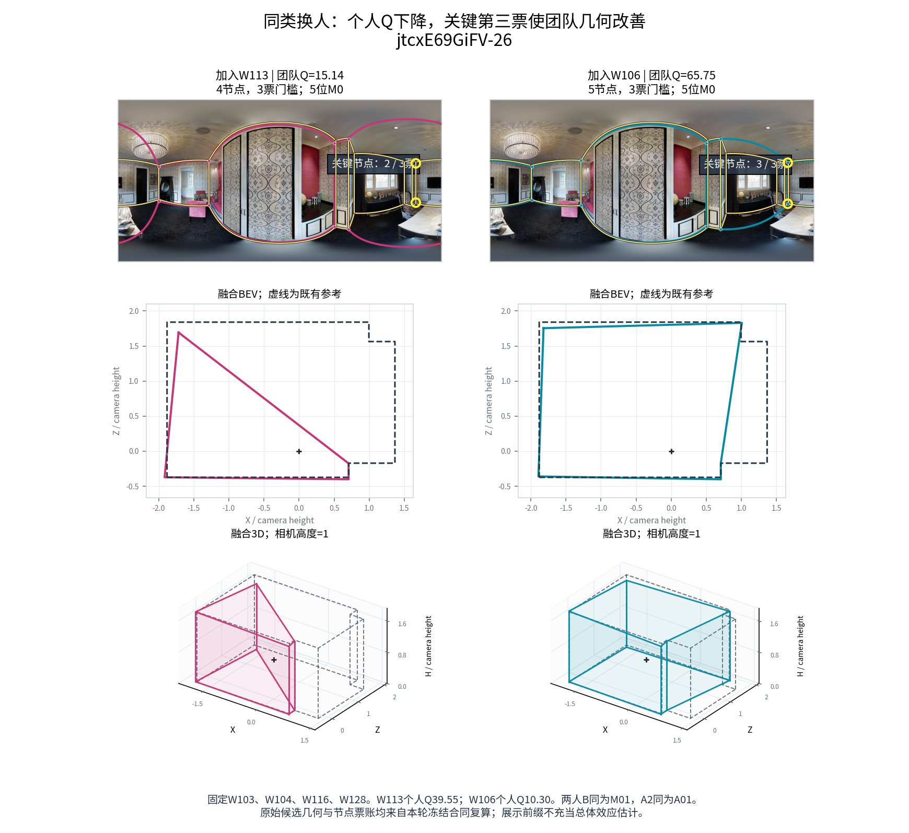

### 9.2 Uw-22：类别块补齐结构，人数门槛使它失选

固定m=2的路径在每一步给三臂增加同一个背景成员。n8时A/B/C为4/5/6节点，Q为64.82/53.59/97.12；C有5名M0、3名M1。加入M0成员W116到n9，门槛4→5，旧观察分组不变，一个4票节点失选，C降至5节点、65.21分。n10增加M1成员W112恢复6节点、95.26分；n13则4节点、69.06分。

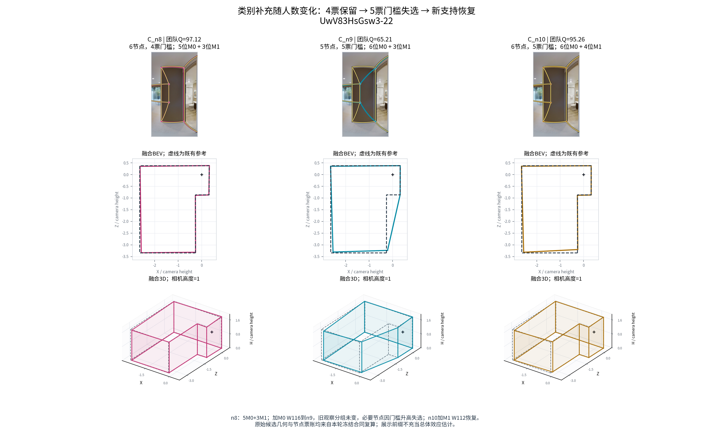

完整人数路径从n5一直保存到实际容量。后续多数前缀三臂都趋于四节点，显示少数表达型成员的局部贡献会被增长的普通背景稀释。这个案例同时交付有利与不利前缀，没有以“整条曲线稳定”作为保留该标法类型的门槛。

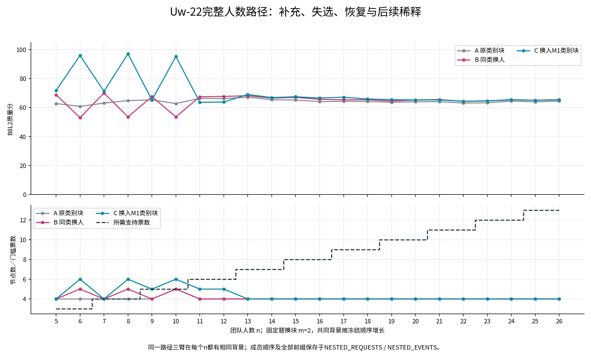

### 9.3 Semi wc-56：更多终稿结构可能产生额外节点

n12时同类B臂5节点、93.17分，换入两名S1的C臂8节点、74.49分。n13加入S0的W008，门槛6→7，三个节点失选，C回到5节点、91.72分。它是相对既有参考的质量改善；缺少逐节点完整语义裁定时，不能把失选的每个节点都称为错误结构。

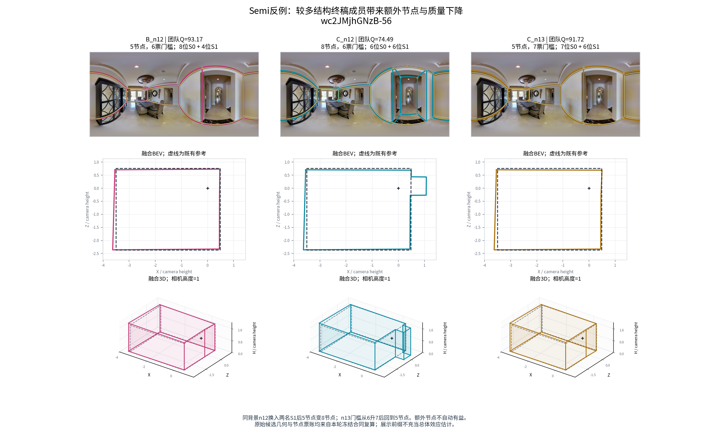

14条路径中，普通Manual存在35个门槛单独导致失选的节点组、38个新增票促成的入选组，以及85次旧观察重新分组的队伍比较。Semi分别12/7/0，门洞21/18/4。单位不同且原因可共存，不能相加为互斥比例。这些票账明确说明部分变化来自分组和门槛，不能全部归为人员能力。

门洞主实验232个ABC事件、17图/9楼单列。M0→M1三个规模均值+0.26/+2.90/+2.35，但区间宽、无统一反向规律，部分端点不足四节点或不完整；普通Manual的平均收益不直接外推到门洞范围政策。

证据入口：`fusion/MECHANISM_CASES.json.gz`、`fusion/NESTED_EVENTS.csv`、`fusion/NESTED_STEPS.csv`、`fusion/NESTED_COMPOSITION_PATHS.csv`、`fusion/NESTED_MECHANISM_SUMMARY.csv`。

## 十、研究台字段、复现与交付边界

### 10.1 接入规则

|字段/键|使用方法|
|---|---|
|worker_id + condition|全数据逐人标签的唯一键，Manual/Semi分别解释|
|worker_id + condition + heldout_building|目标图分析的楼外标签键；无标签时保留缺失|
|primary_coarse_class / primary_fine_class|推荐展示层级；Manual为结构，Semi为位置尺度|
|primary_*_status|采用、条件性、小样本或新来源未支持；不能只显示类名隐藏状态|
|structure_coarse_class / structure_fine_class|保留B冻结结构候选，Semi明确探索未采用|
|geometry_relation_class|A2独立关系分区，不能与B类号混用|
|position_scale_class|SP_L/SP_A/SP_T原冻结细类，匹配Semi专属实验|
|label_fit_scope / heldout_building|区分全数据描述、楼外评估，禁止用描述标签回评目标楼|
|n_images / n_buildings、LOBO一致率、missing_reason|支持量与成员敏感性；训练输入中的资格数不等于全库存资格数|
|event_id → pool_id → team_key|连接图片、建筑、条件、参考、每臂真实成员、m与共同背景|
|quality_usable / independent_vote_eligible / reference_version|继续沿用原合同；行为类型不恢复筛除资格|

每条交换结果保留A/B/C实际成员及点对象ID、粗细构成、来源计数、n、m、可评状态、共同几何分母、B8L2/D10、节点与票账。研究台可先按类型筛选，再读局部机会和票据解释有效补充；不能把类名直接变成无条件组队资格或自动人员替代规则。

### 10.2 可复现内容

本包保留路线A/B关键代码、分类与楼外标签、聚合结果、精确实验请求与端点、少量完整机制票账、必要案例几何、叠图，以及输入引用和参数。没有打包原图全集、虚拟环境、整仓库或全量逐对缓存。复现从冻结commit取输入，把本目录置于 `research/workers/personnel_taxonomy_20261021/`，按 `REPRODUCE.md` 顺序运行。

第一版标签、名单、楼外代表叠图和局部机会表已先保存为阶段成果。主结构标签在大范围融合前冻结；Semi高度候选在发现后另行冻结并做小型专属交换，主结构实验未改标签。本报告替代阶段版的采用判断。

本轮复用既有预处理、参考绑定、环序、正式资格、评分引擎、融合引擎和早期独立核查；实际新做跨图人员关系、可解释分类、楼外检验、原图案例、5,810队与配比/路径解释。原图来自GitHub Release的实际PNG成员。新批部分原始导出未提供，可核到审计记录保存的用户processed输入及既有shared-x处理后坐标；未声称恢复缺失的原始编辑轨迹。关键A2案例核到processed→shared-x→原答API→绘图投影逐点一致，保持默认未确认环序状态，不修环。

仍未完成的范围集中在三处：新批精确Semi初始化缺失，无法恢复完整编辑轨迹；困难Semi和小细类缺少足够正式交换容量；局部语义只对少量代表机会采用原图和已有人工判断，未制造全体结构正确性金标准。面积类型SP_A尤其需要按来源状态使用。上述边界不改变已经完成的Manual条件性结构分类、Semi高度类型、A2原答关系和具体团队机制结果。

## 十一、方法与范围背景文献

[R1] Fionn Murtagh and Pierre Legendre. 2014. *Ward's Hierarchical Agglomerative Clustering Method: Which Algorithms Implement Ward's Criterion?* Journal of Classification, 31(3), 274–295. DOI: https://doi.org/10.1007/s00357-014-9161-z 。作者预印本题名为 *Ward's Hierarchical Clustering Method: Clustering Criterion and Agglomerative Algorithm*，2011，arXiv:1111.6285。[作者预印本PDF](https://arxiv.org/pdf/1111.6285)。用于方法说明，不替代本数据的类别验证。

[R2] Jérôme Kunegis, Stephan Schmidt, Andreas Lommatzsch, Jürgen Lerner, Ernesto W. De Luca, and Sahin Albayrak. 2010. *Spectral Analysis of Signed Graphs for Clustering, Prediction and Visualization.* Proceedings of the 2010 SIAM International Conference on Data Mining, 559–570. DOI: https://doi.org/10.1137/1.9781611972801.49 。[作者机构官方PDF](https://www.uni-konstanz.de/algo/publications/ksllda-sasgcpv-10.pdf)。用于有正负边的谱分区依据，具体来源中心化与12°尺度为本轮选择。

[R3] Yu-Ju Tsai, Jin-Cheng Jhang, Jingjing Zheng, Wei Wang, Albert Y. C. Chen, Min Sun, Cheng-Hao Kuo, and Ming-Hsuan Yang. 2024. *No More Ambiguity in 360° Room Layout via Bi-Layout Estimation.* Proceedings of the IEEE/CVF Conference on Computer Vision and Pattern Recognition, 28056–28065。[作者官方项目与论文PDF](https://liagm.github.io/Bi_Layout/pdf/3739.pdf)。用于解释enclosed/extended范围歧义，不用它重写本研究的冻结参考。

内部证据均以本报告各节列出的实际CSV/JSON为依据；原仓库版本、必要输入摘要与Release链接见 `INPUT_MANIFEST.json`。

## 附录A：完整几何关系分区与Semi成员

<!-- AUTO_MEMBERS_BEGIN -->
### Manual A2几何关系分区

|类|人数|全数据描述成员|
|---|---|---|
|A01|17|W001、W006、W010、W012、W013、W014、W015、W017、W021、W034、W101、W106、W111、W113、W120、W121、W134|
|A02|23|W002、W018、W027、W036、W100、W102、W104、W107、W108、W109、W110、W112、W114、W115、W116、W118、W122、W123、W125、W126、W127、W130、W131|
|A03|19|W008、W011、W028、W029、W030、W031、W032、W033、W035、W037、W103、W105、W117、W119、W124、W128、W129、W132、W133|

### Semi A2几何关系分区

|类|人数|全数据描述成员|
|---|---|---|
|A01|24|W001、W002、W010、W012、W013、W014、W015、W017、W018、W021、W027、W030、W033、W036、W037、W102、W104、W111、W112、W115、W119、W123、W133、W134|
|A02|17|W006、W011、W106、W108、W109、W114、W116、W118、W120、W124、W126、W127、W128、W129、W130、W131、W132|
|A03|18|W008、W028、W029、W031、W032、W034、W035、W100、W101、W103、W105、W107、W110、W113、W117、W121、W122、W125|

### Semi SP_T完整比较组成员

W001、W002、W006、W008、W010、W011、W013、W014、W015、W017、W018、W021、W027、W028、W032、W033、W036、W100、W101、W102、W103、W104、W106、W107、W108、W109、W110、W111、W112、W113、W114、W115、W116、W117、W118、W120、W121、W122、W123、W124、W125、W126、W127、W128、W129、W130、W132、W133、W134。

### 冻结Semi结构探索细类（不作推荐主类）

|探索细类|人数|实际成员|
|---|---|---|
|S00|22|W001、W002、W008、W014、W018、W027、W028、W029、W030、W033、W034、W037、W104、W105、W107、W112、W119、W121、W123、W124、W130、W133|
|S01|24|W010、W012、W013、W015、W017、W031、W032、W035、W036、W100、W101、W102、W106、W108、W109、W111、W115、W116、W118、W122、W125、W129、W131、W134|
|S10|13|W006、W011、W021、W103、W110、W113、W114、W117、W120、W126、W127、W128、W132|

<!-- AUTO_MEMBERS_END -->

## 附录B：补充原答叠图与反例

以下是主文之外的代表图。C01—C07按楼外历史选择最多五位代表成员，全部机会分母另外保留；C08以后的解释案例为结果后选取，不能作为总体效应估计。

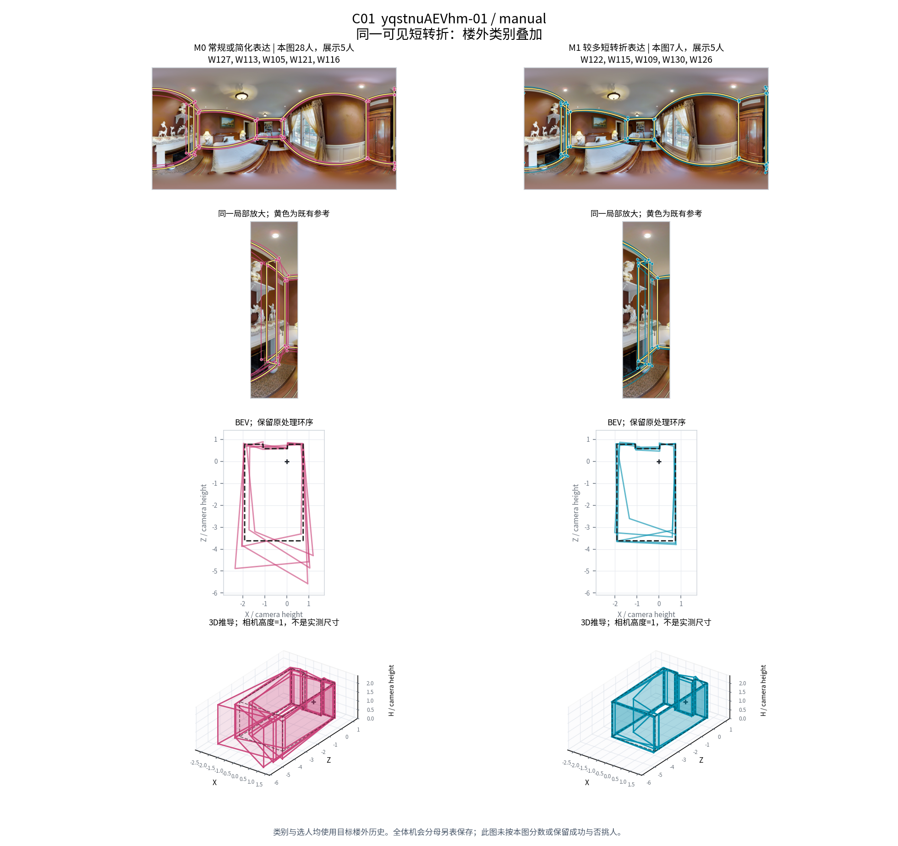

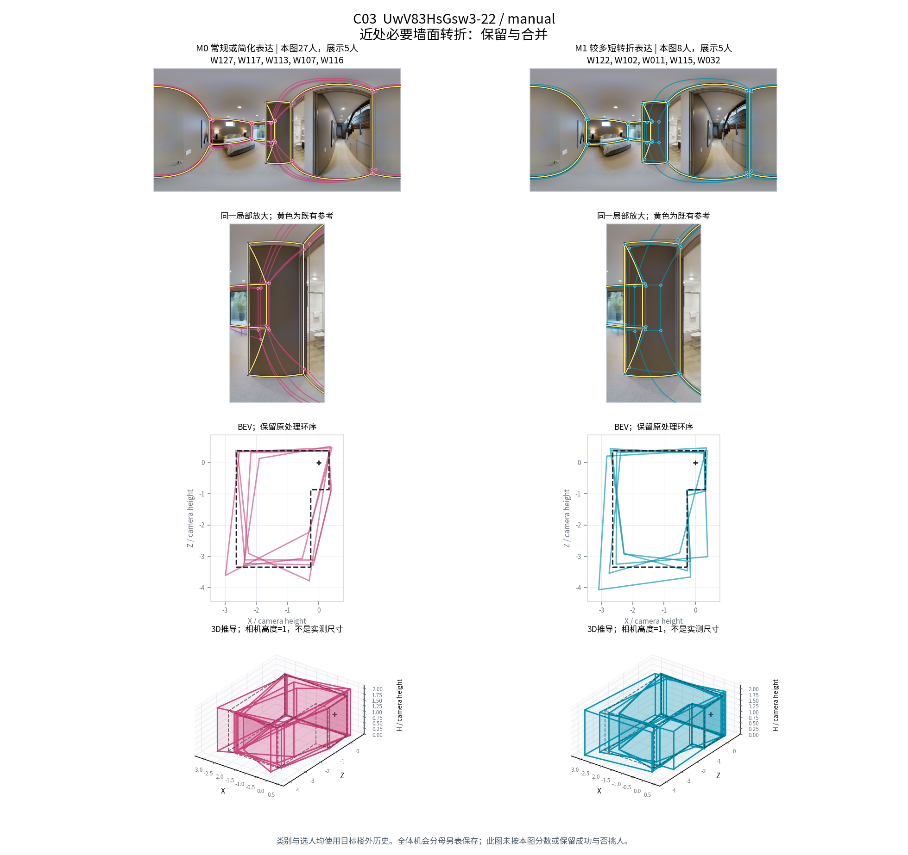

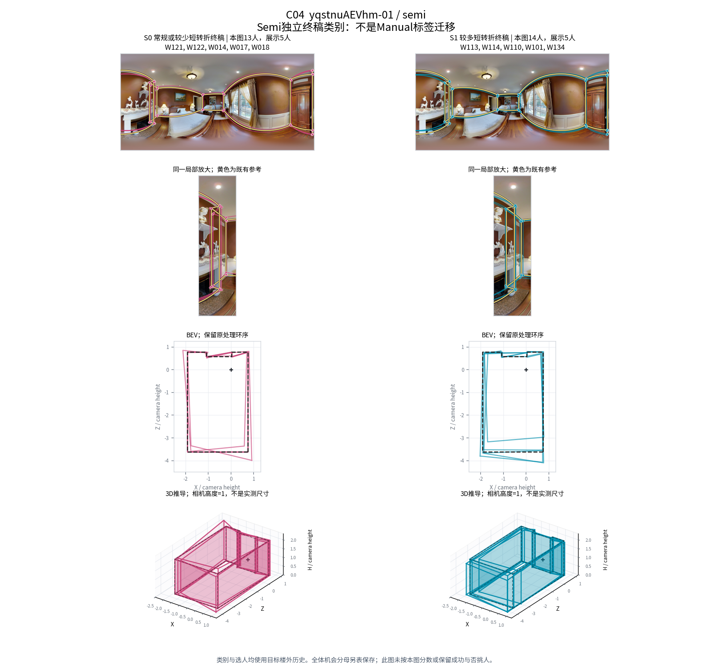

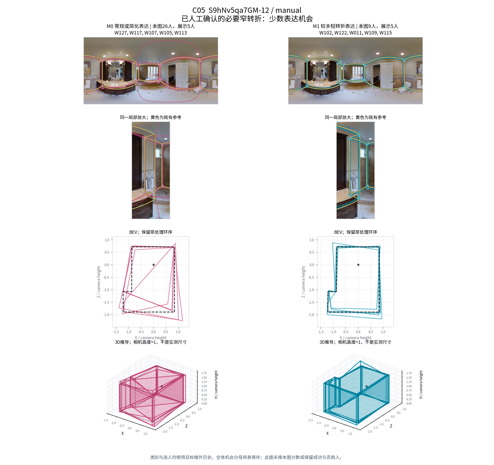

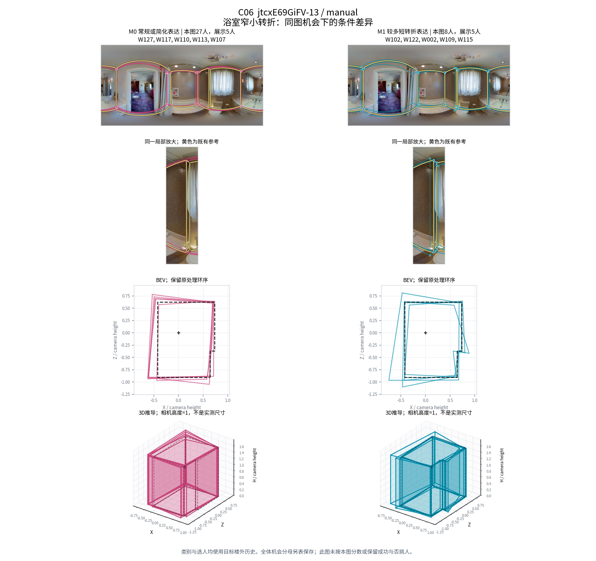

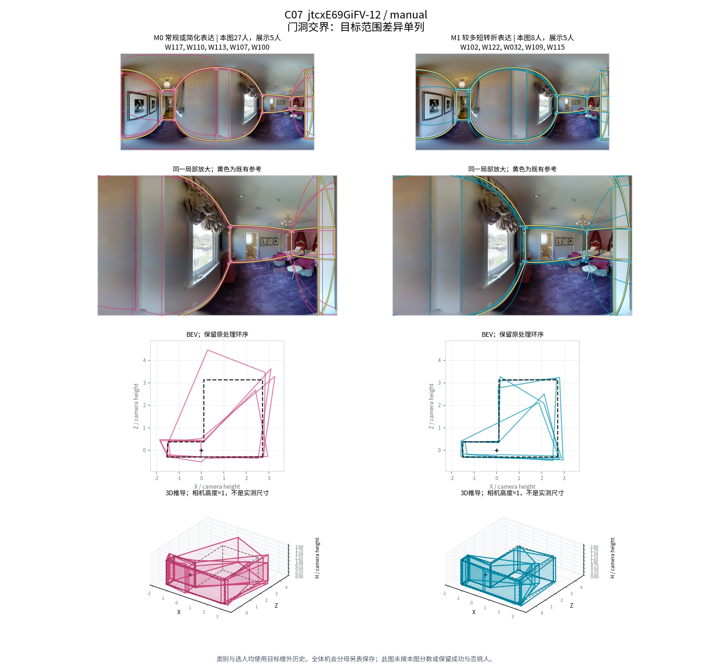

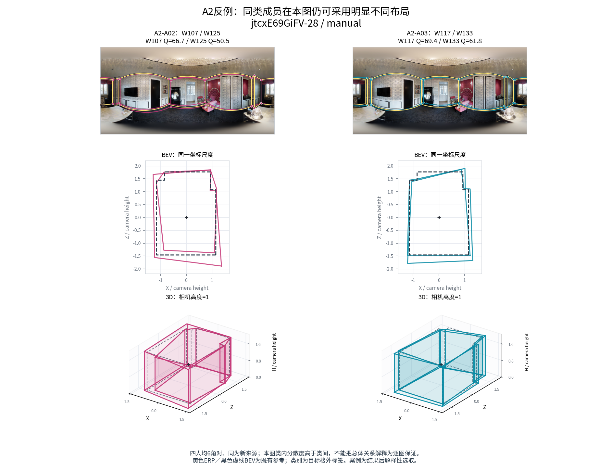

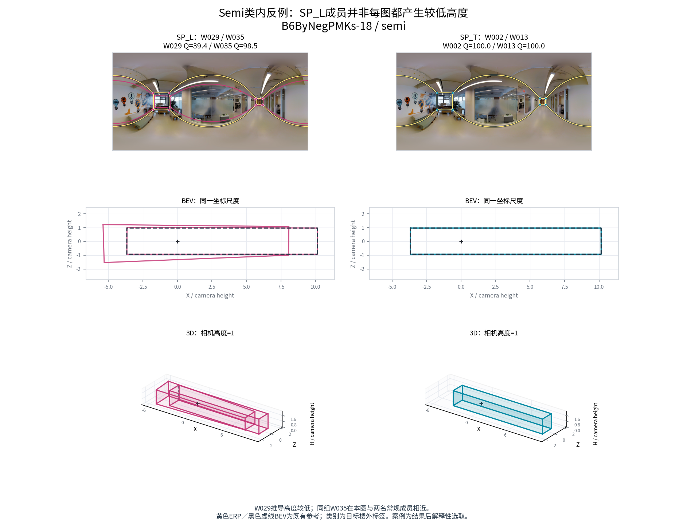

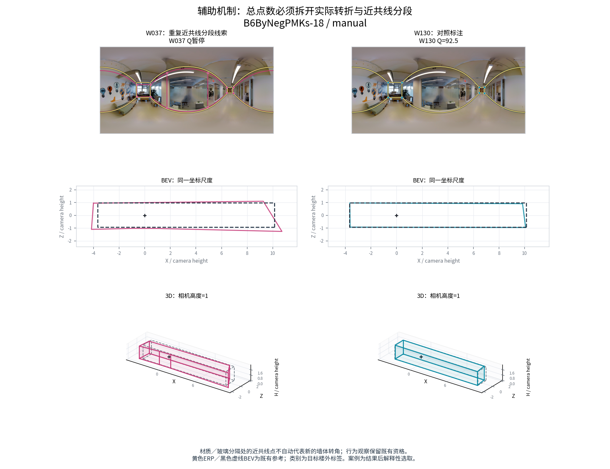
