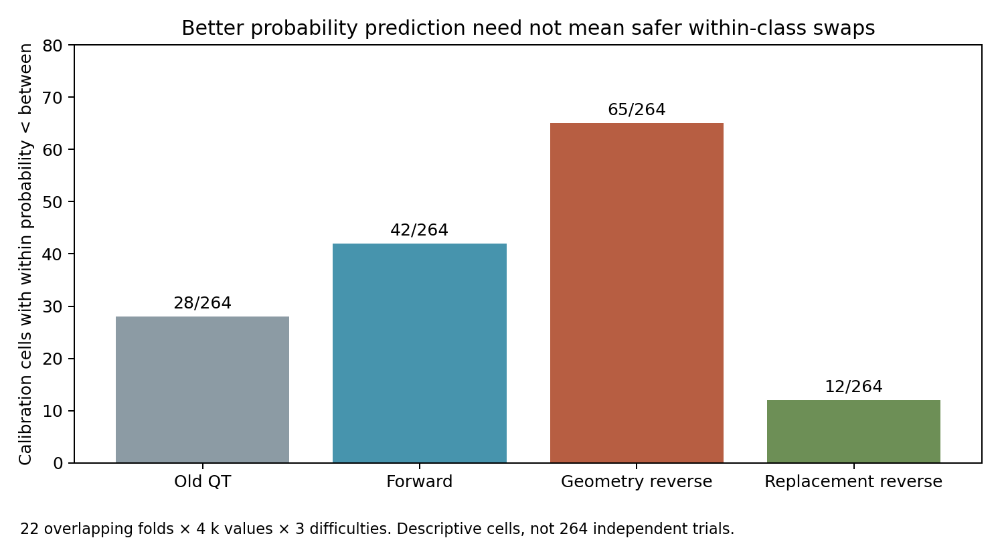
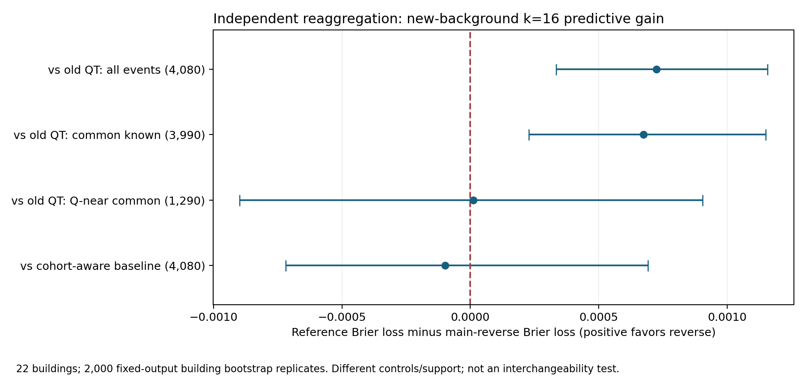

# Part A 人员分型独立审查

日期：2026-10-19。计划基线 dafa73ac7d8ada9a7f5c0e483d695adcbd916550；科学输入固定于 82c6164b0d4630de5316199c92aa405930973168 的真实 v2。B8L2 是主线，D10 是敏感性，N1 未接入。本轮未重做此前整套单布局几何评分审计。

## 一、它实际推进了什么

与旧的关系表相比，本次确实交付了实际人员分区、正向多变量候选、反向几何关系及反向替换关系候选、留建筑训练与选择、共同事件预测评估、独立新背景事件以及解释与展示。不能说它完全没有分类，也不能把计算量或一套四分类结果当成分类目标已实现。

正向最终选择在 FULL 和 22 个外折均为 QT-only K4；完整多变量候选曾参与拟合，但未被选择。已有证据不支持声称增加所有变量必然更好，也不能反推 Semi、scope 或行为永远无价值。其证据覆盖不均：scope 已知样本不能提供一般 OOS 准确率；新 Semi 缺实际初始化几何，报告机会与确认机会必须继续分开。

## 二、已经独立核到哪一层

| 检查 | 已做 | 边界 |
|---|---|---|
| 三 ZIP | 全量 CRC 读取与 SHA；三个大小分别 338,084,619 / 210,257,409 / 470,500,316 字节 | 不代表原工作目录所有未打包文件均在包内 |
| 冻结文件 | 824 源文件、519 既有核心文件、2,957 数据包成员、16 分析关键文件和 83 正向清单成员 | 清单层次有重叠，不能把这些数量相加称独立文件总数 |
| 稳定事件 | 286,666 条重推稳定标记，零不一致；含 7,715 条至少一端不完整的事件 | 不完整仍计不稳定，未删掉失败制造改善 |
| 概率校准 | 四方法、22 留楼折独立实现，最大差约 4.45e-16 | 不是所有原算法重新实现 |
| 分区与特征 | 69 组已选正向分区 4,140 分配完全一致；两组特征新拟合与排除行污染检查通过；主反向 FULL/一个外折完全一致 | 不是所有候选和所有折全管线重跑 |
| 新融合 | 30 个空缓存团队，分数/资格/参考等字段一致；几何状态最大浮点差 1.78e-15 | 24 个按难度×k 哈希抽样请求加 3 个已披露案例对，不是全量 58,679 团队 |

22 份反向概率长表是原交付明确省略、可重建的文件。本审查没有重建全部长表。136 项数据包省略是运行字节码/锁、已由完整布局替代的下载副本和一份临时写文件。不能将“可重建”写成“已全量重建”。详见 [交付审计](independent/COMPLETENESS_AUDIT.json)。

## 三、我的主要异议：目标函数和用户目标还没有完全对齐

### 1. 预测稳定概率，不能替代验证同类更可互换

当前主比较使用 Brier 损失：预测某次替换稳定的概率是否准确。校准器允许“同类稳定概率低于跨类”，所以一个分区可以靠正确预测“同类反而容易坏”改善 Brier。

独立检查主反向 264 个外折×k×难度校准单元，65 个恰为同类概率低于跨类。正向为 42、替换反向为 12、旧 QT 为 28。这些折高度重叠，计数只用于描述，不能当 264 次独立检验。

因此，主反向的新 k16 Brier 有小幅收益，与“它已能支持同类安全换人”是两个不同命题。

### 2. 控制后增益不确定，不能择优保留最漂亮的一行

独立重算的新背景 k16、22 建筑结果如下。正数表示主反向降低 Brier 损失；区间是固定交叉验证输出的建筑重抽样区间。

| 比较 | 事件数 | 建筑等权增益 | 95% 区间 |
|---|---:|---:|---:|
| 主反向 vs 旧 QT，全事件 | 4,080 | 0.000724813 | [0.000334052, 0.001156586] |
| 两方法共同已知支持 | 3,990 | 0.000673154 | [0.000226992, 0.001149391] |
| 共同支持且 Q 接近 | 1,290 | 0.000012005 | [-0.000898648, 0.000904457] |
| vs 来源批次感知基线 | 4,080 | -0.000098649 | [-0.000718584, 0.000690358] |

整体收益与控制后的增量是不同估计目标，需要同时保留。Q 接近及来源控制区间跨零，说明额外收益尚未明确；也不能据此证明所有分类信号必然完全来自 Q 或批次。该 bootstrap 未在每次重抽样中重新训练分类器，不能包含训练集改变后的全部模型不确定性。

### 3. 新背景没有完成用户最关键的直接同背景类内/跨类对比

新面板每个固定背景只放一对候选。方法之间在同一事件比较预测是公平的；但该背景不能同时提供同类和跨类替换机会，所以新面板不能直接估计“同一背景下跨类比类内变化更大”。

旧面板存在这种对比。主反向旧 k16 的“跨类稳定率−同类稳定率”：建筑等权 −1.0574 个百分点，区间 [-4.0330, +1.7775]；背景/事件等权 −3.2178，图片等权 −3.1063。253 背景、139 图、22 建筑。方向有利于同类但不确定，不显著不等于等效，也不是新背景已经成功泛化的证据。

四个 k=8/12/16/24 是嵌套的四节点序列，不是全部人数整曲线，更没有验收相邻奇偶数机制。既定 Part B 仍有实质任务。

### 4. 四类不是数据证明的天然类型数

候选 K 只有 4/6/8/10，正向 28 个、反向 64 个候选全部进入 one-SE 范围，简约规则偏向最低 K。该规则的 SE 来自建筑风险变异，而非候选之间配对差异的 SE。这是已声明的保守选择启发式，不是候选等效或四类最优的证明。

主反向 FULL 的 1/39/18/1（另一个未知）也提示应允许 2/3 类、异常点弃权及无有效分区。不能为了达到目标，事后利用测试图重新调整成员。反向无支持人员对使用共同训练先验填补距离，这是一项建模假设，不是观测到的相似。

## 四、时间策略值得保留，但要展示损失尾部

QT 对 Q 的末席选择，在新 k16 事件上的建筑等权来源时间差 −13.42 秒，平均 Q 差 +0.0036。两者使用各自可用分母，不能直接假定是同一集合；独立改为 Q 和时间均已知的 3,410 事件后，时间差仍 −13.44 秒，Q 差 +0.027，均值结论未被分母差异推翻。

但 650 次实际改变选择中，636 次可比 Q，有 62 次损失超过 2 分、75 次提升超过 2 分；最大损失 38.43 分；完整性三次失去、三次恢复。故这是平均来源成本权衡，不是逐次安全替换，也不是已验证的同目标图总用时收益。具体分母及坏尾见 [独立诊断](independent/SCIENTIFIC_DIAGNOSTICS.json)。

## 五、建议如何继续

1. 先完成已经规划的 Part B，共同背景同时包含类内与跨类机会，固定人数、背景、图、条件和参考；补相邻奇偶 k、票数阈值、对应和连接机制。不要再开一轮相同数据上的无限分型搜索。
2. 下一次类型选择的主目标应是覆盖、类内大变/失败风险上界以及匹配背景的跨类−类内差异；Brier 留作辅助。容差、主次指标、未知处理先固定。
3. 同时报整体选人效果、Q 近似匹配增量、来源/批次控制。保留建筑/图片/事件权重，不把不同事件集合的分类器直接排名。
4. 允许简单类数、未知和无有效分区；维持连续 Q/T 画像，把条件兼容性作为待验证信息。训练内解释规则也要在外楼验证，不能目标图观测票数反向定义人员类型。
5. 新算法若再次使用本次测试结果指导设计，应标为探索性；最终验收需要真正未参与调参的留出数据。不要把“看过数据后新开实验”称新盲测。

## 六、关键图与案例

以下两张原图来自 Pro 的事后选例，保留原貌和哈希用于对照研究叙述。case02 为同类大变的反例；case06 为“稳定但质量仍低”的反例；两者筛选条件见 [原始选例目录](figures/CASE_SELECTION_CATALOG.json)。两图都不是新增人工 GT，不能单凭展示结果裁定个人严重失误。

图源及 SHA：[PRO_FIGURE_PROVENANCE.json](figures/PRO_FIGURE_PROVENANCE.json)。本轮独立图直接由已复算 JSON 生成；可执行脚本、详细英文数值审计、机器收据及移植入口全部保留在本目录。新鲜重算和历史收据应分别阅读，文件完整性、数值正确性、方法有效性、实际部署适用性是四个独立层次。
