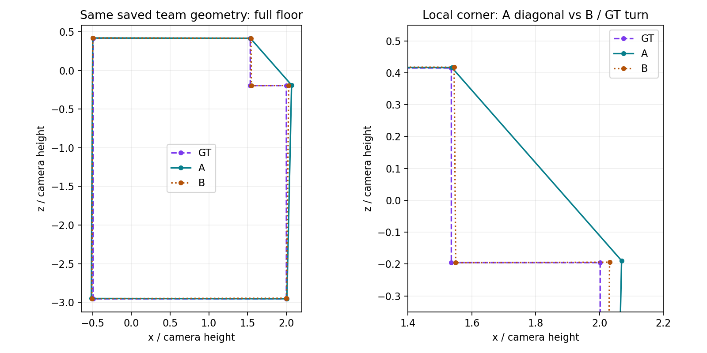

# 人员替换与人数变化首轮独立核查

**最新接续：** A已返回；[B3首轮接入验收](part_a_acceptance/README.md)独立核对286666个A事件标记、关键结果，并将9套逐楼类别接入本面板。主反向几何在12图/10栋有直接积极信号，尚未验证为可靠类型。下文“等待A”的表述是此前阶段记录，以该接续为准。

本轮已完成双线任务的B1共同面板与B2普通Manual有限机制实验，并追加门洞Manual、普通Semi各9图的独立机制面板。固定51图、22栋建筑、三个候选人与两组背景，重新计算3672个不同团队。旧分类存在部分方向性线索，但还没有验证出稳定人员类型；不能据此否定Pro正在准备的多变量与反向发现路线。

直接打开[离线叠图页](index.html)，可按图片、背景、替换人员、人数查看整队融合叠加、个人原答叠加与质量节点。已经接入[完整研究台](../../statistics/research_explorer_v1_r2_20261017/index.html)。案例三点编号已获用户确认，目前没有待答的人工核对问题；评分差的合理性仍与数值正确性分开讨论。

## 设计与实际覆盖

- 从普通Manual、难度与参考对齐、至少27人的163个池中，每个建筑×难度按固定种子选一个池，共51图：22简单、15中等、14困难。门洞、Semi及低人数池未进入这一面板，资格没有被改写。
- 每图均匀抽三个候选人，未按Q、类别、当图点数、簇或融合结果挑选；两个背景排列共用这三个候选人。跨人数使用固定身份和嵌套背景。候选覆盖49人，实际团队覆盖59人；均不是全体人员可替换性的证明。
- 人数为7/8/9、11/12/13、15/16/17、23/24/25。共3672个团队、3672个单人替换对、2448个相邻增人对、1836个不同背景比较。团队和路径重复使用人员与图片，不是独立样本数。
- 3645个团队完整且有质量分，27个不完整/不可评分保留在尝试分母。涉及B6ByNegPMKs-47、wc2JMjhGNzB-53、x8F5xyUWy9e-08，原因分别涉及底面无效、源环/身份未确认及无覆盖全部节点的源环；详见逐团队状态。不补零，不排除整图。
- Q/QT/QTD均读取目标建筑外旧画像。本面板153个人员对中，同类对分别77、36、19；QT未知6对、QTD未知10对。历史9°关系140对有至少6图、3栋的训练支持；不同支持门的分母不混用。

## 旧分类的共同面板结果

每个图×背景内，比较同一随机三人中的同类边与跨类边；两种边都存在才构成配对。先背景/图内平均，再建筑等权。下表要求12个已计算人数节点全部通过原主判据：完整、|ΔB8L2|≤2、底面1−IoU≤0.05、节点数相同、绑定循环对应角差≤3°。这不是每个中间人数都已计算的连续曲线。

| 旧方法 | 配对图／建筑 | 同类全部相近 | 跨类全部相近 | 跨−同，百分点，95%建筑自助区间 |
| --- | ---: | ---: | ---: | --- |
| Q | 38／20 | 33.75% | 29.58% | −4.17 [−20.42, 10.84] |
| QT | 29／21 | 36.51% | 34.72% | −1.79 [−17.26, 11.90] |
| QTD | 16／13 | 38.46% | 28.85% | −9.62 [−28.85, 4.81] |

各方法覆盖不同，不能按这三行直接排名。单看k16，Q同类稳定率较高，但跨12个节点的结果没有同样明确；保留全部人数与严格/宽松阈值结果，不能挑有利人数宣告类别成立。跨类更不相近也不表示质量更差，方向与绝对变化分开保存。

同难度历史9°/12°关系仍有探索线索：k16的近关系稳定率分别87.50%/77.78%，远关系70.31%/63.89%；仅覆盖10图、8/9栋，差异区间均跨零。它们来自同一随机三人、同一出场者的两个替换选择，历史相近度至少差0.2；不是从这些对发现了新人员类别。

## 背景和人数机制

153个人员对中，44对在背景0的12个节点全部相近；换到背景1后29对仍全部相近，15对不再满足。反过来，背景0不满足的109对中，23对在背景1满足。两背景可能共享成员，这是同图另一背景的描述复核，不是跨图验证，也不能把29/44当成总体准确率。

相邻增人比较中，偶数→奇数伴随MV50最低支持数增加，节点数变化率建筑等权为9.25%，奇数→偶数为7.20%；差2.05个百分点，探索性95%区间约[0.60, 3.72]。对应的平均绝对质量变化约2.67与2.14分。不过，加入的实际人员与人数同时改变，这不是投票阈值的独立因果效应。

仅看图内混合人数，“基准团队有一票可翻转节点”呈明显关联；但固定图、背景和人数后，仅17图/12栋有两种状态可比较，不稳定率差约−2.18个百分点，区间[−19.29, 14.61]。因此不能把“接近半数必然更不稳定”当已验证机制。身份对应重组、节点出现/消失、位置变化、连接状态均已分列，票差不能单独解释人员替换。

## 输出与复现

- [REGISTRATION.json](REGISTRATION.json)：新输出前固定的规则、输入和人数；[DESIGN.json.gz](DESIGN.json.gz)保存精确成员、背景和替换事件。
- [FIELD_CONTRACT.json](FIELD_CONTRACT.json)：输出字段、失败与权重规则；[COVERAGE.json](COVERAGE.json)为实际覆盖。
- `TEAM_RESULTS.csv.gz`、`SWAPS.csv.gz`、`GROWTH.csv.gz`、`BACKGROUNDS.csv.gz`：逐团队、换人、相邻增人和背景比较。
- `CLASS_BASELINES.csv`、`CLASS_CHAIN_SUMMARY.csv`、`HISTORY_SUMMARY.csv`、`MECHANISM_SUMMARY.csv`、`CHAINS.csv`、`BACKGROUND_TRANSFER.csv`：按真实支持范围汇总。
- [COMPARATOR_PARITY.json](COMPARATOR_PARITY.json)：本机独立比较器对原定义的1224对/51图核查，11项指标最大差约8.9×10⁻¹⁶；不是对整套原Pro研究的完整重跑。

下面用于从已保存的精确设计重建本地缓存与三层展示。仓库已经包含`DESIGN.json.gz`与登记文件，故不再执行`register`。首次bootstrap要求恢复工作区不存在；已有恢复工作区时跳过该行。命令会更新本包的生成汇总；若需独立对照，请采用下一段的新目录方式。

```powershell
python research/workers/pro_personnel_v2_archive_20261019/bootstrap.py --workspace analysis_results/personnel_type_runtime_20261019
$panelRoot = 'research/workers/personnel_type_validation_next_20261019'
foreach ($panelPath in @($panelRoot, "$panelRoot/extensions/doorway_manual", "$panelRoot/extensions/ordinary_semi")) {
    python tools/thesis_main/analysis/personnel_type_validation_20261019.py run --out $panelPath --jobs 3
    python tools/thesis_main/analysis/personnel_type_validation_20261019.py summarize --out $panelPath
    python tools/thesis_main/analysis/personnel_type_validation_20261019.py verify --out $panelPath
    python tools/thesis_main/analysis/personnel_type_validation_20261019.py mechanism_followup --out $panelPath
}
python tools/thesis_main/analysis/personnel_type_validation_20261019.py mechanisms
python tools/thesis_main/analysis/build_personnel_validation_view_20261019.py
```

独立数值重放：bootstrap到新的`--workspace`；对三层分别执行`register --runtime <新工作区> --out <新的层目录> --layer <层名>`，然后对各层执行`run`、`summarize`、`verify`；普通Manual层再执行`mechanisms`。若复算机制续报，先将对应层已归档的`MECHANISM_FOLLOWUP_SPEC.json`复制到该层新目录，再执行`mechanism_followup`。所有阶段均传同一新`--runtime`和相应新`--out`。`register`要求输出目录不存在。页面构建脚本固定消费本包路径及三层缓存，不能直接显示另一个`--out`；仅执行主层不足以重建当前三层页面。已有缓存会复用，不能称全新计算。局部50条控制另由`personnel_case_score_audit_20261019.py --trace`生成，不包含在上述面板命令中。

本机没有WSL；冻结的融合与评分入口不依赖fcntl，可原样调用。原比较脚本的fcntl仅用于汇总写锁，本轮没有安装伪模块或修改原文件，而是独立实现比较，再只读执行原比较函数做数值核对。Python 3.11、numpy 1.26.4等与Pro环境不同，所以上述一致性检查是必要的；没有宣称所有环境差异均被穷尽。

恢复工作区、完整团队缓存和展示数据是可重建本地文件，继续Git忽略；精确设计、紧凑结果、代码、字段和页面框架可提交。原图沿用已有本地资产或GitHub Release，不另复制。

## 当前边界与下一步

**机制案例及人工评论更正（2026-10-19）：** wc2JMjhGNzB-46，背景1、25人、W131↔W132；页面按钮可直接定位。保存结果的A为包含W131的团队（5节点，B8L2 50.99），B为包含W132的团队（6节点，B8L2 98.54）；这些是团队融合分数，不是两人的个人分数。底面相互1−IoU约0.028，方向误差分别10.66°与0.28°，高度分项近似不变。

用户随后明确说明，前面的评论看的是另一张图。因此撤销“2D差异小、bottom y上移、个人3D差异很大”和“团队好像没啥区别”在本例上的人工证据绑定；不擅自绑定到另一张尚未指明的图。上述撤销不改变本例已经独立复算的数值事实。

本例最新人工观察：两人都标了拐角；按用户截图“从下到上、从左到右”编号1、2、3，第1和第2点A更接近GT，第3点A偏离很大。用户提出的机制假设是第3点偏离导致墙线/角点对应分组不同，继而使A团队融合缺少局部、评分大幅下滑。用户已通过编号图确认：第1/2/3点对应两人原答pair_index 5/4/3（0基），参考pair_index 3/2/1；不能将“第3点”直接等同于node_002。已完成50条坐标控制，结果见下节；第三点单独解释原始换人结果的假设未获确认。个人标了该角与团队是否保留该角必须分开记录。

本例逐层复算已完成，见下节。现有联合判据虽判为不相近，但不能将它当作已获人工确认的明显团队变化案例。暂不更改公式或阈值，也不据此认定某位人员普遍较差。此例按最大绝对质量变化作解释案例，不参与选图、选人或发生率估计。

### 团队大分差核查

**结论：不是个人分误作团队分，也不是显示与评分读取不同几何。团队A的融合结果缺一个内拐角，以一段斜墙替代两段直角墙；整体范围仍接近参考，但B8L2的自身正交方向项对此给出很重的处罚。** 这不表示人员A原答没有标该角。局部差异是否应导致约48分差，仍是评价合理性问题，不能由计算正确自动推出。



图中紫色GT、青色团队A、橙色团队B。共同坐标与尺度，单位为相机高度h。A在局部把拐角跨接为斜线，并非整个房间大幅变形。

| 核查项 | 团队A | 团队B |
| --- | ---: | ---: |
| 融合角点数 | 5 | 6 |
| 对参考底面IoU | 96.12% | 98.69% |
| 角点均高棱柱3D IoU代理 | 95.83% | 98.42% |
| 球面底边误差 | 0.498° | 0.194° |
| 自身正交方向残差 | 10.660° | 0.283° |
| 整体高度残差Hmean | 0.00304 | 0.00313 |
| 局部高度残差Hcenter | 0.00348 | 0.00377 |
| B8L2 | 50.99 | 98.54 |
| 仅令方向损失为零的诊断分 | 95.39 | 98.55 |

1. **输入和显示。** 从24名共同背景人员及各自1名替换人员重新调用冻结融合入口，两队完整保存状态逐字段一致；显示点与评分点完全一致，绑定参考相同。实际JavaScript展示转换与评分引擎三维坐标最大差分别0和2.22×10⁻¹⁶。两队评分重算一致；未改预处理、环序、参考或N1。
2. **为什么少一个角。** MV50门槛为13人。局部内拐角对应组在A中支持11人，未保留；B中支持17人，保留。两组共享9个同一人员/角点观察，A独有2个、B独有8个，新增替换者W132并不属于B的这个组。这不是固定组中加入一张赞成票，而是两两循环对应后的完全链接分组随团队成员变化而重新划分。该机制是角点身份分组，不等于此前用于比较整份作答标法的9°/12°分簇。
3. **为什么方向项很大。** 自身方向残差不直接比较GT；先为该布局寻找最佳正交主轴，再对每条底边偏离最近正交方向的角度做边长加权平方均值并开根号。A的斜边占总周长7.01%，偏离其最佳主轴38.80°，贡献了总方向残差平方的92.82%，最终得到10.66°。B各墙近乎正交，只有0.283°。这是局部斜墙触发强惩罚，不是高度坍塌。
4. **总分放大。** 对非零IoU，B8L2等价于 `100 / (1 + sqrt(F² + Ld²) + H)`，其中 `F=1/IoU−1+S_bottom²/32`，`Ld=1.5*D²/(D²+8²)`，`H=(Hmean/0.8)²+(Hcenter/0.25)²`。A的F仅0.04815，而Ld为0.95959，方向项主导总损失。去掉方向项仅是解释性消融，不是建议换公式或回填分数。
5. **隔离验证。** 保留B其余所有点，仅在研究副本中删除内拐角点对，B8L2从98.54降到52.67；底面IoU仍96.95%、方向残差升到9.76°。这进一步确认，缺角形成斜墙本身足以产生类似大分差。该合成控制不是额外真人或真实团队样本。

因此应同时保留“总体范围接近”“局部角点/墙形不同”“评分对此高度敏感”三个事实。B8L2不能解释为与GT的总体三维相似百分比。人员替换的判定应把几何变化与分数变化分别报告；本例的联合不相近判定还受节点数不同影响，不能只归因于总分门槛。没有证据据此给W131/W132下通用优劣结论。

复现：`python tools/thesis_main/analysis/personnel_case_score_audit_20261019.py`。新增[CASE_SCORE_AUDIT.json](CASE_SCORE_AUDIT.json)保存两队绑定、几何、分项、逐边方向贡献、身份组成员与核查断言结果；`controls`为明确标记的合成诊断，`checks`为输入/显示/复算核对。图由同一保存几何生成。没有新建正式评分字段或更改主结果表。

### 对人员分类的意义与B线后续

本例登记为“局部定位偏差／对应重组／结构保留变化”机制候选，而不是新增人员类型。已经验证的是团队成员替换、身份组重排、节点筛选、缺角斜连及方向项重罚这段链；“由截图第3点单独触发”未被新增控制实验支持为完整解释。即便其他若干点更准，也不保证整队融合更好；单份作答的平均质量不能完整描述其在特定背景下的作用。这不否定Q、T、难度、Semi、盲信、scope的分类价值。

对A线类型发现，允许从训练建筑历史提取结构保留、局部偏差的尾部/集中程度、重复偏移方向及历史标法相容性等候选特征；这些是待检验增量，不能凭本图给两人补一个解释标签。相同Q可能来自均匀的小偏差，也可能来自少数重要角点的大偏差；是否形成可解释且跨图稳定的类别，需要实际验证。

对B线独立验收，保持已注册团队与分类基线不变：

- 先把本图截图三点绑定到原答点对，追踪A/B与共同24人的循环对应和身份组归属；必要时用单点/单点对替换控制区分局部扰动与其他差别。控制仅用于解释，不进入真实人员表现或类别训练。
- 在既定面板中分别报告原答结构是否保留、对应组是否重排、节点是否跨门槛、几何改变及评分放大，比较同类/跨类事件的发生率和坏尾；不从最极端案例估计普遍性。
- 历史特征必须从目标建筑外计算；当前图的匹配/投票只用于机制解释或另列的事后诊断。跨背景/建筑验证后，才判断候选细类是否减少这类替换风险。

若风险在某些历史行为类中重复出现，才支持进一步细分；若主要随图片和团队背景变化，则保留“人员类别＋适用条件/背景风险”的解释，不能靠不断分小类消除所有反例。此例本身既不证明固定人员类型成立，也不证明无法成立。

B1共同随机面板、旧基线、B2普通Manual相邻人数与背景检查已完成；没有重拟合新的人员类别，没有将Semi/盲信/scope排除出Pro任务。它们的新分类增量由A线发现，再在共同事件上评价。

已补同一出场者、两个替代者历史Q差≤3的敏感性：k16时QT仅10图/9栋，QTD仅6图/6栋可比，尚不能确认额外类别效用；见`Q_MATCHED_SUMMARY.csv`。匹配后的稀疏支持不能否定整个选人方案的收益。门洞/Semi独立机制面板已补算，条件专属类别仍未拟合；A返回后的新类别验收尚未完成，本次结果不冒充完整B线收尾。首先保留这个不按分类挑人的共同面板，再对A冻结的类别报告共同覆盖、全部可用覆盖和坏尾。若需要校准几何变化是否重要，只提交少量代表叠图，不要求逐对审查。

这是回顾性探索，已有v2多轮使用；类别筛选、很多人数/指标的区间尚未作多重比较确认。固定分数、参考、点位、准入、MV50和N1状态均未改变。

## 2026-10-19 机制追踪与条件扩展续报

### 已确认的点位与50条诊断控制

[用户确认记录](USER_REVIEW.json)已撤销误看另一张图的旧评论，并确认[三点编号图](case_original_numbered.png)。第1/2/3点分别对应原答点对5/4/3（0基）。固定24名背景人员与被替换者身份，对6个点对逐一替换整对、共同x、top y、bottom y，双向共48条，另有2条全点替换端点核对；坐标只取自另一个真人原答，不插入GT。输出[CASE_POINT_CONTROLS.json](CASE_POINT_CONTROLS.json)，原数据不变。这些是合成机制控制，不能计入真人/团队样本或人员分类训练。

| 从真实A团队出发的诊断改动 | 融合角点数 | B8L2 |
| --- | ---: | ---: |
| 不改动 | 5 | 50.99 |
| 仅将第3点整对换成B的值 | 4 | 77.87 |
| 仅将第3点bottom y换成B的值 | 5 | 51.70 |
| 仅将第2点共同x换成B的值 | 6 | 97.62 |
| 仅将第2点top y换成B的值 | 6 | 97.61 |
| 将全部点对换成B的值 | 6 | 98.54 |

第三点确实影响对应/输出，但替换它并未恢复真实B团队的六角结构；其他点的单个坐标也能改变分组并恢复六角。因此“第3点偏离大→唯一触发缺角”不足以解释当前结果。尤其仅改第2点top y就能改变底面节点保留，说明上下点联合对应存在联动；不能仅按BEV单点离GT远近解释组划分。角点少而分数升高也提醒：节点数、几何和评分需并列解释，不能把高分自动视作结构完全恢复。

这些干预不是修补方案，也不证明更偏的单点在一般情况下更好；它们只说明特定背景下的分组决策有交互。尚未分离所有循环匹配路径、聚类合并顺序和位置中位数的独立贡献。

### 固定普通Manual面板中的频率与旧类别

追加统计保持原51图/22栋、3672次换人事件与原标签不变，计划记录为[MECHANISM_FOLLOWUP_SPEC.json](MECHANISM_FOLLOWUP_SPEC.json)。所有12个人数节点分别输出，不按最有利人数下结论。25人时306次事件中：对应重组44次，节点数变化27次，两者同时出现15次；后者建筑等权比例4.04%。这是事件频率，不是独立图数，也不表示15次都是同一种遗漏或已证明因果链。

旧Q/QT/QTD对这些机制的区分没有跨人数一致的方向。比如QT在16人时，同类节点数变化率10.32%、跨类5.16%；25人时为8.73%与8.33%。不能据16人这一项反向宣布跨类更好，也不能仅取其它人数的有利结果宣告分类成立。全部结果见 `MECHANISM_CLASS_SUMMARY.csv`，覆盖见 `MECHANISM_CLASS_COVERAGE.csv`；未知标签不补成同类。

`MECHANISM_EVENTS.csv.gz`保留逐事件的对应重组、节点改变、选中成员改变及方向项分差放大；`MECHANISM_OVERALL.csv`提供逐人数覆盖。方向分差放大定义为原绝对分差减去将方向项置零后的绝对分差，是可正可负的解释量，不是新质量版本。失败及分项缺失保留，缺失不当零。

### 门洞与Semi独立面板

两层均先登记设计，再实算：沿用相同的3名随机候选、两个嵌套背景、12个人数节点，从各自难度/参考对齐且人数≥27的池中，每建筑×难度选固定顺序首池；不按结果挑选。每层可用17池，实际选9图/9栋。

| 面板 | 团队请求 | 不同团队 | 完整且有评分的请求 | 未完成/不可评分请求 |
| --- | ---: | ---: | ---: | ---: |
| [门洞Manual](extensions/doorway_manual/COVERAGE.json) | 648 | 645 | 512 | 136 |
| [普通Semi](extensions/ordinary_semi/COVERAGE.json) | 648 | 645 | 648 | 0 |

每层有一个27人池，在25人节点两个背景覆盖同一24人，因此3个团队请求重复；未把648写成不同团队数。门洞136个不可评分请求中112个不足四节点、24个无连接；没有恢复为零分或删掉这些请求。门洞25人节点的54次替换中，12次节点数变化、0次共同观察对应重组；Semi该节点两项均为0，但评分仍可能因位置变化而不同。不能将这一小面板差异归因为“门洞必然更差”或“Semi人员更稳定”。

两层类别及历史相近度均保留未知，没有把普通Manual画像直接当条件专属类型；Semi只评价最终作答几何，没有推断纠错增益、盲信或初始化作用。两层各抽216个事件，11项比较与原比较器相符，最大差均小于7×10⁻¹⁶。门洞一次底面并集运算产生Shapely数值警告，已检查该层648行并集面积与R归一化输出均有限，融合/测量异常记录为0；不可评分状态仍逐行保留。

叠图页已增加场景/条件选择，可切换普通Manual、门洞Manual、普通Semi。普通Manual旧类别汇总仍单列，不与扩展混算。扩展的设计、紧凑结果和复算核对分别保存在 `extensions/doorway_manual/`、`extensions/ordinary_semi/`；运行缓存继续忽略。

复现扩展：分析工具 `register --layer doorway_manual --out <新目录>` 或 `--layer ordinary_semi`，随后对同目录执行 `run`、`summarize`、`verify`；机制续报执行 `mechanism_followup`，需保留对应分析计划。局部控制执行 `personnel_case_score_audit_20261019.py --trace`。A线新类别独立验收仍等待Pro交付。

## 2026-10-19 B线自查：证据强度与待补验收

本次从已保存设计与逐团队/逐事件结果重新核对，并未新跑4962个融合团队。三层4968个请求对应4962个不同团队；请求/事件ID完整且唯一，逐请求成员、人数、入场者与设计一致，单人替换双方的共同背景一致。失败没有判为稳定，扩展Q/QT/QTD及历史标签全部未知。另用独立分组代码从逐事件表重建Q/QT/QTD的12节点配对稳定率，与已发布三行结果一致；6项关键测试再次通过。

**发现的主要局限是人员对的跨图重复不足。** 普通Manual的153个“图×人员对”实际只有142对不同身份组合：132对只测了1图，9对测了2图，1对测了3图。门洞27个“图×人员对”对应26对不同身份组合，只有1对测了2图；Semi的27对均只测1图。这不使现有类别总体对比失效，但不能把3672次普通Manual换人事件解释成同一批人跨多数图片反复成功互换。每图仅三名候选，也不能覆盖新细类内部全部成员与坏尾。

**12节点全过是严苛诊断，不等于用户所说的“多数图/背景相近”。** 普通Manual按事件计，k8、16、25主判据通过率为51.63%、73.20%、81.05%；要求同一图/背景/人员对12节点全过则为31.37%。这些是不同目标，均非建筑等权的类别增益。后续须同时报告逐图/背景通过比例、每对跨图分布和极端变化；不能因全过率低就否定实用类别，也不能因大团队本来更稳定就宣称分类有效。原主/严格/宽松阈值与现有结果保持不变。

**当前得到的是机制支持与有限关联证据。** 真实换人确实可改变共同观察的对应分组、节点保留及几何；人工核对和局部控制支持这种相互作用。历史标法有方向性线索，但区间与支持量不足。旧Q/QT/QTD未给出跨人数一致的区分，新多变量/反向类别尚未接受B线检验。门洞/Semi机制扩展不等于已检验Semi纠错、盲信或scope对分类的贡献。不能据旧类别的弱结果否定这些未测变量，也不能据单例证明固定人员类型存在。

**B3验收需要补齐的设计：**

1. Pro交付后先冻结逐折类别、适用难度/条件、训练测试建筑和学习规则；检查预处理、类别数选择和反向解释是否都在训练侧完成。在共同事件上比较新旧方法，分别报告共同支持与各自覆盖；稳定但错误、类内大变、跨类不变都保留。
2. 在冻结标签后，按共同图片可用性及类别覆盖选择重复人员对；用固定随机规则选背景，选择时不读取目标融合结果。让同一对人员跨多个建筑/难度验证，并覆盖同类中的不同成员；若共同作答不足就明报缺口。具体人数和支持门在查看新增结果前登记，不临时按获胜结果调整。
3. 检验“多数图/背景下”的稳定比例、类内坏尾、跨类差异以及绝对融合质量；逐人数报告，并用保持类大小/可用性等约束的随机分区作对照。避免靠单人类、低覆盖小类或大团队天然稳定获得漂亮结果。随机对照的可交换范围须登记，不能把人员历史条件不同的置换自动视为正式显著性检验。
4. 现有B线结果已被探索和公开，增加背景只能验证背景迁移；即使Pro未读具体结果，也不称新的外部盲测。建筑外逐折验证用于当前人员跨建筑的泛化，不直接证明对未来新增人员有效。若Pro按B结果改类，记录新版本，保留旧版本表现。

本次修正了复现说明遗漏两个扩展缓存的步骤，以及索引仍写“两线新实验待执行”的旧状态。机制计划中“编号尚未确认”保留为干预前的历史记录，当前确认以`USER_REVIEW.json`为准。本轮不修改算法、阈值、标签、参考或既有实算结果；没有新增必须人工审查的案例。
