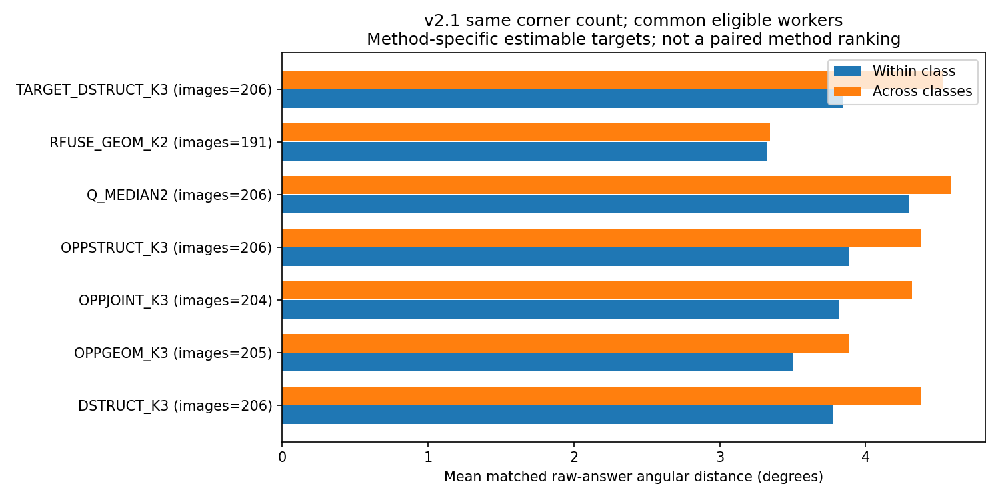

# 新版原答相似性：类别能否描述同图的真实标法

**2026-10-29本地恢复：** 已用仓库输入和原交付代码重建134,197对原答距离、45法逐池/逐图及94,588行汇总；核对三项报告关键行与原数字一致。没有重新建类、评分或融合。见[恢复记录](RESTORATION_CHECKS.json)。

这一项使用 v2.1 全部合法目标池内的原始完整标注。不同空间不互相配对；全部原答对的几何仅计算一次，再套用已经冻结的45套楼外标签。它回答的是“同类的人是否在未参与建类的建筑上画得更相近”，不代替实际融合换人检验。

## 实际范围与比较口径

原答距离库存共有 **134,197 对、294 个目标池**。Manual、Semi、普通、门洞与特殊范围分别汇总。每法自身全部已知人员与45法共同已知人员各保存一套结果。未知不补类别；同一池至少有4个可用类内对和4个跨类对才计算该池对照，未估计的池/方法/子集及原因全部列入缺口表。

每个池先对类内各类均值等权，再对跨类各无序类别对均值等权；随后图内合法目标等权、图片等权，并另保存建筑等权结果。单人类没有可估的类内距离，不以零波动计入。几何角距使用完整顶底点对的球面 Hungarian 匹配；同底点数子集单列。9°水平对应诊断与整份原答旧分簇/融合阈值是不同参数。

## Manual 普通目标：同底点数时的代表结果

以下采用共同已知人员支持、全部合法目标、楼外标签；距离越小表示原答越相近。这里的206是可比较的合法普通Manual图片数，不能写成“原主目标206池全覆盖”。完整45法和所有难度/条件均见结果表。

|方法|图片/建筑|同类联合角距°|跨类联合角距°|跨类更远图片|同类1−IoU|跨类1−IoU|
|---|---:|---:|---:|---:|---:|---:|
|DSTRUCT_K3|206/22|3.779|4.383|162/206|0.1678|0.1805|
|TARGET_DSTRUCT_K3|206/22|3.849|4.534|162/206|0.1698|0.1844|
|OPPSTRUCT_K3|206/22|3.885|4.380|162/206|0.1700|0.1800|
|OPPSTRUCT_K4|204/22|3.925|4.312|154/204|0.1703|0.1800|
|OPPGEOM_K3|205/22|3.504|3.890|155/205|0.1560|0.1699|
|OPPJOINT_K3|204/22|3.819|4.320|155/204|0.1666|0.1814|
|MSDGEOM_SCOPE_K3|206/22|3.722|4.285|139/206|0.1655|0.1786|
|RFUSE_GEOM_K2|191/22|3.325|3.342|134/191|0.1516|0.1586|
|TARGET_RFUSE_GEOM_K3|206/22|3.859|3.984|145/206|0.1677|0.1744|
|TARGET_RFUSE_GEOMQ_K3|206/22|3.887|3.935|143/206|0.1672|0.1728|
|V3_JOINT_QT_FINE|206/22|3.885|4.231|159/206|0.1708|0.1807|
|Q_MEDIAN2|206/22|4.296|4.589|151/206|0.1854|0.1920|

## 解释和用途

45套名单是本轮Manual主任务的冻结候选。Semi表是同一套标签在Semi原答中的辅助观察；它与Semi自身V3分类的独立构成实验分别解释，不将两者合并。

结构类输入本就包含结构表达，因此“同类转折数接近”主要是类别解释。楼外同点数原答的顶/底匹配角距和底面形状差异更直接说明，类别是否还关联了位置与形状倾向。角距、BEV距离、时间和质量差距分别保留；质量接近不自动等于形状相近。

联合匹配角距只对可配对的角点求平均，异点数时还必须看未匹配节点和结构差；不把该角距单独称为完整形状距离。因此本文专列同底点数子集。

这些原答结果允许一套分类在“解释怎样标”上有用，即便其融合换类效应只在部分规模/背景成立。最终主方法仍需结合已冻结 ABC、配比和失败结果选择；本文没有按原答距离单独宣布分类优胜，也没有从此推断成员完全可互换。

## 难度与结构机会：不要求所有分项同向

DSTRUCT K3 的同底点数角距，在正式困难条件下平均分离更大，但同向图片比例并不比简单条件更高。这与“困难图应全面更分离”不是同一个结论。中等条件的底面差异则接近零。

|目标难度|图片数|同类联合角距°|跨类联合角距°|跨类更远图片|同类1−IoU|跨类1−IoU|
|---|---:|---:|---:|---:|---:|---:|
|简单|130|2.556|2.837|113/130|0.1364|0.1486|
|中等|39|4.500|4.620|24/39|0.1977|0.1959|
|困难|34|7.346|9.296|22/34|0.2489|0.2725|
|未分级|6|8.021|10.366|4/6|0.2735|0.3042|

全部点数的困难图中，非冗余转折数差同类/跨类为 1.625/2.574，33/37 图跨类更大；简单图同类/跨类仅 0.101/0.129，109/130 图在这个结构差分项没有类间优势。这说明该结构分类的区别需要结构机会才能充分显示，不该要求多数四角简单目标也画出不同的结构。
未知难度行只来自实际未正式分级的目标，不继承原主空间标签；同一图片在不同目标难度行可能重复出现，不能把各行图片数直接相加作为独立总数。

## 与Q二分及旧DSTRUCT的共同图片对照

方法各自可比较的图片和目标不完全相同，不能直接相减上表均值。以下先保留双方都可比较的同一目标、相同共同人员支持，再图内目标等权。比较量为“跨类角距−同类角距”，单位是度；它衡量标法区分，不表示融合质量收益。

|候选/对照|共同图片|候选间隔|对照间隔|间隔增量|候选间隔较大图片/建筑|
|---|---:|---:|---:|---:|---:|
|DSTRUCT_K3 / Q_MEDIAN2|205|0.536|0.269|+0.267|137/205图；17/22楼|
|TARGET_DSTRUCT_K3 / Q_MEDIAN2|205|0.633|0.269|+0.364|143/205图；19/22楼|
|OPPSTRUCT_K3 / Q_MEDIAN2|205|0.501|0.272|+0.230|147/205图；15/22楼|
|OPPGEOM_K3 / Q_MEDIAN2|205|0.385|0.253|+0.133|145/205图；15/22楼|
|TARGET_DSTRUCT_K3 / DSTRUCT_K3|206|0.684|0.604|+0.080|89/206图；10/22楼|

DSTRUCT及机会结构/几何类在多数共同图片上，比简单Q二分更能描述同点数标法距离。TARGET_DSTRUCT相对原DSTRUCT的平均间隔略大，但只在89/206图较大；原答相似性这一用途并不支持“接上新目标后普遍更优”的说法。其是否更适合实际换类，还要看同目标的真实ABC和构成结果。

## 文件与复算

- `RAW_PAIR_DISTANCES.csv.gz`：所有134,197个实际配对的端点身份、几何、结构、Q/D10及来源内时间差；几何未重算质量。
- `RAW_CLASS_DISTANCE_BY_POOL.csv.gz`、`RAW_CLASS_DISTANCE_BY_IMAGE.csv.gz`：逐目标/逐图类内、类间值与真实分母。
- `RAW_CLASS_DISTANCE_SUMMARY.csv`：全部45方法、条件、范围、难度、支持口径和同点数子集。
- `RAW_CLASS_DISTANCE_UNESTIMABLE.csv.gz`：不满足类内/跨类配对机会的具体行。
- `COMMON45_BASELINE_PAIRED_BY_POOL.csv.gz`：与DSTRUCT K3、Q二分在完全相同目标和人员支持上的差异。
- `COMMON45_BASELINE_PAIRED_SUMMARY.csv`：上述完全配对比较按目标→图→楼汇总；由 `code/summarize_paired_baselines.py` 生成。
- `MANUAL_COMMON45_ALL_METHOD_RESULTS.csv`、`MAIN_RAW_SAME_COUNT_COMPARISON.csv`：主报告可直接用的小表。
- `code/compare_v21_raw_pairs.py --part compare` 从已有配对/方法检查点恢复；逐池表完整后直接运行 `code/complete_from_pool_rows.py` 逐方法保存全部汇总，无需再计算原答几何。`code/report_raw_similarity.py` 重建本说明与图。
