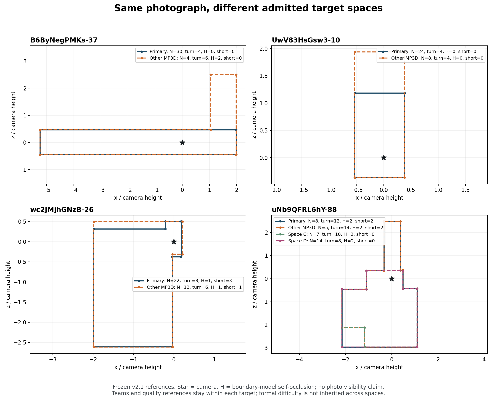

# v2.1 合法目标与目标级结构条件接续

本阶段实际读取提交：`a476461d7ede8db95da43de4139e612c05e618bc`。底层数据为 **v2.1**；这是同一批真人原答的参考、空间归属及评分更新。本文只处理人员分类所需的目标空间和条件表达，未改变参考、人工空间确认、资格、正式难度、评分或融合合同。

## 1. 已完成的输入范围

已实际计算 **294 个目标×条件池、8,385 份正式可用原答、225 张图片、255 个合法目标、22 栋楼**。8,385 个 `object_id` 均唯一。

|范围|条件/层|池数|图片数|原答数|
|---|---|---:|---:|---:|
|原主目标|普通 Manual|206|206|6,512|
|原主目标|门洞 Manual|17|17|571|
|原主目标|特殊范围 Manual|2|2|66|
|原主目标|普通 Semi|37|37|960|
|原主目标|特殊范围 Semi|1|1|45|
|其它已准入目标|普通 Manual|30|28|227|
|其它已准入目标|普通 Semi|1|1|4|

原主目标合计 263 池、8,154 答；其它目标合计 31 池、231 答。其它目标对应 30 个不同目标、28 张图片，单池人数为 **3–17**。`uNb9QFRL6hY-68` 的同一个其它目标同时有 Manual 和 Semi，因此 31 池不等于 31 个待分级目标。

组队主键必须包含 `image_id × condition × reference_id`。同图各合法目标分别形成团队、分别绑定参考；在主目标上选择“较少转折”、在另一个合法空间上选择“较多转折”的人员，不能不分目标直接比较，也不能混为同一队伍。对于 3–17 人的小池，后续根据真实容量安排小规模严格 ABC 或直接 AC，不假定它们能承担主目标的大块实验。

所有精确关联见 [POOL_TARGET_CONDITIONS.csv](../targets/POOL_TARGET_CONDITIONS.csv) 和 [RECORD_TARGET_LINKS_AND_ALL_SUPPORT_WEIGHTS.csv.gz](../targets/RECORD_TARGET_LINKS_AND_ALL_SUPPORT_WEIGHTS.csv.gz)。

## 2. 其它目标的已有人工记录能继承什么

本阶段复用了仓库已经整理的 `admitted_space_extension/difficulty_evidence`，没有重新要求对已准入空间做范围裁决。

30 个其它合法目标中：

- **22 个目标、23 个池**有与当前目标精确对应的历史第三方分级意见；原材料明确不是用户最终采用结果。
- **5 个目标**有与当前目标对应的既有助手图像意见：uNb-18/26/41 和 wc2-03 为中等建议，wc2-61 为困难建议。
- **3 个目标**没有对应于当前目标的分级记录：wc2-26 的 MP3D 6 点对目标，uNb-88 的空间 C 与空间 D。
- **0 个其它目标**能够从已有文件直接继承“已最终采用且目标精确对应”的正式三档。

历史意见全部保存为 `historical_target_grade_for_sensitivity_only`，并保留来源、目标对应和采用状态。正式字段 `official_difficulty` 在这些目标上保持缺失。主目标的分级即使已有用户最终确认，也不跨空间迁移。

这不妨碍它们参与总体人员历史、结构条件分类、分目标团队实验和独立质量评价。正式简单/中等/困难分层继续使用已确认目标；覆盖全部合法空间时，增加下面已经实际算出的连续结构条件。确需比较历史意见三档时，可单列敏感性结果，不把它升格为正式等级。

## 3. 实际补算了什么

本轮为全部 294 池按当前目标底面重算了以下量：

|字段|定义及用途|
|---|---|
|`ref_turn5`|底面相邻边方向改变超过 5° 的顶点数，减少近共线冗余点对结构量的影响。3°、10° 计数同时保留。|
|`ref_H`|相机原点至顶点射线横穿非相邻边的顶点数；擦角和共线接触另记。它是底面边界模型的自遮挡量。|
|`ref_short_edges`|边长/周长小于 4%，且两端转角均至少 15° 的短转折边数。|
|`ref_short_min_horizontal_deg`|上述短边中最小的水平视角跨度；没有短边时为缺失，而不是 0°。|
|`ref_min_horizontal_deg`|所有相邻顶点之间的最小水平视角跨度。|
|`ref_radius_p90_h`|顶点到相机距离的 90% 分位数，单位为相机高度。|
|`ref_floor_area_h2`、`ref_perimeter_h`|归一化底面面积、周长，作为范围/尺度条件。|
|`ref_height_h_median`|冻结参考顶界和底面推得的总高度/相机高度的顶点中位数；顶点高度范围同时保留。|
|`ref_hidden_vertices_1based`、`ref_short_edges_1based`|可回到目标几何中的实际结构机会编号。|

核心转折、短边、自遮挡函数从仓库旧代码**逐函数原样提取**，参数没有为本轮结果调整。来源及 SHA256 见 [FROZEN_FUNCTION_SOURCES.json](../targets/code/FROZEN_FUNCTION_SOURCES.json)。294 个目标池全部是 `valid_camera_inside`；不存在把未知自遮挡填为 0 的情况。与既存 v2.1 原主目标表对照的 263 池中，`ref_turn5`、`ref_H`、`ref_short_edges` 完全一致，最小视角差异仅为浮点舍入（最大约 5.7×10⁻¹⁴ 度）。

同时保留既有结构敏感性研究的二分条件：

> **结构挑战**：`ref_turn5 > 6`，或 `ref_H > 0`，或 `ref_short_edges > 0`。其余为无上述结构挑战。未知几何应保持未知。

这不是新的简单/困难等级。它能明确定位“有更多转折、边界遮挡或短结构机会”的图片目标，适合检验人在这些机会下是否系统简化、补充或偏移。仓库既有可计算难度研究已经显示，它与正式三档结合对结构响应有用，但并未形成普遍更优的 Q 难度预测。因此本轮将其用于结构机会和条件响应，而非把所有质量问题归为“难图”。

还保存三个机制组：无短转折且无边界自遮挡、有短转折但无自遮挡、存在边界自遮挡。它们和连续量一起保留，比单个二分标签更容易解释实际差异。

## 4. 新目标确实改变了所面对的结构条件

其它目标的 31 池中，**30 池符合上述结构挑战条件，1 池不符合**。其中 **18 池的二分条件与同图主目标不同**。按池计算，其它目标减去主目标的有效转折平均为 **+2.39**，自遮挡顶点平均为 **+0.77**；差值也包含负值，不能一概认为其它空间更复杂。

几个直接可见的例子：

|图片|主目标|其它合法目标|对人员研究的意义|
|---|---|---|---|
|B6-37|4 个有效转折、H=0|6 个有效转折、H=2|同图其它空间多出延伸和自遮挡机会；不能沿用主目标的“简单”标签。|
|UwV-10|4 转折、H=0|4 转折、H=0，但范围不同|同角点数不代表相同空间或相同定位；仅靠结构计数不能解释这类差异。|
|wc2-26|8 转折、H=1、3 条短边|6 转折、H=1、1 条短边|其它目标比主目标少转折，不能将少画自动认定为结构遗漏。|
|uNb-88|12 转折、H=2|MP3D 为 14 转折，C 为 10，D 为 8；各 H=2|同图存在四个已准入目标；要分池比较，也说明一个“困难图”标签不足以说明所有具体机会。|



图中均是已冻结的参考底面，星号为相机位置；它不是重新人工判定的图像可见性。特别是 `H` 假设模型中的边界能遮挡射线，不替代真实图片中玻璃、开口、家具遮挡、参考省略细节等语义。后续对关键分类/融合案例仍以原图和完整原答解释，而不把 `H > 0` 当作“所有部分都必须画出”或“必然困难”的证明。

## 5. 多目标计权和人员历史聚合

本阶段检查到 **29 个 image×condition 组合包含多个合法目标**；同时没有任何同一 worker×image×condition 在两个目标内重复出现。当前数据中，每个人的同图历史只有其实际所标目标；不需要为其补造其它目标下的行为。

采用下面的固定规则，可避免加入其它空间后给某张图片或某栋楼额外权重：

1. **同图差异先按目标消除**：结构/质量相对量在 `image_id × reference_id × condition` 内中心化，时间进一步保留 `origin` 和 `time_source_kind`，不能继续只按 image×condition 中心化。
2. **人员历史**：记录→人员的同一目标均值→人员同图各目标等权→同楼图片等权→建筑等权。Manual、Semi 各自形成历史；联合建类时保留条件身份。
3. **楼外建类**：目标建筑在两种条件、所有空间中的记录一并排除，然后在余下有效支持上重新计算均值、缩放和权重。不能直接套用 ALL 权重分母。
4. **结果汇总**：先固定目标和条件汇总事件/团队，再在同图同条件内对已实际评价的合法目标等权，最后图/楼分别报告。主目标与其它目标另外分层呈现，避免少数新增空间被主池平均掩盖。

`evaluation_target_weight_within_image` 给出当前完整合法库存的图内目标等权。对某项实验，若只有部分目标具备容量，必须在实际支持内重算权重并报告未纳入目标，不能把缺乏团队机会的目标按零效果补入。

[build_target_conditions.py](../targets/code/build_target_conditions.py) 中的 `hierarchical_history_weights` 已实现上述历史权重；输出的 `history_weight_on_this_support` 只描述 ALL 的 8,385 答支持，不冒充楼外权重。特征有缺失时也要按该特征有效记录重算分母，不能将“没有困难机会”“没有时间”“没有 scope 回答”变成零。

## 6. 需要人工的内容已经压缩到具体目标

本轮结构条件及分类实验**无需等待新的人工回答**。如果之后希望把其它合法目标完整纳入正式人工三档，先利用已有 27 个目标的意见及其对应，统一确认采用状态；真正没有精确目标分级意见的仅下列三项：

|目标|实际池容量|本轮几何条件|最小待确认问题|
|---|---:|---|---|
|wc2-26：MP3D 6 点对目标|13|6 转折、H=1、1 短边|按这个已准入的 6 点对空间标注，是否沿用某个已有三档意见？历史 8 点对导出目标的意见不能直接替代。|
|uNb-88：空间 C|7|10 转折、H=2、0 短边|仅评价空间 C 的人工难度，而不是主空间或 MP3D 空间。|
|uNb-88：空间 D|14|8 转折、H=2、0 短边|仅评价空间 D 的人工难度；C/D 的空间合法性已确认，无需再重画。|

精确引用及来源原因见 [OPTIONAL_EXACT_TARGET_GRADE_QUESTIONS.csv](../targets/OPTIONAL_EXACT_TARGET_GRADE_QUESTIONS.csv)。这张表是后续需要正式人工三档时使用的小清单，不是暂停当前人员研究的前置审批。

## 7. 时间来源与实际可用性

8,385 份记录中，源记录时间可用 **7,507** 份，目标时间字段可用 **440** 份。这两个字段不是同一口径，不互相填补后假装是完整新测劳动时间。其它目标 231 答中，源时间可用 190 份，目标时间均缺失；源时间继续区分旧批已审计来源与新批用户整理、未按原始日志重放的报告来源。选择哪个字段用于团队时间，沿用主研究冻结规则并保留来源和实际分母。

## 8. 交付和复算

本阶段是**新目标结构补算与输入接续**，没有新增融合端点，也没有重跑已完成的自然人数曲线。

|文件|内容|
|---|---|
|[POOL_TARGET_CONDITIONS.csv](../targets/POOL_TARGET_CONDITIONS.csv)|294 个池的完整元数据、正式/历史难度状态及独立结构条件。|
|[TARGET_STRUCTURAL_FEATURES.csv](../targets/TARGET_STRUCTURAL_FEATURES.csv)|255 个目标的去重结构/尺度特征。|
|[OTHER_TARGETS_EVIDENCE_AND_CONDITIONS.csv](../targets/OTHER_TARGETS_EVIDENCE_AND_CONDITIONS.csv)|31 池原人工证据、独立条件与同图主目标差值。|
|[RECORD_TARGET_LINKS_AND_ALL_SUPPORT_WEIGHTS.csv.gz](../targets/RECORD_TARGET_LINKS_AND_ALL_SUPPORT_WEIGHTS.csv.gz)|8,385 答的人员、目标、条件、时间来源、Q 及 ALL 权重关联。|
|[TARGET_CONDITION_SUPPORT.csv](../targets/TARGET_CONDITION_SUPPORT.csv)|按范围/条件/层/结构机制组的支持量。|
|[CHECKS_AND_SUPPORT.json](../targets/CHECKS_AND_SUPPORT.json)|完成范围及与既存 263 池几何量的对应结果。|
|[INPUT_MANIFEST.json](../targets/INPUT_MANIFEST.json)|实际输入路径、提交、字节数和 SHA256。|
|[code](../targets/code/)|实际运行代码与原函数来源。|

在含上述提交输入的仓库中运行：

```bash
PYTHONPATH=/tmp/hohonet_v21_deps python targets/code/build_target_conditions.py \
  --repo /path/to/3D_Manhattan_label --out targets
PYTHONPATH=/tmp/hohonet_v21_deps MPLCONFIGDIR=/tmp/hohonet_mpl \
  python targets/code/plot_target_space_examples.py \
  --repo /path/to/3D_Manhattan_label --out targets/TARGET_SPACE_EXAMPLES.png
```

依赖为 Python、NumPy、pandas、Shapely；出图再需 Matplotlib。输入沿用仓库原有两份池快照与人工证据表，交付无需重复打包这些大输入。源报告路径为 `research/data/releases/v2.1/admitted_space_extension/difficulty_evidence/README.md`、`research/data/releases/v2.1/difficulty_computable_comparison/README.md` 和 `research/difficulty/difficulty_computable_comparison_20261028/structure_sensitivity_v1/README.md`，几何函数的逐文件引用另存 manifest。
