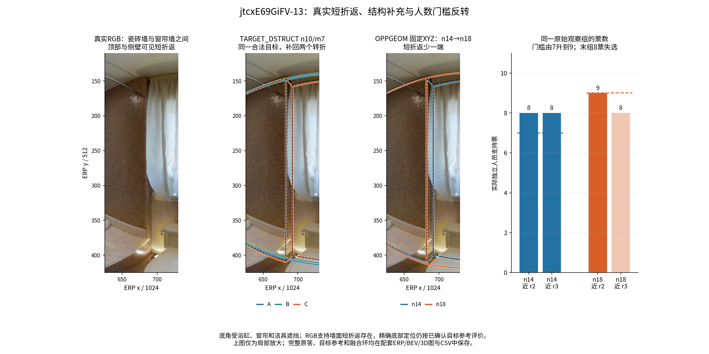
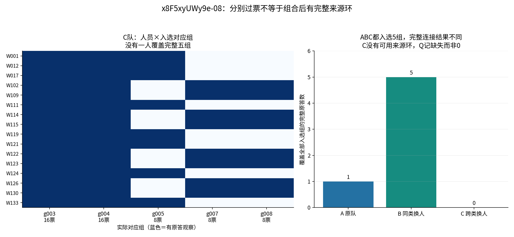
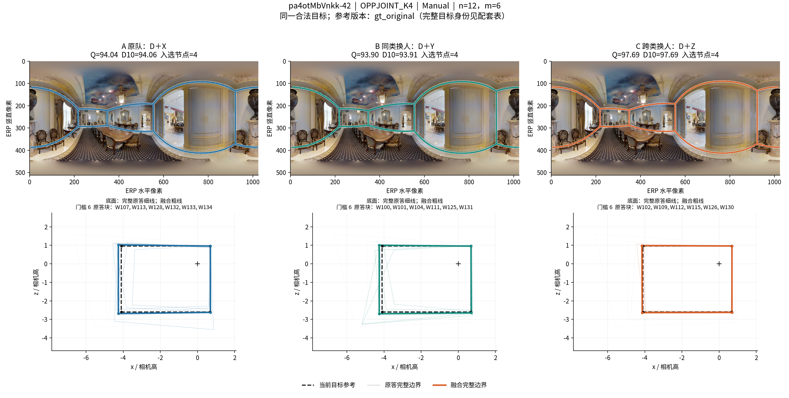

# v2.1 人员分类：完整原答—投票—融合机制案例

**本阶段完成了 6 个主文机制主题、7 个严格 ABC 事件，覆盖 5 张图；另保留 1 个补充案例。** 所有案例属于 Manual，同一事件只使用同一个已准入目标空间。新增工作是从已完成的全局与重点实验中选择机制例证、重放 24 个已有端点取得内部票账、读取 6 张真实原图、生成完整图表和精确成员关联。没有重新拟合类别，没有产生额外独立团队，也没有改动质量与融合规则。

实际读取仓库提交：`a476461d7ede8db95da43de4139e612c05e618bc`；底层数据版本：**v2.1**。原答、参考目标、时间来源和环序资格来自该版本既定输入。端点中保留的旧 `endpoint_origin` / `repository_commit` 描述被复用原引擎的来源，不是本轮重新读取仓库的提交。24 次必要轨迹重放与已有端点标量的最大差为 `1.4210854715202004e-14`。[完成记录](CASE_COMPLETION.json)

## 1. 本组案例解释了什么

1. **节点和票数都一样，也可以有清楚的换类效果。** OPPGEOM 的走廊案例与 OPPJOINT 的餐厅案例保持四个节点、每个节点全员支持；变化通过对应组内的坐标汇总改变底面、上界和高度。
2. **较多转折类确实能补回真实结构，但成员并非每人都画。** 浴室可见的短折返，在同类换人后仍不够票；换入结构类后得到 8 票，跨过 5 票门槛。7 名换入者中 6 人支持这一局部，另有 2 名共同背景成员支持。
3. **增加共同背景会改变结构是否通过门槛。** 固定 X/Y/Z、只扩大 D 的路径中，必要转折的同一组 8 票保持不变，门槛由 7 升到 9，该组失选，C 队 Q 降低 15.18 分。
4. **局部组分别过票，也可能无法形成完整融合。** 一个反例的 C 队选出 5 组，每组至少半数支持，但没有任何完整来源环同时覆盖这 5 组，按既定连接合同失败。
5. **联合分类的时间代价取决于比较对象。** n20/m5 案例比同类替换 B 稍省时，但比原队 A 费时；n12/m6 典型案例相对 A、B 都费时，换来位置、尺度与高度改善。

这些是总体差异的具体传递机制。案例是在全量结果完成后选择的可视解释，不把这几张图的改善比例当作总体有效率。全局候选表保留全部正向、负向、失败和无明显变化；主方法采用仍依据主研究的完整汇总。

## 2. 精确事件与总体变化

统一定义：A＝D∪X，B＝D∪Y，C＝D∪Z；D 为共同背景，X/Y 属于该图楼外标签中的同一源类，Z 属于目标类，D/X/Y/Z 两两不重叠。每个事件 A/B/C 的总人数相同，实际换人数均为 m。类别编号仅在对应楼外折内使用，跨折按角色语义关联。

|案例|图片|分类、n/m|Q：A / B / C|B−A|C−A|C−B|
|---|---|---|---:|---:|---:|---:|
|01_position|wc2JMjhGNzB-67|OPPGEOM_K3，14/7|91.477 / 91.222 / 97.758|-0.255|6.281|6.535|
|02_structure|jtcxE69GiFV-13|TARGET_DSTRUCT_K3，10/7|72.800 / 77.163 / 94.637|4.363|21.838|17.475|
|03_size_lower|jtcxE69GiFV-13|OPPGEOM_K3，14/7|71.018 / 75.726 / 87.393|4.708|16.376|11.668|
|03_size_higher|jtcxE69GiFV-13|OPPGEOM_K3，18/7|72.767 / 75.351 / 72.213|2.583|-0.555|-3.138|
|04_failure|x8F5xyUWy9e-08|TARGET_DSTRUCT_K3，16/4|73.707 / 75.826 / 缺失/失败|2.119|缺失/失败|缺失/失败|
|05_joint|jtcxE69GiFV-03|OPPJOINT_K4，20/5|83.996 / 83.236 / 88.362|-0.760|4.366|5.126|
|06_joint_focus|pa4otMbVnkk-42|OPPJOINT_K4，12/6|94.041 / 93.903 / 97.693|-0.137|3.653|3.790|

完整源/目标类、类别人数向量、背景人数与精确集合见 [CASE_MECHANISM_SUMMARY.csv](CASE_MECHANISM_SUMMARY.csv)；逐人员对象 ID、所属 D/X/Y/Z、个人分数和时间来源见 [CASE_EXACT_MEMBERS_AND_BLOCKS.csv](CASE_EXACT_MEMBERS_AND_BLOCKS.csv)。[CASE_EVENTS_EXACT.csv.gz](CASE_EVENTS_EXACT.csv.gz) 保留原登记字段与团队键；[CASE_ENDPOINT_SCALARS.csv](CASE_ENDPOINT_SCALARS.csv) 是去重可关联的端点分项；[CASE_FULL_EVENT_METRICS.csv.gz](CASE_FULL_EVENT_METRICS.csv.gz) 保留选中事件的全部测量字段。

## 3. 同节点定位改善：OPPGEOM，14 人换 7 人

图 `wc2JMjhGNzB-67`，事件 `cd27d16376d979fbd3e9b1fe`。方向为楼外面积角色 2→3，对应本折 C2→C3。A/B 都是源类 14 人，C 为源类 7 人＋目标类 7 人。

三队都输出四个节点，每个对应组都是 **14/14 票**，门槛均为 7；没有节点增删、没有过门槛状态变化。Q 为 91.477/91.222/97.758；同类变化 −0.255，跨类相对原队 +6.281、相对同类替换 +6.535。D10 为 92.109/92.803/97.782。B→C 的 BEV IoU 从 .9528 提高到 .9799，三维 IoU×100 从 95.195 提高到 97.902，底点角误差 S_bottom 从 .506° 降到 .225°，方向误差从 1.823° 降到 .433°。

可见差别是原答在同一四角结构上的定位，融合坐标更接近当前目标参考。不能因为都是“四个点”就认定原答或融合相同；也不能把改善归因于结构补票。源库存记录时间相对原队 C−A 为 −4.74%；B、C 的时间来源人数构成不一致，故不报告可比的 C−B 百分比。

[完整原答、参考与三队 ERP/BEV](figures/cd27d16376d979fbd3e9b1fe/ERP_BEV.png) · [三维与 14 票对应组](figures/cd27d16376d979fbd3e9b1fe/3D_VOTES.png)

## 4. 真实短折返补充：TARGET_DSTRUCT，10 人换 7 人

图 `jtcxE69GiFV-13`，事件 `ae9bc0bdaf9a5f2119cea910`。楼外困难结构机会下的转折角色 2→3，对应本折 C2→C3。A/B 的完整构成为 C2:9、C3:1，C 为 C2:2、C3:8；共同背景是 W108、W122、W124。

真实 RGB 中，瓷砖墙与窗帘墙之间的顶部和侧壁有可见短折返。两端对应当前参考的 r2/r3。底角被浴缸、帘和洁具遮挡，因此这里用 RGB 确认墙面结构存在，精确底点定位沿用已确认目标参考，不把被遮住的位置说成直接可见。

|队伍|r2 近邻组票数|r3 近邻组票数|门槛|融合节点|
|---|---:|---:|---:|---:|
|A 原队|2|2|5|4|
|B 同类替换|4|2|5|4|
|C 跨类替换|8|8|5|6|

共同背景 W108、W122 在三队都支持这两个局部；C 的换入块中 W002、W109、W112、W115、W126、W130 同时支持两端，W102 不支持这两个组。这直接体现了“该类更常保留局部结构”，而不是“该类每个人都会保留”。X 中没有新增支持；Y 的 W106、W113 只提高其中一端的票数，仍未达门槛。

Q 从 A/B 的 72.800/77.163 提高到 C 的 94.637，D10 为 72.934/77.222/95.434；9°参考节点召回由 4/6 提高到 6/6。B→C 的 BEV IoU .8634→.9668，三维 IoU×100 85.244→96.049，S_bottom 2.074°→.401°。位置也同步改善，所以 **+17.475 的净 Q 不能全部归给两个新增点**。方向损失 .0530→.0661 略有增加，保留这一反向分项。

这个实例有明确时间代价：来源人数构成相同的 B/C 库存记录时间为 891.610/1512.827 秒，C−B 为 +69.67%。它适合解释结构补充和用时间换质量，不作为节时案例。



上图第二栏为本节 TARGET_DSTRUCT 的 A/B/C；第三、四栏属于下一节的 **另一种分类、另一条固定成员块路径**。完整原答和参考没有在局部裁图中删除：[ERP/BEV](figures/ae9bc0bdaf9a5f2119cea910/ERP_BEV.png) · [3D/票账](figures/ae9bc0bdaf9a5f2119cea910/3D_VOTES.png)。

## 5. 固定 X/Y/Z 增加 D：14→18 人，结构门槛反转

仍为 `jtcxE69GiFV-13`，但采用 **OPPGEOM_K3 面积角色 2→3**，m=7。较小事件为 `164f7e24305914ffb1d8c116`，较大事件为 `bbd4c6e7e49cced53ce71301`。X/Y/Z 完全相同；D18 在 D14 基础上增加 W106、W110、W111、W114。

|量|n14|n18|n18−n14|
|---|---:|---:|---:|
|A 的 Q|71.018|72.767|+1.749|
|B 的 Q|75.726|75.351|−.375|
|C 的 Q|87.393|72.213|−15.181|
|C−A|+16.376|−.555|−16.930|
|C−B|+11.668|−3.138|−14.806|
|门槛|7|9|+2|
|C 两个短折返组支持|8 / 8|9 / 8|+1 / 0|
|C 融合节点|6|5|−1|

这条路径不是“净优势变小但 C 没变”：C 自身下降了 15.181 分，A 小幅提高，B 基本不变。也不是只依据跨端点的 `node_004` 名字判断同一组。保存的对象 ID＋原答点对索引显示，小团队各组的旧观察全部保留；失选短折返组的 8 个原始观察完全相同，新增背景没有给这一端加票。相邻另一端得到 W106 的一票，达到新门槛 9 而保留。

C 的三维 IoU×100 从 92.428 降至 84.949；S_bottom 1.040°→2.181°，方向误差 1.968°→3.211°，边界损失 .0338→.1487。成员增加的同时，同类源背景比例从 7/14 变成 11/18、目标块仍为 7 人。这说明人数、配比和支持门槛需要一起解释；固定块并不代表其有效支持占比固定。

三个队伍都增加相同的 566.662 秒源库存记录。这个加法是同四名背景的记录和；ABC 原有时间来源结构并不完全匹配，因此不将该路径汇总成来源配平的跨类节时效果。

[观察级组关联](size_path_mechanism/EXACT_SHARED_OBSERVATION_GROUP_LINKS.csv) · [组变化诊断](size_path_mechanism/GROUP_CHANGE_DIAGNOSTICS.csv) · [全分项路径](size_path_mechanism/SIZE_PATH_ARM_COMPONENTS.csv)

## 6. 明确失败反例：分别过票，但缺少可用完整来源环

图 `x8F5xyUWy9e-08`，事件 `bac6397542c7a06a9d811694`，TARGET_DSTRUCT_K3，n16/m4，转折角色 2→3。三队都选中 5 个对应组；A/B 有完整融合，Q 为 73.707/75.826，C 的 `score_status=no_connection`，`geometry_reason=no_source_ring_covering_all_selected_nodes`。

C 的五组支持为 16、16、8、8、8，均达到门槛 8。但 ERP 水平方向约 951 与 973 的两个组分别由互不重叠的 8 人支持，C 内没有任何原答同时覆盖所选完整五组。两组成员名单和每人的原始环已完整保存。A/B 可覆盖全部入选组的来源环分别有 1 份和 5 份，C 为 0。



这不是“所有局部都标错”：部分换入组靠近当前目标参考，却与保留的另一批表达拼成没有完整来源环覆盖的集合。当前合同没有为它擅自补连边，C 的 Q 保持缺失。3D 图对 C 只画入选的上下点对，不画虚构完整环；失败不记成 Q=0。此反例解释可采用结构类的风险条件，不用于否定其它多数有效配置。

[完整原答与入选点](figures/bac6397542c7a06a9d811694/ERP_BEV.png) · [无完整 C 环的三维与票数](figures/bac6397542c7a06a9d811694/3D_VOTES.png) · [逐人来源环覆盖](local/FAILURE_EXACT_SOURCE_RING_COVERAGE.csv)

## 7. 联合分类的两种规模与时间比较

### 7.1 n20/m5：比同类替换省时，但比原队费时

图 `jtcxE69GiFV-03`，事件 `b8370e9f1447f415c2c4ce0c`。OPPJOINT_K4 楼外相对历史 Q 角色 1→4，对应本折 C1→C4。A/B 的完整人数向量为 C1:10、C2:8、C3:1、C4:0、未知:1；C 为 C1:5、C2:8、C3:1、C4:5、未知:1。未知成员 W034 只在三队共同背景，不被补成某个已知类，也没有参加 X/Y/Z。

三队都输出四节点、每组 20 票，门槛 10。Q 为 83.996/83.236/88.362；C−A +4.366、C−B +5.126。B→C 的三维 IoU×100 85.972→89.833，S_bottom .702°→.473°，方向误差 1.691°→1.268°。这是既有四角表达的定位变化，不是节点选择变化。

来源人数构成可比的库存记录时间分别为 A 3935.285、B 4400.437、C 4334.629 秒。因此 **C−B −1.50%，但 C−A +10.15%**。同类替换 B 本身比 A 更慢；应同时报告两种比较，不能把“相对 B 节时”写成相对原队节时。

[ERP/BEV](figures/b8370e9f1447f415c2c4ce0c/ERP_BEV.png) · [3D/票账](figures/b8370e9f1447f415c2c4ce0c/3D_VOTES.png)

### 7.2 n12/m6：接近中位净增益的质量—时间取舍

图 `pa4otMbVnkk-42`，事件 `2fa2eea81fbc17d689ffb72f`。从重点实验 OPPJOINT_K4 相对历史 Q 角色 1→4、n12/m6 的全部 172 个登记事件中选例；其中 161 个可作三队分数比较、覆盖 56 图，事件 C−B 中位数为 +3.450。本例 +3.790 接近该中位数，并呈现 +11.00% 的时间代价；不是从最大改善事件取图。筛选范围与全部候选见 [FOCUS_CASE_SELECTION_SCOPE.json](FOCUS_CASE_SELECTION_SCOPE.json) 和 [全部条件事件](FOCUS_OPPJOINT_N12M6_ALL_EVENTS.csv.gz)。

本图 D＝W030/W103/W108/W122/W124/W127；X＝W107/W113/W128/W132/W133/W134；Y＝W100/W101/W104/W111/W125/W131；Z＝W102/W109/W112/W115/W126/W130。A/B 的完整配比 C1:8、C2:3、C3:0、C4:1，C 为 C1:2、C2:3、C3:0、C4:7。该折角色中心使用图内中心化历史：源类相对 Q −3.304、相对 log 时间 −.178，目标类相对 Q +14.010、相对 log 时间 +.025；这些是历史残差中心，**不是原始 Q 或秒数**。成员名单和全部中心见 [本案例所用楼外定义](CASE_USED_LOBO_CLASS_DEFINITIONS.csv)。

|分项|A|B|C|
|---|---:|---:|---:|
|Q|94.041|93.903|97.693|
|D10|94.061|93.912|97.694|
|BEV IoU|.94515|.94384|.97820|
|三维 IoU×100|93.547|93.666|97.813|
|S_bottom，度|.3319|.2680|.1964|
|方向误差，度|.5464|.4376|.1725|
|外扩分项|.05802|.05942|.02229|
|平均高度/参考高度|.98919|.99193|.99993|
|高度损失|.001499|.003021|.000110|
|源库存记录时间，秒|1370.005|1657.047|1839.375|

三队仍是四节点，每个对应组都有 12/12 票；共同背景 6 人和换入块 6 人均支持四个主角。改变人员后，底面远端的轻度外扩收敛，方向更接近参考，高度均值和局部高度更合适。完整原图支持餐厅内部目标，右侧开口后的相邻空间没有与本目标混队。

同类换人 Q 仅 −.137，跨类相对原队 +3.653、相对 B +3.790；记录时间相对 B +11.003%，相对 A +34.260%。它说明推荐联合分类在这一合法背景中有清楚的质量取舍用途，而不是“高历史 Q 类必然更快”。



[四组均满票的 3D/票账](figures/2fa2eea81fbc17d689ffb72f/3D_VOTES.png)

## 8. 案例选择、参考边界和保留的补充结果

候选检索基于 69,485 条完整广筛事件，在 TARGET_DSTRUCT、OPPGEOM、OPPJOINT 的预先冻结角色方向中查找可解释机制；该方向子表共 1,647 事件。位置改善筛出 79 事件/23 图，补结构 28/14，明显降质 25/9，C 失败 12/6，同类大波动 28/17；固定 XYZ 的人数反转筛出 14 条路径/8 图。完整筛选代码与每一候选仍保存，最终选图兼顾局部可见性、效应大小、失败类型和与主要总体结果的关系。[选择范围](CASE_SELECTION_SEARCH_SCOPE.json)

`pa4otMbVnkk-05` 的 TARGET_DSTRUCT n14/m7 事件 `e505c9246f7c405989d8d315` 仍保留：Q 为 65.971/68.681/89.328，C−B +20.647，节点 4/4/6。新增点靠近 ERP 接缝且有自遮挡，单图不如浴室短折返清楚，所以将它降为视觉补充；没有从全量统计删除，没有据此改类或改分。[补充完整原答图](figures/e505c9246f7c405989d8d315/ERP_BEV.png)

本阶段案例均为主目标普通 Manual；它们不能替代新增空间池或 Semi 的独立结论。浴室结构案例和人数路径是同图不同分类/成员设计，不能当成三张独立图。原图上出现门洞不自行改变已冻结的门洞/特殊范围资格。三维图以相机高度 h 归一化，地面固定 −1h，是既定三维代理，不是测得的房间米制尺寸。

时间全部来自历史记录库存，单位秒。`source_time_total_seconds` 包含有来源记录的人员时间和；它与当前目标专用 `recorded_time_total_seconds` 不同，不能将缺失目标时间补成源记录。时间百分比仅在两个比较队伍的时间来源人数构成一致且记录完整时报告；逐对资格保存于 [CASE_TIME_COMPARABILITY.csv](CASE_TIME_COMPARABILITY.csv)。即使 ABC 不全部可比，某一对仍可能可比。这里没有重新计时，也没有把计算引擎的秒数当成人工劳动耗时。

## 9. 文件入口与复算

|案例|完整 ERP＋BEV|完整 3D＋票账|
|---|---|---|
|01_position|[原答与融合](figures/cd27d16376d979fbd3e9b1fe/ERP_BEV.png)|[三维与投票](figures/cd27d16376d979fbd3e9b1fe/3D_VOTES.png)|
|02_structure|[原答与融合](figures/ae9bc0bdaf9a5f2119cea910/ERP_BEV.png)|[三维与投票](figures/ae9bc0bdaf9a5f2119cea910/3D_VOTES.png)|
|03_size_lower|[原答与融合](figures/164f7e24305914ffb1d8c116/ERP_BEV.png)|[三维与投票](figures/164f7e24305914ffb1d8c116/3D_VOTES.png)|
|03_size_higher|[原答与融合](figures/bbd4c6e7e49cced53ce71301/ERP_BEV.png)|[三维与投票](figures/bbd4c6e7e49cced53ce71301/3D_VOTES.png)|
|04_failure|[原答与融合](figures/bac6397542c7a06a9d811694/ERP_BEV.png)|[三维与投票](figures/bac6397542c7a06a9d811694/3D_VOTES.png)|
|05_joint|[原答与融合](figures/b8370e9f1447f415c2c4ce0c/ERP_BEV.png)|[三维与投票](figures/b8370e9f1447f415c2c4ce0c/3D_VOTES.png)|
|06_joint_focus|[原答与融合](figures/2fa2eea81fbc17d689ffb72f/ERP_BEV.png)|[三维与投票](figures/2fa2eea81fbc17d689ffb72f/3D_VOTES.png)|
|S1_semantic_not_main|[原答与融合](figures/e505c9246f7c405989d8d315/ERP_BEV.png)|[三维与投票](figures/e505c9246f7c405989d8d315/3D_VOTES.png)|

每个图目录还包含 `ABC_COMPONENTS.csv`、`RAW_ANSWERS.csv`、`VOTE_GROUPS_WITH_BLOCKS.csv`、`COMMON_D_GROUP_LINKS.csv`、`CASE_PROVENANCE.json`，以及 PDF 导出。所有原始观察通过 `object_id` 和 `source_pair_index` 回到完整原答；不同队伍的对应组不会仅凭同名 `node_00x` 被当成同一组。

关键表：

- [CASE_COMPLETE_RAW_ANSWERS.csv.gz](CASE_COMPLETE_RAW_ANSWERS.csv.gz)：每一实际成员的完整输入点序列、环序资格；不只保留局部截图。
- [CASE_VOTE_GROUPS.csv](CASE_VOTE_GROUPS.csv)：全部候选对应组、票数、D/替换块贡献和原观察身份。
- [CASE_SOURCE_RING_COVERAGE.csv](CASE_SOURCE_RING_COVERAGE.csv)：每份原答是否覆盖所有选中组。
- [CASE_USED_LOBO_LABELS.csv](CASE_USED_LOBO_LABELS.csv)：案例实际用到的折与方法的完整逐人标签；不拿 ALL 描述标签替代检验标签。
- [CASE_POOL_INPUTS.json.gz](CASE_POOL_INPUTS.json.gz)：六个案例目标池的精确小输入、参考、所有候选原答，可独立重放选中事件。

分包保留项目相对目录。使用固定提交的仓库作为融合引擎依赖，Python 环境需 numpy/pandas/scipy/matplotlib/Pillow/Shapely。若仅重画已有证据，不需要再融合，也不需要完整大缓存：

```bash
python cases/code/render_exact_abc_case.py --cases stage06_cases/traces_focus/2fa2eea81fbc17d689ffb72f.json.gz --out stage06_cases/figures --originals cases/originals
python cases/code/render_local_mechanisms.py
python cases/code/build_case_tables.py
python cases/code/write_case_report.py
```

如需必要的原引擎轨迹重放，包内给出实际运行的导出器和全部小输入；下例只重放一个 ABC，不涉及建类或全局重算：

```bash
python experiment/export_event_mechanism.py --repo /path/to/HOHONET_at_a476461 --pools stage06_cases/CASE_POOL_INPUTS.json.gz --events stage06_cases/CASE_EVENTS_EXACT.csv.gz --event-ids 2fa2eea81fbc17d689ffb72f --scalars stage06_cases/CASE_ENDPOINT_SCALARS.csv --output /tmp/hohonet_case_trace_check
```

渲染字体使用 Noto CJK；下载来源记录在 `cases/source/FONT_SOURCE.json`，字体文件不重复装入分包。原图来自用户指向的官方 GitHub Release，索引、逐图成员压缩包 Range、CRC 和 SHA256 见 `cases/originals/ORIGINALS_RECEIPT.json`，仅保留所需六张原图，没有打包原图全集。

本阶段交付完成了上述机制解释及可复算关联。主分类取舍、各方向的平均效应、支持率和容量应引用主研究的全量结果；这里不重新计算全局结论，也不把少量案例替代完整的图片/建筑分母。
