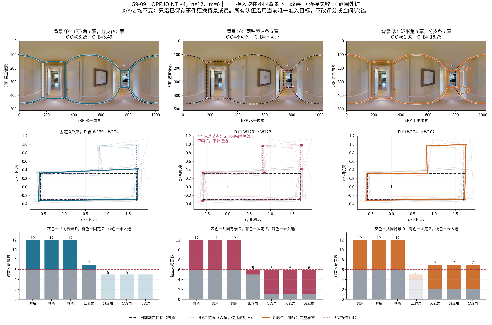

# 主方向反例机制：S9-09 的范围表达与半票连接冲突

**结论：这里的主要代价是已裁定目标范围之外的延伸，并在两种范围表达票数打平时触发连接失败。高度误差与方向误差不是这三个降质事件的主因。** OPPJOINT K4 的楼外低历史 Q → 高历史 Q 方向、n=12/m=6 在本图共有 **6 个既有严格 ABC 事件、2 组固定 X/Y/Z、每组 3 个背景**；4 个 C 可评分，1 个改善、3 个明显下降，另 2 个 C 连接失败。A/B 各 6 队均可评分。全部事件保留，未据结果改类、改目标或删队。

这不是阶段06的 TARGET_DSTRUCT x8-08 失败案例。它属于**本轮采用的 OPPJOINT 主方向**，用于说明主方法的目标范围与背景条件。

## 1. 先读已有裁定：六角分支有历史来源，不能说凭空增加错误结构

仓库 `difficulty_records.json` 已记载用户曾指出“这个有两个空间”，随后确认新四角范围；正式说明是“新范围已固定，原跨空间隐藏分支不再计入”。`selection_reason` 为“采用本次明确确认的新空间，原空间仅对照”。当前 v2.1 的目标是 `user_space_20261016:S9hNv5qa7GM-09`，参考版本 `user_adopted_reference_20261028`，人工难度继续为**中等**。几何四角/H=0 不覆写人工难度。

当前官方池将 35 份记录全部绑定 `sole_admitted_space`。本分析完整沿用该绑定，不把六角作答另行准入，不以它们“更像旧 GT”替换正式分数。现有完整几何说明：负向 C 的新增分支十分接近旧六角 GT，因此应解释为**当前目标内比较时的范围表达差异／旧范围延伸风险**，而不是“高 Q 成员总会多画错误细节”。既有空间裁定已足以解释，不要求用户重新裁决。

原图可见窄走道、两侧开口与实体近墙；旧跨出部分不能在本视角全部直接辨认。关于目标边界的采用依据是既有人工作业记录，不从这张全景重新推断空间归属。[裁定原记录与新旧几何](main_direction_counterexample/S9_09_EXISTING_SCOPE_ADJUDICATION.json)已独立保存；[完整原图](main_direction_counterexample/S9hNv5qa7GM-09_original.png)来自官方 Release，仅提取本图，大小与 ZIP CRC 通过。

## 2. 六个事件全部结果

|块／背景|事件 ID|A Q|B Q|C Q|C−A|C−B|C 节点|止界／分支票|结果|
|---|---|---:|---:|---:|---:|---:|---:|---|---|
|1／1|`129a4331e9634d52870b0397`|80.16|79.76|83.25|3.09|3.49|4|7／5|四角保留，小幅改善|
|1／2|`369c48caccbab2806023d6d6`|80.78|79.41|失败|失败|失败|7|6／6|连接失败|
|1／3|`fe1159d4ef3d264c307beb74`|80.16|80.73|61.98|-18.18|-18.75|6|5／7|旧范围分支进入，明显下降|
|2／1|`4d77bf902bd3aace49b08f8d`|75.90|80.58|失败|失败|失败|7|6／6|连接失败|
|2／2|`afbe9cad3b0ac584c276d296`|76.49|79.97|61.79|-14.70|-18.18|6|5／7|旧范围分支进入，明显下降|
|2／3|`738a89bc03307882433971d0`|76.71|80.78|62.19|-14.52|-18.59|6|4／8|旧范围分支进入，明显下降|

4 个三队可评分事件中，C−A 平均 **-11.08**，C−B 平均 **-13.01**；三队可评分时同类绝对 Q 变化 2.13，跨类绝对 Q 变化 12.62。2 个 C 失败单列为 **2/6**，没有按 0 分填补或从登记分母中删除。三个负向可评分事件的 C−B 均低于 −18 分。

4 个可评分事件的 C−B 库存记录时间均值 **+8.31%**；6 个登记事件含失败 C 的相同记录时间对比为 **+8.07%**。用户处理后的库存记录时间；W002 沿用 v1 时间来源，其余为 new 批处理记录。全 12 人来源时间已知，target-specific 时间为 0；合计为记录劳动秒数，不是新测生产用时。

[完整六事件与 D/X/Y/Z、ABC 成员](main_direction_counterexample/S9_09_ALL_SIX_EVENTS_WITH_MECHANISM.csv) · [18 端点全分项](main_direction_counterexample/S9_09_ABC_ALL_COMPONENTS.csv) · [完整原答及归属块](main_direction_counterexample/S9_09_DXYZ_RAW_ANSWERS.csv)

## 3. 固定换入块，背景怎样改变结果

第一组 X/Y/Z 完全固定，Z 为 **W002、W109、W112、W115、W126、W130**。其中 W002 支持矩形止界角，另外 5 人共同支持旧分支的三个角；因此不能把整个高 Q 类说成同一张图上都画相同结构。

1. 背景① D=`W105|W110|W118|W120|W124|W127`：矩形止界角 7 票，分支每角 5 票，门槛 6。C 保持四角矩形，相对 B 提高 **+3.49 Q**，底点与边界也改善。
2. 背景②将 W120 换为 W122：止界角与分支各 6 票，**两种互斥局部表达都达到门槛**，共同三角之外又选出 4 个局部点，共 7 节点。每个原答只包含止界角或分支三角的一套表达，没有任何原答环覆盖全部 7 点；冻结融合返回 `no_source_ring_covering_all_selected_nodes` / `no_connection`。本分析不手工补连边。
3. 背景③再将 W124 换为 W102：止界角降至 5，分支三角升至 7，C 可沿六角来源环连接，但从当前四角目标向外伸出，相对 B **−18.75 Q**。

第二组固定块同样出现 6:6 失败、5:7 降质、4:8 降质。因此风险不依赖第一组的单一路径。**背景中的目标类人数**与**实际支持某局部表达的票数**并不相同：第二组背景目标类人数为 0 时也可形成 6:6。这正是需要保存具体成员和原答，而不能只报类别人数的原因。

已对四对相邻背景 C 队的共同原观察逐对检查分组关系：共有 6052 对原观察，0 对共同归组关系改变。这里的主要开关是局部表达的支持票跨门槛，不是把已有观察大规模重新对应；坐标中位数随成员改变，仍有小幅位置变化。[归组核对](main_direction_counterexample/S9_09_BACKGROUND_PATH_GROUP_STABILITY.csv) · [全部 125 个候选组票账](main_direction_counterexample/S9_09_ALL_VOTE_GROUPS.csv) · [每人原答环覆盖](main_direction_counterexample/S9_09_SOURCE_RING_COVERAGE.csv)

图中黑虚线为当前采用目标，紫点线仅为旧 GT 范围对照；失败 C 只画选中点，不画推测的完整环。三列属于同一 OPPJOINT n12/m6 成员块路径。

## 4. 降质体现在哪些分项

三个可评分负向 C 中，平均外扩项从 B 的 **0.152** 上升到 C 的 **0.463**；底面 IoU 从 **86.71%** 降到 **67.57%**，三维代理 IoU 从 **86.00** 降到 **67.35**。平均底点误差从 **1.478°** 到 **2.053°**，边界损失从 **0.0683** 到 **0.1318**。

与此同时，平均方向损失从 **0.1487** 降到 **0.0544**，高度损失从 **0.0023** 降到 **0.0007**；遗漏项 C 平均仅 **0.0114**。所以“更差”主要落在**范围/外扩、底面覆盖及边界**，不能把所有几何分项都说成恶化。三个六角 C 与旧 GT 的额外诊断底面 IoU 为 **95.08%–95.37%**；这是帮助解释结构来源的几何对照，没有另算旧参考 Q 或改变正式评价。

## 5. 对采用判断的影响

OPPJOINT 的群体质量差异仍按全体图／楼结果判断。本图增加一条明确适用边界：**在当前目标空间已裁定、但原答仍保留旧跨空间分支的图片上，换入更高历史 Q 成员并不保证当前目标质量提高；若背景把两个局部表达推到半票附近，既可能扩大范围，也可能失去可连接的来源环。**

因此 S9-09 作为“目标范围表达与背景票数的反例”进入主文，不能当作普通正确性差异来解释。人员类、参与者空间绑定与分数全部保持冻结；后续若正式空间归属记录更新，需单独版本化重算，不能在本轮为改善结论自行改池。当前无需因此否定多数图片上的主方向，也不能把失败藏进可评分均值。

## 6. 复算与实际保存

这里只重放 **6 个既有事件、18 个既有端点**以取 full_state；未新增团队、未重拟标签、未更改融合/评分。最大标量差 7.1e-15。[重放命令](main_direction_counterexample/EXACT_REPLAY_COMMAND.json) · [逐端点核分](main_direction_counterexample/traces/TRACE_SCALAR_PARITY.json) · [原始六事件全部指标](main_direction_counterexample/S9_09_ALL_SIX_EVENT_METRICS.csv.gz) · [实际说明/作图代码](code/explain_s9_main_counterexample.py)。六份压缩 trace 中包含完整原答、完整 ABC 几何、对应组、门槛和原答环序；以精确 event ID 命名，可按表定位。

代码使用从官方参考和原答导出的相机高归一化坐标；3D 为当前冻结代理，非新测物理房间尺寸。读取提交 `a476461d7ede8db95da43de4139e612c05e618bc`，底层数据 v2.1。
