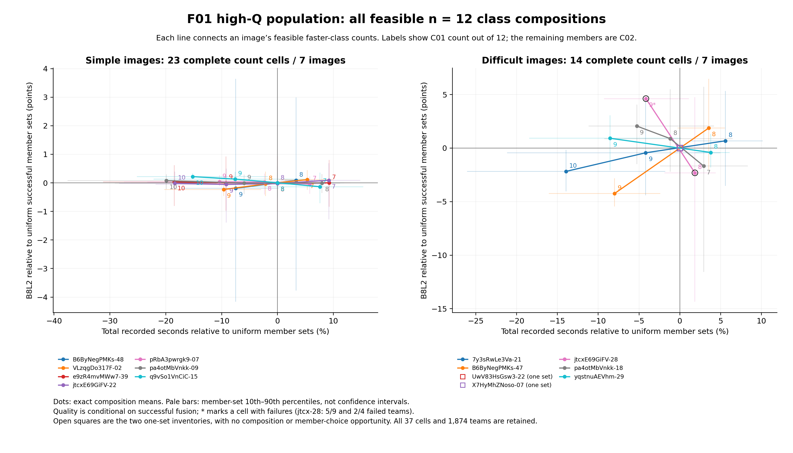

# F01：高 Q 人员域的完整配比与实际选择用途

## 采用判断

**保留 F01 作为历史高 Q 人员域中、普通 Manual 简单图的效率工作分类。** 在本轮可用的新来源成员中，固定 n=12 增加较快类 C01 的比例，能够稳定改变总记录时间，简单图的平均质量变化很小。它可以给出易解释的成本取舍；困难图上，仅凭快慢人数不足以决定质量或连接风险，连续 QT 和具体成员信息仍有实际价值。

这次将旧“n20 容量不足”推进到了有实际容量的 n12 完整有限域，没有重新搜一轮高低 Q/快慢配比。F01 仍是原有 23 人高 Q 域的两类平面分区，没有新增或复制细类，也不并入新行为或联合分类的层级。

## 本轮完成了什么

沿用原历史 10 楼形成、适用于另外 12 楼的冻结 F01 标签，只取本轮普通 Manual 库存中有资格、同属新来源的成员。14 图、11 楼的每图实际容量为 12–15 人，固定 n=12，完整枚举 **1,874 个不同成员集合、37 个可行类别人数配置**。每格数量均核对为两类容量对应的二项式系数之积。

其中两图只有唯一集合：`UwV83HsGsw3-22` 和 `X7HyMhZNoso-07`。它们分别得到 B8L2 95.555 和 46.676，均保留在库存与图中；零成员波动不构成分类有效证据。其余 **12 图、9 楼、1,872 个集合**有实际选择及构成变化机会，进入策略比较。

全部 1,874 个集合都有完整兼容的总记录秒数，来源仍为 `user_processed_reported_not_raw_log_replayed`。完整失败 7 个，均为连接不可用；失败没有删除或置零评分。原始端点失败比例为 7/1,874，策略汇总则按面板→图→楼等权，不能将二者混为同一个失败率。

可行快类人数依图为 7–10 人，慢类为其余 2–5 人；每图的精确上下限和类容量见完整配置表。这个有限域实际换人数最多 3 人，属于容量明确的 F01 补充，较大类别块的主实验另有专题。

## 完整配比：简单图的成本作用清楚，困难图质量方向分化

下表比较每图**可行最多快类**与**可行最少快类**，在每个配置内平均全部具体成员集合。它是完整有限总体的配置均值对照，未逐对固定共同背景，不称为匹配替换的因果效应。

| 图条件 | 图／楼 | B8L2 变化 | D10 变化 | 总记录秒数变化 | 完整失败变化（百分点） |
|---|---:|---:|---:|---:|---:|
| 全部有构成机会 | 12／9 | +0.079 | −0.032 | **−16.624%**，约 −479 秒 | −0.309 |
| 简单 | 7／7 | **−0.026** | −0.026 | **−19.643%**，约 −375 秒 | 0 |
| 困难 | 5／5 | +0.603 | +0.160 | **−11.075%**，约 −569 秒 | −1.111 |

简单图 B8L2 变化的建筑重采样区间为 **[−0.185, +0.137]**，时间为 **[−23.518%, −15.402%]**。7 张图都节时，逐图平均质量变化从 −0.343 到 +0.353 分。它支持一个具体而有限的构成建议：在该高 Q 域、n12 和这些简单结构机会中，可把较快类比例作为成本控制手段，同时保留具体成员的质量检查。

困难图的平均值不能替代逐图结论。`B6ByNegPMKs-47` 从 8 快 4 慢到 9 快 3 慢，B8L2 **59.844→53.722**，下降 **6.122**，时间减少 **11.152%**；`7y3sRwLe3Va-21` 从 8 快 4 慢到 10 快 2 慢，B8L2 **77.120→74.268**，下降 **2.852**。另一方面，`pa4otMbVnkk-18` 从 7 快 5 慢到 9 快 3 慢，B8L2 **89.802→93.536**，时间减少 **7.961%**。这些变化来自各配置全部具体集合，未选某一队代表整个配置。

`jtcxE69GiFV-28` 尤其说明质量和风险须分别读取：8 快 4 慢的 9 队中有 **5 队失败**，9 快 3 慢的 4 队中有 **2 队失败**。成功条件均值从 87.797 升至 94.729，但失败率仍为 **55.556%→50.000%**，不是已经可靠的高质量配置。

图中每条线为一图的全部可行配置，数字为 12 人中的快类人数。点为配置内全部集合的均值，浅线为成员集合分布的 10%–90% 区间，**不是均值置信区间**。两枚空心方点为唯一集合库存，星号格保留失败。简单图的配置均值接近，但同一配置下的具体成员仍可有明显质量波动。

## 与连续 QT、普通选择的实际同支持比较

F01 类别/连续 QT 响应模型均在上述有限域的其它合法建筑上拟合，目标建筑全部端点排除；QT 历史也从目标楼外形成。类别定义则始终保留原历史 10 楼身份。另直接迁移主普通人员域的目标楼外 QT 系数，单独标识训练范围。没有用目标图成绩选择参数或最优成员。

所有策略在同一 **12 图、9 楼、1,872 个候选集合**上比较。普通策略按实际集合均匀抽取；类别模型的全部最优并列集合均匀保留。平衡目标沿用固定 `B8L2 − 10×log(总记录秒数)`，另保存质量优先目标。共 **19 种已登记策略**的所有结果均已交付，下表列关键对照，质量、失败和时间分母均为同一 12 面板。

| 策略 | ΔB8L2 | ΔD10 | 总记录时间变化 | 完整失败变化（百分点） |
|---|---:|---:|---:|---:|
| 历史 Q 最高 | −1.501 | −1.262 | +1.163% | −2.991 |
| 历史时间最短 | −0.463 | −0.423 | −21.022% | −2.991 |
| 有限域 F01 类别，平衡目标 | **−0.005** | −0.075 | **−11.968%** | −0.214 |
| 有限域连续 QT，平衡目标 | −0.411 | −0.373 | −21.119% | −2.991 |
| 有限域连续 QT 二阶，平衡目标 | −0.420 | −0.383 | −20.636% | −2.991 |
| 有限域 QT 加 F01 类别，平衡目标 | −0.475 | −0.432 | −22.450% | −2.991 |
| 普通域迁移 QT 二阶，平衡目标 | **+0.367** | +0.271 | **−13.019%** | −2.991 |

类别一阶与二阶平衡策略在每图均选择可行最多快类，完整保留该配置的 **88 个并列成员集合**，并未挑出其中质量最好的成员。相对普通选择，简单图 B8L2 **−0.010**，时间 **−14.201%**；困难图 B8L2 **+0.237**，时间 **−7.979%**。前者的 B8L2 区间为 [−0.117, +0.091]，时间区间为 [−17.449%, −10.868%]。

全部策略的普通建筑等权失败率为 **2.991%**。类别平衡策略为 **2.778%**；表中连续 QT、历史 Q/T 及迁移 QT 的选择在这 12 个面板均没有完整失败。类别选择平均质量接近普通选择，不等于其内部所有成员都安全：它保留了 `jtcx-28` 最大快类配置中的失败成员集合，而连续人员信息能够改变该格具体成员。

低尾同样保留：类别平衡策略“失败或比同面板随机成功团队低超过 5 分”的风险相对普通选择 **+0.999 个百分点**，有限域 QT 二阶为 **+0.250**，普通域迁移 QT 二阶为 **−3.108**。因此推荐 F01 做可读的效率分层，同时保留连续特征执行精细选人；本轮不把“较快类增加”提升为困难图通用组队规则。本轮未定义 F01 细类，细分增量不适用。

迁移 QT 的结果是可用模型跨人群域迁移的敏感性，不与有限域重新拟合模型视为相同训练预算的算法竞赛。全部数据已有多轮探索，不称为新的外部盲测。

## 可单独取得的证据与复现

- `F01_COMPLETE_CONFIGURATION_CURVE.csv`：37 个配置的容量、全部成员数、完整失败、成功质量均值/低尾/波动、31 个分项和实际时间分布。
- `F01_CONFIGURATION_MEMBERS.csv.gz`：完整 1,874 行配置—成员集合分布，含精确成员、Q、失败与时间；通过 `team_key` 可接原生完整端点。
- `F01_EXTREME_CONFIGURATION_CONTRASTS.csv`、`F01_EXTREME_CONFIGURATION_SUMMARY.csv`：逐图配置端点和建筑等权汇总。
- `F01_ACTUAL_POLICY_CHOICES.csv`、`F01_POLICY_CHECKPOINT.csv`、`F01_PAIRED_POLICY_CHECKPOINT.csv`、`F01_PAIRED_POLICY_EVENTS.csv`：19 策略的实际选择、粗类人数、全分项、风险和配对对照。
- `f01_finite_LOBO/manual/F01_fixed_history/`：精确共同候选、所选团队概率、完整类别人数向量、训练系数及训练支持。
- `FIGURE_F01_COMPLETE_CONFIGURATION_QUALITY_TIME.png` / `.svg`、`F01_FIGURE_POINTS.csv`：完整配比图及作图数据。
- `F01_CONFIGURATION_RECEIPT.json`、`F01_POLICY_CHECKPOINT_RECEIPT.json`、`F01_UTILITY_COMPLETION.json`：输入身份、完成量和原生端点 SHA。

代码为 `run_f01_finite_utility.py`、`summarize_f01_configurations.py`、`summarize_f01_policies.py`、`plot_f01_configurations.py`；主输入位置与训练身份见 `F01_FINITE_DOMAIN_DESIGN_ZH.md`。原生融合只引用 `../composition/batches/f01_001/`，本分支没有重新融合或改变冻结合同。
