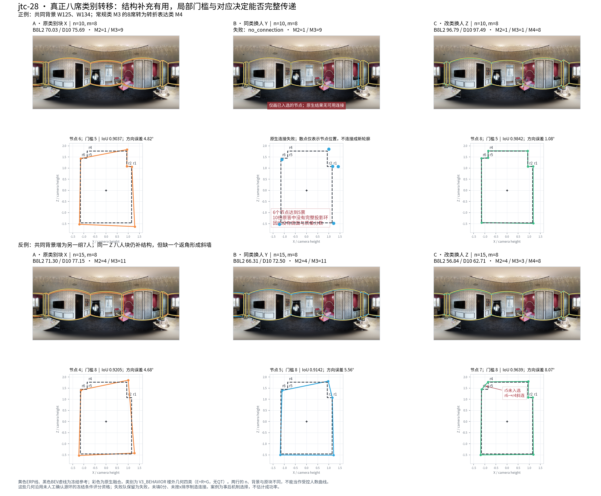
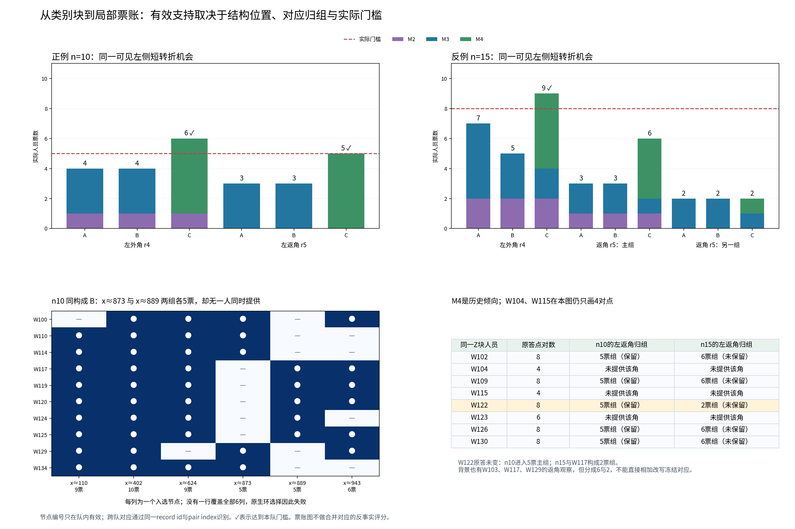

# jtc-28：真正八人类别块的结构补充、连接失败与局部稀释

**这两例说明了一个可直接用于构成研究的机制：偏保留转折的历史类别能够成块补足必要结构，但实际有效票仍由具体位置、全环对应和本队门槛决定。** 同一八人块在n10背景中形成完整八角，B8L2从70.03升至96.79；在另一n15背景中增加了三个参考节点、底面更接近，却漏掉一个返角并形成斜连，B8L2从71.30降至56.84。质量、结构完整性和几何方向需要分别判断。

这是从已完成的纯类别块实验中**事后选择的两例机制解释**，不是新搜索、独立盲测或总体发生率估计。每例A→B保持构成，A→C转移8个完整类别席位；两条边具有同人数、同背景、真实换人数m=8，B→C也净换8人。两例之间的n、背景、X/Y成员都不同，不能作为受控人数因果曲线。

## 一、类别身份与准确成员

两事件方法均为 **`V3_BEHAVIOR` / coarse / Manual / all_formal**，**不是`V3_JOINT_QT`**。类别取自冻结`taxonomy/LABELS_LOBO.csv.gz`，整个jtc建筑排除后形成。该外折内部选择的几何特征家族字符串叫`JOINT`，实际使用E+R+G：转折/短边、近共线冗余、面积/高度等几何特征，不含Q/T。该折四粗四细且没有父内拆分；本案例不声称细层增量，也不把全数据三类编号套入目标折。

| 目标楼外类 | 训练侧实际人数 | 转折残差均值 | 短转折边残差均值 | 近共线节点残差均值 | 解释 |
|---|---:|---:|---:|---:|---|
| M1 | 4 | −0.714 | −0.244 | +0.024 | 较明显简化，尺度偏收缩 |
| M2 | 12 | −0.186 | +0.001 | +0.085 | 略简化，分段/近共线表达较多 |
| M3 | 28 | −0.108 | +0.039 | +0.017 | 常规或略简化 |
| M4 | 15 | +0.367 | +0.295 | +0.006 | 较多真实转折与短边，近共线增点不是主轴 |

这些是训练历史的类中心，不是本图强制动作。M4的同一入场八人Z为：**W102、W104、W109、W115、W122、W123、W126、W130**。本图W104/W115仍只画4对点，W123画6对，另5人画8对。类别描述重复倾向，不声称每个人在每个机会都保留细节。完整原答坐标、源环、参考、逐人历史支持和标签已保留。[证据：`TARGET_BUILDING_EXCLUDED_LABELS.csv`、`TARGET_BUILDING_EXCLUDED_CENTROIDS.csv`、`EXACT_CASE_MEMBERS.csv`、`RAW_EXPRESSION_INPUT_ROWS.csv`。]

### 事件P：n10、真实转移8席

事件ID：`c70e935220e4ec6d39036e69`。

| 部分 | 实际人员 |
|---|---|
| 共同背景2人 | W125、W134 |
| X：A中的8名M3 | W101、W106、W107、W108、W116、W131、W132、W133 |
| Y：B中的另8名M3 | W100、W110、W114、W117、W119、W120、W124、W129 |
| Z：C中的8名M4 | W102、W104、W109、W115、W122、W123、W126、W130 |

按M1/M2/M3/M4顺序，A=B为**(0,1,9,0)**，C为**(0,1,1,8)**。换入块的楼外历史转折均值比X高约0.488。

### 事件N：n15、真实转移8席

事件ID：`8be1375b4d2a53e269e1ccf2`。

| 部分 | 实际人员 |
|---|---|
| 共同背景7人 | W100、W103、W113、W117、W125、W127、W129 |
| X：A中的8名M3 | W101、W106、W108、W110、W119、W124、W132、W134 |
| Y：B中的另8名M3 | W107、W114、W116、W120、W121、W128、W131、W133 |
| Z：C中的8名M4 | 与事件P完全相同的8人 |

A=B为**(0,4,11,0)**，C为**(0,4,3,8)**。换入块的楼外历史转折均值比X高约0.472。两事件均为真正8席转移，未把“换8个成员但净改变2席”的设计混入。[完整原事件：`EXACT_EVENTS.csv`；选择身份：`CASE_SELECTION_RECORDS.csv`。]

## 二、从六个原生端点看差异

所有数值直接取既有原生缓存，未重新评分。唯一失败队保留为失败，不填0分，也不从完整事件分母删去。

| 事件/队 | B8L2 | D10 | 入选节点/门槛 | 底面IoU | 方向误差° | 9°节点/边召回 | 总记录秒数 |
|---|---:|---:|---:|---:|---:|---|---:|
| P-A，n10原块 | 70.033 | 75.693 | 6 / 5 | 0.9037 | 4.821 | 0.750 / 0.625 | 5358.159 |
| P-B，同构成 | **连接失败** | — | 6 / 5 | — | — | — | 7497.423 |
| P-C，M3→M4 | **96.790** | **97.490** | 8 / 5 | **0.9842** | **1.078** | **1.000 / 1.000** | 6422.350 |
| N-A，n15原块 | 71.301 | 77.155 | 4 / 8 | 0.9205 | 4.676 | 0.500 / 0.250 | 8720.228 |
| N-B，同构成 | 66.308 | 72.500 | 5 / 8 | 0.9142 | 5.565 | 0.625 / 0.375 | 12320.564 |
| N-C，M3→M4 | **56.842** | **62.709** | 7 / 8 | **0.9639** | **8.071** | **0.875 / 0.750** | 9989.202 |

C相对A的质量差分别为**+26.757**和**−14.459**。第二例增加参考节点与边，并不意味着综合质量更高。其IoU3D×100由88.785升至95.640；底点误差0.930°降至0.427°；全局高度偏差0.0371降至0.0104、局部高度偏差0.01089降至0.00881；遗漏0.03849降至0.00016，扩展0.04454降至0.03727。**在当前B8L2五个主分项中，只有方向误差明显恶化，成为综合质量下降的明确路径；D10同样下降，结论不依赖B8这一方向尺度。**

两例C均比A增加记录时间，约+19.9%与+14.6%。这里说明结构补充的成本，不据两例推断整体效率。目标个人Q均值也变化：事件P的A/C为56.10/71.05，事件N为55.89/65.90，因此本案例不宣称完全排除了质量构成差异；第二例尤其表明个人Q更高仍可能在局部对应和融合方向上损失。[全部分项：`CASE_ENDPOINT_METRICS.csv`。]

## 三、正例：一组必要返角恰好达到5票

原图左侧窗边与电视墙连接处有可见短转折，冻结参考以r4、r5、r6表示这段结构。它并非仅为凑角点而新增的共线点。事件P中：

| 同一个局部位置 | A | B | C | 本队门槛 |
|---|---:|---:|---:|---:|
| 左侧外角r4 | 4，未选 | 4，未选 | **6，保留** | 5 |
| 左侧返角r5 | 3，未选 | 3，未选 | **5，保留** | 5 |
| 右侧转折r2 | 5，保留 | 2，未选 | **6，保留** | 5 |

C的r5五票恰来自**W102、W109、W122、W126、W130**；同一五人也各自提供了覆盖全部8个入选节点的源环。新增结构与连接因而一起传递到输出。这里M4块的实际作用是保留有图像与参考支持的必要结构，不能概括成泛泛的“多画更好”。背景W125还给r4补了一票；具体位置上的背景贡献同样重要。

A/C共同背景的10个原观察中，只有2个观察的共同组友发生变化，涉及1个观察对；其它主要变化来自八人块的替换、必要票组越过门槛，以及中位定位改善。不能把这次全部增益都归给旧观察重新分组。[`FOCUS_GROUPS.csv`、`OBSERVATION_TRANSITIONS.csv`、`SOURCE_RING_COVERAGE.csv`。]

### 同构成B为什么失败：票数充足，但“兼容的完整环”不存在

B有6个入选节点，并不是低于四角。右侧两个过渡位置x约873、889各有5票，但支持人员完全分开：

- x约873：W100、W110、W114、W129、W134。
- x约889：W117、W119、W120、W124、W125。

**没有任何一份原答同时提供这两个入选位置，更没有源环覆盖全部6个节点。** 冻结算法因此返回`no_source_ring_covering_all_selected_nodes`，原生评分状态为`no_connection`。同构成只固定历史类别人数，无法保证具体成员在同一局部位置形成兼容表达。图中此队只展示节点散点，未擅自按水平坐标排序或人工连接后再评分。[`SOURCE_RING_COVERAGE.csv`；完整状态见事件P的`cases/*.json.gz`。]

## 四、反例：八份观察就在返角附近，仍被分成6票与2票

事件N的C保持同一个Z块。右侧必要转折恢复：r1为8票、r2为9票，都达到门槛8；左侧r4也达到9票。但r5存在两组：

| r5归组 | 具体人员 | 支持/门槛 | 结果 |
|---|---|---:|---|
| 主组，中心x≈86.13 | W102、W103、W109、W126、W129、W130 | **6 / 8** | 未选 |
| 另一组，中心x≈84.59 | W117、W122 | **2 / 8** | 未选 |

不能直接把这两组相加改写当前冻结对应。W122的原答坐标从未改变：在n10 C中它与另4名Z成员构成5票组；在n15 C中则与背景W117进入2票组。新增背景W103、W117、W129也都在这一返角附近有实际观察，问题并非所有背景人员都漏画。

为解释分组原因，仅对这8个现有返角观察涉及的**28个原答人对**调用冻结保序匹配作局部诊断，没有新融合或评分。只有W103–W117这一对的局部返角未被全环匹配认作对应：W103第1对点与W117第3对点平均上下角距离仅**0.943°**，但全环匹配给出W103第1对→W117第4对，W117第3对→W103第0对。当前成组要求组内每一对都得到原答全环匹配支持；因此含W103与含W117的组不能合并，W122随W117落入另一组。**这是原答环级对应与完整链接成组传递出的局部分裂，不是W122突然改变标法。** 该诊断沿用`WORKING_GAP=7.5`，它是融合对应中跳点代价，和整份原答9°/12°分簇不是同一个参数。[`LOCAL_R5_PAIRWISE_COMPATIBILITY.csv`、`SAME_Z_TWO_CONTEXTS_GROUP_LINKS.csv`。]

遗漏r5后，已有源环投影将r6与r4直接相连。这个短斜边在BEV中长约0.450个相机高度，与最近X/Z轴夹角**40.635°**；其余6条边相应偏角仅0.538°—0.940°。冻结方向指标从4.676°升至8.071°，虽然多数边和底面总体更接近，综合质量仍下降。这是结构保留的组合缺口：补出了外角，却未同时保住配对的返角，结果留下一个尖锐斜连。[`SELECTED_WALL_GEOMETRY.csv`；该局部角度只作可视化几何描述，未重算质量。]

在事件N内部A/B/C固定7人背景的43个共同原观察，**共同组友变化为0、共同观察对关系变化为0**。所以不能把这一事件A→C的质量损失都解释成旧背景重新分组：背景内部关系未变，进入的Z观察在这个背景约束下形成6/2分裂，门槛与缺失返角才是这次传递的关键。跨两例C观察到W122归组改变，是不同背景条件的机制对照，不是单独操纵n所得的因果量。

## 五、这两例给构成研究增加了什么

1. **保留Manual结构类的实际补充用途。** M3→M4可以通过八人整块增加必要结构有效票，形成完整环及明显质量收益，不能仅因为另一个背景失效就删除该类型。
2. **同构成换人并不自动兼容。** 同样的M2/M3人数在事件P的A、B中分别得到可评分六角与连接失败；区别具体落在两个互斥位置和完整源环覆盖，而不是一句“分类不稳定”。
3. **“结构变好”与“总分变好”可以分离。** 事件N改类后节点/边召回、IoU、三维代理、上下界和高度均有改善，但部分结构的缺口留下方向损失。这为主实验结构分项与质量尾部提供了同一真实机制解释。
4. **构成建议应检查成套结构机会。** 当一个短转折需要外角与返角共同成立时，应检查两组票数与匹配可兼容性，不能只按“高表达类占8席”保证输出。历史类别可用于识别哪些人更常提供这组机会，实际局部票账用于确认是否成套传递。

这些是两个已算事件的精确解释，不估计此机制在全部事件中的频率。主纯块总体、匹配稳定性和实际选队结果分别由`composition/direction/`、`composition/matched/`、`utility/`提供。

## 六、可复现文件与身份

- `EXACT_EVENTS.csv`：两条完整原事件，保留全部字段、零类别计数和失败；不只是本报告摘录。
- `CASE_ENDPOINT_METRICS.csv`、`EXACT_CASE_MEMBERS.csv`：六队全部原生小标量与逐人记录。
- `cases/*.json.gz`：两例所有成员原答、冻结参考、原生geometry、六队完整对应组/节点/源环状态。
- `GROUP_MEMBERS.csv`、`GROUP_CLASS_VOTES.csv`、`FOCUS_GROUPS.csv`、`MEDIAN_ORDER_STATISTICS.csv`：局部票账、原观察、实际中位定位。
- `OBSERVATION_TRANSITIONS.csv`、`GROUP_OVERLAP_LINKS.csv`、`OBSERVATION_ASSIGNMENT_TRANSMISSION.csv`、`SAME_Z_TWO_CONTEXTS_GROUP_LINKS.csv`：以record id与pair index连接跨队观察，队内节点编号不直接跨队比较。
- `SOURCE_RING_COVERAGE.csv`、`SELECTED_RING_EDGE_VOTES.csv`：失败与完整源环/边支持的证据。
- `LOCAL_R5_PAIRWISE_COMPATIBILITY.csv`：限定8个返角观察、28个人对的冻结环匹配诊断。
- `SOURCE_SHARD_ROWS.csv`与各`*_RECEIPT.json`：完整来源、哈希与输出一致性。native来自`composition/runtime/pure_001/jtcxE69GiFV-28__manual__19653e8bc7.json.gz`。
- 两张主图可单独取得；其中原图来自GitHub Release，文件`jtcxE69GiFV_dce110162b244b2ab76a0804fc830a9e.png`，图像哈希与路径保留在`FIGURE_RECEIPT.json`。精简包不重复装入原图全集。

复现：在既有HOHONET输入与本轮V3目录位置运行`export_cases.py`、`analyze_mechanism.py`、`render_cases.py`。已有case状态自动复用；若从零导出，仅重放这6个已算成员集取得票账，每队candidate哈希必须与native geometry完全相等。**无新增团队、无新质量评分、无修改原答/参考/资格/环序/门槛。** 28个人对诊断不形成新端点。报告、精确事件、标签、表格、代码、状态与两图均单独保存，ZIP只作便于搬运的精简合集。
