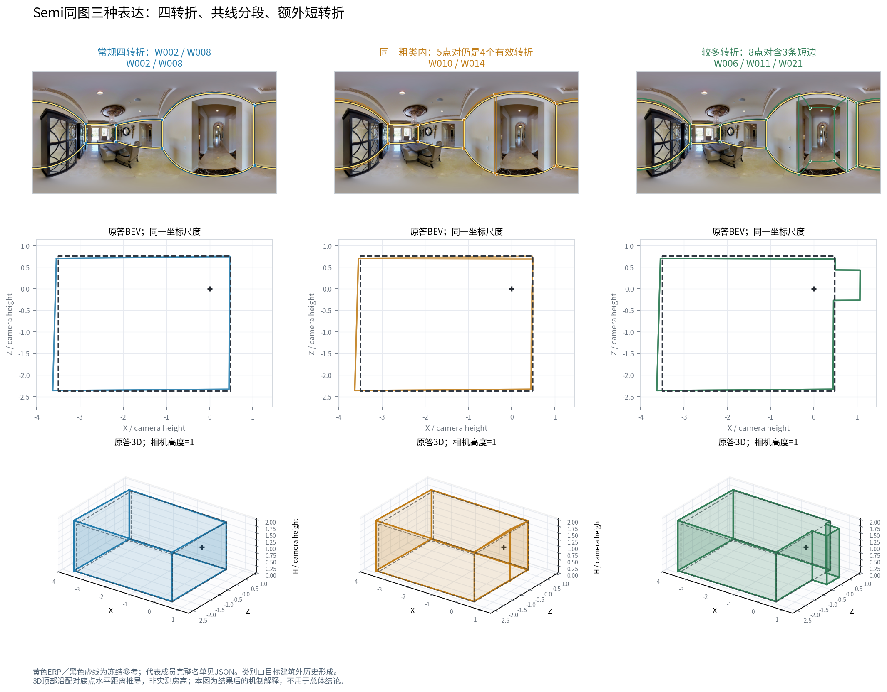
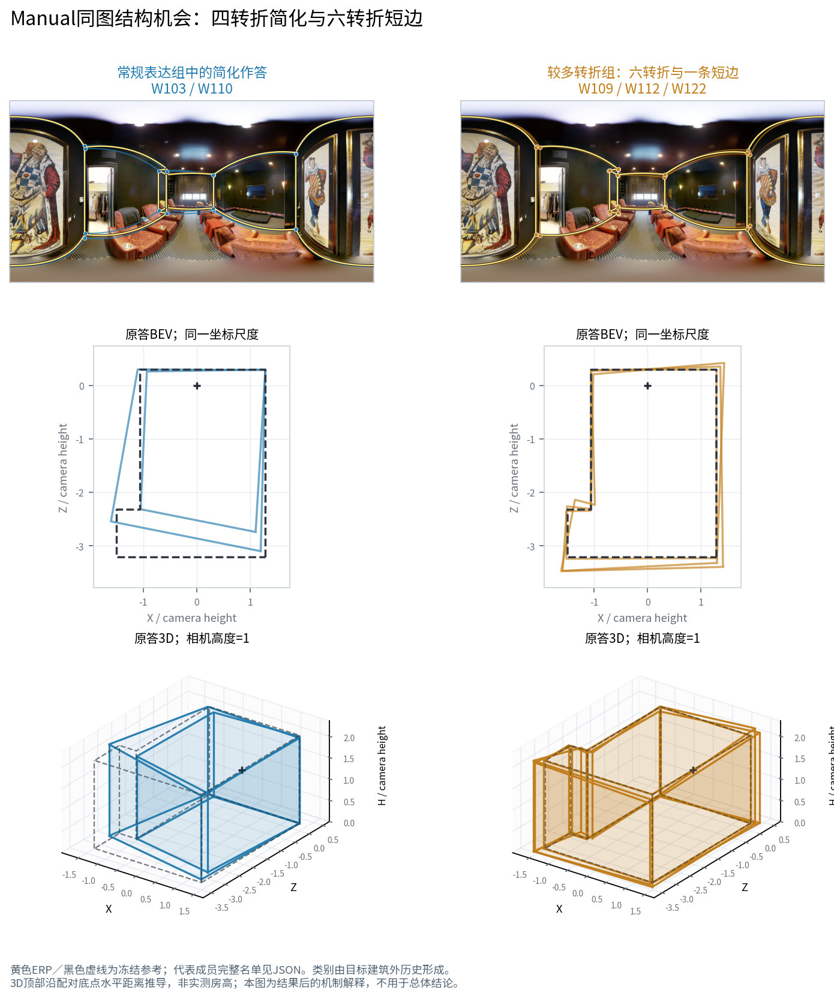
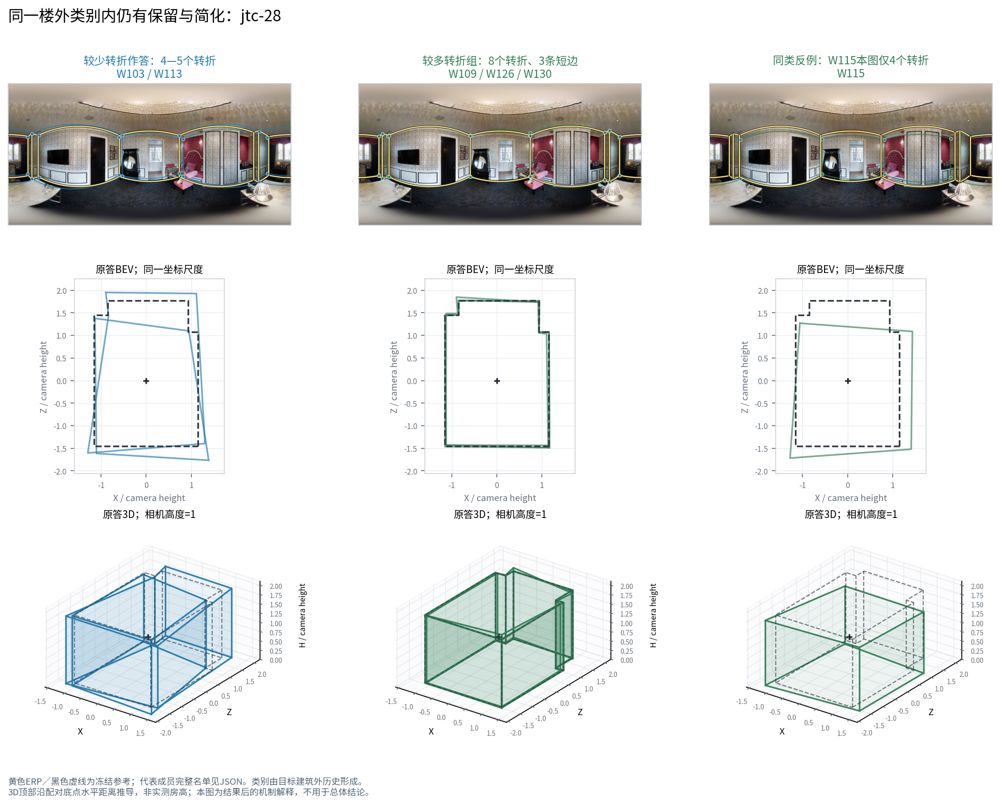

# 人员分类续研：条件结构、近共线分段与结构×QT联合类型

版本：2026-10-21；输入 main：`324dba44d0a82d9d64a62965f2e549ee05165417`。本报告给出新分类、实际成员及楼外原答验证；整体构成和替换结果由同批 `composition`、`utility` 与整合报告联合交付。分类在读取本轮新融合端点之前冻结，四个正式标签文件的 SHA256 见 `LABEL_FREEZE.json`。

## 1. 本轮采用判断

本轮形成了两套有不同用途的分类，而不是把几种旧方法拼成一套统一层级。

| 条件与方法 | 全数据粗类/细类 | 支持人员 | 建议用途 | 主要判断 |
|---|---:|---:|---|---|
| Manual：`V3_BEHAVIOR` | 3 / 3 | 59 / 62 | 描述复杂结构下的简化、常规表达和较多转折；作为结构构成的简洁分类 | 保留。它是旧 Manual 四细类的有依据简化：旧 M00、M01 分别保留，旧 M10/M11 合并。没有选出额外细层。 |
| Semi：`V3_BEHAVIOR` | 3 / 4 | 59 / 62 | 区分少转折、常规终稿、近共线分段和较多转折；解释同点数之外的原答形状差异 | 保留为条件性结构分类。其细类有正向原答几何相似性证据，重复表达主要由旧来源支持。 |
| Manual：`V3_JOINT_QT` | 5 / 5 | 57 / 62 | 同时解释结构机会、相对时间及历史质量；研究相近 Q 人员的不同构成角色 | 保留为构成解释候选，不能替代连续 QT 选择。它确实以条件结构和 Q/T 共同形成分类。没有独立细层。 |
| Semi：`V3_JOINT_QT` | 5 / 5 | 54 / 62 | 区分快慢及终稿结构表达，辅助分析效率取舍 | 作为探索性并列候选。外折成员稳定性较低，质量预测未超过来源基线；时间描述有用。 |

这些采用判断以“描述哪种行为、在哪种机会下有用”为单位。Semi 结构细类在同点数、同来源配对条件下原答更接近，并不自动意味着实际团队可以随意换人；团队端点另行检验。Manual 联合五类能让相近 Q 下的快慢和结构差异更清楚，但相同输入的连续模型在时间和质量预测上仍更好。

证据入口：`CLASS_DEFINITIONS.csv`、`PERSONNEL_LABELS_EXPLAINED.csv`、`RAW_GEOMETRIC_SIMILARITY_SUMMARY.csv`、`RAW_PREDICTION_SUMMARY.csv`。

## 2. 实际研究库存及资格

本轮直接读取原始证据库 `records.json.gz`，按 `is_oos == false` 对齐对象集合，确认全部 **9,217 行**均在行为库存中，遗漏和额外对象均为零。它们涉及 **62 人、233 图、22 栋建筑**。这一口径包括不能评分、被筛除及特殊范围作答，而不是把旧质量可用簇表当成全部行为库存。

| 条件、层 | 库存行数 | 可比较行为行数 | 用于形成类别 | 处理 |
|---|---:|---:|---:|---|
| Manual 普通 | 7,457 | 7,366 | 7,366 | 以原答结构建模；质量仍按原资格 |
| Semi 普通 | 1,046 | 996 | 996 | 仅终稿行为建模 |
| Manual 门洞交界 | 603 | 585 | 0 | 单列外部行为观察，不并入普通建模 |
| 特殊范围：Manual / Semi | 66 / 45 | 66 / 45 | 0 | 单列条件观察 |

合计 **8,362 条普通可比较原答**进入特征构建。Manual 覆盖 215 图、22 楼；Semi 的可比较普通行为覆盖 39 图、12 楼，库存仍保留其全部 41 图。全数据几何标签的 59 人各自至少有 12 图、4 楼；联合分类另有 Q/T 机会门槛。每个条件均输出 62 人的完整库存名单，不足者保留 `unknown` 与具体原因；没有在 Semi 作答的人也不会被静默当成常规类。

**历史筛除和 GT 暂停的处理已落实到逐记录字段。** 原库存中 review 筛除 89 条，68 条可以观察，其中普通层 66 条进入行为模型，但全部保留 `independent_vote_eligible=false`。历史 `not_accepted` 的 108 条全部保留在库存，0 条进入行为建模、0 条恢复票资格。11 条 pending 中10条普通行为可用于描述，均无正式票资格。带 GT 错误暂停原因的210条均为 Manual、涉及6图5楼；其中205条提供结构行为证据，质量得分全部为空。不能把 `independent_vote_eligible` 单字段理解成通过图级质量、参考和组队的全部资格。

详见 `RESEARCH_INPUT_INVENTORY.csv`、`INVENTORY_RECONCILIATION.json`。上述层、筛除和 GT 切片有交集，不能把切片行数相加成新的总数。

## 3. 新分类怎样形成

### 3.1 区分转折、近共线分段和尺度

沿用已有冻结几何描述，不改原点、环序、参考或坐标。定义非近共线转折代理为“原上下点对数减去转角不超过5°的底面节点数”；短转折边沿用“周长占比小于4%，相邻两端转角均至少15°”。近共线节点、面积对数和推导高度对数独立保留。

这些是几何表达指标。非近共线转折不自动等于真实必要结构，近共线点也不自动等于错误；语义需要实际图像与目标范围解释。由此可避免把“多两个必要转折”和“多两个直线分段点”当成同一种多画。

每项行为先减去**同图、同条件、同参考、同层**的人员中位数，再先按建筑取个人均值、最后建筑等权，避免一栋图多的建筑主导人员历史。另按同图人员非近共线转折中位数是否至少6，分为简单结构机会和复杂结构机会。这是结构条件 `C`，**不是旧五域中的难度适应域 D**。

几何候选有五个输入族：仅转折/短边 `TURN`，加入近共线点的 `STRUCTURE`，面积/高度 `SCALE`，表达+近共线+尺度 `JOINT`，以及简单/复杂结构条件表达+近共线+尺度 `CONTEXT`。每域先稳健标准化；域内字段和域之间等权，避免多字段域被重复加权。

### 3.2 真正联合 Q/T，而非事后贴画像

另建 `EQT`、`GEQT`、`CQT` 三个候选族。E 为转折/短边，G 为面积/高度，C 为简单/复杂机会的三个结构量。Q 使用本条件的合格 B8L2 相对同图均值及低尾差；T 使用本条件的来源记录时间，先取对数，再在同图、同来源、同 `time_source_kind` 内中心化。所有个人历史仍按建筑等权。

因此全数据 Manual 选中的 `CQT` 五类确实使用了条件结构、Q 和 T；Semi 选中的 `EQT` 使用终稿表达、Q 和 T。scope 回答、裁定正确率、难度适应及 Semi 初始化行为只用于有支持的事后解释。本轮并未把结构条件 C 改名为 D，也未把本轮输入族/类数变体冒充26种变量域子集的新覆盖。

### 3.3 类数由支持与内侧检查决定

对 Ward 树逐层比较，要求每类至少3名成员。最初计算网格到K8，发现部分树仍有容量后，在接触新融合端点前延伸到实际容量上界；62人给出数学上界20，本轮实际可支持最大 **K11**。高于容量的切割保留失败登记，不当作可用分类。最终选出3、4或5类是本轮数据与用途准则的结果，不是预先限制三类或八类。

外侧每次排除目标建筑；内侧再排除一栋建筑，重新估计人员特征、缩放、Ward树及预测中心，以原答表达重构误差选择输入族和细类数。类别容量只作为合格门槛，所有内侧验证建筑都进入损失分母。候选至少覆盖90%的基础支持人员，并在至少80%的内侧切割中有足够类容量。粗类为同一棵树上与细类损失差落在配对一个标准误内的最小祖先切割。

几何分支保存26,426条内侧检查记录、4,370条候选登记；联合分支保存15,995条内侧检查记录、2,622条候选登记。这些是方法×条件×外折×K登记，不是独立方法数、域子集数或融合实验数。完整尝试与失败分母见两份 `*_CANDIDATE_SELECTION_ALL.csv` 和两份 `*_INNER_BUILDING_CANDIDATE_LOSSES.csv.gz`。

所有目标建筑都使用其专用楼外标签。`ALL`标签用于最终描述，不回代到验证。数据在此前项目中已有多轮探索，本轮属于明确冻结新方案后的嵌套内部验证，不声称全新外部盲测。

## 4. 实际类别与成员

以下名称属于全数据标签；不同楼外折重新选型，编号不能跨折直接解释成同一角色。用于跨建筑汇总时采用每折训练侧类别中心的高/低角色。

### 4.1 Manual 结构三类

| 类 | 人数 | 实际区别 | 平均复杂机会转折残差 |
|---|---:|---|---:|
| M1.1 | 6 | 复杂结构时明显简化；简单结构时差别很小 | −2.372 |
| M2.1 | 34 | 常规表达或略简化 | −0.550 |
| M3.1 | 19 | 较多转折及短细节表达 | +0.791 |

M1.1：W008、W029、W030、W034、W035、W037。M2.1：W006、W010、W014、W018、W031、W033、W100、W101、W103、W104、W105、W106、W107、W108、W110、W111、W113、W114、W116、W117、W118、W119、W120、W121、W123、W124、W125、W127、W128、W129、W131、W132、W133、W134。M3.1：W001、W002、W011、W012、W013、W015、W017、W021、W027、W028、W032、W036、W102、W109、W112、W115、W122、W126、W130。

三类与旧M的全数据对应十分清楚：新M1.1=旧M00，新M2.1=旧M01，新M3.1=旧M10的13人+旧M11的6人。本轮贡献是内侧选型支持合并以及用途边界的实测，不能把同一批人再称为全新发现。粗细均为3，所以`.1`只表示接口叶节点，不代表额外细分。逐人对照见 `OLD_NEW_MANUAL_CLASS_CROSSWALK.csv`。

### 4.2 Semi 结构三粗四细

| 类 | 人数 | 非近共线转折历史残差 | 短转折历史残差 | 近共线节点历史残差 |
|---|---:|---:|---:|---:|
| S1.1：偏简化终稿 | 6 | −0.350 | −0.105 | +0.006 |
| S1.2：常规终稿 | 32 | +0.087 | +0.027 | +0.001 |
| S2.1：近共线分段较多 | 6 | +0.042 | −0.002 | +0.162 |
| S3.1：较多转折终稿 | 15 | +0.444 | +0.287 | +0.014 |

S1.1：W027、W028、W029、W034、W123、W133。S1.2：W001、W002、W008、W012、W013、W015、W017、W018、W030、W032、W033、W035、W036、W100、W101、W104、W105、W106、W107、W108、W111、W112、W115、W116、W118、W119、W121、W122、W124、W125、W129、W134。S2.1：W010、W014、W031、W037、W102、W130。S3.1：W006、W011、W021、W103、W109、W110、W113、W114、W117、W120、W126、W127、W128、W131、W132。

S1.1/S1.2共享父类S1；S2、S3各自只有一个叶节点。这是本轮全数据分类中真正保留的粗细层级。

近共线组有不同强度的成员支持：W010、W014、W031分别在2图2楼出现非零近共线点；W037在4图4楼重复；W102、W130各只有1图1楼。其可观察普通Semi机会分别为21、20、21、20、14、15图，不能把“1次出现”解释成稳定习惯。S2.1宜使用类别与个人机会计数联合呈现，尤其新来源两人只作为暂定成员。

### 4.3 Manual 联合五类

| 类 | 人数 | 主要角色 | 历史Q残差 | 记录时间对数残差 | 复杂机会转折残差 |
|---|---:|---|---:|---:|---:|
| J1.1 | 10 | 较快、适度转折 | −3.74 | −0.650 | +0.280 |
| J2.1 | 23 | 常规时间、复杂结构略简化 | −3.70 | −0.076 | −0.650 |
| J3.1 | 6 | 复杂结构明显简化 | −3.22 | +0.099 | −2.372 |
| J4.1 | 9 | 较慢、常规转折 | −0.72 | +0.687 | −0.048 |
| J5.1 | 9 | 较高历史Q、较多细节 | +15.29 | +0.131 | +1.043 |

J1.1：W001、W006、W011、W012、W013、W017、W021、W028、W113、W134。J2.1：W010、W031、W100、W101、W103、W104、W105、W106、W107、W108、W110、W111、W116、W117、W118、W119、W120、W123、W124、W127、W128、W132、W133。J3.1即上述M1.1六人。J4.1：W015、W032、W033、W036、W114、W121、W125、W129、W131。J5.1：W002、W027、W102、W109、W112、W115、W122、W126、W130。

这组分类回答了一个有实际意义的问题：J1、J2、J3的历史相对Q都约−3至−4，但记录时间与复杂结构表达明显不同。它们不是把Q排序切成五段。W014、W018缺本条件充分时间机会，连同原几何证据不足的W019、W022、W026保留未知。

### 4.4 Semi 联合五类

K1.1（6人）：W037、W103、W111、W117、W118、W131；较低历史Q、适度转折。K2.1（12人）：W001、W101、W104、W105、W106、W107、W110、W123、W125、W129、W130、W133；较低历史Q、常规转折。K3.1（9人）：W006、W011、W021、W113、W120、W126、W127、W128、W132；较快、较多转折。K4.1（8人）：W027、W028、W029、W032、W036、W112、W114、W121；较慢、常规或偏少转折。K5.1（19人）：W002、W008、W010、W013、W015、W017、W018、W030、W033、W100、W102、W108、W109、W115、W116、W119、W122、W124、W134；较高历史Q、较快常规表达。

联合Semi未知为W012、W014、W019、W022、W026、W031、W034、W035。完整连续值和支持量见 `JOINT_CLASS_MEMBERS_AND_FEATURES.csv`、`PERSONNEL_LABELS_EXPLAINED.csv`，名称只描述当前可观察行为，不归因于心理动机。

## 5. 楼外是否还看得到这些差别

### 5.1 复杂结构条件比“一般多画”更准确

每个目标建筑用楼外训练侧类别中心找高/低转折角色，同图、同参考两边各至少2人；先比较总作用，再分来源。建筑等权，区间为建筑重采样描述性95%区间。

Manual结构类在复杂机会中，高表达角色比低表达角色平均多 **3.20个非近共线转折**，95%区间[2.00,4.41]，支持31图8楼；简单机会只多 **0.090个**，支持85图16楼。短转折边对应增加1.49和0.055。旧来源内部仍有方向一致的表达差异；最低表达类全部来自旧来源，因此没有把旧/新来源平衡说成已经充分完成。

Manual联合类的相应复杂机会差为 **2.71个转折**，[1.54,3.97]，36图11楼；简单机会为0.159，区间跨零。联合类的慢角色与快角色在新来源内部仍有明显记录时间差，但转折均值差接近零，说明速度轴与结构轴确实提供不同用途。

Semi结构类的高/低转折角色在24图12楼平均相差0.336个转折，[0.097,0.672]；近共线高/低角色在旧来源18图10楼相差0.104个节点，[0.022,0.200]。在新来源7图5楼没有复现近共线角色的正方向；全来源近共线差的区间也跨零。因此“近共线分段较多”是有实际原答和旧来源重复支持的条件类，不能把全数据6名成员都当成同等稳定的类型。

详见 `OUTER_CLASS_ROLE_MAP.csv.gz`、`OUTER_CLASS_ROLE_PANELS.csv.gz`、`OUTER_CLASS_ROLE_SUMMARY.csv`。这里的结构机会由原答共识描述，不是GT结构裁定。

### 5.2 同点数下原答是否相近

对137,480对原答重新提取连续几何距离，复用既有冻结角距离、共同上下界循环对应和底面投影。它没有把整份作答9°/12°阈值拿来当融合角点参数，也没有用不同图的局部簇编号直接拼成人员类别。

最清楚的正结果来自 **Semi结构细类**。在同图、同参考内进一步匹配点数与来源对，要求类内和类间比较同时有支持后，31图12楼、10,751个实际贡献配对的最大上下界对应角距离为：

| 比较 | 平均角距离 |
|---|---:|
| 同细类 | 5.229° |
| 不同细类 | 6.464° |
| 类内减类间 | **−1.235°**，95%区间[−2.016,−0.500] |

底点和顶点分别减少0.887°和1.146°；因此结果不只来自角点数量相同。底面Jaccard差和高度差方向偏向类内较近，但区间跨零。只看粗类，角距离差为−0.638°，区间跨零；固定父类后比较细类的角距离差为−1.114°，23图10楼、6,099对，区间[−2.391,0.331]。这表明全局细类划分对原答形状有用途，而父类内细分增量仍应结合实际团队结果判断。

再按楼外历史Q的配对均值和差值分箱后，Semi细类角距离差缩小为−0.084°，26图12楼，区间跨零。因此本轮支持分类的**总几何分组作用**，尚未证明其角距离优势完全独立于历史Q。该检查是在总作用之后进行，不用Q匹配阻止分类用途评估。

Manual结构细类同点数/来源匹配差为−0.459°，213图22楼、84,662对，区间[−1.288,0.259]；不能据此声称Manual同类完整原答普遍更近。它更明确的用途仍是复杂机会下结构表达的方向。

## 6. 与连续特征、粗细类和旧方法比较

原答预测另设固定岭回归，所有方法带来源指示。每个外折用同一套楼外人员历史映射训练和评价，比较共同支持记录，按参考、图片、建筑等权。保留旧QT四项、基础结构五项，并新增**每个选中族的完全同源连续特征**。后一对照包含CQT的条件结构及自身Q/T，避免用过弱对照夸大离散类别。

下表是相对来源基线的楼外R²，质量为同图相对B8L2，时间为相对记录秒数对数；正值表示预测误差降低。

| 条件、结果 | 结构细类 | 联合细类 | 联合完全同源连续特征 | 旧连续QT |
|---|---:|---:|---:|---:|
| Manual B8L2 | 0.149 | 0.163 | **0.202** | 0.207 |
| Manual D10 | 0.141 | 0.154 | **0.193** | 0.197 |
| Manual 相对记录时间 | 0.008 | 0.330 | **0.587** | 0.581 |
| Semi B8L2 | −0.043 | −0.010 | −0.114 | −0.163 |
| Semi D10 | −0.048 | −0.008 | −0.116 | −0.174 |
| Semi 相对记录时间 | 0.074 | 0.218 | **0.366** | 0.377 |

Manual质量使用177图22楼、行为/时间使用215图22楼；Semi质量使用32图12楼、行为使用39图12楼，具体每项人数与记录分母保存在 `RAW_PREDICTION_BUILDINGS.csv`。这些是预测误差比较，不是相同比例的工时节省或组队质量提升。

三个结论值得保留：

1. **联合类别可读，但没有胜过相同信息的连续QT模型。** Manual联合分类能解释快慢和结构差异；以精准选择人员为目的，应保留连续QT为主要对照。Semi质量的负R²说明不能仅据这些历史类预测每张目标图的个人质量。
2. **离散结构类有小的非线性信息，但不是全面超越连续结构。** 给同源连续结构模型增加结构细类，Manual B8L2预测MSE再降3.93%，22楼中20楼改善；Semi近共线响应MSE再降1.34%，建筑重采样绝对MSE改善区间大于零。转折/短边的相应增量很小或为负。这些是辅助解释结果，不把探索性多个比较说成独立确认。
3. **旧SP尺度类仍有明确用途。** 同一共同支持上，旧Semi细类对高度响应R²约0.072，新结构细类约0.016，连续结构约0.076。新Semi分类补充“怎样表达结构”，没有理由因此删除旧SP对尺度的描述。Manual旧四细类的原答预测也略优于新三类；新三类的价值是更简洁的工作分类，不能声称所有指标胜出。

粗/细增量只在确有两层的外折计算。全数据Manual结构3/3、Manual联合5/5、Semi联合5/5不应被包装成两套独立分类。原答中的Semi细分对时间响应约有5%的相对MSE改善，但它不等于节时5%；类别构成下的实际时间、形状和质量由团队实验判断。

## 7. 成员敏感性与辅助解释

| 方法 | 条件 | 有实际目标的外折 | 粗类ARI均值 | 细类ARI均值 | 细类ARI范围 |
|---|---|---:|---:|---:|---:|
| V3_BEHAVIOR | Manual | 22 | 0.835 | 0.815 | 0.395–1.000 |
| V3_BEHAVIOR | Semi | 12 | 0.409 | 0.463 | 0.244–0.911 |
| V3_JOINT_QT | Manual | 22 | 0.759 | 0.759 | 0.450–1.000 |
| V3_JOINT_QT | Semi | 12 | 0.342 | 0.418 | 0.143–0.554 |

ARI比较每折与最终标签的分区，不比较任意编号。Semi支持人员在楼外折会降到37人（联合32人），正是少量历史机会被整栋排除后暴露的缺口。单人同类成员集合的Jaccard另存 `MEMBER_COASSIGNMENT_STABILITY.csv` 及联合版本。

26种域子集的旧覆盖、真实替换反推768/1040候选及直接m2块学习负结果继续在整合账中保留；本轮不重新运行一轮高低Q/快慢配比。A2、Rnew2、F01保持各自人群与方法身份。scope、难度、Semi错误机会均使用原支持标志，缺机会为空；`CLASS_AUXILIARY_DOMAINS.csv` 的均值只纳入相应支持标志为真的成员。scope回答倾向与裁定正确率分别保存，后者只以有裁定的机会为分母。Manual行的Semi证据是明确标记的跨条件辅助信息，不能算Manual终点评价。

## 8. 实际原图解释及反例

整合包的三个ERP/BEV/3D对照来自实际原图和原答，保留冻结参考；3D高度以相机高度归一，仅为适用代理。图不用于选型，案例是冻结标签后解释。

### wc2-56：区分新增转折与近共线分段

W002/W008的4点对终稿、W010/W014的5点对终稿，都只有约4个非近共线转折；W010/W014多的是直边上的分段。W006/W011/W021则有8点对、3条短边，表达了门洞方向的局部延伸。该楼外折把前两组分在同父类的不同细类S1.1/S1.2，第三组分在另一粗类。这是细类能区分“同样大轮廓下怎样落点”的实际正例。

门洞延伸在原图可见，但其是否属于本题完整目标范围应按既有裁定处理；不能把参考之外的延伸统称错误。近共线5°也是几何阈值，语义解读保留具体图像。

这组人并非“没有改初始化”。在wc2-56和rPc-17，W010/W014有精确初始化，均已净删3点对而留下1个近共线节点。近共线组另外有净增、净删等不同轨迹；列出的12条非零例均记录为已编辑。W102/W130没有精确初始化，不能重建编辑轨迹。故采用名称是“近共线分段较多终稿”，不称“盲信类”。见 `SEMI_REDUNDANCY_VISIBLE_RECORDS.csv` 和 `SEMI_REDUNDANCY_SUPPORT.csv`。

### pa4-18：复杂结构中的短转折保留

W103/W110给出四转折简化形状；W109/W112/W122保留六转折及一条短边。短转折与冻结参考相符，BEV和3D可直接看见局部台阶表达。此例说明类别历史识别的是遇到该类机会时的表达倾向，区别不只体现在总分。

### jtc-28：同类成员也会在某图简化

W109/W126/W130保留8个转折、3条短边；同一楼外高表达类的W115本图只给4转折，并伴随位置/推导高度变化。这是必须保留的实际反例。较高历史结构表达不是每图保证；同构成团队的差异应回到具体成员、局部对应和票数解释。

此外，旧rPc-17 C02中W002与W010在新楼外结构类仍同为S1.2，在联合类仍同为K5.1。不能用W010的全数据标签S2.1反过来说新类已经解释掉该替换反例。它继续是同类成员敏感性的机制证据。

## 9. 研究台接入与复现

主接口为 `ALL_METHOD_LABELS_LOBO.csv.gz`，主键为 `method + condition + heldout_building + worker_id`。`coarse_label`、`fine_label`严格嵌套；`known=false`时保持unknown，不能填常规类。团队针对目标建筑读取同名外折，不读取 `ALL`。任何类别标签都不覆盖既有人员、作答、图级资格。

跨建筑方向汇总使用 `OUTER_CLASS_ROLE_MAP.csv.gz` 的历史中心角色，或保留每折完整类别构成向量；不要直接合并不同外折的S1、M1。支持量、缺失原因、来源及连续历史随标签一并提供。精确字段说明见 `FIELD_GUIDE_ZH.md`。

快速恢复正式标签：在同一main及原路径放入本目录后，运行 `python finalize_selection.py`，它从已保存完整内侧损失登记恢复选型及标签。需全量重算新分类时运行 `discover_behavior_classes.py`、`discover_joint_qt.py`，再运行 `finalize_selection.py`；当前代码已遍历数学容量上界。原答评价分别运行 `evaluate_raw_behavior.py`、`check_raw_geometric_similarity.py`、`describe_classes.py`、`export_support_and_definitions.py`。几何配对文件已有则复用，不重复计算相同配对。

依赖为Python、numpy、pandas、scipy、scikit-learn、shapely；实际版本见 `RUNTIME_VERSIONS.json`。必要输入、字节数与SHA256见 `INPUTS_AND_CHECKSUMS.csv`。包内不复制原图全集、原始证据库、虚拟环境或旧融合大缓存。开发中暂存标签与残留partial文件不属于正式交付；正式读取以 `LABEL_FREEZE.json` 为准。

本轮可以明确采用的认识是：**结构类别最强的用途是识别条件性的表达方向；Semi细类另有同点数下完整原答更近的证据；结构×QT联合类使相近Q人员的不同工作角色更可读；精细预测和效率选择仍须与连续变量并列。** 是否形成更好的团队、哪种构成产生有效补充或稀释，以本轮固定人数、共同背景及真实替换规模对齐的端点实验为准，不由个人原答相似性代替。
