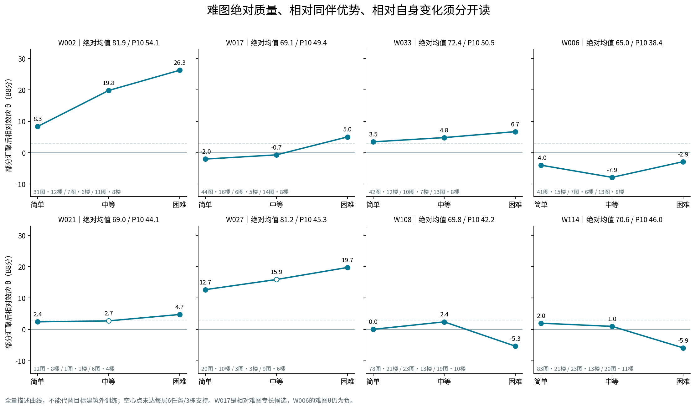
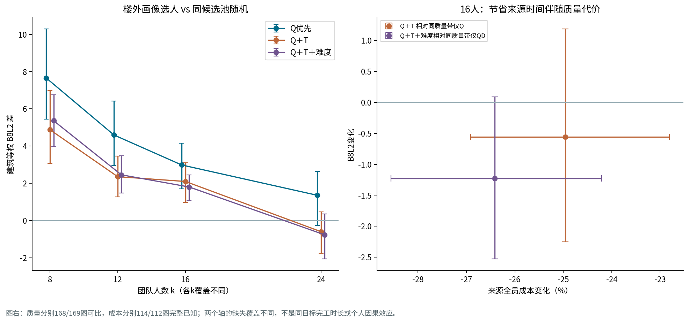
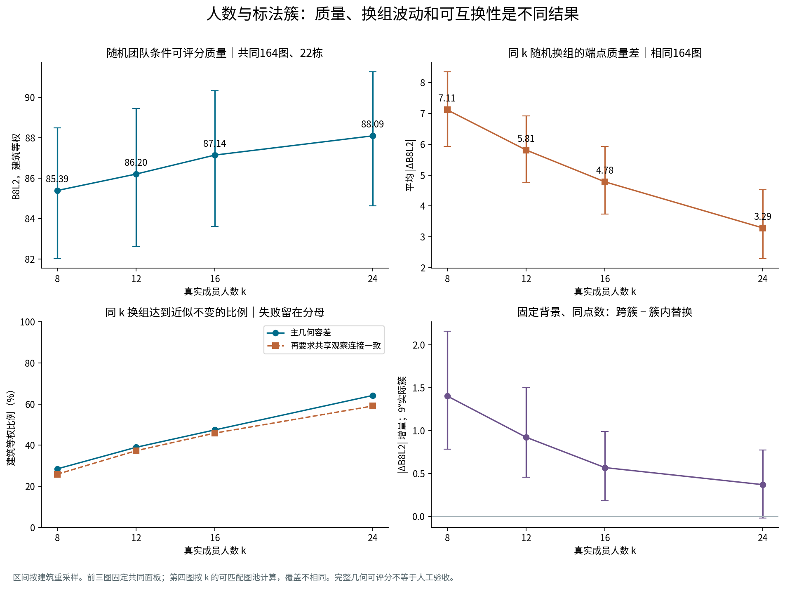

> Pro原文内容转排，未改科学结论。本文保留原报告全部正文与15张表；三张内嵌图改为仓库中同SHA256图像链接。原始HTML逐字节保留，压缩存储见[原始报告](work_v2_20261019/delivery/research_report_v2_zh.html.gz)。独立审查另见[693ff07提交](https://github.com/Sparkling-Flames/3D_Manhattan_label/commit/693ff07c4c1b6976810b2e4861adb015927385ca)。

> 证据链接指向本目录实际保存的文件；压缩文件需下载或通过bootstrap恢复后读取。本文不把Pro自述的复现范围升级为本次整理重新执行的结果。

冻结资料 · 实际融合 · 建筑外评估

# v2 人员分类与融合共识 独立复算、采用判断与边界

10439份库存 · 7302份质量作答 · 60人 · 144253个真实不同成员集合 GitHub main 82c6164b0d4630de5316199c92aa405930973168｜资料批次 20261019 本报告是研究建议，不自动变更正式考核、评分、参考或融合规则。

[一、采用判断](#judgment) · [二、输入、分母与独立复现范围](#inputs) · [三、评价框架：维度的关系与重复信息](#framework) · [四、Q与难度：模型、候选类及楼外验证](#models) · [五、逐人结论、真实成员与边界](#people) · [六、与已有Q/T及v1的实际比较](#versions) · [七、效率：可用信息和实算代价](#time) · [八、正向组队：质量收益与难度/效率增量](#forwardteams) · [九、反向路线：真实局部簇和几何敏感性](#clusters) · [十、固定背景换人、固定构成换成员](#swap) · [十一、人数、真实顺序与冻结融合机制](#size) · [十二、两条路线能否接起来](#transfer) · [十三、Semi、scope与明确个人错误](#behavior) · [十四、代表、反例与少量人工判断](#cases) · [十五、覆盖台账与未验证部分](#limits) · [十六、复现与交付入口](#reproduce)

## 一、采用判断

建议采用“连续质量画像＋少量 Q/T 粗类＋有支持的难度细类＋独立行为台账”。当前证据支持用这些信息理解人员并约束组队，但没有证明同一细类的人普遍可互换。团队机制的解释力，更多来自目标图上的实际标法、背景成员和多数投票门槛。

本轮完成了 10439 份库存证据核对、全部可计算几何重放、60 人画像、22 栋建筑外验证、229 个质量池的四套分簇，以及 144253 个不同真实成员集合的融合。研究没有以新采集、补标或重新生成原始导出为前提；没有为让团队赢而回调分类、参考、难度或融合规则。

| 方案 | 本轮建议 | 依据与适用边界 |
| --- | --- | --- |
| 绝对 Q 分布＋同任务调整 β | 采用为人员质量主画像 | 均值/中位/低尾/波动和分项保留。β解决任务分配差异；绝对交付水平不能由排名替代。 |
| Q/T 少量粗类 | 采用为沟通和组队筛选轴 | 保留连续值；Q 三档 ±3 分与 T 相对25%中性带比强迫二分更能说明边界。阈值是研究候选，并非已批准考核制度。 |
| 部分汇聚难度画像 θ | 采用为带支持量的解释与预测修正 | 相对Q楼外误差小幅改善；中等/困难分别保留。尚不能把它当默认能提升融合的选人规则。 |
| Q×T×难度细类 | 保留有限候选和团队实验维度 | 实际产生13个含未知的单元，存在单人/双人单元。不强制无限细分，也不因不能证明永久人群而停止使用。 |
| Q优先选人 | 可作为当前质量导向基线 | 16人较同候选池随机平均提高约2.98 B8分；每图不保证获胜，仍要查看完整性与结构。 |
| Q＋T / Q＋T＋难度选人 | 作为明确成本取舍的选项 | 来源时间下降，但小团队有明确质量代价；个体预测带宽不是团队损失上界。 |
| 9°/12°实际标法簇 | 采用为当图机制诊断，保留双阈值 | 固定背景同点数的跨簇替换通常影响更大；簇内仍有大变化和失败。它们不是事前已知的全局人员类型。 |
| Semi / scope / 排除合成通用分 | 不采用 | 证据机会、审核覆盖和语义不同，且大量未知；净改善与最终Q在同初始化内高度重复，不能重复加权。 |
| 来源时间固定60/180或90/240秒正式标签 | 暂不冻结 | 57个有支持人员中15人换标签；来源协议与任务/结构组成仍有影响。 |
| 把不显著当可互换、把稳定当高质量 | 否定 | 实际几何容差、共享连接和失败应直接检验；本轮存在稳定但错误、同簇替换失败等反例。 |

计算证据：[fusion/EXTENSION_RECEIPT.json](work_v2_20261019/fusion/EXTENSION_RECEIPT.json)；[profiles/paired_model_comparison.csv](work_v2_20261019/profiles/paired_model_comparison.csv.gz)；[fusion/FORWARD_POLICY_SUMMARY.csv](work_v2_20261019/fusion/FORWARD_POLICY_SUMMARY.csv.gz)

## 二、输入、分母与独立复现范围

固定来源为 GitHub main 提交 `82c6164b0d4630de5316199c92aa405930973168`。按照研究台、证据审计和统计消费者接口读取 `records.json.gz` 顶层 `records`，继承最终点位、各阶段坐标、参考绑定、平均x预处理和声明环序。R01424 修复与 W018 删点均未被原始导出覆盖；`uNb9QFRL6hY-01` 沿用冻结中等难度。

| 分母 | 核对结果 | 解释 |
| --- | --- | --- |
| 全库存 | 10439份；261图；62个ID | 旧3222＋新7217；新保留7203、排除14。 |
| 正式质量 | 7302份；196图；60人 | W019/W026没有质量画像；W022仅2份/1栋，不能有充分楼外画像。 |
| 普通Manual主层 | 5719份；177图；22栋 | 简单3751/114图，中等988/32图，困难980/31图。 |
| 其它质量层 | 门洞Manual571；普通Semi901；Manual特殊66；Semi特殊45 | 分别解释，不混成普通Manual能力。 |
| 几何诊断 | 9363完整；941仅底面；135不可计算 | 诊断资格和质量资格不同；未合格人员作答不补0。 |
| 来源时间 | 9236份＝旧2019＋新7217 | 旧为继承审计来源，新为用户处理后报告时间，不能假定跨源同人校准。 |
| 同目标时间 | 440份 | 所有440个数值均与相应来源时间相同且是其子集；不是独立时间复测，也不用于补全其余来源记录。 |
| 普通Manual画像时间池 | 来源6250份/206图/58人；同目标418份/48图/23人 | 有1025份来源时间作答没有质量资格；T资格独立于Q。主质量Q+来源T交集5225份。 |
| 实际质量池 | 229个同图/条件/参考池 | 普通Manual177池；同池没有同一人重复投票。 |
| k=8/12/16/24支持 | 普通Manual175/171/170/164图 | 跨k比较必须显示共同图集；不是每图35人。 |

独立调用冻结评分函数重放，9363份完整几何的 B8L2/D10/3D诊断均在 10−8 容差内一致，最大数值差小于 2.2×10−13；941份底面和135份不可计算状态相符。v1固定1911份质量分数未变，37份旧作答仅因原人数门在扩充后满足而新进入质量层。B8L2主线不变；D10只改变方向尺度8°→10°，N1未接入。

从 `REPRO_CONTEXT` 的最小源列，用原生统计函数实际重算51张表中的44张，逐值比较全部通过。另7张涉及未随仓库提供的旧人员CSV和历史源整合，保留为“读取已发布表，未通过该原生生成步骤独立重放”；本轮人员模型另行从逐份证据独立重拟合。不能把这件事写成整个采集、导出和清洗流程已复现。

Release三个压缩包均做SHA核对，当前261图中259张取得原图；2t7WUuJeko7-02/-03只有仓库预览。缺图不影响冻结几何；没有声称已视觉审查259张原图。难度来源259图注明逐张全景复核且非盲法，2图缺来源；不能称难度评级者未见作答。本轮没有按融合表现重标难度。

计算证据：[audit/EVIDENCE_AUDIT_CHECKS.json](work_v2_20261019/audit/EVIDENCE_AUDIT_CHECKS.json)；[audit/GEOMETRY_REPLAY_CHECKS.json](work_v2_20261019/audit/GEOMETRY_REPLAY_CHECKS.json)；[audit/INTEGRATED_STATISTICS_REPLAY.json](work_v2_20261019/audit/INTEGRATED_STATISTICS_REPLAY.json)；[profiles/INPUT_COVERAGE.json](work_v2_20261019/profiles/INPUT_COVERAGE.json)；[original_images/ORIGINAL_IMAGE_AUDIT.json](work_v2_20261019/original_images/ORIGINAL_IMAGE_AUDIT.json.gz)

## 三、评价框架：维度的关系与重复信息

| 维度 | 保留指标 | 可以回答 | 不能直接推断 |
| --- | --- | --- | --- |
| 绝对几何Q | B8均值、中位、P10、SD、五分项；D10敏感性 | 实际提交对绑定参考的质量及低尾风险 | 不同任务池的平均分不能直接当个人能力排序。 |
| 相对几何Q | 同任务百分位、中心差、人员效应β | 同一图片/条件/参考下表现差异，及任务组成调整 | 这些来自同一批Q，不是三份独立证据；不能合计加权。 |
| 难度适应 | 三个θ、难−易、难−中、各层绝对质量、支持/区间 | 同难图比别人好，及相对自己通常水平的变化 | θ高不是绝对质量高；难图百分位上升可能来自同伴分配。 |
| 效率T | 来源与同目标的秒数/尾部/相对log速度 | 在各自可比范围内的时间成本 | 不替补缺失、不同来源未校准；修改幅度不是效率或修正成功。 |
| Semi纠错 | 最终Q、初始Q、净改善、确认/报告错误机会、未改/改动/未知 | 最终交付与真实初始化过程的不同侧面 | 改过≠改对；缺初始化没有净改善；100−Q不是残留错误数。 |
| scope | 回答倾向、相容裁定正确性、最终空间选择 | 三种相互有关但不同的行为 | 图片OOS≠人员判断金标；有限in-scope正确不能推出误收率。 |
| 排除与明确个人错误 | 唯一事件ID、当前判定、理由、历史、审查覆盖 | 资格、个别强证据异常及应复核事件 | 定向审核数不直接外推总体；旧严重标记与同一排除不叠罚。 |
| 团队机制 | 原答分歧R、团队差异V、完整几何、节点/边/旧观察保留 | 固定人数、固定背景、真实入场过程如何变 | 不能把R/V/Q当自动的图片噪声与人员噪声分解。 |

因此不建议建立一个通用“质量与可靠性总分”。Q保持几何含义；T作为成本轴；难度是Q随任务背景变化的修正；Semi、scope和排除是独立证据层。需要实际组队时，先指定任务条件、人数与可接受的成本/质量取舍，再使用这些画像。研究中的失败团队效用补0仅作为团队决策敏感性，未用于缺失个人Q、人员分类或主条件质量均值。

计算证据：[audit/SEMI_ANALYSIS_RECEIPT.json](work_v2_20261019/audit/SEMI_ANALYSIS_RECEIPT.json)；[audit/EXCLUSION_TEXT_REVIEW_RECEIPT.json](work_v2_20261019/audit/EXCLUSION_TEXT_REVIEW_RECEIPT.json)；[fusion/DESIGN.json](work_v2_20261019/fusion/DESIGN.json)

## 四、Q与难度：模型、候选类及楼外验证

同任务百分位采用同分平均秩，再按 `(rank−1)/(n−1)` 归一化；单人的任务不能定义同伴排名。它易于解释相对位置，但丢失分差幅度，对同伴池、并列和任务覆盖敏感。中心差保留分单位，却仍受自己遇到的同伴组成影响。人员效应通过 `Q = 任务截距＋人员β＋残差` 联合估计；任务包含图片、条件、参考ID与版本，β采用等人员零均值约束。它解决任务分配的一个主要来源，不把不可观测分配机制变成随机试验。

难度主模型在简单/中等/困难分别有人员θ，但用强度20的同人跨难度部分汇聚约束避免三个完全独立模型的过拟合；5/80作为冻结敏感性。每一层效应依旧通过同任务对照学习，不是减掉三个难度均值。全局Q岭惩罚5、中心差、百分位经训练尺度校准、独立难度模型等均作为基线。主比较在同一批可评人员与同伴上重建目标，再逐图、逐建筑汇总。

在22折留建筑验证中，评估某栋之前学好人员画像；测试图实际Q不参与选人。用于反向预测的训练示例再排除其自身所在建筑，形成双排除嵌套特征。这里的主验证目标是个人实际Q减去同任务其他共同可评人员的Q均值；预测则将建筑外人员效应作同样的同伴对照。测试Q只定义评估目标，不进入画像或选人；这不是未知测试任务截距下的事前绝对Q预测改善。实际做了目标Q污染至109后的训练画像不变检查、22折独立重拟合和5个嵌套折复核。全量描述和训练外估计分别保存。

| 模型相对FE | 难度层 | 可评作答/图/栋 | 相对Q MSE改善% | 建筑区间 |
| --- | --- | --- | --- | --- |
| centered_mean | 全部 | 5717/177/22 | 0.013 | [-0.113, 0.153] |
| joint0 | 全部 | 5717/177/22 | -0.318 | [-2.310, 1.479] |
| joint20 | 全部 | 5717/177/22 | 1.264 | [0.428, 2.114] |
| joint20 | 简单 | 3749/114/22 | -0.198 | [-0.768, 0.283] |
| joint20 | 中等 | 988/32/16 | 2.037 | [0.074, 4.074] |
| joint20 | 困难 | 980/31/15 | 2.456 | [0.007, 4.535] |
| rank_calibrated | 全部 | 5717/177/22 | -0.361 | [-0.928, 0.166] |

部分汇聚的全层改善约1.26%，困难约2.46%，但困难区间下界接近0，D10困难区间跨0。这是小幅、有限的增量；不能写成难度已经普遍解决人员差异。完全独立三难度模型在v2没有稳定增益。

细类预测比只有Q二分×T二分粗类好约7.52%，但与更保留幅度的Q三分×T三分相比，B8全层改善为−0.019% [−0.987%,0.911%]；说明大量“细类增益”只是恢复粗分丢掉的Q幅度。保留连续β后再加细类难度修正有约0.75%的小幅增益，仍弱于连续θ。不能用模型复杂度决定采用。

粗类候选：Q3以β≥3、β≤−3、其间分为相对较高/较低/接近；T3以log效应的±log(1.25)定义快/接近/慢。另冻结Q2符号×T2符号四类用于组合实验，并未要求四类为永久上限。难度细类定义如下，所有条件先要求各层至少6个不同任务、3栋支持，并按下表顺序优先归类（跨难度相对强优先；不足直接记未知）：

| 难度候选 | 冻结定义 | 注意 |
| --- | --- | --- |
| 跨难度相对强 | 三个θ均≥3 | 表示三层相对同伴都强；绝对低尾另看。 |
| 难图相对专长 | θ难≥3，且难−易≥3、难−中≥3 | 独立查看两个对照；不是仅难图均分高。 |
| 难图相对上升、同伴优势不足 | 同样两个差≥3，但θ难<3 | 可以仍为正值；不自动等于绝对低Q或实际排名上升。 |
| 难图相对掉队 | 难−易≤−3，难−中≤−3 | 不是说其难图绝对无用，亦需区间与建筑支持。 |
| 混合/接近；不足 | 其余；任一难度支持不足 | 保留连续曲线，不强迫分类。 |

计算证据：[profiles/REGISTRATION.json](work_v2_20261019/profiles/REGISTRATION.json)；[profiles/paired_model_comparison.csv](work_v2_20261019/profiles/paired_model_comparison.csv.gz)；[profiles/fine_information_controls.csv](work_v2_20261019/profiles/fine_information_controls.csv)；[profiles/AUDIT_CHECKS.json](work_v2_20261019/profiles/AUDIT_CHECKS.json)；[profiles/END_TO_END_REPRODUCTION.json](work_v2_20261019/profiles/END_TO_END_REPRODUCTION.json)

## 五、逐人结论、真实成员与边界

| 人员 | 绝对均值/P10 | β | θ易/中/难 | 各层图·栋 | 来源T中位秒 | 解释 |
| --- | --- | --- | --- | --- | --- | --- |
| W002 | 81.91/54.10 | 13.99 | 8.34/19.83/26.29 | 31·12/7·6/11·8 | 104.0 | 跨难度强；困难较易/中均有优势 |
| W006 | 64.96/38.43 | -4.26 | -3.99/-7.87/-2.87 | 41·15/7·6/13·8 | 40.0 | 难−中上升，但难−易不足且θ难<0；不认定难图专长 |
| W017 | 69.13/49.38 | -0.41 | -2.03/-0.70/5.02 | 44·16/6·5/14·8 | 59.0 | 相对难图专长候选；普通Q接近同伴，中等仅6任务边界 |
| W021 | 69.01/44.07 | 3.17 | 2.41/2.71/4.75 | 12·8/1·1/6·4 | 28.5 | 中等仅1图/1栋，难度细类未知 |
| W027 | 81.17/45.26 | 14.95 | 12.67/15.90/19.75 | 20·10/3·3/9·6 | 360.0 | 绝对与相对Q较高；中等仅3图，跨难度类支持不足 |
| W033 | 72.41/50.49 | 4.26 | 3.46/4.81/6.71 | 42·12/10·7/13·8 | 257.0 | 跨难度强；难−中不足3，不单列难图专长 |
| W102 | 84.36/55.60 | 13.32 | 14.09/7.32/17.31 | 79·21/22·14/19·13 | 107.1 | 相对T二分为慢，三分在中间；不贴绝对慢标签 |
| W108 | 69.82/42.17 | -0.41 | 0.02/2.40/-5.34 | 78·21/23·13/19·10 | 83.4 | 快但难图相对掉队 |
| W114 | 70.58/45.98 | 0.48 | 1.97/0.97/-5.89 | 83·21/23·13/20·11 | 339.2 | 总体接近同伴且慢，难图掉队 |
| W125 | 71.82/45.11 | 0.62 | 1.15/1.38/-2.62 | 83·21/25·15/18·11 | 181.8 | 难图下降候选，边界区间需保留 |

空心为难度支持不足；这里只展示预先提出线索与新增反例，60人全表和13类成员均在下方保留。

W017仍是值得继续使用的难图相对专长线索：难−易约7.05，难−中约5.73；全量建筑jackknife区间分别约[2.89,11.22]和[2.53,8.92]。但Q/T粗类在留建筑折的一致比例约90.9%，完整难度细类约72.7%，不是稳定不变的标签。W017的难度类型17/22折为专长、5/22为支持不足，已知折并未改判其它难度类型；完整细类16/22一致还受Q2零点边界影响，不把所有不一致说成专长方向翻转。W033的难−中约1.89、区间跨0，更接近“跨难度相对强”，不应因为原先被称难图专长而维持该说法。W002三个θ均高，困难优势也有支持。W021、W027的中等支持薄，未知保留。

全量Q2×T2有57名可分类人员：相对Q较高快7、较高慢16、较低快17、较低慢17，另3人未知。难度类型为跨难度强10、相对专长1、掉队3、混合/接近40、未知6。下表为**实际参与组合实验的未合并Q2×T2×难度候选**；全量13个单元不等于13个可部署永久类型。稀疏合并版与原始难度标签另存，反向替换分别对照，未混用名称。

| 细类编码 | 人数 | 真实成员 | 联合覆盖 图/栋 | 状态 |
| --- | --- | --- | --- | --- |
| Q+\|fast\|across_strong | 3 | W002 W109 W126 | 166/22 | exploratory_candidate |
| Q+\|fast\|mixed_or_near | 3 | W104 W123 W134 | 166/22 | exploratory_candidate |
| Q+\|fast\|unknown | 1 | W021 | 19/10 | unknown_or_sparse |
| Q+\|slow\|across_strong | 7 | W015 W033 W102 W112 W115 W122 W130 | 177/22 | exploratory_candidate |
| Q+\|slow\|hard_drop | 2 | W114 W125 | 148/22 | unknown_or_sparse |
| Q+\|slow\|mixed_or_near | 6 | W008 W035 W036 W110 W118 W131 | 175/22 | exploratory_candidate |
| Q+\|slow\|unknown | 1 | W027 | 32/10 | unknown_or_sparse |
| Q-\|fast\|hard_drop | 1 | W108 | 120/22 | unknown_or_sparse |
| Q-\|fast\|hard_specialist | 1 | W017 | 64/18 | unknown_or_sparse |
| Q-\|fast\|mixed_or_near | 14 | W001 W006 W010 W012 W013 W030 W103 W113 W116 W124 W127 W128 W132 W133 | 177/22 | exploratory_candidate |
| Q-\|fast\|unknown | 1 | W011 | 41/16 | unknown_or_sparse |
| Q-\|slow\|mixed_or_near | 17 | W028 W029 W031 W032 W034 W037 W100 W101 W105 W106 W107 W111 W117 W119 W120 W121 W129 | 175/22 | exploratory_candidate |
| unknown | 3 | W014 W018 W022 | 35/11 | unknown_or_sparse |

展开全部60人的核心画像（按ID，不是排行榜）

| 人员 | Q图/栋 | 均值/P10 | β | Q3 | T中位秒/相对T3 | θ易/中/难 | 难度候选 |
| --- | --- | --- | --- | --- | --- | --- | --- |
| W001 | 61/17 | 61.96/40.70 | -7.72 | below_peer | 59.0/fast | -7.88/-7.01/-7.38 | 混合／接近 |
| W002 | 49/15 | 81.91/54.10 | 13.99 | above_peer | 104.0/fast | 8.34/19.83/26.29 | 跨难度相对强 |
| W006 | 61/17 | 64.96/38.43 | -4.26 | below_peer | 40.0/fast | -3.99/-7.87/-2.87 | 混合／接近 |
| W008 | 63/17 | 71.51/38.36 | 3.21 | above_peer | 140.0/middle | 2.40/3.94/5.42 | 混合／接近 |
| W010 | 57/15 | 66.14/40.97 | -2.41 | near_peer | 53.5/fast | -1.60/-2.52/-4.77 | 混合／接近 |
| W011 | 41/16 | 64.76/41.96 | -1.23 | near_peer | 124.0/middle | -1.69/-0.34/-0.59 | 难度支持不足 |
| W012 | 57/16 | 56.36/35.18 | -12.56 | below_peer | 50.0/fast | -13.83/-8.31/-10.62 | 混合／接近 |
| W013 | 50/16 | 63.40/36.33 | -3.27 | below_peer | 45.0/fast | -2.85/-3.94/-3.88 | 混合／接近 |
| W014 | 32/10 | 62.13/31.20 | -3.12 | below_peer | 未知/unknown | -2.70/-4.99/-3.59 | 难度支持不足 |
| W015 | 64/19 | 74.12/49.96 | 4.53 | above_peer | 152.0/middle | 4.22/4.43/6.32 | 跨难度相对强 |
| W017 | 64/18 | 69.13/49.38 | -0.41 | near_peer | 59.0/fast | -2.03/-0.70/5.02 | 难图相对专长 |
| W018 | 31/10 | 74.42/29.22 | 8.95 | above_peer | 95.0/unknown | 7.31/12.04/11.47 | 难度支持不足 |
| W021 | 19/10 | 69.01/44.07 | 3.17 | above_peer | 28.5/fast | 2.41/2.71/4.75 | 难度支持不足 |
| W022 | 2/1 | 74.50/71.19 | -4.45 | unknown | 未知/unknown | -4.26/-4.26/-4.26 | 难度支持不足 |
| W027 | 32/10 | 81.17/45.26 | 14.95 | above_peer | 360.0/slow | 12.67/15.90/19.75 | 难度支持不足 |
| W028 | 58/14 | 64.64/40.05 | -4.83 | below_peer | 187.5/middle | -4.20/-6.69/-5.63 | 混合／接近 |
| W029 | 57/14 | 67.73/39.62 | -0.85 | near_peer | 194.0/slow | 1.02/-4.65/-4.27 | 混合／接近 |
| W030 | 61/15 | 69.12/40.99 | -0.11 | near_peer | 69.5/fast | 0.29/-0.99/-0.62 | 混合／接近 |
| W031 | 70/16 | 65.80/42.58 | -3.70 | below_peer | 141.0/middle | -2.84/-4.22/-6.33 | 混合／接近 |
| W032 | 63/16 | 61.58/39.53 | -7.84 | below_peer | 208.0/slow | -8.23/-6.22/-7.15 | 混合／接近 |
| W033 | 65/15 | 72.41/50.49 | 4.26 | above_peer | 257.0/slow | 3.46/4.81/6.71 | 跨难度相对强 |
| W034 | 63/16 | 62.08/35.18 | -6.87 | below_peer | 198.0/slow | -6.46/-5.55/-8.48 | 混合／接近 |
| W035 | 64/17 | 71.18/41.99 | 1.02 | near_peer | 156.5/slow | 2.27/-2.33/-1.00 | 混合／接近 |
| W036 | 58/15 | 74.45/43.68 | 4.39 | above_peer | 689.0/slow | 5.02/3.98/2.79 | 混合／接近 |
| W037 | 53/15 | 58.49/31.65 | -11.16 | below_peer | 213.5/slow | -10.54/-15.24/-10.11 | 混合／接近 |
| W100 | 121/22 | 66.73/43.83 | -3.99 | below_peer | 117.1/middle | -3.70/-4.15/-4.92 | 混合／接近 |
| W101 | 121/22 | 66.14/41.15 | -4.80 | below_peer | 128.7/middle | -4.81/-5.82/-3.11 | 混合／接近 |
| W102 | 120/22 | 84.36/55.60 | 13.32 | above_peer | 107.1/middle | 14.09/7.32/17.31 | 跨难度相对强 |
| W103 | 118/22 | 64.63/39.14 | -6.21 | below_peer | 87.0/middle | -5.94/-6.37/-6.85 | 混合／接近 |
| W104 | 121/21 | 72.20/46.22 | 2.19 | near_peer | 89.8/middle | 0.97/6.87/2.02 | 混合／接近 |
| W105 | 121/22 | 64.68/42.58 | -6.17 | below_peer | 138.5/slow | -6.20/-7.38/-4.12 | 混合／接近 |
| W106 | 121/22 | 64.24/42.64 | -6.67 | below_peer | 118.2/middle | -6.68/-6.28/-6.79 | 混合／接近 |
| W107 | 120/22 | 68.09/44.27 | -2.46 | near_peer | 157.7/slow | -2.81/0.91/-4.68 | 混合／接近 |
| W108 | 120/22 | 69.82/42.17 | -0.41 | near_peer | 83.4/fast | 0.02/2.40/-5.34 | 难图相对掉队 |
| W109 | 123/22 | 84.99/54.44 | 14.84 | above_peer | 47.7/fast | 15.93/13.43/12.18 | 跨难度相对强 |
| W110 | 124/22 | 70.73/46.01 | 0.32 | near_peer | 139.9/slow | -0.47/2.59/1.18 | 混合／接近 |
| W111 | 123/22 | 64.62/46.12 | -6.27 | below_peer | 113.2/middle | -7.15/-4.78/-3.92 | 混合／接近 |
| W112 | 125/22 | 84.84/52.66 | 14.74 | above_peer | 346.6/slow | 15.53/10.74/16.47 | 跨难度相对强 |
| W113 | 126/21 | 64.22/43.06 | -5.98 | below_peer | 46.4/fast | -6.08/-7.20/-3.87 | 混合／接近 |
| W114 | 126/22 | 70.58/45.98 | 0.48 | near_peer | 339.2/slow | 1.97/0.97/-5.89 | 难图相对掉队 |
| W115 | 126/22 | 86.34/50.97 | 16.38 | above_peer | 109.9/middle | 17.28/14.94/14.74 | 跨难度相对强 |
| W116 | 125/22 | 69.63/44.47 | -0.65 | near_peer | 69.5/fast | -0.88/1.68/-2.03 | 混合／接近 |
| W117 | 123/22 | 65.47/40.65 | -5.34 | below_peer | 108.0/middle | -4.77/-5.82/-6.89 | 混合／接近 |
| W118 | 125/22 | 70.36/43.57 | 0.31 | near_peer | 113.7/middle | 1.80/-1.80/-2.83 | 混合／接近 |
| W119 | 126/22 | 63.72/42.58 | -6.77 | below_peer | 152.4/slow | -6.27/-8.39/-6.54 | 混合／接近 |
| W120 | 125/21 | 67.83/43.25 | -2.19 | near_peer | 104.8/middle | -1.89/-1.10/-4.36 | 混合／接近 |
| W121 | 123/22 | 63.77/43.07 | -6.50 | below_peer | 351.9/slow | -6.29/-9.17/-3.66 | 混合／接近 |
| W122 | 125/22 | 85.67/48.89 | 15.29 | above_peer | 128.8/slow | 16.56/11.63/14.58 | 跨难度相对强 |
| W123 | 126/22 | 70.75/43.38 | 0.30 | near_peer | 102.6/middle | 0.47/1.41/-1.39 | 混合／接近 |
| W124 | 128/22 | 63.77/35.99 | -6.55 | below_peer | 72.2/fast | -4.90/-9.79/-9.24 | 混合／接近 |
| W125 | 126/22 | 71.82/45.11 | 0.62 | near_peer | 181.8/slow | 1.15/1.38/-2.62 | 难图相对掉队 |
| W126 | 129/22 | 85.60/60.84 | 14.99 | above_peer | 82.4/fast | 14.78/14.85/16.22 | 跨难度相对强 |
| W127 | 133/22 | 67.14/42.37 | -2.57 | near_peer | 106.3/middle | -3.29/1.99/-5.09 | 混合／接近 |
| W128 | 133/22 | 64.47/41.78 | -6.37 | below_peer | 85.1/fast | -6.28/-6.60/-6.22 | 混合／接近 |
| W129 | 135/22 | 64.01/38.65 | -6.40 | below_peer | 194.5/slow | -6.41/-5.67/-7.06 | 混合／接近 |
| W130 | 136/22 | 85.85/56.91 | 15.22 | above_peer | 173.3/slow | 15.76/13.51/15.23 | 跨难度相对强 |
| W131 | 135/22 | 72.34/43.94 | 1.43 | near_peer | 141.0/slow | 1.33/3.74/-0.53 | 混合／接近 |
| W132 | 139/22 | 65.78/39.53 | -3.80 | below_peer | 105.0/middle | -4.23/-2.16/-3.81 | 混合／接近 |
| W133 | 139/22 | 65.54/42.04 | -4.49 | below_peer | 100.5/middle | -4.30/-5.56/-3.81 | 混合／接近 |
| W134 | 137/22 | 71.32/44.01 | 0.47 | near_peer | 48.7/fast | -0.60/5.82/-1.31 | 混合／接近 |

计算证据：[profiles/人员画像与候选细类60人.csv](work_v2_20261019/delivery/personnel_profiles_v2_60.csv)；[profiles/profile_stability_uncertainty.csv](work_v2_20261019/profiles/profile_stability_uncertainty.csv.gz)；[profiles/fine_dtype_stability.csv](work_v2_20261019/profiles/fine_dtype_stability.csv)；[profiles/fine_dtype_membership.csv](work_v2_20261019/profiles/fine_dtype_membership.csv)

## 六、与已有Q/T及v1的实际比较

不是将新旧所有变化合并成“升级提升”。本轮分别核查：

| 比较 | 结果 | 解释 |
| --- | --- | --- |
| v1固定1911份质量 | B8/D10逐份未变，参考一致 | 分数没有因v2加入而提高或降低。 |
| v1开发1048份原Q/T | 人员效应重算最大差约6.2×10⁻¹⁴ | 已有任务调整Q不是简单任务池均分，本轮确认其确实存在。 |
| v1旧独立难度模型楼外结论 | 共同943份；困难219份/18图/9栋，误差降4.883%，仅3/9栋改善；全难度误差反增1.347% | 原线索成立，但与本次joint20不是同一个模型；历史留出不称新盲测。 |
| 固定v1普通1258 → v2旧1295 | 新增37份旧资格，无原固定记录分数变化 | 资格门变化和能力变化分开。 |
| v2旧1295 → 加新人后的5719 | 同伴均衡点、任务连通与相对画像改变 | 可用固定24人锚点另比较，不能把β零点移动当能力变差。 |
| 固定团队只换B8/D10 | 普通Manual k16的21135个不同集合，D10−B8约+1.19分 | 尺度敏感性，不是质量评价更准确。 |
| 换B8/D10再分组/选人 | 全量Q2、QT、难度及原始细类0/60换标签；Q3有2人变；Q优先同成员约80.7%、QT约51.4% | 阈值标签不变不表示连续排序/候选带不变；重选与固定成员计量分列。 |
| 旧人/新人来源时间 | 单源与混合源策略分别计算 | 无同人跨来源校准，不把source_centering当测量协议校准。 |

例如W017在固定v1普通记录的零均值β约+0.27，在v2混合人员池约−0.41，会由Q2正侧移到负侧；固定旧24人锚点则从约−0.002变为+0.085。这是粗分边界和参照人群的例子，不是标注能力下降证据。其难图专长线索仍在。W006、W001在已发布的百分位三档中是“中Q”，本次分差β三档为相对较低；W033由百分位“中Q”对应到β相对较高。这是指标回答问题不同，不把原排名复算正确写成必须采用排名。

已发布v2的百分位逐人精确复算一致。其T汇总主要来自质量合格交集；本轮T独立采用有资格时间的普通Manual池，包含没有质量资格但有有效时间的作答，因此如W001的30份/65.5秒与本轮42份/59秒不能仅归因于换阈值。每种T的源列、任务范围、数量都保留。

局部簇也受新增同伴影响：固定v1普通1258份的两阈值19980个成对关系精确重放。仅加37份旧资格时，固定旧关系没有变化；再加新人员，9°下9990个旧关系改变342个（26图），12°改变387个（18图）。坐标没变，优化的全体亲近关系变了，不能把局部簇当跨池固定身份。

计算证据：[profiles/version_anchor_comparison.csv](work_v2_20261019/profiles/version_anchor_comparison.csv)；[profiles/published_v2_classification_comparison.csv](work_v2_20261019/profiles/published_v2_classification_comparison.csv)；[profiles/worker_metric_class_sensitivity.csv](work_v2_20261019/profiles/worker_metric_class_sensitivity.csv)；[fusion/FIXED_TEAM_METRIC_SENSITIVITY_SUMMARY.csv](work_v2_20261019/fusion/FIXED_TEAM_METRIC_SENSITIVITY_SUMMARY.csv)；[fusion/METRIC_RESELECTION_SUMMARY.csv](work_v2_20261019/fusion/METRIC_RESELECTION_SUMMARY.csv)；[clusters/version_cluster_summary.csv](work_v2_20261019/clusters/version_cluster_summary.csv)

## 七、效率：可用信息和实算代价

固定60/180与90/240秒的阈值均按预先列出的探索方案计算，没有根据融合胜负调整。57名有支持人员中15人改变固定速度标签，说明边界选择实质影响组队。加入最终点数复杂度控制后相对T三档仅1人变，时间1/99分位缩尾截限也仅1人变，但最终点数是标注行为的结果，控制它属于诊断，不能当普遍消混杂的保证。

全量57人的调整Q与log时间效应Spearman约0.092，没有“慢的人整体质量更高”的明显单调关系。另一方面，在同时控制任务和人员固定效应的样本内关联中（不是同一人对同任务反复计时实验），新人4424份Q+T数据每时间翻倍对应约+1.03 B8分，区间[0.20,1.85]；旧人可比较773份约+0.31，区间[−0.60,1.23]。点对数量也可随时间变化，这不是因果“要求多花时间就能提分”，也不能把少节点直接称遗漏。

团队成本仅在全员来源时间都已知时求和，另保留已知人数和小计。普通Manual k16的2040个随机抽样团队请求中，来源完整1257个，同目标完整**0个**；因此本轮不能给出可靠的16人团队同目标总成本。门洞与Semi的完整性也不同，不能只转移普通Manual均值。

图右质量和成本的可评图集不同；图左每个k的支持不同，不把线段解释为固定同图人数实验。

计算证据：[profiles/TIME_DIAGNOSTIC_SUMMARY.json](work_v2_20261019/profiles/TIME_DIAGNOSTIC_SUMMARY.json)；[profiles/time_threshold_stability.csv](work_v2_20261019/profiles/time_threshold_stability.csv)；[profiles/efficiency_within_person_diagnostics.csv](work_v2_20261019/profiles/efficiency_within_person_diagnostics.csv)；[fusion/TEAM_TIME_SOURCE_COVERAGE.csv](work_v2_20261019/fusion/TEAM_TIME_SOURCE_COVERAGE.csv)；[fusion/FORWARD_POLICY_SUMMARY.csv](work_v2_20261019/fusion/FORWARD_POLICY_SUMMARY.csv.gz)

## 八、正向组队：质量收益与难度/效率增量

所有选人画像在目标建筑以外学习。Q优先按β；QD按目标冻结难度θ；QT/QTD先进入“不低于第k名预测值3分”的同已知时间候选带，再按任务调整时间选最快k人，并配对同候选带仅质量选择。该3分带在相应实验之前固定，未为了团队获胜改宽/改窄。支持充分的难度池与全历史估计策略分开；绝不使用目标图个人实际Q来冒充预测选人。

| 16人对照 | 尝试/可评配对 | 尝试/可评分图 | B8差（建筑等权） | 95%建筑区间 | 声明组等权差 |
| --- | --- | --- | --- | --- | --- |
| Q优先 − 同候选池随机 | 680/669 | 170/169 | 2.982 | [1.702, 4.144] | 3.655 |
| Q＋T − 同候选池随机 | 680/673 | 170/170 | 2.096 | [0.965, 3.101] | 2.178 |
| Q＋T＋难度 − 同候选池随机 | 680/670 | 170/169 | 1.800 | [1.063, 2.449] | 1.674 |
| Q＋难度 − Q | 170/169 | 170/169 | -0.062 | [-0.614, 0.470] | -0.180 |
| Q＋T＋难度 − Q＋T | 170/169 | 170/169 | -0.199 | [-0.664, 0.314] | -0.474 |
| 同已知时间质量带：快选 − 仅Q | 170/168 | 170/168 | -0.558 | [-2.250, 1.185] | -1.142 |
| 同已知时间质量带：快选 − 仅QD | 170/169 | 170/169 | -1.229 | [-2.527, 0.088] | -1.923 |

主层170图/22栋。Q优先的平均优势可用作当前基线；难度选人相对Q、QTD相对QT没有稳定额外增益，不能由单人相对Q预测误差改善推导团队更好。16人困难子层31图/15栋中，QD−Q约−2.12分，区间[−4.79,0.19]；仅30图两端可评，其中5图改善超过2分、10图下降超过2分。没有只挑5个有利图。

同已知时间质量带的QT在16人时来源成本约下降25.0%（114图成本完整），B8差约−0.56（168图质量可比），质量区间仍跨0，但未建立实用等效性；QTD成本约下降26.4%（112图），B8差约−1.23（169图）。8人时相应质量损失约−2.55/−2.65分更明确；24人QT/QTD较随机没有清楚质量优势。3分个体预测带不保证3分团队质量损失上界。

新人纯池16人QT相对同已知时间带仅Q，B8约−2.45 [−4.99,−0.57]、来源成本约降24.9%；旧池成本完整仅2图时不作普遍效率结论。来源中心化敏感性没有解决跨源可比性：它只是调整策略的对照。

难度选人的正反极值同列在展示页：yqstnuAEVhm-25由40.85升至72.10，换入W017替换W035，点对5→6；同楼另一困难图yqstnuAEVhm-29由79.71降至55.71，底面V仅0.037但点对14→13。前一例支持某些结构能被补入，后一例说明底面接近不代表结构或方向分项近似。两图都不是单独的新验证集。

计算证据：[fusion/FORWARD_POLICY_SUMMARY.csv](work_v2_20261019/fusion/FORWARD_POLICY_SUMMARY.csv.gz)；[fusion/FORWARD_POLICY_PER_IMAGE.csv.gz](work_v2_20261019/fusion/FORWARD_POLICY_PER_IMAGE.csv.gz)；[fusion/FORWARD_CASES.json](work_v2_20261019/fusion/FORWARD_CASES.json)；[fusion/FORWARD_REGISTRATION.json](work_v2_20261019/fusion/FORWARD_REGISTRATION.json)

## 九、反向路线：真实局部簇和几何敏感性

所有7302份合格作答进入229池；每池不同点对数分开。同点数调用已有上下绑定、共享循环对应的最大球面端点角距，沿用半像素中心约定；主簇不自动反向，另做整环反向敏感性。9°、12°统一使用全局亲近度：同簇所有两两距离须≤阈值，最大化保留的加权亲近关系 (1−d/τ)²。完整链接为对照；没有把融合过程当聚类。

333个非平凡连通子问题全部求到MILP gap0，没有回退启发式；530个原生循环/平移对照及41609个小规模穷举分区目标一致。116个小问题的替代最优探查未发现替代；其余217个大型问题未做完整最优唯一性证明，保留未知。

| 普通Manual分簇 | 平均簇数 | 最大簇平均占比 | 解释 |
| --- | --- | --- | --- |
| 全局亲近度9° | 6.11 | 68.3% | 主探索，保留较大的亲近主体和单例。 |
| 全局亲近度12° | 4.71 | 75.8% | 阈值更宽，但优化分区未必是9°的合并树。 |
| 完整链接9° | 6.19 | 59.8% | 同距离/阈值对照；不能把它等同全局保留关系最优。 |
| 完整链接12° | 4.73 | 71.2% | 不同优化规则导致具体归属不同。 |

9°→12°有39图出现222个旧同簇对分开，同时有10312个原跨簇对合并。局部C01/C02编号只有当前池含义，不能跨图直接叫同一类人员。9°全局主层有542个单例，相应完整链接468个，完整成员与单例分母均保留。

全景角度近不保证底面/三维近：B6ByNegPMKs-18的W108/W126绑定角距8.267°，底面IoU仅0.0715、平均高度棱柱IoU0.0415。这是62496个普通Manual9°近对中的算法筛选机制例，近地平线方向投影深度对底部y敏感。反过来，uNb9QFRL6hY-65两作答底面IoU0.9509而棱柱IoU0.7637，整体角距13.789°，不能称“9°近对”。

允许整环反向会使9°额外452对、12°额外530对变近，集中于4图；其中10对两侧都有既定环确认。这是表示等价性诊断，不据此改原点位、主距离或已冻结环。旧9月25.6像素方法的验证结论未移植为本轮角度方法已验证。

计算证据：[clusters/ALGORITHM_AUDIT.json](work_v2_20261019/clusters/ALGORITHM_AUDIT.json)；[clusters/partition_population_summary.csv](work_v2_20261019/clusters/partition_population_summary.csv)；[clusters/partition_sensitivity_summary.csv](work_v2_20261019/clusters/partition_sensitivity_summary.csv)；[clusters/bottom_y_sensitivity_summary.csv](work_v2_20261019/clusters/bottom_y_sensitivity_summary.csv)；[clusters/REVERSE_RING_RECEIPT.json](work_v2_20261019/clusters/REVERSE_RING_RECEIPT.json)；[clusters/CASE_CATALOG.json](work_v2_20261019/clusters/CASE_CATALOG.json)

## 十、固定背景换人、固定构成换成员

初始在每池每个k抽两个固定k−1背景，把其余所有真实成员逐一加入，再穷尽该背景内入替人对。全层370490次替换比较；普通Manual270370次/175图/22栋。主解释同时限制同图、同k、同背景、同参考、同融合设置和入替人点对数，比较9°跨簇相对簇内的影响。联合主几何容差预先定义为两端完整、|ΔB8|≤2、底面Jaccard差≤0.05、节点数相同且绑定循环端点角距≤3°；另列更严/更宽设置。共享观察的边关系和保留另验，不能把主容差称所有细节一致。

| 人数k | 尝试图/质量可评图/栋 | 跨簇−簇内：\|ΔB8\| | 95%建筑区间 |
| --- | --- | --- | --- |
| 8 | 153/150/22 | 1.403 | [0.785, 2.161] |
| 12 | 154/153/22 | 0.922 | [0.455, 1.500] |
| 16 | 145/145/22 | 0.568 | [0.183, 0.992] |
| 24 | 123/123/21 | 0.369 | [-0.020, 0.775] |

跨簇相对簇内的联合几何稳定比例约降低12.8/10.6/6.4/6.1个百分点。k24地面差异的均值方向不稳定，不能说所有指标都同向增强。即使固定同一个QT粗类，实际簇差异仍能解释换人效应。这里的“通常差别较小”指明示分布与工程容差，并非不显著p值或逐人互换担保。

同人数、同人员类别人数向量、改具体成员，在k16下Q2/QT/未合并难度细类的平均|ΔB8|约3.35/3.05/2.50，联合几何稳定65.0%/64.8%/69.6%；但同时共享成员比例72.1%/75.6%/79.9%。细分缩小可替换人员池，实际换人更少，是不能忽略的解释。它不单独证明细类更可互换。

在固定QT、背景、点数后，合并难度细类跨类替换|ΔB8|增加约0.223 [0.086,0.364]；进一步控制入替人员连续β均值及差，变为0.117 [−0.128,0.355]，再加连续T仍跨0。细类的额外互换性信息较弱，与前面Q三档基线结果一致。

对实际标法簇构成，另严格匹配两次团队相同k、相同换人数、相同点数直方图，再比较“改变簇人数比例”与“保持比例只换人”。全部72027对中356对实际成员集合相同，保留明细但不进入换身份效果分母。9°的k8/12/16/24可匹配79/72/61/62图、18栋，质量可比78/71/60/61图；|ΔB8|额外增加1.353/0.872/0.566/−0.078分。12°只有38/37/33/34图，覆盖更薄，不能直接比较均值就定优劣。

声明房组加权进一步限制结论：9°k12固定背景跨簇−簇内仍约+0.698 [0.322,1.171]；固定构成比例的同k12效应变为+0.513 [−0.087,1.092]，区间跨0。构成比例的证据比单人替换更薄且对权重敏感。房间只使用已有原始声明并有physical_same支持的组，没有用建筑或关系传递制造同房事实。

计算证据：[clusters/fusion_analysis/replacement_summary.csv](work_v2_20261019/clusters/fusion_analysis/replacement_summary.csv)；[fusion/FIXED_COMPOSITION_SUMMARY.csv](work_v2_20261019/fusion/FIXED_COMPOSITION_SUMMARY.csv.gz)；[fusion/COMPOSITION_MATCHED_VARIATION_SUMMARY.csv](work_v2_20261019/fusion/COMPOSITION_MATCHED_VARIATION_SUMMARY.csv)；[clusters/conditional_dtype/summary.csv](work_v2_20261019/clusters/conditional_dtype/summary.csv)；[clusters/fusion_analysis/composition_summary.csv](work_v2_20261019/clusters/fusion_analysis/composition_summary.csv)；[clusters/room_sensitivity/RECEIPT.json](work_v2_20261019/clusters/room_sensitivity/RECEIPT.json)

## 十一、人数、真实顺序与冻结融合机制

融合原样调用 `consensus_delivery_20261008.fuse → ring_correspondence_20261007.build`：上下端点平均角距、循环及反向/跳点匹配，固定跳点代价7.5°，同身份相容，每人一票，MV50包含刚好半数；坐标为全身份成员等权中位数，只从覆盖所有选中节点的真实来源投影环连接。没有参考择优、N1、临时补边或x排序回退。

167581条真实请求对应144253个不同成员集合，229池/196图/22栋。0个执行异常；162825条请求有条件质量分数，1624条为两人暂不排序政策空档，3132条其它质量缺失。不同成员集合中可计算完整几何139730个，但**139730个都不是新人工确认交付**，因此用“可计算完整几何率”，不写“人工通过率”。同一集合的缓存只去掉重复计算；路径保留真实不同前缀。

| k（共同164图） | 真实请求数 | 有条件分数 | 建筑等权B8 | 同k平均\|ΔB8\| | 联合主几何容差比例 |
| --- | --- | --- | --- | --- | --- |
| 8 | 2624 | 2561 | 85.39 | 7.11 | 28.5% |
| 12 | 2624 | 2594 | 86.20 | 5.81 | 38.9% |
| 16 | 2624 | 2600 | 87.14 | 4.78 | 47.4% |
| 24 | 2624 | 2597 | 88.09 | 3.29 | 64.2% |

人数增加总体上降低同人数换组波动，但端点质量、范围、节点/连接完整、失败与不确定性仍分别统计。

固定164图随机端点显示8→24人质量从85.39至88.09，换组|ΔB8|由7.11至3.29。原答分歧R约0.133基本不变：增加人并没有让原始成员标法差异消失，改变的是融合输出对这些差异的响应。

真实排列8→24的656条路径（164图）中635条两端可评分，建筑等权改善约2.44分 [1.46,3.53]。但8→12在171图684条路径、664可评中平均−0.28 [−1.08,0.42]；269条下降，其中118条下降>2分，198条提高>2分。12→16约+1.66，16→24约+1.10。各步的共同图集合不同，不能将所有数字都说成同164图。

当前可比的真实oracle路径显示，9°先补齐大簇相对轮流平衡簇，在k8/12更高：平衡−大簇优先约−5.91/−2.80分；k16/24区间跨0。k≥4的9°路径中，完整→不完整分别9/5011与38/5011步，共享观察投票掉出62与217步。这里是多数规则与早期分票的实际机制，不意味着多样性永久有害；低全局Q也可能提供结构，纯大簇也可能共享节点差。

另外实际做了36个同成员集合×3输入顺序的108次不走缓存调用，最终compact状态相同。终点按集合重建的算法没有历史状态依赖，不妨碍不同真实前缀有不同内容；不能以终点相同否定入场过程，也不能用人为排列制造独立真人样本。

普通Manual随机抽样k16可计算完整2018/2040；门洞Manual175/204；普通Semi258/264。门洞合理空间与普通参考不能混成相同错误类型，其连接失败更多时须单列。这也说明通过主层质量选择不能自动保证跨条件完整交付。

计算证据：[fusion/OUTPUT_STATUS_AUDIT.json](work_v2_20261019/fusion/OUTPUT_STATUS_AUDIT.json)；[fusion/RANDOM_COMMON_8_12_16_24_SUMMARY.csv](work_v2_20261019/fusion/RANDOM_COMMON_8_12_16_24_SUMMARY.csv)；[fusion/SAME_K_VARIATION_COMMON_8_12_16_24.csv](work_v2_20261019/fusion/SAME_K_VARIATION_COMMON_8_12_16_24.csv)；[fusion/GROWTH_COMMON_PANEL_SUMMARY.csv](work_v2_20261019/fusion/GROWTH_COMMON_PANEL_SUMMARY.csv)；[clusters/prefix_analysis/RECEIPT.json](work_v2_20261019/clusters/prefix_analysis/RECEIPT.json)；[fusion/ORDER_INDEPENDENCE_CHECKS.csv](work_v2_20261019/fusion/ORDER_INDEPENDENCE_CHECKS.csv)；[fusion/TEAM_COVERAGE_BY_LAYER_K.csv](work_v2_20261019/fusion/TEAM_COVERAGE_BY_LAYER_K.csv)

## 十二、两条路线能否接起来

双排除的建筑外共簇预测，普通Manual92438个实际作答对/177图/22栋：9°下只知任务难度的Brier约0.15984，Q为0.15583，QT为0.15578，QTD为0.15551。QTD相对QT差值−0.000268，95%区间[−0.000868,0.000316]跨0；12°也是小幅不确定增量。人员Q对标法相近有一些信息，难度细分没有稳定追加很多信息。

对“换人影响有多大”的楼外预测，普通175图/22栋270370替换：难度+k基线预测|ΔB8|的MSE约27.5868，Q/QT/QTD约27.579/27.651/27.659，没有清楚改善。加入目标图实际9°簇及背景簇比例的oracle后MSE为26.5561，减少约1.031 [0.457,1.679]；联合稳定Brier由0.17390降至0.16185，20/22栋改善。人员平均质量可用于选人，并不意味着它能预测给定背景中换人的边际结构作用。

还实际尝试了“同一人员对的历史共簇频率”。混合所有难度的原方案表现不好；观察该失败后，明确另列同冻结难度条件化的诊断，9°Brier约0.15097、12°约0.10932，均低于各自难度基线。这个规则是在发现结果后展开，不能包装为原始预注册模型的新盲测成功。它给出的继续研究方向是按任务背景记录人员对的标法兼容性，而不是把全局Q标签当充分的组合相容性。

因此，两条路线接起来的实用方法是：事前以楼外连续质量/时间/难度支持筛选候选；作答后以局部簇、投票边界和不同结构的保留检查团队内容。实际簇提供的oracle解释不能偷偷加入预测画像。独立Semi/scope特征在共簇/最大簇预测没有稳健增益，不因为变量更多就保留为默认类型。

计算证据：[clusters/transfer/pair_transfer_summary.csv](work_v2_20261019/clusters/transfer/pair_transfer_summary.csv)；[clusters/transfer/pair_paired_comparisons.csv](work_v2_20261019/clusters/transfer/pair_paired_comparisons.csv)；[clusters/transfer/TRANSFER_RECEIPT.json](work_v2_20261019/clusters/transfer/TRANSFER_RECEIPT.json)；[clusters/swap_transfer/summary.csv](work_v2_20261019/clusters/swap_transfer/summary.csv)；[clusters/swap_transfer/RECEIPT.json](work_v2_20261019/clusters/swap_transfer/RECEIPT.json)；[clusters/pair_history_diagnostic/RECEIPT.json](work_v2_20261019/clusters/pair_history_diagnostic/RECEIPT.json)

## 十三、Semi、scope与明确个人错误

### Semi：质量、净改善和错误保留机会

旧574份Semi有冻结初始化，147份未改；确认错误初始化机会156份，其中25份未改、131份改过。新525份缺初始化坐标，194份报告未改；报告错误机会284份，其中45份未改、239份改过。两层证据不可混称同等“盲信机会”。改过的370份没有足够逐条成功纠正gold，本轮保留未知，不写成0%纠正或全部成功。

519份可双向评分的旧初始化中，原嵌入数组直接沿用时有19份与既有初始分数不同；查到已有评分声明使用明确绑定的已确认环。本轮只用同一批绑定点的精确身份、明确命名的来源环、多个来源一致性恢复声明排列，没有用GT或最大得分选择环。500份原生＋19份声明环恢复后，519份评分一致。该恢复影响4份质量合格可归因记录，保留原不一致结果和去掉这4份的敏感性。

465份质量合格旧Semi：初始均Q82.55、最终79.64、净变化−2.91。去除不适于个人归因的记录后461份/30图/11栋/24人，82.75→79.73，净变化−3.02；仅保留原数组环即可评分的457份时仍约−3.01。138份可归因确认错误初始化中，118份被编辑，61份Q提高、57份Q降低；这些是分数变化，不是错误实体修复裁定。

在同一初始化/参考任务内，“最终Q的人员效应”与“净改善的人员效应”精确相同（最大差约1.4×10⁻¹⁴），因为任务截距吸收了初始质量。因此最终Q和净改善不能再作为独立相对Q重复加权；绝对初始→最终过程仍有价值。残留错误数没有可靠全量gold，保留机会与未知。

行为组队只在同证据层、至少3机会/2栋的可知子池中测试，先保持同QTD质量带，再按较少错误未改记录优先，而非将未知当0。新人报告层k8/12较基线B8约+2.09/+2.44，但来源成本增加约387/572秒；k16/24区间跨0。旧确认层k8/12/16约−0.25/−0.76/−1.25、区间均跨0，k24无支持。这是独立行为变量的有限诊断，不能合并成普遍纠错能力提升。

### Scope：不混淆三种问题

9845份有scope回答；93份相容历史裁定（89份保留）全部来自有限in-scope机会且均正确；其它10346份无相容裁定。回答倾向可描述，但没有OOS金标机会，无法估算误收率或建立有效的通用scope能力分类。最终空间是否选到某范围也不能直接等同scope回答正确性。

### 排除：每个事件只记一次，个人归因要有原文证据

243条排除记录保留全原因；25条具体个人错误候选包含10条旧严重标记，不能相加为35次。本轮逐条读25条最新判定和历史注释：22条有明确具体缺陷文字，2条只有“太歪/偏得离谱”这类强偏差判断但缺校准严重阈值，1条W001/UwV83HsGsw3-08的“OOS但是只标3个点”与场景scope归因混合，不能独立确认是明确个人严重错误。保留原剔除资格，不改为合格，也不把疑义悄悄归责个人。

25条候选涉及W032七条、W034五条、W037五条、W001两条、W036两条、W031/W012/W033/W029各一条。它们来自有限定向审查，907条旧记录有明确个别审核，新增记录没有同等级逐条裁定覆盖；新14条批次剔除不自动成为新严重gold。唯一事件联合台账95条、105个标签的差别来自重叠，不形成通用罚分。没有据此给未审核人员奖励或降低别人两次。

计算证据：[audit/semi_paired_summary.csv](work_v2_20261019/audit/semi_paired_summary.csv)；[audit/semi_person_paired_metrics.csv](work_v2_20261019/audit/semi_person_paired_metrics.csv.gz)；[audit/semi_person_opportunity_evidence.csv](work_v2_20261019/audit/semi_person_opportunity_evidence.csv)；[audit/GEOMETRY_REPLAY_NATIVE_PAYLOAD_CHECKS.json](work_v2_20261019/audit/GEOMETRY_REPLAY_NATIVE_PAYLOAD_CHECKS.json)；[audit/SEMI_ANALYSIS_RECEIPT.json](work_v2_20261019/audit/SEMI_ANALYSIS_RECEIPT.json)；[audit/exclusion_text_review_25.csv](work_v2_20261019/audit/exclusion_text_review_25.csv)；[audit/unique_adverse_events.csv](work_v2_20261019/audit/unique_adverse_events.csv)；[fusion/FORWARD_POLICY_SUMMARY.csv](work_v2_20261019/fusion/FORWARD_POLICY_SUMMARY.csv.gz)

## 十四、代表、反例与少量人工判断

案例按全体结果中的机制条件、稳定/不稳定尾部和正反极值自动选择，不是先挑想要的人员再证明类型有效。展示页提供整簇叠加、关键成员所属簇并集、成员开关、ERP/BEV/可旋转3D、A/B真实团队以及真实前缀滑块。图像只用于解释冻结几何，观察不回写参考、资格或个人错误gold。

| 案例 | 图 | 证据与问题 |
| --- | --- | --- |
| 角度接近，底面与三维范围却分离 | B6ByNegPMKs-18 | 绑定角距 8.267°；底面 IoU 0.0715；平均高度棱柱 IoU 0.0415。端点在球面上接近，但底面范围/投影深度分离是否能在整簇ERP、BEV、3D联动里清楚看出？请判断误差位置及遮挡，不需逐对打分。 展示筛选分母：62496（原始单位与筛选规则见完整案例清单）。 |
| 底面接近，顶部与高度仍不同 | uNb9QFRL6hY-65 | 绑定角距 13.789°；底面 IoU 0.9509；平均高度棱柱 IoU 0.7637。底面很接近时，顶界或高度差异是否具有实际语义意义？冻结棱柱IoU只是平均高度代理。 展示筛选分母：6202（原始单位与筛选规则见完整案例清单）。 |
| 环方向不同是否仅是表示差异 | yqstnuAEVhm-05 | 该图有 169 对作答受整环反向敏感性影响。主距离不允许整环反向；保持上下绑定时反向是否仅改变画环方向、并未改变空间？这是表示等价性核查，不更改既有点位或主分簇。 展示筛选分母：4（原始单位与筛选规则见完整案例清单）。 |
| 簇平均历史 Q 偏高，仍有共同节点差 | UwV83HsGsw3-22 | 4 人簇平均全量 β +3.84，个体 β −0.41/+0.31/+14.99/+0.47；当图平均 B8L2 40.62；4 点对，参考 6 点对。该簇平均相对Q较高，但成员个体有差异（请联动逐人画像），均采用比绑定参考更少的节点。整簇是否共享简化、是否遗漏有效结构，还是参考分点粒度/合理范围不同？不能把簇均值称为人人高Q；节点差尚不是gold遗漏裁定。 展示筛选分母：96（原始单位与筛选规则见完整案例清单）。 |
| 同簇换一人，融合仍可发生大变化 | yqstnuAEVhm-31 | 固定 11 人背景，W034 → W127；B8L2 31.238 → 5.701；底面 V 0.8660。同一标法簇且同点数，固定背景换一人为什么仍有较大变化？请检查角度近/深度远、投票边界、连接和共同遗漏。 展示筛选分母：175（原始单位与筛选规则见完整案例清单）。 |
| 同簇换人得到相同端点的实例 | 7y3sRwLe3Va-03 | 固定 11 人背景，W006 → W010；B8L2 96.291 → 96.291；底面 V 0.0000。同一标法簇内换人得到稳定输出时，端点质量、几何范围、共享连接及保留细节是否分别保持？这是代表性稳定实例，不据此认定全簇可互换。 展示筛选分母：175（原始单位与筛选规则见完整案例清单）。 |
| 跨簇换人改变了范围与质量 | UwV83HsGsw3-09 | 固定 7 人背景，W002 → W033；B8L2 85.339 → 23.879；底面 V 0.6544。同点数但跨标法簇换人产生大变化时，换入位置、背景支持和连接变化中哪个解释实际差异？ 展示筛选分母：156（原始单位与筛选规则见完整案例清单）。 |
| 跨簇换人也可能几乎没有变化 | x8F5xyUWy9e-03 | 固定 7 人背景，W037 → W107；B8L2 68.222 → 68.228；底面 V 0.0000。跨簇且同点数换人，为什么结果仍几乎不变？请查看强背景共识是否压过了换入人的差异。 展示筛选分母：156（原始单位与筛选规则见完整案例清单）。 |
| 输出近似不变，但对参考质量很低 | yqstnuAEVhm-31 | 固定 11 人背景，W029 → W127；B8L2 5.692 → 5.701；底面 V 0.0201。两队输出很稳定但对参考质量较低；请看稳定的是哪一段错误范围/结构，不把稳定性当质量。 展示筛选分母：175（原始单位与筛选规则见完整案例清单）。 |
| 同簇替换也可能触发不可评分输出 | 7y3sRwLe3Va-03 | 固定 7 人背景，W006 → W027；B8L2 60.102 → 不可评分。同簇成员替换仍导致完整输出失败；请检查节点与连接的阈值触发。 展示筛选分母：24（原始单位与筛选规则见完整案例清单）。 |
| 难度选人收益的反例 | yqstnuAEVhm-29 | yqstnuAEVhm-29，同为 16 人：Q优先 79.709 → Q＋难度 55.712；底面 V 0.0371，点对 14 → 13。在同楼外训练、同困难等级和同人数下，换入的成员是否改变了关键节点/连接？底面范围变化与B8损失或增益为何不一致？请只审查这些候选几何，不把未人工确认的环当成正式交付。 两例按所有31张困难图的损失／增益极值同时选出；30图质量可比，5图增益>2，10图损失>2。 |
| 难度选人改善的实例 | yqstnuAEVhm-25 | yqstnuAEVhm-25，同为 16 人：Q优先 40.854 → Q＋难度 72.104；底面 V 0.3341，点对 5 → 6。在同楼外训练、同困难等级和同人数下，换入的成员是否改变了关键节点/连接？底面范围变化与B8损失或增益为何不一致？请只审查这些候选几何，不把未人工确认的环当成正式交付。 两例按所有31张困难图的损失／增益极值同时选出；30图质量可比，5图增益>2，10图损失>2。 |

真正需要用户专业判断的优先事项只有三类：①B6-18中靠近地平线的底界，确认角度近但范围远是否涉及真实遮挡/边界语义；②UwV-22四人簇的4点对与参考6点对，是结构遗漏还是合理分点/空间差异；③yqst-29与yqst-25难度选人正反例，关键节点与连接是否符合场景。它们不会作为本轮数值分析的前置，也不要求逐对审查。W001的混合scope排除可由现有判定负责人补一句最终个人归因；在此之前保留待定。

UwV-22案例的平均全量β为+3.84，但个体为−0.41/+0.31/+14.99/+0.47，不能称四人都是高Q。其当图平均B8仅40.62；这是均值掩盖异质性和共同节点差的反例，不是已确认“所有高Q人共同遗漏”的证明。同簇替换yqst-31从31.24降到5.70，跨簇替换x8-03却约68.222→68.228；7y3-03另有同簇换人触发不可评分。所有失败与反例进入完整分母。

计算证据：[clusters/CASE_CATALOG.json](work_v2_20261019/clusters/CASE_CATALOG.json)；[fusion/FORWARD_CASES.json](work_v2_20261019/fusion/FORWARD_CASES.json)；[presentation/viewer_cases.json](work_v2_20261019/presentation/viewer_cases.json)；[presentation/qa/VISUAL_REVIEW_RECEIPT.json](work_v2_20261019/presentation/qa/VISUAL_REVIEW_RECEIPT.json)

## 十五、覆盖台账与未验证部分

| 项目 | 缺失/限制 | 处理 | 边界 |
| --- | --- | --- | --- |
| 原始采集与预处理流程 | 未独立重放全部历史采集 | 使用审计后的冻结逐份证据；不改已修点、环序、参考 | 不阻塞本轮统计/几何重放 |
| 原生51表中7表 | 缺旧人员CSV及相关历史源 | 保留已发布读数；44表独立计算，人员Q另从逐份独立拟合 | 不声称51表或全采集均独立复现 |
| 新Semi初始化 | 525份缺初始坐标 | 没有净改善/精确残留；284报告机会与旧确认机会分开 | 无法验证编辑后修复成功 |
| 旧Semi初始数组环 | 19份需已有声明环身份恢复 | 保留原失败、明示来源环、无GT选择；457份敏感性 | 未验证旧前端屏幕实际渲染环 |
| Scope金标覆盖 | 仅93相容且全in-scope，10346未知 | 正确93不外推；OOS误收率未知 | 不建立通用scope能力类 |
| 明确个人排除 | 25候选中22明确具体、2程度未校准、1归因混合 | 旧10标记包含于25；不重复处罚 | 定向审查不能给总体发生率 |
| 同目标时间 | 440库存/418普通Manual；大团队多数缺 | 独立于来源总成本，不补零不替代 | 16人随机团队同目标完整0/2040 |
| 跨来源时间协议 | 旧审计 vs 新处理报告，无跨源同人校准 | 同源/混合/来源中心化敏感性分别保存 | 不作纯速度能力的强跨源比较 |
| 难度评级 | 259图非盲法注明，2图来源缺 | 沿用冻结等级和来源，不按融合改标签 | 不能称不看作答的盲评 |
| 输出人工验收 | 139730个可计算完整集合均未新人工确认 | 保留geometry_review/source_suggestion/ring状态 | 完整率不是人工交付通过率 |
| 聚类唯一性 | 217大型子问题未证明最优唯一 | 333非平凡问题gap0；116小问题替代探查 | 不把未发现替代当全部唯一 |
| 原图 | 259当前原图；2图仅预览 | 原图SHA与显示预览来源分列 | 未声称全量视觉审查 |
| 物理同房 | 只用直接声明且有支持的组 | 原始组加权和建筑重采样；33主层图未关联 | 不传递制造同房，不按组数当独立建筑 |
| 历史探索与新增诊断 | 历史留出已看过；pair-history同难度为后续诊断 | 训练楼外规则冻结；事后模型标记探索 | 不包装为新盲测 |
| 多团队/多路径 | 167581请求≠独立人或独立图 | 144253唯一集合，图/栋为主要推断支持 | 不把大量变体放大置信 |
| 平台查看 | DOM和原生canvas可测，真实浏览器布局未独立自动化 | 静态报告无需脚本；viewer需现代DecompressionStream | 不声称全浏览器兼容验证 |

统计不确定性采用图先汇总、建筑等权及建筑重采样；声明房组敏感性保持直接关系。大量成对事件共享成员和图，区间没有按几十万次替换当独立观测收窄。探索阈值、模型与多个结局都完整保留，不以单个刚越过0的区间宣称普适分类规律。

计算证据：[delivery/coverage_missing_ledger.csv](work_v2_20261019/delivery/coverage_missing_ledger.csv)；[audit/INTEGRATED_STATISTICS_REPLAY.json](work_v2_20261019/audit/INTEGRATED_STATISTICS_REPLAY.json)；[clusters/room_sensitivity/RECEIPT.json](work_v2_20261019/clusters/room_sensitivity/RECEIPT.json)

## 十六、复现与交付入口

建议先读本报告，再开 `personnel_fusion_v2_viewer.html` 联动人员、局部簇、团队与真实路径。它嵌入全部7302份合格作答几何、全部229池四套分簇、全部60人及22折画像，并按明示显示规则嵌入真实团队子集；完整的所有成员/顺序/几何/失败和比较分布在团队结果包。显示子集的尾部选择不参与总体估计。

复现入口将读取冻结提交源和本轮代码，按依赖顺序运行覆盖/几何审计、Q/T/难度、分簇、冻结融合与比较，最后生成报告与展示。每个模块保留源SHA、设计/注册、完整请求列表、随机种子、运行日志与检查收据。保留预计算缓存可重建统计；去除缓存的显式选项才重算全部真实团队，不将只核hash称为重新运行融合。

已经实际完成的验证包括：几何逐份重放、44原生统计表、v1固定分数/任务调整/旧难度验证、正向9步独立目录端到端重放48张表、分簇原生函数与穷举、真实同集合顺序检查、团队比较压缩流全读和字段数/行数/摘要核对。个别并行汇总曾发现压缩文件缺尾，均在冻结输入不变条件下重新生成、完整回读并保存恢复记录；不能用重写成功掩盖故障或声称未确定的根因已确定。

本轮方法版本和建议不会自动改写仓库正式规则；没有推送GitHub main、改变资格、参考或用户批准的评分方案。新结论来自当前可用证据，能够支持继续使用带条件的人员画像，也明确指出它不能替代目标图真实结构与共识机制。

计算证据：[profiles/END_TO_END_REPRODUCTION.json](work_v2_20261019/profiles/END_TO_END_REPRODUCTION.json)；[fusion/COMPARISON_INTEGRITY_CHECK_2.json](work_v2_20261019/fusion/COMPARISON_INTEGRITY_CHECK_2.json)；[clusters/REPLAY_RECOVERY.json](work_v2_20261019/clusters/REPLAY_RECOVERY.json)；[presentation/VIEWER_BUILD_RECEIPT.json](work_v2_20261019/presentation/VIEWER_BUILD_RECEIPT.json)；[delivery/README_REPRO_ZH.txt](work_v2_20261019/delivery/README_REPRO_ZH.txt)

数据、代码、阈值、失败、缺失和全部尝试均有对应明细。阅读离线文件不需要访问原图服务器。
